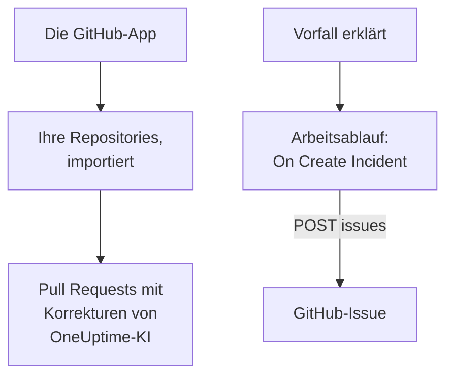

# GitHub

OneUptime arbeitet auf zwei Arten mit [GitHub](https://github.com) zusammen. Verbinden Sie Ihre Repositories über die OneUptime-GitHub-App, und die KI von OneUptime öffnet Pull Requests, die beheben, was sie findet, und antwortet, wenn Sie sie in einem Issue oder einem Pull Request erwähnen. Oder bauen Sie einen Arbeitsablauf, der für jeden Vorfall ein GitHub-Issue öffnet, sodass die Nacharbeit im Repository verfolgt wird, dem der Dienst gehört.

:::cards
- [Wählen Sie, wie Sie verbinden](#wählen-sie-wie-sie-verbinden): Die GitHub-App oder ein Arbeitsablauf, und was jede davon tut.
- [Ihre Repositories verbinden](#ihre-repositories-verbinden): Die GitHub-App, für Pull Requests mit Korrekturen.
- [Ein Issue für jeden Vorfall öffnen](#ein-github-issue-für-jeden-vorfall-öffnen): Ein Arbeitsablauf, zwei Blöcke.
- [Fehlerbehebung](#fehlerbehebung): Wenn GitHub eine Anfrage ablehnt.
:::

## So funktioniert es



Die beiden sind getrennt, und Sie können eines oder beide verwenden. Die GitHub-App arbeitet in den Repositories, in denen Sie sie installieren. Der Arbeitsablauf braucht nur ein Token und ruft die [REST-API](https://docs.github.com/en/rest/issues/issues#create-an-issue) von GitHub auf wie jede andere API.

## Wählen Sie, wie Sie verbinden

| Art | Was sie tut | Was sie braucht |
| --- | --- | --- |
| Die GitHub-App | Importiert Ihre Repositories. Die KI von OneUptime öffnet darin Pull Requests, die Ausnahmen, langsame Traces und die Ursachen beheben, die ihre Untersuchungen finden, und antwortet auf Erwähnungen in Issues und Pull Requests. | Eine Organisation oder ein Konto, in dem Sie die App installieren. In OneUptime Cloud den Plan **Growth**. |
| Ein Arbeitsablauf | Öffnet für jeden Vorfall ein GitHub-Issue, in dem Repository, das Sie wählen. | Ein GitHub-Token, das Issues erstellen darf, und einen Arbeitsablauf aus zwei Blöcken. |

## Ihre Repositories verbinden

Öffnen Sie **Produkte → Code → Aufgaben**, dann **Code-Repositories**, und klicken Sie auf **Mit GitHub-App verbinden**. GitHub fragt, wo die App installiert werden soll und welche Repositories sie verwenden darf. Jedes Repository der Installation wird importiert und bleibt auf dem neuesten Stand, wenn Sie der Installation Repositories hinzufügen oder sie herausnehmen.

Eine selbst gehostete Instanz braucht zuerst eine eigene GitHub-App: [GitHub-Integration](/docs/self-hosted/github-integration) zeigt, wie Sie sie erstellen. Danach öffnen [Korrekturaufgaben](/docs/ai/ai-agent) Pull Requests in Ihren Repositories, und die Seite [GitHub App](/docs/ai/github-app) zeigt, was die App tut, wenn Sie sie in einem Issue oder einem Pull Request erwähnen.

## Bevor Sie beginnen

Der Rest dieser Seite baut den Arbeitsablauf. Er braucht:

- Ein GitHub-Token, das im Repository Issues erstellen darf: ein feingranulares persönliches Zugriffstoken für dieses Repository, mit der Berechtigung **Issues** auf **Read and write**, oder ein klassisches Token mit dem Scope `repo`. Erstellen Sie eines in den [Token-Einstellungen](https://github.com/settings/tokens) von GitHub.
- In OneUptime das Recht, Workflows und globale Variablen anzulegen. In OneUptime Cloud brauchen Workflows den Tarif **Growth** oder höher.

## Das Token speichern

:::steps
1. Gehen Sie zu **Arbeitsabläufe → Globale Variablen** und klicken Sie auf **Arbeitsablaufvariable erstellen**.
2. Nennen Sie sie `GITHUB_TOKEN` und klicken Sie auf **Weiter**.
3. Fügen Sie das Token in **Inhalt** ein, schalten Sie **Geheimnis** ein und klicken Sie auf **Arbeitsablaufvariable erstellen**.
:::

Eine geheime Variable wird in den Laufprotokollen durch `[REDACTED]` ersetzt, das Token erscheint also nie in einem Lauf.

## Ein GitHub-Issue für jeden Vorfall öffnen

:::steps
### Den Workflow anlegen

Gehen Sie zu **Arbeitsabläufe**, klicken Sie auf **Arbeitsablauf erstellen**, dann auf **Ohne Vorlage beginnen**. Nennen Sie ihn `Incidents to GitHub` und klicken Sie auf **Arbeitsablauf erstellen**.

### Den Trigger hinzufügen

Klicken Sie auf den gestrichelten Block **Wählen Sie, was diesen Arbeitsablauf startet** und wählen Sie **On Create Incident**. Klicken Sie auf den Auslöser und wählen Sie in **Fields to pass on** `title`, `description` und `incidentNumberWithPrefix`.

### Das Issue öffnen

Klicken Sie auf **Komponente hinzufügen**, fügen Sie einen Block **API Post (JSON)** hinzu und verbinden Sie den Punkt **Success** des Auslösers damit. Setzen Sie seine **URL** auf `https://api.github.com/repos/your-org/your-repo/issues`, mit dem Besitzer und dem Namen Ihres Repositorys. Setzen Sie unter **Weitere Felder** seine **Request Headers** auf:

```json
{
  "Authorization": "Bearer {{global.variables.GITHUB_TOKEN}}",
  "Accept": "application/vnd.github+json",
  "X-GitHub-Api-Version": "2022-11-28"
}
```

Und seinen **Request Body** auf:

```json
{
  "title": "{{local.components.incident-on-create-1.returnValues.model.title}}",
  "body": "{{local.components.incident-on-create-1.returnValues.model.description}}\n\nOpened by OneUptime for incident {{local.components.incident-on-create-1.returnValues.model.incidentNumberWithPrefix}}.",
  "labels": ["incident"]
}
```

### Testen und dann einschalten

Klicken Sie auf **Arbeitsablauf ausführen**, wählen Sie unter **Vorfall** einen Testvorfall aus und führen Sie ihn aus. Der Schritt **API Post (JSON)** zeigt eine Antwort `201` mit dem neuen Issue, mit seiner `number` und seiner `html_url`. Schalten Sie dann oben im **Editor** **Aktiviert** ein.
:::

Das Issue bleibt offen, wenn der Vorfall behoben ist, denn die Nacharbeit überdauert den Vorfall meist. Für Tickets, die in beide Richtungen mit dem Vorfall Schritt halten, siehe [Jira](/docs/integrations/jira).

## Tipps

- **GitHub Enterprise Server.** Senden Sie die Anfrage stattdessen an Ihren Server: `https://your-github-host/api/v3/repos/your-org/your-repo/issues`. Ein Server an einer privaten Netzwerkadresse braucht ein selbst gehostetes OneUptime, dessen Administrator es erlaubt: siehe [Ausgehender Netzwerkzugriff](/docs/workflows/configuration#ausgehender-netzwerkzugriff).
- **Zuweisen.** Fügen Sie dem Text `"assignees": ["octocat"]` oder `"milestone": 3` hinzu. GitHub verwirft Labels, Zuweisungen und Meilensteine wortlos, wenn das Token nicht in das Repository pushen darf.
- **Nur manche Vorfälle.** Setzen Sie einen Block **If / Else** zwischen den Auslöser und den API-Block und öffnen Sie Issues nur auf seiner Seite **Yes**, zum Beispiel für einen Schweregrad.

## Fehlerbehebung

Der Schritt **API Post (JSON)** nimmt **Error**, wenn GitHub die Anfrage ablehnt. Seine **Response Status** und **Response Body** im Lauf sagen, warum.

:::details GitHub antwortet 401
Das Token ist falsch, abgelaufen oder widerrufen. Erstellen Sie ein neues und ersetzen Sie den Inhalt von `GITHUB_TOKEN`.
:::

:::details GitHub antwortet 403
Das Token darf dort keine Issues erstellen: ein feingranulares Token ohne **Issues** auf **Read and write** für dieses Repository, ein Token, das Ihre Organisation nicht genehmigt hat, oder ein klassisches Token, das nicht für das Single Sign-on Ihrer Organisation autorisiert ist. Ein 403, dessen Text von einem Ratenlimit spricht, heißt, dass das Token zu viele Anfragen gesendet hat: Warten Sie, oder öffnen Sie Issues für weniger Vorfälle.
:::

:::details GitHub antwortet 404
Der Besitzer oder das Repository in der **URL** ist falsch, oder das Token kann das Repository nicht sehen. GitHub antwortet 404, nicht 403, für ein privates Repository, das ein Token nicht sehen kann.
:::

:::details GitHub antwortet 410 oder 422
- `410`: Issues sind in den Einstellungen des Repositorys ausgeschaltet.
- `422`: GitHub kann den Text nicht lesen. Prüfen Sie, dass er gültiges JSON ist, dass `title` gesetzt ist und dass `labels` und `assignees` Listen sind.
:::

## Nächste Schritte

:::cards
- [GitHub App](/docs/ai/github-app): Die OneUptime-KI direkt aus GitHub um eine Änderung, eine Überarbeitung oder ein Review bitten.
- [GitLab](/docs/integrations/gitlab): Derselbe Arbeitsablauf, für GitLab-Issues.
- [Workflow-Komponenten](/docs/workflows/components#api): Jede Einstellung der API-Bausteine.
- [Integrationsübersicht](/docs/integrations/index): Die Muster hinter jeder Integration.
:::
