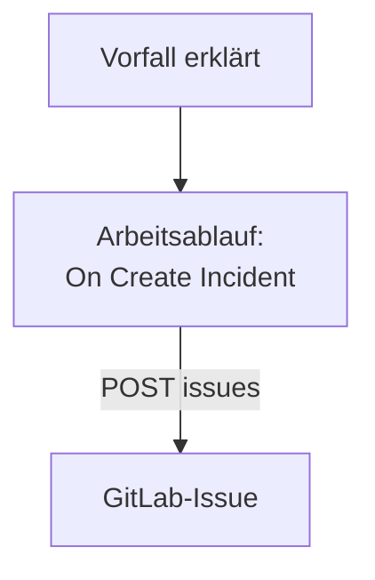

# GitLab

Öffnen Sie für jeden OneUptime-Vorfall ein [GitLab](https://gitlab.com)-Issue, sodass die Nacharbeit im Projekt verfolgt wird, dem der Dienst gehört. Ein Arbeitsablauf ruft die [Issues-API](https://docs.gitlab.com/api/issues/#new-issue) von GitLab auf, auf GitLab.com oder in einem eigenen GitLab.

:::cards
- [Das Token speichern](#das-token-speichern): Halten Sie das Token von GitLab aus Ihren Arbeitsabläufen heraus.
- [Ein Issue für jeden Vorfall öffnen](#ein-gitlab-issue-für-jeden-vorfall-öffnen): Ein Arbeitsablauf, zwei Blöcke.
- [Tipps](#tipps): Ein eigenes GitLab, Projektpfade und Zuweisungen.
- [Fehlerbehebung](#fehlerbehebung): Wenn GitLab eine Anfrage ablehnt.
:::

> [!NOTE]
> Die KI von OneUptime arbeitet auch in GitLab-Repositorys: Verbinden Sie sie in Code mit einem Zugriffstoken, und sie öffnet für jede Korrektur einen Merge Request. Siehe [Ein Repository verbinden](/docs/ai/ai-agent#ein-repository-verbinden).

## So funktioniert es



Der Arbeitsablauf läuft einmal für jeden neuen Vorfall. Sein Block **API Post (JSON)** sendet den Titel und die Beschreibung des Vorfalls an die Issues des Projekts, signiert mit einem Zugriffstoken.

## Bevor Sie beginnen

- Die ID des GitLab-Projekts. Wählen Sie auf der Übersichtsseite des Projekts das Aktionsmenü, die drei senkrechten Punkte, dann **Copy project ID**.
- Ein GitLab-Zugriffstoken mit dem Scope `api`, für einen Benutzer oder Bot, dessen Rolle im Projekt Issues erstellen darf: ein Projekt-, Gruppen- oder persönliches Zugriffstoken. Erstellen Sie es unter **Settings → Access tokens** im Projekt, in der Gruppe oder in Ihren Benutzereinstellungen.
- In OneUptime das Recht, Workflows und globale Variablen anzulegen. In OneUptime Cloud brauchen Workflows den Tarif **Growth** oder höher.

## Das Token speichern

:::steps
1. Gehen Sie zu **Arbeitsabläufe → Globale Variablen** und klicken Sie auf **Arbeitsablaufvariable erstellen**.
2. Nennen Sie sie `GITLAB_TOKEN` und klicken Sie auf **Weiter**.
3. Fügen Sie das Token in **Inhalt** ein, schalten Sie **Geheimnis** ein und klicken Sie auf **Arbeitsablaufvariable erstellen**.
:::

Eine geheime Variable wird in den Laufprotokollen durch `[REDACTED]` ersetzt, das Token erscheint also nie in einem Lauf.

## Ein GitLab-Issue für jeden Vorfall öffnen

:::steps
### Den Workflow anlegen

Gehen Sie zu **Arbeitsabläufe**, klicken Sie auf **Arbeitsablauf erstellen**, dann auf **Ohne Vorlage beginnen**. Nennen Sie ihn `Incidents to GitLab` und klicken Sie auf **Arbeitsablauf erstellen**.

### Den Trigger hinzufügen

Klicken Sie auf den gestrichelten Block **Wählen Sie, was diesen Arbeitsablauf startet** und wählen Sie **On Create Incident**. Klicken Sie auf den Auslöser: Seine **Fields to pass on** beginnen mit **Titel**, also klicken Sie auf **Feld hinzufügen** und wählen Sie **Beschreibung** und **Vorfallsnummer mit Präfix**.

### Das Issue öffnen

Klicken Sie auf **Komponente hinzufügen**, fügen Sie einen Block **API Post (JSON)** hinzu und verbinden Sie den Punkt **Success** des Auslösers damit. Setzen Sie seine **URL** auf `https://gitlab.com/api/v4/projects/12345678/issues`, mit der ID Ihres Projekts statt `12345678`. Setzen Sie unter **Weitere Felder** seine **Request Headers** auf:

```json
{
  "PRIVATE-TOKEN": "{{global.variables.GITLAB_TOKEN}}"
}
```

Und seinen **Request Body** auf:

```json
{
  "title": "{{local.components.incident-on-create-1.returnValues.model.title}}",
  "description": "{{local.components.incident-on-create-1.returnValues.model.description}}\n\nOpened by OneUptime for incident {{local.components.incident-on-create-1.returnValues.model.incidentNumberWithPrefix}}.",
  "labels": "incident,oneuptime"
}
```

### Testen und dann einschalten

Klicken Sie auf **Arbeitsablauf ausführen**, wählen Sie unter **Vorfall** einen Testvorfall aus und führen Sie ihn aus. Der Schritt **API Post (JSON)** zeigt eine Antwort `201` mit dem neuen Issue, mit seiner `iid` und seiner `web_url`. Schalten Sie dann oben im **Editor** **Aktiviert** ein.
:::

Der Block sendet JSON und braucht deshalb keinen Header `Content-Type`. GitLab legt Labels an, die es noch nicht kennt, `incident` und `oneuptime` müssen also nicht eingerichtet werden. Das Issue bleibt offen, wenn der Vorfall behoben ist, denn die Nacharbeit überdauert den Vorfall meist.

## Tipps

- **Ein eigenes GitLab.** Senden Sie die Anfrage stattdessen an Ihren Server: `https://gitlab.example.com/api/v4/projects/12345678/issues`. Ein Server an einer privaten Netzwerkadresse braucht ein selbst gehostetes OneUptime, dessen Administrator es erlaubt: siehe [Ausgehender Netzwerkzugriff](/docs/workflows/configuration#ausgehender-netzwerkzugriff).
- **Der Projektpfad statt der ID.** Der Pfad funktioniert anstelle der ID, mit seinem `/` als `%2F` geschrieben: `projects/your-group%2Fyour-project/issues`. Die URL wird genau so gesendet, wie sie geschrieben ist, kodieren Sie sie also selbst.
- **Zuweisen.** Fügen Sie dem Text `"assignee_ids": [42]` oder `"due_date": "2026-12-31"` hinzu, oder `"confidential": true`, um das Issue nur Projektmitgliedern zu zeigen.
- **Nur manche Vorfälle.** Setzen Sie einen Block **If / Else** zwischen den Auslöser und den API-Block und öffnen Sie Issues nur auf seiner Seite **Yes**, zum Beispiel für einen Schweregrad.

## Fehlerbehebung

Der Schritt **API Post (JSON)** nimmt **Error**, wenn GitLab die Anfrage ablehnt. Seine **Response Status** und **Response Body** im Lauf sagen, warum.

:::details GitLab antwortet 401
Das Token ist falsch, abgelaufen oder widerrufen. Erstellen Sie ein neues und ersetzen Sie den Inhalt von `GITLAB_TOKEN`.
:::

:::details GitLab antwortet 403
Das Token hat keinen Scope `api`, oder die Rolle seines Benutzers im Projekt darf keine Issues erstellen. Der Text nennt `insufficient_scope`, wenn es am Scope liegt.
:::

:::details GitLab antwortet 404
Die ID des Projekts in der **URL** ist falsch, oder das Token kann das Projekt nicht sehen. GitLab antwortet 404, nicht 403, für ein privates Projekt, das ein Token nicht sehen kann.
:::

:::details GitLab antwortet 400
GitLab kann den Text nicht lesen: `title` fehlt, oder ein Feld hat den falschen Typ. Der Text nennt das Feld.
:::

## Nächste Schritte

:::cards
- [GitHub](/docs/integrations/github): Derselbe Arbeitsablauf für GitHub, und die GitHub-App.
- [Workflow-Komponenten](/docs/workflows/components#api): Jede Einstellung der API-Bausteine.
- [Workflow-Ausführungen](/docs/workflows/runs-and-logs): Lesen Sie, was jede Anfrage gesendet und zurückbekommen hat.
- [Integrationsübersicht](/docs/integrations/index): Die Muster hinter jeder Integration.
:::
