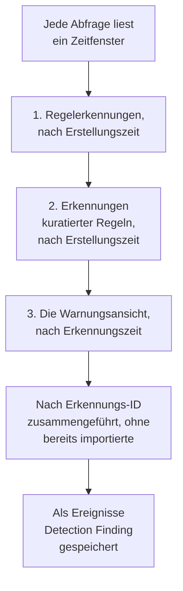

# Google SecOps

Bringen Sie Warnungen und Erkennungen aus [Google SecOps](https://cloud.google.com/security/products/security-operations) (früher Chronicle) in die Sicherheitsereignisse von OneUptime. Dort durchsuchen Sie sie neben Ihren Logs, Traces und Metriken, verknüpfen sie mit jeder anderen Quelle und alarmieren die Bereitschaft für die wichtigen.

:::cards
- [Wählen Sie, wie Sie verbinden](#wählen-sie-wie-sie-verbinden): Ein Webhook aus einem SOAR-Playbook, der verwaltete Connector oder UDM-Weiterleitung.
- [Den verwalteten Connector einrichten](#den-verwalteten-connector-einrichten): Ein Dienstkontoschlüssel und das Formular der Verbindung.
- [So fragt der Connector ab](#so-fragt-der-connector-ab): Drei Lesevorgänge für jedes Zeitfenster, und ihre Budgets.
- [Fehlerbehebung](#fehlerbehebung): Was Letzter Fehler sagt und was zu tun ist.
- [Sicherheitsereignisse an Google SecOps senden](#sicherheitsereignisse-an-google-secops-senden): Die Erkennungen von OneUptime, in Google SecOps.
:::

## Wählen Sie, wie Sie verbinden

| Weg | Was ankommt | Nutzen Sie ihn, wenn |
| --- | --- | --- |
| Ein Webhook aus einem SOAR-Playbook | Jede Warnung, die ein Playbook sendet, innerhalb von Sekunden | Sie SOAR-Playbooks betreiben und deren Warnungen ohne Abfragen in OneUptime haben möchten. |
| Der verwaltete Connector | Warnungen und, wenn Sie wollen, Regelerkennungen, in einem Intervall abgefragt | OneUptime sie für Sie holen soll, ohne dass in SecOps etwas zu konfigurieren ist. |
| UDM-Ereignisweiterleitung | Rohe UDM-Ereignisse, für volle Suche und Verknüpfung | Sie UDM-Ereignisse bereits exportieren und jedes davon haben möchten. |

Jeder Weg normalisiert, was ankommt, nach [OCSF](https://schema.ocsf.io/), dem Open Cybersecurity Schema Framework, in dem OneUptime jedes Sicherheitsereignis speichert, sodass Erkennungsregeln und Dashboards gleich funktionieren, egal aus welcher Quelle.

## Bevor Sie beginnen

- Für den verwalteten Connector in OneUptime die Rolle Project Owner, Project Admin oder Security Admin. Security Member und Security Viewer können Verbindungen lesen, aber nicht anlegen.
- Für den Webhook und die UDM-Weiterleitung einen Aufnahmeschlüssel: Öffnen Sie **Projekteinstellungen → Telemetrie & APM → Ingestion-Schlüssel** und klicken Sie auf **Aufnahmeschlüssel erstellen**.
- Für den verwalteten Connector das Recht, ein Google-Cloud-Dienstkonto anzulegen, in dem Projekt, an das Ihre SecOps-Instanz gebunden ist.

## Warnungen aus einem SOAR-Playbook senden

SOAR-Playbooks von Google SecOps können Warnungen an jeden HTTP-Endpunkt senden. Richten Sie eines auf die Aufnahme der Sicherheitsereignisse von OneUptime.

:::steps
### Eine Aktion HTTP request hinzufügen

Fügen Sie in Ihrem SOAR-Playbook von SecOps eine Aktion **HTTP request** hinzu, die bei neuen Warnungen läuft.

### Sie auf OneUptime richten

Setzen Sie ihre **Method** auf `POST` und ihre **URL** auf `https://oneuptime.com/security-events/v1/ingest`, oder bei einer selbst gehosteten Installation auf `https://<your-host>/security-events/v1/ingest`. Fügen Sie diese Header hinzu:

```text
Content-Type: application/json
x-oneuptime-token: <your telemetry ingestion key>
```

Senden Sie das JSON der Warnung als **Body**. Eine Erkennung, Regelangaben mit den gefundenen UDM-Ereignissen unter `collectionElements`, wird von selbst erkannt, als Ereignis Detection Finding gespeichert, und die Benutzer, Hosts und IPs ihrer gefundenen Ereignisse werden als Observables behalten.

### Prüfen, ob Warnungen ankommen

Führen Sie das Playbook aus. Seine Warnungen erscheinen innerhalb von Sekunden unter **Produkte → Sicherheitsereignisse**.
:::

## UDM-Ereignisse weiterleiten

Für volle Suche und Verknüpfung leiten Sie die UDM-Ereignisse selbst weiter, etwa aus einer BigQuery-Exportpipeline, einer Cloud Function oder jedem Weiterleiter, den Sie bereits betreiben:

```bash
curl -X POST "https://oneuptime.com/security-events/v1/ingest?format=udm" \
  -H "Content-Type: application/json" \
  -H "x-oneuptime-token: <your telemetry ingestion key>" \
  -d '{
    "events": [
      {
        "metadata": {
          "event_type": "USER_LOGIN",
          "event_timestamp": "2026-08-21T10:00:00Z",
          "vendor_name": "Google",
          "product_name": "Google SecOps"
        },
        "principal": { "user": { "userid": "alice" }, "ip": ["203.0.113.7"] },
        "target": { "hostname": "vpn-gw-01" },
        "security_result": [{ "severity": "HIGH", "action": ["BLOCK"] }]
      }
    ]
  }'
```

- `format` kann `udm`, `ocsf`, `google-secops-alert` oder `generic` sein. Lassen Sie es weg, wird das Format Ereignis für Ereignis erkannt.
- Der Text kann ein Ereignis sein, eine Liste von Ereignissen oder `{ "events": [...] }`.
- `x-oneuptime-service-name` nennt den Telemetriedienst, zu dem die Ereignisse gehören. Ohne ihn gehören sie zu dem Dienst, der nach dem Produkt der Nutzlast benannt ist.

## Den verwalteten Connector einrichten

OneUptime fragt die Erkennungen und Warnungen Ihres Mandanten in einem Intervall ab, ohne SOAR-Konfiguration. Google SecOps ist ein Anbieter der Security Event Connections, es wird also auf derselben Seite und auf dieselbe Weise angelegt, getestet, abgefragt und diagnostiziert wie jeder andere verwaltete Connector.

:::steps
### Einen Dienstkontoschlüssel anlegen

Legen Sie in Google Cloud ein Dienstkonto in dem Projekt an, an das Ihre SecOps-Instanz gebunden ist, und erteilen Sie ihm die Rolle **Chronicle API Viewer** (`roles/chronicle.viewer`). Diese Rolle enthält die Berechtigungen `legacySearchDetections`, `legacySearchCuratedDetections`, `countAllCuratedRuleSetDetections` und `legacyFetchAlertsView`, mit denen der Connector liest.

Fügen Sie im Tab **Keys** des Dienstkontos einen Schlüssel vom Typ **JSON** hinzu und laden Sie ihn herunter. Sie fügen die ganze Datei in die Verbindung ein. Ihr `token_uri` muss eine `https`-URL auf einem Google-Host sein, was ein aus Google Cloud heruntergeladener Schlüssel bereits ist.

### Die Region und den Instanz-Ressourcennamen finden

Öffnen Sie in Google SecOps **SIEM Settings → Profile**. Der Instanz-Ressourcenname hat die Form `projects/{project}/locations/{location}/instances/{instance}`, wobei der Instanzteil die ID der SecOps-Instanz ist; ein Anzeigename der Verbindung oder ein Dienstkontoname ersetzt ihn nicht. Die Region ist der regionale Endpunkt, der diesen Standort bedient, und sie muss zum Segment locations des Instanz-Ressourcennamens passen, sonst wird die Verbindung beim Speichern abgelehnt.

### Die Verbindung hinzufügen

Öffnen Sie **Produkte → Sicherheitsereignisse → Verbindungen** (`/dashboard/{projectId}/security-events/connections`), wählen Sie **Verbindung hinzufügen**, wählen Sie **Google SecOps** und füllen Sie das Formular mit den Einstellungen aus der Tabelle unten aus.

### Vor dem Speichern testen

Wählen Sie vor dem Speichern **Diese Einstellungen testen** unter **Vor dem Speichern testen**. Der Test läuft gegen die Werte im Formular, ohne etwas zu speichern, ein fehlerhafter Schlüssel, eine fehlende Rolle oder eine falsche Instanz fällt also auf, bevor die Verbindung existiert. Im Bearbeitungsformular testet dieselbe Schaltfläche die angezeigten Werte **Region**, **Ressourcenname der Instanz** und **Data to import** mit dem gespeicherten Schlüssel; ein leer gelassenes Feld für Anmeldedaten behält den gespeicherten Schlüssel. Weicht etwas Getestetes von dem ab, was die Verbindung gespeichert hat, auch ein neu eingegebener Schlüssel, wird keine Zeile im Laufverlauf erfasst, denn die Verbindung hat diese Einstellungen noch nicht.
:::

| Einstellung | Wo Sie sie finden | Erforderlich |
| --- | --- | --- |
| **Region** | Der regionale Endpunkt von Google SecOps (`us`, `europe`, `asia-southeast1`, ...), der zum Standort in Ihrem Instanz-Ressourcennamen passt. Es gibt keinen Standard, damit ein Mandant außerhalb der USA nicht versehentlich den falschen Endpunkt speichert. | Ja |
| **Ressourcenname der Instanz** | In Google SecOps unter **SIEM Settings → Profile**: `projects/{project}/locations/{location}/instances/{instance}`. | Ja |
| **Warnungen schließen, wenn ihr Fall geschlossen wird** | Im letzten Schritt des Formulars, aus, bis Sie es einschalten. Eingeschaltet schließt das Schließen eines Falls dessen Google SecOps-Warnungen: siehe [Warnungen schließen, wenn ihr Fall geschlossen wird](#warnungen-schließen-wenn-ihr-fall-geschlossen-wird). | Nein |
| **JSON des Dienstkontos** | Google Cloud, Tab **Keys** des Dienstkontos. Fügen Sie die ganze JSON-Schlüsseldatei ein. Nur schreibbar: im Ruhezustand verschlüsselt, nie von der API zurückgegeben, nie wieder auf der Seite angezeigt. Nutzen Sie **Anmeldedaten aktualisieren** an der Verbindung, um ihn zu wechseln. | Ja |
| **Data to import** | **Warnungen** werden immer importiert, weil die Warnungs-API von Google sie immer zurückgibt. Wählen Sie **Erkennungen**, um auch Regeltreffer zu importieren, die keine Warnung erzeugt haben. Das leitet keine rohen UDM-Ereignisse weiter: Die leiten Sie selbst weiter, wie oben. | Warnungen immer |

Der Schritt Abfrage des Formulars fragt nach einem **Name**, einer optionalen **Beschreibung**, ob die Verbindung **Aktiviert** ist, und nach dem **Abfrageintervall (Minuten)**: eine ganze Zahl von `1` bis `1440`, Standard `5`. Alles außerhalb dieses Bereichs wird beim Speichern abgelehnt.

Neue Erkennungen werden als Ereignisse Detection Finding importiert, die einem Telemetriedienst `Google SecOps` zugeordnet werden.

## Den Zustand der Verbindung lesen

Die Liste der Verbindungen zeigt **Name**, mit dem Anbieter der Verbindung und ihrer Auswahl Data to import darunter, **Integrität**, **Zuletzt abgefragt** und **Letztes importiertes Ereignis**. **Status** (Enabled oder Disabled), **Intervall (Minuten)** und **Letzte erfolgreiche Abfrage** warten unter **Spalten anpassen**. Hat eine Verbindung einen Fehler, erscheint **Fehler anzeigen** in ihrer Spalte **Aktionen**, neben **Verbindung testen**, **Jetzt ausführen**, **Diagnose**, **Bearbeiten** und **Anmeldedaten aktualisieren**. Enabled heißt, dass automatisches Abfragen eingerichtet ist. Zuletzt abgefragt hält einen Versuch fest; ein erfolgreiches leeres Zeitfenster belegt nicht, dass eine bestimmte Erkennung importiert wurde.

**Integrität** zeigt **Last poll succeeded** erst, sobald ein Ereignis importiert wurde. Bis dahin zeigt eine erfolgreich abfragende Verbindung **Polling, no events imported yet**, und das ist der Zustand, den Sie mit Verbindung testen untersuchen. Die anderen Zustände sind **No records returned**, **Partial import**, **Catching up**, **Last poll failed**, **Poll overdue**, **Schedule paused** und **Wartet auf erste Abfrage**; fahren Sie mit der Maus über einen Zustand, um zu sehen, was er bedeutet.

> [!NOTE]
> Der Connector nutzt die alten Erkennungs- und Warnungs-APIs `v1alpha` von Chronicle, die Google als Vorabversion ausliefert. Schlägt eine Abfrage fehl, speichert das Feld **Letzter Fehler** der Verbindung die vollständige Fehlermeldung mit geschwärzten Anmeldedaten, hinter einem Präfix, das den fehlgeschlagenen Schritt nennt, auch für den Fall, dass Chronicle mit `200` antwortet und die Ablehnung in den Text legt. Wählen Sie **Fehler anzeigen** in der Spalte **Aktionen** der Verbindung, um die Meldung zu lesen, und dann **Fehler kopieren** im Dialog, um sie für den Support zu kopieren.

## So fragt der Connector ab



Einmal pro Minute stellt ein Hintergrund-Worker eine Abfrage für jede aktivierte Verbindung in die Warteschlange, deren Intervall seit der letzten Abfrage abgelaufen ist. Jede Abfrage ist ein Lauf im Verlauf der Verbindung, den ein Worker ausführt. Sie liest ein Zeitfenster auf drei Arten und führt die Ergebnisse nach Erkennungs-ID zusammen, sodass ein Eintrag, den mehr als ein Durchgang liefert, einmal gespeichert wird:

1. **Regelerkennungen nach Erstellungszeit.** `legacy:legacySearchDetections` mit `ruleId=-` (jede Revision jeder Regel) und `listBasis=CREATED_TIME`, wobei es `nextPageToken` folgt, bis die Seite die letzte ist.
2. **Erkennungen kuratierter Regeln nach Erstellungszeit.** `legacy:legacySearchCuratedDetections`, auf dieselbe Weise, einmal pro kuratierter (von Google verfasster) Regel. Dieser Endpunkt nimmt genau eine ID einer kuratierten Regel (`ur_...`) und hat keinen Platzhalter für „jede Regel“, deshalb ruft der Durchgang zuerst `:countAllCuratedRuleSetDetections` für die Woche vor dem Zeitfenster bis zu dessen Ende auf und durchsucht jede kuratierte Regel, die Erkennungen erzeugt hat. Eine kuratierte Regel, die in dieser Woche nicht ausgelöst hat, hat nichts zu importieren. Ein Mandant ohne Zugriff auf kuratierte Regeln beantwortet diesen Durchgang mit `400`, `403` oder `404`; das wird als Warnung am Lauf erfasst, nicht als Fehler.
3. **Die Warnungsansicht nach Erkennungszeit.** `legacy:legacyFetchAlertsView`, das Telemetriewarnungen, SOAR-Warnungen und Warnungen maschineller Intelligenz ebenso abdeckt wie Regelwarnungen. Der Endpunkt hat keine Seitenaufteilung, deshalb wird eine Antwort, die Google begrenzt, in kleinere Zeitfenster aufgeteilt und erneut gelesen.

Die Warnungsansicht kann nur nach Erkennungszeit filtern, und Google macht eine Warnung oft erst lange nach ihrer Erkennungszeit lesbar (Aufnahmeverzögerung, geplante Regeln, erneute Läufe über verspätete Daten). Eine geplante Abfrage **durchsucht deshalb auch die Warnungsansicht über die 24 Stunden vor ihrem Zeitfenster**, nur Warnungen, erfasst als Prüfung **Read late alerts by detection time**. Bereits importierte Einträge werden übersprungen, die Wiederholungen dieser Suche erscheinen also unter **Already imported**. Die Suche ist ein Bestmöglich-Versuch: Begrenzt Google sie, ist ihr Budget aufgebraucht oder schlägt sie fehl, bekommt der Lauf eine Warnung, aber die Abfrage ist nicht Partial oder Failed, und der Cursor rückt trotzdem vor, denn den Tag, auf den sie zurückgreift, haben frühere Abfragen schon gelesen.

Das Abfragen nach **Erstellungszeit** ist der Kern des Entwurfs. Eine Regel von Google SecOps läuft nach einem Zeitplan (alle 10 Minuten, stündlich, täglich), und die Erkennung, die sie erzeugt, trägt eine `detectionTime`, die das Ende des Zeitfensters der Regel oder die Zeit des gefundenen Ereignisses ist, während `createdTime` angibt, wann die Erkennungs-Engine sie tatsächlich erzeugt hat. Eine Erkennung, die um 10:05 für ein Zeitfenster bis 09:00 erzeugt wurde, hat eine Erkennungszeit, die schon hinter einem Cursor liegt, der vor mehreren Abfragen über 09:00 hinausgerückt ist, ein Connector, der nach Erkennungszeit abfragt, sieht sie also nie, und auch kein verspätet ankommendes Ereignis. Das Lesen nach Erstellungszeit lässt jede Abfrage fragen: „Was hat Google erzeugt, seit ich zuletzt nachgesehen habe?“, und das ist die Frage, auf die es eine Antwort gibt. Jeder Lauf erfasst seine Erstellungsverzögerung, wie viele abgerufene Einträge mehr als ein Abfrageintervall (plus eine Minute) nach ihrer Erkennungszeit erzeugt wurden, und die größte Lücke, sodass die Wirkung in der Diagnose sichtbar ist.

Die erste Abfrage einer neuen Verbindung blickt **24 Stunden** nach Erstellungszeit zurück. Jede Abfrage danach setzt mit einer Überlappung von **1 Minute** am gespeicherten Cursor der Verbindung an; ein Eintrag, der an einer Fenstergrenze erzeugt wurde, wird von beiden Abfragen gelesen und einmal gespeichert, denn Abfragen überspringen Ereignisse, die schon mit derselben Quellkennung gespeichert sind. Jede geplante Abfrage liest höchstens **24 Stunden** über den Cursor hinaus, eine Verbindung mit einem älteren gespeicherten Cursor holt also in aufeinanderfolgenden 24-Stunden-Fenstern auf (Integrität zeigt **Catching up**), statt die Erkennungen dazwischen zu verwerfen. Nutzen Sie **Diesen Zeitraum importieren** in der Diagnose für Einträge, die vor dem ersten 24-Stunden-Fenster erzeugt wurden.

### Wenn ein Zeitfenster mehr enthält, als eine Abfrage lesen kann

Der Connector gibt jeder Abfrage feste Budgets: Der Durchgang für Regelerkennungen hat **20** Suchseiten, der kuratierte Durchgang bis zu **200** Anfragen (die Zählung plus mindestens eine Seite pro kuratierter Regel, die in der vergangenen Woche ausgelöst hat, die aktivsten Regeln zuerst), die Warnungsansicht und ihre Suche nach verspäteten Warnungen teilen sich **16** Anfragen, und das ganze Lesen endet nach **4 Minuten**. Der kuratierte Durchgang beginnt keine weitere kuratierte Regel mehr, sobald 60 % dieser Zeit verbraucht sind, sodass die Warnungsansicht trotzdem läuft. Kann eine Abfrage nicht jede aktive kuratierte Regel durchsuchen, erfasst sie eine Warnung, die nennt, wie viele nicht durchsucht wurden, statt den Cursor anzuhalten, denn ein kürzeres Zeitfenster hätte immer noch jede dieser Regeln zu durchsuchen. Ein Durchgang, den ein Budget mittendrin angehalten hat, wird als Warnungsprüfung erfasst, die das Budget nennt (zum Beispiel `Read rule detections by created time was stopped by the request budget after 20 requests.`), und ein Durchgang, den das Budget nie beginnen ließ, ist eine übersprungene Prüfung mit demselben Grund in den Warnungen des Laufs, nie ein Erfolg. Ein Zeitfenster mit mehr Erkennungen lässt sich nicht in einer Abfrage lesen, und das Abfragen liest nie ewig dasselbe Zeitfenster neu:

1. **Verkleinern.** Die Suchendpunkte von Google geben die neuesten Erkennungen zuerst zurück, eine Abfrage, die früh anhält, hat also keinen Punkt, an dem sie fortsetzen kann. Die Abfrage wird als **Teilweise** erfasst, der Cursor bleibt, wo er war, und die nächste Abfrage liest ein halb so langes Zeitfenster ab demselben Startpunkt, mit der Warnung `This window holds more records than one poll can read; the next poll reads a {n} minute window from the same starting point.` Das Halbieren geht bis hinunter zu einer Minute weiter, bis ein Zeitfenster passt.
2. **Wieder wachsen.** Jede vollständige Abfrage verdoppelt das nächste Zeitfenster, bis zum Höchstwert von 24 Stunden, sodass ein Schwall ein paar kurze Abfragen kostet statt einer dauerhaft langsamen Verbindung.
3. **Über eine einzelne Minute hinweggehen.** Enthält selbst eine Minute mehr Erkennungen, als eine Abfrage lesen kann, rückt das Abfragen den Cursor über diese Minute hinaus, damit neuere Erkennungen weiter ankommen. Der Lauf ist **Teilweise**, und derselbe Text steht vorn in **Letzter Fehler**: `More records were created in the one minute from {start} to {end} than one poll can read. Polling moved past this minute so newer records keep arriving; use Import this time range in Diagnostics on this minute to recover what one run can read.` Um zurückzuholen, was ein Lauf lesen kann, öffnen Sie die **Diagnose**, wählen einen eigenen Zeitraum, der diese Minute abdeckt (die Zeitraumfelder nutzen Ihre Ortszeit; die Meldung ist in UTC), und führen **Diesen Zeitraum importieren** aus; ein Import hat dieselben Grenzen pro Lauf wie eine Abfrage. Bereits importierte Erkennungen werden übersprungen.

Eine Abfrage mit Teilweise speichert ihre Warnungen auch in **Letzter Fehler**, wo sie bleiben, bis eine vollständige Abfrage sie löscht. Eine Abfrage, die ganz fehlschlägt (ein Fehler, nicht zu viele Einträge), behält ihren Cursor und ihre Fensterlänge und wird beim nächsten Takt wiederholt. Die einzige Ausnahme ist eine Anfrage, deren Zeit abgelaufen ist: Die nächste Abfrage liest ein halb so langes Zeitfenster ab demselben Startpunkt (`The source did not answer in time for this window; the next poll reads a {n} minute window from the same starting point.`), denn ein Zeitfenster, das zu schwer ist, um rechtzeitig beantwortet zu werden, würde sonst bei jeder Wiederholung ablaufen. Ein kürzeres Abfrageintervall ändert nichts davon: Das Zeitfenster bestimmen der Cursor und das Ergebnis der letzten Abfrage, nicht, wie oft Abfragen laufen.

## Verbindung testen

**Verbindung testen**, in der Zeile der Verbindung oder in der **Diagnose**, läuft synchron im API-Prozess. Es braucht keinen Hintergrund-Worker, und genau deshalb kann es Ihnen sagen, wenn kein Worker läuft. Die Prüfliste:

1. **Konfiguration**: Jedes Feld ist vorhanden und gültig: eine unterstützte **Region**, die zum Standort der Instanz passt, ein **Ressourcenname der Instanz** in der richtigen Form und ein Schlüssel **JSON des Dienstkontos** mit `client_email`, einem lesbaren `private_key` und einem Google-`token_uri`. Schlägt das fehl, wird nichts kontaktiert.
2. **Authenticate with Google**: Der Schlüssel wird am OAuth-Endpunkt von Google gegen ein Zugriffstoken getauscht, bevor Chronicle kontaktiert wird.
3. **Read rule detections**, **Read curated rule detections** und **Read the alerts view**: eine Probe mit einem Eintrag für jeden Durchgang über die letzten 24 Stunden. Die kuratierte Prüfung liest die Zählungen der kuratierten Regeln für die letzten 7 Tage und probt die kuratierte Regel mit den meisten Erkennungen; hat in dieser Woche keine kuratierte Regel ausgelöst, besteht sie ohne etwas zu proben. Ein kuratiertes Lesen, das mit `400`, `403` oder `404` beantwortet wird, ist eine Warnung, denn der Mandant hat vielleicht schlicht keinen Zugriff auf kuratierte Regeln.
4. **Detections available to import**: was Google mit der gespeicherten Auswahl **Data to import** und mit der anderen (nur Warnungen, oder Warnungen und **Erkennungen**) über die letzten 24 Stunden und die letzten 7 Tage hat: die Trefferzahl der Warnungsansicht und eine Suchseite nach Erstellungszeit pro Zeitraum, als Zahl oder als `1000+` angegeben. Hat die gespeicherte Auswahl nichts, die andere aber schon, warnt die Prüfung: Ihre Regeln erzeugen Erkennungen, aber das Warnen ist für sie nicht aktiviert. Bearbeiten Sie die Verbindung und wählen Sie **Erkennungen** unter **Data to import**, oder aktivieren Sie das Warnen für die Regeln in Google SecOps.
5. **Background workers**, **Poll scheduler** und **Security event storage**: ob ein Prozess die Worker-Warteschlange von OneUptime abarbeitet, ob der Abfrageauftrag im Minutentakt registriert ist und ob der Speicher der Sicherheitsereignisse dieselbe Duplikatsuche beantwortet, die das Abfragen vor jedem Einfügen ausführt, sodass eine kaputte Analysedatenbank hier mit Namen fehlschlägt statt eine Stunde später als Abfragefehler.
6. **Geplante Abfrage** (nur gespeicherte Verbindungen): ob das Abfragen aktiviert ist, ob ein eingereihter Lauf festgefahren auf einen Worker wartet und ob die Verbindung planmäßig abgefragt wird.

Jede Anfrage in einem Test hat eine Frist von 20 Sekunden. Tests lassen den Abfragecursor und den Ereignisspeicher unberührt. Eine gespeicherte Verbindung, die mit ihren gespeicherten Einstellungen getestet wird, bekommt eine Zeile im Laufverlauf vom Typ test, und die Details der Zeile zeigen dieselbe Prüfliste.

## Bei Bedarf ansehen, ausführen und importieren

Öffnen Sie an einer Verbindung die **Diagnose**, um die letzten Läufe zu sehen und den Connector zu bedienen. Projektbesitzer, Projektadministratoren und Sicherheitsadministratoren können Vorgänge starten. Sicherheitsmitglieder und -betrachter können den Verlauf lesen.

- **Jetzt ausführen** stellt sofort eine Abfrage in die Warteschlange, mit dem normalen Cursor und Aufnahmeweg, auch wenn das geplante Abfragen deaktiviert ist. Die Zustände eingereiht und laufend bleiben sichtbar, während der Worker die Anfrage ausführt. Bleibt ein Lauf eingereiht, prüfen Sie, ob Worker die Worker-Warteschlange abarbeiten; die Prüfung **Background workers** in Verbindung testen sagt, ob ein Prozess das tut.
- **Preview detections** liest einen gewählten Zeitraum, ohne zu importieren oder den Cursor zu ändern. Nutzen Sie die letzte Stunde, 24 Stunden, 7 Tage oder einen eigenen Zeitraum von bis zu 7 Tagen. Der Zeitraum entspricht der Warnungsansicht von SecOps, die nach Erkennungszeit liest, und die beiden Suchdurchgänge lesen sowohl darin erzeugte Erkennungen als auch Erkennungen, deren Erkennungszeit darin liegt, eine Vorschau auf gestern zeigt also auch gestern erzeugte Erkennungen zu älteren Ereignissen. Die Vorschau zeigt Erkennungszeit und Erstellungszeit getrennt. Die Ergebnisse folgen der gespeicherten Auswahl **Data to import** der Verbindung.
- **Diesen Zeitraum importieren** importiert den gewählten Zeitraum nach Ihrer Bestätigung, ohne den Abfragecursor zu verschieben. So holen Sie auch eine Minute zurück, über die das Abfragen hinweggegangen ist, wie oben beschrieben. Sehen Sie sich den Zeitraum zuerst in der Vorschau an. Wiederholte Abfragen und Importe überspringen Ereignisse, die schon mit derselben Quellkennung im Projekt gespeichert sind. Importe können konfigurierte Erkennungsregeln und Monitore auslösen, genau wie geplantes Abfragen.

Die Details jedes Laufs zeigen das **Angefordertes Zeitfenster (UTC)**, die Auswahl **Data to import** der Verbindung und fünf Zahlen:

| Zahl | Was sie zählt |
| --- | --- |
| **Returned by Google SecOps** | Einträge, die Google über die drei Durchgänge zurückgegeben hat, nach dem Zusammenführen nach ID. |
| **Imported into OneUptime** | In den Ereignisspeicher geschriebene Zeilen. |
| **Already imported** | Übersprungene Einträge, weil dieselbe Quellkennung in diesem Projekt schon gespeichert ist; die Überlappung von 1 Minute und erneute Läufe machen das normal. |
| **Abgelehnt** | Zurückgegebene Objekte, die keine Erkennungen von Google SecOps sind. Sie werden gezählt und gemeldet, nie wiederholt, und halten den Cursor nicht an. |
| **Fehlgeschlagen** | Einträge, die sich nicht normalisieren ließen. Eine Abfrage wiederholt sie in einem kürzeren Zeitfenster. |

**Anbieterdetails** ergänzen den **Time basis read**, die Einträge **Returned by each pass** (Regelerkennungen, Erkennungen kuratierter Regeln und die Warnungsansicht) und die **Creation lag**. Danach folgen die Prüfungen, eine pro Durchgang, die Warnungen und Beispielerkennungen. Die Details einer geplanten Abfrage zeigen auch das **Von dieser Abfrage gelesenes Zeitfenster** und was **Die nächste geplante Abfrage liest**, und eine Abfrage mit Teilweise sagt, ob sie ihren Startpunkt behalten und das nächste Zeitfenster verkleinert hat oder über eine einzelne Minute hinweggegangen ist, die sie nennt. **Erfolg**, **No records returned**, **Teilweise** und **Fehlgeschlagen** sind getrennte Ergebnisse.

Nutzen Sie an einem Lauf **Ereignisse in diesem Zeitraum anzeigen**, um den Ereigniszeitraum der Erkennungen zu öffnen, die er zurückgegeben hat. Eine heute erzeugte Erkennung mit der Erkennungszeit von gestern kann sonst von einem Filter auf jüngste Ereignisse verborgen werden. Der Laufverlauf bewahrt Fehler, auch wenn eine spätere vollständige Abfrage Letzter Fehler löscht. Nutzen Sie **Diagnosen kopieren**, wenn Sie den Support kontaktieren; Anmeldedaten des Dienstkontos und Tokens sind nie enthalten.

## Warum sehe ich keine Ereignisse?

Gehen Sie diese Punkte der Reihe nach durch. Jeder lässt sich in der **Diagnose** oder mit **Verbindung testen** vom nächsten unterscheiden.

1. **Data to import.** Standardmäßig werden nur **Warnungen** importiert, und eine Regelerkennung ist nur dann eine Warnung, wenn das Warnen für die Regel in Google SecOps aktiviert ist. Ein Mandant, dessen Regeln Erkennungen ohne Warnen erzeugen, fragt für immer ehrlich leer ab. Führen Sie **Verbindung testen** aus: Die Prüfung **Detections available to import** zählt mit und ohne **Erkennungen** und sagt es, wenn deren Auswahl Einträge hinzufügen würde. Bearbeiten Sie die Verbindung und wählen Sie **Erkennungen** unter **Data to import**, oder aktivieren Sie das Warnen für die Regeln.
2. **Laufhäufigkeit der Regeln und Erkennungsverzögerung.** Erkennungen werden erzeugt, wenn die Regel läuft, und das kann bis zu einer Stunde oder einem Tag nach den Ereignissen sein, die sie beschreiben. Der Connector fragt nach Erstellungszeit ab, sie kommen also mit der ersten Abfrage, nachdem Google sie erzeugt hat, nicht zu ihrer Erkennungszeit. Eine gerade aktivierte Regel hat noch nichts erzeugt, und ein ruhiger Mandant hat nichts zu erzeugen. Die Verfügbarkeitsprüfung meldet, wie viele Erkennungen in den letzten 24 Stunden und 7 Tagen erzeugt wurden; null mit und ohne **Erkennungen** heißt, dass Google noch nichts hat, was OneUptime importieren könnte.
3. **Lesen Sie die Zahlen des letzten Laufs.** In der Diagnose ist **Returned by Google SecOps** mit null bei **Imported into OneUptime** und einer passenden Zahl bei **Already imported** der Connector, der wie vorgesehen arbeitet: Diese Erkennungen hat eine frühere Abfrage importiert. **Abgelehnt** sind Objekte, die Google zurückgegeben hat und die gar keine Erkennungen sind.
4. **Wird überhaupt abgefragt?** Zuletzt abgefragt mit `Never` und ein leerer Letzter Fehler heißen, dass für diese Verbindung keine Abfrage fertig geworden ist. Verbindung testen meldet **Background workers** (Prozesse, die die Worker-Warteschlange abarbeiten), **Poll scheduler** (die Registrierung des Planers im Minutentakt) und **Geplante Abfrage** (den eigenen Zeitplan dieser Verbindung, samt einer überfälligen Abfrage oder eines im Zustand eingereiht festgefahrenen Laufs). Siehe den Eintrag in der Fehlerbehebung unten für die Bereitstellungseinstellungen, die das verursachen.
5. **Suchen Sie an der richtigen Stelle.** Ereignisse werden unter ihrer Erkennungszeit gespeichert, die Stunden oder Tage vor der Zeit liegen kann, zu der sie erzeugt und importiert wurden, ein Filter „letzte Stunde“ in den Sicherheitsereignissen verbirgt also eine Erkennung zu gestern, die vor einer Minute importiert wurde. Nutzen Sie **Ereignisse in diesem Zeitraum anzeigen** an einem Lauf in der Diagnose: Es öffnet den Ereigniszeitraum der Erkennungen, die dieser Lauf zurückgegeben hat.

## So wird der Schweregrad gesetzt

Google SecOps legt den Schweregrad einer Erkennung an verschiedenen Stellen ab, je nachdem, wer die Regel geschrieben hat, und OneUptime liest sie in dieser Reihenfolge und nimmt die erste, die einen Schweregrad nennt:

1. **Der eigene Schweregrad von Google** (`detection[].severity`). Google setzt ihn bei kuratierten Regeln, etwa Applied Threat Intelligence und den kuratierten Regelsätzen.
2. **Der Schweregrad der Warnung** (der `severity` der Collection), für SOAR-Warnungen und Webhook-Texte.
3. **Der Schweregrad in `meta` der Regel.** Bei einer eigenen YARA-L-Regel lässt Google `detection[].severity` leer und gibt den Abschnitt `meta` der Regel als `ruleLabels` zurück. OneUptime liest das Label `severity`, also den Wert, den das Regel-Dashboard von Google SecOps zeigt. Info, Informational, Low, Medium, High und Critical werden erkannt, in jeder Groß- und Kleinschreibung.
4. **Das Ergebnis `$risk_score` der Regel**, wenn die Regel keinen Schweregrad setzt, eingestuft nach den [von Google empfohlenen Bereichen](https://docs.cloud.google.com/chronicle/docs/yara-l/outcome-syntax): 90–100 Critical, 80–89 High, 50–79 Medium, 20–49 Low, 1–19 Informational. OneUptime nutzt nur einen Wert, den die Regel selbst setzt. Es ignoriert den `riskScore`, den Google für Regeln ohne einen einsetzt (40 für warnende Regeln, sonst 15), denn dieser Standard sagt nichts darüber, wie schwer die Erkennung wiegt.

Eine Erkennung, die keine dieser Stellen einstuft, wird als Unknown angezeigt. Um eine eigene Regel einzustufen, fügen Sie ihrem Abschnitt `meta` in Google SecOps einen Schweregrad hinzu, etwa `severity = "High"`, oder setzen Sie `$risk_score` in ihrem Abschnitt `outcome`. Erkennungen, die die Regel danach erzeugt, werden mit diesem Schweregrad importiert.

## Warnungen schließen, wenn ihr Fall geschlossen wird

Ist **Warnungen schließen, wenn ihr Fall geschlossen wird** eingeschaltet, schließt das Schließen eines [Sicherheitsfalls](/docs/telemetry/security-cases#einen-fall-schließen) die Google SecOps-Warnungen, aus denen er entstanden ist. Jede Warnung wird mit dem Urteil des Falls als geschlossen markiert, ein True Positive als bösartig und ein False Positive oder Benign Positive als nicht bösartig, zusammen mit der Abschlussnotiz des Falls und einem Link zurück zum Fall. Die Zeitleiste des Falls sagt, wie viele Warnungen geschlossen wurden.

- Das Dienstkonto braucht `chronicle.legacies.legacyUpdateAlert`, das die Rolle `roles/chronicle.editor` hat. Die Rolle `roles/chronicle.viewer` liest Warnungen, kann sie aber nicht schließen, und ein `403` steht dann am Fall.
- Eine Warnung, die Google SecOps nicht mehr hat, wird übersprungen. Ist Google SecOps nicht erreichbar, versucht OneUptime es etwa eine Stunde lang erneut und schreibt dann an den Fall, was es nicht schließen konnte.

## Ihre anderen Ereignisse auf seine Indikatoren prüfen

Ein [Threat-Intel-Feed](/docs/telemetry/threat-intelligence#wie-google-secops-gelesen-wird), dessen **Quelle** auf **Google SecOps** steht, liest über diese Verbindung die Indikatoren, die die Threat Intelligence von Google SecOps in seinen Ereignissen gefunden hat, und prüft den Rest der Ereignisse Ihres Projekts auf sie: die Anmeldungen, Netzwerkflüsse und Endpunktereignisse, die Google SecOps nie gesehen hat.

## Sicherheitsereignisse an Google SecOps senden

OneUptime kann seine Funde auch an Google SecOps senden, damit das SIEM, in dem Ihr Team arbeitet, die Erkennungen von OneUptime neben den eigenen sieht. Jedes Sicherheitsereignis wird als UDM-Ereignis importiert, mit seinem Schweregrad, seinen MITRE-ATT&CK-Tags und der Regel, die es gefunden hat:

| Sicherheitsereignis | UDM-Ereignistyp |
| --- | --- |
| Eine Anmeldung | `USER_LOGIN` |
| Ein Prozess wird gestartet, geöffnet, injiziert oder beendet | `PROCESS_LAUNCH`, `PROCESS_OPEN`, `PROCESS_INJECTION`, `PROCESS_TERMINATION` |
| Ein Prozess erhöht seine Berechtigungen | `PROCESS_PRIVILEGE_ESCALATION` |
| Jede andere Prozessaktivität | `PROCESS_UNCATEGORIZED` |
| Eine Netzwerkverbindung | `NETWORK_CONNECTION` |
| Alles andere, oder ein Ereignis ohne die Felder, die sein Typ braucht | `GENERIC_EVENT` |

In einem Prozessereignis ist `principal` der Prozess, der gehandelt hat, und `target` der Prozess, auf den er eingewirkt hat: bei einem Start der übergeordnete Prozess und der Prozess, den er gestartet hat.

:::steps
### Einen Schlüssel erstellen, der Ereignisse importieren darf

Legen Sie in Google Cloud ein Dienstkonto in dem Projekt an, an das Ihre SecOps-Instanz gebunden ist, und erteilen Sie ihm eine Rolle mit der Berechtigung `chronicle.events.import`, etwa **Chronicle API Editor** (`roles/chronicle.editor`). Fügen Sie im Tab **Keys** einen Schlüssel vom Typ **JSON** hinzu und laden Sie ihn herunter.

### Das Ziel hinzufügen

Öffnen Sie **Produkte → Sicherheitsereignisse → Verbindungen**. Klicken Sie unter **An Ihr SIEM senden** auf **Ziel hinzufügen**, wählen Sie Google SecOps unter **SIEM** und klicken Sie auf **Weiter**. Wählen Sie die **Region**, tragen Sie den **Ressourcenname der Instanz** wie beim Connector oben ein und fügen Sie den Schlüssel in **JSON des Dienstkontos** ein.

### Ein Testereignis senden

Klicken Sie auf **Testereignis senden**. Ein `GENERIC_EVENT` des Produkts `OneUptime Security Events` geht mit den Einstellungen des Formulars an Google SecOps, und nichts wird gespeichert. Es erscheint innerhalb weniger Minuten in Google SecOps.

### Wählen, was gesendet wird

Behalten Sie unter **Was gesendet wird** die Auswahl **Nur Erkennungen**, also was Ihre Regeln und Ihre Threat Intelligence gefunden haben und die Warnungen Ihrer verbundenen Produkte, oder wählen Sie **Alle Sicherheitsereignisse**. Klicken Sie auf **Senden starten**.
:::

- Ein Ziel sendet die Ereignisse, die ab dem Speichern eintreffen, nie den bisherigen Verlauf des Projekts, und sendet neue jede Minute.
- Warnungen, die OneUptime aus Google SecOps importiert hat, werden nie dorthin zurückgesendet.
- Antwortet Google SecOps nicht oder lehnt es einen Stapel ab, behält das Ziel seine Stelle und versucht es beim nächsten Lauf erneut. Sein **Status** lautet dann **Fehlerhaft**, und **Fehler anzeigen** zeigt, was Google SecOps geantwortet hat.

## Fehlerbehebung

:::details Erkennungen eigener Regeln zeigen den Schweregrad Unknown, kuratierte sind eingestuft
Die Regel setzt keinen Schweregrad. Fügen Sie dem Abschnitt `meta` der Regel `severity = "Low"`, `"Medium"`, `"High"` oder `"Critical"` hinzu, oder setzen Sie `$risk_score` in ihrem Abschnitt `outcome` (siehe [So wird der Schweregrad gesetzt](#so-wird-der-schweregrad-gesetzt)). Versionen vor dieser Änderung haben auch den Schweregrad in `meta` einer eigenen Regel ignoriert; ein Upgrade stuft die Erkennungen, die diese Versionen importiert haben, neu ein, mit den Regel-Labels, die bei jeder Erkennung gespeichert sind.
:::

:::details Warnungen erscheinen in Google SecOps, aber nie in OneUptime
Aktualisieren Sie auf eine Version, die Erkennungen kuratierter Regeln eine kuratierte Regel nach der anderen liest und die Warnungsansicht nach verspäteten Warnungen durchsucht. Frühere Versionen haben `ruleId=-` an `legacySearchCuratedDetections` gesendet, das keinen Platzhalter hat, sodass Google jede kuratierte Suche mit einem leeren Erfolg beantwortet hat; und sie haben die Warnungsansicht nur über die wenigen Minuten Erkennungszeit der Abfrage selbst gelesen, sodass eine Warnung, die Google später lesbar gemacht hat, nie gesehen wurde. Beides sah aus wie eine gesunde, ruhige Verbindung. Nutzen Sie nach dem Upgrade **Diesen Zeitraum importieren** in der Diagnose, um die letzten 7 Tage zu importieren.
:::

:::details Google gibt null Einträge zurück
Prüfen Sie in der Diagnose das genaue Zeitfenster, die Zeitbasis und die gespeicherte Auswahl **Data to import**, und führen Sie Verbindung testen aus, um die Verfügbarkeitszahlen mit und ohne **Erkennungen** zu lesen. Ein Regeltreffer ohne Warnen braucht das Kontrollkästchen **Erkennungen**. Sehen Sie sich in der Vorschau einen Zeitraum an, der seine Erkennungszeit und seine Erstellungszeit abdeckt. Die erste geplante Abfrage blickt 24 Stunden nach Erstellungszeit zurück; nutzen Sie **Diesen Zeitraum importieren** für ältere Einträge.
:::

:::details Integrität ist Partial import
Öffnen Sie den letzten Lauf in der **Diagnose** und lesen Sie seine Warnungen; dieselben Warnungen stehen in Letzter Fehler. `This window holds more records than one poll can read; ...` heißt, dass das Abfragen sein Zeitfenster ab demselben Startpunkt verkleinert und nichts zu tun ist: Es wächst wieder, sobald Abfragen vollständig sind. `More records were created in the one minute from ...` heißt, dass das Abfragen über diese Minute hinweggegangen ist; importieren Sie sie mit **Diesen Zeitraum importieren**, um die übersprungenen Erkennungen zurückzuholen. Eine Warnung, die sagt, dass ein Durchgang vom Anfrage- oder Zeitbudget der Abfrage angehalten oder nicht ausgeführt wurde, nennt den Durchgang, der abgeschnitten wurde. Ein kürzeres Abfrageintervall ändert das Zeitfenster nicht. Ein leerer Letzter Fehler allein belegt keine vollständige Abdeckung.
:::

:::details Integrität ist Poll overdue
Geplante Abfragen laufen nicht pünktlich. Prüfen Sie die Worker-Warteschlange und führen Sie Verbindung testen für die Prüfungen **Background workers** und **Geplante Abfrage** aus.
:::

:::details Status ist Disabled
Das geplante Abfragen überspringt die Verbindung. Berechtigte Benutzer können trotzdem testen, eine Vorschau ansehen, mit **Jetzt ausführen** eine Abfrage starten oder aus der Diagnose importieren.
:::

:::details Zuletzt abgefragt ist `Never` und Letzter Fehler ist leer
Für diese Verbindung ist noch keine Abfrage fertig geworden. Öffnen Sie die **Diagnose**: Enthält ihr Laufverlauf keine Abfrage oder nur eine im Zustand eingereiht festgefahrene, hat der Hintergrund-Worker den Abfrageauftrag gar nicht ausgeführt, also hat nie etwas Chronicle erreicht. Bei selbst gehosteten Bereitstellungen ist die übliche Ursache `DISABLE_QUEUE_WORKERS=true` am App-Container, ohne eigene Worker-Bereitstellung, die die Warteschlangen abarbeitet. Setzen Sie entweder `DISABLE_QUEUE_WORKERS=false` (der Standard aus `config.example.env`, mit dem Docker Compose ausgeliefert wird), oder betreiben Sie die eigene Worker-Bereitstellung (Helm: `worker.enabled: true`, das standardmäßig `false` ist). Verbindung testen meldet das als fehlgeschlagene Prüfung **Background workers**, **Poll scheduler** oder **Geplante Abfrage**. Eine Abfrage, die lief, aber anhielt, bevor sie die Verbindung erreichte, ist stattdessen ein fehlgeschlagener Lauf in diesem Verlauf: `Another poll or import for this source is still running in this project` heißt, dass eine andere Abfrage oder ein anderer Import von Google SecOps in diesem Projekt die Quellsperre hielt, und die Verbindung wird beim nächsten Takt erneut eingereiht. Ein Planer, der nicht einmal eine Abfrage einreihen konnte, schreibt `Scheduler could not queue a poll:` und den Grund in Letzter Fehler.
:::

:::details Letzter Fehler ist gefüllt
Eine Abfrage wurde versucht und etwas darin ist fehlgeschlagen, eine Abfrage konnte nicht ihr ganzes Zeitfenster lesen, oder der Planer konnte keine Abfrage einreihen. Bei einer fehlgeschlagenen Abfrage speichert das Feld die vollständige Fehlermeldung mit geschwärzten Anmeldedaten. Hat eine Verbindung einen Fehler, wählen Sie **Fehler anzeigen** in ihrer Spalte **Aktionen**, um die volle Meldung zu öffnen, und dann **Fehler kopieren** im Dialog, um sie für den Support zu kopieren. Das Feld wird bei der nächsten vollständigen Abfrage geleert, was auch die Aktion **Fehler anzeigen** entfernt; der Laufverlauf behält ihn. Lesen Sie zuerst das Präfix. Eine Meldung, die mit `More records were created in the one minute from` beginnt, ist diese übersprungene Minute und kein Fehler; siehe **Integrität ist Partial import** oben. Nur vier Präfixe tragen einen HTTP-Status, eine Meldung ohne Status ist also kein Beleg für einen Fehler auf der Seite von OneUptime:

- `Google token exchange failed (HTTP ...)`: Die Anmeldedaten des Dienstkontos wurden am OAuth-Endpunkt von Google abgelehnt, bevor Chronicle überhaupt kontaktiert wurde. Meist ein fehlerhafter, widerrufener oder zum falschen Projekt gehörender Schlüssel.
- `Google token exchange returned ...`: Derselbe OAuth-Endpunkt hat geantwortet, aber mit etwas Unbrauchbarem: kein `access_token` oder ein Text, der kein JSON ist. Weiterhin vor Chronicle, und meist ein Proxy oder Gateway dazwischen statt des Schlüssels selbst.
- `Google SecOps detections search failed (HTTP ...)`: Chronicle selbst hat die Suche nach Erstellungszeit abgelehnt (`legacySearchDetections` oder `legacySearchCuratedDetections`). Ein `403` heißt meist, dass dem Dienstkonto die Rolle **Chronicle API Viewer** in dem Projekt fehlt, an das die Instanz gebunden ist; beim kuratierten Durchgang wird ein `400`, `403` oder `404` zur Warnung herabgestuft, denn der Mandant hat vielleicht schlicht keinen Zugriff auf kuratierte Regeln.
- `Google SecOps detections search returned ...`: Chronicle hat die Suche mit `200` beantwortet, aber der Text war keine lesbare Seite mit Erkennungen: leer, kein JSON oder eine Form, die der Parser nicht kennt. Gemeldet statt als ruhiges Zeitfenster gezählt, damit der Cursor nicht über Verpasstes hinwegrückt.
- `Google SecOps curated rule detection counts failed (HTTP ...)`: Chronicle hat `countAllCuratedRuleSetDetections` abgelehnt, den Aufruf, der die kuratierten Regeln nennt, die der kuratierte Durchgang durchsucht. Ein `400`, `403` oder `404` wird aus demselben Grund wie bei der kuratierten Suche zur Warnung herabgestuft; alles andere lässt die Abfrage fehlschlagen.
- `Google SecOps curated rule detection counts returned ...`: Chronicle hat die Zählungen der kuratierten Regeln mit `200` beantwortet, aber der Text war leer, kein JSON oder eine Form, die der Parser nicht kennt. Gemeldet statt als „keine kuratierte Regel hat ausgelöst“ gelesen, damit kuratierte Erkennungen nicht stillschweigend übersprungen werden.
- `Google SecOps alerts fetch failed (HTTP ...)`: Chronicle selbst hat die Anfrage an die Warnungsansicht abgelehnt. Ein `403` heißt meist, dass dem Dienstkonto die Rolle **Chronicle API Viewer** in dem Projekt fehlt, an das die Instanz gebunden ist; ein `404` heißt meist, dass der Instanz-Ressourcenname auf eine andere Instanz zeigt oder das Regionspräfix keines ist, das Chronicle bedient.
- `Google SecOps alerts fetch returned ...`: Chronicle hat mit `200` geantwortet, aber der Text war kein lesbarer Strom von Erkennungswarnungen: leer, kein JSON oder eine Form, die der Parser nicht kennt. Das wird mit Absicht gemeldet statt als leeres Zeitfenster gezählt: Einen nicht lesbaren Text als „keine Warnungen“ zu behandeln, würde den Cursor über alles Verpasste hinwegrücken.
- `Google SecOps alerts query was rejected by Chronicle on an HTTP 200`: Chronicle hat die Anfrage angenommen, ausgeführt und die Abfrage im zurückgegebenen Text abgelehnt (`validSnapshotQuery` oder `validBaselineQuery` false, oder `queryValidationErrors`). Das ist die Ablehnung von Google, und es gibt darin nirgends einen HTTP-Status.
- `timed out after 60 seconds with no response`: Weder der OAuth-Endpunkt von Google noch Chronicle hat geantwortet, bevor der Client aufgab (ein Verbindungstest nutzt eine Frist von 20 Sekunden pro Anfrage und meldet denselben Wortlaut mit dieser Zahl). Es kam nichts zurück, deshalb ordnet die Meldung keiner Seite etwas zu; prüfen Sie den ausgehenden Verkehr des OneUptime-Workers ebenso wie den Mandanten.
- Eine Meldung, die zu keinem der obigen Punkte passt, kam nicht von Google. Eine, die mit einem Feldnamen beginnt, `Region`, `Instance resource name` oder `Service account JSON`, heißt, dass die gespeicherten Einstellungen die Prüfung nicht bestehen: Bearbeiten Sie die Verbindung oder ersetzen Sie den Schlüssel mit **Anmeldedaten aktualisieren**. Eine Verbindung, die aus dem früheren Google-SecOps-Connector übernommen wurde und deren gespeicherte Einstellungen die heutigen Regeln nicht mehr bestehen, landet hier, bis sie bearbeitet wird. Andernfalls lag der Fehler auf der Seite von OneUptime: Meist sind die Erkennungen angekommen, und das Schreiben in den Telemetriespeicher ist fehlgeschlagen.
:::

:::details Letzter Fehler zitiert `Unknown name "pageSize": Cannot bind query parameter`
Die Meldung lautet `Google SecOps alerts fetch failed (HTTP 400)` und benennt einen nicht unterstützten Anfrageparameter an der Warnungsansicht. Upstream **13.0.0** hat an diesem Endpunkt `pageSize` bereits durch `alertListOptions.maxReturnedAlerts` ersetzt. Prüfen Sie die tatsächlichen App- und Worker-Images, auch eigene Builds und separat bereitgestellte Worker, wenn dieser Fehler noch auftritt. Das Wechseln des Dienstkontoschlüssels behebt keinen nicht unterstützten Abfrageparameter. Ein erfolgreicher OAuth-Tokentausch bestätigt, dass die Anmeldedaten angenommen wurden; die Ablehnung des Parameters allein belegt weder Authentifizierung noch Autorisierung.
:::

### Eine Warnungsanfrage gibt weiter `400 INVALID_ARGUMENT` zurück

Ein erfolgreicher OAuth-Tokentausch bestätigt, dass Google die Anmeldedaten des Dienstkontos angenommen hat. Er bestätigt weder den Instanz-Ressourcennamen von SecOps noch die Berechtigung, diese Instanz zu lesen. Eine allgemeine Antwort `Request contains an invalid argument` sagt nicht, welches Argument fehlgeschlagen ist.

Die Upstream-Version **13.0.0** nutzt an der Warnungsansicht bereits `alertListOptions.maxReturnedAlerts`. Sendet eine Bereitstellung, die diese Version meldet, dort weiter `pageSize`, prüfen Sie die tatsächlichen Images aller abfragenden Worker, auch separat bereitgestellter Worker und eigener Builds.

1. Prüfen Sie die **Versionen der laufenden App- und Worker-Images**. Eine lokale Connector-Quelldatei zu ändern oder das JSON des Dienstkontos neu hochzuladen, aktualisiert keinen bereitgestellten Container. Stellen Sie ein Image mit der Korrektur des Connectors auf jeder App und jedem eigenen Worker bereit, der den Abfrageauftrag ausführt. Bauen Sie Ihr eigenes Image, bauen Sie es mit der korrigierten Quelle neu und stellen Sie ein neues, unveränderliches Tag bereit; einen Pod mit dem alten Image neu zu starten, genügt nicht.
2. Prüfen Sie die Anfrage an die Warnungsansicht gegen die [Google-API-Referenz](https://docs.cloud.google.com/chronicle/docs/reference/rest/v1alpha/projects.locations.instances.legacy/legacyFetchAlertsView). Sie nutzt `timeRange.startTime`, `timeRange.endTime`, `snapshotQuery=` (ein leerer Wert schließt alle Warnungsstatus ein), `alertListOptions.maxReturnedAlerts` und `includeNonAlertingDetections`, ausdrücklich aus der gespeicherten Auswahl **Data to import** gesetzt. Sie darf an diesem Endpunkt kein `pageSize` und kein `pageToken` senden. Die beiden Durchgänge nach Erstellungszeit nutzen [`legacySearchDetections`](https://docs.cloud.google.com/chronicle/docs/reference/rest/v1alpha/projects.locations.instances.legacy/legacySearchDetections) und `legacySearchCuratedDetections`, wo `ruleId`, `listBasis`, `alertState`, `pageSize` und `pageToken` die dokumentierten Parameter sind, und ihre Fehler tragen stattdessen das Präfix der Erkennungssuche. `legacySearchCuratedDetections` bekommt immer genau eine ID einer kuratierten Regel, nie `-`. Ersetzen Sie das nicht durch einen Filter, der geschlossene Warnungen ausschließt, denn dabei gehen Erkennungen verloren.
3. Vergleichen Sie die ganze Ressource `projects/{project}/locations/{location}/instances/{instance}` mit den Werten in den Mandanteneinstellungen von Google SecOps. Der Instanzteil muss die ID der SecOps-Instanz sein; ein Anzeigename der Verbindung oder ein Dienstkontoname ersetzt ihn nicht. Bestätigen Sie, dass der regionale Endpunkt zum Standort der Instanz passt.
4. Warten Sie nach dem Abschluss des Rollouts auf das nächste eingestellte Abfrageintervall. **Zuletzt abgefragt** sollte vorrücken und **Letzter Fehler** bei einer vollständigen Abfrage geleert werden. Enthält das Zeitfenster Erkennungen, sollten sie unter **Produkte → Sicherheitsereignisse** erscheinen; ein ruhiges Zeitfenster kann zu Recht null Ereignisse aufnehmen.

Bleibt derselbe Fehler bestehen, öffnen Sie **Fehler anzeigen** in der Spalte **Aktionen** der Verbindung, nutzen Sie **Fehler kopieren** im Dialog und geben Sie dem Support diese Meldung, das Image-Tag oder den Digest, die Region und den Instanz-Ressourcennamen. Anmeldedaten in der erfassten Meldung sind geschwärzt; senden Sie den privaten Schlüssel des Dienstkontos, die JWT-Assertion oder das Zugriffstoken nicht separat. Fehler, die vor dem Upgrade erfasst wurden, sind möglicherweise schon gekürzt; eine spätere fehlgeschlagene Abfrage erfasst die vollständige Meldung. Eine fehlgeschlagene Abfrage behält ihr Zeitfenster zur Wiederholung, und eine Abfrage mit Teilweise verkleinert ihr nächstes Zeitfenster oder geht über eine einzelne Minute hinweg, die sie in Letzter Fehler nennt. Geplantes Aufholen verarbeitet bis zu 24 Stunden pro Lauf.

## Upgrade vom früheren Google-SecOps-Connector

Google SecOps hatte früher eine eigene Verbindungskarte, API und Abfrage. Es ist jetzt ein Anbieter der Security Event Connections, und ein Upgrade verschiebt bestehende Verbindungen für Sie.

- **Verbindungen ziehen von selbst um.** Wenn die aktualisierte Version ihre Datenmigrationen ausführt, wird jede Google-SecOps-Verbindung in die Security Event Connections kopiert, mit dem Anbieter `google-secops`. Sie behält ihre ID, ihren Namen, **Region**, **Ressourcenname der Instanz**, den Dienstkontoschlüssel, den Zustand **Aktiviert**, das Abfrageintervall, die Auswahl **Data to import**, den Abfragecursor, Zuletzt abgefragt, Letzte erfolgreiche Abfrage, Letztes importiertes Ereignis und Letzter Fehler, sodass das Abfragen dort weitermacht, wo es aufgehört hat. Der Connector behält die Identität `Google` / `Google SecOps`, unter der der frühere importiert hat, bereits importierte Erkennungen zählen also als **Already imported**, statt doppelt gespeichert zu werden.
- **Der jüngste Laufverlauf kommt mit.** Die letzten 500 Läufe jeder Verbindung werden in ihren Laufverlauf in der **Diagnose** kopiert. Ein Lauf, der noch eingereiht war oder lief, wird als fehlgeschlagen kopiert, mit `This operation was still in progress when Google SecOps moved to Security Event Connections, so its outcome was not recorded here. Check the imported security events before running it again.`
- **Die früheren Zeilen werden deaktiviert, nicht gelöscht.** Ein alter Worker, der während einer schrittweisen Bereitstellung noch läuft, kann dieselbe Instanz also nicht ein zweites Mal abfragen. Ein Zurückrollen auf eine Version mit dem früheren Connector erfordert, diese Zeilen wieder zu aktivieren.
- **Eine Verbindung, die sich nicht verschieben lässt, bleibt, wo sie war.** Eine ohne gespeicherten Schlüssel oder eine, deren Schlüssel sich mit dem `ENCRYPTION_SECRET` dieses Servers nicht entschlüsseln lässt, wird übersprungen und im Worker-Protokoll genannt; fügen Sie sie unter **Produkte → Sicherheitsereignisse → Verbindungen** erneut hinzu. Eine, deren gespeicherte Einstellungen die heutige Prüfung nicht mehr bestehen, wird trotzdem verschoben, und ihre Abfragen schlagen mit einer Meldung fehl, die das Feld nennt, bis Sie sie bearbeiten. Eine, die ein vorübergehender Datenbankfehler unterbrochen hat, wird verschoben, wenn die Migration beim nächsten Start eines Workers erneut läuft, und das Abfragen macht an ihrem kopierten Cursor weiter.
- **Die API-Routen haben sich geändert.** Die Routen `/google-secops-connection` und `/google-secops-connection-run`, einschließlich `/google-secops-connection/test` und `/google-secops-connection/:connectionId/run`, werden ersetzt durch `/security-event-connection` und `/security-event-connection-run` mit dem Anbieter `google-secops`; die Vorgänge sind `/security-event-connection/test` und `/security-event-connection/:connectionId/run`. Die früheren Felder der obersten Ebene ziehen nach `config` und `secrets` um:

  ```json
  {
    "data": {
      "name": "Google SecOps production",
      "provider": "google-secops",
      "config": {
        "region": "us",
        "instanceResourceName": "projects/{project}/locations/{location}/instances/{instance}"
      },
      "secrets": {
        "serviceAccountJson": "<the service account key file, as a JSON string>"
      },
      "alertingOnly": true,
      "pollIntervalInMinutes": 5,
      "isEnabled": true
    }
  }
  ```

  `alertingOnly` ist das Gegenteil des früheren `includeNonAlertingDetections`: Setzen Sie es auf `false`, um auch **Erkennungen** zu importieren. `secrets` ist nur schreibbar, wie es `serviceAccountJson` war.

- **Ereignisse tragen ein neues Verbindungsattribut.** Erkennungen, die vor dem Umzug importiert wurden, behalten das Attribut `oneuptime.google_secops.connection_id`. Erkennungen, die danach importiert werden, tragen `oneuptime.security_connection.id` (mit `oneuptime.security_connection.provider` auf `google-secops`), wie jeder verwaltete Connector. Beide enthalten dieselbe Verbindungs-ID, filtern Sie also nach beiden, um über das Upgrade hinweg zu suchen. **Ereignisse in diesem Zeitraum anzeigen** an einem übernommenen Lauf nutzt das Attribut, mit dem seine Ereignisse geschrieben wurden.

## Was Sie davon haben

- **Suche.** Filtern Sie Ereignisse im Explorer der Sicherheitsereignisse nach Schweregrad, OCSF-Klasse, Akteur, Ziel oder jedem Observable.
- **Verknüpfung.** Benutzer, Hosts, IPs und Domänen jedes Ereignisses werden als Observables indiziert, sodass eine Suche alles findet, was einen Host nennt, neben den Logs und Metriken dieses Hosts.
- **Erkennungsregeln.** Sigma-Regeln, die nach einem Zeitplan über Ihre Sicherheitsereignisse laufen, Warnungen eröffnen, die die Bereitschaft alarmieren, und Ereignisse Detection Finding schreiben.
- **Monitore.** Monitore für Sicherheitsereignisse zählen passende Ereignisse und eröffnen ab einem Schwellwert Vorfälle oder Warnungen.
- **Dashboards und KI.** Widgets für Sicherheitsereignisse auf Dashboards, darunter eine Sankey-Flussansicht, und die KI-Werkzeuge `search_security_events` und `security_event_summary` für Fragen in natürlicher Sprache.

Sicherheitsereignisse werden wie Ihre übrige Telemetrie abgerechnet, pro aufgenommenem GB. Siehe [Preise](https://oneuptime.com/pricing).

## Nächste Schritte

:::cards
- [Sicherheitsereignisse](/docs/telemetry/security-events): Durchsuchen, verknüpfen und warnen, was Sie importieren.
- [Microsoft Sentinel](/docs/integrations/microsoft-sentinel): Auch die Vorfälle eines Sentinel-Arbeitsbereichs importieren.
- [Rollen](/docs/permissions/reference#rollen): Was die Security-Rollen sehen und ändern können.
- [Integrationsübersicht](/docs/integrations/index): Die anderen Werkzeuge, die Sie verbinden können.
:::
