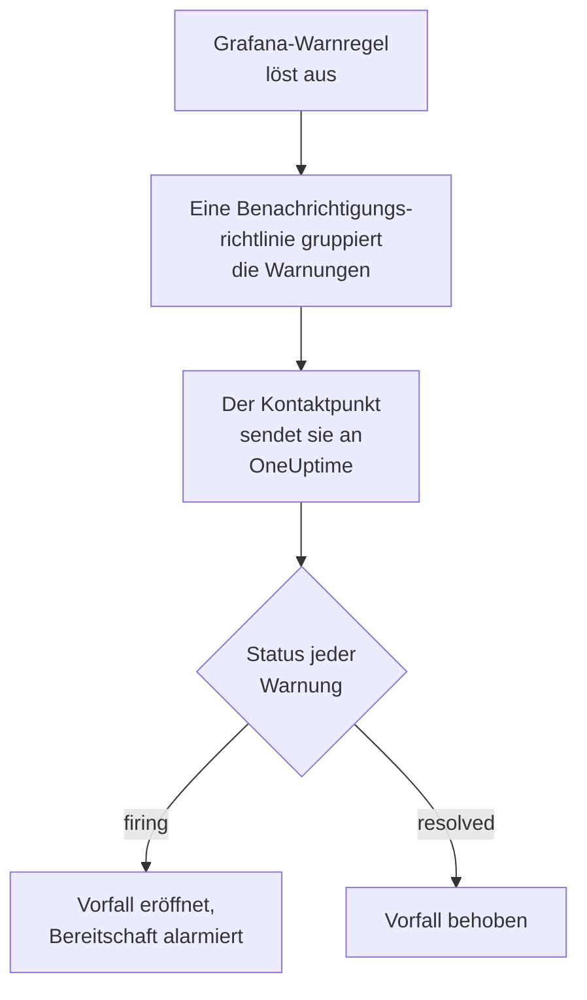

# Grafana

Senden Sie Warnungen von [Grafana](https://grafana.com) an OneUptime, sodass jede auslösende Warnung zu einem Vorfall wird, der Ihr Bereitschaftsteam alarmiert und behoben wird, wenn sich die Warnung erholt. Grafana sendet seine Warnungen über einen Webhook-Kontaktpunkt, es gibt also auf keiner Seite etwas zu installieren.

:::cards
- [Wählen Sie, wie OneUptime Warnungen empfängt](#wählen-sie-wie-oneuptime-warnungen-empfängt): Ein Monitor für eingehende Anfragen oder ein eigener Workflow.
- [Warnungen mit einem Monitor empfangen](#warnungen-mit-einem-monitor-empfangen): Ein Vorfall pro Warnung, bei der Erholung behoben.
- [Grafana konfigurieren](#grafana-konfigurieren): Ein Webhook-Kontaktpunkt und die Richtlinie, die ihn nutzt.
- [Fehlerbehebung](#fehlerbehebung): Wenn Warnungen nicht ankommen oder Vorfälle offen bleiben.
:::

## So funktioniert es



Die Benachrichtigungsrichtlinien von Grafana gruppieren die auslösenden Warnungen, und ein Webhook-Kontaktpunkt sendet jede Gruppe als eine JSON-Benachrichtigung. Sie hat dieselbe Form wie eine Benachrichtigung von [Prometheus Alertmanager](/docs/integrations/prometheus-alertmanager): einen `status`, eine Liste `alerts`, in der jede Warnung ihren eigenen `status` und `fingerprint` hat, und die `commonLabels` und `commonAnnotations`, die ihre Warnungen teilen. Grafana fügt einen `title` und eine `message` hinzu, die für Menschen geschrieben sind.

## Bevor Sie beginnen

- Grafana 9 oder neuer, mit Grafana Alerting, dem Standard seit Grafana 9. Es muss Ihr OneUptime über HTTPS erreichen.
- In OneUptime das Recht, Monitore anzulegen, oder Workflows, wenn Sie diesen Weg gehen.

## Wählen Sie, wie OneUptime Warnungen empfängt

Richten Sie zuerst OneUptime ein: Es gibt Ihnen die URL, an die Grafana sendet.

| Weg | Nutzen Sie ihn, wenn |
| --- | --- |
| Ein Monitor für eingehende Anfragen (empfohlen) | Sie möchten, dass jede Warnung ein Vorfall wird, der die Bereitschaft alarmiert und behoben wird, wenn sich die Warnung erholt. Es gibt nichts zu bauen. |
| Ein Workflow mit einem Webhook-Trigger | Sie brauchen eigene Logik: Warnungen filtern, umformen oder zuerst andere Systeme aufrufen. Ein Workflow eröffnet einen Vorfall pro Benachrichtigung, nicht pro Warnung, und behebt ihn bei der Erholung nicht. |

Beide bekommen dasselbe JSON vom selben Kontaktpunkt, Sie können also mit einem beginnen und später wechseln, indem Sie in Grafana eine URL ändern.

## Warnungen mit einem Monitor empfangen

Ein [Monitor für eingehende Anfragen](/docs/monitor/incoming-request-monitor) gibt Ihnen eine URL, und seine Kriterien entscheiden, was jede Benachrichtigung bewirkt.

:::steps
### Den Monitor anlegen

Gehen Sie zu **Monitore** und klicken Sie auf **Monitor erstellen**. Wählen Sie unter **Monitortyp** die Option **Eingehende Anfrage**, nennen Sie ihn `Grafana` und klicken Sie auf **Weiter**.

### Für jede auslösende Warnung einen Vorfall melden

Öffnen Sie im Schritt **Kriterien** das erste Kriterium, das den Monitor als offline markiert. Setzen Sie seinen Filter auf **Anfragetext**, **Enthält**, `"status":"firing"`. Dieses Kriterium meldet bereits einen Vorfall, wenn sein Filter zutrifft. Füllen Sie den Vorfall aus:

- **Vorfalltitel**: `{{requestBody.commonLabels.alertname}}`.
- **Vorfallbeschreibung**, unter **Beschreibung**: `{{requestBody.message}}`, der Text, den Grafana für die Benachrichtigung schreibt.
- **Schweregrad**: der Vorfallschweregrad, den diese Warnungen haben sollen.
- **Bereitschaftsrichtlinien**, unter **Bereitschaft**: die Richtlinien, die alarmiert werden.
- **Vorfall automatisch beheben**, unter **Weitere Felder**: Lassen Sie es eingeschaltet, wie es beginnt. Ohne diese Option werden Erholungen ignoriert, und Vorfälle bleiben offen.

### Einen Vorfall pro Warnung eröffnen

Öffnen Sie im selben Kriterium **Einstellungen** und schalten Sie **Vorfälle und Warnungen nach einem Payload-Feld gruppieren** ein. Füllen Sie es wie unten aus, damit jede Warnung ihren eigenen Vorfall bekommt und ihre Erholung ihn behebt:

| Feld | Wert |
| --- | --- |
| **Einen eigenen Vorfall eröffnen pro…** | `requestBody.alerts[*].fingerprint` |
| **Feld, das die Erholung signalisiert** | `requestBody.alerts[*].status` |
| **Wert, der „wiederhergestellt“ bedeutet** | `resolved` |

### Den Monitor wieder online bringen

Öffnen Sie das zweite Kriterium, das den Monitor als online markiert, und setzen Sie seinen Filter auf **Anfragetext**, **Enthält**, `"status":"resolved"`.

### Die URL kopieren

Klicken Sie auf **Monitor erstellen**. Die Seite **Übersicht** des Monitors zeigt seine **Heartbeat-URL**. Kopieren Sie sie für Grafana:

```text
https://oneuptime.com/heartbeat/<secret key>
```

Eine selbst gehostete Installation hat ihren eigenen Host anstelle von `oneuptime.com`.
:::

Jede Warnung einer Benachrichtigung eröffnet ihren eigenen Vorfall, höchstens so viele, wie **Max. Vorfälle pro Anfrage** zulässt (`100`, sofern Sie es nicht ändern), und der eigene `status` jeder Warnung entscheidet, wann ihr Vorfall behoben wird. Der `fingerprint` von Grafana bezeichnet eine Warnung über ihre Labels und ist daher der Wert, nach dem gruppiert wird. Unter [Warnungen aus einem anderen System empfangen](/docs/monitor/incoming-request-monitor#warnungen-aus-einem-anderen-system-empfangen) steht, was jede Einstellung tut.

> [!WARNING]
> Gruppieren Sie nicht nach einem Label, das alle Warnungen einer Benachrichtigung teilen. Die Standard-Benachrichtigungsrichtlinie von Grafana gruppiert Warnungen nach `grafana_folder` und `alertname`, jede Warnung einer Benachrichtigung hat also denselben `alertname`: Gruppieren nach `requestBody.alerts[*].labels.alertname` fasst die ganze Benachrichtigung zu einem Vorfall zusammen.

`{{requestBody.commonLabels.alertname}}` und `{{requestBody.message}}` beschreiben die ganze Benachrichtigung, unter der Standardrichtlinie also eine Warnregel. Auch der Gruppierungsschlüssel ist eine Variable, `{{fingerprint}}`, aber er ist ein Hash, der einer Einsatzkraft nichts sagt. Unter [Vorfall- & Warnmeldungsvorlagen](/docs/monitor/incident-alert-templating) finden Sie jede Variable, die Sie verwenden können.

## Grafana konfigurieren

:::steps
### Einen Webhook-Kontaktpunkt hinzufügen

Gehen Sie in Grafana zu **Alerting → Contact points** und klicken Sie auf **+ Add contact point**. Ab Grafana 11 liegt **Alerting** unter **Alerts & IRM**, und **Contact points** ist ein Tab von **Notification configuration**.

Nennen Sie den Kontaktpunkt `OneUptime`, wählen Sie unter **Integration** die Option **Webhook** und fügen Sie die kopierte URL in **URL** ein. Lassen Sie **HTTP Method** auf `POST` und klicken Sie auf **Save contact point**.

### Warnungen dorthin senden

Gehen Sie zu **Alerting → Notification policies**. Setzen Sie den Kontaktpunkt der Standardrichtlinie auf `OneUptime`, oder fügen Sie eine untergeordnete Richtlinie hinzu, die auf die Warnungen passt, die OneUptime bekommen soll, mit `OneUptime` als Kontaktpunkt.
:::

Grafana sendet `Content-Type: application/json`, das der Monitor braucht, um die Felder einer Benachrichtigung zu lesen. Die Einstellung **Max Alerts** des Kontaktpunkts begrenzt die Warnungen einer Benachrichtigung: Lassen Sie sie auf `0`, ohne Grenze, oder höchstens auf **Max. Vorfälle pro Anfrage** des Monitors.

## Testen

1. Öffnen Sie in Grafana den Kontaktpunkt `OneUptime` und klicken Sie auf **Test**. Grafana sendet eine auslösende Testwarnung, und in OneUptime wird ein Vorfall eröffnet. Eine Testwarnung erholt sich nie, beheben Sie diesen Vorfall also von Hand.
2. Lassen Sie eine echte Warnregel auslösen, etwa indem Sie ihren Schwellwert kurz senken, und sehen Sie zu, wie ihr Vorfall eröffnet und dann behoben wird, wenn Sie den Schwellwert zurücksetzen.

## Warnungen mit einem Workflow empfangen

Nutzen Sie einen [Workflow](/docs/workflows/index), wenn Sie zwischen Grafana und dem Vorfall eigene Schritte brauchen.

:::steps
### Den Workflow anlegen

Gehen Sie zu **Arbeitsabläufe**, klicken Sie auf **Arbeitsablauf erstellen** und dann auf **Ohne Vorlage beginnen**. Nennen Sie ihn `Grafana alerts` und klicken Sie auf **Arbeitsablauf erstellen**.

### Den Webhook-Trigger hinzufügen

Klicken Sie auf den gestrichelten Baustein **Wählen Sie, was diesen Arbeitsablauf startet** und wählen Sie **Webhook**. Klicken Sie auf den Trigger, dann auf **URL kopieren**, und verwenden Sie diese URL im Kontaktpunkt in Grafana.

### Prüfen, ob die Benachrichtigung auslöst

Klicken Sie auf **Komponente hinzufügen**, fügen Sie einen **If / Else**-Baustein hinzu und verbinden Sie den Punkt **Out** des Triggers damit. Setzen Sie **Value to check** auf `{{local.components.webhook-1.returnValues.request-body.status}}`, **Comparison** auf **is equal to** und **Compare with** auf `firing`.

### Den Vorfall melden

Fügen Sie einen **Create One Incident**-Baustein hinzu und verbinden Sie die Seite **Yes** des **If / Else**-Bausteins damit. Wählen Sie unter **Incident Template** eine Vorlage, die den Schweregrad und die zu alarmierenden Bereitschaftsrichtlinien festlegt (siehe [Vorfallvorlagen](/docs/incidents/settings#vorfall-vorlagen)). Setzen Sie in **JSON Object**, was von Grafana kommt:

```json
{
  "title": "{{local.components.webhook-1.returnValues.request-body.title}}",
  "description": "{{local.components.webhook-1.returnValues.request-body.message}}"
}
```

Ohne Vorlage braucht **JSON Object** zusätzlich `incidentSeverityId`, die ID eines Vorfallschweregrads des Projekts.

### Den Workflow einschalten

Schalten Sie oben im **Editor** **Aktiviert** ein. Ein ausgeschalteter Workflow antwortet Grafana mit `400`.
:::

Eine Ausführung bearbeitet eine Benachrichtigung und meldet also einen Vorfall, wie viele Warnungen die Benachrichtigung auch enthält. Eine Benachrichtigung mit `resolved` nimmt die Seite **No** des **If / Else**-Bausteins, an der nichts angeschlossen ist, die Ausführung endet also dort. Für einen Vorfall pro Warnung, bei der Erholung behoben, nutzen Sie den Monitor.

## Fehlerbehebung

:::details In OneUptime kommt nichts an
- Klicken Sie am Kontaktpunkt auf **Test**: Grafana zeigt einen Fehler, wenn es die URL nicht erreicht. Das Serverprotokoll von Grafana enthält die Einzelheiten.
- Der Monitor antwortet sofort mit `200`, bevor er etwas prüft, selbst bei einem falschen geheimen Schlüssel. Prüfen Sie in der Zeitleiste des Monitors, ob Benachrichtigungen ankommen.
- Ein ausgeschalteter Workflow antwortet mit `400`. Schalten Sie oben in seinem **Editor** **Aktiviert** ein.
:::

:::details Vorfälle werden eröffnet, aber nie behoben
- Der Vorfall des Kriteriums braucht **Vorfall automatisch beheben** unter **Weitere Felder**.
- **Feld, das die Erholung signalisiert** muss `requestBody.alerts[*].status` sein und **Wert, der „wiederhergestellt“ bedeutet** genau `resolved`. Der Vergleich unterscheidet Groß- und Kleinschreibung.
- Die Gruppierungspfade müssen mit `requestBody.` beginnen, und nur das erste `[*]` eines Pfads liest eine Liste. Ein Pfad, der gegen eine der Regeln verstößt, trifft nichts, ohne Fehlermeldung.
:::

:::details Ein Vorfall für eine Benachrichtigung voller Warnungen
Sie haben nach einem Label gruppiert, das für jede Warnung einer Benachrichtigung gleich ist, etwa `alertname` unter der Standardrichtlinie. Gruppieren Sie stattdessen nach `requestBody.alerts[*].fingerprint`.
:::

:::details Der Vorfall zeigt einen Verweis statt eines Werts
Ein Verweis auf ein Feld, das die Benachrichtigung nicht hat, bleibt so stehen, wie er geschrieben ist, mit allen Klammern. Vergleichen Sie den Feldnamen mit dem, was Grafana gesendet hat: Öffnen Sie bei einem Workflow die Ausführung unter **Protokolle → Ausführungen** und vergleichen Sie mit dem, was der Trigger empfangen hat.
:::

Die Anleitung zu [Prometheus Alertmanager](/docs/integrations/prometheus-alertmanager#fehlerbehebung) behandelt weitere Fälle, und sie gelten auch für die Benachrichtigungen von Grafana.

## Sicherheit

- **Behandeln Sie die URL wie ein Passwort.** Wer sie hat, kann Vorfälle eröffnen. Wird sie bekannt, setzen Sie sie zurück: mit **Geheimen Schlüssel für eingehende Anfragen zurücksetzen** auf der Seite **Einstellungen** des Monitors oder mit **URL zurücksetzen** im **Webhook**-Trigger des Workflows. Aktualisieren Sie dann die **URL** des Kontaktpunkts in Grafana.
- **Selbst gehostet?** Lassen Sie Grafana Ihr OneUptime über HTTPS durch Ihre Firewall erreichen.

## Nächste Schritte

:::cards
- [Eingehende-Anfrage-Überwachung](/docs/monitor/incoming-request-monitor): Jede Einstellung des Monitors, der Ihre Warnungen empfängt.
- [Prometheus Alertmanager](/docs/integrations/prometheus-alertmanager): Dieselbe Einrichtung, mit einem Totmannschalter für Ihre Warnungen.
- [Metriken-Überwachung](/docs/monitor/metrics-monitor): Warnen Sie bei denselben Metriken direkt in OneUptime.
- [Integrationsübersicht](/docs/integrations/index): Die anderen Werkzeuge, die Sie verbinden können.
:::
