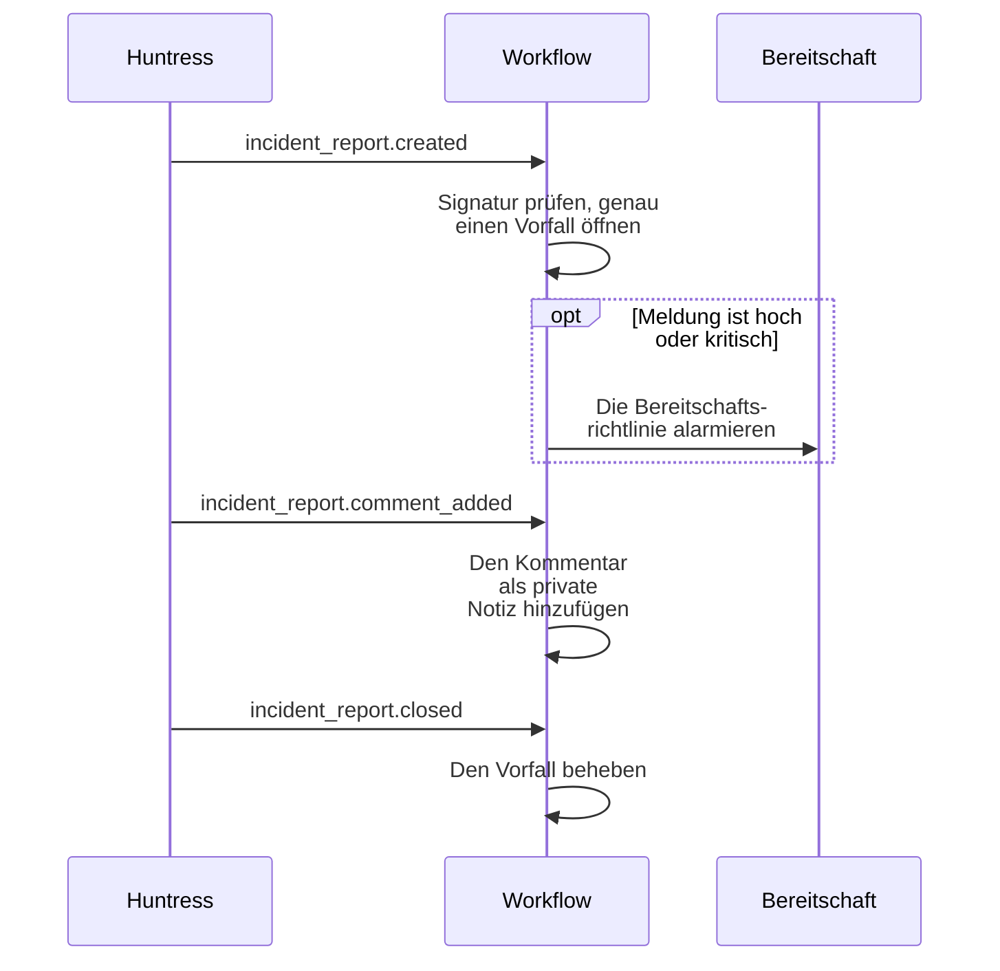

# Huntress-Integration

Alarmieren Sie Ihre Bereitschaft bei Huntress-Vorfallsmeldungen, mit einem Workflow. Wenn das Huntress-SOC eine Vorfallsmeldung zu einem Endpunkt oder einer Identität sendet, öffnet der Workflow dafür genau einen Vorfall, alarmiert die Bereitschaftsrichtlinie, die Sie auswählen, fügt Kommentare aus Huntress als private Notizen hinzu und behebt den Vorfall, wenn die Meldung in Huntress geschlossen wird.

Diese Integration ist **eingehend**: Huntress sendet jedes Ereignis zu einer Vorfallsmeldung an die eigene URL des Workflows, signiert mit dem Signaturgeheimnis des Endpunkts. OneUptime ruft Huntress nie auf und braucht deshalb keinen Huntress-API-Schlüssel.

:::cards
- [So funktioniert es](#so-funktioniert-es): Was der Workflow mit jedem Ereignis zu einer Meldung tut.
- [Einrichten](#die-integration-einrichten): Den Workflow erstellen, den Endpunkt in Huntress anlegen, sein Signaturgeheimnis speichern, einen Test senden.
- [Der Trigger](#der-trigger-huntress-incident-report): Die Werte, die eine Meldung dem Workflow übergibt, und die Einstellungen des Triggers.
- [Fehlerbehebung](#fehlerbehebung): Was die Fehler des Triggers bedeuten und was zu ändern ist.
:::

## So funktioniert es

Huntress sendet ein Ereignis zu einer Vorfallsmeldung, wenn die Meldung versendet wird, wenn jemand sie kommentiert und wenn sie geschlossen wird. Der Trigger **Huntress Incident Report** startet den Workflow einmal für jedes Ereignis, und sein **Event** sagt, welches es war: `created`, `comment-added` oder `closed`.

1. **Prüfen.** Eine Anfrage muss mit dem Signaturgeheimnis des Endpunkts signiert sein, höchstens fünf Minuten bevor sie eintrifft. Alles andere wird abgelehnt, und die Einstellungen des Triggers sagen, warum.
2. **Den Workflow starten.** Jedes Ereignis startet einen Durchlauf, mit den Feldern der Meldung als Werten des Triggers. Ein Ereignis, das Huntress erneut sendet, startet nichts mehr.
3. **Genau einen Vorfall öffnen.** Bei `created` öffnet der Workflow einen Vorfall, der nach der Meldung benannt ist, etwa `Huntress: Incident on DESKTOP-01 (Acme Corp)`. Seine Beschreibung enthält die Zusammenfassung der Meldung, ihren Schweregrad in Huntress, die Organisation, den betroffenen Host oder die Identität, die Indikatoren, die Huntress gefunden hat, und einen Link zur Meldung in Huntress. Der Vorfall erhält eine Beschriftung mit der Organisation der Meldung und alarmiert die Bereitschaftsrichtlinie Ihrer Wahl, wenn die Meldung hoch oder kritisch ist.
4. **Der Meldung folgen.** Bei `comment-added` wird der Kommentar zu einer privaten Notiz am Vorfall. Bei `closed` wird der Vorfall behoben, mit dem Grund in seiner Zeitleiste.

Der Vorfall bewahrt die Nummer der Meldung in seinen benutzerdefinierten Feldern auf, als `huntressReportId`: So findet der Workflow ihn wieder, wenn Huntress die Meldung kommentiert oder schließt. So geöffnete Vorfälle erscheinen nie auf einer Statusseite, und Ihre Vorfallsregeln (Bereitschafts-, Besitzer-, Beschriftungs- und Datenschutzregeln) gelten für sie wie für jeden anderen Vorfall.

## Bevor Sie beginnen

- In OneUptime eine Rolle, die Workflows erstellen und bearbeiten darf, etwa **Projektinhaber**, **Projektadministrator** oder **Arbeitsablauf-Administrator**.
- In Huntress die Rolle **Account Admin**: Nur Account-Admins können Webhooks anlegen.
- Eine Bereitschaftsrichtlinie, die alarmiert wird.
- In OneUptime Cloud einen Tarif mit Workflows: Growth oder höher. Jedes Ereignis, das Huntress sendet, ist ein Workflow-Durchlauf.
- Bei einer selbst gehosteten Installation ein OneUptime, das Huntress aus dem Internet über HTTPS erreicht: Huntress sendet Webhooks nur an `https://`-URLs.

## Die Integration einrichten

:::steps
### Den Workflow erstellen

Öffnen Sie **Arbeitsabläufe** und klicken Sie auf **Arbeitsablauf erstellen**. Wählen Sie unter **Oder mit einer Vorlage beginnen** die Kategorie **Huntress**, wählen Sie **Open an incident for each Huntress incident report**, klicken Sie auf **Diese Vorlage verwenden** und erstellen Sie den Workflow. Er öffnet sich im **Editor**, ausgeschaltet.

### Wählen, wer alarmiert wird

Klicken Sie auf den Schritt **Page an On-Call Policy**, wählen Sie die **Bereitschaftsrichtlinien**, die alarmiert werden sollen, und speichern Sie den Schritt.

### Einen Webhook-Endpunkt in Huntress anlegen

Klicken Sie auf den Trigger **Huntress Incident Report** und dort unter **Webhook-Endpunkt in Huntress hinzufügen** auf **URL kopieren**. Die URL sieht aus wie `https://oneuptime.com/workflow/huntress/<key>`; bei einer selbst gehosteten Installation beginnt sie mit Ihrem eigenen Host.

Öffnen Sie in Huntress das Menü oben rechts und wählen Sie **Integrations**. Klicken Sie auf **Add an Integration**, wählen Sie **Webhooks** und klicken Sie auf **Add Endpoint**. Fügen Sie die URL ein, schalten Sie **Incident Reports** ein und speichern Sie. Lassen Sie **Escalations**, **Platform Actions** und **Account Notices** aus: Der Trigger nimmt diese Ereignisse an und startet für sie nichts.

### Das Signaturgeheimnis des Endpunkts speichern

Öffnen Sie in Huntress das Menü des Endpunkts (⋯) und wählen Sie **View Signing Secret**. Kopieren Sie es vollständig: Es beginnt mit `whsec_`. Klicken Sie im Trigger auf **Signaturgeheimnis speichern**, fügen Sie es ein und klicken Sie auf **Signaturgeheimnis speichern**. Das Geheimnis wird verschlüsselt und nie wieder angezeigt.

Solange das Geheimnis nicht gespeichert ist, lehnt der Trigger jede Anfrage ab. Huntress sendet ein abgelehntes Ereignis später erneut, sodass ein jetzt abgelehntes Ereignis trotzdem ankommt.

### Den Workflow einschalten und einen Test senden

Schalten Sie **Aktiviert** oben im **Editor** ein. Öffnen Sie in Huntress das Menü des Endpunkts (⋯) und wählen Sie **Send Test**. Innerhalb weniger Sekunden zeigt der Trigger **Empfängt Meldungen**.

> [!NOTE]
> Was auch immer der Test enthält, der Trigger zeigt, dass er angekommen ist. Ein Test mit einer Vorfallsmeldung startet den Workflow wie jede andere Meldung.
:::

## Was der Workflow tut

Die Vorlage nimmt für jedes **Event** einen eigenen Weg, mit einem **Switch / Case** nach dem Trigger:

| Event | Was der Workflow tut |
| --- | --- |
| `created` | Öffnet einen Vorfall mit der **Incident Severity ID** des Triggers, mit seiner **Organization Label ID** beschriftet. Bei einer hohen oder kritischen Meldung alarmiert **Page an On-Call Policy** Ihre Richtlinie; eine niedrige Meldung alarmiert niemanden. Eine Meldung, die schon einen Vorfall hat, öffnet keinen weiteren. |
| `comment-added` | Findet den Vorfall der Meldung und fügt den Kommentar als private Notiz hinzu. |
| `closed` | Findet den Vorfall der Meldung und behebt ihn, sofern er nicht schon behoben ist. Der Grund steht in seiner Zeitleiste: Huntress hat die Meldung geschlossen. |

Es ist ein Workflow wie jeder andere, Sie können also ändern, was er tut: nur bei kritischen Meldungen alarmieren, indem Sie ändern, womit das **If / Else** nach **Create One Incident** vergleicht, jede Meldung mit einem Slack- oder Microsoft-Teams-Schritt in einen Chatkanal senden oder jede Organisation mit einem **Switch / Case** auf **Organization** zu ihrer eigenen Bereitschaftsrichtlinie leiten. Jeder Durchlauf steht in den Durchläufen des Workflows, mit dem, was jeder Schritt getan hat.

### Schweregrade

Huntress gibt jeder Vorfallsmeldung einen von drei Schweregraden. Die **Incident Severity ID** des Triggers ist der Vorfallsschweregrad, mit dem die Meldung öffnet: der, den seine Einstellung wählt, oder sonst die Rangfolge Ihrer Vorfallsschweregrade, wie **Vorfälle → Einstellungen → Vorfallsschweregrad** sie auflistet:

| Huntress-Schweregrad | Was Huntress damit meint | Einstellung | Vorfallsschweregrad, wenn die Einstellung leer ist |
| --- | --- | --- | --- |
| Critical | Angreifer an der Tastatur, gefährliche Malware oder eine aktive Kompromittierung, sofort einzudämmen. | **Schweregrad für kritische Meldungen** | Der höchste |
| High | Bestätigte Malware, die dringend beseitigt werden muss, oder eine handlungsrelevante Kompromittierung einer Identität. | **Schweregrad für hohe Meldungen** | Der zweite |
| Low | Potenziell unerwünschte Programme, Malware-Überreste und ältere Funde zu Identitäten. | **Schweregrad für niedrige Meldungen** | Der dritte |

Ein Projekt mit weniger Schweregraden nutzt für den Rest seinen niedrigsten. Eine Meldung ohne Schweregrad wird als hoch behandelt. Wird ein gewählter Schweregrad gelöscht, entscheidet wieder die Rangfolge.

### Organisationen

Die **Organization Label ID** des Triggers ist eine Beschriftung, die nach der Huntress-Organisation der Meldung benannt ist, etwa _Acme Corp_, und die er anlegt, wenn die erste Meldung dieser Organisation eintrifft. Ein Workflow empfängt die Meldungen aller Organisationen Ihres Huntress-Kontos, und **Nur diese Organisationen** des Triggers schränkt das ein: ein Organisationsname oder eine ID pro Zeile, bei Namen zählt die Groß- und Kleinschreibung nicht.

> [!TIP]
> Um das eigene Team jedes Kunden zu alarmieren, legen Sie pro Organisation eine Bereitschaftsregel für Vorfälle an, etwa „Wenn **Vorfall-Beschriftungen** eines von _Acme Corp_ hat“, die die Richtlinie dieses Kunden ausführt. Siehe [Bereitschaftsregeln für Vorfälle](/docs/incidents/settings#bereitschaftsregeln-für-vorfälle).

## Der Trigger Huntress Incident Report

Der Trigger öffnet sich mit Huntress: seiner URL, einem Haken neben jedem erledigten Einrichtungsschritt und dem, was Huntress zuletzt gesendet hat. Seine Einstellungen, alle optional, liegen eingeklappt unter **Weitere Felder**: **Nur diese Organisationen**, **Schweregrad für kritische Meldungen**, **Schweregrad für hohe Meldungen** und **Schweregrad für niedrige Meldungen**.

| Wert | Was er enthält |
| --- | --- |
| **Event** | `created`, `comment-added` oder `closed`. Eine Meldung, die schon geschlossen oder verworfen ist, ist `closed`, gleich welches Ereignis sie brachte. |
| **Report ID** | Die Nummer der Meldung in Huntress. |
| **Severity** | `critical`, `high` oder `low`. |
| **Status** | Der Status der Meldung in Huntress, etwa `sent`, `closed` oder `dismissed`. |
| **Subject** | Der Betreff der Meldung, so wie Huntress ihn schreibt. |
| **Summary** | Was der SOC-Analyst geschrieben hat. |
| **Organization**, **Organization ID** | Die Huntress-Organisation, um die es in der Meldung geht. |
| **Affected** | Der Host oder die Identität, um die es in der Meldung geht. |
| **Platform**, **Indicators** | Wo Huntress es gefunden hat und was es gefunden hat. |
| **Comment** | Der Kommentar, den jemand hinzugefügt hat, bei `comment-added`. |
| **Report URL** | Wo sich die Meldung in Huntress öffnet. |
| **Incident Title**, **Incident Description** | Ein Titel und eine Markdown-Beschreibung für einen Vorfall zu der Meldung. |
| **Note** | Markdown für eine Notiz zu dem Ereignis: der Kommentar, oder dass Huntress die Meldung geschlossen hat. |
| **Incident Severity ID**, **Organization Label ID** | Der Vorfallsschweregrad und die Beschriftung, wie oben. |
| **Received At** | Wann OneUptime das Ereignis empfangen hat. |

**Summary** und **Comment** sind Text, den die Analysten von Huntress geschrieben haben. Um sie in einen Vorfall oder eine Notiz zu setzen, verwenden Sie **Incident Description** und **Note**: Sie behalten die Formatierung, und nichts darin lädt ein Bild oder erwähnt jemanden.

Um den Workflow ohne Huntress auszuprobieren, klicken Sie im **Editor** auf **Arbeitsablauf ausführen** und geben ein **Event**, eine **Report ID** und die Felder ein, die Sie brauchen. Verwenden Sie dieselbe **Report ID**, um eine Meldung von `created` bis `closed` zu verfolgen.

## Früher angelegte Huntress-Verbindungen

Huntress wurde früher unter **Vorfälle → Integrationen → Huntress** eingerichtet. Jede Huntress-Verbindung wurde zu einem gleichnamigen, eingeschalteten Workflow, der tut, was die Verbindung tat: Er alarmiert dieselben Bereitschaftsrichtlinien bei denselben Meldungen, vergibt dieselben Beschriftungen und behebt (oder vermerkt nur) auf dieselbe Weise. Seine URL ist weiterhin die der Verbindung, `https://oneuptime.com/api/huntress/webhook/<connection-id>`, und sein Signaturgeheimnis ist dasselbe, in Huntress ist also nichts zu ändern. Die Vorfälle, die die Verbindung geöffnet hat, behalten die Nummer ihrer Meldung, sodass der Workflow sie findet, wenn Huntress diese Meldungen kommentiert oder schließt.

## Sicherheit

- **Nur signierte Anfragen.** Der Trigger prüft die Header `svix-id`, `svix-timestamp` und `svix-signature`, die Huntress sendet, gegen den Rumpf der Anfrage, genau so, wie er ankam. Eine Anfrage, die nicht mit dem gespeicherten Geheimnis signiert ist oder mehr als fünf Minuten früher oder später signiert wurde, wird abgelehnt.
- **Das Geheimnis bleibt geheim.** Es wird verschlüsselt gespeichert, nie von der API zurückgegeben und nie wieder angezeigt. **Signaturgeheimnis ersetzen** im Trigger speichert ein anderes, etwa das Geheimnis eines neuen Endpunkts.
- **Die URL ist eine Adresse, kein Passwort.** Sie endet mit dem Schlüssel des Workflows; nur eine mit dem Geheimnis des Endpunkts signierte Anfrage startet den Workflow.
- **Ein Endpunkt pro Workflow.** Jeder Workflow hat seine eigene URL und sein eigenes Geheimnis. Um die Meldungen eines zweiten Huntress-Kontos zu empfangen, erstellen Sie einen zweiten Workflow.

## Stattdessen E-Mail nutzen

Huntress versendet Vorfallsmeldungen auch per E-Mail, und ein [Monitor für eingehende E-Mails](/docs/monitor/incoming-email-monitor) kann aus diesen E-Mails Vorfälle öffnen, etwa wenn der Betreff `Critical Incident Report` enthält. Er behandelt die E-Mails aber als Status eines einzigen Monitors: Solange sein Vorfall offen ist, öffnet die nächste Meldung keinen, und der Vorfall wird durch die Kriterien des Monitors behoben statt dann, wenn Huntress die Meldung schließt. Der Workflow öffnet einen Vorfall pro Meldung und behebt jeden mit seiner Meldung, ziehen Sie ihn also vor. Sobald der Workflow Meldungen empfängt, senden Sie die E-Mails nicht mehr an den Monitor, sonst alarmiert jede Meldung zweimal.

## Fehlerbehebung

Lehnt der Trigger eine Anfrage ab, zeigen seine Einstellungen den Grund unter **Die letzte Anfrage wurde abgelehnt**. In Huntress listet **View Delivery Attempts** im Menü des Endpunkts (⋯) jede Zustellung mit der Antwort von OneUptime.

:::details "A request arrived but was refused, because no signing secret is saved for this workflow yet"
Speichern Sie das Signaturgeheimnis des Endpunkts: siehe [Die Integration einrichten](#die-integration-einrichten). Huntress sendet die abgelehnte Anfrage erneut.
:::

:::details "The request's signature does not match the signing secret"
Das gespeicherte Geheimnis gehört nicht zu diesem Endpunkt. Jeder Endpunkt hat sein eigenes: Öffnen Sie in Huntress das Menü des Endpunkts (⋯), wählen Sie **View Signing Secret**, kopieren Sie es vollständig und speichern Sie es mit **Signaturgeheimnis ersetzen**.
:::

:::details "The request was signed more than five minutes from now"
Die Uhren von Huntress und Ihrem OneUptime-Server liegen mehr als fünf Minuten auseinander, oder die Anfrage ist eine Wiederholung. Prüfen Sie bei einer selbst gehosteten Installation, ob die Uhr des Servers stimmt.
:::

:::details "A request arrived while this workflow is off"
Schalten Sie **Aktiviert** oben im **Editor** ein. Huntress sendet die abgelehnte Anfrage erneut, und sie startet dann den Workflow.
:::

:::details "No Huntress workflow has this address."
Der Workflow wurde gelöscht oder archiviert, sein Trigger ist nicht mehr **Huntress Incident Report**, oder die URL des Endpunkts in Huntress ist nicht die des Workflows. Kopieren Sie die URL aus dem Trigger und fügen Sie sie erneut in den Endpunkt in Huntress ein.
:::

:::details Es wurde kein Vorfall geöffnet
Öffnen Sie die Durchläufe des Workflows und den Durchlauf der Meldung. Ist **Create One Incident** fehlgeschlagen, weil der Vorfallsschweregrad leer ist, hat das Projekt keine Vorfallsschweregrade: Legen Sie einen unter **Vorfälle → Einstellungen → Vorfallsschweregrad** an.
:::

:::details Niemand wurde alarmiert
Eine niedrige Meldung öffnet einen Vorfall, ohne zu alarmieren. Sonst sagt der Durchlauf der Meldung, was **Page an On-Call Policy** getan hat, und die Seite **Bereitschaftsausführungen** des Vorfalls zeigt, was jede Richtlinie getan hat.
:::

## Nächste Schritte

:::cards
- [Workflow-Trigger](/docs/workflows/triggers): Die anderen Wege, einen Workflow zu starten.
- [Bereitschaftsregeln für Vorfälle](/docs/incidents/settings#bereitschaftsregeln-für-vorfälle): Das eigene Team jeder Organisation alarmieren, über ihre Beschriftung.
- [Vorfallsstatus und Schweregrade](/docs/incidents/states-and-severities): Die Schweregrade ordnen, mit denen Huntress-Meldungen öffnen.
- [Integrationen – Überblick](/docs/integrations/index): Die anderen Werkzeuge, die Sie anbinden können.
:::
