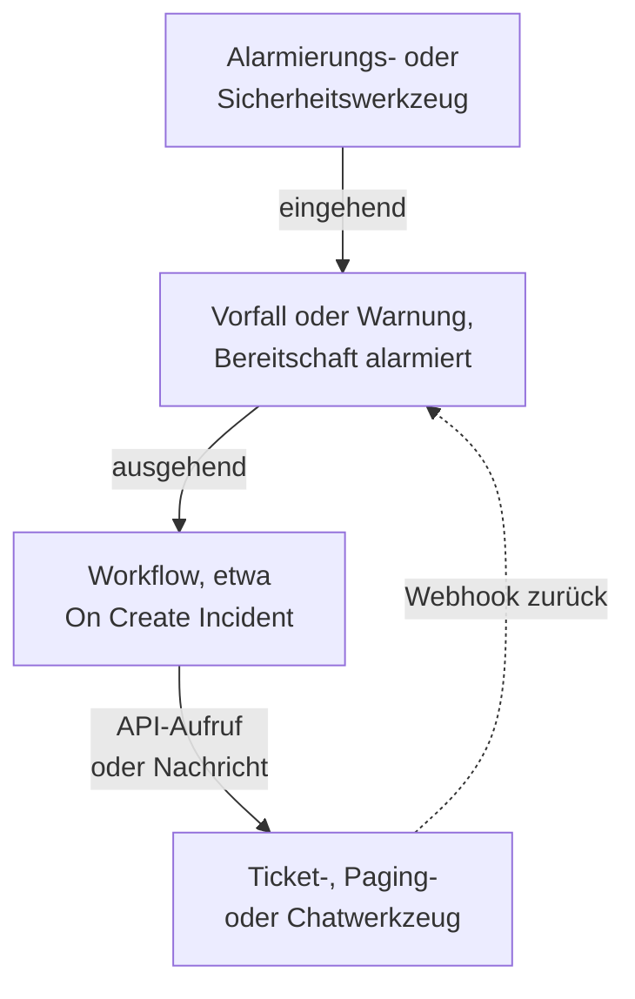

# Integrationsübersicht

OneUptime arbeitet mit den Werkzeugen, die Ihr Team bereits nutzt. Alarmierungswerkzeuge eröffnen darin Vorfälle, und OneUptime eröffnet Tickets, Benachrichtigungen und Chatnachrichten in anderen Werkzeugen. Manche Werkzeuge verbinden Sie über ein Formular, manche über eine fertige Workflow-Vorlage. Jedes andere Werkzeug mit einem Webhook oder einer API verbinden Sie über einen Workflow, den Sie selbst bauen.

:::cards
- [Wählen Sie, wie Sie verbinden](#wählen-sie-wie-sie-verbinden): Die vier Wege und wann Sie welchen nutzen.
- [Katalog](#katalog): Jedes Werkzeug mit einer Anleitung, nach seiner Aufgabe gruppiert.
- [Eigene Integration bauen](#eigene-integration-bauen): Das eingehende und das ausgehende Muster für jedes andere Werkzeug.
- [Zugangsdaten sicher aufbewahren](#zugangsdaten-sicher-aufbewahren): Geheime Variablen und die Header, die jedes Werkzeug erwartet.
:::

## So funktionieren Integrationen

Jede Integration bewegt Daten in eine Richtung oder in beide. **Eingehend** meldet ein anderes Werkzeug OneUptime, dass etwas nicht stimmt, und OneUptime eröffnet einen Vorfall oder eine Warnung und benachrichtigt das Bereitschaftsteam. **Ausgehend** passiert etwas in OneUptime, und ein Workflow informiert ein anderes Werkzeug: Er legt ein Ticket an, benachrichtigt jemanden oder schreibt eine Nachricht.



Eine Zwei-Wege-Integration wie Jira oder Dynamics 365 nutzt beide Richtungen: Ein Workflow sendet den Vorfall hinaus, und ein anderer, vom Webhook des anderen Werkzeugs gestartet, bringt Änderungen zurück.

## Wählen Sie, wie Sie verbinden

| Weg | Am besten für | Beispiele |
| --- | --- | --- |
| Eine eingebaute Verbindung | Werkzeuge, mit denen sich OneUptime selbst verbindet. Sie füllen ein Formular aus, und es gibt nichts zu bauen. | [Slack](/docs/workspace-connections/slack), [Microsoft Teams](/docs/workspace-connections/microsoft-teams), die Verbindungen der [Sicherheitsereignisse](/docs/telemetry/security-events) |
| Eine Workflow-Vorlage | Ticketwerkzeuge, in beide Richtungen abgeglichen, Monitoring-Probleme, Sicherheitsvorfallsmeldungen und Chatnachrichten. Sie wählen eine Vorlage und füllen ein paar Einstellungen aus. | [Jira](/docs/integrations/jira), [Microsoft Dynamics 365](/docs/integrations/microsoft-dynamics-365), [Huntress](/docs/integrations/huntress), [Zabbix](/docs/integrations/zabbix) |
| Ein Monitor für eingehende Anfragen | Alarmierungswerkzeuge, die einen Webhook senden. Sie bekommen einen Vorfall pro Alarm, an die Bereitschaft gemeldet und behoben, wenn sich der Alarm erholt, ganz ohne Workflow. | [Zabbix](/docs/integrations/zabbix), [Prometheus Alertmanager](/docs/integrations/prometheus-alertmanager), [Grafana](/docs/integrations/grafana) |
| Ein Workflow, den Sie bauen | Jedes Werkzeug mit einem Webhook oder einer REST-API, und jede eigene Logik. | [PagerDuty](/docs/integrations/pagerduty), [Opsgenie](/docs/integrations/opsgenie), [ServiceNow](/docs/integrations/servicenow) |

Beginnen Sie oben in der Tabelle: Je weiter oben ein Weg steht, desto weniger gibt es zu pflegen.

## Katalog

### Überwachungs- und Alarmierungswerkzeuge

| Werkzeug | Richtung | Was es tut |
| --- | --- | --- |
| [Zabbix](/docs/integrations/zabbix) | Beide | Macht aus Zabbix-Problemen Vorfälle oder Warnungen, behebt sie bei der Erholung und bestätigt oder schließt die Probleme aus OneUptime heraus. |
| [Prometheus Alertmanager](/docs/integrations/prometheus-alertmanager) | Eingehend | Macht aus Alertmanager-Benachrichtigungen Vorfälle. |
| [Grafana](/docs/integrations/grafana) | Eingehend | Macht aus Grafana-Alarmen Vorfälle. |
| [Datadog](/docs/integrations/datadog) | Eingehend | Macht aus Datadog-Monitoralarmen Vorfälle. |

### Sicherheitswerkzeuge

| Werkzeug | Richtung | Was es tut |
| --- | --- | --- |
| [Huntress](/docs/integrations/huntress) | Eingehend | Alarmiert die Bereitschaft bei Huntress-Vorfallberichten und behebt den Vorfall, wenn der Bericht geschlossen wird. |
| [Google SecOps](/docs/integrations/google-secops) | Beide | Bringt Google-SecOps-Erkennungen und -Indikatoren in die Sicherheitsereignisse und sendet dorthin, was OneUptime findet. |
| [Microsoft Sentinel](/docs/integrations/microsoft-sentinel) | Beide | Bringt Microsoft-Sentinel-Vorfälle in die Sicherheitsereignisse und sendet dorthin, was OneUptime findet. |
| [Microsoft Defender XDR](/docs/integrations/microsoft-defender-xdr) | Eingehend | Bringt Microsoft-Defender-XDR-Alarme in die Sicherheitsereignisse. |
| [CrowdStrike Falcon](/docs/integrations/crowdstrike-falcon) | Eingehend | Bringt CrowdStrike-Falcon-Alarme in die Sicherheitsereignisse. |
| [Splunk Enterprise Security](/docs/integrations/splunk) | Beide | Bringt Splunk-Notable-Events in die Sicherheitsereignisse und sendet dorthin, was OneUptime findet. |
| [Elastic Security](/docs/integrations/elastic-security) | Beide | Bringt Erkennungsalarme von Elastic Security in die Sicherheitsereignisse und sendet dorthin, was OneUptime findet. |
| [AWS Security Hub](/docs/integrations/aws-security-hub) | Eingehend | Bringt Befunde von AWS Security Hub in die Sicherheitsereignisse. |
| [Okta System Log](/docs/integrations/okta) | Eingehend | Bringt Okta-Anmeldungen, Kontoänderungen und Bedrohungserkennungen in die Sicherheitsereignisse. |
| [Microsoft Entra ID](/docs/integrations/microsoft-entra-id) | Eingehend | Bringt Anmeldungen und Verzeichnisänderungen aus Microsoft Entra ID sowie das Microsoft 365-Audit-Protokoll in die Sicherheitsereignisse. |
| [Google Workspace](/docs/integrations/google-workspace) | Eingehend | Bringt Google Workspace-Anmeldungen, Admin-Änderungen und Googles eigene Erkennungen in die Sicherheitsereignisse. |

### Ticket- und IT-Service-Management-Werkzeuge

| Werkzeug | Richtung | Was es tut |
| --- | --- | --- |
| [Jira](/docs/integrations/jira) | Beide | Legt für jeden Vorfall und jede Warnung ein Jira-Issue an und bringt Statusänderungen und Kommentare zurück. |
| [Microsoft Dynamics 365](/docs/integrations/microsoft-dynamics-365) | Beide | Legt für jeden Vorfall und jede Warnung einen Dynamics-365-Fall an und bringt Statusänderungen und Notizen zurück. |
| [ServiceNow](/docs/integrations/servicenow) | Ausgehend | Legt für jeden OneUptime-Vorfall einen ServiceNow-Vorfall an und behebt ihn mit dem Vorfall. |
| [GitHub](/docs/integrations/github) | Ausgehend | Legt für einen Vorfall ein GitHub-Issue an. |
| [GitLab](/docs/integrations/gitlab) | Ausgehend | Legt für einen Vorfall ein GitLab-Issue an. |

### Paging-Werkzeuge

| Werkzeug | Richtung | Was es tut |
| --- | --- | --- |
| [PagerDuty](/docs/integrations/pagerduty) | Ausgehend | Löst für jeden OneUptime-Vorfall einen PagerDuty-Vorfall aus und behebt ihn mit dem Vorfall. |
| [Opsgenie](/docs/integrations/opsgenie) | Ausgehend | Legt für jeden OneUptime-Vorfall einen Opsgenie-Alarm an und schließt ihn mit dem Vorfall. |

### Chatwerkzeuge

| Werkzeug | Richtung | Was es tut |
| --- | --- | --- |
| [Slack](/docs/workspace-connections/slack) | Beide | Eine eingebaute Verbindung: Vorfallkanäle, Aktionen aus Slack und Bereitschaft. |
| [Microsoft Teams](/docs/workspace-connections/microsoft-teams) | Beide | Eine eingebaute Verbindung: Vorfallkanäle, Aktionen aus Teams und Bereitschaft. |
| [Mattermost](/docs/workflows/components#mattermost) | Ausgehend | Schreibt Vorfall-Updates in einen Mattermost-Kanal. |
| [Discord](/docs/integrations/discord) | Ausgehend | Schreibt Vorfall-Updates in einen Discord-Kanal. |
| [Telegram](/docs/integrations/telegram) | Ausgehend | Sendet eine Nachricht an einen Telegram-Chat, wenn eine Warnung ausgelöst wird. |
| [IRC](/docs/integrations/irc) | Ausgehend | Schreibt Vorfall-Updates in einen IRC-Kanal. |

> [!TIP]
> Slack und Microsoft Teams haben auch Workflow-Schritte. Nutzen Sie die eingebaute Verbindung für Vorfallkanäle und Bereitschaft, und einen Workflow-Schritt, wenn Sie nur eine Nachricht in einem Kanal brauchen.

### Hosting-Plattformen

| Werkzeug | Richtung | Was es tut |
| --- | --- | --- |
| [Vercel](/docs/integrations/vercel) | Eingehend | Fügen Sie OneUptime über den Vercel Marketplace hinzu: Traces, Logs, Uptime-Monitore und eine Statusseite für Ihre Vercel-Projekte. |

## Wechsel von einem anderen Werkzeug

Wenn Sie ein anderes Bereitschafts-, Uptime- oder Statusseiten-Werkzeug verlassen, holen Sie Ihr Team herüber, statt beide zu verbinden. **Projekteinstellungen → Erweitert → Import aus anderem Tool** liest Ihr Konto mit einem API-Schlüssel, zeigt Ihnen, was es gefunden hat, und legt an, was Sie ankreuzen. Für jedes Werkzeug gibt es eine Anleitung:

- Bereitschafts- und Vorfallwerkzeuge: [Opsgenie](/docs/moving-to-oneuptime/opsgenie), [PagerDuty](/docs/moving-to-oneuptime/pagerduty), [incident.io](/docs/moving-to-oneuptime/incident-io), [Splunk On-Call](/docs/moving-to-oneuptime/splunk-on-call) und [Grafana OnCall](/docs/moving-to-oneuptime/grafana-oncall).
- Uptime- und Statusseiten-Werkzeuge: [UptimeRobot](/docs/moving-to-oneuptime/uptimerobot), [Atlassian Statuspage](/docs/moving-to-oneuptime/atlassian-statuspage), [Better Stack](/docs/moving-to-oneuptime/better-stack), [Pingdom](/docs/moving-to-oneuptime/pingdom), [StatusCake](/docs/moving-to-oneuptime/statuscake) und [Uptime Kuma](/docs/moving-to-oneuptime/uptime-kuma).

## Eigene Integration bauen

Ein Werkzeug ohne Anleitung passt trotzdem in eines von zwei Mustern. Kann es einen Webhook senden, nutzen Sie das eingehende Muster. Hat es eine REST-API, nutzen Sie das ausgehende Muster. Beide sind Workflows: Siehe [Workflows – Übersicht](/docs/workflows/index) für den Einstieg.

### Eingehend: Ein anderes Werkzeug sendet Daten an OneUptime

Für ein Alarmierungswerkzeug beginnen Sie mit einem [Monitor für eingehende Anfragen](/docs/monitor/incoming-request-monitor#warnungen-aus-einem-anderen-system-empfangen): Er eröffnet einen Vorfall pro Alarm und behebt ihn bei der Erholung, ohne dass Sie etwas bauen. Bauen Sie einen Workflow, wenn Sie eigene Logik brauchen:

:::steps
1. Öffnen Sie **Arbeitsabläufe**, klicken Sie auf **Arbeitsablauf erstellen** und dann auf **Ohne Vorlage beginnen**. Benennen Sie den Workflow und klicken Sie auf **Arbeitsablauf erstellen**.
2. Klicken Sie auf den gestrichelten Baustein **Wählen Sie, was diesen Arbeitsablauf startet** und wählen Sie **Webhook**. Klicken Sie auf den Trigger und dann auf **URL kopieren**.
3. Lassen Sie das andere Werkzeug seinen Webhook als `POST` mit `Content-Type: application/json` an diese URL senden.
4. Fügen Sie die Bausteine hinzu, die damit arbeiten. Sie lesen die Anfrage mit Verweisen wie `{{local.components.webhook-1.returnValues.request-body.status}}`: einen **If / Else**-Baustein, um ein Feld zu prüfen, dann **Create One Incident**, um einen Vorfall zu melden.
5. Schalten Sie oben im **Editor** **Aktiviert** ein, senden Sie einen Test aus dem anderen Werkzeug und öffnen Sie **Protokolle → Ausführungen**, um zu sehen, was angekommen ist.
:::

Die URL ist der einzige Berechtigungsnachweis, behandeln Sie sie also wie ein Passwort. Siehe [Webhook](/docs/workflows/triggers#webhook).

### Ausgehend: OneUptime sendet Daten an ein anderes Werkzeug

:::steps
1. Speichern Sie den API-Schlüssel des Werkzeugs als geheime globale Variable, wie [unten](#zugangsdaten-sicher-aufbewahren) gezeigt.
2. Legen Sie einen Workflow an, klicken Sie auf den gestrichelten Baustein und wählen Sie einen Ereignis-Trigger, etwa **On Create Incident**. Klicken Sie auf den Trigger: Seine **Fields to pass on** beginnen mit **Titel**, also klicken Sie auf **Feld hinzufügen** und wählen Sie die weiteren Felder, die gesendet werden sollen, etwa **Beschreibung**.
3. Klicken Sie auf **Komponente hinzufügen** und fügen Sie einen **API Post (JSON)**-Baustein hinzu. Verbinden Sie den Punkt **Success** des Triggers damit.
4. Füllen Sie seine **URL** aus, seine **Request Headers** mit dem `Authorization`-Header und seinen **Request Body** mit den Feldern des Vorfalls, etwa `{{local.components.incident-on-create-1.returnValues.model.title}}`.
5. Klicken Sie auf **Arbeitsablauf ausführen**, wählen Sie unter **Vorfall** einen Vorfall aus und führen Sie ihn aus. Ein Testlauf sendet die Anfrage wirklich. Schalten Sie danach **Aktiviert** ein.
:::

Braucht das Werkzeug die Daten zuerst umgeformt, fügen Sie dazwischen einen [Run Custom JavaScript](/docs/workflows/components#custom-code)-Baustein ein. Das Rezept ist dasselbe für Zendesk, New Relic, AWS (über SNS), StatusCake und alle weiteren: Nur die URL und der Body ändern sich.

## Zugangsdaten sicher aufbewahren

Fügen Sie niemals einen API-Schlüssel oder ein Token in einen Baustein ein. Speichern Sie ihn einmal als geheime globale Variable:

:::steps
1. Gehen Sie zu **Arbeitsabläufe → Globale Variablen** und klicken Sie auf **Arbeitsablaufvariable erstellen**.
2. Benennen Sie sie, etwa `JIRA_AUTH`, und klicken Sie auf **Weiter**.
3. Fügen Sie den Schlüssel in **Inhalt** ein, schalten Sie **Geheimnis** ein und klicken Sie auf **Arbeitsablaufvariable erstellen**.
:::

Jeder Baustein liest sie als `{{global.variables.JIRA_AUTH}}`. Der Inhalt einer Variable lässt sich nach dem Speichern nicht mehr auslesen, und der einer geheimen Variable wird in den Ausführungsprotokollen durch `[REDACTED]` ersetzt. Für Tokens, die ablaufen, etwa die von Microsoft Entra ID, holt eine [OAuth-2.0-Variable](/docs/workflows/variables#oauth-20-variablen-token-die-sich-selbst-erneuern) selbst ein neues. Siehe [Workflow-Variablen](/docs/workflows/variables#globale-variablen).

### Spickzettel zur Authentifizierung

Die meisten ausgehenden Integrationen setzen den Schlüssel in einen Anfrage-Header. Die üblichen Formen:

| Schema | Was gesendet wird | Genutzt von |
| --- | --- | --- |
| Bearer-Token | `Authorization: Bearer {{global.variables.TOKEN}}` | GitHub und den meisten modernen APIs |
| Basic-Auth | `Authorization: Basic {{global.variables.BASE64_USER_PASS}}` | Jira Cloud, ServiceNow |
| API-Schlüssel-Header | `Authorization: GenieKey {{global.variables.OPSGENIE_KEY}}` | Opsgenie |
| Private-Token-Header | `PRIVATE-TOKEN: {{global.variables.GITLAB_TOKEN}}` | GitLab |
| Schlüssel im Body | `routing_key` im JSON-Body | PagerDuty Events API |
| OAuth 2.0 mit Client-Anmeldedaten | `Authorization: Bearer {{local.variables.dynamicsAccessToken}}`, aus einer OAuth-2.0-Variable | Microsoft Dynamics 365 |

Für Basic-Auth kodieren Sie `username:password` oder `email:api_token` einmal und speichern das Ergebnis als Geheimnis. Unter macOS oder Linux:

```bash
printf '%s' 'you@example.com:your_api_token' | base64 | tr -d '\n'
```

Verwenden Sie `printf`, nicht `echo`: `echo` hängt einen Zeilenumbruch an, der mitkodiert wird und die Zugangsdaten unbrauchbar macht. `tr` hält ein langes Ergebnis auf einer Zeile.

## Selbst gehostete Installationen

Ein selbst gehostetes OneUptime ruft andere Werkzeuge aus Ihrem Netz auf, und andere Werkzeuge rufen es aus ihrem auf:

- **Ausgehend:** Workflow-Anfragen an private Netzwerkadressen werden abgelehnt, sofern ein Administrator sie nicht erlaubt. Siehe [Ausgehender Netzwerkzugriff](/docs/workflows/configuration#ausgehender-netzwerkzugriff).
- **Eingehend:** Die Webhooks eines Werkzeugs müssen Ihr OneUptime über HTTPS erreichen, ein Werkzeug in der Cloud braucht also eine öffentliche Adresse zum Aufrufen.
- **Eingebaute Integrationen** haben jeweils eine Einrichtungsanleitung: [Slack](/docs/self-hosted/slack-integration), [Microsoft Teams](/docs/self-hosted/microsoft-teams-integration), [GitHub](/docs/self-hosted/github-integration), [Twilio](/docs/self-hosted/twilio-integration), [SendGrid Inbound Email](/docs/self-hosted/sendgrid-inbound-email) und [Push-Benachrichtigungen](/docs/self-hosted/push-notifications).

## Nächste Schritte

:::cards
- [Workflows – Übersicht](/docs/workflows/index): Wie Workflows laufen und wie Sie Ihren ersten bauen.
- [Eingehende-Anfrage-Überwachung](/docs/monitor/incoming-request-monitor): Alarme von jedem Werkzeug ohne Workflow empfangen.
- [Jira](/docs/integrations/jira): Eine vollständige Zwei-Wege-Integration aus Vorlagen.
- [Workflow-Variablen](/docs/workflows/variables): Daten zwischen Bausteinen weitergeben und Geheimnisse aus ihnen heraushalten.
:::
