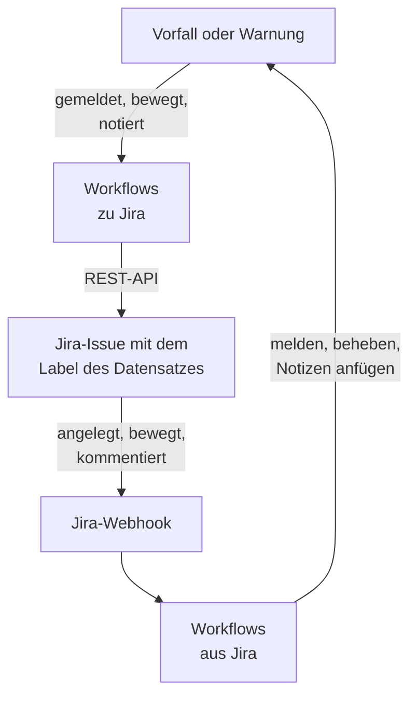

# Jira

Halten Sie [Jira](https://www.atlassian.com/software/jira)-Issues mit Ihren OneUptime-Vorfällen und -Warnungen im Gleichschritt, in beide Richtungen. Fertige Workflow-Vorlagen legen für jeden Vorfall und jede Warnung ein Issue an, bewegen es mit dem Datensatz und kopieren Notizen als Kommentare hinein. Andere melden Vorfälle aus neuen Issues und bringen Statusänderungen, Kommentare und Bearbeitungen zurück. Es gibt kein Plugin: Die Workflows rufen die REST-API von Jira auf, und Jira ruft ihre Webhook-URLs auf.

:::cards
- [Mit einer Vorlage beginnen](#mit-einer-vorlage-beginnen): Die 17 Vorlagen, was sie abfragen und wie Sie sie einrichten.
- [So arbeiten die Vorlagen](#so-arbeiten-die-vorlagen): Wie Issues und Datensätze verknüpft bleiben, ohne Schleifen.
- [Selbst bauen](#selbst-bauen): Jede Richtung von Hand, wenn eine Vorlage nicht passt.
- [Fehlerbehebung](#fehlerbehebung): Was die Antworten von Jira bedeuten.
:::

> [!NOTE]
> Atlassian benennt in Jira Cloud einiges um: Ein **project** heißt in weiten Teilen der Oberfläche jetzt **space**, und ein **issue** heißt **work item**. Sites nutzen beide Begriffe, deshalb finden Sie hier, wo die Wortwahl zählt, beide.

## So funktioniert es



Jede Vorlage ist ein kleiner Workflow, Sie nehmen also nur die Richtungen, die Sie wollen, für Vorfälle, Warnungen oder beides. Die Vorlagen von OneUptime zu Jira starten bei einem Ereignis in OneUptime und rufen die REST-API von Jira auf. Die Vorlagen von Jira zu OneUptime starten bei einem Jira-Webhook. Sie alle finden die Datensätze der anderen über zwei Labels am Issue.

Alles auf dieser Seite ist für **Jira Cloud** geschrieben. [Jira Data Center](#jira-data-center) listet, was sich bei einem selbst verwalteten Jira ändert.

## Bevor Sie beginnen

- Eine Jira-Cloud-Site, etwa `https://your-domain.atlassian.net`, und ein Projekt, in dem Issues angelegt werden.
- Ein Jira-Benutzer für die Integration und ein API-Token für ihn. Geben Sie dem Benutzer im Projekt **Browse Projects**, **Create Issues**, **Edit Issues**, **Add Comments** und **Transition Issues**.
- Einen Jira-Administrator, der die Webhooks registriert, die die Vorlagen von Jira zu OneUptime brauchen.
- In OneUptime das Recht, Workflows anzulegen. In OneUptime Cloud brauchen Workflows den Tarif **Growth** oder höher.

## Mit einer Vorlage beginnen

Der Dialog **Arbeitsablauf erstellen** hat 17 Jira-Vorlagen, unter **Jira** in seiner Kategorienliste: neun für Vorfälle, dann acht für Warnungen, jede Gruppe unter ihrer eigenen Überschrift. Sie teilen eine Konvention, Labels am Jira-Issue, sodass jede Kombination zusammenarbeitet.

### Vorlagen für Vorfälle

| Vorlage | Was sie tut | Was sie abfragt |
| --- | --- | --- |
| **Von OneUptime zu Jira** | | |
| Create a Jira issue when an incident is declared | Legt für jeden neuen Vorfall ein Issue an und versieht es mit der ID des Vorfalls als Label. Aus Jira gemeldete Vorfälle und private Vorfälle werden übersprungen. | API URL, API token, project key, issue type, OneUptime URL |
| Move the Jira issue when the incident is acknowledged or resolved | Bewegt das verknüpfte Issue vorwärts: in einen In-Progress-Status, wenn der Vorfall bestätigt wird, und in einen Done-Status, wenn er behoben wird. Bewegt es nie zurück. | API URL, API token |
| Copy incident private notes to the Jira issue | Postet jede neue private Notiz als Kommentar am verknüpften Issue, in Jira Service Management als internen Kommentar. | API URL, API token |
| Copy incident public notes to the Jira issue | Postet jede neue öffentliche Notiz als Kommentar am verknüpften Issue. | API URL, API token |
| Comment on the Jira issue when the incident is edited | Wenn sich Titel, Schweregrad, Beschreibung, Ursache oder Behebungshinweise des Vorfalls ändern, postet sie den aktuellen Stand des Vorfalls, in Jira Service Management als internen Kommentar. | API URL, API token |
| **Von Jira zu OneUptime** | | |
| Declare an incident when a Jira issue is created | Meldet für jedes neue Issue einen Vorfall, von Ihren Statusseiten ferngehalten, mit einem aus der Priorität des Issues gewählten Schweregrad, und versieht das Issue dann mit Labels, um beide zu verknüpfen. | Site URL, API URL, API token und ein Jira-Webhook für **Issue created** |
| Acknowledge or resolve the incident when its Jira issue moves | Bestätigt den Vorfall, wenn sein verknüpftes Issue in einen In-Progress-Status wechselt, und behebt ihn, wenn das Issue in einen Done-Status wechselt. | Ein Jira-Webhook für **Issue updated** |
| Add Jira comments to the incident as private notes | Kopiert jeden Kommentar an einem verknüpften Issue als private Notiz in den Vorfall. | Site URL, API URL, API token und ein Jira-Webhook für **Comment created** |
| Add Jira issue changes to the incident as private notes | Notiert jede Bearbeitung eines verknüpften Issues, etwa Priorität, Bearbeiter oder Zusammenfassung, als private Notiz am Vorfall. Statusänderungen überlässt sie der Vorlage darüber. | Site URL und ein Jira-Webhook für **Issue updated** |

### Vorlagen für Warnungen

Die Vorlagen für Warnungen erledigen dieselben Aufgaben für Warnungen. Es ist eine weniger, weil Warnungen keine öffentlichen Notizen haben. [Was bei Warnungen anders ist](#was-bei-warnungen-anders-ist) listet den Rest.

| Vorlage | Was sie tut | Was sie abfragt |
| --- | --- | --- |
| **Von OneUptime zu Jira** | | |
| Create a Jira issue when an alert is created | Legt für jede neue Warnung ein Issue an, auch für jede, die ein Monitor auslöst, und versieht es mit der ID der Warnung als Label. Aus Jira angelegte Warnungen und private Warnungen werden übersprungen. | API URL, API token, project key, issue type, OneUptime URL |
| Move the Jira issue when the alert is acknowledged or resolved | Bewegt das verknüpfte Issue vorwärts: in einen In-Progress-Status, wenn die Warnung bestätigt wird, und in einen Done-Status, wenn sie behoben wird. Bewegt es nie zurück. | API URL, API token |
| Copy alert private notes to the Jira issue | Postet jede neue private Notiz als Kommentar am verknüpften Issue, in Jira Service Management als internen Kommentar. | API URL, API token |
| Comment on the Jira issue when the alert is edited | Wenn sich Titel, Schweregrad, Beschreibung, Ursache oder Behebungshinweise der Warnung ändern, postet sie den aktuellen Stand der Warnung, in Jira Service Management als internen Kommentar. | API URL, API token |
| **Von Jira zu OneUptime** | | |
| Create an alert when a Jira issue is created | Legt für jedes neue Issue eine Warnung an, mit einem aus der Priorität des Issues gewählten Schweregrad, und versieht das Issue dann mit Labels, um beide zu verknüpfen. | Site URL, API URL, API token und ein Jira-Webhook für **Issue created** |
| Acknowledge or resolve the alert when its Jira issue moves | Bestätigt die Warnung, wenn ihr verknüpftes Issue in einen In-Progress-Status wechselt, und behebt sie, wenn das Issue in einen Done-Status wechselt. | Ein Jira-Webhook für **Issue updated** |
| Add Jira comments to the alert as private notes | Kopiert jeden Kommentar an einem verknüpften Issue als private Notiz in die Warnung. | Site URL, API URL, API token und ein Jira-Webhook für **Comment created** |
| Add Jira issue changes to the alert as private notes | Notiert jede Bearbeitung eines verknüpften Issues, etwa Priorität, Bearbeiter oder Zusammenfassung, als private Notiz an der Warnung. Statusänderungen überlässt sie der Vorlage darüber. | Site URL und ein Jira-Webhook für **Issue updated** |

Keine der Vorlagen von OneUptime zu Jira sendet einen als [**Privater Vorfall**](/docs/incidents/declaring-incidents#schritt-1-vorfalldetails) markierten Vorfall oder eine als **Private Warnung** markierte Warnung an Jira: weder den Datensatz noch seinen Status, seine Notizen oder seine Bearbeitungen, es sei denn, Sie schalten das ein. Siehe [Einschränkungen](#einschränkungen).

### Was bei Warnungen anders ist

Jede Vorlage für Warnungen ist wie ihr Gegenstück für Vorfälle gebaut, Schritt für Schritt. Wo sich Warnungen von Vorfällen unterscheiden, tun es auch die Vorlagen:

- **Keine öffentlichen Notizen.** Warnungen haben nur private Notizen, jeder Kommentar der Vorlagen für Warnungen ist in Jira Service Management also ein interner Kommentar.
- **Keine Statusseite.** Eine Warnung erreicht nie eine Statusseite, also schreibt **Create an alert when a Jira issue is created** den Schweregrad, Titel, die Beschreibung und `customFields.jiraIssueKey`, und sonst nichts.
- **Zwei Schweregrade, also wird Medium zu Low.** Ein neues Projekt hat zwei Schweregrade für Warnungen, High und Low, aber drei für Vorfälle. Die Anlegevorlage verteilt die Prioritäten von Jira auf die Schweregrade, die das Projekt hat. Bei den zwei Standardwerten werden Highest, High, Critical und Blocker zu High und jede andere Priorität zu Low, auch Medium und Major. Um Medium auf High zu schicken, ändern Sie `medium: 1` zu `medium: 0` in `PRIORITY_RANK` im Skript `prepare-alert-1`.
- **Links und Labels für Warnungen.** Das Issue verlinkt auf `/dashboard/<project id>/alerts/<alert id>` und trägt das Label `oneuptime-alert-<alert id>`.
- **Nummern sagen, was sie nummerieren.** Mit dem Standardpräfix `#` können eine Warnung und ein Vorfall beide `#12` sein, deshalb schreiben die Vorlagen `Alert #12` oder `Incident #12`. Eine Nummer mit eigenem Präfix, etwa `ALT-12`, wird geschrieben, wie sie ist.
- **Private Warnungen.** Eine als **Private Warnung** markierte Warnung, von Hand oder durch eine Datenschutzregel für Warnungen, bleibt außerhalb von Jira, es sei denn, Sie setzen `SYNC_PRIVATE_ALERTS` auf `true`.

**Monitore lösen Warnungen von selbst aus, und es können viele sein.** **Create a Jira issue when an alert is created** legt für jede ein Issue an. Sofern nicht jede Warnung ein Ticket verdient, setzen Sie eine Bedingung vor den Jira-Schritt. Um Issues nur für Warnungen mit High anzulegen:

1. Öffnen Sie den **Editor** des Workflows und fügen Sie einen **If / Else**-Baustein hinzu.
2. Setzen Sie **Value to check** auf `{{local.components.alert-on-create-1.returnValues.model.alertSeverity.name}}`, **Comparison** auf **is equal to** und **Compare with** auf `High`.
3. Entfernen Sie die Linie vom Trigger `alert-on-create-1` zu `prepare-issue-1`, indem Sie ihr Ende vom Punkt wegziehen (siehe [Aufräumen](/docs/workflows/authoring#aufräumen)). Verbinden Sie dann **Success** des Triggers mit dem **If / Else**-Baustein und dessen **Yes** mit `prepare-issue-1`.

Eine Warnung, die die Seite **No** nimmt, beendet die Ausführung dort, und für sie wird kein Issue angelegt.

### Was die Vorlagen abfragen

Der Schritt **Konfigurieren** des Anlegeassistenten fragt bis zu fünf Werte ab. Die Tabellen oben zeigen, welche jede Vorlage braucht.

- **Jira Site URL** — die Adresse, unter der Sie Jira öffnen, etwa `https://your-domain.atlassian.net`. Bei Jira Data Center seine Basis-URL, etwa `https://jira.example.com:8443` oder `https://example.com/jira`. Die Vorlagen, die Jira nach OneUptime bringen, verlinken das Issue in der Beschreibung oder Notiz, die sie schreiben, und dieser Link geht immer auf diese Site, was auch immer das Ereignis sagt. Das Feld nimmt also die Adresse einer Site und sonst nichts: ein Schema, einen Host, einen Port, wenn es einen gibt, und bei Data Center den Pfad, unter dem Jira läuft. Es lehnt die Adresse einer Seite in der Site, eine Abfrage oder einen Benutzernamen ab und sagt, was Sie stattdessen eingeben sollen. Ein Schrägstrich am Ende ist in Ordnung. Wird die Variable später geleert, wird das Issue ohne Link genannt.
- **Jira API URL** — wohin der Workflow seine Jira-Anfragen sendet: Ihre Site, etwa `https://your-domain.atlassian.net`, ohne abschließenden Schrägstrich. Mit einem API-Token mit Geltungsbereichen, wozu jedes Token eines Dienstkontos gehört, verwenden Sie stattdessen `https://api.atlassian.com/ex/jira/<cloudId>`. Ihre `cloudId` steht im JSON unter `https://your-domain.atlassian.net/_edge/tenant_info`. Mit einem klassischen Token ist dies dieselbe Adresse wie die **Jira Site URL**, deshalb füllt der Assistent sie in den Vorlagen, die nach beiden fragen, aus der **Jira Site URL** aus, bis Sie etwas hineintippen.
- **Jira API Token (base64 of email:token)** — nicht das Token allein, sondern E-Mail und Token des Kontos gemeinsam kodiert, so wie Jira Cloud Basic-Auth annimmt. [Das API-Token erstellen](#das-api-token-erstellen) zeigt, wie. Tokens laufen ab, standardmäßig ein Jahr nach ihrer Erstellung, notieren Sie sich das Datum also irgendwo.
- **Jira Project Key** — das Projekt (der Space), in dem neue Issues angelegt werden: das `OPS` in `OPS-123`.
- **Jira Issue Type** — die Art des anzulegenden Issues, genau so geschrieben wie in diesem Projekt, etwa `Task`, `Bug` oder `Incident`.
- **OneUptime URL** — die Adresse, unter der Sie OneUptime öffnen: `https://oneuptime.com` oder Ihr eigener Host. Die Beschreibung des Issues verlinkt damit zurück auf den Vorfall oder die Warnung.

### Das API-Token erstellen

:::steps
1. Erstellen Sie ein Token für einen eigenen Jira-Benutzer, ein gewöhnliches Atlassian-Konto nur für die Integration, statt für eine Person: Issues und Kommentare werden dem Besitzer des Tokens zugeschrieben. Melden Sie sich als dieser Benutzer an und erstellen Sie das Token unter [id.atlassian.com/manage-profile/security/api-tokens](https://id.atlassian.com/manage-profile/security/api-tokens). Ein klassisches Token (**Create API token**) funktioniert mit Ihrer Site-URL. Ein Token mit Geltungsbereichen (**Create API token with scopes**) funktioniert nur mit der Adresse `api.atlassian.com` oben. Die klassischen Geltungsbereiche `read:jira-work` und `write:jira-work` decken jeden Aufruf der Vorlagen ab.
2. Kodieren Sie die E-Mail dieses Kontos und das Token:

   ```bash
   printf '%s' 'jira-bot@example.com:your_api_token' | base64 | tr -d '\n'
   ```

   Verwenden Sie `printf`, nicht `echo`: `echo` hängt einen Zeilenumbruch an, der mitkodiert wird, und Jira nimmt die Zugangsdaten nicht mehr an. Auf Ihrer Site-URL zeigt sich das selten als `401` (siehe [Einschränkungen](#einschränkungen)). `tr` hält die Ausgabe auf einer Zeile: GNU `base64` unter Linux bricht alle 76 Zeichen um, und ein aktuelles Token ist lang genug dafür.

3. Fügen Sie die Ausgabe in **Jira API Token (base64 of email:token)** ein.
:::

Ein Atlassian-**Dienstkonto** funktioniert auch. Ein Organisationsadministrator erstellt es samt Token in [admin.atlassian.com](https://admin.atlassian.com) unter **Directory → Service accounts**. Dieses Token hat immer Geltungsbereiche, also muss die **Jira API URL** die Adresse `https://api.atlassian.com/ex/jira/<cloudId>` sein (die **Jira Site URL** bleibt Ihre Site), und die E-Mail, die Sie kodieren, ist die des Dienstkontos selbst. Geben Sie dem Dienstkonto die oben genannten Projektberechtigungen, wie jedem anderen Benutzer.

### Die Workflows anlegen

:::steps
1. Öffnen Sie **Arbeitsabläufe → Arbeitsablauf erstellen**. Wählen Sie unter **Oder mit einer Vorlage beginnen** in der Kategorienliste **Jira**, oder tippen Sie `Jira` in **Vorlagen durchsuchen…**, und klicken Sie auf die gewünschte Vorlage. Sie öffnet sich und zeigt, was sie tut und welche Einstellungen sie abfragt. Klicken Sie auf **Diese Vorlage verwenden**.
2. **Name** wird aus der Vorlage ausgefüllt. Ändern Sie ihn, wenn Sie möchten.
3. **Konfigurieren** fragt die Werte oben ab. Sie werden als eigene Variablen des Workflows gespeichert, unter **Arbeitsablaufvariablen** in seinem Menü. Das API-Token wird als Geheimnis gespeichert: Es wird in **Protokolle → Ausführungen** geschwärzt und gelangt nur in den `Authorization`-Header der Jira-Aufrufe.
4. Klicken Sie auf **Arbeitsablauf erstellen**. Jeder Workflow wird ausgeschaltet angelegt: Schalten Sie oben in seinem **Editor** **Aktiviert** ein.
:::

Beginnen Sie mit **Create a Jira issue when an incident is declared**, oder für Warnungen mit **Create a Jira issue when an alert is created**: Jede andere Vorlage von OneUptime zu Jira derselben Art findet das Issue über das Label, das diese hinzufügt. Schalten Sie sie ein, melden Sie einen Testvorfall oder legen Sie eine Testwarnung an, und öffnen Sie **Protokolle → Ausführungen** des Workflows. Der letzte Schritt der Ausführung sollte `✅ Created Jira issue` lauten und das neue Issue nennen.

Jeder Workflow behält seine eigene Kopie dieser Werte. Wenn Sie das Token ersetzen, aktualisieren Sie `jiraBasicAuthToken` unter **Arbeitsablaufvariablen** in jedem Jira-Workflow, der danach gefragt hat. Zieht Jira an eine andere Adresse um, aktualisieren Sie `jiraSiteUrl` und `jiraBaseUrl` auf dieselbe Weise.

### Die Webhook-Vorlagen verbinden

Die Vorlagen von Jira zu OneUptime, vier für Vorfälle und vier für Warnungen, starten bei einem [Webhook-Trigger](/docs/workflows/triggers#webhook), also muss Jira gesagt werden, wohin es seine Ereignisse senden soll. Gehen Sie in dieser Reihenfolge vor:

1. Legen Sie den Workflow an und **schalten Sie ihn zuerst ein**. Ein ausgeschalteter Workflow antwortet Jira mit `400`, und Jira wiederholt keine Zustellung, die mit einem solchen `4xx` abgelehnt wurde. Ereignisse, die vor dem Einschalten gesendet werden, gehen verloren und werden nicht eingereiht.
2. Öffnen Sie den **Editor** des Workflows, klicken Sie auf den **Webhook**-Trigger-Baustein (`webhook-1`) und klicken Sie oben in seinen Einstellungen auf **URL kopieren**. Die URL sieht so aus:

   ```text
   https://<your OneUptime host>/workflow/trigger/<webhook secret key>
   ```

3. Gehen Sie in Jira zu **Settings → System → WebHooks** (unter **Advanced**) und klicken Sie auf **Create a WebHook**. Fügen Sie die URL ein, kreuzen Sie das Ereignis aus der Tabelle unten unter **Issue related events** an und geben Sie einen JQL-Filter ein, damit nur die Issues Ihres Projekts ihn auslösen. Lassen Sie **Exclude body** frei: Der Workflow liest alles aus dem Body.

| Vorlage | Jira-Ereignis | JQL-Filter |
| --- | --- | --- |
| **Vorfälle** | | |
| Declare an incident when a Jira issue is created | **Issue created** | `project = OPS AND (labels is EMPTY OR labels != oneuptime)` |
| Acknowledge or resolve the incident when its Jira issue moves | **Issue updated** | `project = OPS` |
| Add Jira comments to the incident as private notes | **Comment created** | `project = OPS` |
| Add Jira issue changes to the incident as private notes | **Issue updated** | `project = OPS` |
| **Warnungen** | | |
| Create an alert when a Jira issue is created | **Issue created** | `project = OPS AND (labels is EMPTY OR labels != oneuptime)` |
| Acknowledge or resolve the alert when its Jira issue moves | **Issue updated** | `project = OPS` |
| Add Jira comments to the alert as private notes | **Comment created** | `project = OPS` |
| Add Jira issue changes to the alert as private notes | **Issue updated** | `project = OPS` |

Ersetzen Sie `OPS` durch Ihren Projektschlüssel. Der Filter der beiden Vorlagen, die einen Datensatz anlegen, hält die von OneUptime eröffneten Issues ganz von ihnen fern: Sie würden sie ohnehin überspringen, aber ein Ereignis, das nie ankommt, kostet keine Ausführung. `labels != oneuptime` allein würde auch jedes Issue ohne Labels ausschließen, deshalb steht `labels is EMPTY` dabei. Die anderen Vorlagen handeln nur bei verknüpften Issues, für sie ist `project = OPS AND labels = oneuptime` also ein engerer Filter.

Jeder Workflow hat seine eigene URL, jeder braucht also seinen eigenen Jira-Webhook. Zwei Vorlagen auf **Issue updated** bedeuten zwei Webhooks, und vier, wenn Sie auch die Versionen für Warnungen nutzen.

**Nutzen Sie beide Vorlagen, die einen Datensatz anlegen?** **Declare an incident when a Jira issue is created** und **Create an alert when a Jira issue is created** hören beide auf **Issue created**. Jede prüft die Labels des Issues bei Jira, bevor sie etwas anlegt, aber die beiden Zustellungen kommen gleichzeitig an, ein neues Issue kann also sowohl einen Vorfall als auch eine Warnung bekommen. Registrieren Sie die beiden für verschiedene Issues, nach Projekt oder nach Issue-Typ:

```text
project = OPS AND issuetype = Incident AND (labels is EMPTY OR labels != oneuptime)
project = OPS AND issuetype = Alert AND (labels is EMPTY OR labels != oneuptime)
```

Verwenden Sie Issue-Typen, die es in Ihrem Projekt gibt, so geschrieben, wie Jira sie schreibt.

Bevor Sie sich darauf verlassen:

- **Jira ruft nur HTTPS auf, auf seinen erlaubten Ports.** OneUptime Cloud ist in Ordnung. Eine selbst gehostete Installation muss aus dem Internet über HTTPS auf einem Port aus der Liste von Jira erreichbar sein.
- **Wer die URL hat, kann den Workflow auslösen.** Die Webhooks von Jira tragen nichts, was ein Workflow prüfen kann, die URL ist also das einzige Geheimnis. Wer sie hat, kann Vorfälle melden oder Warnungen anlegen (die Vorlagen, die einen Datensatz anlegen, fragen Jira, ob das genannte Issue existiert und noch nicht verknüpft ist, übernehmen Titel, Beschreibung und Priorität aber aus der Anfrage) und kann Vorfälle und Warnungen bewegen oder mit Notizen versehen, deren ID oder Jira-Issue-Schlüssel er kennt. Was eine solche Anfrage sagt, wird als Text geschrieben (siehe [Einschränkungen](#einschränkungen)), und der Link zum Issue geht auf die Site, die Ihre **Jira Site URL** nennt, was auch immer die Anfrage sagt. Bewahren Sie die URL nur in Jira auf. Wird sie bekannt, klicken Sie im **Editor** des Workflows auf den **Webhook**-Trigger, klicken Sie auf **URL zurücksetzen** und fügen Sie die neue URL in den Jira-Webhook ein. Die alte URL funktioniert sofort nicht mehr.
- **Jedes Ereignis ist eine Ausführung.** In OneUptime Cloud zählt jede Zustellung zu den Workflow-Ausführungen Ihres Tarifs, auch die, die eine Vorlage überspringt. Der JQL-Filter hält diese Zahl niedrig. Siehe [Tariflimits](/docs/workflows/configuration#plan-grenzen).

### Prüfen, ob es funktioniert

Jede Vorlage endet mit einem **Log**-Schritt, der sagt, was passiert ist, der letzte Schritt einer Ausführung in **Protokolle → Ausführungen** ist also die Stelle, an der Sie nachsehen:

- `✅` — sie hat ihre Aufgabe erledigt und nennt das Issue, den Vorfall oder die Warnung.
- `ℹ️` — sie hat das Ereignis absichtlich übersprungen und sagt, warum: Das Issue ist mit keinem Datensatz dieser Art verknüpft, die Notiz kam aus Jira, der Datensatz ist privat, oder dem neuen Status ist kein Jira-Status zugeordnet.
- `❌` — ein Aufruf ist fehlgeschlagen. Bei einem Jira-Aufruf enthält die Zeile die Antwort von Jira.
- `⚠️` — eine Vorlage, die aus einem Jira-Issue einen Datensatz anlegt, hat ihn angelegt, aber Jira hat die Verknüpfungslabels nicht angenommen, die anderen Vorlagen finden ihn also noch nicht. Fügen Sie die Labels von Hand hinzu.

Eine übersprungene Ausführung endet trotzdem als **Ausgeführt**. Übersprungene Ausführungen sind normal: Die meisten Jira-Ereignisse sind keine, auf die eine bestimmte Vorlage reagiert. Siehe [Workflow-Ausführungen](/docs/workflows/runs-and-logs).

## So arbeiten die Vorlagen

### Wie beide Seiten verknüpft bleiben

Jira hält die Verknüpfung. Ein Issue, das zu einem Vorfall oder einer Warnung gehört, trägt zwei Labels:

- `oneuptime`, das das Issue als verknüpft markiert.
- `oneuptime-incident-<incident id>` für einen Vorfall oder `oneuptime-alert-<alert id>` für eine Warnung, das den Datensatz benennt. Die ID ist der letzte Teil der Adresse des Datensatzes im Dashboard: `/dashboard/<project id>/incidents/<incident id>`.

Die beiden Vorlagen, die Issues anlegen, fügen beim Anlegen des Issues beide Labels hinzu, und die beiden Vorlagen, die aus einem Jira-Issue einen Datensatz anlegen, fügen beide hinzu, sobald der Datensatz existiert. Jede andere Vorlage findet über sie die andere Seite: Die von OneUptime zu Jira suchen in Jira nach dem Label des Datensatzes, und die von Jira zu OneUptime lesen die ID des Datensatzes aus den Labels des Issues. Benennen Sie sie also nicht um und entfernen Sie sie nicht. Um ein von Hand angelegtes Issue zu verknüpfen, fügen Sie die beiden Labels selbst hinzu, aber nur, wenn der Datensatz noch kein Issue hat.

**Ein Issue ist mit einem Vorfall oder mit einer Warnung verknüpft, nie mit beidem.** Die Vorlagen, die einen Datensatz anlegen, überspringen jedes Issue, das `oneuptime` trägt oder ein Label, das mit `oneuptime-incident-` oder `oneuptime-alert-` beginnt, und die Vorlagen einer Art ignorieren Issues, die mit der anderen verknüpft sind. Wenn Sie ein Issue von Hand verknüpfen, geben Sie ihm ein Label für einen Datensatz, nicht eines von jeder Art.

**Ein Datensatz hat ein Issue.** Die Vorlagen, die an ein Issue posten oder es bewegen, handeln nur, wenn genau ein Issue das Label des Datensatzes trägt. Das Klonen eines Issues in Jira kopiert seine Labels, ein Klon eines verknüpften Issues beansprucht also denselben Datensatz. Von da an halten diese Vorlagen an, und jede Ausführung endet mit einem Überspringen, das beide Issues nennt:

```text
More than one Jira issue is labelled oneuptime-incident-<id> (OPS-17, OPS-30). A cloned issue copies the label: remove it from every issue except the one filed for the incident.
```

Die andere Richtung hat keine solche Prüfung: Statusänderungen, Kommentare und Bearbeitungen am Klon erreichen den Datensatz, als wären sie am Original gemacht worden. Wenn Sie ein verknüpftes Issue klonen, entfernen Sie also beide Labels vom Klon.

Aus Jira angelegte Vorfälle und Warnungen behalten außerdem den Issue-Schlüssel in `customFields.jiraIssueKey`, beim Anlegen geschrieben. Daran erkennen die Vorlagen, die Issues anlegen, dass der Datensatz schon ein Issue hat.

### Wie die Vorlagen Schleifen vermeiden

Jedes Schreiben in eine Richtung ist ein Ereignis in der anderen: Ein in Jira geposteter Kommentar kommt als **Comment created**-Webhook zurück, und eine in OneUptime hinzugefügte Notiz löst den Notiz-Trigger aus. Drei Dinge stoppen das Echo:

- **Markierungen im Text.** Jeder Kommentar, den die Vorlagen in Jira posten, beginnt mit `Synced from OneUptime`. Jede aus Jira geschriebene Notiz und die Ursache jeder aus Jira vorgenommenen Statusänderung beginnen mit `Synced from Jira`. Jede Richtung überspringt Text, der die Markierung der anderen Seite trägt, auch in einem Kommentar, den jemand geschrieben hat und der eine Markierung zitiert.
- **Labels an neuen Issues.** Von OneUptime eröffnete Issues tragen das Label `oneuptime`, und die Vorlagen, die einen Datensatz anlegen, überspringen sie. Sie fragen Jira nach den Labels des Issues, bevor sie etwas anlegen, statt dem Ereignis zu vertrauen. Aus Jira angelegte Datensätze tragen `customFields.jiraIssueKey`, und die Vorlagen, die Issues anlegen, überspringen sie.
- **Status bewegen sich nur vorwärts, auf beiden Seiten.** Die Statusvorlagen schreiben eine neue Zeile in die Statuszeitleiste des Datensatzes, so wie die Schaltfläche **Beheben**, und immer nur zu einem späteren Status. Die Übergangsvorlagen bewegen ein Issue ebenfalls nie zurück. Wenn also eine Seite behebt, findet die andere sich bereits erledigt und ändert nichts.

Behalten Sie die Markierungen, wenn Sie die Vorlagen bearbeiten. Es sind die Konstanten `FROM_ONEUPTIME` und `FROM_JIRA` im Hilfsblock oben in jedem Skript. Ein Kommentar oder eine Notiz ohne Markierung wird direkt zurückkopiert.

### Wie die Übergangsvorlage einen Status wählt

Jira hat keinen Aufruf „auf Done setzen“. Ein Issue bewegt sich über einen Übergang, und welche Übergänge es hat, hängt von seinem Workflow und seinem Status ab. Deshalb lesen **Move the Jira issue when the incident is acknowledged or resolved** und ihr Gegenstück für Warnungen die Übergänge, die dem Issue offenstehen, und wählen einen nach dem Status, zu dem er führt:

- **Nur vorwärts.** Jira ordnet Status drei Kategorien zu, To Do, In Progress und Done, und die Vorlage wählt nie einen Übergang in eine frühere Kategorie als die des Issues, nicht einmal für einen in `STATE_TO_JIRA_STATUS` genannten Status. Das Bestätigen eines Vorfalls, dessen Issue schon Done ist, endet mit `Jira issue OPS-17 is already Done, so it was not moved back to an In Progress status.`
- **Zuerst die üblichen Namen.** Für einen behobenen Datensatz gewinnt ein Status namens Done, Resolved, Closed, Complete, Completed oder Fixed. Für einen bestätigten gewinnt In Progress oder Work in Progress. Ein Status mit anderem Namen in der richtigen Kategorie wird genommen, wenn er der einzige passende ist.
- **Nie eine Vermutung, die die Arbeit verwirft.** Ein Status, dessen Name wie Canceled, Declined, Rejected, Won't Do, Duplicate, Obsolete, Waiting, Pending, Escalated, On Hold oder Blocked klingt, wird nie gewählt, es sei denn, `STATE_TO_JIRA_STATUS` nennt ihn. Eine Anfrage in Jira Service Management, die zu Resolved oder zu Canceled gehen kann, geht also zu Resolved.
- **Zwei Wege zum selben Status.** Führen zwei Übergänge zu einem Status, nimmt sie den ohne Maske.

Bleibt sie danach unsicher, bewegt sie nichts und sagt, warum: Zwei Status passen gleich gut, oder keiner der Übergänge ist einer, den sie selbst wählen darf.

```text
Jira issue OPS-17 could move to Released or Deployed for a Done status. Name the one to use in STATE_TO_JIRA_STATUS.
Jira issue OPS-17 has no transition from In Review to a Done status that can be chosen without naming it in STATE_TO_JIRA_STATUS.
```

Nennen Sie den Status dann in `STATE_TO_JIRA_STATUS` oben im Skript `plan-transition-1`, nach den Namen Ihrer OneUptime-Status. Ein dort aufgeführter Status bewegt das Issue namentlich zu diesem Status, egal in welcher Kategorie, solange das nicht rückwärts ist:

```javascript
const STATE_TO_JIRA_STATUS = {
  Resolved: "Resolved",
  Acknowledged: "In Progress",
};
```

### Ändern, was eine Vorlage tut

Öffnen Sie den **Editor** des Workflows und klicken Sie auf den Baustein, den Sie ändern möchten. Die Einstellungen, die Sie am ehesten brauchen, sind Konstanten nahe dem Anfang eines Skripts, im **JavaScript Code** eines **Run Custom JavaScript**-Bausteins, direkt unter dem gemeinsamen Hilfsblock. Die Versionen einer Vorlage für Vorfälle und Warnungen haben dieselben Konstanten in denselben Bausteinen:

| Konstante | Vorlage und Baustein | Was sie steuert |
| --- | --- | --- |
| `STATE_TO_JIRA_STATUS` | Move the Jira issue when the incident (or alert) is acknowledged or resolved — `plan-transition-1` | Ordnet einen OneUptime-Statusnamen einem Jira-Statusnamen zu, etwa `{ Resolved: 'Resolved', Acknowledged: 'In Progress' }`. Nicht aufgeführte Status gehen nach Bedeutung: Bestätigt bewegt das Issue in einen In-Progress-Status, behoben in einen Done-Status, und jeder andere Status wird übersprungen. Nennen Sie hier einen Status, wenn das Ausführungsprotokoll Sie darum bittet, siehe [Wie die Übergangsvorlage einen Status wählt](#wie-die-übergangsvorlage-einen-status-wählt). |
| `PREFERRED_STATUS`, `NEVER_GUESS` | Move the Jira issue when the incident (or alert) is acknowledged or resolved — `plan-transition-1` | Die Statusnamen, die die Vorlage bevorzugt, wenn sie nach Bedeutung geht, und die, die sie nie wählt, es sei denn, `STATE_TO_JIRA_STATUS` nennt sie. Beide sind reguläre Ausdrücke, die ohne Rücksicht auf Groß- und Kleinschreibung gegen den Statusnamen geprüft werden. |
| `SYNC_PRIVATE_INCIDENTS` | Jede Vorlage für Vorfälle von OneUptime zu Jira — `prepare-issue-1`, `plan-transition-1` oder `build-comment-1` | `false` hält als **Privater Vorfall** markierte Vorfälle aus Jira heraus: Für einen wird kein Issue angelegt, sein Issue wird nicht bewegt, und weder seine Notizen noch seine Bearbeitungen werden gepostet. Setzen Sie sie auf `true`, um sie trotzdem zu senden. Jede Vorlage hat ihre eigene Kopie, setzen Sie sie also in jeder Vorlage, die sie senden soll. |
| `SYNC_PRIVATE_ALERTS` | Jede Vorlage für Warnungen von OneUptime zu Jira — `prepare-issue-1`, `plan-transition-1` oder `build-comment-1` | Dasselbe für als **Private Warnung** markierte Warnungen: `false` hält sie auf dieselbe Weise aus Jira heraus, und `true` sendet sie trotzdem. Setzen Sie sie in jeder Vorlage für Warnungen, die sie senden soll. |
| `JIRA_STATUS_TO_STATE` | Acknowledge or resolve the incident (or alert) when its Jira issue moves — `decide-state-1` | Ordnet einen Jira-Statusnamen einem OneUptime-Statusnamen zu, etwa `{ 'In Review': 'Monitoring' }`. Nicht aufgeführte Status gehen nach der Statuskategorie von Jira: In Progress bestätigt den Vorfall oder die Warnung, Done behebt ihn oder sie, und To Do wird keinem Status zugeordnet. |
| `PRIORITY_RANK` | Declare an incident when a Jira issue is created — `prepare-incident-1`; Create an alert when a Jira issue is created — `prepare-alert-1` | Ordnet eine Jira-Priorität, kleingeschrieben, `0` (Ihrem schwersten Schweregrad), `1` oder `2` (Ihrem leichtesten) zu, die dazwischen über den Bereich verteilt. Nicht aufgeführte Prioritäten landen in der Mitte. Mit den zwei Schweregraden für Warnungen, die ein neues Projekt hat, ist `0` High, und `1` und `2` sind beide Low, Medium wird also zu Low, es sei denn, Sie ändern es zu `medium: 0`. |
| `EVENTS` | Add Jira comments to the incident (or alert) as private notes — `read-comment-1` | Die Kommentarereignisse, die zu Notizen werden. Fügen Sie `'comment_updated'` hinzu, um auch Bearbeitungen zu kopieren (jede Bearbeitung wird zu einer neuen Notiz), und kreuzen Sie auch im Jira-Webhook **Comment updated** an. |
| `IGNORED_FIELDS` | Add Jira issue changes to the incident (or alert) as private notes — `read-changes-1` | Die Jira-Felder, kleingeschrieben, deren Änderungen keine Notiz wert sind. Eine Änderung wird ausgelassen, wenn ihre Feld-ID oder ihr Name aufgeführt ist, so erfasst `'rank'` Rank, ein benutzerdefiniertes Feld, das als ID wie `customfield_10019` ankommt. Status steht auf der Liste, weil die Statusvorlage ihn übernimmt. |

Als Schlüssel verwendete Status- und Statusnamen müssen genau so geschrieben sein, wie sie heißen, mit Groß- und Kleinschreibung. Halten Sie `{{` aus dem Code heraus: Ein Skript wird vor der Ausführung wie jede andere Einstellung ausgefüllt, zwei öffnende geschweifte Klammern hintereinander würden also als Verweis gelesen.

Um bei neuen Issues mehr Felder zu senden, bearbeiten Sie den **Request Body** des Bausteins `create-issue-1` der Vorlagen, die Issues anlegen. Er enthält Projekt, Issue-Typ, Zusammenfassung, Labels und Beschreibung des Issues, und Sie können innerhalb von `fields` eine Priorität, Komponenten, einen Bearbeiter oder benutzerdefinierte Felder hinzufügen, in den Formen, die [Weitere Felder ausfüllen](#weitere-felder-ausfüllen) beschreibt. Behalten Sie beide Labels. Der Wortlaut von Zusammenfassung und Beschreibung steht im Skript `prepare-issue-1`. Die Beschreibung nennt Schweregrad, Status und Beschreibung des Datensatzes, dann seine Ursache und Behebungshinweise, wenn er welche hat: Ein Monitor füllt sie aus, wenn er einen Vorfall oder eine Warnung auslöst, und sie erklären ihn oft.

Private Notizen und Bearbeitungskommentare werden durch den Eintrag `properties`, `sd.public.comment`, im **Request Body** ihres Bausteins `post-comment-1` als intern markiert. Nur Jira Service Management liest ihn. Löschen Sie ihn nur, wenn Kunden diese Kommentare sehen sollen.

### Einschränkungen

- **Nur Jira Cloud.** Die Vorlagen rufen die REST-API v3 von Jira Cloud mit Basic-Auth auf. Data Center hat keine v3 und nimmt ein persönliches Zugriffstoken als `Bearer` an, also braucht jeder API-Baustein die Änderungen aus [Jira Data Center](#jira-data-center): Pfade mit `/rest/api/2/...`, einfache Zeichenketten statt Bodies im Atlassian Document Format, und den Header. Die Bausteine `find-issue-1` ändern sich am meisten: Data Center hat kein `/search/jql`, sie müssen also stattdessen per `POST` an `/rest/api/2/search` senden.
- **Aus Jira gemeldete Vorfälle sind still.** Sie werden vor Ihren Statusseiten verborgen angelegt, ohne Abonnenten der Statusseite zu benachrichtigen, weil der Text eines Issues nicht für Kunden geschrieben wurde. Um einen zu zeigen, schalten Sie **Auf Statusseite sichtbar** auf der Seite **Einstellungen** des Vorfalls ein (siehe [Einen Vorfall von der Statusseite fernhalten](/docs/incidents/states-and-severities#einen-vorfall-von-der-statusseite-fernhalten)), oder ändern Sie `isVisibleOnStatusPage` und `shouldStatusPageSubscribersBeNotifiedOnIncidentCreated` im Baustein `create-incident-1` der Vorlage.
- **Private Vorfälle und Warnungen bleiben in OneUptime.** Die Vorlagen von OneUptime zu Jira überspringen sie, und jedes Überspringen steht in **Protokolle → Ausführungen**. Um sie trotzdem zu senden, setzen Sie `SYNC_PRIVATE_INCIDENTS` oder `SYNC_PRIVATE_ALERTS` auf `true`. Wird ein Datensatz später privat, stoppt der Abgleich von da an, nimmt aber nicht zurück, was Jira schon hat. Die Vorlagen von Jira zu OneUptime prüfen das nicht, Kommentare, Bearbeitungen und Statusänderungen an einem verknüpften Issue erreichen also auch einen privaten Datensatz.
- **Nichts bewegt sich rückwärts.** Das Wiedereröffnen eines Jira-Issues ändert nichts in OneUptime, und ein Status der Kategorie To Do wird keinem Status zugeordnet. Siehe [Die Reihenfolge ist eine echte Einschränkung](/docs/incidents/states-and-severities#die-reihenfolge-ist-eine-echte-einschränkung-keine-anzeigevorliebe). Die Übergangsvorlagen bewegen ein Issue ebenfalls nie in eine frühere Statuskategorie.
- **Jede Warnung bekommt ein Issue.** Außer für private Warnungen legt die Anlegevorlage für Warnungen für jede Warnung ein Issue an, auch für jede, die ein Monitor auslöst. [Was bei Warnungen anders ist](#was-bei-warnungen-anders-ist) zeigt, wie Sie eine Bedingung hinzufügen.
- **Die ersten Sekunden können das Issue verfehlen.** Die Suche von Jira holt eine Änderung an einem Issue erst einen Moment später ein, eine Notiz, Statusänderung oder Bearbeitung in den ersten Sekunden nach dem Anlegen eines Datensatzes kann das neue Issue also verfehlen und mit dem Überspringen `No Jira issue is labelled …` enden. Diese Ausführung wird nicht wiederholt. Dasselbe gilt kurz nach dem Anlegen eines Datensatzes aus Jira, bis seine Labels hinzugefügt sind.
- **Privat und öffentlich bedeuten in Jira Verschiedenes.** In einem Projekt von Jira Service Management werden private Notizen und Bearbeitungskommentare, die Ursache und Behebung tragen, zu internen Kommentaren, während die öffentlichen Notizen eines Vorfalls zu Kommentaren werden, die der Kunde sehen kann. In jeder anderen Art von Projekt sind alle gewöhnliche Kommentare, die jeder lesen kann, der das Issue sehen kann.
- **Bearbeitungskommentare folgen dem Speichern, nicht den Änderungen.** Die Detailformulare von Vorfällen und Warnungen senden Titel und Schweregrad bei jedem Speichern mit, ein Speichern nach einer Änderung nur der Labels oder der Einstellung Privat postet also auch einen Kommentar, mit denselben Werten wie der letzte. Der Trigger übergibt dem Workflow den Datensatz, wie er jetzt ist, nicht, was sich geändert hat.
- **Formatierung wird nicht übertragen.** Notizen werden als einfacher Text an Jira gepostet, Markdown kommt also als seine rohen Zeichen an. Der Rich Text von Jira kommt in OneUptime als das Wiki-Markup an, das die Webhooks von Jira senden, etwa `*bold*`, und liest sich genau so, wie er geschrieben wurde: Ein Bild, ein Link, HTML, ein Diagramm oder eine Chat-Erwähnung wie `<!channel>`, getippt in einem Issue, einem Kommentar, einem Status oder einem Namen, erscheint als seine Zeichen und bewirkt nichts, weil hinter dem Zeichen, das es auslösen würde, ein unsichtbarer Wortverbinder steht. Eine Kopie des Textes behält den Verbinder. Der Link zum Issue geht auf die Site, die die **Jira Site URL** des Workflows nennt. Ein Workflow behält die Skripte, mit denen er angelegt wurde, einer aus einer älteren Version einer Vorlage schreibt Text also so wie diese Version: Legen Sie ihn erneut aus seiner Vorlage an, um dies zu bekommen.
- **Vor der Jira Site URL angelegte Workflows verlinken das Issue auf die Site, die das Ereignis nennt.** Ein Workflow behält die Skripte und Einstellungen, mit denen er angelegt wurde, ein Workflow für das Anlegen aus Issues, für Kommentare oder für Issue-Änderungen, der angelegt wurde, bevor seine Vorlage nach der **Jira Site URL** fragte, nimmt die Site des Issue-Links also noch aus der Adresse des Issues im Ereignis. Um auf Ihre eigene Site zu verlinken, legen Sie den Workflow erneut aus seiner Vorlage an, die nach der **Jira Site URL** fragt. Schalten Sie den neuen Workflow ein, fügen Sie seine Webhook-URL anstelle der alten in den Jira-Webhook ein (jeder Workflow hat seine eigene URL) und löschen Sie dann den alten Workflow.
- **Ein falsches oder abgelaufenes Token sagt das selten.** Auf Ihrer Site-URL beantwortet Jira einen Aufruf, den es nicht authentifizieren kann, wie den eines anonymen Besuchers, nicht mit `401`. Ein falsches oder abgelaufenes Token zeigt sich also als `The target project doesn't exist or you don't have permission to create issues in it` der Anlegevorlage (ein `400`), als `Issue does not exist or you do not have permission to see it` (ein `404`) oder als das Überspringen `No Jira issue is labelled oneuptime-incident-<id>, or the Jira credentials cannot see it.` Ein einfaches `401` antwortet meist die Adresse `api.atlassian.com`. Um den Wert zu testen, senden Sie ihn an `/rest/api/3/myself`: Es antwortet mit Name und E-Mail des Kontos, wenn der Wert funktioniert, und mit `401`, wenn nicht.

  ```bash
  curl -H 'Authorization: Basic <the encoded value>' https://your-domain.atlassian.net/rest/api/3/myself
  ```

- **Dasselbe Ereignis kann zweimal ankommen.** Jira wiederholt eine Zustellung, die mit einem Serverfehler fehlschlug oder in eine Zeitüberschreitung lief. Hatte OneUptime die Ausführung schon begonnen, fügen die Kommentar- und Issue-Änderungs-Vorlagen eine zweite Notiz hinzu. Die Vorlagen, die einen Datensatz anlegen, legen keinen zweiten an: Sie fragen Jira zuerst nach den Labels des Issues, und bis eine Wiederholung ankommt, hat die erste Ausführung das Issue mit Labels versehen. Das hilft nicht, wenn die erste Ausführung den Datensatz angelegt hat, Jira die Labels aber abgelehnt hat: Die Ausführung endet mit einer `⚠️`-Zeile, und Sie sollten die Labels von Hand hinzufügen.

## Selbst bauen

Die Vorlagen decken die üblichen Fälle ab. Um eine Richtung selbst zu bauen oder eine über ihre Konstanten hinaus zu ändern, baut dieser Abschnitt beide Richtungen von Hand, für Vorfälle. [Dasselbe für Warnungen](#dasselbe-für-warnungen) überträgt es auf Warnungen.

### Die Jira-Zugangsdaten speichern

Jira Cloud nimmt Basic-Auth an, gebildet aus der E-Mail des Kontos und einem API-Token, gemeinsam kodiert, wie unter [Was die Vorlagen abfragen](#was-die-vorlagen-abfragen).

1. Gehen Sie zu **Arbeitsabläufe → Globale Variablen** und klicken Sie auf **Arbeitsablaufvariable erstellen**. Nennen Sie sie `JIRA_AUTH`, fügen Sie den kodierten Wert in **Inhalt** ein, schalten Sie **Geheimnis** ein und legen Sie sie an.
2. Legen Sie eine zweite Variable an, `JIRA_URL`, mit `https://your-domain.atlassian.net` ohne abschließenden Schrägstrich, und lassen Sie **Geheimnis** aus.

Jeder Baustein kann dann `Basic {{global.variables.JIRA_AUTH}}` als seinen `Authorization`-Header senden, und das Token erscheint nie im Workflow oder in seinen Ausführungen. Mit einem Token mit Geltungsbereichen ist `JIRA_URL` stattdessen `https://api.atlassian.com/ex/jira/<cloudId>`, und jeder Pfad unten hängt unverändert daran.

Tokens laufen standardmäßig nach einem Jahr ab und erneuern sich nicht. Damit Sie keines von Hand ersetzen müssen, kann eine Organisation mit der zentralen Benutzerverwaltung von Atlassian einem Dienstkonto eine [OAuth-2.0-Anmeldeinformation](https://support.atlassian.com/user-management/docs/create-oauth-2-0-credential-for-service-accounts/) geben: eine Client-ID und ein Secret, die ein Workflow gegen ein kurzlebiges Token tauscht, so wie es die Seite [Microsoft Dynamics 365](/docs/integrations/microsoft-dynamics-365) tut.

### Für jeden Vorfall ein Jira-Issue anlegen

:::steps
1. Legen Sie ohne Vorlage einen Workflow namens `Incidents to Jira` an. Klicken Sie auf den gestrichelten Baustein und fügen Sie den Trigger **On Create Incident** hinzu. Seine **Fields to pass on** beginnen mit **Titel**: Klicken Sie auf **Feld hinzufügen** und wählen Sie **Beschreibung** und **Vorfallnummer**. Die ID wird immer weitergegeben. Lassen Sie seine **Kennung** bei `incident-on-create-1`.
2. Klicken Sie auf **Komponente hinzufügen**, fügen Sie einen **API Post (JSON)**-Baustein hinzu und verbinden Sie den Punkt **Success** des Triggers damit. Setzen Sie seine **Kennung** auf `create-issue`, seine **URL** auf `{{global.variables.JIRA_URL}}/rest/api/3/issue` und unter **Weitere Felder** seine **Request Headers** auf `{"Authorization": "Basic {{global.variables.JIRA_AUTH}}", "Accept": "application/json"}`.
3. Setzen Sie seinen **Request Body** auf das Issue, und ersetzen Sie `OPS` und `Bug` durch Ihren Projektschlüssel und einen Issue-Typ dieses Projekts:

   ```json
   {
     "fields": {
       "project": { "key": "OPS" },
       "issuetype": { "name": "Bug" },
       "summary": "OneUptime #{{local.components.incident-on-create-1.returnValues.model.incidentNumber}}: {{local.components.incident-on-create-1.returnValues.model.title}}",
       "labels": ["oneuptime"],
       "description": {
         "type": "doc",
         "version": 1,
         "content": [
           {
             "type": "paragraph",
             "content": [
               {
                 "type": "text",
                 "text": "{{local.components.incident-on-create-1.returnValues.model.description}}"
               }
             ]
           }
         ]
       }
     }
   }
   ```

4. Schalten Sie **Aktiviert** ein, melden Sie einen Testvorfall und öffnen Sie **Protokolle → Ausführungen**. Der Schritt `create-issue` zeigt ein `201` und einen Body mit `id`, `key` und `self` des neuen Issues.
:::

Die Beschreibung wirkt schwer, weil die v3-API von Jira Cloud Rich Text als **Atlassian Document Format** annimmt, einen Dokumentbaum statt einer Zeichenkette. Der Body oben enthält das kleinste gültige Dokument: einen Absatz mit einem Textknoten. Dasselbe gilt für `environment` und mehrzeilige benutzerdefinierte Textfelder. Ein späterer Baustein liest den neuen Schlüssel als `{{local.components.create-issue.returnValues.response-body.key}}`.

### Weitere Felder ausfüllen

Innerhalb von `fields` können Sie hinzufügen:

- **Priorität**: `"priority": { "id": "20000" }`, mit der ID einer Priorität Ihrer Site.
- **Bearbeiter**: `"assignee": { "id": "<accountId>" }`. Jira Cloud benennt Personen über die Atlassian-Konto-ID.
- **Labels**: `"labels": ["oneuptime", "sev1"]`, eine Liste von Zeichenketten ohne Leerzeichen.
- **Komponenten**: `"components": [{ "id": "10000" }]`.
- **Benutzerdefinierte Felder**: `"customfield_10034": "..."`, über die eigene ID des Feldes. Eine Einfachauswahl nimmt `{"value": "red"}`, ein mehrzeiliges Textfeld ein Dokument wie die Beschreibung.

Fragen Sie Jira, was ein Projekt braucht, statt zu raten. Der erste Aufruf listet die Issue-Typen eines Projekts, der zweite die Felder eines davon, welche Pflicht sind und ihre `customfield_NNNNN`-IDs:

```bash
curl -u 'you@example.com:your_api_token' \
  'https://your-domain.atlassian.net/rest/api/3/issue/createmeta/OPS/issuetypes'

curl -u 'you@example.com:your_api_token' \
  'https://your-domain.atlassian.net/rest/api/3/issue/createmeta/OPS/issuetypes/10001'
```

### Die Vorfall-ID nach Jira mitnehmen

Jede Hälfte eines Zwei-Wege-Abgleichs braucht ein System, das die ID des anderen hält. Halten Sie die ID des Vorfalls am Issue: Jira sendet sie dann mit jedem Ereignis zurück, und der eingehende Workflow liest sie aus der Anfrage. Legen Sie sie in ein Label, dasselbe, das die [Vorlagen](#wie-beide-seiten-verknüpft-bleiben) verwenden, damit Ihre Workflows und die Vorlagen die Issues der jeweils anderen finden:

```json
"labels": ["oneuptime", "oneuptime-incident-{{local.components.incident-on-create-1.returnValues.model._id}}"]
```

Ein Jira-Administrator kann stattdessen ein kurzes benutzerdefiniertes Textfeld hinzufügen, etwa OneUptime Incident ID genannt, und Sie setzen es als `"customfield_10050": "{{local.components.incident-on-create-1.returnValues.model._id}}"`. Es lässt sich leichter zurücklesen als ein Label.

Um allen in Jira einen Weg zurück zu geben, fügen Sie nach `create-issue` einen **API Post (JSON)**-Baustein hinzu, der einen Remote-Link an `{{global.variables.JIRA_URL}}/rest/api/3/issue/{{local.components.create-issue.returnValues.response-body.key}}/remotelink` sendet:

```json
{
  "globalId": "system=https://oneuptime.com&id={{local.components.incident-on-create-1.returnValues.model._id}}",
  "object": {
    "url": "https://oneuptime.com/dashboard/{{local.components.incident-on-create-1.returnValues.model.projectId.value}}/incidents/{{local.components.incident-on-create-1.returnValues.model._id}}",
    "title": "OneUptime incident #{{local.components.incident-on-create-1.returnValues.model.incidentNumber}}"
  }
}
```

Klicken Sie dafür in den **Fields to pass on** des Triggers auf **Feld hinzufügen** und wählen Sie **Projekt-ID**, und behalten Sie das `.value`: Eine Spalte, die die ID eines anderen Datensatzes hält, kommt als `{"_type": "ObjectID", "value": "..."}` an. Die `globalId` macht den Aufruf wiederholbar: Jira aktualisiert den Link, der sie trägt, statt einen zweiten hinzuzufügen.

### Kommentieren und übergehen, während sich der Vorfall bewegt

Bauen Sie dies als zweiten Workflow, damit ein Fehler hier nie das Anlegen von Issues stoppt.

:::steps
1. Legen Sie einen Workflow namens `Incident updates to Jira` an, mit dem Trigger **On Update Incident**. Klicken Sie in **Fields to watch** auf **Feld hinzufügen** und wählen Sie **Aktueller Vorfallsstatus**. Klicken Sie in **Fields to pass on** auf **Feld hinzufügen**, öffnen Sie **Aktueller Vorfallsstatus** und wählen Sie **Name**.
2. Fügen Sie einen **If / Else**-Baustein hinzu: **Value to check** `{{local.components.incident-on-update-1.returnValues.model.currentIncidentState.name}}`, **Comparison** **is equal to**, **Compare with** `Resolved` oder der Name Ihres behobenen Status.
3. Suchen Sie nach seiner Seite **Yes** das Issue mit einem **API Post (JSON)**-Baustein, dessen **Kennung** `find-issue` ist und der an `{{global.variables.JIRA_URL}}/rest/api/3/search/jql` sendet:

   ```json
   {
     "jql": "project = OPS AND labels = \"oneuptime-incident-{{local.components.incident-on-update-1.returnValues.model._id}}\"",
     "fields": ["key"],
     "maxResults": 1
   }
   ```

4. Lesen Sie die ID des Issues als `{{local.components.find-issue.returnValues.response-body.issues[0].id}}` und verwenden Sie sie in den Aufrufen unten.
:::

Senden Sie die JQL per POST, statt sie in die URL zu setzen: Eine URL wird genau so gesendet, wie sie geschrieben ist, nicht für Sie kodiert, und JQL ist voller Leerzeichen, Anführungszeichen und `=`-Zeichen. Eine Abfrage muss begrenzt sein, deshalb steht die Klausel `project =` dabei. In der Cloud ist der Endpunkt `/rest/api/3/search/jql`; das ältere `/rest/api/3/search` gibt es nicht mehr.

- **Kommentar**: ein **API Post (JSON)**-Baustein an `{{global.variables.JIRA_URL}}/rest/api/3/issue/<id>/comment`, mit einem Dokument als `body`: `{"body": {"type": "doc", "version": 1, "content": [{"type": "paragraph", "content": [{"type": "text", "text": "Resolved in OneUptime."}]}]}}`.
- **Übergang**: Ein **API Get (JSON)**-Baustein auf `{{global.variables.JIRA_URL}}/rest/api/3/issue/<id>/transitions` listet die Übergänge, die vom Status des Issues aus offenstehen, jeden mit einer `id`, einem `name` und dem Status, zu dem er führt, `to`. Ein **API Post (JSON)**-Baustein an dieselbe URL mit `{"transition": {"id": "31"}}` führt einen aus und antwortet mit `204`.

Eine Übergangs-ID gehört zum Jira-Workflow des Issues, ein Jira-Administrator, der diesen Workflow bearbeitet, kann eine fest eingetragene also brechen. Die Liste zur Laufzeit zu lesen, wie es die Vorlagen tun, vermeidet das.

### Änderungen aus Jira empfangen

Bauen Sie zuerst den empfangenden Workflow:

1. Legen Sie einen Workflow namens `Jira to OneUptime` an, mit dem **Webhook**-Trigger.
2. Öffnen Sie den **Editor** des Workflows, klicken Sie auf den **Webhook**-Trigger und klicken Sie oben in seinen Einstellungen auf **URL kopieren**. Die URL sieht so aus:

   ```text
   https://oneuptime.com/workflow/trigger/<webhook secret key>
   ```

   Eine selbst gehostete Installation nutzt ihren eigenen Host. Behandeln Sie die URL wie ein Passwort: Wer sie hat, kann den Workflow starten. Wird sie bekannt, klicken Sie an derselben Stelle auf **URL zurücksetzen**, und die alte URL funktioniert sofort nicht mehr.

3. Fügen Sie nach dem Trigger einen **Update One Incident**-Baustein hinzu. Setzen Sie seine **Query** auf `{"_id": "{{local.components.webhook-1.returnValues.request-body.oneuptimeIncidentId}}"}` und seine **Data (JSON Object)** auf die Änderung, etwa eine neue `currentIncidentStateId`. Ein **Find One Incident State**-Baustein mit der Abfrage `{"name": "Resolved"}` gibt Ihnen diese ID als `{{local.components.incident-state-find-one-1.returnValues.model._id}}`.

Schalten Sie ihn ein und lassen Sie Jira ihn dann aufrufen, aus einer Automatisierungsregel oder aus einem Webhook:

:::tabs
@tab Automation rule
1. Öffnen Sie in Jira die Automatisierung des Projekts: **Space settings → Automation**, oder auf älteren Sites **Project settings → Automation**. Für mehrere Projekte nutzen Sie **Settings → System → Global automation**.
2. Legen Sie eine Regel mit dem Trigger **Work item transitioned** an (**Issue transitioned** auf älteren Sites), so eingestellt, dass sie läuft, wenn der Status zu **Done** wechselt. Der Trigger **Work item updated** lässt Statusänderungen aus.
3. Fügen Sie die Aktion **Send web request** hinzu: **Web request URL** die URL des Workflows, **HTTP method** `POST`, ein Header `Content-Type: application/json` und ein Body vom Typ **Custom data**:

   ```json
   {
     "oneuptimeIncidentId": "{{issue.customfield_10050}}",
     "issueKey": "{{issue.key}}",
     "status": "{{issue.status.name}}"
   }
   ```

   Mit einem Label statt eines benutzerdefinierten Feldes senden Sie `"labels": "{{issue.labels}}"` und holen die ID mit einem **Run Custom JavaScript**-Baustein heraus.

4. Schalten Sie die Regel ein und verschieben Sie ein Test-Issue auf Done. Prüfen Sie das Audit-Protokoll der Regel in Jira und **Protokolle → Ausführungen** in OneUptime.

Um sicherzugehen, dass eine Anfrage von Ihrer Regel kommt, fügen Sie einen zweiten Header hinzu, `X-OneUptime-Secret`, mit einem Wert, den Sie sich ausdenken, und nutzen Sie dafür die Option **Hide** der Aktion. Setzen Sie im Workflow vor die Aktualisierung einen **If / Else**-Baustein: **Value to check** `{{local.components.webhook-1.returnValues.request-headers.x-oneuptime-secret}}`, **Comparison** **is equal to** und **Compare with** denselben Wert, in einer geheimen globalen Variable aufbewahrt.

Send web request ruft nur die Ports 80, 8080, 443, 6017, 8443, 8444, 7990, 8090, 8085, 8060, 8900 und 9900 auf. Jira Cloud zählt Regelausführungen gegen ein monatliches Kontingent, das von Ihrem Tarif abhängt, eine Regel bei jedem Übergang eines lebhaften Projekts summiert sich also.
@tab Jira webhook
1. Gehen Sie als Jira-Administrator zu **Settings → System → WebHooks** (unter **Advanced**) und klicken Sie auf **Create a WebHook**.
2. Fügen Sie die URL des Workflows ein, kreuzen Sie **Issue updated** an und geben Sie einen JQL-Filter ein, etwa `project = OPS AND labels = oneuptime`.
3. Lesen Sie im Workflow die eigene Nutzlast von Jira: `issue` enthält das Issue, und `changelog.items` enthält jedes geänderte Feld, vorher und nachher. Für eine Statusänderung nehmen Sie den Eintrag, dessen `field` `status` ist. Ein **Run Custom JavaScript**-Baustein ist der einfachste Weg, sie zu lesen.

Ein Webhook kann ein Secret tragen, und Jira signiert den Body dann in einem `X-Hub-Signature`-Header. Ein Workflow kann das nicht prüfen, weil der Webhook-Trigger einen bereits als JSON gelesenen Body übergibt. Jira wiederholt eine fehlgeschlagene Zustellung bis zu fünfmal, der Workflow muss also mit demselben Ereignis zweimal zurechtkommen.
:::

So oder so ist die URL des Workflows ein Berechtigungsnachweis: Bewahren Sie sie in Jira auf und setzen Sie sie zurück, wenn sie bekannt wird.

### Dasselbe für Warnungen

Beginnen Sie mit den Vorlagen für Warnungen unter [Mit einer Vorlage beginnen](#mit-einer-vorlage-beginnen). Um einen Workflow für Warnungen von Hand zu bauen, folgen Sie den Schritten oben mit der Version jedes Bausteins und Feldes für Warnungen:

| Vorfall | Warnung |
| --- | --- |
| **On Create Incident** (`incident-on-create-1`) | **On Create Alert** (`alert-on-create-1`) |
| **On Update Incident** (`incident-on-update-1`) | **On Update Alert** (`alert-on-update-1`) |
| **On Create Incident Internal Note** | **On Create Alert Internal Note** |
| **On Create Incident Public Note** | Keiner: Warnungen haben keine öffentlichen Notizen |
| `incidentNumber`, `currentIncidentState`, `incidentSeverity` | `alertNumber`, `currentAlertState`, `alertSeverity` |
| **Find One Incident State** | **Find One Alert State** |
| **Update One Incident** | **Update One Alert** |
| Label `oneuptime-incident-<incident id>` | Label `oneuptime-alert-<alert id>` |
| `/dashboard/<project id>/incidents/<incident id>` | `/dashboard/<project id>/alerts/<alert id>` |

Ein Workflow hat genau einen Trigger, Vorfälle und Warnungen brauchen also je einen Workflow. Um dieselbe Jira-Arbeit für beide zu erledigen, bauen Sie sie einmal in einem Workflow mit einem **Manual**-Trigger und starten ihn aus beiden mit einem **Execute Workflow**-Baustein.

## Jira Data Center

Ein selbst verwaltetes Jira funktioniert genauso, mit einer Handvoll Ersetzungen. Jira Server hat sein Supportende im Februar 2024 erreicht, Data Center ist also das selbst verwaltete Ziel.

| Cloud | Data Center |
| --- | --- |
| `/rest/api/3/...` | `/rest/api/2/...`, auf Data Center gibt es kein v3 |
| `POST /rest/api/3/search/jql` zum Suchen mit JQL | `POST /rest/api/2/search`, auf Data Center gibt es kein `/search/jql`. Der Body behält `jql`, `fields` und `maxResults`; senden Sie `expand` als Liste, `["transitions"]` |
| `description` als Dokument im Atlassian Document Format | `description` als einfache Zeichenkette in Wiki-Markup |
| `Authorization: Basic base64(email:api_token)` | `Authorization: Bearer <personal access token>` |
| API-Token von id.atlassian.com | **Profile → Personal access tokens → Create token** in Ihrem eigenen Jira-Konto |
| Automatisierungsaktion **Send web request** | Automatisierungsaktion **Send outgoing web request** |

Der Baustein, der das Issue anlegt, wird also zu einem `POST` an `/rest/api/2/issue`, mit einer einfachen Beschreibung:

```json
{
  "fields": {
    "project": { "key": "OPS" },
    "issuetype": { "name": "Bug" },
    "summary": "OneUptime #123: Checkout is down",
    "description": "Plain text goes straight in here."
  }
}
```

Weitere Unterschiede, die Sie einplanen sollten:

- **Die Jira Site URL ist Ihre Basis-URL**, wie **Administration → System → General configuration** sie zeigt, mit ihrem Port und dem Pfad, unter dem Jira läuft: `https://jira.example.com:8443` oder `https://example.com/jira`. Die Vorlagen verlinken ein Issue unter `<base URL>/browse/<key>`. Das Feld nimmt einen Pfad aus einem Segment an, etwa `/jira`, und lehnt einen längeren ab, der die Adresse einer Seite in Jira wäre statt seiner Basis-URL.
- **Persönliche Zugriffstoken** gibt es ab Jira Core und Jira Software 8.14 und Jira Service Management 4.15. Sie laufen ab, standardmäßig nach 365 Tagen. Basic-Auth mit einem Passwort funktioniert noch, aber ein paar fehlgeschlagene Anmeldungen bringen ein CAPTCHA, das das Konto aus der REST-API aussperrt, bis jemand es in einem Browser löst. Nehmen Sie lieber ein Token.
- **Automatisierung ist eingebaut** ab Jira Data Center 10.0. Davor war es die separat installierte App Automation for Jira.
- **Die Zustellung von Webhooks ist asynchron** ab Data Center 10.0, Ereignisse können also in anderer Reihenfolge ankommen. Sorgen Sie dafür, dass der empfangende Workflow damit zurechtkommt.

## Fehlerbehebung

Öffnen Sie zuerst den fehlgeschlagenen Schritt in **Protokolle → Ausführungen**. Jira antwortet mit einem JSON-Body, der nennt, was es abgelehnt hat, und der API-Baustein behält ihn in `response-body`.

:::details 401 Unauthorized
Kodieren Sie `email:api_token` erneut mit `printf`, nicht `echo`, und aktualisieren Sie das Token: Ein abschließender Zeilenumbruch ist die übliche Ursache. Prüfen Sie dann, dass das Konto des Tokens Issues im Projekt anlegen darf. Prüfen Sie auf Data Center, dass Sie `Bearer` senden, nicht `Basic`. Auf einer Cloud-Site-URL sehen falsche Zugangsdaten häufiger aus wie der nächste Eintrag.
:::

:::details Jira sagt, ein vorhandenes Projekt oder Issue existiere nicht, oder eine Suche findet nichts
Auf einer Cloud-Site-URL liegt das meist an den Zugangsdaten, nicht an den Daten: Jira beantwortet einen Aufruf, den es nicht authentifizieren kann, wie den eines anonymen Besuchers. Senden Sie den kodierten Wert an `/rest/api/3/myself`, wie unter [Einschränkungen](#einschränkungen) gezeigt. Antwortet es mit `401`, kodieren Sie ihn erneut oder ersetzen Sie das Token. Antwortet es mit dem richtigen Konto, fehlt diesem Konto eine Berechtigung im Projekt: **Browse Projects**, um seine Issues zu sehen, **Create Issues**, um eines anzulegen.
:::

:::details 400 Bad Request mit einem Feldnamen
Der Issue-Typ existiert im Projekt nicht, oder das Projekt hat ein Pflichtfeld, das Sie nicht senden. Führen Sie die `createmeta`-Aufrufe aus [Weitere Felder ausfüllen](#weitere-felder-ausfüllen) gegen dieses Projekt und diesen Issue-Typ aus und vergleichen Sie. Ein `400` zu `description` bedeutet, dass die v3-API der Cloud eine Zeichenkette statt eines Dokuments im Atlassian Document Format bekommen hat.
:::

:::details 404 Not Found
Prüfen Sie die Basis-URL und die API-Version: `/rest/api/3/...` in der Cloud, `/rest/api/2/...` auf Data Center.
:::

:::details 429 Too Many Requests
Jira begrenzt, wie schnell Sie es aufrufen. Die Antwort trägt `Retry-After`, in Sekunden. Schreibzugriffe auf ein einzelnes Issue sind eng begrenzt, ein Workflow, der kurz hintereinander kommentiert und übergeht, kann die Grenze also auslösen. Setzen Sie einen **Sleep**-Baustein zwischen die Aufrufe oder verlegen Sie Massenarbeit in einen geplanten Workflow.
:::

:::details Der Übergangsaufruf antwortet mit 400
Die Übergangs-ID steht vom aktuellen Status des Issues aus nicht offen. Rufen Sie `/transitions` für dieses Issue ab und verwenden Sie eine ID aus der Antwort.
:::

:::details Jira zeigt, dass die Regel oder der Webhook lief, aber nichts erreicht OneUptime
Prüfen Sie zuerst den Port: Jira ruft nur seine erlaubten Ports auf. Senden Sie dann selbst mit `curl` eine Anfrage an die URL des Workflows und suchen Sie sie in **Protokolle → Ausführungen**. Kommt Ihre an und die von Jira nicht, liegt das Problem bei Jira. Ist die Ausführung da, aber abgelehnt, prüfen Sie, dass der Workflow eingeschaltet ist.
:::

:::details Der Workflow läuft, aber der Vorfall ändert sich nicht
Ein **Update One Incident**-Baustein meldet `Items Updated: 0`, wenn seine Abfrage nichts getroffen hat, und das ist ein Erfolg, kein Fehler. Prüfen Sie, dass die ID in der Anfrage wirklich die des OneUptime-Vorfalls ist und dass Sie `_id` abfragen.
:::

:::details Ein Verweis erscheint unverändert in einem Jira-Issue
Ein Verweis, der sich nicht auflöst, wird so gesendet, wie er geschrieben ist, mit allen Klammern, statt geleert zu werden. Auf dem Tab **Schritte** der Ausführung ist die Einstellung, in der er stand, als **Nicht behoben** markiert: meist eine vertippte Kennung eines Bausteins oder eine umbenannte Variable.
:::

## Nächste Schritte

:::cards
- [Microsoft Dynamics 365](/docs/integrations/microsoft-dynamics-365): Derselbe Zwei-Wege-Abgleich für Dynamics-365-Fälle.
- [Workflow-Variablen](/docs/workflows/variables): Geheimnisse, und wie ein Baustein die Werte des vorigen liest.
- [Workflow-Konfiguration & Sicherheit](/docs/workflows/configuration): Webhook-Sicherheit, ausgehender Netzwerkzugriff und Tariflimits.
- [Integrationsübersicht](/docs/integrations/index): Die anderen Werkzeuge, die Sie verbinden können.
:::
