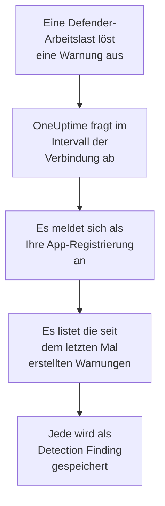

# Microsoft Defender XDR

Importieren Sie die Warnungen jeder Arbeitslast von [Microsoft Defender XDR](https://learn.microsoft.com/en-us/defender-xdr/), von Endpunkten, Identitäten, E-Mail und Cloud-Apps, in die Sicherheitsereignisse von OneUptime. Dort durchsuchen Sie sie neben Ihren Logs, Traces und Metriken, verknüpfen sie mit jeder anderen Quelle und alarmieren die Bereitschaft für die wichtigen. OneUptime liest sie über die Sicherheits-API von Microsoft Graph mit einer App-Registrierung, die Sie anlegen: Kein Agent, Playbook oder Sentinel-Arbeitsbereich ist nötig.

:::cards
- [Die Verbindung einrichten](#die-verbindung-einrichten): Eine App-Registrierung, eine Berechtigung und das Formular der Verbindung.
- [Was importiert wird](#was-importiert-wird): Wie aus jeder Defender-Warnung ein Sicherheitsereignis wird.
- [So funktioniert das Abfragen](#so-funktioniert-das-abfragen): Das Zeitfenster jeder Abfrage, und was ein ausgelasteter Mandant damit macht.
- [Fehlerbehebung](#fehlerbehebung): Was jeder Fehler bedeutet und was zu ändern ist.
:::

## So funktioniert es



Jede Minute fragt OneUptime jede aktivierte Verbindung ab, deren Abfrageintervall abgelaufen ist. Eine Abfrage meldet sich als Ihre App-Registrierung bei Microsoft Entra ID an, bittet Microsoft Graph um die seit der letzten Abfrage erstellten Warnungen ([List alerts_v2](https://learn.microsoft.com/en-us/graph/api/security-list-alerts_v2)) und speichert jede als [OCSF](https://schema.ocsf.io/)-Ereignis Detection Finding (Klasse `2004`). Erkennungsregeln, Monitore und Dashboards behandeln es dann wie ein Sicherheitsereignis aus jeder anderen Quelle.

## Bevor Sie beginnen

- In OneUptime die Rolle Project Owner, Project Admin oder Security Admin. Security Member und Security Viewer sehen Verbindungen und ihren Laufverlauf, können sie aber nicht ändern.
- Ein Microsoft-Entra-Mandant mit einer Lizenz für Microsoft Defender XDR: jede im Microsoft Defender-Portal eingebundene Defender-Arbeitslast, etwa Defender for Endpoint, for Identity, for Office 365 oder for Cloud Apps.
- Eine Entra-Rolle, die Anwendungen registrieren darf, etwa Anwendungsadministrator, und einen globalen Administrator oder Administrator für privilegierte Rollen, um die Administratorzustimmung zu erteilen.
- Ausgehendes HTTPS von der OneUptime-App und den Workern zu `login.microsoftonline.com` und `graph.microsoft.com`, oder zu `login.microsoftonline.us` und `graph.microsoft.us` für Azure Government.

## Die Verbindung einrichten

Die Verbindung meldet sich mit dem [OAuth-2.0-Fluss für Clientanmeldeinformationen](https://learn.microsoft.com/en-us/entra/identity-platform/v2-oauth2-client-creds-grant-flow) an: als Anwendung, nie als Person, mit einer Anwendungsberechtigung.

:::steps
### Eine Anwendung registrieren

1. Melden Sie sich im [Azure-Portal](https://portal.azure.com) an und öffnen Sie **Microsoft Entra ID**.
2. Gehen Sie zu **App registrations → New registration**. Nennen Sie sie `OneUptime Security Events`, lassen Sie **Supported account types** auf **Accounts in this organizational directory only**, lassen Sie die Umleitungs-URI leer und wählen Sie **Register**.
3. Kopieren Sie auf der Seite **Overview** der App die **Anwendungs-ID (Client)** und die **Verzeichnis-ID (Tenant)**.

### Ihr das Lesen von Warnungen erlauben

1. Gehen Sie zu **API permissions → Add a permission → Microsoft Graph → Application permissions**, wählen Sie `SecurityAlert.Read.All` und wählen Sie **Add permissions**. Es ist die Berechtigung mit den geringsten Rechten, die der Aufruf [List alerts_v2](https://learn.microsoft.com/en-us/graph/api/security-list-alerts_v2#permissions) für eine Anwendung annimmt: Fügen Sie nicht `SecurityAlert.ReadWrite.All` hinzu.
2. Wählen Sie **Grant admin consent for** Ihren Mandanten und bestätigen Sie. Der Status der Berechtigung muss **Granted** lauten: Ohne Zustimmung wird jedes Lesen mit `403` abgelehnt.

### Einen geheimen Clientschlüssel anlegen

Gehen Sie zu **Certificates & secrets → Client secrets → New client secret**, wählen Sie, wann es abläuft, und wählen Sie **Add**. Kopieren Sie den **Value** des Geheimnisses, nicht seine **Secret ID**, bevor Sie die Seite verlassen: Er wird nie wieder angezeigt.

Notieren Sie, wann das Geheimnis abläuft. An diesem Tag hört das Abfragen mit `Microsoft Defender XDR token request failed (HTTP 401)` auf, bis Sie es mit **Anmeldedaten aktualisieren** ersetzen.

### Die Verbindung in OneUptime hinzufügen

Öffnen Sie **Produkte → Sicherheitsereignisse → Verbindungen** (`/dashboard/{projectId}/security-events/connections`), klicken Sie auf **Verbindung hinzufügen**, wählen Sie **Microsoft Defender XDR** unter **EDR / XDR** und klicken Sie auf **Weiter**. Füllen Sie die Einstellungen aus der Tabelle unten aus, klicken Sie auf **Weiter** und fügen Sie den Wert des Geheimnisses in **Client-Secret** ein.

### Vor dem Speichern testen

Klicken Sie unter **Vor dem Speichern testen** auf **Diese Einstellungen testen**. Der Test meldet sich mit den Werten im Formular an, liest Warnungen und speichert nichts, ein falsches Geheimnis oder eine fehlende Zustimmung zeigt sich also, bevor die Verbindung existiert. Klicken Sie dann auf **Weiter**, geben Sie der Verbindung einen **Name** und legen Sie sie an.
:::

| Einstellung | Wo Sie sie finden |
| --- | --- |
| **Verzeichnis-ID (Tenant)** | Die Seite **Overview** der App. Die GUID des Mandanten oder eine verifizierte Domäne wie `contoso.onmicrosoft.com`. |
| **Anwendungs-ID (Client)** | Die Seite **Overview** der App. Die GUID der App, die `SecurityAlert.Read.All` hat. |
| **Cloud** | **Öffentliche Azure-Cloud**, die auch Microsoft 365 GCC bedient, oder **Azure Government (USA)** für GCC High (`login.microsoftonline.us` und `graph.microsoft.us`). Microsoft 365 DoD und die 21Vianet-Cloud in China werden nicht unterstützt. |
| **Client-Secret** | Der **Value** des Geheimnisses. Es wird verschlüsselt, nie von der API zurückgegeben und nie wieder angezeigt. Ersetzen Sie es mit **Anmeldedaten aktualisieren** an der Verbindung. |

Der Schritt **Abfrage** hat außerdem eine optionale **Beschreibung**, das **Abfrageintervall (Minuten)**, eine ganze Zahl von `1` bis `1440`, die mit `5` beginnt, und **Aktiviert**, das eingeschaltet beginnt.

## Was importiert wird

Jede [Warnung](https://learn.microsoft.com/en-us/graph/api/resources/security-alert) von Defender XDR wird zu einem Ereignis Detection Finding (OCSF-Klasse `2004`), mit dem Anbieter `Microsoft` und dem Produkt `Microsoft Defender XDR`, das dem Telemetriedienst `Microsoft Defender XDR` zugeordnet wird:

| OCSF-Spalte | Feld der Warnung |
| --- | --- |
| `eventUid` | `id`, die ID der Graph-Warnung, nach der auch Duplikate verworfen werden |
| `time` | `firstActivityDateTime`, oder `createdDateTime`, wenn es keine gibt |
| `message`, `ruleName` | `title` |
| `ruleId` | `detectorId`, oder `alertPolicyId`, wenn es keine gibt |
| `severityName` | `severity`: `informational`, `low`, `medium` oder `high`, und `unknown` bleibt Unknown |
| `statusName` | `status`: Aus `new` wird New, aus `inProgress` In Progress, aus `resolved` Resolved |
| `mitreTechniques` | `mitreTechniques` |
| `mitreTactics` | `categories` oder `category`, wenn es eine ATT&CK-Taktik ist: Aus `CredentialAccess` wird `TA0006`. Andere Kategorien bleiben in `attributes`. |
| `principalHost`, `principalUser`, `principalIp`, `principalProcess` | Die `evidence` mit der Rolle `source`, `attacker` oder `compromised`, sonst die erste ihrer Art |
| `processName`, `processPath`, `processCommandLine`, `parentProcessName`, `parentProcessPath` | Der Prozess-Nachweis, aus dem `principalProcess` stammt: sein `imageFile`, `processCommandLine` und `parentProcessImageFile`. Graph liefert keine Befehlszeile des übergeordneten Prozesses. |
| `targetHost`, `targetUser`, `targetIp`, `targetResource` | Die `evidence` mit einer Zielrolle, etwa `destination` oder `attacked`. URLs, Postfächer und Cloud-Ressourcen füllen `targetResource`. |
| `observables` | Jeder Hostname, jede IP, jeder Benutzer, Dateiname, SHA-1 und SHA-256, jede URL, Domäne, jedes Postfach und jede Ressourcen-ID in `evidence` |
| `attributes` | Die ganze Warnung, flach gemacht zu Schlüsseln mit Punkten wie `evidence.0.hostName`, `serviceSource` und `incidentId` |

Warnungen aus jeder `serviceSource` werden importiert, auch die von Microsoft Sentinel, sobald Sentinel mit dem Defender-Portal verbunden ist. Vorfälle werden nicht importiert, aber jede Warnung behält ihre `incidentId` und `incidentWebUrl` in `attributes`.

## So funktioniert das Abfragen

Jede Abfrage listet die in ihrem Zeitfenster erstellten Warnungen, 100 pro Seite, und folgt dem `@odata.nextLink` von Graph, bis sie das ganze Zeitfenster gelesen hat:

```text
GET https://graph.microsoft.com/v1.0/security/alerts_v2?$filter=createdDateTime ge {start} and createdDateTime lt {end}&$top=100
```

- **Die Erstellungszeit ist der Cursor.** Defender erstellt eine Warnung oft Stunden nach ihrer `firstActivityDateTime`, und ein Cursor über die Aktivitätszeit würde jede solche Warnung überspringen.
- **Die erste Abfrage blickt 24 Stunden zurück**, sodass eine neue Verbindung ihre jüngsten Warnungen sofort zeigt.
- **Jede spätere Abfrage beginnt 1 Minute vor dem gespeicherten Cursor**, sodass eine Warnung, die an der Grenze zwischen zwei Zeitfenstern erstellt wurde, zweimal gelesen und einmal importiert wird.
- **Eine Abfrage liest höchstens 24 Stunden über den Cursor hinaus.** Eine Verbindung, deren Cursor zurückliegt, weil die Worker ausgefallen waren oder der Mandant gedrosselt wurde, holt in einer Reihe von 24-Stunden-Fenstern auf.
- **Duplikate werden nach der `id` der Warnung verworfen**, unter den Ereignissen des Projekts von `Microsoft` / `Microsoft Defender XDR`, sodass die Überlappung, ein wiederholtes Zeitfenster und ein Import nie eine Warnung doppelt speichern.
- **Ein fehlgeschlagener Lauf ändert nichts.** Nach einem Netzwerkfehler oder einem Fehlerstatus von Graph bleiben der Cursor und die Fensterlänge, wie sie waren, und die nächste Abfrage liest dasselbe Zeitfenster erneut. Die einzige Ausnahme ist eine Anfrage, deren Zeit abgelaufen ist: Der Cursor bleibt, aber das nächste Zeitfenster ist halb so lang, denn ein Zeitfenster, das zu schwer ist, um rechtzeitig beantwortet zu werden, würde bei jedem Versuch ablaufen.

### Wenn ein Zeitfenster mehr enthält, als eine Abfrage lesen kann

Eine Abfrage liest höchstens 20 Seiten mit 100 Warnungen: 2.000 Warnungen. Hält diese Grenze sie vor dem Ende ihres Zeitfensters an, ist der Lauf **Teilweise**, mit dieser Warnung:

```text
Stopped after 20 alerts requests (the per-run request limit) before reading the whole window. Microsoft Graph lists alerts newest first and documents no way to sort them oldest first, so this run cannot name a point to resume from.
```

[List alerts_v2](https://learn.microsoft.com/en-us/graph/api/security-list-alerts_v2) dokumentiert `$filter`, `$top`, `$skip` und `$count`, aber nicht `$orderby`, und gibt die neuesten Warnungen zuerst zurück. Die 2.000 Warnungen, die ein angehaltener Lauf gelesen hat, sind die neuesten seines Zeitfensters, den Cursor über sie hinaus zu setzen, würde also die älteren überspringen, die er nie erreicht hat. OneUptime verkürzt stattdessen das Zeitfenster:

1. **Verkleinern.** Die nächste Abfrage liest ein halb so langes Zeitfenster ab demselben Startpunkt und halbiert weiter, bis ein Zeitfenster vollständig gelesen wird, bis hinunter zu einer Minute. Die Warnung des Laufs sagt das: `This window holds more records than one poll can read; the next poll reads a {n} minute window from the same starting point.` Warnungen, die aus dem längeren Zeitfenster schon importiert wurden, werden als Duplikate übersprungen.
2. **Wieder wachsen.** Nachdem ein Zeitfenster vollständig gelesen wurde, rückt der Cursor an sein Ende, und das nächste Zeitfenster ist wieder doppelt so lang, bis zu 24 Stunden.
3. **Über eine einzelne Minute hinweggehen.** Enthält selbst eine Minute mehr als 2.000 Warnungen, geht das Abfragen über sie hinweg, damit neuere Warnungen weiter ankommen. Der Lauf bleibt **Teilweise**, und **Letzter Fehler** lautet `More records were created in the one minute from {cursor} to {end} than one poll can read. Polling moved past this minute so newer records keep arriving; use Import this time range in Diagnostics on this minute to recover what one run can read.` Importieren Sie diese Minute mit **Diesen Zeitraum importieren**, um zurückzuholen, was ein Lauf lesen kann.

Ein Lauf, der aus einem anderen Grund **Teilweise** ist, etwa wegen einer Warnung, die sich nicht in ein Sicherheitsereignis umwandeln ließ, wird ebenso wiederholt, ab demselben Startpunkt. Ein anderes **Abfrageintervall (Minuten)** ändert nichts davon: Es entscheidet, wie oft eine Abfrage beginnt, nicht, wo ihr Zeitfenster beginnt.

### Bei Bedarf ausführen, ansehen und importieren

Klicken Sie an einer Verbindung auf **Diagnose**, um ihre letzten Läufe zu sehen und von Hand mit ihr zu arbeiten. Wer die Verbindung ändern darf, kann diese starten; wer sie sehen darf, kann den Verlauf lesen.

- **Jetzt ausführen** startet sofort eine Abfrage, mit dem üblichen Cursor, auch wenn die Verbindung nicht **Aktiviert** ist.
- **Preview alerts** liest einen Zeitraum von bis zu 7 Tagen und importiert nichts.
- **Diesen Zeitraum importieren** importiert nach Ihrer Bestätigung einen Zeitraum von bis zu 7 Tagen, ohne den Cursor zu verschieben. Bereits importierte Warnungen werden übersprungen.
- **Diagnosen kopieren** an einem Lauf kopiert seinen Bericht für den Support. Er enthält nie Anmeldedaten.

## Verbindung testen

**Verbindung testen** in der Zeile einer Verbindung und **Diese Einstellungen testen** im Formular laufen im API-Prozess, nicht in einem Hintergrund-Worker, sodass ein Test auch dann antwortet, wenn die Worker das Problem sind. Er führt diese Prüfungen der Reihe nach aus:

| Prüfung | Was sie prüft |
| --- | --- |
| **Konfiguration** | Die vier Einstellungen sind vorhanden und gültig. Schlägt das fehl, wird nichts kontaktiert. |
| **Authenticate with Microsoft Entra** | Microsoft Entra ID stellt ein Token für Microsoft Graph aus, in der gewählten Cloud. Das schlägt bei einem falschen oder abgelaufenen Geheimnis fehl, bei einer falschen Mandanten- oder Client-ID oder bei der falschen Cloud. |
| **Read alerts from Microsoft Graph** | Eine in den letzten 24 Stunden erstellte Warnung lässt sich lesen (`$top=1`). Ein `403` hier ist die fehlende Berechtigung `SecurityAlert.Read.All`, die fehlende Administratorzustimmung oder ein Mandant ohne Defender XDR. |
| **Alerts available to import** | Wie viele Warnungen in den letzten 24 Stunden und den letzten 7 Tagen erstellt wurden, je eine Seite mit 100, `100+` heißt also mehr. Keine in 7 Tagen ist eine Warnung, kein Fehler. |
| **Background workers**, **Poll scheduler**, **Security event storage** | Die Seite von OneUptime selbst: Ein Prozess nimmt die Aufträge der Worker-Warteschlange an, der Abfrageauftrag läuft jede Minute, und der Speicher der Sicherheitsereignisse antwortet. |
| **Geplante Abfrage** | Für eine gespeicherte Verbindung: Das Abfragen ist eingeschaltet, kein Lauf wartet festgefahren auf einen Worker, und die Abfragen laufen pünktlich. |

Jede Anfrage in einem Test hat eine Frist von 20 Sekunden. Ein Test importiert nie etwas und verschiebt nie den Cursor, und jede fehlgeschlagene Prüfung sagt, was zu ändern ist.

## Fehlerbehebung

Der **Letzter Fehler** der Verbindung bewahrt die vollständige Fehlermeldung, mit geschwärzten Anmeldedaten, hinter einem Präfix, das den fehlgeschlagenen Schritt nennt. Hat eine Verbindung einen Fehler, wählen Sie in ihrer Spalte **Aktionen** die Aktion **Fehler anzeigen**, um ihn zu lesen, und im Dialog **Fehler kopieren**, um ihn zu kopieren. Lesen Sie zuerst das Präfix.

:::details Letzter Fehler beginnt mit `Microsoft Defender XDR token request`
- `Microsoft Defender XDR token request failed (HTTP ...)`: Microsoft Entra ID hat sich geweigert, ein Token auszustellen, Graph wurde also nie kontaktiert. Die Meldung endet mit einem Hinweis, der sich nach dem `error`-Code von Entra richtet:
  - `invalid_client` (`AADSTS7000215`): Das Geheimnis ist falsch, abgelaufen oder gehört zu einer anderen App. Legen Sie unter **Certificates & secrets** ein neues an und speichern Sie es mit **Anmeldedaten aktualisieren**.
  - `unauthorized_client` (`AADSTS700016`): Die **Anwendungs-ID (Client)** ist nicht in dieser **Verzeichnis-ID (Tenant)**, oder **Cloud** ist falsch.
  - `AADSTS90002`: Diesen Mandanten gibt es nicht.
  - `invalid_scope`: Den Graph-Bereich gibt es in der gewählten Cloud nicht. Prüfen Sie **Cloud**.
- `Microsoft Defender XDR token request returned ...`: Microsoft Entra ID hat mit etwas Unbrauchbarem geantwortet, einem Text, der kein JSON ist oder kein `access_token` hat. Das ist meist ein Proxy oder Gateway dazwischen, nicht die Anmeldedaten.
- `Microsoft Defender XDR token request did not complete: ...`: Der Token-Endpunkt war nicht erreichbar oder hat nicht rechtzeitig geantwortet. Prüfen Sie ausgehendes HTTPS von der OneUptime-App und den Workern zu `login.microsoftonline.com` oder `login.microsoftonline.us`.
:::

:::details Letzter Fehler beginnt mit `Microsoft Defender XDR alerts request`
- `Microsoft Defender XDR alerts request failed (HTTP ...)`: Graph hat sich geweigert, die Warnungen zu listen. Die Meldung nennt den Fehlercode von Graph und einen Hinweis:
  - `403` (`Authorization_RequestDenied`): `SecurityAlert.Read.All` oder ihre Administratorzustimmung fehlt, oder der Mandant hat keine Lizenz für Defender XDR. Eine Zustimmung braucht einige Minuten, bis sie greift.
  - `401` (`InvalidAuthenticationToken`), nachdem ein Token ausgestellt wurde: **Cloud** passt meist nicht zum Mandanten.
  - `429` (`TooManyRequests`): Graph drosselt die App, und die nächste Abfrage liest dasselbe Zeitfenster erneut. Die Meldung kann das `Retry-After` von Graph nicht zitieren, weil der HTTP-Client von OneUptime bei einem Fehler keine Antwort-Header behält. Wiederholt sich das, erhöhen Sie das **Abfrageintervall (Minuten)**.
  - `5xx`: ein Problem auf der Seite von Graph. Die nächste Abfrage versucht es erneut.
  - `400`: Graph wollte die Abfrage nicht ausführen, die OneUptime baut, nicht Ihre Einstellungen. Kopieren Sie die Meldung für den OneUptime-Support.
- `Microsoft Defender XDR alerts request returned ...`: Graph hat mit `200` geantwortet, aber mit etwas, das die Verbindung nicht nutzen konnte: einem Text, der kein JSON ist, keiner Liste `value` oder einem `@odata.nextLink`, das kein `https://`-Link auf dem Graph-Host Ihrer Cloud ist. Ein solcher Link wird abgelehnt, damit das Token nie anderswohin gesendet wird. Das wird gemeldet statt als leeres Zeitfenster genommen, damit der Cursor nie über Warnungen hinwegrückt, die niemand gelesen hat.
- `Microsoft Defender XDR alerts request did not complete: ...`: Graph war nicht erreichbar oder hat nicht rechtzeitig geantwortet: 60 Sekunden bei einer Abfrage, 20 bei einem Test. Prüfen Sie ausgehendes HTTPS zu `graph.microsoft.com` oder `graph.microsoft.us`.
:::

:::details Der Test besteht, aber Zuletzt abgefragt ist Never
Der Abfrageauftrag ist nie gelaufen. Lesen Sie die Prüfungen **Background workers** und **Poll scheduler**. Bei einer selbst gehosteten Installation ist die übliche Ursache `DISABLE_QUEUE_WORKERS=true` an der App, ohne eigene Worker-Bereitstellung, die die Aufträge annimmt: Setzen Sie es auf `false` oder betreiben Sie die Worker-Bereitstellung (Helm: `worker.enabled: true`, das standardmäßig `false` ist).
:::

:::details Abfragen gelingen, aber eine bekannte Warnung fehlt
Vergleichen Sie die `createdDateTime` der Warnung im Defender-Portal mit dem Zeitfenster des Laufs in der **Diagnose**: Zeitfenster gehen nach der Erstellungszeit, nicht nach der Aktivitätszeit.

- Eine Warnung, die erstellt wurde, bevor es die Verbindung gab, ist älter als der erste Rückblick von 24 Stunden. Importieren Sie sie mit **Diesen Zeitraum importieren**.
- Ein Lauf mit **Teilweise** wurde von der Grenze von 2.000 Warnungen angehalten. Die nächste Abfrage liest ein kürzeres Zeitfenster ab demselben Start, die Warnung wird also importiert, sobald ein Zeitfenster, das sie enthält, vollständig gelesen wird.
- Nennt **Letzter Fehler** eine Minute, über die das Abfragen hinweggegangen ist, importieren Sie diese Minute mit **Diesen Zeitraum importieren**.
:::

:::details Dieselbe Warnung erscheint zweimal
Die Überlappung von 1 Minute ist es nicht: Das zweite Lesen wird als Duplikat gezählt und nicht gespeichert. Zwei Ereignisse mit derselben `eventUid` wurden unter verschiedenen Produkten importiert, etwa wenn dieselbe Warnung auch über eine Verbindung zu Microsoft Sentinel ankommt. Duplikate werden pro Anbieter und Produkt verworfen.
:::

## Was Sie davon haben

- **Suche.** Filtern Sie Defender-Warnungen im Explorer der Sicherheitsereignisse nach Schweregrad, Status, MITRE-Technik, Host, Benutzer, IP oder jedem Observable, neben den Logs und Metriken dieses Hosts.
- **Verknüpfung.** Die Belege jeder Warnung, ihre Geräte, Benutzer, IPs, Dateien und URLs, werden als Observables indiziert, sodass eine Suche quer durch alle Quellen alles findet, was einen Host nennt.
- **Erkennungsregeln.** Sigma-Regeln, die nach einem Zeitplan über Ihre Sicherheitsereignisse laufen und Warnungen eröffnen, die die Bereitschaft alarmieren.
- **Monitore.** Monitore für Sicherheitsereignisse zählen passende Ereignisse und eröffnen ab einem Schwellwert Vorfälle oder Warnungen.

Sicherheitsereignisse werden wie Ihre übrige Telemetrie abgerechnet, pro aufgenommenem GB. Siehe [Preise](https://oneuptime.com/pricing).

## Nächste Schritte

:::cards
- [Sicherheitsereignisse](/docs/telemetry/security-events): Durchsuchen, verknüpfen und warnen, was Sie importieren.
- [Microsoft Sentinel](/docs/integrations/microsoft-sentinel): Auch die Vorfälle eines Sentinel-Arbeitsbereichs importieren.
- [Rollen](/docs/permissions/reference#rollen): Was die Security-Rollen sehen und ändern können.
- [Integrationsübersicht](/docs/integrations/index): Die anderen Werkzeuge, die Sie verbinden können.
:::
