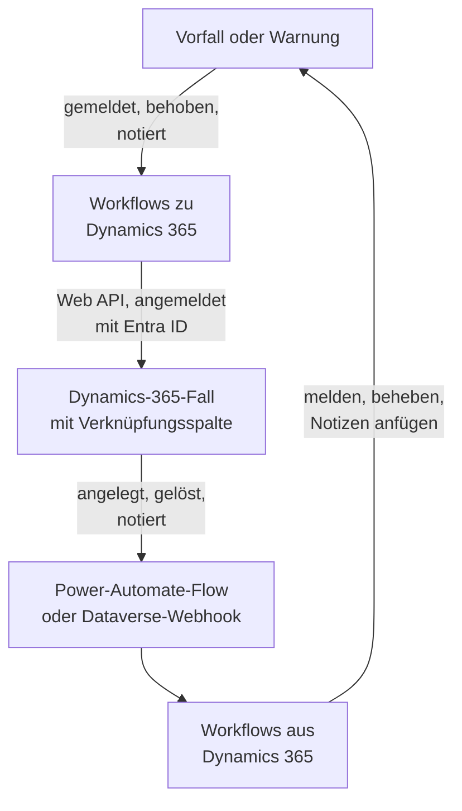

# Microsoft Dynamics 365

Halten Sie Fälle in [Microsoft Dynamics 365](https://www.microsoft.com/dynamics-365) mit Ihren OneUptime-Vorfällen und -Warnungen im Gleichschritt, in beide Richtungen. Fertige Workflow-Vorlagen legen für jeden Vorfall und jede Warnung einen Fall an, schließen ihn, wenn der Datensatz behoben ist, und kopieren Notizen hinein. Andere melden Vorfälle aus neuen Fällen und bringen Lösungen und Notizen zurück. Es gibt kein Plugin: Die Workflows rufen die Dataverse Web API auf, und Dynamics 365 ruft ihre Webhook-URLs auf.

:::cards
- [Dynamics 365 vorbereiten](#dynamics-365-vorbereiten): Eine App-Registrierung, ein Anwendungsbenutzer und eine Verknüpfungsspalte.
- [Mit einer Vorlage beginnen](#mit-einer-vorlage-beginnen): Die 13 Vorlagen, was sie abfragen und wie Sie sie einrichten.
- [So arbeiten die Vorlagen](#so-arbeiten-die-vorlagen): Wie Fälle und Datensätze verknüpft bleiben, ohne Schleifen.
- [Selbst bauen](#selbst-bauen): Jede Richtung von Hand, wenn eine Vorlage nicht passt.
:::

## So funktioniert es



Jede Vorlage ist ein kleiner Workflow, Sie nehmen also nur die Richtungen, die Sie wollen, für Vorfälle, Warnungen oder beides. Die Vorlagen von OneUptime zu Dynamics 365 rufen die Dataverse Web API auf, als Anwendung über Microsoft Entra ID angemeldet. Die Vorlagen von Dynamics 365 zu OneUptime starten, wenn ein Power-Automate-Flow oder ein Dataverse-Webhook sie aufruft. Eine Textspalte, die Sie der Tabelle Case hinzufügen, verknüpft jeden Fall mit seinem Datensatz.

## Bevor Sie beginnen

- Eine Dynamics-365-Umgebung mit der Tabelle **Case**. Fälle kommen aus Dynamics 365 Customer Service: Eine Dataverse-Umgebung ohne es hat keine Tabelle `incident`, in die geschrieben werden kann.
- Das Recht, eine Anwendung in **Microsoft Entra ID** zu registrieren und in der Umgebung einen Anwendungsbenutzer anzulegen. Das sind oft zwei verschiedene Administratoren.
- In OneUptime das Recht, Workflows anzulegen. In OneUptime Cloud brauchen Workflows den Tarif **Growth** oder höher.

> [!NOTE]
> Diese Seite verwendet die Namen von Dataverse, nicht die Beschriftungen der Dynamics-Formulare. Ein Fall ist die Tabelle `incident`, ihre Sammlung in einer URL heißt `incidents`, ihr Schlüssel ist `incidentid` und ihre Titelspalte `title`. Die Fallnummer, die Sie sehen, ist `ticketnumber`.

## Dynamics 365 vorbereiten

Die Vorlagen und ein Workflow, den Sie selbst bauen, brauchen beide das Folgende. OneUptime meldet sich als Anwendung an, nicht als Person, mit dem OAuth-2.0-Ablauf für Client-Anmeldedaten.

:::steps
### Eine Anwendung in Microsoft Entra ID registrieren

1. Melden Sie sich im [Azure-Portal](https://portal.azure.com) als Administrator des Mandanten Ihrer Dynamics-Umgebung an und öffnen Sie **Microsoft Entra ID**.
2. Gehen Sie zu **App registrations → New registration**. Nennen Sie sie `OneUptime Integration`, lassen Sie **Supported account types** auf **Accounts in this organizational directory only** und wählen Sie **Register**.
3. Kopieren Sie auf der Seite **Overview** der App die **Application (client) ID** und die **Directory (tenant) ID**.
4. Gehen Sie zu **Certificates & secrets → Client secrets → New client secret** und kopieren Sie den **Value** des Secrets, nicht seine ID, bevor Sie die Seite verlassen: Er wird nie wieder angezeigt. Ein Client-Secret lebt höchstens 24 Monate, notieren Sie sich also, wann es abläuft.

Fügen Sie keine API-Berechtigungen hinzu und erteilen Sie keine Administratorzustimmung: Ohne angemeldeten Benutzer bewirken sie nichts. Dynamics 365 entscheidet über seinen Anwendungsbenutzer, was die Anwendung darf.

### Den Anwendungsbenutzer anlegen

1. Wählen Sie im [Power Platform Admin Center](https://admin.powerplatform.microsoft.com/) **Manage → Environments** und dann Ihre Umgebung.
2. Wählen Sie **Settings → Users + permissions → Application users**, dann **+ New app user** und **+ Add an app**. Wählen Sie die Registrierung und dann **Add**.
3. Wählen Sie eine **Business unit** und geben Sie ihm dann mit dem Bearbeitungssymbol neben **Security roles** eine benutzerdefinierte Sicherheitsrolle. Auf Organisationsebene braucht die Rolle:
   - **Case**: Create, Read, Write, Append und Append To.
   - **Note**: Create, Read und Append, für die Notizvorlagen.
   - **Activity**: Create, Read und Append, weil das Schließen eines Falls eine Case Resolution aufzeichnet, die eine Aktivität ist.
   - **Account**, und **Contact**, wenn Fälle für einen Kontakt angelegt werden: Read und Append To.
4. Wählen Sie **Save** und dann **Create**.

Ein Anwendungsbenutzer kann nur eine benutzerdefinierte Rolle haben: Kopieren Sie eine vorhandene und kürzen Sie sie. Ohne diesen Benutzer stellt Microsoft Entra ID trotzdem Tokens aus, aber jeder Aufruf an Dynamics 365 scheitert mit `403` und `0x80072560`, „The user isn't a member of the organization.“

### Eine Verknüpfungsspalte zur Tabelle Case hinzufügen

Dataverse hat nichts wie die Labels von Jira, also finden ein Fall und ein OneUptime-Datensatz einander über eine Spalte, die Sie hinzufügen.

1. Wählen Sie in [make.powerapps.com](https://make.powerapps.com) Ihre Umgebung, öffnen Sie **Tables → Case → Columns** und wählen Sie **New column**.
2. Nennen Sie sie `OneUptime Link`, lassen Sie **Data type** auf **Single line of text** und speichern Sie. Die Standardlänge von höchstens 100 reicht völlig: Die Vorlagen schreiben höchstens 55 Zeichen.
3. Öffnen Sie die neue Spalte und kopieren Sie ihren **Logical name**, etwa `new_oneuptimelink`. Das Präfix stammt vom Herausgeber Ihrer Lösung, Ihres kann also abweichen, wie `cr4f2_oneuptimelink`.

Fügen Sie die Spalte dem Formular Case hinzu, wenn Bearbeiter die Verknüpfung sehen sollen.
:::

## Mit einer Vorlage beginnen

Der Dialog **Arbeitsablauf erstellen** hat 13 Dynamics-365-Vorlagen, unter **Dynamics 365** in seiner Kategorienliste: sieben für Vorfälle, dann sechs für Warnungen, jede Gruppe unter ihrer eigenen Überschrift. Sie teilen die Verknüpfungsspalte, sodass jede Kombination zusammenarbeitet.

### Vorlagen für Vorfälle

| Vorlage | Was sie tut | Was sie abfragt |
| --- | --- | --- |
| **Von OneUptime zu Dynamics 365** | | |
| Create a Dynamics 365 case when an incident is declared | Legt für jeden neuen Vorfall einen Fall an, mit einer aus seinem Schweregrad gewählten Priorität und der ID des Vorfalls in der Verknüpfungsspalte. Aus Dynamics 365 gemeldete Vorfälle und private Vorfälle werden übersprungen. | Die fünf Dynamics-365-Einstellungen, der Kunde für neue Fälle und die OneUptime URL |
| Resolve the Dynamics 365 case when the incident is resolved | Schließt den verknüpften Fall als **Problem Solved**, wenn der Vorfall behoben wird, und zeichnet eine Case Resolution auf, wie es das Lösen von Hand tut. Öffnet nie einen Fall wieder. | Die fünf Dynamics-365-Einstellungen |
| Copy incident private notes to the Dynamics 365 case | Fügt jede neue private Notiz als Notiz zum verknüpften Fall hinzu. | Die fünf Dynamics-365-Einstellungen |
| Copy incident public notes to the Dynamics 365 case | Fügt jede neue öffentliche Notiz als Notiz zum verknüpften Fall hinzu, damit Bearbeiter Kunden sagen können, was die Statusseite sagt. | Die fünf Dynamics-365-Einstellungen |
| **Von Dynamics 365 zu OneUptime** | | |
| Declare an incident when a Dynamics 365 case is created | Meldet für jeden neuen Fall einen Vorfall, von Ihren Statusseiten ferngehalten, mit einem aus der Priorität des Falls gewählten Schweregrad, und schreibt dann die ID des Vorfalls in die Verknüpfungsspalte des Falls. | Die fünf Dynamics-365-Einstellungen und ein Flow oder Webhook für neue Fälle |
| Resolve the incident when its Dynamics 365 case is resolved | Behebt den Vorfall, wenn sein verknüpfter Fall gelöst wird. | Die fünf Dynamics-365-Einstellungen und ein Flow oder Webhook für Statusänderungen von Fällen |
| Add Dynamics 365 case notes to the incident as private notes | Kopiert jede Notiz, die ein Bearbeiter einem verknüpften Fall hinzufügt, als private Notiz in den Vorfall. | Die fünf Dynamics-365-Einstellungen und ein Flow oder Webhook für neue Notizen |

### Vorlagen für Warnungen

Die Vorlagen für Warnungen erledigen dieselben Aufgaben für Warnungen. Es ist eine weniger, weil Warnungen keine öffentlichen Notizen haben, und **Create an alert when a Dynamics 365 case is created** schreibt keine Statusseiten-Einstellungen, weil eine Warnung nie eine Statusseite erreicht.

| Vorlage | Was sie tut | Was sie abfragt |
| --- | --- | --- |
| **Von OneUptime zu Dynamics 365** | | |
| Create a Dynamics 365 case when an alert is created | Legt für jede neue Warnung einen Fall an, auch für jede, die ein Monitor auslöst. Aus Dynamics 365 angelegte Warnungen und private Warnungen werden übersprungen. | Die fünf Dynamics-365-Einstellungen, der Kunde für neue Fälle und die OneUptime URL |
| Resolve the Dynamics 365 case when the alert is resolved | Schließt den verknüpften Fall als **Problem Solved**, wenn die Warnung behoben wird. | Die fünf Dynamics-365-Einstellungen |
| Copy alert private notes to the Dynamics 365 case | Fügt jede neue private Notiz als Notiz zum verknüpften Fall hinzu. | Die fünf Dynamics-365-Einstellungen |
| **Von Dynamics 365 zu OneUptime** | | |
| Create an alert when a Dynamics 365 case is created | Legt für jeden neuen Fall eine Warnung an, mit einem aus der Priorität des Falls gewählten Schweregrad, und schreibt dann die ID der Warnung in die Verknüpfungsspalte des Falls. | Die fünf Dynamics-365-Einstellungen und ein Flow oder Webhook für neue Fälle |
| Resolve the alert when its Dynamics 365 case is resolved | Behebt die Warnung, wenn ihr verknüpfter Fall gelöst wird. | Die fünf Dynamics-365-Einstellungen und ein Flow oder Webhook für Statusänderungen von Fällen |
| Add Dynamics 365 case notes to the alert as private notes | Kopiert jede Notiz, die ein Bearbeiter einem verknüpften Fall hinzufügt, als private Notiz in die Warnung. | Die fünf Dynamics-365-Einstellungen und ein Flow oder Webhook für neue Notizen |

Keine der Vorlagen von OneUptime zu Dynamics 365 sendet einen als **Privater Vorfall** markierten Vorfall oder eine als **Private Warnung** markierte Warnung an Dynamics 365: weder den Datensatz noch seinen Status oder seine Notizen, es sei denn, Sie schalten das ein. Siehe [Ändern, was eine Vorlage tut](#ändern-was-eine-vorlage-tut).

**Monitore lösen Warnungen von selbst aus, und es können viele sein.** **Create a Dynamics 365 case when an alert is created** legt für jede einen Fall an. Sofern nicht jede Warnung einen Fall verdient, setzen Sie zwischen den Trigger und den Rest des Workflows einen **If / Else**-Baustein, etwa auf `{{local.components.alert-on-create-1.returnValues.model.alertSeverity.name}}`, und verbinden Sie nur seine Seite **Yes** weiter.

### Was die Vorlagen abfragen

Der Schritt **Konfigurieren** des Anlegeassistenten fragt bis zu sieben Werte ab: Jede Vorlage fragt nach den ersten fünf, den Dynamics-365-Einstellungen, und die beiden Vorlagen, die Fälle anlegen, zusätzlich nach den letzten beiden. Er prüft die Form jeder Dynamics-365-Einstellung, bevor etwas angelegt wird, und sagt, was Sie stattdessen eingeben sollen, weil ein Wert der falschen Form erst bei einer Ausführung irgendwo ein Fehler wird.

- **Dynamics 365 Environment URL** — die Adresse Ihrer Umgebung, etwa `https://yourorg.crm.dynamics.com`, aus dem [Power Platform Admin Center](https://admin.powerplatform.microsoft.com/) unter **Environments**, Ihre Umgebung, **Environment URL**. Nur die Adresse: nicht der Web-API-Endpunkt, der auf `/api/data/v9.2` endet, und kein Schrägstrich am Ende.
- **Directory (Tenant) ID** — von der Seite **Overview** der App-Registrierung.
- **Application (Client) ID** — von derselben Seite.
- **Client Secret Value** — der **Value** des Client-Secrets aus **Certificates & secrets**. Nicht seine **Secret ID**, die eine GUID ist: Der Assistent lehnt hier eine GUID ab.
- **Case Link Column** — der logische Name der Verknüpfungsspalte, etwa `new_oneuptimelink`.
- **Customer for New Cases** — nur die beiden Vorlagen, die Fälle anlegen, fragen danach. Jeder Fall braucht einen Kunden, und ein OneUptime-Vorfall hat keinen, also werden alle neuen Fälle für einen angelegt: Fügen Sie die ID eines Kontos ein, oder `contacts(<id>)` für einen Kontakt. Öffnen Sie den Datensatz in Dynamics 365: Seine ID ist der Teil nach `id=` in der Adresse.
- **OneUptime URL** — nur die beiden Vorlagen, die Fälle anlegen, fragen danach: die Adresse, unter der Sie OneUptime öffnen, etwa `https://oneuptime.com`. Die Beschreibung des Falls verlinkt damit zurück auf den Vorfall oder die Warnung.

**So melden sich die Vorlagen an.** Der Assistent speichert Mandant, Client-ID und Secret in einer [OAuth-2.0-Variable](/docs/workflows/variables#oauth-20-variablen-token-die-sich-selbst-erneuern), `dynamicsAccessToken`, unter den **Arbeitsablaufvariablen** des Workflows: Client Credentials, die Token-URL `https://login.microsoftonline.com/<tenant>/oauth2/v2.0/token`, der Geltungsbereich `<environment URL>/.default` und das Client-Secret, im Request-Body gesendet und verschlüsselt gespeichert. Jeder Aufruf an Dynamics 365 sendet `Authorization: Bearer {{local.variables.dynamicsAccessToken}}`. OneUptime holt das Token, wenn ein Schritt es zum ersten Mal braucht, holt ein neues, bevor es abläuft, und ersetzt es in Ausführungsprotokollen und Schrittspuren durch `[REDACTED]`.

Um die Anmeldung zu prüfen, bevor etwas läuft, öffnen Sie **Arbeitsablaufvariablen**, klicken Sie bei `dynamicsAccessToken` auf **Anzeigen** und dann auf **Jetzt aktualisieren**. **Access Token Fetched** bedeutet, dass die App-Registrierung stimmt. Sonst nennt der Fehler von Microsoft Entra ID, was falsch ist, etwa `AADSTS7000215: Invalid client secret provided`.

Jeder Workflow behält seine eigene Kopie. Wenn Sie das Client-Secret ersetzen, öffnen Sie `dynamicsAccessToken` in jedem Dynamics-365-Workflow und nutzen Sie **Anmeldedaten aktualisieren**.

### Die Workflows anlegen

:::steps
1. Öffnen Sie **Arbeitsabläufe → Arbeitsablauf erstellen**. Wählen Sie unter **Oder mit einer Vorlage beginnen** in der Kategorienliste **Dynamics 365**, oder tippen Sie `Dynamics` in **Vorlagen durchsuchen…**, und klicken Sie auf die gewünschte Vorlage. Sie öffnet sich und zeigt, was sie tut und welche Einstellungen sie abfragt. Klicken Sie auf **Diese Vorlage verwenden**.
2. **Name** wird aus der Vorlage ausgefüllt. Ändern Sie ihn, wenn Sie möchten.
3. **Konfigurieren** fragt die Werte oben ab.
4. Klicken Sie auf **Arbeitsablauf erstellen**. Jeder Workflow wird ausgeschaltet angelegt: Schalten Sie oben in seinem **Editor** **Aktiviert** ein.
:::

Beginnen Sie mit **Create a Dynamics 365 case when an incident is declared**, oder für Warnungen mit **Create a Dynamics 365 case when an alert is created**: Jede andere Vorlage von OneUptime zu Dynamics 365 derselben Art findet den Fall über die Verknüpfung, die diese schreibt. Schalten Sie sie ein, melden Sie einen Testvorfall oder legen Sie eine Testwarnung an, und öffnen Sie **Protokolle → Ausführungen** des Workflows. Der letzte Schritt der Ausführung sollte `✅ Opened Dynamics 365 case CAS-01001-X1Y2Z3 for INC-42, linked as oneuptime-incident-<id>.` lauten.

### Die Vorlagen von Dynamics 365 zu OneUptime verbinden

Die Vorlagen von Dynamics 365 zu OneUptime, drei für Vorfälle und drei für Warnungen, starten bei einem [Webhook-Trigger](/docs/workflows/triggers#webhook), also muss Dynamics 365 gesagt werden, wohin es seine Ereignisse senden soll. Gehen Sie in dieser Reihenfolge vor:

1. Legen Sie den Workflow an und **schalten Sie ihn zuerst ein**. Ein ausgeschalteter Workflow lehnt Zustellungen ab, und sie werden nicht eingereiht.
2. Öffnen Sie den **Editor** des Workflows, klicken Sie auf den **Webhook**-Trigger-Baustein (`webhook-1`) und klicken Sie oben in seinen Einstellungen auf **URL kopieren**. Die URL sieht so aus:

   ```text
   https://<your OneUptime host>/workflow/trigger/<webhook secret key>
   ```

3. Lassen Sie Dynamics 365 an sie senden, aus einem Power-Automate-Flow oder aus einem Dataverse-Webhook.

Jeder Vorlage muss nur gesagt werden, welche Zeile sich geändert hat. Sie liest diese Zeile aus Dynamics 365 zurück, bevor sie etwas tut, übernimmt also nie Titel, Status oder Verknüpfung eines Falls aus der Anfrage, und es ist ihr gleich, welcher der beiden sie sendet.

:::tabs
@tab Power Automate flow
Legen Sie in [Power Automate](https://make.powerautomate.com) einen **Automated cloud flow** mit dem **Microsoft Dataverse**-Trigger **When a row is added, modified or deleted** an, eingestellt wie unten, mit **Scope** auf **Organization**. Fügen Sie die eingebaute Aktion **HTTP** hinzu: **Method** `POST`, **URI** die URL des Workflows, ein Header `Content-Type: application/json` und der Body unten, mit der ID der Zeile aus dem dynamischen Inhalt des Triggers.

| Vorlage | Change type | Table name | Select columns | Body |
| --- | --- | --- | --- | --- |
| Einen Vorfall melden / eine Warnung anlegen, wenn ein Fall angelegt wird | Added | Cases | | `{"incidentid": "<Case>"}` |
| Den Vorfall / die Warnung beheben, wenn ihr Fall gelöst wird | Modified | Cases | `statecode,statuscode` | `{"incidentid": "<Case>"}` |
| Fallnotizen als private Notizen zum Vorfall / zur Warnung hinzufügen | Added | Notes | | `{"annotationid": "<Note>"}` |

Um nur manche Fälle zu senden, nutzen Sie **Filter rows** des Triggers, etwa `prioritycode eq 1` nur für Fälle mit hoher Priorität. Sie können auch die gesamte Ausgabe des Triggers senden: Die Vorlagen lesen die ID der Zeile und ihre `SdkMessage` auf dieselbe Weise daraus.
@tab Dataverse webhook
Registrieren Sie die URL mit dem [Plug-in Registration Tool](https://learn.microsoft.com/en-us/power-apps/developer/data-platform/register-web-hook): **Register New WebHook**, mit der Authentifizierung **HttpHeader** und einem eigenen Header; die URL selbst ist das Geheimnis. Registrieren Sie dann für jedes Ereignis unten einen Schritt darauf, mit **Event Pipeline Stage of Execution** auf **PostOperation** und **Execution Mode** auf **Asynchronous**.

| Vorlage | Message | Primary Entity | Filtering Attributes |
| --- | --- | --- | --- |
| Einen Vorfall melden / eine Warnung anlegen, wenn ein Fall angelegt wird | `Create` | `incident` | |
| Den Vorfall / die Warnung beheben, wenn ihr Fall gelöst wird | `Close`, und `Update` für Statusänderungen durch andere | `incident` | `statecode, statuscode` (Update) |
| Fallnotizen als private Notizen zum Vorfall / zur Warnung hinzufügen | `Create` | `annotation` | |

Das Lösen eines Falls löst die Nachricht **Close** aus, nicht **Update**, deshalb braucht diese Vorlage beide. Ein Webhook sendet den Ausführungskontext des Plug-ins, der die Zeile in `PrimaryEntityId` nennt, oder bei **Close** in seiner `IncidentResolution`, und die Vorlagen lesen sie von dort. Ein Dataverse-Webhook ruft nur die Ports 80 und 443 auf und hat keinen eigenen Zeilenfilter: Jeder neue Fall erreicht die Anlegevorlage, es sei denn, Sie schränken sie mit `ONLY_PRIORITIES` ein.
:::

Bevor Sie sich auf einen der beiden verlassen:

- **Wer die URL hat, kann den Workflow auslösen.** Weil die Vorlagen jede Zeile aus Dynamics 365 zurücklesen, kann eine Anfrage eine Vorlage nur einen echten Fall oder eine echte Notiz ansehen lassen. Sie kann die Anlegevorlagen aber auf einen noch nicht verknüpften Fall ansetzen. Bewahren Sie die URL nur im Flow oder im Webhook auf. Wird sie bekannt, klicken Sie im **Editor** des Workflows auf den **Webhook**-Trigger, klicken Sie auf **URL zurücksetzen** und fügen Sie die neue URL in den Flow oder den Webhook ein. Die alte URL funktioniert sofort nicht mehr.
- **Jedes Ereignis ist eine Ausführung**, auch die, die eine Vorlage überspringt. In OneUptime Cloud zählt jedes zu den Workflow-Ausführungen Ihres Tarifs, und das Filtern im Flow hält die Zahl niedrig. Siehe [Tariflimits](/docs/workflows/configuration#plan-grenzen).
- **Nutzen Sie beide Vorlagen, die aus Fällen Datensätze anlegen?** **Declare an incident when a Dynamics 365 case is created** und **Create an alert when a Dynamics 365 case is created** handeln beide bei jedem Fall, der ihnen gesendet wird. Jede prüft zuerst die Verknüpfungsspalte, aber zwei Zustellungen für einen neuen Fall kommen gleichzeitig an, der Fall kann also einen Vorfall und eine Warnung bekommen. Senden Sie den beiden verschiedene Fälle, etwa nach Falltyp.

### Prüfen, ob es funktioniert

Jede Vorlage endet mit einem **Log**-Schritt, der sagt, was passiert ist, der letzte Schritt einer Ausführung in **Protokolle → Ausführungen** ist also die Stelle, an der Sie nachsehen:

- `✅` — sie hat ihre Aufgabe erledigt und nennt den Fall, den Vorfall oder die Warnung.
- `ℹ️` — sie hat das Ereignis absichtlich übersprungen und sagt, warum: Der Fall ist mit keinem Datensatz dieser Art verknüpft, die Notiz kam von der anderen Seite, der Datensatz ist privat, oder dem neuen Status ist kein Fallstatus zugeordnet.
- `❌` — ein Aufruf ist fehlgeschlagen. Bei einem Dynamics-365-Aufruf enthält die Zeile die Antwort von Dynamics 365.
- `⚠️` — eine Vorlage, die aus einem Fall einen Datensatz anlegt, hat ihn angelegt, aber Dynamics 365 hat die Verknüpfung nicht angenommen, die anderen Vorlagen finden ihn also noch nicht. Tippen Sie die Verknüpfung von Hand in die Spalte des Falls.

Bleibt eine Ausführung beim ersten Dynamics-365-Schritt mit `Could not get an OAuth 2.0 access token for {{local.variables.dynamicsAccessToken}}` stehen, sind die Anmeldeeinstellungen falsch, und die Meldung zitiert die Antwort von Microsoft Entra ID. Siehe [Was die Vorlagen abfragen](#was-die-vorlagen-abfragen).

## So arbeiten die Vorlagen

### Wie beide Seiten verknüpft bleiben

Der Fall hält die Verknüpfung. Ein Fall, der zu einem Vorfall gehört, hat `oneuptime-incident-<incident id>` in seiner Verknüpfungsspalte, und einer, der zu einer Warnung gehört, `oneuptime-alert-<alert id>`. Die ID ist der letzte Teil der Adresse des Datensatzes im Dashboard.

Die Vorlagen, die Fälle anlegen, schreiben sie beim Anlegen des Falls, und die Vorlagen, die aus Fällen Datensätze anlegen, schreiben sie, sobald der Datensatz existiert. Jede andere Vorlage findet darüber die andere Seite: Die von OneUptime zu Dynamics 365 suchen den Fall über seine Verknüpfung, und die von Dynamics 365 zu OneUptime lesen die ID des Datensatzes aus dem Fall. Um einen von Hand angelegten Fall zu verknüpfen, tippen Sie den Wert selbst in seine Verknüpfungsspalte, aber nur, wenn der Datensatz noch keinen Fall hat.

**Ein Fall ist mit einem Vorfall oder mit einer Warnung verknüpft, nie mit beidem.** Eine Spalte dient beiden Arten. Die Vorlagen für Vorfälle ignorieren einen mit einer Warnung verknüpften Fall und umgekehrt, und die Vorlagen, die aus Fällen Datensätze anlegen, lassen jeden Fall in Ruhe, dessen Verknüpfungsspalte überhaupt etwas enthält.

**Ein Datensatz hat einen Fall.** Die Vorlagen, die in einen Fall schreiben, handeln nur, wenn genau ein Fall die Verknüpfung des Datensatzes hält. Wird die Verknüpfung in einen zweiten Fall kopiert, halten sie an, und jede Ausführung endet mit einem Überspringen, das beide nennt:

```text
More than one Dynamics 365 case holds the link oneuptime-incident-<id> (CAS-01001-X1Y2Z3, CAS-01002-K4L5M6). Clear it on every case except the one opened for the incident.
```

Aus einem Fall angelegte Vorfälle und Warnungen behalten außerdem ID und Nummer des Falls in `customFields.dynamicsCaseId` und `customFields.dynamicsCaseNumber`, beim Anlegen geschrieben. Daran erkennen die Vorlagen, die Fälle anlegen, dass der Datensatz schon einen Fall hat.

### Wie die Vorlagen Schleifen vermeiden

Jedes Schreiben in eine Richtung ist ein Ereignis in der anderen: Eine einem Fall hinzugefügte Notiz kommt als neue Notiz zurück, und eine in OneUptime hinzugefügte private Notiz löst den Notiz-Trigger aus. Vier Dinge stoppen das Echo:

- **Markierungen im Text.** Jede Notiz, die die Vorlagen einem Fall hinzufügen, hat den Titel `Synced from OneUptime: …`, und ebenso der Betreff jeder Case Resolution, die sie aufzeichnen. Jede aus Dynamics 365 geschriebene Notiz und die Ursache jeder von dort vorgenommenen Statusänderung beginnen mit `Synced from Dynamics 365`. Jede Richtung überspringt Text, der die Markierung der anderen Seite trägt, auch in einer Notiz, die jemand geschrieben hat und die eine Markierung zitiert.
- **Die Verknüpfung ab dem ersten Speichern.** Ein von OneUptime eröffneter Fall hält seine Verknüpfung ab dem Moment, in dem er existiert, wenn also sein **Create** zurückkommt, findet die Vorlage, die aus Fällen Datensätze anlegt, ihn verknüpft und tut nichts.
- **`customFields.dynamicsCaseId`.** Ein aus einem Fall angelegter Datensatz trägt es, und die Vorlagen, die Fälle anlegen, überspringen solche Datensätze.
- **Status bewegen sich nur vorwärts, auf beiden Seiten.** Das Beheben des Datensatzes schließt den Fall, und das **Close** des Falls findet den Datensatz dann bereits behoben. Wird zuerst der Fall gelöst, wird der Datensatz behoben, und seine Aktualisierung findet den Fall bereits geschlossen. Ein bereits gelöster oder abgebrochener Fall wird nie wieder geöffnet.

Behalten Sie die Markierungen, wenn Sie die Vorlagen bearbeiten. Es sind die Konstanten `FROM_ONEUPTIME` und `FROM_DYNAMICS` im Hilfsblock oben in jedem Skript.

### Ändern, was eine Vorlage tut

Öffnen Sie den **Editor** des Workflows und klicken Sie auf den Baustein, den Sie ändern möchten. Die Einstellungen, die Sie am ehesten brauchen, sind Konstanten nahe dem Anfang eines Skripts, im **JavaScript Code** eines **Run Custom JavaScript**-Bausteins, direkt unter dem gemeinsamen Hilfsblock. Die Versionen für Vorfälle und Warnungen haben dieselben Konstanten in denselben Bausteinen.

| Konstante | Vorlage und Baustein | Was sie steuert |
| --- | --- | --- |
| `SYNC_PRIVATE_INCIDENTS`, `SYNC_PRIVATE_ALERTS` | Jede Vorlage von OneUptime zu Dynamics 365 — `prepare-case-1`, `plan-case-1`, `build-note-1` | `false` hält private Datensätze aus Dynamics 365 heraus: Für einen wird kein Fall angelegt, sein Fall wird nicht geändert, und seine Notizen werden nicht hinzugefügt. Setzen Sie sie in jeder Vorlage, die sie senden soll, auf `true`. |
| `SEVERITY_TO_PRIORITY`, `DEFAULT_PRIORITY` | Einen Dynamics-365-Fall anlegen — `prepare-case-1` | Die Schweregrade des Projekts werden in ihrer Reihenfolge auf die Fallprioritäten verteilt: Der schwerste eröffnet einen Fall mit High (`1`), der leichteste einen mit Low (`3`), und die dazwischen Fälle mit Normal (`2`). Führen Sie einen Schweregrad mit Namen, kleingeschrieben, auf, um seine Priorität selbst zu wählen, etwa `{ 'major incident': 1 }`. `DEFAULT_PRIORITY` (`2`) gilt für einen Schweregrad, den die Liste des Projekts nicht hat, oder für ein Projekt mit nur einem. |
| `CASE_ORIGIN`, `CASE_TYPE` | Einen Dynamics-365-Fall anlegen — `prepare-case-1` | `caseorigincode` (`3`, Web) und `casetypecode` (`2`, Problem) des neuen Falls. Um eine andere Spalte zu setzen, fügen Sie sie im selben Skript unter ihrem logischen Namen zu `CASE` hinzu. |
| `MAX_TITLE_LENGTH`, `MAX_DESCRIPTION_LENGTH` | Einen Dynamics-365-Fall anlegen — `prepare-case-1` | Die eigenen Grenzen der Tabelle Case, 200 und 2000 Zeichen. Die Beschreibung behält die Verknüpfung zurück zu OneUptime, wie viel auch gekürzt wird. Erhöhen Sie sie, wenn Ihre Tabelle Case mehr erlaubt. |
| `RESOLVED_CASE_STATUS` | Den Dynamics-365-Fall beheben — `plan-case-1` | Der Status, mit dem ein behobener Datensatz seinen Fall schließt: `5` ist Problem Solved, `1000` Information Provided. |
| `STATE_TO_CASE_STATUS` | Den Dynamics-365-Fall beheben — `plan-case-1` | Bewegt den Fall, wenn der Datensatz einen anderen Status erreicht, nach dem Namen des Status: `{ Acknowledged: 4 }` bewegt ihn auf Researching, wenn der Vorfall bestätigt wird. Die aktiven Status von Dynamics 365 sind `1` In Progress, `2` On Hold, `3` Waiting for Details und `4` Researching. Ein hier aufgeführter behobener Status schließt den Fall mit dem Status, den er nennt. |
| `PRIORITY_RANK` | Aus einem Dynamics-365-Fall anlegen — `prepare-incident-1`, `prepare-alert-1` | Ordnet eine Fallpriorität (`1` High, `2` Normal, `3` Low) `0` (Ihrem schwersten Schweregrad), `1` oder `2` (Ihrem leichtesten) zu. Nicht aufgeführte Prioritäten landen in der Mitte. Mit den zwei Schweregraden für Warnungen, die ein neues Projekt hat, wird Normal zu Low, es sei denn, Sie ändern `2: 1` zu `2: 0`. |
| `ONLY_PRIORITIES` | Aus einem Dynamics-365-Fall anlegen — `prepare-incident-1`, `prepare-alert-1` | Leer nimmt jeden Fall, den der Flow oder Webhook sendet. `[1]` legt nur für Fälle mit hoher Priorität Datensätze an. |
| `CASE_STATUS_TO_STATE`, `CASE_STATE_TO_STATE_FLAG` | Beheben, wenn der Dynamics-365-Fall gelöst wird — `decide-state-1` | Ein Fallstatus, mit Namen, zu einem OneUptime-Status, etwa `{ Researching: 'Acknowledged' }`. Sonst entscheidet der Zustand des Falls: Resolved behebt den Datensatz. Fügen Sie `2: 'isResolvedState'` hinzu, um ihn auch zu beheben, wenn sein Fall abgebrochen wird. |
| `MESSAGES` | Jede Vorlage von Dynamics 365 zu OneUptime — `read-event-1` | Die Ereignisse, auf die die Vorlage reagiert. Fügen Sie der Liste der Notizvorlage `'Update'` hinzu, um auch bearbeitete Notizen zu kopieren: Jede Bearbeitung wird zu einer neuen Notiz. |
| `MAX_NOTE_LENGTH` | Die Notizvorlagen — `build-note-1`, `read-note-1` | Die längste Notiz, die jede schreibt: 100.000 Zeichen nach Dynamics 365, die eigene Grenze einer Notiz, und 30.000 nach OneUptime. |

Als Schlüssel verwendete Status- und Statusnamen müssen genau so geschrieben sein, wie sie heißen, mit Groß- und Kleinschreibung. Halten Sie `{{` aus dem Code heraus: Ein Skript wird vor der Ausführung wie jede andere Einstellung ausgefüllt, zwei öffnende geschweifte Klammern hintereinander würden also als Verweis gelesen.

### Einschränkungen

- **Die kommerzielle Cloud von Microsoft.** Die Token-URL ist `login.microsoftonline.com`. Für die Clouds US Government (GCC High, DoD) oder China öffnen Sie `dynamicsAccessToken`, nutzen **Einstellungen bearbeiten** und ändern die Token-URL auf den Anmeldehost Ihrer Cloud, etwa `login.microsoftonline.us`.
- **Dynamics 365 kann das Lösen eines Falls ablehnen.** Ihre Customer-Service-Einstellungen können verhindern, dass ein Fall gelöst wird, solange er offene Aktivitäten oder offene untergeordnete Fälle hat, und eine Geschäftsregel oder ein Plug-in kann es ebenfalls ablehnen. Die Ausführung endet mit `❌ Dynamics 365 did not resolve the case`, mit dem Grund von Dynamics 365, und der Fall bleibt, wie er war.
- **Datensätze und Fälle bewegen sich nie rückwärts.** Das Wiedereröffnen eines Falls ändert nichts in OneUptime, und ein behobener Datensatz wird nie wieder geöffnet. Ein bereits gelöster oder abgebrochener Fall wird nie wieder geöffnet, um erneut geschlossen zu werden.
- **Notizen und Beschreibungen sind einfacher Text.** Eine im Rich-Text-Editor von Dynamics 365 geschriebene Notiz kommt in OneUptime als der Text an, den sie zeigt, ebenso eine im Editor geschriebene oder aus einer E-Mail übernommene Fallbeschreibung: Absätze und Zeilenumbrüche bleiben, Formatierung, Bilder und die eigenen Stile der E-Mail fallen weg. Eine OneUptime-Notiz kommt in Dynamics 365 als ihre rohen Zeichen an, Markdown eingeschlossen. Text aus Dynamics 365, also Titel und Beschreibung eines Falls, eine Notiz, die Namen von Status, Prioritäten, Kunden und Personen, liest sich genau so, wie er geschrieben wurde: Ein darin getipptes Bild, ein Link, HTML, ein Diagramm oder eine Chat-Erwähnung wie `<!channel>` erscheint als seine Zeichen und bewirkt nichts, weil hinter dem Zeichen, das es auslösen würde, ein unsichtbarer Wortverbinder steht. Eine Kopie des Textes behält den Verbinder. Ein Workflow behält die Skripte, mit denen er angelegt wurde, einer aus einer älteren Version einer Vorlage schreibt Text also so wie diese Version: Legen Sie ihn erneut aus seiner Vorlage an, um dies zu bekommen. Anhänge bleiben in Dynamics 365; die Notiz in OneUptime nennt die Datei.
- **Bearbeitete Notizen werden nicht kopiert**, nur neue, es sei denn, Sie fügen `'Update'` zu `MESSAGES` hinzu.
- **Private Vorfälle und Warnungen bleiben in OneUptime**, aber die Vorlagen von Dynamics 365 zu OneUptime prüfen das nicht: Notizen und Statusänderungen an einem verknüpften Fall erreichen auch einen privaten Datensatz.
- **Jeder Fall bekommt einen Datensatz.** Sofern Sie den Flow nicht filtern oder `ONLY_PRIORITIES` setzen, legen die Vorlagen, die aus Fällen Datensätze anlegen, für jeden neuen Fall, der ihnen gesendet wird, einen Vorfall oder eine Warnung an. In einer lebhaften Kundenservice-Umgebung ist das viel.
- **Dasselbe Ereignis kann zweimal ankommen.** Ein Dataverse-Webhook wiederholt einmal, wenn OneUptime mit `502`, `503` oder `504` antwortet. Ein wiederholtes **Create**, das ankommt, nachdem die erste Ausführung den Fall verknüpft hat, bleibt unberücksichtigt. Eines, das ankommt, während die erste Ausführung noch läuft, kann einen zweiten Datensatz anlegen.

## Selbst bauen

Die Vorlagen decken die üblichen Fälle ab. Um eine Richtung selbst zu bauen, baut dieser Abschnitt beide von Hand, für Vorfälle, nach [Dynamics 365 vorbereiten](#dynamics-365-vorbereiten). [Dasselbe für Warnungen](#dasselbe-für-warnungen) überträgt es auf Warnungen.

### Mit einer OAuth-2.0-Variable anmelden

Legen Sie das Token einmal für jeden Workflow als [OAuth-2.0-Variable](/docs/workflows/variables#oauth-20-variablen-token-die-sich-selbst-erneuern) an:

1. Gehen Sie zu **Arbeitsabläufe → Globale Variablen**, öffnen Sie das Menü **Mehr** (**⋯**) neben **Arbeitsablaufvariable erstellen** und wählen Sie **OAuth-2.0-Variable erstellen**. Nennen Sie sie `DYNAMICS_TOKEN`.
2. Wählen Sie unter **Anbieter** **Microsoft Entra ID**, ersetzen Sie `{tenant-id}` in der **Token-URL** durch Ihre Directory (tenant) ID und wählen Sie **Client Credentials**.
3. Geben Sie unter **Anmeldedaten** die **Client-ID** und das **Client-Secret** ein. Setzen Sie unter **Erweitert** den Geltungsbereich auf `https://yourorg.crm.dynamics.com/.default` und legen Sie die Variable dann an.

Jeder Baustein sendet dann `Bearer {{global.variables.DYNAMICS_TOKEN}}` in seinem `Authorization`-Header. OneUptime holt das Token, holt ein neues, bevor es abläuft, und hält es aus den Ausführungsprotokollen heraus.

Der Geltungsbereich muss Ihre Umgebungs-URL gefolgt von `/.default` sein. Eine falsche Umgebungs-URL ist die übliche Ursache von `AADSTS70011: The provided value for the input parameter 'scope' is not valid`.

### Für jeden Vorfall einen Fall anlegen

:::steps
1. Legen Sie ohne Vorlage einen Workflow namens `Incidents to Dynamics 365` an. Klicken Sie auf den gestrichelten Baustein und fügen Sie den Trigger **On Create Incident** hinzu. Seine **Fields to pass on** beginnen mit **Titel**: Klicken Sie auf **Feld hinzufügen** und wählen Sie **Beschreibung** und **Vorfallnummer**. Die ID wird immer weitergegeben.
2. Klicken Sie auf **Komponente hinzufügen**, fügen Sie einen **API Post (JSON)**-Baustein hinzu und verbinden Sie den Punkt **Success** des Triggers damit. Setzen Sie seine **Kennung** auf `create-case` und seine **URL** auf `https://yourorg.crm.dynamics.com/api/data/v9.2/incidents?$select=incidentid,ticketnumber`.
3. Setzen Sie unter **Weitere Felder** seine **Request Headers** auf:

   ```json
   {
     "Authorization": "Bearer {{global.variables.DYNAMICS_TOKEN}}",
     "OData-MaxVersion": "4.0",
     "OData-Version": "4.0",
     "Accept": "application/json",
     "If-None-Match": "null",
     "Prefer": "return=representation"
   }
   ```

4. Setzen Sie seinen **Request Body** auf den Fall, mit der GUID des Kontos, zu dem Ihre Fälle gehören:

   ```json
   {
     "title": "OneUptime #{{local.components.incident-on-create-1.returnValues.model.incidentNumber}}: {{local.components.incident-on-create-1.returnValues.model.title}}",
     "description": "{{local.components.incident-on-create-1.returnValues.model.description}}",
     "caseorigincode": 3,
     "prioritycode": 1,
     "new_oneuptimelink": "oneuptime-incident-{{local.components.incident-on-create-1.returnValues.model._id}}",
     "customerid_account@odata.bind": "/accounts(00000000-0000-0000-0000-000000000000)"
   }
   ```

5. Schalten Sie **Aktiviert** ein, melden Sie einen Testvorfall und öffnen Sie **Protokolle → Ausführungen**. Der Schritt `create-case` zeigt ein `201` und einen Body mit der neuen `incidentid` und `ticketnumber`.
:::

Jeder Fall braucht einen Kunden, also ist `customerid` Pflicht. Es kann auf ein Konto oder einen Kontakt zeigen, deshalb schreiben Sie `customerid_account@odata.bind` oder `customerid_contact@odata.bind`, genau so geschrieben. `Prefer: return=representation` macht die Antwort zu einem `201` mit dem Fall selbst, sodass der nächste Baustein `{{local.components.create-case.returnValues.response-body.incidentid}}` lesen kann. Ohne diesen Header antwortet Dynamics 365 mit `204` ohne Body.

`new_oneuptimelink` ist die Verknüpfungsspalte aus [Dynamics 365 vorbereiten](#dynamics-365-vorbereiten), mit demselben Wert, den die Vorlagen schreiben, damit Ihre Workflows und die Vorlagen die Fälle der jeweils anderen finden. Verwenden Sie den logischen Namen Ihrer Spalte.

### Priorität und Status zuordnen

Dynamics 365 liefert `severitycode` mit einer einzigen Option aus, setzen Sie also stattdessen `prioritycode`, und verzweigen Sie mit einem **If / Else**-Baustein nach dem Schweregrad des Vorfalls, um je Schweregrad eine Priorität zu setzen. Senden Sie diese Spalten als Zahlen:

| Spalte | Werte |
| --- | --- |
| `prioritycode` | `1` Hoch, `2` Normal, `3` Niedrig |
| `caseorigincode` | `1` Telefon, `2` E-Mail, `3` Web, `2483` Facebook, `3986` Twitter, `700610000` IoT |
| `casetypecode` | `1` Frage, `2` Problem, `3` Anfrage |
| `statecode` | `0` Aktiv, `1` Gelöst, `2` Abgebrochen |
| `statuscode` | `1` In Bearbeitung, `2` Zurückgestellt, `3` Warten auf Details, `4` Wird untersucht, `5` Problem gelöst, `6` Abgebrochen, `1000` Informationen bereitgestellt, `2000` Zusammengeführt |

`statuscode` lässt sich anpassen, Ihre Umgebung kann also eigene Werte haben.

### Den Fall beheben, wenn der Vorfall behoben wird

Bauen Sie dies als zweiten Workflow, damit ein Fehler hier nie das Anlegen von Fällen stoppt.

:::steps
1. Legen Sie einen Workflow namens `Close Dynamics 365 cases` an, mit dem Trigger **On Update Incident**. Klicken Sie in **Fields to watch** auf **Feld hinzufügen** und wählen Sie **Aktueller Vorfallsstatus**. Klicken Sie in **Fields to pass on** auf **Feld hinzufügen**, öffnen Sie **Aktueller Vorfallsstatus** und wählen Sie **Ist Behoben-Status**.
2. Fügen Sie einen **If / Else**-Baustein hinzu: **Value to check** `{{local.components.incident-on-update-1.returnValues.model.currentIncidentState.isResolvedState}}`, **Comparison** **is true**.
3. Fügen Sie nach seiner Seite **Yes** einen **API Get (JSON)**-Baustein mit der **Kennung** `find-case` hinzu, mit denselben Headern ohne `Prefer` und dieser **URL**:

   ```text
   https://yourorg.crm.dynamics.com/api/data/v9.2/incidents?$select=incidentid&$filter=new_oneuptimelink%20eq%20'oneuptime-incident-{{local.components.incident-on-update-1.returnValues.model._id}}'
   ```

4. Fügen Sie danach einen **API Post (JSON)**-Baustein an `https://yourorg.crm.dynamics.com/api/data/v9.2/CloseIncident` hinzu, mit denselben Headern und diesem Body:

   ```json
   {
     "IncidentResolution": {
       "@odata.type": "Microsoft.Dynamics.CRM.incidentresolution",
       "subject": "Resolved in OneUptime",
       "incidentid@odata.bind": "/incidents({{local.components.find-case.returnValues.response-body.value[0].incidentid}})"
     },
     "Status": 5
   }
   ```
:::

Die URL wird genau so gesendet, wie sie geschrieben ist, deshalb sind die Leerzeichen in `$filter` als `%20` geschrieben. Eine Abfrage antwortet mit einer Liste `value`, und `value[0]` ist ihr erster Fall. `Status` ist ein `statuscode` des Zustands Resolved: `5` ist Problem Solved.

Verwenden Sie zum Lösen `CloseIncident`, statt `statecode` per `PATCH` zu ändern: Es zeichnet die Case Resolution auf, die ein gelöster Fall haben sollte, und ein `PATCH` wird abgelehnt, wo ein Administrator Statusübergänge konfiguriert hat. Für alles andere, etwa eine Priorität oder einen Titel, senden Sie einen **API Patch (JSON)**-Baustein an `https://yourorg.crm.dynamics.com/api/data/v9.2/incidents(<the case id>)` mit einem Header `If-Match: *`, der verhindert, dass er einen neuen Fall anlegt, und nur den Spalten, die Sie ändern.

### Änderungen aus Dynamics 365 empfangen

Bauen Sie zuerst den empfangenden Workflow:

1. Legen Sie einen Workflow namens `Dynamics 365 to OneUptime` an, mit dem **Webhook**-Trigger.
2. Öffnen Sie den **Editor** des Workflows, klicken Sie auf den **Webhook**-Trigger und klicken Sie oben in seinen Einstellungen auf **URL kopieren**. Die URL sieht so aus:

   ```text
   https://oneuptime.com/workflow/trigger/<webhook secret key>
   ```

   Bei einer selbst gehosteten Installation enthält die URL Ihren eigenen Host. Behandeln Sie die URL wie ein Passwort: Wer sie hat, kann den Workflow starten. Wird sie bekannt, klicken Sie an derselben Stelle auf **URL zurücksetzen**, und die alte URL funktioniert sofort nicht mehr.

3. Fügen Sie einen **If / Else**-Baustein hinzu, der vor allem anderen ein gemeinsames Geheimnis prüft: **Value to check** `{{local.components.webhook-1.returnValues.request-headers.x-oneuptime-secret}}`, **Comparison** **is equal to**, **Compare with** ein Wert, den Sie sich ausdenken, in einer geheimen globalen Variable aufbewahrt.
4. Fügen Sie nach seiner Seite **Yes** einen **Update One Incident**-Baustein hinzu. Setzen Sie seine **Query** auf `{"_id": "{{local.components.webhook-1.returnValues.request-body.oneuptimeIncidentId}}"}` und seine **Data (JSON Object)** auf die Änderung, etwa eine neue `currentIncidentStateId`. Ein **Find One Incident State**-Baustein mit der Abfrage `{"name": "Resolved"}` gibt Ihnen diese ID als `{{local.components.incident-state-find-one-1.returnValues.model._id}}`.

Schalten Sie ihn ein und lassen Sie Dynamics 365 ihn dann aufrufen:

:::tabs
@tab Power Automate flow
1. Legen Sie in [Power Automate](https://make.powerautomate.com) einen **Automated cloud flow** mit dem **Microsoft Dataverse**-Trigger **When a row is added, modified or deleted** an: **Change type** `Modified`, **Table name** `Cases`, **Scope** `Organization` und **Select columns** `statecode,statuscode`, damit er nur bei Statusänderungen auslöst.
2. Fügen Sie **Get a row by ID** auf `Cases` hinzu, mit der ID der Zeile aus dem Trigger: Eine Aktualisierung trägt nur die geänderten Spalten.
3. Fügen Sie die eingebaute Aktion **HTTP** hinzu: **Method** `POST`, **URI** die URL des Workflows, die Header `Content-Type: application/json` und `X-OneUptime-Secret: <your secret>` und ein aus der Zeile gebauter Body: `oneuptimeIncidentId` ist die Verknüpfungsspalte ohne `oneuptime-incident-`, etwa mit `replace(<link column>, 'oneuptime-incident-', '')`, neben `ticketnumber` und `statecode`.
4. Speichern Sie den Flow und schalten Sie ihn ein.

Der Microsoft-Dataverse-Connector ist Premium: Der Besitzer des Flows braucht die Lizenz, und der Flow hält an, wenn sie abläuft. Die Zustellung dauert meist Sekunden.
@tab Dataverse webhook
1. Registrieren Sie die URL des Workflows mit dem [Plug-in Registration Tool](https://learn.microsoft.com/en-us/power-apps/developer/data-platform/register-web-hook): **Register New WebHook**, mit der Authentifizierung **HttpHeader** und dem Header `X-OneUptime-Secret`.
2. Registrieren Sie einen Schritt für die Nachricht **Update** auf `incident`, mit **Filtering Attributes** auf die Spalten beschränkt, die Sie brauchen, **PostOperation** und **Asynchronous**.
3. Lesen Sie im Workflow die Nutzlast: Sie ist der Ausführungskontext des Plug-ins, in dem `InputParameters` eine Liste von `{key, value}`-Paaren ist und die geänderte Zeile unter `Target` steht. Ein **Run Custom JavaScript**-Baustein ist der einfachste Weg, sie zu lesen.

Dataverse ruft nur die Ports 80 und 443 auf, wartet 60 Sekunden auf eine Antwort und wiederholt einmal, nur bei `502`, `503` und `504`. Eine Aktualisierung trägt nur die geänderten Spalten, registrieren Sie für die anderen also ein Post-Image.
:::

### Dasselbe für Warnungen

Warnungen funktionieren genauso. Tauschen Sie die Art des Datensatzes, sonst ändert sich nichts:

| Vorfall | Warnung |
| --- | --- |
| **On Create Incident** (`incident-on-create-1`) | **On Create Alert** (`alert-on-create-1`) |
| **On Update Incident** (`incident-on-update-1`) | **On Update Alert** (`alert-on-update-1`) |
| `incidentNumber`, `currentIncidentState`, `incidentSeverity` | `alertNumber`, `currentAlertState`, `alertSeverity` |
| **Find One Incident State** | **Find One Alert State** |
| **Update One Incident** | **Update One Alert** |

Ein Workflow hat genau einen Trigger, Vorfälle und Warnungen brauchen also je einen Workflow. Um dieselbe Dynamics-365-Arbeit für beide zu erledigen, bauen Sie sie einmal in einem Workflow mit einem **Manual**-Trigger und starten ihn aus beiden mit einem **Execute Workflow**-Baustein.

## Fehlerbehebung

Öffnen Sie zuerst den fehlgeschlagenen Schritt in **Protokolle → Ausführungen**. Beide Microsoft-Endpunkte antworten mit einem JSON-Body, der das Problem erklärt, und der API-Baustein behält ihn in `response-body`.

:::details 400 mit AADSTS70011, der Geltungsbereich ist ungültig
Der Geltungsbereich ist nicht Ihre Umgebungs-URL gefolgt von `/.default`. Kopieren Sie die URL aus dem Power Platform Admin Center und lassen Sie jeden abschließenden Schrägstrich und jeden Pfad `/api/data/...` weg.
:::

:::details 401 Unauthorized von Dynamics 365
Der Header `Authorization` fehlt oder ist fehlerhaft. Er muss `Bearer`, ein Leerzeichen und dann das Token enthalten.
:::

:::details 403 Forbidden mit 0x80072560
„The user isn't a member of the organization“: Der Anwendungsbenutzer fehlt oder gehört zu einer anderen App-Registrierung. Das Token ist in Ordnung. Legen Sie den Benutzer an wie unter [Dynamics 365 vorbereiten](#dynamics-365-vorbereiten).
:::

:::details 403 Forbidden mit einem Berechtigungsfehler
Der Anwendungsbenutzer existiert, aber seiner Sicherheitsrolle fehlt eine Berechtigung, die der Aufruf braucht, etwa Create, Read oder Write auf **Case**.
:::

:::details 400 Bad Request zum Kunden
`customerid` ist Pflicht. Senden Sie `customerid_account@odata.bind` oder `customerid_contact@odata.bind`, genau so geschrieben, mit einer Adresse wie `/accounts(<guid>)`.
:::

:::details 404 Not Found bei CloseIncident
`CloseIncident` kommt mit Dynamics 365 Customer Service, nicht mit Dataverse allein. Suchen Sie es in den `$metadata` Ihrer Umgebung.
:::

:::details 412 Precondition Failed mit DuplicateRecord
Eine Regel zur Duplikaterkennung hat zugetroffen. Schränken Sie die Regel ein oder senden Sie das Feld nicht mehr, auf das sie prüft.
:::

:::details 429 Too Many Requests
Die Dienstschutzgrenzen von Dataverse erlauben etwa 6.000 Anfragen und 20 Minuten Ausführungszeit pro Benutzer in beliebigen fünf Minuten. Die Antwort trägt `Retry-After`, in Sekunden. Setzen Sie in einen Workflow, der stoßweise arbeitet, einen **Sleep**-Baustein, oder verlegen Sie die Arbeit in einen geplanten Workflow.
:::

:::details In OneUptime kommt nichts an
Senden Sie selbst mit `curl` eine Anfrage an die Webhook-URL und suchen Sie sie in **Protokolle → Ausführungen**. Kommt Ihre an und die von Dynamics 365 nicht, suchen Sie weiter vorn: im eigenen Ausführungsverlauf des Flows oder in den fehlgeschlagenen System Jobs eines Dataverse-Webhooks.
:::

:::details Der Workflow läuft, aber der Vorfall ändert sich nicht
Ein **Update One Incident**-Baustein meldet `Items Updated: 0`, wenn seine Abfrage nichts getroffen hat, und das ist ein Erfolg, kein Fehler. Prüfen Sie, dass die ID in der Anfrage wirklich die des OneUptime-Vorfalls ist und dass Sie `_id` abfragen.
:::

## Nächste Schritte

:::cards
- [Jira](/docs/integrations/jira): Derselbe Zwei-Wege-Abgleich für Jira-Issues.
- [Workflow-Variablen](/docs/workflows/variables#oauth-20-variablen-token-die-sich-selbst-erneuern): OAuth-2.0-Variablen und die Tokens, die sie frisch halten.
- [Workflow-Konfiguration & Sicherheit](/docs/workflows/configuration): Webhook-Sicherheit, ausgehender Netzwerkzugriff und Tariflimits.
- [IP-Adressen](/docs/configuration/ip-addresses): Die ausgehenden Adressen von OneUptime, falls Dynamics 365 hinter einer Positivliste liegt.
:::
