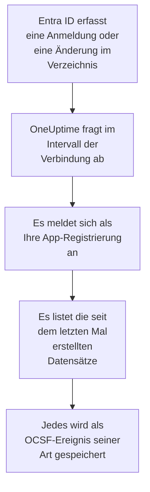

# Microsoft Entra ID

Importieren Sie die Anmeldungen und Verzeichnisänderungen von [Microsoft Entra ID](https://learn.microsoft.com/en-us/entra/identity/) in die Sicherheitsereignisse von OneUptime und, wenn Sie möchten, die Aktivität in Exchange, SharePoint, OneDrive und Teams aus dem [Microsoft 365-Audit-Protokoll](https://learn.microsoft.com/en-us/purview/audit-log-activities). Dort durchsuchen Sie sie neben Ihren Logs, Traces und Metriken, verknüpfen sie mit jeder anderen Quelle und alarmieren die Bereitschaft für die wichtigen. OneUptime liest sie mit einer App-Registrierung, die Sie anlegen, und ändert nichts in Ihrem Mandanten.

:::cards
- [Die Verbindung einrichten](#die-verbindung-einrichten): Eine App-Registrierung, ihre Berechtigungen und das Formular der Verbindung.
- [Was importiert wird](#was-importiert-wird): Welche Datensätze, und wie aus jedem ein Sicherheitsereignis wird.
- [So funktioniert das Abfragen](#so-funktioniert-das-abfragen): Das Zeitfenster jeder Abfrage, und warum es sich um 30 Minuten überlappt.
- [Fehlerbehebung](#fehlerbehebung): Was jeder Fehler bedeutet und was zu ändern ist.
:::

## So funktioniert es

Jede Minute fragt OneUptime jede aktivierte Verbindung ab, deren Abfrageintervall abgelaufen ist. Eine Abfrage meldet sich als Ihre App-Registrierung bei Microsoft Entra ID an und liest in dieser Reihenfolge die seit der letzten Abfrage erfassten Verzeichnisänderungen ([List directoryAudits](https://learn.microsoft.com/en-us/graph/api/directoryaudit-list)) und Anmeldungen ([List signIns](https://learn.microsoft.com/en-us/graph/api/signin-list)), dann, wenn die Option **Microsoft 365-Audit-Protokoll** eingeschaltet ist, die neuen Inhalte des Audit-Protokolls ([Office 365 Management Activity API](https://learn.microsoft.com/en-us/office/office-365-management-api/office-365-management-activity-api-reference)). Jeder Datensatz wird als [OCSF](https://schema.ocsf.io/)-Ereignis gespeichert: eine Anmeldung als Ereignis Authentication, eine zugewiesene Rolle als User Access Management, ein Phishing-Urteil als Detection Finding.

## Bevor Sie beginnen

- In OneUptime die Rolle Project Owner, Project Admin oder Security Admin. Security Member und Security Viewer sehen Verbindungen und ihren Laufverlauf, können sie aber nicht ändern.
- Für Anmeldungen Microsoft Entra ID P1 oder P2, das in Microsoft 365 E3, E5 und Business Premium enthalten ist: Microsoft Graph gibt Anmeldungen nur an solche Mandanten heraus. Verzeichnisänderungen werden in jedem Mandanten gelesen.
- Eine Entra-Rolle, die Anwendungen registrieren darf, etwa Anwendungsadministrator, und einen globalen Administrator oder Administrator für privilegierte Rollen, um die Administratorzustimmung zu erteilen.
- Für das Microsoft 365-Audit-Protokoll eingeschaltete Überwachung im Mandanten, was standardmäßig der Fall ist: Im [Microsoft Purview-Portal](https://purview.microsoft.com) darf **Audit** nicht **Start recording user and admin activity** anbieten.
- Ausgehendes HTTPS von der OneUptime-App und den Workern zu `login.microsoftonline.com`, `graph.microsoft.com` und `manage.office.com`, oder zu `login.microsoftonline.us`, `graph.microsoft.us` und `manage.office365.us` für Azure Government.

## Die Verbindung einrichten

Die Verbindung meldet sich mit dem [OAuth-2.0-Fluss für Clientanmeldeinformationen](https://learn.microsoft.com/en-us/entra/identity-platform/v2-oauth2-client-creds-grant-flow) an: als Anwendung, nie als Person, mit lesenden Berechtigungen.

:::steps
### Eine Anwendung registrieren

1. Melden Sie sich im [Microsoft Entra Admin Center](https://entra.microsoft.com) an und öffnen Sie **App registrations**.
2. Wählen Sie **New registration**. Nennen Sie sie `OneUptime Security Events`, lassen Sie **Supported account types** auf **Accounts in this organizational directory only**, lassen Sie die Umleitungs-URI leer und wählen Sie **Register**.
3. Kopieren Sie auf der Seite **Overview** der App die **Anwendungs-ID (Client)** und die **Verzeichnis-ID (Tenant)**.

### Ihr das Lesen der Protokolle erlauben

1. Gehen Sie zu **API permissions → Add a permission → Microsoft Graph → Application permissions**, wählen Sie `AuditLog.Read.All` und wählen Sie **Add permissions**. Microsoft dokumentiert, dass seine Liste der Anmeldungen auch `Directory.Read.All` verlangen kann: Fügen Sie sie hinzu, wenn Anmeldungen nach erteilter Zustimmung mit `403` abgelehnt werden.
2. Für das Microsoft 365-Audit-Protokoll fügen Sie eine zweite Berechtigung hinzu: **Add a permission → Office 365 Management APIs → Application permissions**, dann `ActivityFeed.Read`.
3. Wählen Sie **Grant admin consent for** Ihren Mandanten und bestätigen Sie. Der Status jeder Berechtigung muss **Granted** lauten: Ohne Zustimmung wird jedes Lesen mit `403` abgelehnt.

### Einen geheimen Clientschlüssel anlegen

Gehen Sie zu **Certificates & secrets → Client secrets → New client secret**, wählen Sie, wann es abläuft, und wählen Sie **Add**. Kopieren Sie den **Value** des Geheimnisses, nicht seine **Secret ID**, bevor Sie die Seite verlassen: Er wird nie wieder angezeigt. An dem Tag, an dem es abläuft, hört das Abfragen mit `Microsoft Entra ID token request failed (HTTP 401)` auf, bis Sie es mit **Anmeldedaten aktualisieren** ersetzen.

### Die Verbindung in OneUptime hinzufügen

Öffnen Sie **Produkte → Sicherheitsereignisse → Verbindungen** (`/dashboard/{projectId}/security-events/connections`), klicken Sie auf **Verbindung hinzufügen**, wählen Sie **Microsoft Entra ID** unter **Identität** und klicken Sie auf **Weiter**. Füllen Sie die Einstellungen aus der Tabelle unten aus, klicken Sie auf **Weiter** und fügen Sie den Wert des Geheimnisses in **Client-Secret** ein. Schalten Sie im Schritt **Abfrage** **Microsoft 365-Audit-Protokoll** ein, um auch dieses zu lesen.

### Vor dem Speichern testen

Klicken Sie unter **Vor dem Speichern testen** auf **Diese Einstellungen testen**. Der Test meldet sich mit den Werten im Formular an, liest jedes Protokoll und speichert nichts, ein falsches Geheimnis oder eine fehlende Zustimmung zeigt sich also, bevor die Verbindung existiert. Klicken Sie dann auf **Weiter**, geben Sie der Verbindung einen **Name** und legen Sie sie an.
:::

| Einstellung | Wo Sie sie finden |
| --- | --- |
| **Verzeichnis-ID (Tenant)** | Die Seite **Overview** der App. Die GUID des Mandanten oder eine verifizierte Domäne wie `contoso.onmicrosoft.com`. Mit eingeschaltetem **Microsoft 365-Audit-Protokoll** die GUID: Die Management API benennt einen Mandanten nur damit. |
| **Anwendungs-ID (Client)** | Die Seite **Overview** der App. Die GUID der App, die `AuditLog.Read.All` hat. |
| **Cloud** | **Öffentliche Azure-Cloud** oder **Azure Government (USA)** für GCC High (`login.microsoftonline.us`, `graph.microsoft.us` und `manage.office365.us`). |
| **Microsoft 365-Audit-Protokoll** | Optional, standardmäßig aus. Eingeschaltet liest jede Abfrage auch das Microsoft 365-Audit-Protokoll. Die App braucht `ActivityFeed.Read`. |
| **Client-Secret** | Der **Value** des Geheimnisses. Es wird verschlüsselt, nie von der API zurückgegeben und nie wieder angezeigt. Ersetzen Sie es mit **Anmeldedaten aktualisieren** an der Verbindung. |

Der Schritt **Abfrage** hat außerdem eine optionale **Beschreibung**, das **Abfrageintervall (Minuten)**, eine ganze Zahl von `1` bis `1440`, die mit `5` beginnt, und **Aktiviert**, das eingeschaltet beginnt.

## Was importiert wird

Jedes Ereignis hat den Anbieter `Microsoft` und das Produkt `Microsoft Entra ID`. Sein Attribut `entra.log` sagt, aus welchem Protokoll eine Anmeldung oder eine Änderung stammt, und `microsoft365.contentType` eines Microsoft 365-Datensatzes seinen Inhaltstyp.

| Datensatz | OCSF-Klasse | Schweregrad |
| --- | --- | --- |
| Eine Anmeldung, die gelang | Authentication (`3002`), Status `Success` | Informational |
| Eine Anmeldung, die auf einen zweiten Schritt wartet, etwa MFA (`50074`, `50076`) oder die Aufforderung, das Passwort zu ändern | Authentication (`3002`), Status `Interrupted` | Informational: ein Schritt, kein Fehlschlag |
| Eine fehlgeschlagene Anmeldung, mit dem Grund und Fehlercode von Entra | Authentication (`3002`), Status `Failure` | Low |
| Eine Anmeldung, die Identity Protection mit mittlerem oder hohem Risiko bewertet hat | Authentication (`3002`) | Medium oder High |
| Ein geänderter Benutzer, eine Gruppe oder Rolle, nach ihrer Kategorie | Account Change (`3001`), Group Management (`3006`), User Access Management (`3005`) oder Entity Management (`3004`) für den Rest | Medium für eine privilegierte Rolle wie Global Administrator; Low für eine fehlgeschlagene Änderung |

Mit eingeschaltetem **Microsoft 365-Audit-Protokoll** werden die Datensätze daraus importiert, auf die ein Sicherheitsteam reagiert, und der Rest, etwa eine geöffnete Datei oder eine gelesene E-Mail, nur gezählt:

| Microsoft 365-Datensatz | OCSF-Klasse | Schweregrad |
| --- | --- | --- |
| Ein Exchange-Cmdlet wie `New-InboxRule` oder `Set-Mailbox`, eine in Outlook angelegte Posteingangsregel oder im Namen eines anderen gesendete E-Mail | API Activity (`6003`) | Medium, wenn sie E-Mails weiterleitet, mit `microsoft365.forwardsMail` auf `true` |
| Eine erteilte Postfachberechtigung, etwa `Add-MailboxPermission` | User Access Management (`3005`) | Low |
| Eine in SharePoint oder OneDrive geteilte Datei | File Hosting Activity (`6006`) | Low mit einem Gast oder einem Link, den jeder öffnen kann, mit `microsoft365.sharedOutside` auf `true` |
| Ein hinzugefügter oder entfernter Websitesammlungsadministrator | User Access Management (`3005`) | Low |
| Von Microsoft Defender for Office 365 gefundene Schadsoftware- oder Phishing-E-Mail | Detection Finding (`2004`) | High für Schadsoftware, Medium für Phishing |
| Eine Warnung, die Microsoft 365 ausgelöst hat | Detection Finding (`2004`) | Der eigene der Warnung |
| Eine App, ein Bot oder ein Connector, der einem Team hinzugefügt wurde | Application Lifecycle (`6002`) | Low |

Die eigene Hausarbeit von Exchange, unter seinem Systemkonto ausgeführt, bleibt außen vor, außer sie leitet E-Mails weiter. Jedes Ereignis behält den ganzen Datensatz, flach gemacht zu Schlüsseln mit Punkten wie `status.errorCode` oder `Parameters.ForwardTo`, sodass eine Regel jedes Feld unter dem Namen liest, den Microsoft ihm gibt. Die Regeln der Regelbibliothek für Entra ID lesen sie so, wie sie hier importiert werden.

Dieselben Anmeldungen und Verzeichnisänderungen können OneUptime stattdessen als Logs erreichen, von einer Azure-Diagnoseeinstellung exportiert und von [Ihre Protokolle](/docs/telemetry/security-events#sicherheitsereignisse-in-ihren-logs-finden) gelesen. Jeder Datensatz bekommt auf beiden Wegen dieselbe Ereignis-ID, aber ein auf beiden Wegen gelesener Datensatz wird zweimal gespeichert: Lesen Sie Entra ID auf einem Weg.

## So funktioniert das Abfragen

- **Datensätze werden danach gelesen, wann Entra ID sie erfasst hat**, `activityDateTime` bei einer Änderung und `createdDateTime` bei einer Anmeldung.
- **Die erste Abfrage blickt 24 Stunden zurück**, sodass eine neue Verbindung ihre jüngsten Datensätze sofort zeigt.
- **Jede spätere Abfrage beginnt 30 Minuten vor dem gespeicherten Cursor.** Microsoft dokumentiert, dass beide Protokolle Minuten verspätet ankommen, deshalb liest die Überlappung einen verspäteten Datensatz bei der nächsten Abfrage, und Duplikate werden innerhalb des Projekts nach Datensatz-ID verworfen.
- **Eine Abfrage liest höchstens 24 Stunden über den Cursor hinaus.** Eine Verbindung, deren Cursor zurückliegt, holt in einer Reihe von 24-Stunden-Fenstern auf.
- **Ein Mandant ohne Microsoft Entra ID P1 oder P2** importiert seine Verzeichnisänderungen, und die Prüfung **Read sign-ins** jedes Laufs warnt, dass keine Anmeldungen gelesen wurden.
- **Ein fehlgeschlagener Lauf ändert nichts.** Nach einem Netzwerkfehler oder einem Fehlerstatus von Graph bleiben der Cursor und die Fensterlänge, wie sie waren, und die nächste Abfrage liest dasselbe Zeitfenster erneut. Die einzige Ausnahme ist eine Anfrage, deren Zeit abgelaufen ist: Der Cursor bleibt, aber das nächste Zeitfenster ist halb so lang, denn ein Zeitfenster, das zu schwer ist, um rechtzeitig beantwortet zu werden, würde bei jedem Versuch ablaufen.

Das Microsoft 365-Audit-Protokoll wird danach gelesen, wann Microsoft jeden Inhaltsblob bereitgestellt hat, einen Tag nach dem anderen, und nicht weiter zurück als die 7 Tage, die Microsoft ihn aufbewahrt. Die erste Abfrage abonniert die App für `Audit.Exchange`, `Audit.SharePoint` und `Audit.General`, und Microsoft stellt die ersten Datensätze eines neuen Abonnements innerhalb von 12 Stunden bereit. Das Audit-Protokoll hält die Protokolle von Entra ID nie auf: Eine fehlende Berechtigung ist eine Warnung, und das Zeitfenster rückt weiter, während ein Fehler auf der Seite von Microsoft, etwa `HTTP 503`, den Lauf **Teilweise** macht, damit das Zeitfenster erneut gelesen wird.

### Wenn ein Zeitfenster mehr enthält, als eine Abfrage lesen kann

Jedes Protokoll hat ein eigenes Budget: 10 Seiten mit 500 Verzeichnisänderungen, 20 Seiten mit 500 Anmeldungen und, für das Microsoft 365-Audit-Protokoll, 120 Anfragen und 10.000 Datensätze. Eine Abfrage hört nach 4 Minuten auf. Hält ein Budget ein Protokoll vor dem Ende seines Zeitfensters an, ist der Lauf **Teilweise**, und seine Warnung nennt das Protokoll und das Budget. Microsoft Graph listet die neuesten Datensätze zuerst, deshalb verkürzt OneUptime das Zeitfenster, statt den Cursor über Datensätze hinwegzurücken, die es nie erreicht hat:

1. **Verengen.** Die nächste Abfrage liest ein halb so langes Zeitfenster ab demselben Startpunkt und halbiert erneut, bis ein Zeitfenster vollständig gelesen wird, bis hinunter zu einer Minute. Die Warnung des Laufs sagt es: `This window holds more records than one poll can read; the next poll reads a {n} minute window from the same starting point.` Aus dem längeren Zeitfenster bereits importierte Datensätze werden als Duplikate übersprungen.
2. **Wieder wachsen.** Nachdem ein Zeitfenster vollständig gelesen wurde, rückt der Cursor an sein Ende, und das nächste Zeitfenster ist wieder doppelt so lang, bis zu 24 Stunden.
3. **Über eine einzelne Minute hinwegrücken.** Enthält schon eine Minute mehr, als eine Abfrage lesen kann, rückt das Abfragen über sie hinweg, damit neuere Datensätze weiter ankommen. Der Lauf bleibt **Teilweise**, und **Letzter Fehler** lautet `More records were created in the one minute from {cursor} to {end} than one poll can read. Polling moved past this minute so newer records keep arriving; use Import this time range in Diagnostics on this minute to recover what one run can read.` Importieren Sie diese Minute mit **Diesen Zeitraum importieren**, um zurückzuholen, was ein Lauf lesen kann.

Ein anderes **Abfrageintervall (Minuten)** ändert nichts davon: Es entscheidet, wie oft eine Abfrage beginnt, nicht, wo ihr Zeitfenster beginnt.

### Bei Bedarf ausführen, ansehen und importieren

Klicken Sie an einer Verbindung auf **Diagnose**, um ihre letzten Läufe zu sehen und von Hand mit ihr zu arbeiten. Wer die Verbindung ändern darf, kann diese starten; wer sie sehen darf, kann den Verlauf lesen.

- **Jetzt ausführen** startet sofort eine Abfrage, mit dem üblichen Cursor, auch wenn die Verbindung nicht **Aktiviert** ist.
- **Preview records** liest einen Zeitraum von bis zu 7 Tagen und importiert nichts.
- **Diesen Zeitraum importieren** importiert nach Ihrer Bestätigung einen Zeitraum von bis zu 7 Tagen, ohne den Cursor zu verschieben. Bereits importierte Datensätze werden übersprungen. Microsoft Entra ID bewahrt Anmeldungen und Verzeichnisänderungen mit P1 oder P2 30 Tage lang auf, ohne 7 Tage.
- **Diagnosen kopieren** an einem Lauf kopiert seinen Bericht für den Support. Er enthält nie Anmeldedaten.

## Verbindung testen

**Verbindung testen** in der Zeile einer Verbindung und **Diese Einstellungen testen** im Formular laufen im API-Prozess, nicht in einem Hintergrund-Worker, sodass ein Test auch dann antwortet, wenn die Worker das Problem sind. Er führt diese Prüfungen der Reihe nach aus:

| Prüfung | Was sie prüft |
| --- | --- |
| **Konfiguration** | Jede Einstellung ist vorhanden und gültig. Schlägt das fehl, wird nichts kontaktiert. |
| **Authenticate with Microsoft Entra** | Entra ID stellt der App ein Token für Microsoft Graph aus, in der Cloud, die Sie gewählt haben. |
| **Read sign-ins** | Die Anmeldungen der letzten 24 Stunden lassen sich lesen. Eine Warnung, kein Fehler, in einem Mandanten ohne P1 oder P2. |
| **Read directory changes** | Die Verzeichnisänderungen der letzten 24 Stunden lassen sich lesen. |
| **Read the Microsoft 365 audit log** | Nur mit eingeschalteter Option: Die Management API antwortet, und welche Inhaltstypen die App abonniert hat. |
| **Records available to import** | Wie viele Anmeldungen und Verzeichnisänderungen die letzten 24 Stunden enthalten, je höchstens 500, `500+` heißt also mehr. Keine ist eine Warnung. |
| **Background workers**, **Poll scheduler**, **Security event storage** | Die Seite von OneUptime selbst: Ein Prozess nimmt die Aufträge der Worker-Warteschlange an, der Abfrageauftrag läuft jede Minute, und der Speicher der Sicherheitsereignisse antwortet. |
| **Geplante Abfrage** | Für eine gespeicherte Verbindung: Das Abfragen ist eingeschaltet, kein Lauf wartet festgefahren auf einen Worker, und die Abfragen laufen pünktlich. |

Jede Anfrage in einem Test hat eine Frist von 20 Sekunden. Ein Test importiert nie etwas und verschiebt nie den Cursor, und jede fehlgeschlagene Prüfung sagt, was zu ändern ist.

## Fehlerbehebung

Der **Letzter Fehler** der Verbindung bewahrt die vollständige Fehlermeldung, mit geschwärzten Anmeldedaten. Hat eine Verbindung einen Fehler, wählen Sie in ihrer Spalte **Aktionen** die Aktion **Fehler anzeigen**, um ihn zu lesen, und im Dialog **Fehler kopieren**, um ihn zu kopieren. Jede Meldung beginnt mit `Microsoft Entra ID`, nennt dann die fehlgeschlagene Anfrage und zitiert den Fehlercode von Microsoft, wenn es einen gibt.

:::details Letzter Fehler sagt `token request failed`
- `HTTP 401` mit `invalid_client`: Das Client-Secret ist falsch oder abgelaufen. Legen Sie ein neues an und speichern Sie es mit **Anmeldedaten aktualisieren**.
- `HTTP 400`, das die Anwendungs-ID (Client) oder den Mandanten nennt: Prüfen Sie beide auf der Seite **Overview** der App, und dass die **Cloud** die des Mandanten ist.
:::

:::details Letzter Fehler sagt `sign-ins request failed (HTTP 403)` oder `audit logs request failed (HTTP 403)`
- Fehlercode `Authorization_RequestDenied`: Der App fehlt `AuditLog.Read.All`, oder die Zustimmung wurde nicht erteilt. Erteilen Sie die Administratorzustimmung, warten Sie einige Minuten und testen Sie erneut. Erteilen Sie für Anmeldungen auch `Directory.Read.All`.
- Fehlercode `Authentication_RequestFromNonPremiumTenantOrB2CTenant`: Der Mandant hat kein Microsoft Entra ID P1 oder P2. Verzeichnisänderungen werden weiterhin importiert.
:::

:::details Das Microsoft 365-Audit-Protokoll wird nicht gelesen
- `subscriptions request failed (HTTP 401)` oder `(HTTP 403)`, mit `AF10001`: Der App fehlt `ActivityFeed.Read` der Office 365 Management APIs, oder die Zustimmung wurde nicht erteilt.
- `AF20010` bis `AF20013`: Die Management API kennt die **Verzeichnis-ID (Tenant)** nicht. Verwenden Sie die GUID des Mandanten.
- `subscription start failed` mit `AF20023`: Ein Administrator hat das Abonnement abgeschaltet. Ein Inhaltstyp, der sich nicht abonnieren lässt, wird in den Warnungen des Laufs genannt, und die anderen werden weiterhin gelesen.
- Stundenlang keine Datensätze nach der ersten Abfrage: Microsoft stellt die ersten Inhalte eines neuen Abonnements innerhalb von 12 Stunden bereit.
:::

:::details Letzter Fehler sagt `did not complete`
Die Anfrage bekam keine Antwort: eine Zeitüberschreitung, ein Name, der sich nicht auflösen lässt, oder eine abgelehnte Adresse. Prüfen Sie, dass die OneUptime-App und die Worker die Hosts aus [Bevor Sie beginnen](#bevor-sie-beginnen) erreichen, über jeden Proxy, den Sie verwenden.
:::

:::details Der Test besteht, aber Zuletzt abgefragt ist Never
Der Abfrageauftrag ist nie gelaufen. Lesen Sie die Prüfungen **Background workers** und **Poll scheduler**. Bei einer selbst gehosteten Installation ist die übliche Ursache `DISABLE_QUEUE_WORKERS=true` an der App, ohne eigene Worker-Bereitstellung, die die Aufträge annimmt: Setzen Sie es auf `false` oder betreiben Sie die Worker-Bereitstellung (Helm: `worker.enabled: true`, das standardmäßig `false` ist).
:::

## Nächste Schritte

:::cards
- [Sicherheitsereignisse](/docs/telemetry/security-events): Durchsuchen, verknüpfen und warnen, was Sie importieren.
- [Okta-Systemprotokoll](/docs/integrations/okta): Die Anmeldungen eines weiteren Identitätsanbieters importieren.
- [Google Workspace](/docs/integrations/google-workspace): Die Anmeldungen und Admin-Änderungen von Google importieren.
- [Integrationsübersicht](/docs/integrations/index): Die anderen Werkzeuge, die Sie verbinden können.
:::
