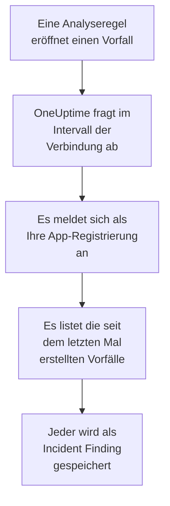

# Microsoft Sentinel

Importieren Sie die Vorfälle, die Ihre Analyseregeln in [Microsoft Sentinel](https://learn.microsoft.com/en-us/azure/sentinel/overview) eröffnen, in die Sicherheitsereignisse von OneUptime. Dort durchsuchen Sie sie neben Ihren Logs, Traces und Metriken, verknüpfen sie mit jeder anderen Quelle und alarmieren die Bereitschaft für die wichtigen. OneUptime liest sie mit einer App-Registrierung, die Sie anlegen, und ändert nichts in Azure.

:::cards
- [Die Verbindung einrichten](#die-verbindung-einrichten): Eine App-Registrierung, eine Rolle und das Formular der Verbindung.
- [Was importiert wird](#was-importiert-wird): Wie aus jedem Sentinel-Vorfall ein Sicherheitsereignis wird.
- [So funktioniert das Abfragen](#so-funktioniert-das-abfragen): Das Zeitfenster jeder Abfrage, und was ein ausgelasteter Arbeitsbereich damit macht.
- [Fehlerbehebung](#fehlerbehebung): Was jeder Fehler bedeutet und was zu ändern ist.
:::

## So funktioniert es



Jede Minute fragt OneUptime jede aktivierte Verbindung ab, deren Abfrageintervall abgelaufen ist. Eine Abfrage meldet sich als Ihre App-Registrierung bei Microsoft Entra ID an, bittet Azure Resource Manager um die seit der letzten Abfrage erstellten Vorfälle und speichert jeden als [OCSF](https://schema.ocsf.io/)-Ereignis Incident Finding (Klasse `2005`). Erkennungsregeln, Monitore und Dashboards behandeln es dann wie ein Sicherheitsereignis aus jeder anderen Quelle.

## Bevor Sie beginnen

- In OneUptime die Rolle Project Owner, Project Admin oder Security Admin. Security Member und Security Viewer sehen Verbindungen und ihren Laufverlauf, können sie aber nicht ändern.
- Ein Log-Analytics-Arbeitsbereich mit aktiviertem Microsoft Sentinel, in der öffentlichen Azure-Cloud oder in Azure Government (US).
- In Microsoft Entra ID das Recht, eine App-Registrierung und einen geheimen Clientschlüssel anzulegen.
- Für die Ressourcengruppe, die den Arbeitsbereich enthält, das Recht, Rollen zuzuweisen, etwa als Besitzer oder Benutzerzugriffsadministrator.

## Die Verbindung einrichten

Die Verbindung meldet sich mit dem OAuth-2.0-Fluss für Clientanmeldeinformationen an: als Anwendung, nie als Person. Ihr Zugriff kommt aus einer Azure-Rolle, die App-Registrierung braucht also keine API-Berechtigungen.

:::steps
### Eine Anwendung registrieren

1. Melden Sie sich im [Azure-Portal](https://portal.azure.com) an und öffnen Sie **Microsoft Entra ID**.
2. Gehen Sie zu **App registrations → New registration**. Nennen Sie sie `OneUptime Sentinel connector`, lassen Sie **Supported account types** auf **Accounts in this organizational directory only**, lassen Sie die Umleitungs-URI leer und wählen Sie **Register**.
3. Kopieren Sie auf der Seite **Overview** der App die **Anwendungs-ID (Client)** und die **Verzeichnis-ID (Tenant)**.
4. Gehen Sie zu **Certificates & secrets → Client secrets → New client secret**, wählen Sie, wann es abläuft, und wählen Sie **Add**. Kopieren Sie den **Value** des Geheimnisses, nicht seine **Secret ID**, bevor Sie die Seite verlassen: Er wird nie wieder angezeigt.

### Ihr das Lesen von Vorfällen erlauben

1. Öffnen Sie im Azure-Portal die Ressourcengruppe, die Ihren Log-Analytics-Arbeitsbereich enthält.
2. Wählen Sie **Access control (IAM) → Add → Add role assignment**.
3. Wählen Sie im Tab **Role** die Rolle **Microsoft Sentinel Reader**.
4. Wählen Sie im Tab **Members** die Option **User, group, or service principal**, klicken Sie auf **Select members** und wählen Sie Ihre App-Registrierung über ihren Namen.
5. Wählen Sie **Review + assign**.

Die Rolle erlaubt der App, Vorfälle zu lesen (`Microsoft.SecurityInsights/incidents/read`), und nichts zu schreiben. Microsoft empfiehlt, sie für die Ressourcengruppe statt für den Arbeitsbereich zuzuweisen, damit sie auch die Lösung `SecurityInsights` abdeckt, aus der die Vorfälle kommen. Eine neue Zuweisung kann einige Minuten brauchen, bis sie greift.

### Die Angaben des Arbeitsbereichs finden

Öffnen Sie den Log-Analytics-Arbeitsbereich im Azure-Portal. Seine Seite **Overview** zeigt die **Abonnement-ID**, die **Resource group** und den Namen des Arbeitsbereichs. Die Ressourcen-ID des Arbeitsbereichs enthält dieselben drei:

```text
/subscriptions/{Subscription ID}/resourceGroups/{Resource group}/providers/Microsoft.OperationalInsights/workspaces/{Workspace name}
```

### Die Verbindung in OneUptime hinzufügen

Öffnen Sie **Produkte → Sicherheitsereignisse → Verbindungen** (`/dashboard/{projectId}/security-events/connections`), klicken Sie auf **Verbindung hinzufügen**, wählen Sie **Microsoft Sentinel** und klicken Sie auf **Weiter**. Füllen Sie die Einstellungen aus der Tabelle unten aus, klicken Sie auf **Weiter** und fügen Sie den Wert des Geheimnisses in **Client-Secret** ein.

### Vor dem Speichern testen

Klicken Sie unter **Vor dem Speichern testen** auf **Diese Einstellungen testen**. Der Test meldet sich mit den Werten im Formular an, liest Vorfälle und speichert nichts, ein falsches Geheimnis oder eine fehlende Rolle zeigt sich also, bevor die Verbindung existiert. Klicken Sie dann auf **Weiter**, geben Sie der Verbindung einen **Name** und legen Sie sie an.
:::

| Einstellung | Wo Sie sie finden |
| --- | --- |
| **Verzeichnis-ID (Tenant)** | Die Seite **Overview** der App. Die GUID des Mandanten oder eine verifizierte Domäne wie `contoso.onmicrosoft.com`. |
| **Anwendungs-ID (Client)** | Die Seite **Overview** der App. Eine GUID. |
| **Abonnement-ID** | Die Seite **Overview** des Arbeitsbereichs. Eine GUID. |
| **Resource group** | Die Seite **Overview** des Arbeitsbereichs. 1 bis 90 Buchstaben, Ziffern, Unterstriche, Bindestriche, Punkte oder Klammern, nicht mit einem Punkt am Ende. |
| **Workspace name** | Die Seite **Overview** des Arbeitsbereichs. 3 bis 90 Buchstaben, Ziffern oder Bindestriche, mit einem Buchstaben oder einer Ziffer am Anfang und am Ende. |
| **Cloud** | **Öffentliche Azure-Cloud** (`login.microsoftonline.com`, `management.azure.com`) oder **Azure Government (USA)** (`login.microsoftonline.us`, `management.usgovcloudapi.net`). |
| **Client-Secret** | Der **Value** des Geheimnisses. Es wird verschlüsselt, nie von der API zurückgegeben und nie wieder angezeigt. Ersetzen Sie es mit **Anmeldedaten aktualisieren** an der Verbindung. |

Der Schritt **Abfrage** hat außerdem eine optionale **Beschreibung**, das **Abfrageintervall (Minuten)**, eine ganze Zahl von `1` bis `1440`, die mit `5` beginnt, und **Aktiviert**, das eingeschaltet beginnt.

## Was importiert wird

Jeder Sentinel-Vorfall wird zu einem Ereignis Incident Finding (OCSF-Klasse `2005`, Aktivität `Create`), das dem Telemetriedienst `Microsoft Sentinel` zugeordnet wird:

| OCSF-Spalte | Feld des Sentinel-Vorfalls |
| --- | --- |
| `time` | `properties.createdTimeUtc`, wann Sentinel den Vorfall erstellt hat |
| `eventUid` | `name`, die GUID des Vorfalls, nach der auch Duplikate verworfen werden |
| `message`, `ruleName` | `properties.title` |
| `ruleId` | Die Regel-GUID am Ende des ersten Eintrags von `properties.relatedAnalyticRuleIds` |
| `severityName` | `properties.severity`: `High`, `Medium`, `Low` oder `Informational` |
| `statusName` | `properties.status`: `New`, `Active` oder `Closed` |
| `mitreTactics` | `properties.additionalData.tactics`, als ATT&CK-IDs: Aus `Persistence` wird `TA0003` |
| `principalUser` | `properties.owner.userPrincipalName` oder `properties.owner.email` |
| `targetResource` | `properties.incidentUrl`, ein Link zum Vorfall im Azure-Portal |
| `observables` | UPN, E-Mail und Objekt-ID des Besitzers sowie der Name jedes Labels |
| `attributes` | Der ganze Vorfall, flach gemacht zu Schlüsseln mit Punkten wie `properties.classification` und `properties.firstActivityTimeUtc` |

Auch geschlossene Vorfälle, die im Zeitfenster einer Abfrage erstellt wurden, werden importiert. Filtern Sie im Explorer der Sicherheitsereignisse nach `statusName`, um nur offene zu sehen.

## So funktioniert das Abfragen

Jede Abfrage listet die in ihrem Zeitfenster erstellten Vorfälle, die ältesten zuerst, 50 pro Seite, und folgt dem `nextLink` der API, bis sie das ganze Zeitfenster gelesen hat:

```text
GET https://management.azure.com/subscriptions/{sub}/resourceGroups/{rg}/providers/Microsoft.OperationalInsights/workspaces/{ws}/providers/Microsoft.SecurityInsights/incidents
    ?api-version=2024-03-01
    &$filter=(properties/createdTimeUtc ge {windowStart}) and (properties/createdTimeUtc lt {windowEnd})
    &$orderby=properties/createdTimeUtc asc
    &$top=50
```

- **Die Erstellungszeit ist der Cursor.** Eine geplante Analyseregel, die stündlich läuft, eröffnet ihren Vorfall lange nach der Aktivität, die sie gefunden hat, und `firstActivityTimeUtc` des Vorfalls kann Stunden oder Tage älter sein. Ein Cursor über die Aktivitätszeit würde jeden solchen Vorfall überspringen. Die Aktivitätszeiten bleiben in `attributes`, und die Beispiele in der Diagnose zeigen beide.
- **Die erste Abfrage blickt 24 Stunden zurück**, sodass eine neue Verbindung ihre jüngsten Vorfälle sofort zeigt.
- **Jede spätere Abfrage beginnt 1 Minute vor dem gespeicherten Cursor**, sodass ein Vorfall, der an der Grenze zwischen zwei Zeitfenstern erstellt wurde, nie übersprungen wird.
- **Eine Abfrage liest höchstens 24 Stunden über den Cursor hinaus.** Eine Verbindung, deren Cursor zurückliegt, holt in einer Reihe von 24-Stunden-Fenstern auf, und ihre **Integrität** zeigt **Catching up**.
- **Duplikate werden nach der GUID des Vorfalls verworfen** (`name`), innerhalb des Projekts, sodass die Überlappung, ein wiederholtes Zeitfenster und ein Import nie einen Vorfall doppelt speichern.

### Wenn ein Zeitfenster mehr enthält, als eine Abfrage lesen kann

Eine Abfrage liest höchstens 20 Seiten mit 50 Vorfällen: 1.000 Vorfälle. Hält diese Grenze sie vor dem Ende ihres Zeitfensters an, ist der Lauf **Teilweise**, mit einer Warnung wie dieser:

```text
Stopped after 20 incidents requests (the per-run request limit) before reading the whole window. Incidents are read oldest first; every incident created before 2026-09-14T08:12:44.000Z was read.
```

Vorfälle werden die ältesten zuerst gelesen, deshalb setzt OneUptime den Cursor auf die Erstellungszeit des letzten gelesenen Vorfalls, und die nächste Abfrage beginnt dort, mit derselben Fensterlänge. Ein ausgelasteter Arbeitsbereich holt etwa 1.000 Vorfälle pro Abfrage auf, statt dieselben noch einmal zu lesen. Die Vorfälle, die im selben Augenblick erstellt wurden, werden zweimal gelesen, und die Duplikatprüfung verwirft die zweite Kopie.

Kommt ein Lauf gar nicht über den gespeicherten Cursor hinaus, verkürzt OneUptime stattdessen das Zeitfenster:

1. **Verkleinern.** Die nächste Abfrage liest ein halb so langes Zeitfenster ab demselben Startpunkt und halbiert weiter, bis ein Zeitfenster vollständig gelesen wird, bis hinunter zu einer Minute. Die Warnung des Laufs sagt das: `This window holds more records than one poll can read; the next poll reads a {n} minute window from the same starting point.`
2. **Wieder wachsen.** Nachdem ein Zeitfenster vollständig gelesen wurde, ist das nächste wieder doppelt so lang, bis zu 24 Stunden.
3. **Über eine einzelne Minute hinweggehen.** Enthält selbst eine Minute mehr, als eine Abfrage lesen kann, geht das Abfragen über sie hinweg, damit neuere Vorfälle weiter ankommen. Der Lauf bleibt **Teilweise**, und **Letzter Fehler** lautet `More records were created in the one minute from {cursor} to {end} than one poll can read. Polling moved past this minute so newer records keep arriving; use Import this time range in Diagnostics on this minute to recover what one run can read.` Importieren Sie diese Minute mit **Diesen Zeitraum importieren**, um zurückzuholen, was ein Lauf lesen kann.

Ein Lauf, der ganz fehlschlägt, mit einem Fehler von Microsoft Entra ID oder Azure Resource Manager, behält den Cursor und die Fensterlänge, und die nächste Abfrage liest dasselbe Zeitfenster erneut. Die einzige Ausnahme ist eine Anfrage, deren Zeit abgelaufen ist: Der Cursor bleibt, aber das nächste Zeitfenster ist halb so lang, denn ein Zeitfenster, das zu schwer ist, um rechtzeitig beantwortet zu werden, würde bei jedem Versuch ablaufen. Ein anderes **Abfrageintervall (Minuten)** ändert nichts davon: Es entscheidet, wie oft eine Abfrage beginnt, nicht, wo ihr Zeitfenster beginnt.

### Bei Bedarf ausführen, ansehen und importieren

Klicken Sie an einer Verbindung auf **Diagnose**, um ihre letzten Läufe zu sehen und von Hand mit ihr zu arbeiten. Wer die Verbindung ändern darf, kann diese starten; wer sie sehen darf, kann den Verlauf lesen.

- **Jetzt ausführen** startet sofort eine Abfrage, mit dem üblichen Cursor, auch wenn die Verbindung nicht **Aktiviert** ist.
- **Preview incidents** liest einen Zeitraum von bis zu 7 Tagen und importiert nichts.
- **Diesen Zeitraum importieren** importiert nach Ihrer Bestätigung einen Zeitraum von bis zu 7 Tagen, ohne den Cursor zu verschieben. Bereits importierte Vorfälle werden übersprungen.
- **Diagnosen kopieren** an einem Lauf kopiert seinen Bericht für den Support. Er enthält nie Anmeldedaten.

## Verbindung testen

**Verbindung testen** in der Zeile einer Verbindung und **Diese Einstellungen testen** im Formular laufen im API-Prozess, nicht in einem Hintergrund-Worker, sodass ein Test auch dann antwortet, wenn die Worker das Problem sind. Er führt diese Prüfungen der Reihe nach aus:

| Prüfung | Was sie prüft |
| --- | --- |
| **Konfiguration** | Jede Einstellung ist vorhanden und gültig. Schlägt das fehl, wird nichts kontaktiert. |
| **Authenticate with Microsoft Entra** | Microsoft Entra ID stellt Ihrer App-Registrierung ein Token für Azure Resource Manager aus. |
| **Read incidents** | Ein in den letzten 24 Stunden erstellter Vorfall lässt sich lesen (`$top=1`). Das beweist die Rolle und die Angaben des Arbeitsbereichs. |
| **Incidents available to import** | Wie viele Vorfälle in den letzten 24 Stunden und den letzten 7 Tagen erstellt wurden, je eine Seite mit 50, `50+` heißt also mehr. Keine in 7 Tagen ist eine Warnung, kein Fehler. |
| **Background workers**, **Poll scheduler**, **Security event storage** | Die Seite von OneUptime selbst: Ein Prozess nimmt die Aufträge der Worker-Warteschlange an, der Abfrageauftrag läuft jede Minute, und der Speicher der Sicherheitsereignisse antwortet. |
| **Geplante Abfrage** | Für eine gespeicherte Verbindung: Das Abfragen ist eingeschaltet, kein Lauf wartet festgefahren auf einen Worker, und die Abfragen laufen pünktlich. |

Jede Anfrage in einem Test hat eine Frist von 20 Sekunden. Ein Test importiert nie etwas und verschiebt nie den Cursor, und jede fehlgeschlagene Prüfung sagt, was zu ändern ist.

## Fehlerbehebung

Der **Letzter Fehler** der Verbindung bewahrt die vollständige Fehlermeldung, mit geschwärzten Anmeldedaten, hinter einem Präfix, das den fehlgeschlagenen Schritt nennt. Hat eine Verbindung einen Fehler, wählen Sie in ihrer Spalte **Aktionen** die Aktion **Fehler anzeigen**, um ihn zu lesen, und im Dialog **Fehler kopieren**, um ihn zu kopieren. Lesen Sie zuerst das Präfix.

:::details Letzter Fehler beginnt mit `Microsoft Sentinel token request`
- `Microsoft Sentinel token request failed (HTTP ...)`: Microsoft Entra ID hat sich geweigert, ein Token auszustellen, Azure wurde also nie kontaktiert. Die Meldung zitiert den Code von Entra:
  - `AADSTS7000215` oder `invalid_client`: Das **Client-Secret** ist falsch oder abgelaufen, oder es ist die ID des Geheimnisses statt seines Werts. Legen Sie ein neues Geheimnis an und speichern Sie es mit **Anmeldedaten aktualisieren**.
  - `AADSTS700016` oder `unauthorized_client`: Die **Anwendungs-ID (Client)** ist nicht in der angegebenen **Verzeichnis-ID (Tenant)**. Vergleichen Sie beide mit der Seite **Overview** der App.
  - `AADSTS90002` oder `HTTP 404`: Diesen Mandanten gibt es nicht. Die **Verzeichnis-ID (Tenant)** ist falsch oder liegt in der anderen Cloud: Prüfen Sie **Cloud**.
  - `HTTP 429` oder `HTTP 5xx`: Microsoft Entra ID drosselt oder ist nicht verfügbar. Die nächste Abfrage versucht es erneut.
- `Microsoft Sentinel token request returned ...`: Microsoft Entra ID hat mit etwas Unbrauchbarem geantwortet, etwa einem Text, der kein JSON ist oder kein `access_token` hat. Das ist meist ein Proxy oder Gateway dazwischen.
- `Microsoft Sentinel token request failed:`, ohne Status, oder `Microsoft Sentinel token request timed out after ... seconds with no response`: Die Anfrage bekam keine Antwort. Prüfen Sie DNS, TLS und ausgehendes HTTPS von der OneUptime-App und den Workern zu `login.microsoftonline.com`.
:::

:::details Letzter Fehler beginnt mit `Microsoft Sentinel incidents list`
- `Microsoft Sentinel incidents list failed (HTTP ...)`: Azure Resource Manager hat die Anfrage abgelehnt.
  - `HTTP 401`: Es hat das Token nicht angenommen. Fast immer passt **Cloud** nicht zum Mandanten, oder die App-Registrierung wurde gelöscht. Ein Token, das zwischen zwei Seiten abläuft, wird von selbst erneuert und einmal wiederholt.
  - `HTTP 403` oder `AuthorizationFailed`: Die App hat **Microsoft Sentinel Reader** für die Ressourcengruppe noch nicht. Weisen Sie die Rolle zu und warten Sie einige Minuten.
  - `HTTP 404`: Kein Arbeitsbereich hat diese **Abonnement-ID**, **Resource group** und diesen **Workspace name**, oder Microsoft Sentinel ist darauf nicht aktiviert. Kopieren Sie sie von der Seite **Overview** des Arbeitsbereichs.
  - `HTTP 429` oder `HTTP 5xx`: Azure Resource Manager drosselt oder ist nicht verfügbar. Die nächste Abfrage versucht es erneut.
  - `HTTP 400`: Azure Resource Manager hat die Abfrage abgelehnt, die OneUptime baut, nicht Ihre Einstellungen. Senden Sie die Meldung an den OneUptime-Support.
- `Microsoft Sentinel incidents list returned ...`: Azure hat mit `200` geantwortet, aber ohne lesbare Seite mit Vorfällen oder mit einem `nextLink` auf einen anderen Host, den die Verbindung ablehnt, damit das Token Azure Resource Manager nie verlässt. Das wird gemeldet statt als leeres Zeitfenster genommen, damit der Cursor nie über Vorfälle hinwegrückt, die niemand gelesen hat.
- `Microsoft Sentinel incidents list failed:`, ohne Status, oder `Microsoft Sentinel incidents list timed out after ... seconds with no response`: Die Anfrage bekam keine Antwort. Prüfen Sie ausgehendes HTTPS von den OneUptime-Workern zu `management.azure.com` oder `management.usgovcloudapi.net`.
:::

:::details Zuletzt abgefragt ist Never und Letzter Fehler ist leer
Für diese Verbindung ist noch keine Abfrage fertig geworden. Führen Sie **Verbindung testen** aus: Ihre Prüfungen **Background workers** und **Poll scheduler** nennen die Ursache. Bei einer selbst gehosteten Installation ist die übliche Ursache `DISABLE_QUEUE_WORKERS=true` an der App, ohne eigene Worker-Bereitstellung, die die Aufträge annimmt: Setzen Sie es auf `false` oder betreiben Sie die Worker-Bereitstellung (Helm: `worker.enabled: true`).
:::

:::details Ein Lauf ist Teilweise
- `Stopped after 20 incidents requests (the per-run request limit) before reading the whole window`: Das Zeitfenster enthielt mehr als die 1.000 Vorfälle, die ein Lauf liest. Nichts geht verloren: Die nächste Abfrage beginnt nach dem letzten gelesenen Vorfall. Eine Verbindung, die Abfrage um Abfrage **Teilweise** bleibt, holt einen Rückstand auf, und ihre Werte **Zuletzt abgefragt** und **Letztes importiertes Ereignis** bewegen sich weiter.
- `Microsoft Sentinel returned incidents out of creation-time order, so this run cannot name a point to resume from.`: Die API hat die Reihenfolge „älteste zuerst“ ignoriert, der Lauf kann den Cursor also nicht auf seinen letzten Vorfall setzen, und die nächste Abfrage liest stattdessen ein kürzeres Zeitfenster. Wiederholt sich das, senden Sie den Bericht des Laufs an den OneUptime-Support.
- `More records were created in the one minute from ... than one poll can read`: Das Abfragen ist über diese Minute hinweggegangen. Importieren Sie sie mit **Diesen Zeitraum importieren** in der **Diagnose**. Ein Import liest so viel wie eine Abfrage.
:::

:::details Der Test besteht, aber nichts wird importiert
Lesen Sie **Incidents available to import** im Bericht des Tests. `0` in den letzten 7 Tagen heißt, dass die Analyseregeln des Arbeitsbereichs keine Vorfälle eröffnet haben, und das ist kein Fehler der Verbindung. Prüfen Sie in Microsoft Sentinel, dass die Regeln aktiviert und so eingestellt sind, dass sie Vorfälle erstellen.
:::

## Azure Government

Setzen Sie **Cloud** auf **Azure Government (USA)**. Die Verbindung meldet sich dann bei `login.microsoftonline.us` mit dem Bereich `https://management.usgovcloudapi.net/.default` an und liest Vorfälle von `management.usgovcloudapi.net`. Alles andere, auch die Rollenzuweisung, bleibt gleich.

## Was Sie davon haben

- **Suche.** Filtern Sie Vorfälle im Explorer der Sicherheitsereignisse nach Schweregrad, Status, Besitzer, Label oder Taktik, neben jeder anderen Quelle.
- **Verknüpfung.** Besitzer und Labels jedes Vorfalls werden als Observables indiziert, sodass eine Suche alles findet, was sie nennt.
- **Erkennungsregeln.** Sigma-Regeln, die nach einem Zeitplan über Ihre Sicherheitsereignisse laufen und Warnungen eröffnen, die die Bereitschaft alarmieren.
- **Monitore.** Monitore für Sicherheitsereignisse zählen passende Ereignisse, etwa neue Vorfälle mit High, und eröffnen ab einem Schwellwert Vorfälle oder Warnungen.

Sicherheitsereignisse werden wie Ihre übrige Telemetrie abgerechnet, pro aufgenommenem GB. Siehe [Preise](https://oneuptime.com/pricing).

## Nächste Schritte

:::cards
- [Sicherheitsereignisse](/docs/telemetry/security-events): Durchsuchen, verknüpfen und warnen, was Sie importieren.
- [Microsoft Defender XDR](/docs/integrations/microsoft-defender-xdr): Auch die Warnungen jeder Defender-Arbeitslast importieren.
- [Rollen](/docs/permissions/reference#rollen): Was die Security-Rollen sehen und ändern können.
- [Integrationsübersicht](/docs/integrations/index): Die anderen Werkzeuge, die Sie verbinden können.
:::
