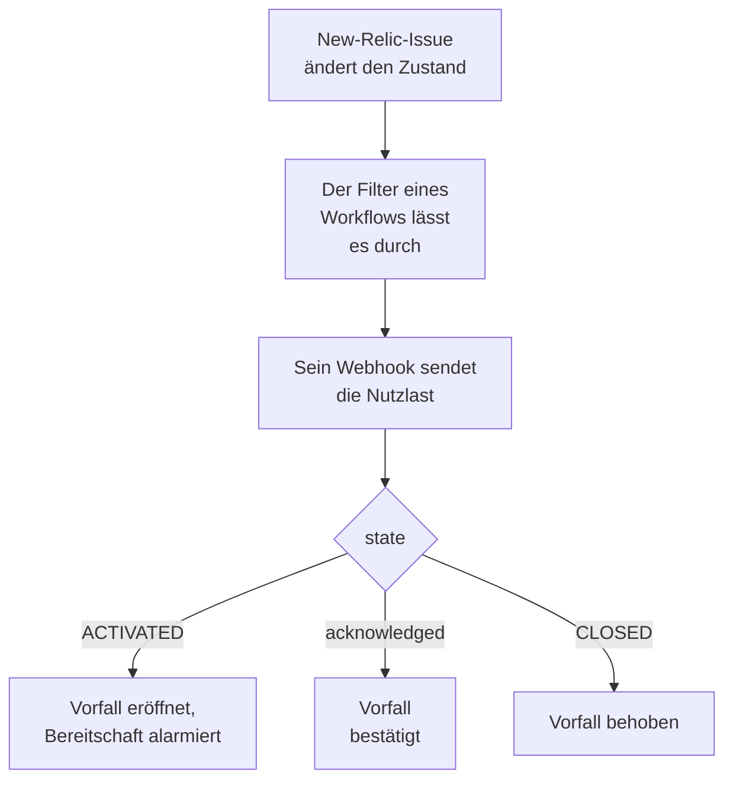

# New Relic

Senden Sie [New Relic](https://newrelic.com)-Issues an OneUptime. Jedes Issue wird zu einem Vorfall oder einer Warnung, die Ihr Bereitschaftsteam alarmiert, bestätigt wird, wenn jemand das Issue bestätigt, und behoben wird, wenn das Issue geschlossen wird. New Relic sendet seine Issues über ein [Webhook-Ziel](https://docs.newrelic.com/docs/alerts/get-notified/notification-integrations/), es gibt also auf keiner Seite etwas zu installieren.

:::cards
- [Mit der Vorlage beginnen](#mit-der-vorlage-beginnen): Wählen Sie, wen Sie alarmieren, kopieren Sie die URL und sehen Sie, was jedes Issue bewirkt.
- [New Relic konfigurieren](#new-relic-konfigurieren): Ein Webhook-Ziel und der Workflow, der es benachrichtigt.
- [Testen](#testen): Senden Sie selbst ein Issue, dann eines aus New Relic.
- [Fehlerbehebung](#fehlerbehebung): Wenn Issues nicht ankommen oder Vorfälle offen bleiben.
:::

## So funktioniert es



Ein New-Relic-Workflow wählt mit seinem Filter die Issues aus, die gesendet werden, und benachrichtigt ein Webhook-Ziel, wenn eines aktiviert, bestätigt oder geschlossen wird, mit einer JSON-Nutzlast, die New Relic ausfüllt. Über die ID des Issues findet OneUptime den Vorfall, den es eröffnet hat.

## Bevor Sie beginnen

- Ein New-Relic-Konto, in dem Sie Ziele und Workflows anlegen können.
- In OneUptime das Recht, Workflows anzulegen. In OneUptime Cloud brauchen Workflows den Tarif **Growth** oder höher.

## Mit der Vorlage beginnen

Richten Sie zuerst OneUptime ein: Es gibt Ihnen die URL, an die New Relic sendet. Der Dialog **Arbeitsablauf erstellen** hat zwei New-Relic-Vorlagen, unter **New Relic** in seiner Kategorieliste: **Declare an incident for each New Relic issue** und, für Warnungen, **Create an alert for each New Relic issue**. Beide tun dasselbe, jede mit ihrer eigenen Art von Datensatz.

:::steps
1. Gehen Sie zu **Arbeitsabläufe** und klicken Sie auf **Arbeitsablauf erstellen**. Wählen Sie unter **Oder mit einer Vorlage beginnen** in der Kategorieliste **New Relic**, klicken Sie auf **Declare an incident for each New Relic issue** oder auf **Create an alert for each New Relic issue** und dann auf **Diese Vorlage verwenden**.
2. Wählen Sie unter **Who to page for new New Relic issues** die zu alarmierenden Bereitschaftsrichtlinien, oder keine, um niemanden zu alarmieren, und klicken Sie auf **Arbeitsablauf erstellen**. Der Workflow öffnet sich ausgeschaltet im **Editor**.
3. Klicken Sie auf den Trigger **Webhook**, dann auf **URL kopieren**, und bewahren Sie die URL für New Relic auf.
4. Schalten Sie oben im **Editor** **Aktiviert** ein. Ein ausgeschalteter Workflow antwortet New Relic mit `400`.
:::

Dann [konfigurieren Sie New Relic](#new-relic-konfigurieren), damit es seine Issues an diese URL sendet. Der Schritt `read-event-1` des Workflows öffnet sich mit derselben Einrichtung, falls Sie im **Editor** darauf zurückkommen.

### Was der Workflow tut

Nach dem Trigger **Webhook** liest der Schritt **Check With JavaScript** `read-event-1` das `state`, das New Relic sendet, und **Incident From Another Tool**, in der Vorlage für Warnungen **Alert From Another Tool**, tut, was es bedeutet, über die ID des Issues. Der Vorfall behält die ID in seinem benutzerdefinierten Feld `newRelicIssueId`.

| Was New Relic sendet | Was der Workflow tut |
| --- | --- |
| `state` ist `ACTIVATED` oder `CREATED` | Meldet einen Vorfall mit dem Titel `New Relic: <issue>`, mit dem Schweregrad, auf den die Priorität des Issues abgebildet wird, und hält ihn von Ihren Statusseiten fern. Seine Beschreibung verlinkt das Issue in New Relic und nennt die Priorität, die Entitäten, die Policies und die Bedingungen. Er alarmiert die gewählten Bereitschaftsrichtlinien. Dasselbe Issue erneut, etwa wenn New Relic es auf CRITICAL anhebt, eröffnet keinen zweiten Vorfall und alarmiert niemanden erneut. |
| `state` ist `ACTIVATED` und `isAcknowledged` ist `true` | Bestätigt den Vorfall des Issues, sodass die Bereitschaft ihn nicht weiter eskaliert. Der Grund steht auf seiner Zeitleiste. |
| `state` ist `CLOSED` | Behebt den Vorfall des Issues, sofern er nicht schon behoben ist. Der Grund steht auf seiner Zeitleiste. |

Eine Bestätigung oder ein Schließen für ein Issue ohne Vorfall ändert nichts. Alles andere, etwa eine Anfrage eines anderen Werkzeugs, bleibt unberührt: `read-event-1` nimmt **No**, und die **Schritte** der Ausführung sagen, warum. Nichts geht an New Relic zurück: Es schließt seine eigenen Issues, wenn sich das Signal erholt, und das behebt den Vorfall.

### Prioritäten und Alarmierung

Jedes neue Issue alarmiert die gewählten Bereitschaftsrichtlinien, egal welche Priorität es hat: New Relic hebt ein Issue an Ort und Stelle von HIGH auf CRITICAL an, am selben Issue, das Warten auf CRITICAL würde also nie für ein Issue alarmieren, das mit HIGH eröffnet wurde und schlimmer wurde. Um für weniger Issues zu alarmieren, grenzen Sie den Filter des Workflows in New Relic ein: Nur was ihn passiert, erreicht OneUptime. In einem neuen Projekt werden die Prioritäten auf diese Vorfall- und Warnungsschweregrade abgebildet:

| New-Relic-Priorität | Vorfall | Warnung | Bereitschaft |
| --- | --- | --- | --- |
| CRITICAL | Critical Incident | High | Alarmiert |
| HIGH | Major Incident | Low | Alarmiert |
| MEDIUM | Minor Incident | Low | Alarmiert |
| LOW | Minor Incident | Low | Alarmiert |

Mit eigenen Schweregraden geht CRITICAL an Ihren schwersten, HIGH an den mittleren und MEDIUM und LOW an Ihren leichtesten. Ein Vorfall behält den Schweregrad, mit dem er eröffnet wurde, wenn New Relic sein Issue anhebt.

Um eine Priorität per Namen einem Ihrer Schweregrade zuzuordnen, bearbeiten Sie `SEVERITY_BY_NAME` im Schritt `read-event-1`, etwa `{ HIGH: 'Critical Incident' }`.

## New Relic konfigurieren

:::steps
### Das Webhook-Ziel hinzufügen

Gehen Sie in New Relic zu **Alerts → Destinations** und fügen Sie ein **Webhook**-Ziel hinzu. Setzen Sie **Webhook name** auf `OneUptime` und **Endpoint URL** auf die URL, die Sie aus OneUptime kopiert haben, und speichern Sie es. Lassen Sie **Use authorization** aus: Die URL ist die einzige Zugangsberechtigung.

### Den Workflow hinzufügen

Gehen Sie zu **Alerts → Workflows** und klicken Sie auf **Add a workflow**. Nennen Sie ihn `OneUptime`. Sein Filter entscheidet, welche Issues OneUptime erreichen, etwa nur CRITICAL-Issues oder die eines Teams.

### Das Ziel benachrichtigen

Fügen Sie dem Workflow das **Webhook**-Ziel hinzu, das Sie angelegt haben. Behalten Sie die Nutzlast, die New Relic ausfüllt, und fügen Sie nach `state` eine Zeile für `isAcknowledged` hinzu, damit der Vorfall mit seinem Issue bestätigt wird:

```json
{
  "id": {{ json issueId }},
  "issueUrl": {{ json issuePageUrl }},
  "title": {{ json annotations.title.[0] }},
  "priority": {{ json priority }},
  "impactedEntities": {{ json entitiesData.names }},
  "totalIncidents": {{ json totalIncidents }},
  "state": {{ json state }},
  "isAcknowledged": {{ json isAcknowledged }},
  "trigger": {{ json triggerEvent }},
  "isCorrelated": {{ json isCorrelated }},
  "createdAt": {{ createdAt }},
  "updatedAt": {{ updatedAt }},
  "sources": {{ json accumulations.source }},
  "alertPolicyNames": {{ json accumulations.policyName }},
  "alertConditionNames": {{ json accumulations.conditionName }},
  "workflowName": {{ json workflowName }}
}
```

Die Zeile, die Sie hinzufügen, ist `"isAcknowledged": {{ json isAcknowledged }},`. Klicken Sie dann auf **Update message**.

### Bei Aktivierung, Bestätigung und Schließung benachrichtigen

Klicken Sie auf die drei Punkte am Ziel und wählen Sie **Notify when**. Lassen Sie **Activated**, **Acknowledged** und **Closed** eingeschaltet.

### Den Workflow aktivieren

Klicken Sie auf **Activate workflow**.
:::

Der OneUptime-Workflow liest diese Felder der Nutzlast und lässt die anderen unberührt:

| Feld | Was New Relic einsetzt |
| --- | --- |
| `id` | Die ID des Issues. |
| `issueUrl` | Ein Link zum Issue in New Relic. |
| `title` | Der Titel des Issues. |
| `priority` | Wie dringend das Issue ist: `CRITICAL`, `HIGH`, `MEDIUM` oder `LOW`. |
| `state` | Wo das Issue steht: `CREATED`, `ACTIVATED` oder `CLOSED`. |
| `isAcknowledged` | `true`, sobald jemand das Issue in New Relic bestätigt. |
| `impactedEntities` | Die Namen der Entitäten, um die es im Issue geht. |
| `alertPolicyNames` | Die Namen der Policies hinter dem Issue. |
| `alertConditionNames` | Die Namen der Bedingungen hinter dem Issue. |

## Testen

Senden Sie ein Issue an die kopierte URL, so wie New Relic es täte:

```bash
curl -X POST "<url>" \
  -H "Content-Type: application/json" \
  -d '{
    "id": "7d4a2e1c-3b5f-4c8e-9a1d-2f6b8c0e4a71",
    "issueUrl": "https://radar-api.service.newrelic.com/accounts/1234567/issues/7d4a2e1c-3b5f-4c8e-9a1d-2f6b8c0e4a71?notifier=WEBHOOK",
    "title": "High CPU on checkout-service",
    "priority": "CRITICAL",
    "impactedEntities": ["checkout-service"],
    "state": "ACTIVATED",
    "isAcknowledged": false,
    "alertPolicyNames": ["Production"],
    "alertConditionNames": ["CPU above 90%"]
  }'
```

Ein Vorfall wird eröffnet, mit dem Titel `New Relic: High CPU on checkout-service`, und die gewählten Bereitschaftsrichtlinien werden alarmiert. Senden Sie dieselbe Anfrage mit `isAcknowledged` auf `true`, und der Vorfall wird bestätigt. Senden Sie sie mit `state` auf `CLOSED`, und der Vorfall wird behoben.

Testen Sie dann aus New Relic: Öffnen Sie die Webhook-Nachricht des Workflows und klicken Sie auf **Send test notification**. Um zu sehen, ob sie angekommen ist, öffnen Sie **Protokolle → Ausführungen** des OneUptime-Workflows.

## Fehlerbehebung

:::details In OneUptime kommt nichts an
- Prüfen Sie, dass der Workflow in New Relic aktiv ist und sein Filter das Issue durchlässt.
- Prüfen Sie, dass die **Endpoint URL** des Ziels die URL des **Webhook**-Triggers ist.
- Ein ausgeschalteter Workflow antwortet mit `400`. Schalten Sie oben in seinem **Editor** **Aktiviert** ein.
:::

:::details Der Workflow läuft, eröffnet aber nichts
Öffnen Sie die Ausführung unter **Protokolle → Ausführungen**. Der Eintrag `read-event-1` unter **Schritte** sagt, warum er **No** genommen hat.

- `New Relic named no issue ID`: Behalten Sie die Zeile `"id": {{ json issueId }},` in der Nutzlast.
- `is in no state`: Behalten Sie die Zeile `"state": {{ json state }},` in der Nutzlast.
:::

:::details Vorfälle werden nicht bestätigt
- Die Nutzlast braucht die Zeile `"isAcknowledged": {{ json isAcknowledged }},`. Ohne sie wird ein Vorfall eröffnet und mit seinem Issue behoben, aber nie bestätigt.
- Im Workflow in New Relic muss **Acknowledged** unter **Notify when** eingeschaltet sein.
:::

:::details Vorfälle werden eröffnet, aber nie behoben
- Im Workflow in New Relic muss **Closed** unter **Notify when** eingeschaltet sein.
- Öffnen Sie die Ausführung des Schließens unter **Protokolle → Ausführungen**: Ihr letzter Schritt sagt, warum. Die `id` des Schließens muss die des Issues sein, lassen Sie also `"id": {{ json issueId }},` in der Nutzlast so, wie es ist.
:::

:::details Die Bereitschaft wird für zu viele Issues alarmiert
Jedes neue Issue, das OneUptime erreicht, alarmiert. Grenzen Sie den Filter des Workflows in New Relic ein, sodass nur die Issues ihn erreichen, die alarmieren sollen. Siehe [Prioritäten und Alarmierung](#prioritäten-und-alarmierung).
:::

:::details Die Bereitschaft wird nicht alarmiert
- Eine Benachrichtigung für ein Issue, das seinen Vorfall hat, alarmiert niemanden erneut, ein Anheben auf CRITICAL alarmiert also niemanden.
- Ist im Dialog **Arbeitsablauf erstellen** niemand gewählt, hat der Workflow keinen Schritt, der alarmiert.
:::

## Sicherheit

- **Behandeln Sie die URL wie ein Passwort.** Wer sie hat, kann Vorfälle eröffnen. Wird sie bekannt, klicken Sie im **Webhook**-Trigger des Workflows auf **URL zurücksetzen**. Aktualisieren Sie dann die **Endpoint URL** des Ziels in New Relic.
- **Links führen zu New Relic.** Die Vorlage verlinkt ein Issue nur auf einer New-Relic-Site, egal was eine Anfrage sagt, und schreibt, was New Relic gesendet hat, als Text.
- **Selbst gehostet?** New Relic sendet Webhooks aus dem Internet, Ihr OneUptime muss also von dort über HTTPS erreichbar sein.

## Nächste Schritte

:::cards
- [Workflow-Vorlagen](/docs/workflows/authoring): Einen Workflow aus einer Vorlage erstellen und im Editor ändern.
- [Datadog](/docs/integrations/datadog): Dieselbe Vorlage für Datadog-Monitore.
- [Eskalationsregeln](/docs/on-call/escalation-rules): Festlegen, wen eine Bereitschaftsrichtlinie alarmiert, und wann.
- [Integrationsübersicht](/docs/integrations/index): Die anderen Werkzeuge, die Sie verbinden können.
:::
