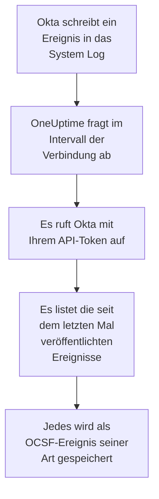

# Okta-Systemprotokoll

Importieren Sie das [Okta System Log](https://developer.okta.com/docs/reference/system-log-query/) in die Sicherheitsereignisse von OneUptime: Anmeldungen, MFA-Abfragen, Konto- und Gruppenänderungen und die eigenen Bedrohungserkennungen von Okta. Dort durchsuchen Sie sie neben Ihren Logs, Traces und Metriken, verknüpfen sie mit jeder anderen Quelle und alarmieren die Bereitschaft für die wichtigen. OneUptime liest sie mit einem API-Token, das Sie erstellen, und ändert nichts in Okta.

:::cards
- [Die Verbindung einrichten](#die-verbindung-einrichten): Ein API-Token und das Formular der Verbindung.
- [Was importiert wird](#was-importiert-wird): Welche Ereignisse, und wie aus jedem ein Sicherheitsereignis wird.
- [So funktioniert das Abfragen](#so-funktioniert-das-abfragen): Das Zeitfenster jeder Abfrage, und warum es sich um 15 Minuten überlappt.
- [Fehlerbehebung](#fehlerbehebung): Was jeder Fehler bedeutet und was zu ändern ist.
:::

## So funktioniert es



Jede Minute fragt OneUptime jede aktivierte Verbindung ab, deren Abfrageintervall abgelaufen ist. Eine Abfrage bittet Okta um die seit der letzten Abfrage veröffentlichten Ereignisse des System Log und speichert jedes als [OCSF](https://schema.ocsf.io/)-Ereignis: eine Anmeldung als Ereignis Authentication, eine Kontoänderung als Account Change und eine Okta-Erkennung als Detection Finding. Erkennungsregeln, Monitore und Dashboards behandeln es dann wie ein Sicherheitsereignis aus jeder anderen Quelle. Es funktioniert mit jeder Okta-Zelle, `okta.com`, `oktapreview.com` und `okta-emea.com`, und mit einer Organisation auf einer eigenen Domäne.

## Bevor Sie beginnen

- In OneUptime die Rolle Project Owner, Project Admin oder Security Admin. Security Member und Security Viewer sehen Verbindungen und ihren Laufverlauf, können sie aber nicht ändern.
- Ein Okta-Administrator, der das System Log sehen darf, um das Token zu erstellen. Ein Token kann, was sein Administrator kann, verwenden Sie also einen Read-only Administrator: Er liest das System Log und ändert nichts. Ein Read-only Administrator sieht auch Benutzer, Gruppen, Apps und Einstellungen, bewahren Sie das Token also so sicher wie ein Passwort auf.
- Am besten ein Dienstkonto für diesen Administrator. Okta deaktiviert ein Token, wenn sein Administrator deaktiviert wird und wenn es 30 Tage lang ungenutzt bleibt. Das Abfragen nutzt es alle paar Minuten, es bleibt also in Gebrauch, solange die Verbindung aktiviert ist.
- Wenn Ihre Organisation API-Aufrufe nur aus einer Netzwerkzone annimmt, eine Zone mit den Adressen, von denen OneUptime aufruft: in OneUptime Cloud seine ausgehenden Adressen, und bei einer selbst gehosteten Installation die öffentliche Adresse Ihrer App- und Worker-Hosts.

## Die Verbindung einrichten

:::steps
### Ein API-Token erstellen

1. Melden Sie sich als Read-only Administrator bei der Okta **Admin Console** an.
2. Öffnen Sie **Security → API**, dann den Tab **Tokens**, und wählen Sie **Create token**.
3. Benennen Sie es, zum Beispiel `OneUptime security events`. Lassen Sie unter der Angabe, woher seine Aufrufe kommen dürfen, **Any IP** stehen, außer Ihre Organisation braucht eine Zone.
4. Wählen Sie **Create token** und kopieren Sie den **Token Value**. Okta zeigt ihn nur einmal.

Jedes Token darf einen Anteil am API-Ratenlimit der Organisation nutzen, den seine Zeile im Tab **Tokens** zeigt. Eine Abfrage stellt höchstens 20 Anfragen, der Standardanteil reicht also, außer andere Werkzeuge nutzen dasselbe Token.

### Die Verbindung in OneUptime hinzufügen

Öffnen Sie **Produkte → Sicherheitsereignisse → Verbindungen** (`/dashboard/{projectId}/security-events/connections`), klicken Sie auf **Verbindung hinzufügen**, wählen Sie **Okta System Log** und klicken Sie auf **Weiter**. Füllen Sie die Einstellungen aus der Tabelle unten aus, klicken Sie auf **Weiter** und fügen Sie das Token in **API token** ein.

### Vor dem Speichern testen

Klicken Sie unter **Vor dem Speichern testen** auf **Diese Einstellungen testen**. Der Test meldet sich mit den Werten im Formular an, liest Ereignisse und speichert nichts, eine falsche URL oder ein ungültiger Filter zeigt sich also, bevor die Verbindung existiert. Klicken Sie dann auf **Weiter**, geben Sie der Verbindung einen **Name** und legen Sie sie an.
:::

| Einstellung | Was Sie eintragen |
| --- | --- |
| **Okta organization URL** | Die Adresse, an der sich Ihre Benutzer anmelden, etwa `https://acme.okta.com`, `https://acme.oktapreview.com` oder `https://login.example.com`. Sie muss `https` verwenden, ohne Pfad. Nicht die `-admin`-Adresse der Admin Console, die die API nicht bereitstellt. |
| **Event filter** | Optional. Ein [System-Log-Filter](https://developer.okta.com/docs/reference/core-okta-api/#filter), der die zu importierenden Ereignisse auswählt, etwa `eventType sw "user.session" or eventType sw "security"`. Leer importiert die Familien unten. Höchstens 2.000 Zeichen, auf einer Zeile, und nicht auf `published`: OneUptime setzt den Zeitraum selbst. |
| **API token** | Der Wert des Tokens, für sich allein: OneUptime fügt das Schema `SSWS` selbst hinzu. Er wird verschlüsselt, nie von der API zurückgegeben und nie wieder angezeigt. Ersetzen Sie ihn mit **Anmeldedaten aktualisieren** an der Verbindung. |

Der Schritt **Abfrage** hat außerdem eine optionale **Beschreibung**, das **Abfrageintervall (Minuten)**, eine ganze Zahl von `1` bis `1440`, die mit `5` beginnt, und **Aktiviert**, das eingeschaltet beginnt.

## Was importiert wird

Ohne **Event filter** importiert OneUptime die Ereignisfamilien, die ein Sicherheitsteam beobachtet, nach Präfix von `eventType`. Ein eigener Filter ersetzt diese Liste, statt sie zu ergänzen:

| Präfix | Ereignisse |
| --- | --- |
| `user.session` | Anmeldungen und Abmeldungen, Zugriff auf die Admin Console, Identitätswechsel |
| `user.authentication` | Authentifizierungsergebnisse, einschließlich Single Sign-on |
| `user.mfa` | Registrierung, Abfragen und Zurücksetzen von Faktoren |
| `user.account` | Passwortänderungen und -zurücksetzungen, Sperren, Profil- und Rechteänderungen |
| `user.lifecycle` | Erstellte, aktivierte, gesperrte, deaktivierte und gelöschte Benutzer |
| `security.` | ThreatInsight, Meldungen verdächtiger Aktivität und die anderen Erkennungen von Okta |
| `policy.` | Auswertungen von Anmelderichtlinien und Richtlinienänderungen |
| `system.api_token` | Erstellte und widerrufene API-Tokens |
| `application.user_membership` | App-Zuweisungen |
| `group.user_membership` | Änderungen an Gruppenmitgliedschaften |

Jedes Ereignis wird zu einem OCSF-Ereignis, mit dem Anbieter `Okta` und dem Produkt `Okta System Log`, der Klasse, die sein `eventType` verlangt:

| `eventType` | OCSF-Klasse | Aktivität |
| --- | --- | --- |
| `user.session.start` | Authentication (`3002`) | `Logon` |
| `user.session.end` | Authentication (`3002`) | `Logoff` |
| `user.authentication.*` | Authentication (`3002`) | `Logon` |
| `user.mfa.*` | Authentication (`3002`) | `Authentication Ticket` |
| Andere Ereignisse `user.session.*` | Authentication (`3002`) | `Other` |
| `user.account.*`, `user.lifecycle.*` | Account Change (`3001`) | Der letzte Teil des Ereignistyps, etwa `Update Password` |
| `group.*` | Group Management (`3006`) | Der letzte Teil des Ereignistyps, etwa `Add` |
| `security.*` und eine `policy.evaluate_sign_on`, die den Zugriff verweigert hat | Detection Finding (`2004`) | `Create`, mit dem Ereignistyp als Regelname |
| Alles andere | `0`, benannt nach dem Ereignistyp | Der letzte Teil des Ereignistyps |

Ein Ereignis ohne eigene Klasse behält jedes Feld und bleibt über jedes davon durchsuchbar. Seine Spalten:

| Okta-Feld | OneUptime-Spalte |
| --- | --- |
| `uuid` | Ereignis-UID, nach der auch Duplikate verworfen werden |
| `published`, wann das Ereignis geschah | Ereigniszeit |
| `displayMessage`, sonst der Ereignistyp und `outcome.reason` | Meldung |
| `severity`: `DEBUG` und `INFO` sind Informational, `WARN` Medium, `ERROR` High | Schweregrad |
| `outcome.result`, etwa `SUCCESS`, `FAILURE`, `ALLOW` oder `DENY` | Status |
| `actor.alternateId`, sonst `actor.displayName`; `client.ipAddress` | Benutzer und IP des Akteurs |
| Die `alternateId` des `User` in `target` | Zielbenutzer |
| Die `alternateId` der `AppInstance` in `target` | Zielressource |
| Der Akteur, jedes Ziel und die IP des Clients | Observables |
| Das ganze Ereignis, flach gemacht zu Schlüsseln mit Punkten wie `client.userAgent.browser` und `debugContext.debugData.requestUri` | `attributes` |

Eine fehlgeschlagene oder verweigerte Anmeldung mit `INFO` wird auf Low angehoben, damit sie sich von einer erfolgreichen abhebt. Das System Log trägt keine MITRE-ATT&CK-Verweise, diese Spalten bleiben also leer.

## So funktioniert das Abfragen

Jede Abfrage listet die in ihrem Zeitfenster veröffentlichten Ereignisse, die ältesten zuerst, 1.000 pro Seite, und folgt dem Link `next`, den Okta sendet, bis zur letzten Seite:

```text
GET {Okta organization URL}/api/v1/logs?since={window start}&until={window end}&sortOrder=ASCENDING&limit=1000&filter={Event filter}
```

- **Die Veröffentlichungszeit ist der Cursor.** Ein Ereignis des System Log ist die Aktivität selbst, deshalb ist `published` sowohl der Zeitpunkt, zu dem es geschah, als auch das, was das Abfragen liest.
- **Die erste Abfrage blickt 24 Stunden zurück**, sodass eine neue Verbindung ihre jüngsten Ereignisse sofort zeigt.
- **Jede spätere Abfrage beginnt 15 Minuten vor dem gespeicherten Cursor.** Okta warnt, dass eine Anfrage mit einer Endzeit verzögerte Ereignisse auslassen kann, was es selten nennt. Die Überlappung liest sie bei der nächsten Abfrage. Eines, das um mehr als 15 Minuten verzögert ist, kann hinter den Cursor fallen: Importieren Sie seinen Zeitraum, um es zurückzuholen.
- **Eine Abfrage liest höchstens 24 Stunden über den Cursor hinaus.** Eine Verbindung, deren Cursor zurückliegt, holt in einer Reihe von 24-Stunden-Fenstern auf, und ihre **Integrität** zeigt **Catching up**.
- **Duplikate werden nach `uuid` verworfen**, innerhalb des Projekts, sodass die Überlappung, ein wiederholtes Zeitfenster und ein Import nie ein Ereignis doppelt speichern.

Einem Link `next`, der woandershin zeigt als auf Ihre **Okta organization URL**, wird nie gefolgt, da das Token jede Anfrage begleitet.

### Wenn ein Zeitfenster mehr enthält, als eine Abfrage lesen kann

Eine Abfrage liest höchstens 10.000 Ereignisse, in höchstens 20 Anfragen. Enthält ein Zeitfenster mehr, ist der Lauf **Teilweise**, mit einer Warnung wie dieser:

```text
Stopped after collecting 10000 events; the window holds more. The last event read was published at 2026-09-14T08:12:44.000Z.
```

Ereignisse werden die ältesten zuerst gelesen, deshalb setzt OneUptime den Cursor auf die Veröffentlichungszeit des letzten gelesenen Ereignisses, und die nächste Abfrage beginnt genau dort, ohne die 15 Minuten Überlappung, mit derselben Fensterlänge. Eine ausgelastete Organisation holt 10.000 Ereignisse pro Abfrage auf, statt dieselben noch einmal zu lesen. Die Überlappung kehrt zurück, sobald der Cursor 15 Minuten über diesen Punkt hinaus gerückt ist.

Kommt ein Lauf gar nicht über den gespeicherten Cursor hinaus, etwa weil schon die 15 Minuten der Überlappung mehr als 10.000 Ereignisse enthalten, verkürzt OneUptime stattdessen das Zeitfenster:

1. **Verkleinern.** Die nächste Abfrage liest ein halb so langes Zeitfenster ab demselben Startpunkt und halbiert weiter, bis ein Zeitfenster vollständig gelesen wird, bis hinunter zu einer Minute. Die Warnung des Laufs sagt das: `This window holds more records than one poll can read; the next poll reads a {n} minute window from the same starting point.`
2. **Wieder wachsen.** Nachdem ein Zeitfenster vollständig gelesen wurde, ist das nächste wieder doppelt so lang, bis zu 24 Stunden.
3. **Über eine einzelne Minute hinweggehen.** Enthält selbst eine Minute mehr, als eine Abfrage lesen kann, geht das Abfragen über sie hinweg, damit neuere Ereignisse weiter ankommen, und die Überlappung späterer Abfragen reicht nicht mehr in sie zurück. Der Lauf bleibt **Teilweise**, und **Letzter Fehler** lautet `More records were created in the one minute from {cursor} to {end} than one poll can read. Polling moved past this minute so newer records keep arriving; use Import this time range in Diagnostics on this minute to recover what one run can read.` Importieren Sie diese Minute mit **Diesen Zeitraum importieren**, um zurückzuholen, was ein Lauf lesen kann, oder schränken Sie den **Event filter** ein.

Ein Lauf, der ganz fehlschlägt, mit einem Fehler von Okta, behält den Cursor und die Fensterlänge, und die nächste Abfrage liest dasselbe Zeitfenster erneut. Die einzige Ausnahme ist eine Anfrage, deren Zeit abgelaufen ist: Der Cursor bleibt, aber das nächste Zeitfenster ist halb so lang, denn ein Zeitfenster, das zu schwer ist, um rechtzeitig beantwortet zu werden, würde bei jedem Versuch ablaufen. Ein anderes **Abfrageintervall (Minuten)** ändert nichts davon: Es entscheidet, wie oft eine Abfrage beginnt, nicht, wo ihr Zeitfenster beginnt.

### Bei Bedarf ausführen, ansehen und importieren

Klicken Sie an einer Verbindung auf **Diagnose**, um ihre letzten Läufe zu sehen und von Hand mit ihr zu arbeiten. Wer die Verbindung ändern darf, kann diese starten; wer sie sehen darf, kann den Verlauf lesen.

- **Jetzt ausführen** startet sofort eine Abfrage, mit dem üblichen Cursor, auch wenn die Verbindung nicht **Aktiviert** ist.
- **Preview log events** liest einen Zeitraum von bis zu 7 Tagen und importiert nichts.
- **Diesen Zeitraum importieren** importiert nach Ihrer Bestätigung einen Zeitraum von bis zu 7 Tagen, ohne den Cursor zu verschieben. Bereits importierte Ereignisse werden übersprungen. Okta bewahrt das System Log 90 Tage lang auf.
- **Diagnosen kopieren** an einem Lauf kopiert seinen Bericht für den Support. Er enthält nie Anmeldedaten.

## Verbindung testen

**Verbindung testen** in der Zeile einer Verbindung und **Diese Einstellungen testen** im Formular laufen im API-Prozess, nicht in einem Hintergrund-Worker, sodass ein Test auch dann antwortet, wenn die Worker das Problem sind. Er führt diese Prüfungen der Reihe nach aus:

| Prüfung | Was sie prüft |
| --- | --- |
| **Konfiguration** | Jede Einstellung ist vorhanden und gültig. Schlägt das fehl, wird nichts kontaktiert. |
| **Authenticate with Okta** | Okta nimmt das Token für das System Log an, mit einem gelesenen Ereignis und ohne Filter. |
| **Read System Log events** | Ein Ereignis aus den letzten 24 Stunden lässt sich durch den Filter lesen, den das Abfragen verwendet, Ihren oder den Standardfilter, deshalb schlägt ein ungültiger **Event filter** hier fehl statt bei der ersten Abfrage. |
| **Events available to import** | Wie viele Ereignisse in den letzten 24 Stunden und den letzten 7 Tagen veröffentlicht wurden, je eine Seite mit 1.000, `1000+` heißt also mehr. Keine in 7 Tagen ist eine Warnung, kein Fehler. |
| **Background workers**, **Poll scheduler**, **Security event storage** | Die Seite von OneUptime selbst: Ein Prozess nimmt die Aufträge der Worker-Warteschlange an, der Abfrageauftrag läuft jede Minute, und der Speicher der Sicherheitsereignisse antwortet. |
| **Geplante Abfrage** | Für eine gespeicherte Verbindung: Das Abfragen ist eingeschaltet, kein Lauf wartet festgefahren auf einen Worker, und die Abfragen laufen pünktlich. |

Jede Anfrage in einem Test hat eine Frist von 20 Sekunden. Ein Test importiert nie etwas und verschiebt nie den Cursor, und jede fehlgeschlagene Prüfung sagt, was zu ändern ist.

## Fehlerbehebung

Der **Letzter Fehler** der Verbindung bewahrt die vollständige Fehlermeldung, mit geschwärzten Anmeldedaten, hinter einem Präfix, das den fehlgeschlagenen Schritt nennt. Hat eine Verbindung einen Fehler, wählen Sie in ihrer Spalte **Aktionen** die Aktion **Fehler anzeigen**, um ihn zu lesen, und im Dialog **Fehler kopieren**, um ihn zu kopieren. Jede Meldung beginnt mit `Okta System Log events request` und zitiert nach dem Status den eigenen Fehlercode von Okta; lesen Sie, was danach folgt.

:::details Letzter Fehler sagt `failed (HTTP 400)`
Okta hat die Parameter der Anfrage abgelehnt, `E0000053`. Hat das Token funktioniert, ist das fast immer der **Event filter**: Prüfen Sie seine Operatoren, `eq`, `ne`, `co`, `sw`, `ew`, `pr`, `gt`, `ge`, `lt` und `le`, seine Verknüpfungen mit `and` und `or` und die doppelten Anführungszeichen um seine Werte, oder leeren Sie ihn, um die Standardfamilien zu verwenden. Bei einem Import kann es auch heißen, dass der Zeitraum mehr als 180 Tage zurück beginnt.
:::

:::details Letzter Fehler sagt `failed (HTTP 401)` oder `failed (HTTP 403)`
- `HTTP 401`: Okta hat das Token nicht angenommen, `E0000011`. Es wurde widerrufen, blieb 30 Tage ungenutzt oder wurde mit seinem Administrator deaktiviert; oder es wurde mit `SSWS` oder einem überzähligen Zeichen eingefügt. Erstellen Sie ein neues Token als Read-only Administrator und speichern Sie es mit **Anmeldedaten aktualisieren**.
- `HTTP 403`: Das Token meldet sich an, aber sein Administrator darf das System Log nicht lesen, `E0000006`. Erstellen Sie es als Read-only Administrator oder Super Administrator, und prüfen Sie, dass seine Netzwerkzone die Adressen zulässt, von denen OneUptime aufruft.
:::

:::details Letzter Fehler sagt `failed (HTTP ...)` mit einem anderen Status
- `HTTP 404`: Die URL stellt die API von Okta nicht bereit. Verwenden Sie die eigene Adresse der Organisation, etwa `https://acme.okta.com`, ohne Pfad und nicht die `-admin`-Adresse.
- `HTTP 3xx`: Okta hat die Anfrage umgeleitet, und Umleitungen werden abgelehnt, da das Token jede Anfrage begleitet. Verwenden Sie die eigene Adresse der Organisation.
- `HTTP 429`: Okta begrenzt das Token, `E0000047`. Die nächste Abfrage versucht es erneut. Wiederholt sich das, erhöhen Sie den Anteil des Tokens am Ratenlimit im Tab **Tokens**, geben Sie OneUptime ein eigenes Token, oder fragen Sie seltener ab.
- `HTTP 5xx`: Okta ist fehlgeschlagen, oder die Abfrage hat das Limit von 30 Sekunden von Okta überschritten, `E0000009`. Die nächste Abfrage versucht es erneut; wiederholt sich das, prüfen Sie [status.okta.com](https://status.okta.com).
:::

:::details Letzter Fehler sagt `returned` oder `did not complete`
- `returned a non-JSON body.` oder `returned an unrecognized response shape`: Etwas anderes als die API von Okta hat geantwortet, etwa eine Anmeldeseite oder ein Proxy, oder Okta hat mit einem Fehler geantwortet. Das wird gemeldet statt als leeres Zeitfenster genommen, damit der Cursor nie über Ereignisse hinwegrückt, die niemand gelesen hat.
- `returned a next link outside the Okta organization URL`: Ein Link `next` zeigte woandershin, und ihm wurde nicht gefolgt. Okta selbst tut das nie: Suchen Sie nach einem Proxy, der Header umschreibt.
- `did not complete`: Die Anfrage bekam keine Antwort: eine Zeitüberschreitung, ein Name, der sich nicht auflösen lässt, ein Zertifikat, dem OneUptime nicht vertraut, oder eine abgelehnte Adresse. Prüfen Sie, ob die OneUptime-App und die Worker Ihre Organisation über HTTPS erreichen, durch jeden Proxy, den Sie verwenden.
:::

:::details Zuletzt abgefragt ist Never und Letzter Fehler ist leer
Für diese Verbindung ist noch keine Abfrage fertig geworden. Führen Sie **Verbindung testen** aus: Ihre Prüfungen **Background workers** und **Poll scheduler** nennen die Ursache. Bei einer selbst gehosteten Installation ist die übliche Ursache `DISABLE_QUEUE_WORKERS=true` an der App, ohne eigene Worker-Bereitstellung, die die Aufträge annimmt: Setzen Sie es auf `false` oder betreiben Sie die Worker-Bereitstellung (Helm: `worker.enabled: true`).
:::

:::details Ein Lauf ist Teilweise
- `Stopped after collecting 10000 events`: Das Zeitfenster enthielt mehr als die 10.000 Ereignisse, die ein Lauf liest. Nichts geht verloren: Die nächste Abfrage beginnt nach dem letzten gelesenen Ereignis. Eine Verbindung, die Abfrage um Abfrage **Teilweise** bleibt, holt einen Rückstand auf, und ihre Werte **Zuletzt abgefragt** und **Letztes importiertes Ereignis** bewegen sich weiter. Holt sie nie auf, veröffentlicht die Organisation mehr passende Ereignisse, als ein Abfrageintervall fassen kann: Schränken Sie den **Event filter** ein oder verkürzen Sie das **Abfrageintervall (Minuten)**.
- `More records were created in the one minute from ... than one poll can read`: Das Abfragen ist über diese Minute hinweggegangen. Importieren Sie sie mit **Diesen Zeitraum importieren** in der **Diagnose**. Ein Import liest so viel wie eine Abfrage.
:::

:::details Der Test besteht, aber nichts wird importiert
Lesen Sie **Events available to import** im Bericht des Tests. Mit dem Standardfilter veröffentlicht eine Organisation mit Benutzern ständig Anmeldungen, `0` in den letzten 7 Tagen heißt also, dass die URL eine Sandbox oder eine ungenutzte Organisation ist. Mit Ihrem eigenen **Event filter** heißt es, dass der Filter nichts getroffen hat: Vergleichen Sie ihn mit den Ereignistypen im System Log der Admin Console.
:::

## Was Sie davon haben

- **Suche.** Filtern Sie Anmeldungen, MFA-Ergebnisse, Kontoänderungen und Okta-Erkennungen im Explorer der Sicherheitsereignisse nach Schweregrad, Status, Benutzer, IP oder jedem Observable, neben jeder anderen Quelle.
- **Verknüpfung.** Die Benutzer, Apps und IPs jedes Ereignisses werden als Observables indiziert, sodass eine Suche alles findet, was ein Benutzer getan hat, neben den eigenen Logs seiner App.
- **Erkennungsregeln.** Sigma-Regeln, die nach einem Zeitplan über Ihre Sicherheitsereignisse laufen, etwa fehlgeschlagene Anmeldungen pro IP oder MFA-Ablehnungen pro Benutzer, und Warnungen eröffnen, die die Bereitschaft alarmieren.
- **Monitore.** Monitore für Sicherheitsereignisse zählen passende Ereignisse und eröffnen ab einem Schwellwert Vorfälle oder Warnungen.

Sicherheitsereignisse werden wie Ihre übrige Telemetrie abgerechnet, pro aufgenommenem GB. Siehe [Preise](https://oneuptime.com/pricing).

## Nächste Schritte

:::cards
- [Sicherheitsereignisse](/docs/telemetry/security-events): Durchsuchen, verknüpfen und warnen, was Sie importieren.
- [AWS Security Hub](/docs/integrations/aws-security-hub): Auch die Findings Ihrer Cloud importieren.
- [Rollen](/docs/permissions/reference#rollen): Was die Security-Rollen sehen und ändern können.
- [Integrationsübersicht](/docs/integrations/index): Die anderen Werkzeuge, die Sie verbinden können.
:::
