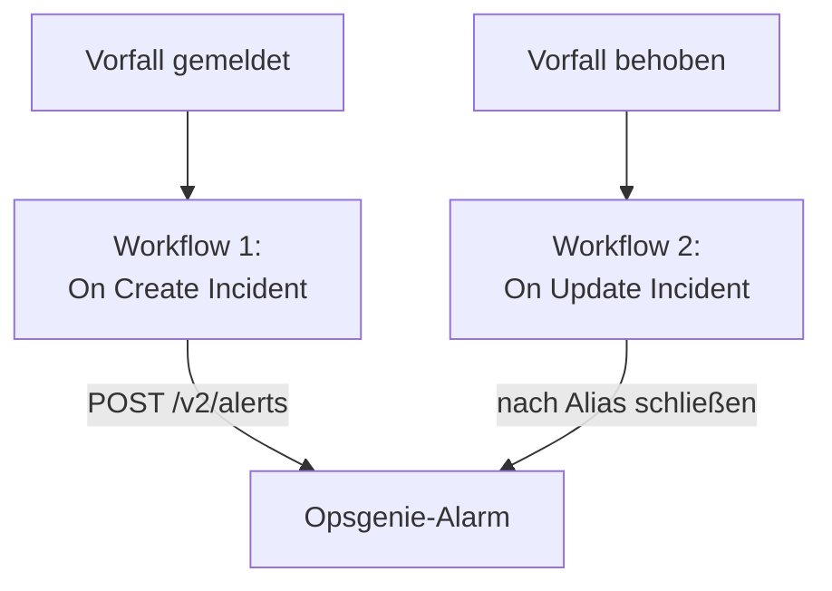

# Opsgenie

Senden Sie OneUptime-Vorfälle an [Opsgenie](https://www.atlassian.com/software/opsgenie). Ein Workflow legt einen Opsgenie-Alarm an, wenn ein OneUptime-Vorfall gemeldet wird, und ein zweiter schließt ihn, wenn der OneUptime-Vorfall behoben ist. Nutzen Sie das, solange Opsgenie Ihr Team noch alarmiert und OneUptime Ihre Systeme überwacht.

:::cards
- [Den API-Schlüssel speichern](#den-api-schlüssel-speichern): Halten Sie den Schlüssel von Opsgenie aus Ihren Workflows heraus.
- [Opsgenie-Alarme anlegen](#für-jeden-vorfall-einen-opsgenie-alarm-anlegen): Ein Workflow, zwei Bausteine.
- [Sie schließen](#den-opsgenie-alarm-schließen): Ein zweiter Workflow, der dem Status des Vorfalls folgt.
- [Fehlerbehebung](#fehlerbehebung): Wenn Opsgenie eine Anfrage ablehnt.
:::

> [!IMPORTANT]
> Atlassian hat den Verkauf von Opsgenie im Juni 2025 eingestellt und beendet den Support im April 2027. OneUptime alarmiert auch selbst, mit Bereitschaftsrichtlinien, Dienstplänen und Eskalationsregeln. Um Ihr Team herüberzuholen, siehe [Wechsel von Opsgenie](/docs/moving-to-oneuptime/opsgenie): Ein Import bringt Ihre Benutzer, Teams, Dienstpläne und Eskalationen herüber.

## So funktioniert es



Beide Workflows rufen die [Opsgenie Alert API](https://docs.opsgenie.com/docs/alert-api) auf. Der erste gibt dem Alarm einen `alias`, gebildet aus der ID des OneUptime-Vorfalls, und der zweite schließt den Alarm über diesen Alias.

## Bevor Sie beginnen

- Eine Opsgenie-Integration vom Typ **API** und ihr **API Key**. Legen Sie eine in Opsgenie unter **Settings → Integrations** an, oder unter den **Integrations** eines Teams, um Alarme an dieses Team zu senden.
- Ihre Opsgenie-Region. Konten in Europa, die sich unter `app.eu.opsgenie.com` anmelden, nutzen `api.eu.opsgenie.com`. Alle anderen nutzen `api.opsgenie.com`.
- In OneUptime das Recht, Workflows und globale Variablen anzulegen. In OneUptime Cloud brauchen Workflows den Tarif **Growth** oder höher.

## Den API-Schlüssel speichern

:::steps
1. Gehen Sie zu **Arbeitsabläufe → Globale Variablen** und klicken Sie auf **Arbeitsablaufvariable erstellen**.
2. Nennen Sie sie `OPSGENIE_KEY` und klicken Sie auf **Weiter**.
3. Fügen Sie den API-Schlüssel in **Inhalt** ein, schalten Sie **Geheimnis** ein und klicken Sie auf **Arbeitsablaufvariable erstellen**.
:::

Eine geheime Variable wird in den Ausführungsprotokollen durch `[REDACTED]` ersetzt, der Schlüssel erscheint also nie in einer Ausführung.

## Für jeden Vorfall einen Opsgenie-Alarm anlegen

:::steps
### Den Workflow anlegen

Gehen Sie zu **Arbeitsabläufe**, klicken Sie auf **Arbeitsablauf erstellen** und dann auf **Ohne Vorlage beginnen**. Nennen Sie ihn `Incidents to Opsgenie` und klicken Sie auf **Arbeitsablauf erstellen**.

### Den Trigger hinzufügen

Klicken Sie auf den gestrichelten Baustein **Wählen Sie, was diesen Arbeitsablauf startet** und wählen Sie **On Create Incident**. Klicken Sie auf den Trigger und wählen Sie in **Fields to pass on** die Felder `title` und `description`.

### Den Alarm anlegen

Klicken Sie auf **Komponente hinzufügen**, fügen Sie einen **API Post (JSON)**-Baustein hinzu und verbinden Sie den Punkt **Success** des Triggers damit. Setzen Sie seine **URL** auf `https://api.opsgenie.com/v2/alerts`, in Europa auf `https://api.eu.opsgenie.com/v2/alerts`. Setzen Sie unter **Weitere Felder** seine **Request Headers** auf:

```json
{ "Authorization": "GenieKey {{global.variables.OPSGENIE_KEY}}" }
```

Und seinen **Request Body** auf:

```json
{
  "message": "{{local.components.incident-on-create-1.returnValues.model.title}}",
  "alias": "oneuptime-{{local.components.incident-on-create-1.returnValues.model._id}}",
  "description": "{{local.components.incident-on-create-1.returnValues.model.description}}",
  "priority": "P1",
  "source": "OneUptime"
}
```

### Testen und dann einschalten

Klicken Sie auf **Arbeitsablauf ausführen**, geben Sie die **Vorfall-ID** eines Testvorfalls ein und führen Sie ihn aus. Der Schritt **API Post (JSON)** zeigt eine `202`-Antwort, und der Alarm erscheint einen Moment später in Opsgenie. Schalten Sie danach oben im **Editor** **Aktiviert** ein.
:::

Das Schema von Opsgenie ist das Wort `GenieKey`, ein Leerzeichen, dann der Schlüssel. Opsgenie begrenzt `message` auf 130 Zeichen, und seine Prioritäten reichen von `P1` bis `P5`: Um die jeweils eigene Priorität jedes Vorfalls zu senden, siehe [Prioritäten zuordnen](#prioritäten-zuordnen).

## Den Opsgenie-Alarm schließen

Ein Workflow hat einen Trigger, das Schließen braucht also einen zweiten Workflow, der startet, wenn sich der Status eines Vorfalls ändert.

:::steps
### Den Trigger On Update Incident hinzufügen

Legen Sie einen Workflow namens `Close Opsgenie alerts` an und wählen Sie **On Update Incident** als Trigger. Wählen Sie in **Fields to watch** das Feld `currentIncidentStateId`, damit er nur läuft, wenn sich der Status ändert. Fragen Sie in **Fields to pass on** ab, ob der neue Status ein behobener ist:

```json
{ "_id": true, "currentIncidentState": { "isResolvedState": true } }
```

### Prüfen, ob der Vorfall behoben ist

Fügen Sie nach dem Trigger einen **If / Else**-Baustein hinzu. Setzen Sie **Value to check** auf `{{local.components.incident-on-update-1.returnValues.model.currentIncidentState.isResolvedState}}` und **Comparison** auf **is true**.

### Den Alarm schließen

Fügen Sie nach der Seite **Yes** einen **API Post (JSON)**-Baustein hinzu, mit denselben **Request Headers** und dieser **URL**:

```text
https://api.opsgenie.com/v2/alerts/oneuptime-{{local.components.incident-on-update-1.returnValues.model._id}}/close?identifierType=alias
```

Setzen Sie seinen **Request Body** auf `{ "source": "OneUptime", "note": "Resolved in OneUptime" }`.

### Ihn einschalten

Schalten Sie **Aktiviert** ein und beheben Sie dann einen Testvorfall in OneUptime. Opsgenie schließt seinen Alarm.
:::

`identifierType=alias` sagt Opsgenie, dass die Adresse den Alarm über seinen Alias benennt, nicht über seine eigene ID.

## Prioritäten zuordnen

Um den Schweregrad jedes Vorfalls als Opsgenie-Priorität zu senden, fügen Sie zwischen dem Trigger und dem **API Post (JSON)**-Baustein einen **Run Custom JavaScript**-Baustein hinzu.

1. Wählen Sie in den **Fields to pass on** des Triggers zusätzlich den `name` des Schweregrads: `{ "incidentSeverity": { "name": true } }`.
2. Setzen Sie die **Arguments** des Bausteins auf `{ "severity": "{{local.components.incident-on-create-1.returnValues.model.incidentSeverity.name}}" }` und seinen **JavaScript Code** auf:

   ```javascript
   // Your incident severities, by name, to Opsgenie's priorities.
   const PRIORITY = {
     "Critical Incident": "P1",
     "Major Incident": "P2",
     "Minor Incident": "P3",
   };

   return { priority: PRIORITY[args.severity] || "P3" };
   ```

3. Setzen Sie im Request-Body `"priority"` auf `"{{local.components.javascript-1.returnValues.returnValue.priority}}"`.

Die Namen oben sind die drei Schweregrade, mit denen ein neues Projekt beginnt. Verwenden Sie Ihre eigenen, wenn Sie sie umbenannt haben.

## Fehlerbehebung

:::details Opsgenie antwortet mit 401 oder 403
Der Schlüssel ist falsch oder gehört zur anderen Region. Prüfen Sie, dass der Header `GenieKey`, ein Leerzeichen und den Schlüssel enthält, dass der Schlüssel zu einer **API**-Integration gehört und dass der Host zu Ihrer Region passt: `api.opsgenie.com` oder `api.eu.opsgenie.com`.
:::

:::details Das Schließen antwortet mit 404
Kein Alarm hat diesen Alias. Beide Workflows müssen den Alias gleich bilden, `oneuptime-`, gefolgt von der `_id` des Vorfalls, und die URL muss auf `?identifierType=alias` enden.
:::

:::details Der Alarm erscheint nie, obwohl der Schritt 202 zeigt
Opsgenie antwortet mit `202`, bevor es die Anfrage verarbeitet, eine Anfrage, die es später ablehnt, zeigt also trotzdem `202`. Suchen Sie die Anfrage in den Protokollen von Opsgenie, um zu sehen, warum sie abgelehnt wurde, etwa weil die Integration ausgeschaltet ist.
:::

:::details Der Workflow läuft nie
Prüfen Sie, dass er eingeschaltet ist: **Aktiviert**, oben in seinem **Editor**. Öffnen Sie dann **Protokolle → Ausführungen**: Eine Ausführung, die die Seite **No** des **If / Else**-Bausteins genommen hat, ist eine Aktualisierung, die keine Behebung war.
:::

## Nächste Schritte

:::cards
- [Wechsel von Opsgenie](/docs/moving-to-oneuptime/opsgenie): Bringen Sie Ihr Team, Ihre Dienstpläne und Eskalationen herüber, bevor Opsgenie endet.
- [Eskalationsregeln](/docs/on-call/escalation-rules): Alarmieren Sie Menschen direkt aus OneUptime.
- [PagerDuty](/docs/integrations/pagerduty): Dieselben zwei Workflows für PagerDuty.
- [Integrationsübersicht](/docs/integrations/index): Die Muster hinter jeder Integration.
:::
