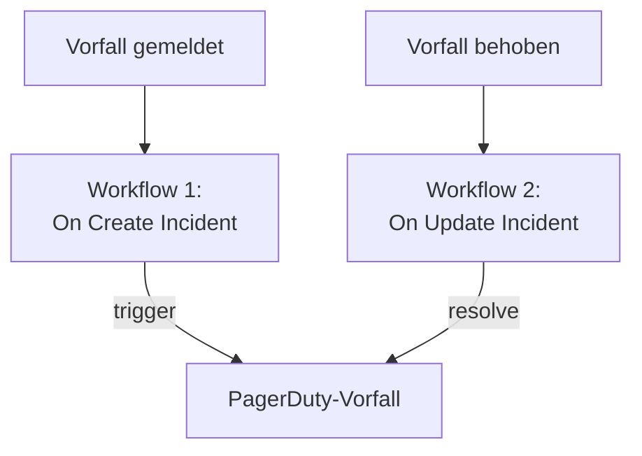

# PagerDuty

Senden Sie OneUptime-Vorfälle an [PagerDuty](https://www.pagerduty.com). Ein Workflow löst einen PagerDuty-Vorfall aus, wenn ein OneUptime-Vorfall gemeldet wird, und ein zweiter behebt ihn, wenn der OneUptime-Vorfall behoben ist. Nutzen Sie das, wenn PagerDuty Ihr Team alarmiert und OneUptime Ihre Systeme überwacht.

:::cards
- [Den Routing-Schlüssel speichern](#den-routing-schlüssel-speichern): Halten Sie den Schlüssel von PagerDuty aus Ihren Workflows heraus.
- [PagerDuty-Vorfälle auslösen](#für-jeden-vorfall-einen-pagerduty-vorfall-auslösen): Ein Workflow, zwei Bausteine.
- [Sie beheben](#den-pagerduty-vorfall-beheben): Ein zweiter Workflow, der dem Status des Vorfalls folgt.
- [Fehlerbehebung](#fehlerbehebung): Wenn PagerDuty ein Ereignis ablehnt.
:::

> [!TIP]
> OneUptime alarmiert auch selbst, mit Bereitschaftsrichtlinien, Dienstplänen und Eskalationsregeln. Um Ihr Team von PagerDuty wegzuholen, siehe [Wechsel von PagerDuty](/docs/moving-to-oneuptime/pagerduty): Ein Import bringt Ihre Benutzer, Dienstpläne und Eskalationsrichtlinien herüber.

## So funktioniert es



Beide Workflows rufen die [Events API v2](https://developer.pagerduty.com/docs/events-api-v2/overview/) von PagerDuty mit demselben `dedup_key` auf, gebildet aus der ID des OneUptime-Vorfalls. An diesem Schlüssel erkennt PagerDuty, dass das Behebungsereignis den Vorfall schließt, den das Auslöseereignis eröffnet hat.

## Bevor Sie beginnen

- Ein PagerDuty-Dienst mit einer Events-API-v2-Integration. Öffnen Sie in PagerDuty den Dienst, dann **Integrations**, klicken Sie auf **Add an integration** und wählen Sie **Events API V2**. Kopieren Sie ihren **Integration Key**: Die Events API nennt ihn den Routing-Schlüssel.
- In OneUptime das Recht, Workflows und globale Variablen anzulegen. In OneUptime Cloud brauchen Workflows den Tarif **Growth** oder höher.

## Den Routing-Schlüssel speichern

:::steps
1. Gehen Sie zu **Arbeitsabläufe → Globale Variablen** und klicken Sie auf **Arbeitsablaufvariable erstellen**.
2. Nennen Sie sie `PAGERDUTY_ROUTING_KEY` und klicken Sie auf **Weiter**.
3. Fügen Sie den Integrationsschlüssel in **Inhalt** ein, schalten Sie **Geheimnis** ein und klicken Sie auf **Arbeitsablaufvariable erstellen**.
:::

Eine geheime Variable wird in den Ausführungsprotokollen durch `[REDACTED]` ersetzt, der Schlüssel erscheint also nie in einer Ausführung.

## Für jeden Vorfall einen PagerDuty-Vorfall auslösen

:::steps
### Den Workflow anlegen

Gehen Sie zu **Arbeitsabläufe**, klicken Sie auf **Arbeitsablauf erstellen** und dann auf **Ohne Vorlage beginnen**. Nennen Sie ihn `Incidents to PagerDuty` und klicken Sie auf **Arbeitsablauf erstellen**.

### Den Trigger hinzufügen

Klicken Sie auf den gestrichelten Baustein **Wählen Sie, was diesen Arbeitsablauf startet** und wählen Sie **On Create Incident**. Klicken Sie auf den Trigger: Seine **Fields to pass on** beginnen mit **Titel**, also klicken Sie auf **Feld hinzufügen** und wählen Sie **Beschreibung**.

### Das Auslöseereignis senden

Klicken Sie auf **Komponente hinzufügen**, fügen Sie einen **API Post (JSON)**-Baustein hinzu und verbinden Sie den Punkt **Success** des Triggers damit. Setzen Sie seine **URL** auf `https://events.pagerduty.com/v2/enqueue` und seinen **Request Body** auf:

```json
{
  "routing_key": "{{global.variables.PAGERDUTY_ROUTING_KEY}}",
  "event_action": "trigger",
  "dedup_key": "oneuptime-{{local.components.incident-on-create-1.returnValues.model._id}}",
  "payload": {
    "summary": "{{local.components.incident-on-create-1.returnValues.model.title}}",
    "source": "OneUptime",
    "severity": "critical",
    "custom_details": {
      "description": "{{local.components.incident-on-create-1.returnValues.model.description}}"
    }
  }
}
```

### Testen und dann einschalten

Klicken Sie auf **Arbeitsablauf ausführen**, wählen Sie unter **Vorfall** einen Testvorfall aus und führen Sie ihn aus. Der Schritt **API Post (JSON)** zeigt eine `202`-Antwort mit `"status": "success"`, und PagerDuty eröffnet einen Vorfall. Schalten Sie danach oben im **Editor** **Aktiviert** ein.
:::

Der Baustein sendet JSON, er braucht also keinen `Content-Type`-Header. Der `severity` von PagerDuty ist einer von `critical`, `error`, `warning` und `info`: Um den jeweils eigenen Schweregrad jedes Vorfalls zu senden, siehe [Schweregrade zuordnen](#schweregrade-zuordnen).

## Den PagerDuty-Vorfall beheben

Ein Workflow hat einen Trigger, das Beheben braucht also einen zweiten Workflow, der startet, wenn sich der Status eines Vorfalls ändert.

:::steps
### Den Trigger On Update Incident hinzufügen

Legen Sie einen Workflow namens `Resolve PagerDuty incidents` an und wählen Sie **On Update Incident** als Trigger. Klicken Sie in **Fields to watch** auf **Feld hinzufügen** und wählen Sie **Aktueller Vorfallsstatus**, damit er nur läuft, wenn sich der Status ändert. Fragen Sie in **Fields to pass on** ab, ob der neue Status ein behobener ist: Klicken Sie auf **Feld hinzufügen**, öffnen Sie **Aktueller Vorfallsstatus** und wählen Sie **Ist Behoben-Status**. Oder klicken Sie auf **Als JSON bearbeiten** und ersetzen Sie das JSON durch:

```json
{ "_id": true, "currentIncidentState": { "isResolvedState": true } }
```

### Prüfen, ob der Vorfall behoben ist

Fügen Sie nach dem Trigger einen **If / Else**-Baustein hinzu. Setzen Sie **Value to check** auf `{{local.components.incident-on-update-1.returnValues.model.currentIncidentState.isResolvedState}}` und **Comparison** auf **is true**.

### Das Behebungsereignis senden

Fügen Sie nach der Seite **Yes** einen **API Post (JSON)**-Baustein hinzu, mit derselben **URL** und diesem **Request Body**:

```json
{
  "routing_key": "{{global.variables.PAGERDUTY_ROUTING_KEY}}",
  "event_action": "resolve",
  "dedup_key": "oneuptime-{{local.components.incident-on-update-1.returnValues.model._id}}"
}
```

### Ihn einschalten

Schalten Sie **Aktiviert** ein und beheben Sie dann einen Testvorfall in OneUptime. PagerDuty behebt seinen Vorfall.
:::

Wer `isResolvedState` statt des Namens eines Status prüft, muss nach dem Umbenennen von Status nichts ändern. Siehe [Vorfallstatus & Schweregrade](/docs/incidents/states-and-severities).

## Schweregrade zuordnen

Um den Schweregrad jedes Vorfalls zu senden, fügen Sie zwischen dem Trigger und dem **API Post (JSON)**-Baustein einen **Run Custom JavaScript**-Baustein hinzu und lesen seine Antwort im Body.

1. Klicken Sie in den **Fields to pass on** des Triggers auf **Feld hinzufügen**, öffnen Sie **Vorfallsschweregrad** und wählen Sie **Name**.
2. Setzen Sie die **Arguments** des Bausteins auf `{ "severity": "{{local.components.incident-on-create-1.returnValues.model.incidentSeverity.name}}" }` und seinen **JavaScript Code** auf:

   ```javascript
   // Your incident severities, by name, to PagerDuty's.
   const SEVERITY = {
     "Critical Incident": "critical",
     "Major Incident": "error",
     "Minor Incident": "warning",
   };

   return { severity: SEVERITY[args.severity] || "info" };
   ```

3. Setzen Sie im Request-Body `"severity"` auf `"{{local.components.javascript-1.returnValues.returnValue.severity}}"`.

Die Namen oben sind die drei Schweregrade, mit denen ein neues Projekt beginnt. Verwenden Sie Ihre eigenen, wenn Sie sie umbenannt haben.

## Fehlerbehebung

:::details PagerDuty antwortet mit 400
Der Antwort-Body sagt, was PagerDuty abgelehnt hat, und der Schritt **API Post (JSON)** der Ausführung zeigt ihn. Meist ist der Routing-Schlüssel kein Integrationsschlüssel der Events API v2: Kopieren Sie ihn erneut aus den **Integrations** des Dienstes. Auch ein Ereignis ohne `summary`, `source` oder `severity` wird abgelehnt.
:::

:::details Das Behebungsereignis schließt nichts
Beide Ereignisse müssen genau denselben `dedup_key` tragen. Prüfen Sie, dass beide Bodies ihn als `oneuptime-`, gefolgt von der `_id` des Vorfalls, bilden und dass der Behebungs-Workflow eingeschaltet ist.
:::

:::details Der Workflow läuft nie
Prüfen Sie, dass er eingeschaltet ist: **Aktiviert**, oben in seinem **Editor**. Öffnen Sie dann **Protokolle → Ausführungen**: Eine Ausführung, die die Seite **No** des **If / Else**-Bausteins genommen hat, ist eine Aktualisierung, die keine Behebung war.
:::

:::details PagerDuty zeigt einen Verweis statt eines Werts
Ein Verweis, der sich nicht auflöst, wird so gesendet, wie er geschrieben ist, mit allen Klammern. Prüfen Sie die Kennung des Bausteins, den Feldnamen und den Namen der Variable, bei dem Groß- und Kleinschreibung zählt. Auf dem Tab **Schritte** der Ausführung ist eine Einstellung mit einem solchen Verweis als **Nicht behoben** markiert.
:::

## Nächste Schritte

:::cards
- [Wechsel von PagerDuty](/docs/moving-to-oneuptime/pagerduty): Bringen Sie Ihr Team, Ihre Dienstpläne und Eskalationsrichtlinien herüber.
- [Eskalationsregeln](/docs/on-call/escalation-rules): Alarmieren Sie Menschen direkt aus OneUptime.
- [Opsgenie](/docs/integrations/opsgenie): Dieselben zwei Workflows für Opsgenie.
- [Integrationsübersicht](/docs/integrations/index): Die Muster hinter jeder Integration.
:::
