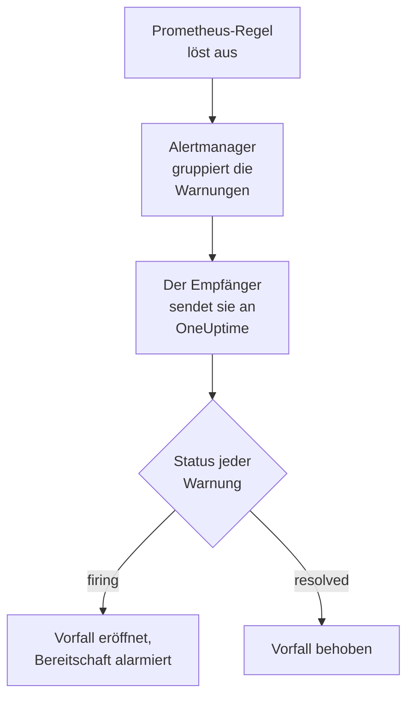

# Prometheus Alertmanager

Senden Sie Warnungen von [Prometheus Alertmanager](https://prometheus.io/docs/alerting/latest/alertmanager/) an OneUptime, sodass jede auslösende Warnung zu einem Vorfall wird, der Ihr Bereitschaftsteam alarmiert und behoben wird, wenn sich die Warnung erholt. Alertmanager sendet seine Benachrichtigungen an einen Webhook-Empfänger, es gibt also auf keiner Seite etwas zu installieren.

:::cards
- [Wählen Sie, wie OneUptime Warnungen empfängt](#wählen-sie-wie-oneuptime-warnungen-empfängt): Ein Monitor für eingehende Anfragen oder ein eigener Workflow.
- [Warnungen mit einem Monitor empfangen](#warnungen-mit-einem-monitor-empfangen): Ein Vorfall pro Warnung, bei der Erholung behoben.
- [Alertmanager konfigurieren](#alertmanager-konfigurieren): Ein Webhook-Empfänger und die Route, die ihn nutzt.
- [Fehlerbehebung](#fehlerbehebung): Wenn Warnungen nicht ankommen oder Vorfälle offen bleiben.
:::

## So funktioniert es



Prometheus wertet Ihre Warnregeln aus und sendet die auslösenden Warnungen an Alertmanager. Alertmanager gruppiert sie nach den Labels im `group_by` Ihrer Route und sendet jede Gruppe als eine JSON-Benachrichtigung an den Webhook-Empfänger. Die Liste `alerts` der Benachrichtigung enthält jede Warnung der Gruppe, jede mit ihrem eigenen `status`, `firing` oder `resolved`, ihren Labels und Annotationen und einem `fingerprint`, der sie bezeichnet.

## Bevor Sie beginnen

- Ein Alertmanager, dessen `alertmanager.yml` Sie bearbeiten können und der Ihr OneUptime über HTTPS erreicht.
- In OneUptime das Recht, Monitore anzulegen, oder Workflows, wenn Sie diesen Weg gehen.

## Wählen Sie, wie OneUptime Warnungen empfängt

Richten Sie zuerst OneUptime ein: Es gibt Ihnen die URL, an die Alertmanager sendet.

| Weg | Nutzen Sie ihn, wenn |
| --- | --- |
| Ein Monitor für eingehende Anfragen (empfohlen) | Sie möchten, dass jede Warnung ein Vorfall wird, der die Bereitschaft alarmiert und behoben wird, wenn sich die Warnung erholt. Es gibt nichts zu bauen. |
| Ein Workflow mit einem Webhook-Trigger | Sie brauchen eigene Logik: Warnungen filtern, umformen oder zuerst andere Systeme aufrufen. Ein Workflow eröffnet einen Vorfall pro Benachrichtigung, nicht pro Warnung, und behebt ihn bei der Erholung nicht. |

Beide bekommen dasselbe JSON vom selben Empfänger, Sie können also mit einem beginnen und später wechseln, indem Sie in `alertmanager.yml` eine URL ändern.

## Warnungen mit einem Monitor empfangen

Ein [Monitor für eingehende Anfragen](/docs/monitor/incoming-request-monitor) gibt Ihnen eine URL, und seine Kriterien entscheiden, was jede Benachrichtigung bewirkt.

:::steps
### Den Monitor anlegen

Gehen Sie zu **Monitore** und klicken Sie auf **Monitor erstellen**. Wählen Sie unter **Monitortyp** die Option **Eingehende Anfrage**, nennen Sie ihn `Alertmanager` und klicken Sie auf **Weiter**.

### Für jede auslösende Warnung einen Vorfall melden

Öffnen Sie im Schritt **Kriterien** das erste Kriterium, das den Monitor als offline markiert. Setzen Sie seinen Filter auf **Anfragetext**, **Enthält**, `"status":"firing"`. Dieses Kriterium meldet bereits einen Vorfall, wenn sein Filter zutrifft. Füllen Sie den Vorfall aus:

- **Vorfalltitel**: `{{requestBody.commonLabels.alertname}} on {{requestBody.commonLabels.instance}}`.
- **Schweregrad**: der Vorfallschweregrad, den diese Warnungen haben sollen.
- **Bereitschaftsrichtlinien**, unter **Bereitschaft**: die Richtlinien, die alarmiert werden.
- **Vorfall automatisch beheben**, unter **Weitere Felder**: Lassen Sie es eingeschaltet, wie es beginnt. Ohne diese Option werden Erholungen ignoriert, und Vorfälle bleiben offen.

### Einen Vorfall pro Warnung eröffnen

Öffnen Sie im selben Kriterium **Einstellungen** und schalten Sie **Vorfälle und Warnungen nach einem Payload-Feld gruppieren** ein. Füllen Sie es wie unten aus, damit jede Warnung ihren eigenen Vorfall bekommt und ihre Erholung ihn behebt:

| Feld | Wert |
| --- | --- |
| **Einen eigenen Vorfall eröffnen pro…** | `requestBody.alerts[*].fingerprint` |
| **Feld, das die Erholung signalisiert** | `requestBody.alerts[*].status` |
| **Wert, der „wiederhergestellt“ bedeutet** | `resolved` |

### Den Monitor wieder online bringen

Öffnen Sie das zweite Kriterium, das den Monitor als online markiert, und setzen Sie seinen Filter auf **Anfragetext**, **Enthält**, `"status":"resolved"`.

### Die URL kopieren

Klicken Sie auf **Monitor erstellen**. Die Seite **Übersicht** des Monitors zeigt seine **Heartbeat-URL**. Kopieren Sie sie für Alertmanager:

```text
https://oneuptime.com/heartbeat/<secret key>
```

Eine selbst gehostete Installation hat ihren eigenen Host anstelle von `oneuptime.com`.
:::

`[*]` liest jede Warnung einer Benachrichtigung, eine Benachrichtigung mit drei Warnungen kann also drei Vorfälle eröffnen, höchstens so viele, wie **Max. Vorfälle pro Anfrage** zulässt (`100`, sofern Sie es nicht ändern). Der eigene `status` jeder Warnung entscheidet über ihren Vorfall: Ist eine Warnung einer Benachrichtigung behoben und lösen zwei weiter aus, wird nur der Vorfall der behobenen Warnung geschlossen. Unter [Warnungen aus einem anderen System empfangen](/docs/monitor/incoming-request-monitor#warnungen-aus-einem-anderen-system-empfangen) steht, was jede Einstellung tut.

> [!WARNING]
> Gruppieren Sie nach einem Wert, der sich innerhalb einer Benachrichtigung von Warnung zu Warnung unterscheidet. Der `fingerprint` von Alertmanager ist ein Hash über alle Labels einer Warnung, er tut das also immer. Ein Label im `group_by` Ihrer Route tut es nie: Es ist das, was die Warnungen in eine Benachrichtigung bringt. Gruppieren nach `requestBody.alerts[*].labels.alertname` mit der Route unten fasst alle Warnungen einer Benachrichtigung zu einem Vorfall zusammen, der den Status der ersten Warnung übernimmt.

## Die Vorfälle benennen

Der Titel oben liest Labels, die alle Warnungen der Benachrichtigung teilen: `commonLabels` enthält diese Labels und `commonAnnotations` die gemeinsamen Annotationen. Mit der Route unten, die nach `alertname` und `instance` gruppiert, sind beide vorhanden. Geben Sie dem Vorfall unter **Beschreibung** eine **Vorfallbeschreibung** wie diese:

```text
{{requestBody.commonAnnotations.summary}}

{{requestBody.commonAnnotations.description}}
Severity: {{requestBody.commonLabels.severity}}
Alertmanager: {{requestBody.externalURL}}
```

- Auch der Gruppierungsschlüssel ist eine Variable, benannt nach dem letzten Segment seines Pfads: `{{fingerprint}}`. Er ist ein Hash und sagt einer Einsatzkraft also nichts.
- `{{requestBody.alerts[0].annotations.summary}}` liest die erste Warnung der Benachrichtigung, und das ist nicht immer die Warnung, für die der Vorfall eröffnet wurde.
- Ein Verweis auf ein Feld, das die Benachrichtigung nicht hat, bleibt so stehen, wie er geschrieben ist, mit allen Klammern, statt geleert zu werden.

Unter [Vorfall- & Warnmeldungsvorlagen](/docs/monitor/incident-alert-templating) finden Sie jede Variable, die Sie verwenden können.

## Alertmanager konfigurieren

:::steps
### Einen Webhook-Empfänger hinzufügen

Fügen Sie in `alertmanager.yml` einen Empfänger hinzu, der an die kopierte URL sendet, und machen Sie ihn zum Empfänger der Route:

```yaml title="alertmanager.yml"
route:
  receiver: oneuptime
  group_by: ["alertname", "instance"]

receivers:
  - name: oneuptime
    webhook_configs:
      - url: "https://oneuptime.com/heartbeat/<secret key>"
        send_resolved: true
```

`send_resolved: true` ist der Standard von Alertmanager und wird ausgeschrieben, damit es eingeschaltet bleibt: Ohne es erfährt OneUptime nie, dass sich eine Warnung erholt hat. Alertmanager sendet `Content-Type: application/json`, das der Monitor braucht, um die Felder einer Benachrichtigung zu lesen.

### Alertmanager neu laden

Laden Sie die Konfiguration neu oder starten Sie Alertmanager neu:

```bash
curl -X POST http://localhost:9093/-/reload
```
:::

Die Route behält die Zeitvorgaben von Alertmanager. Sie wartet `30s`, bevor sie eine neue Gruppe sendet (`group_wait`), `5m`, bevor sie eine Gruppe mit neuen Warnungen erneut sendet (`group_interval`), und `4h`, bevor sie eine unveränderte Benachrichtigung wiederholt (`repeat_interval`).

## Testen

Senden Sie OneUptime eine Benachrichtigung mit zwei auslösenden Warnungen, so wie Alertmanager es täte:

```bash
curl -X POST "https://oneuptime.com/heartbeat/<secret key>" \
  -H "Content-Type: application/json" \
  -d '{
    "version": "4",
    "status": "firing",
    "receiver": "oneuptime",
    "groupLabels": { "alertname": "DiskFull", "instance": "web-1" },
    "commonLabels": { "alertname": "DiskFull", "instance": "web-1", "severity": "critical" },
    "commonAnnotations": { "summary": "Disk almost full on web-1" },
    "externalURL": "http://alertmanager:9093",
    "alerts": [
      {
        "status": "firing",
        "labels": { "alertname": "DiskFull", "instance": "web-1", "severity": "critical", "device": "/dev/sda1" },
        "fingerprint": "a1b2c3d4e5f60001"
      },
      {
        "status": "firing",
        "labels": { "alertname": "DiskFull", "instance": "web-1", "severity": "critical", "device": "/dev/sdb1" },
        "fingerprint": "a1b2c3d4e5f60002"
      }
    ]
  }'
```

Zwei Vorfälle werden eröffnet, einer pro `fingerprint`, beide mit dem Titel `DiskFull on web-1`. Senden Sie dieselbe Anfrage mit jedem `status` auf `resolved`, und beide werden behoben.

Um den ganzen Weg ab Alertmanager zu testen, lösen Sie mit `amtool` eine Warnung aus. Alertmanager sendet sie nach `group_wait` und ihre Erholung, wenn die Warnung einige Minuten später abläuft:

```bash
amtool alert add test_alert severity=warning \
  --annotation=summary="Test from Alertmanager" \
  --alertmanager.url=http://localhost:9093
```

## Warnungen mit einem Workflow empfangen

Nutzen Sie einen [Workflow](/docs/workflows/index), wenn Sie zwischen Alertmanager und dem Vorfall eigene Schritte brauchen.

:::steps
### Den Workflow anlegen

Gehen Sie zu **Arbeitsabläufe**, klicken Sie auf **Arbeitsablauf erstellen** und dann auf **Ohne Vorlage beginnen**. Nennen Sie ihn `Alertmanager alerts` und klicken Sie auf **Arbeitsablauf erstellen**.

### Den Webhook-Trigger hinzufügen

Klicken Sie auf den gestrichelten Baustein **Wählen Sie, was diesen Arbeitsablauf startet** und wählen Sie **Webhook**. Klicken Sie auf den Trigger, dann auf **URL kopieren**, und verwenden Sie diese URL im Empfänger in `alertmanager.yml`.

### Prüfen, ob die Benachrichtigung auslöst

Klicken Sie auf **Komponente hinzufügen**, fügen Sie einen **If / Else**-Baustein hinzu und verbinden Sie den Punkt **Out** des Triggers damit. Setzen Sie **Value to check** auf `{{local.components.webhook-1.returnValues.request-body.status}}`, **Comparison** auf **is equal to** und **Compare with** auf `firing`.

### Den Vorfall melden

Fügen Sie einen **Create One Incident**-Baustein hinzu und verbinden Sie die Seite **Yes** des **If / Else**-Bausteins damit. Wählen Sie unter **Incident Template** eine Vorlage, die den Schweregrad und die zu alarmierenden Bereitschaftsrichtlinien festlegt (siehe [Vorfallvorlagen](/docs/incidents/settings#vorfall-vorlagen)). Setzen Sie in **JSON Object**, was von Alertmanager kommt:

```json
{
  "title": "{{local.components.webhook-1.returnValues.request-body.commonLabels.alertname}}",
  "description": "{{local.components.webhook-1.returnValues.request-body.commonAnnotations.summary}}\nAlertmanager: {{local.components.webhook-1.returnValues.request-body.externalURL}}"
}
```

Ohne Vorlage braucht **JSON Object** zusätzlich `incidentSeverityId`, die ID eines Vorfallschweregrads des Projekts.

### Den Workflow einschalten

Schalten Sie oben im **Editor** **Aktiviert** ein. Ein ausgeschalteter Workflow antwortet Alertmanager mit `400`.
:::

Eine Ausführung bearbeitet eine Benachrichtigung und meldet also einen Vorfall, wie viele Warnungen die Benachrichtigung auch enthält. Eine Benachrichtigung mit `resolved` nimmt die Seite **No** des **If / Else**-Bausteins, an der nichts angeschlossen ist, die Ausführung endet also dort. Für einen Vorfall pro Warnung, bei der Erholung behoben, nutzen Sie den Monitor.

## Alertmanager selbst überwachen

Keiner der beiden Wege bemerkt, wenn Prometheus oder Alertmanager nicht mehr arbeitet: Keine ankommenden Warnungen sehen genauso aus, als wäre alles in Ordnung. Leiten Sie deshalb eine Warnung, die immer auslöst, an einen zweiten Monitor, der einen Vorfall meldet, wenn diese Warnung ausbleibt. [kube-prometheus-stack](https://github.com/prometheus-community/helm-charts/tree/main/charts/kube-prometheus-stack) liefert eine solche Warnung mit, namens `Watchdog`. Fügen Sie bei einem einfachen Prometheus eine Warnregel namens `Watchdog` hinzu, deren Ausdruck immer wahr ist, etwa `vector(1)`.

:::steps
### Den Watchdog-Monitor anlegen

Legen Sie einen zweiten Monitor für eingehende Anfragen an, namens `Alertmanager watchdog`. Setzen Sie den Filter seines ersten Kriteriums, das den Monitor als offline markiert, auf **Eingehende Anfrage**, **Not Recieved In Minutes**, `10`, und den Filter seines zweiten Kriteriums auf **Eingehende Anfrage**, **Recieved In Minutes**, `10`. Das Dashboard schreibt beide so. Kopieren Sie die **Heartbeat-URL** des neuen Monitors.

### Die Watchdog-Warnung dorthin leiten

Fügen Sie einen Empfänger für die URL des Watchdog-Monitors hinzu und eine Route, die `Watchdog` alle fünf Minuten dorthin sendet. Eine untergeordnete Route wird vor dem Empfänger ihrer übergeordneten Route geprüft, `Watchdog` geht also an den Watchdog-Monitor, und jede andere Warnung geht weiter an den ersten:

```yaml title="alertmanager.yml"
route:
  receiver: oneuptime
  group_by: ["alertname", "instance"]
  routes:
    - receiver: oneuptime-watchdog
      matchers:
        - alertname = "Watchdog"
      group_wait: 0s
      group_interval: 5m
      repeat_interval: 5m

receivers:
  - name: oneuptime
    webhook_configs:
      - url: "https://oneuptime.com/heartbeat/<secret key>"
        send_resolved: true
  - name: oneuptime-watchdog
    webhook_configs:
      - url: "https://oneuptime.com/heartbeat/<watchdog secret key>"
```
:::

Ist die Watchdog-Warnung zehn Minuten lang nicht angekommen, geht der Watchdog-Monitor offline und meldet einen Vorfall. Die nächste Watchdog-Benachrichtigung bringt den Monitor wieder online und behebt den Vorfall.

## Fehlerbehebung

:::details In OneUptime kommt nichts an
- Prüfen Sie im Protokoll von Alertmanager, ob die Zustellung an den Empfänger fehlschlägt.
- Der Monitor antwortet sofort mit `200`, bevor er etwas prüft, selbst bei einem falschen geheimen Schlüssel. Prüfen Sie in der Zeitleiste des Monitors, ob Benachrichtigungen ankommen.
- Ein ausgeschalteter Workflow antwortet mit `400`. Schalten Sie oben in seinem **Editor** **Aktiviert** ein.
:::

:::details Vorfälle werden eröffnet, aber nie behoben
- Prüfen Sie, dass kein Empfänger `send_resolved: false` setzt: Dann sendet Alertmanager nie eine Erholung.
- Der Vorfall des Kriteriums braucht **Vorfall automatisch beheben** unter **Weitere Felder**.
- **Feld, das die Erholung signalisiert** muss `requestBody.alerts[*].status` sein und **Wert, der „wiederhergestellt“ bedeutet** genau `resolved`. Der Vergleich unterscheidet Groß- und Kleinschreibung.
- Die Warnungen einer Benachrichtigung jenseits von **Max. Vorfälle pro Anfrage** werden gar nicht gelesen, ihre Erholungen gehen also auch verloren.
- Eine Erholung, die in einem Schwall übersprungen wird (siehe unten), lässt ihren Vorfall für immer offen: Alertmanager wiederholt auslösende Warnungen, aber nie eine Erholung. Beheben Sie einen solchen Vorfall von Hand.
:::

:::details Es wird gar kein Vorfall eröffnet
Die Gruppierungspfade müssen mit `requestBody.` beginnen, und nur das erste `[*]` eines Pfads liest eine Liste. Ein Pfad, der gegen eine der Regeln verstößt, trifft nichts, ohne Fehlermeldung.
:::

:::details Ein Vorfall für eine Benachrichtigung voller Warnungen
Sie haben nach einem Label gruppiert, das für jede Warnung einer Benachrichtigung gleich ist, meist eines aus dem `group_by` Ihrer Route. Gruppieren Sie stattdessen nach `requestBody.alerts[*].fingerprint`.
:::

:::details Der Vorfall zeigt einen Verweis statt eines Werts
Ein Verweis auf ein Feld, das die Benachrichtigung nicht hat, bleibt so stehen, wie er geschrieben ist, mit allen Klammern. Verschiedene Regeln setzen verschiedene Annotationen, nutzen Sie also die Felder, die Ihre Regeln setzen: in `commonAnnotations` oder in den `annotations` jeder Warnung.
:::

:::details Zu viele Vorfälle
Gruppieren Sie Ihre Route nach weniger Labels oder erhöhen Sie `group_interval`, damit Alertmanager zusammengehörige Warnungen gemeinsam sendet. Ein niedrigeres **Max. Vorfälle pro Anfrage** begrenzt die Vorfälle einer Benachrichtigung, doch die Warnungen jenseits der Grenze werden nicht gelesen, ihre Erholungen gehen also auch verloren.
:::

:::details Manche Benachrichtigungen werden in einem Schwall übersprungen
Erreicht eine neuere Anfrage einen Monitor, bevor eine frühere ausgewertet ist, wertet OneUptime nur die neuere aus, damit ein einzelner Absender einen Monitor nicht überlasten kann. Die letzte Benachrichtigung eines Schwalls wird immer ausgewertet, eine frühere zu anderen Warnungen kann aber übersprungen werden, denn Alertmanager sendet jede Gruppe an dieselbe URL. Erhöhen Sie `group_wait` und `group_interval`, um Benachrichtigungen zu verteilen. Setzen Sie bei einer selbst gehosteten Installation `INCOMING_REQUEST_INGEST_COALESCE_ENABLED=false` in der Umgebung der OneUptime-App, damit jede Anfrage ausgewertet wird.
:::

## Sicherheit

- **Behandeln Sie die URL wie ein Passwort.** Wer sie hat, kann Vorfälle eröffnen. Wird sie bekannt, setzen Sie sie zurück: mit **Geheimen Schlüssel für eingehende Anfragen zurücksetzen** auf der Seite **Einstellungen** des Monitors oder mit **URL zurücksetzen** im **Webhook**-Trigger des Workflows. Aktualisieren Sie dann die `url` des Empfängers in `alertmanager.yml`.
- **Selbst gehostet?** Lassen Sie Alertmanager Ihr OneUptime über HTTPS durch Ihre Firewall erreichen.

## Nächste Schritte

:::cards
- [Eingehende-Anfrage-Überwachung](/docs/monitor/incoming-request-monitor): Jede Einstellung des Monitors, der Ihre Warnungen empfängt.
- [Grafana](/docs/integrations/grafana): Dieselbe Einrichtung für Grafana-Warnungen.
- [Eskalationsregeln](/docs/on-call/escalation-rules): Festlegen, wen eine Bereitschaftsrichtlinie alarmiert, und wann.
- [Integrationsübersicht](/docs/integrations/index): Die anderen Werkzeuge, die Sie verbinden können.
:::
