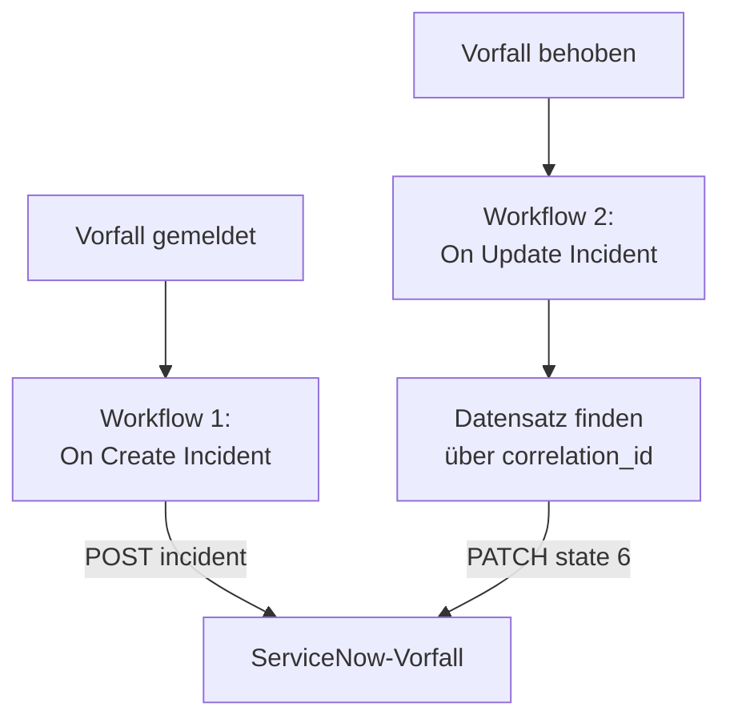

# ServiceNow

Legen Sie für jeden OneUptime-Vorfall einen [ServiceNow](https://www.servicenow.com)-Vorfall an und beheben Sie ihn, wenn der OneUptime-Vorfall behoben ist, damit Ihr Service Desk dem folgt, was Ihre Überwachung sieht. Zwei Workflows rufen die [Table API](https://developer.servicenow.com/dev.do#!/reference/api/latest/rest/c_TableAPI) von ServiceNow auf.

:::cards
- [Die Zugangsdaten speichern](#die-zugangsdaten-speichern): Halten Sie das ServiceNow-Passwort aus Ihren Workflows heraus.
- [ServiceNow-Vorfälle anlegen](#für-jeden-vorfall-einen-servicenow-vorfall-anlegen): Ein Workflow, zwei Bausteine.
- [Sie beheben](#den-servicenow-vorfall-beheben): Den Datensatz finden und dann schließen.
- [Fehlerbehebung](#fehlerbehebung): Wenn ServiceNow eine Anfrage ablehnt.
:::

## So funktioniert es



Der erste Workflow schreibt die ID des OneUptime-Vorfalls in die `correlation_id` des Datensatzes. Der zweite sucht den Datensatz darüber und behebt ihn dann.

## Bevor Sie beginnen

- Eine ServiceNow-Instanz, etwa `https://your-instance.service-now.com`.
- Ein ServiceNow-Benutzer für die Integration, der Datensätze in der Tabelle `incident` anlegen und ändern darf, meist mit der Rolle `itil`. Sein Name und Passwort signieren die Anfragen.
- In OneUptime das Recht, Workflows und globale Variablen anzulegen. In OneUptime Cloud brauchen Workflows den Tarif **Growth** oder höher.

## Die Zugangsdaten speichern

Die Table API nimmt Basic-Auth an: Name und Passwort des Benutzers, gemeinsam kodiert.

:::steps
1. Kodieren Sie sie einmal, unter macOS oder Linux:

   ```bash
   printf '%s' 'integration.user:password' | base64 | tr -d '\n'
   ```

   Verwenden Sie `printf`, nicht `echo`: `echo` hängt einen Zeilenumbruch an, der mitkodiert wird und die Zugangsdaten unbrauchbar macht.

2. Gehen Sie in OneUptime zu **Arbeitsabläufe → Globale Variablen** und klicken Sie auf **Arbeitsablaufvariable erstellen**. Nennen Sie sie `SERVICENOW_AUTH` und klicken Sie auf **Weiter**.
3. Fügen Sie den kodierten Wert in **Inhalt** ein, schalten Sie **Geheimnis** ein und klicken Sie auf **Arbeitsablaufvariable erstellen**.
:::

## Für jeden Vorfall einen ServiceNow-Vorfall anlegen

:::steps
### Den Workflow anlegen

Gehen Sie zu **Arbeitsabläufe**, klicken Sie auf **Arbeitsablauf erstellen** und dann auf **Ohne Vorlage beginnen**. Nennen Sie ihn `Incidents to ServiceNow` und klicken Sie auf **Arbeitsablauf erstellen**.

### Den Trigger hinzufügen

Klicken Sie auf den gestrichelten Baustein **Wählen Sie, was diesen Arbeitsablauf startet** und wählen Sie **On Create Incident**. Klicken Sie auf den Trigger und wählen Sie in **Fields to pass on** die Felder `title` und `description`.

### Den Datensatz anlegen

Klicken Sie auf **Komponente hinzufügen**, fügen Sie einen **API Post (JSON)**-Baustein hinzu und verbinden Sie den Punkt **Success** des Triggers damit. Setzen Sie seine **URL** auf `https://your-instance.service-now.com/api/now/table/incident`. Setzen Sie unter **Weitere Felder** seine **Request Headers** auf:

```json
{
  "Authorization": "Basic {{global.variables.SERVICENOW_AUTH}}",
  "Accept": "application/json"
}
```

Und seinen **Request Body** auf:

```json
{
  "short_description": "OneUptime: {{local.components.incident-on-create-1.returnValues.model.title}}",
  "description": "{{local.components.incident-on-create-1.returnValues.model.description}}",
  "urgency": "1",
  "impact": "1",
  "correlation_id": "oneuptime-{{local.components.incident-on-create-1.returnValues.model._id}}"
}
```

### Testen und dann einschalten

Klicken Sie auf **Arbeitsablauf ausführen**, geben Sie die **Vorfall-ID** eines Testvorfalls ein und führen Sie ihn aus. Der Schritt **API Post (JSON)** zeigt eine `201`-Antwort mit dem neuen Datensatz, seiner `sys_id` und seiner `number`, etwa `INC0012345`. Schalten Sie danach oben im **Editor** **Aktiviert** ein.
:::

`urgency` und `impact` nehmen `1` für hoch, `2` für mittel und `3` für niedrig, und ServiceNow errechnet aus beiden die Priorität. Jede andere Spalte der Tabelle `incident` kann unter ihrem Spaltennamen in den Body.

## Den ServiceNow-Vorfall beheben

Ein Workflow hat einen Trigger, das Beheben braucht also einen zweiten Workflow, der startet, wenn sich der Status eines Vorfalls ändert.

:::steps
### Den Trigger On Update Incident hinzufügen

Legen Sie einen Workflow namens `Resolve ServiceNow incidents` an und wählen Sie **On Update Incident** als Trigger. Wählen Sie in **Fields to watch** das Feld `currentIncidentStateId`, damit er nur läuft, wenn sich der Status ändert. Fragen Sie in **Fields to pass on** ab, ob der neue Status ein behobener ist:

```json
{ "_id": true, "currentIncidentState": { "isResolvedState": true } }
```

### Prüfen, ob der Vorfall behoben ist

Fügen Sie nach dem Trigger einen **If / Else**-Baustein hinzu. Setzen Sie **Value to check** auf `{{local.components.incident-on-update-1.returnValues.model.currentIncidentState.isResolvedState}}` und **Comparison** auf **is true**.

### Den Datensatz finden

Fügen Sie nach der Seite **Yes** einen **API Get (JSON)**-Baustein hinzu, mit denselben **Request Headers** und dieser **URL**:

```text
https://your-instance.service-now.com/api/now/table/incident?sysparm_query=correlation_id=oneuptime-{{local.components.incident-on-update-1.returnValues.model._id}}&sysparm_fields=sys_id&sysparm_limit=1
```

### Den Datensatz beheben

Fügen Sie nach dem Punkt **Success** des Suchbausteins einen **API Patch (JSON)**-Baustein hinzu, mit denselben **Request Headers** und dieser **URL**:

```text
https://your-instance.service-now.com/api/now/table/incident/{{local.components.api-get-1.returnValues.response-body.result[0].sys_id}}
```

Setzen Sie seinen **Request Body** auf:

```json
{
  "state": "6",
  "close_code": "Solution provided",
  "close_notes": "Resolved in OneUptime"
}
```

### Ihn einschalten

Schalten Sie **Aktiviert** ein und beheben Sie dann einen Testvorfall in OneUptime. Sein ServiceNow-Vorfall wechselt zu Resolved.
:::

`state` `6` ist Resolved in den Standard-Vorfallstatus von ServiceNow. `close_code` muss einer der Lösungscodes Ihrer Instanz sein. Viele Instanzen beheben einen Vorfall nicht ohne Lösungscode und Notizen, senden Sie also beides.

## Fehlerbehebung

:::details ServiceNow antwortet mit 401
Die Zugangsdaten sind falsch. Kodieren Sie `username:password` erneut mit `printf`, nicht `echo`, und ersetzen Sie den Inhalt von `SERVICENOW_AUTH`.
:::

:::details ServiceNow antwortet mit 403
Der Benutzer darf nicht in die Tabelle `incident` schreiben. Geben Sie ihm die Rolle `itil` oder eine Rolle mit denselben Rechten, und prüfen Sie, dass keine Zugriffsregel die Table API für ihn sperrt.
:::

:::details ServiceNow antwortet mit 400, oder das Beheben ändert nichts
Ein Spaltenname oder ein Wert passt nicht zu Ihrer Instanz: eine angepasste `state`-Liste oder ein `close_code`, den Ihre Instanz nicht hat. Vergleichen Sie mit der Tabelle `incident` unter **System Definition → Tables** in ServiceNow und mit dem Formular des Datensatzes.
:::

:::details Das Beheben antwortet mit 404
Der Suchschritt hat keinen Datensatz gefunden, die URL hat den Verweis also so behalten, wie er geschrieben ist. Prüfen Sie, dass der erste Workflow `correlation_id` geschrieben hat und dass beide Workflows sie gleich bilden: `oneuptime-`, gefolgt von der `_id` des Vorfalls.
:::

## Nächste Schritte

:::cards
- [Jira](/docs/integrations/jira): Eine Zwei-Wege-Integration, mit fertigen Vorlagen abgeglichen.
- [Workflow-Komponenten](/docs/workflows/components#api): Jede Einstellung der API-Bausteine.
- [Workflow-Ausführungen](/docs/workflows/runs-and-logs): Lesen Sie, was jede Anfrage gesendet und zurückbekommen hat.
- [Integrationsübersicht](/docs/integrations/index): Die Muster hinter jeder Integration.
:::
