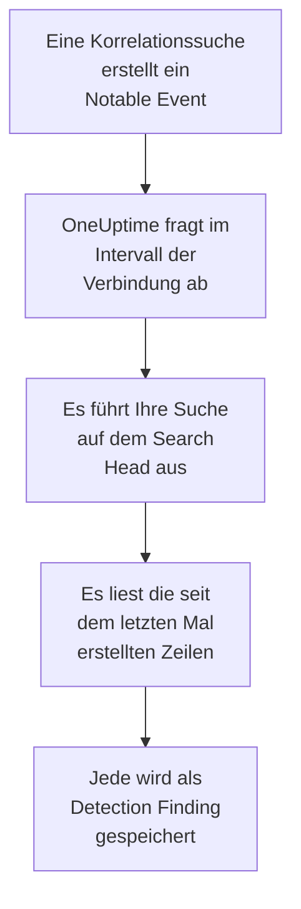

# Splunk Enterprise Security

Importieren Sie die Notable Events, die die Korrelationssuchen Ihrer [Splunk Enterprise Security](https://www.splunk.com/en_us/products/enterprise-security.html) erstellen, in die Sicherheitsereignisse von OneUptime. Dort durchsuchen Sie sie neben Ihren Logs, Traces und Metriken, verknüpfen sie mit jeder anderen Quelle und alarmieren die Bereitschaft für die wichtigen. OneUptime liest sie, indem es als ein Splunk-Benutzer, den Sie anlegen, eine Suche auf Ihrem Search Head ausführt, und ändert nichts in Splunk. Da es nur eine Suche ist, importiert es jeden Index und die Ausgabe jeder gespeicherten Suche, nicht nur Notable Events.

:::cards
- [Die Verbindung einrichten](#die-verbindung-einrichten): Ein Token, eine Rolle und das Formular der Verbindung.
- [Was importiert wird](#was-importiert-wird): Wie aus jeder Zeile der Suche ein Sicherheitsereignis wird.
- [So funktioniert das Abfragen](#so-funktioniert-das-abfragen): Das Zeitfenster jeder Abfrage, und was ein ausgelasteter Search Head damit macht.
- [Fehlerbehebung](#fehlerbehebung): Was jeder Fehler bedeutet und was zu ändern ist.
:::

## So funktioniert es



Jede Minute fragt OneUptime jede aktivierte Verbindung ab, deren Abfrageintervall abgelaufen ist. Eine Abfrage führt Ihre Suche über die REST-API des Search Heads aus, über die seit der letzten Abfrage erstellten Zeilen, und speichert jede Zeile als [OCSF](https://schema.ocsf.io/)-Ereignis Detection Finding (Klasse `2004`). Erkennungsregeln, Monitore und Dashboards behandeln es dann wie ein Sicherheitsereignis aus jeder anderen Quelle.

## Bevor Sie beginnen

- In OneUptime die Rolle Project Owner, Project Admin oder Security Admin. Security Member und Security Viewer sehen Verbindungen und ihren Laufverlauf, können sie aber nicht ändern.
- Ein Search Head mit Splunk Enterprise 9.0.1 oder neuer, oder Splunk Cloud Platform. OneUptime spricht mit seiner REST-API auf dem Management-Port, meist `8089`. Splunk Web auf Port `8000` stellt die REST-API nicht bereit.
- Ein Splunk-Benutzer für OneUptime, dessen Rolle die Fähigkeit `search` hat und den Index lesen darf, den die Suche liest: `notable` für Notable Events. Die Rollen `ess_analyst` und `ess_user` von Enterprise Security gewähren beides. Die Verbindung liest nur, die Rolle braucht also nichts weiter.
- Ein Search Head, den OneUptime über HTTPS erreicht. OneUptime Cloud verbindet sich aus dem Internet, der Search Head braucht also eine öffentliche Adresse: Private Adressen werden abgelehnt. Ein selbst gehostetes OneUptime verbindet sich aus seinen App- und Worker-Containern und erreicht einen Search Head in Ihrem privaten Netz, außer wenn `DATA_SOURCE_BLOCK_PRIVATE_ADDRESSES` auf `true` steht.

## Die Verbindung einrichten

Die Verbindung meldet sich mit einem Splunk-Authentifizierungstoken an, oder mit einem Benutzernamen und einem Passwort.

:::steps
### Ein Authentifizierungstoken erstellen

1. Öffnen Sie in Splunk Web **Settings → Tokens**. Meldet Splunk, dass die Token-Authentifizierung deaktiviert ist, wählen Sie zuerst **Enable Token Authentication**.
2. Wählen Sie **New Token**. Geben Sie unter **User** den Splunk-Benutzer ein, den Sie für OneUptime angelegt haben, und schreiben Sie unter **Audience**, wofür das Token ist, etwa `OneUptime security events`.
3. Wählen Sie eine **Expiration** oder keine. Ein Token, das abläuft, hält die Verbindung an, bis Sie es ersetzen.
4. Wählen Sie **Create** und kopieren Sie das Token. Splunk zeigt es nur einmal.

Um sich stattdessen mit einem Passwort anzumelden, überspringen Sie diesen Schritt und halten Sie den Namen und das Passwort des Benutzers bereit.

### Die Verbindung in OneUptime hinzufügen

Öffnen Sie **Produkte → Sicherheitsereignisse → Verbindungen** (`/dashboard/{projectId}/security-events/connections`), klicken Sie auf **Verbindung hinzufügen**, wählen Sie **Splunk Enterprise Security** und klicken Sie auf **Weiter**. Füllen Sie die Einstellungen aus der Tabelle unten aus, klicken Sie auf **Weiter** und fügen Sie das Token in **Authentication token** ein, oder das Passwort in **Passwort**.

### Vor dem Speichern testen

Klicken Sie unter **Vor dem Speichern testen** auf **Diese Einstellungen testen**. Der Test meldet sich mit den Werten im Formular an, führt Ihre Suche aus und speichert nichts, ein falscher Port oder eine fehlende Rolle zeigt sich also, bevor die Verbindung existiert. Klicken Sie dann auf **Weiter**, geben Sie der Verbindung einen **Name** und legen Sie sie an.
:::

| Einstellung | Was Sie eintragen |
| --- | --- |
| **Splunk management URL** | Die REST-API des Search Heads, etwa `https://splunk.example.com:8089`. Sie muss `https` verwenden, ohne Abfragezeichenfolge. Ein Pfad bleibt erhalten, für einen Reverse Proxy, der die API unter einem Pfad bereitstellt. |
| **Suchen** | Die Suche, die auswählt, was importiert wird, `index=notable`, solange Sie sie nicht ändern. Schränken Sie sie ein, etwa mit `index=notable urgency IN (high, critical)`. OneUptime fügt den Zeitraum selbst hinzu, die Suche kann also weder `earliest` noch `latest` setzen und nicht mit einer Pipe beginnen. Ein führendes `search` wird entfernt. |
| **Benutzername** | Der Name des Splunk-Benutzers, nur wenn er sich mit einem Passwort anmeldet. |
| **Authentication token** | Das Token aus dem ersten Schritt. Ist ein Token gespeichert, wird es verwendet, und Benutzername und Passwort nicht. |
| **Passwort** | Das Passwort des Splunk-Benutzers, nur wenn kein Token verwendet wird. |

**Authentication token** und **Passwort** werden verschlüsselt, nie von der API zurückgegeben und nie wieder angezeigt. Ersetzen Sie eines davon mit **Anmeldedaten aktualisieren** an der Verbindung. Um von einer Anmeldung zur anderen zu wechseln, tragen Sie dort die neue ein und schalten Sie **Remove the stored Authentication token** oder **Remove the stored Password** ein.

Der Schritt **Abfrage** hat außerdem eine optionale **Beschreibung**, das **Abfrageintervall (Minuten)**, eine ganze Zahl von `1` bis `1440`, die mit `5` beginnt, und **Aktiviert**, das eingeschaltet beginnt.

## Was importiert wird

Jede Zeile, die die Suche zurückgibt, wird zu einem Ereignis Detection Finding (OCSF-Klasse `2004`), mit dem Anbieter `Splunk` und dem Produkt `Splunk Enterprise Security`. Für ein Notable Event:

| Splunk-Feld | OneUptime-Spalte |
| --- | --- |
| `event_id`, sonst `_bkt` und `_cd`, sonst ein Hash der Zeile | Ereignis-UID, nach der auch Duplikate verworfen werden |
| `_time`, wann die Korrelationssuche das Notable Event erstellt hat | Ereigniszeit |
| `rule_name`, sonst `search_name`, sonst `source` | Regelname |
| `search_name`, sonst `source`, sonst `rule_name` | Regel-ID |
| `rule_title`, sonst `rule_description`, sonst der Regelname | Meldung |
| `urgency`, sonst `severity` | Schweregrad |
| `status_label`, sonst `status_description`, sonst der Name des Prüfstatus, den `status` enthält | Status |
| `annotations.mitre_attack` und Felder wie `mitre_technique_id` und `mitre_tactic` | MITRE-ATT&CK-Taktiken und -Techniken |
| `user` oder `src_user`; `src`, `src_ip` oder `src_host`; `process`, `process_name` oder `parent_process` | Benutzer, IP, Host und Prozess des Akteurs |
| `process_name` oder `process_exec`, `process_path` und `process`; `parent_process_name` oder `parent_process_exec`, `parent_process_path` und `parent_process` | Prozessname, -pfad und -befehlszeile; Name, Pfad und Befehlszeile des übergeordneten Prozesses |
| `dest_user`; `dest`, `dest_ip` oder `dest_host`; `dest_port` | Benutzer, IP, Host und Port des Ziels |
| `file_path`, `url` oder `risk_object` | Zielressource |
| Jeder Benutzer, Host und jede IP, sowie `dvc`, `host`, `file_hash`, `file_name`, `url`, `domain`, `query` und `risk_object` | Observables |
| Jedes Feld der Zeile, etwa `security_domain`, `owner`, `orig_sid` und `_raw` | `attributes`, unter dem eigenen Namen des Felds |

Eine Zeile aus einem anderen Index wird genauso importiert. Die Spalten, die ihre Felder nicht füllen, bleiben leer, und jedes Feld bleibt in `attributes` durchsuchbar.

## So funktioniert das Abfragen

Jede Abfrage führt eine Exportsuche über ihr Zeitfenster aus, die ältesten zuerst:

```text
POST {Splunk management URL}/services/search/v2/jobs/export
    search=search index=notable | fields * | sort 0 _time | head 10001
    earliest_time={window start}
    latest_time={window end}
    output_mode=json
```

- **Die Erstellungszeit ist der Cursor.** Das Zeitfenster liegt auf `_time`, und das ist für ein Notable Event der Zeitpunkt, zu dem die Korrelationssuche es erstellt hat, nicht der, zu dem die gefundene Aktivität geschah. Eine stündlich laufende Suche versieht ihre Notable Events mit der Zeit ihres Laufs, sodass keines hinter den Cursor fällt.
- **Die erste Abfrage blickt 24 Stunden zurück**, sodass eine neue Verbindung ihre jüngsten Notable Events sofort zeigt.
- **Jede spätere Abfrage beginnt 1 Minute vor dem gespeicherten Cursor**, sodass eine Zeile, die an der Grenze zwischen zwei Zeitfenstern erstellt wurde, nie übersprungen wird.
- **Eine Abfrage liest höchstens 24 Stunden über den Cursor hinaus.** Eine Verbindung, deren Cursor zurückliegt, holt in einer Reihe von 24-Stunden-Fenstern auf, und ihre **Integrität** zeigt **Catching up**.
- **Duplikate werden nach `event_id` verworfen**, oder nach den Splunk-eigenen `_bkt` und `_cd`, innerhalb des Projekts, sodass die Überlappung, ein wiederholtes Zeitfenster und ein Import nie eine Zeile doppelt speichern.

Ein Search Head, der älter als 9.0.1 ist, beantwortet die Anfrage an `search/v2/jobs/export` mit `404`. OneUptime sendet sie dann an das veraltete `search/jobs/export`, und der Lauf sagt das in einer Warnung. Aktualisieren Sie den Search Head: Aktuelle Versionen schalten diesen Endpunkt ab.

### Wenn ein Zeitfenster mehr enthält, als eine Abfrage lesen kann

Eine Abfrage liest höchstens 10.000 Zeilen. Enthält ein Zeitfenster mehr, ist der Lauf **Teilweise**, mit einer Warnung wie dieser:

```text
Stopped after collecting 10000 records; the window holds more. Records are read oldest first, and the last one read was created at 2026-09-14T08:12:44.000Z, where the next poll can resume.
```

Die Suche sortiert das Zeitfenster nach `_time`, die ältesten zuerst, deshalb setzt OneUptime den Cursor auf die Erstellungszeit der letzten gelesenen Zeile, und die nächste Abfrage beginnt dort, mit derselben Fensterlänge. Ein ausgelasteter Search Head holt 10.000 Zeilen pro Abfrage auf, statt dieselben noch einmal zu lesen. Die Zeilen, die im selben Augenblick erstellt wurden, werden zweimal gelesen, und die Duplikatprüfung verwirft die zweite Kopie. Splunk sortiert das ganze Zeitfenster, bevor es eine Zeile zurückgibt, deshalb macht eine Suche in **Suchen**, die weit mehr trifft als nötig, jede Abfrage langsamer: Halten Sie sie gezielt.

Kommt ein Lauf gar nicht über den gespeicherten Cursor hinaus, verkürzt OneUptime stattdessen das Zeitfenster:

1. **Verkleinern.** Die nächste Abfrage liest ein halb so langes Zeitfenster ab demselben Startpunkt und halbiert weiter, bis ein Zeitfenster vollständig gelesen wird, bis hinunter zu einer Minute. Die Warnung des Laufs sagt das: `This window holds more records than one poll can read; the next poll reads a {n} minute window from the same starting point.`
2. **Wieder wachsen.** Nachdem ein Zeitfenster vollständig gelesen wurde, ist das nächste wieder doppelt so lang, bis zu 24 Stunden.
3. **Über eine einzelne Minute hinweggehen.** Enthält selbst eine Minute mehr, als eine Abfrage lesen kann, geht das Abfragen über sie hinweg, damit neuere Notable Events weiter ankommen. Der Lauf bleibt **Teilweise**, und **Letzter Fehler** lautet `More records were created in the one minute from {cursor} to {end} than one poll can read. Polling moved past this minute so newer records keep arriving; use Import this time range in Diagnostics on this minute to recover what one run can read.` Importieren Sie diese Minute mit **Diesen Zeitraum importieren**, um zurückzuholen, was ein Lauf lesen kann.

Ein Lauf, der ganz fehlschlägt, mit einem Fehler von Splunk, behält den Cursor und die Fensterlänge, und die nächste Abfrage liest dasselbe Zeitfenster erneut. Die einzige Ausnahme ist eine Anfrage, deren Zeit abgelaufen ist: Der Cursor bleibt, aber das nächste Zeitfenster ist halb so lang, denn ein Zeitfenster, das zu schwer ist, um rechtzeitig beantwortet zu werden, würde bei jedem Versuch ablaufen. Ein anderes **Abfrageintervall (Minuten)** ändert nichts davon: Es entscheidet, wie oft eine Abfrage beginnt, nicht, wo ihr Zeitfenster beginnt.

### Bei Bedarf ausführen, ansehen und importieren

Klicken Sie an einer Verbindung auf **Diagnose**, um ihre letzten Läufe zu sehen und von Hand mit ihr zu arbeiten. Wer die Verbindung ändern darf, kann diese starten; wer sie sehen darf, kann den Verlauf lesen.

- **Jetzt ausführen** startet sofort eine Abfrage, mit dem üblichen Cursor, auch wenn die Verbindung nicht **Aktiviert** ist.
- **Preview notable events** liest einen Zeitraum von bis zu 7 Tagen und importiert nichts.
- **Diesen Zeitraum importieren** importiert nach Ihrer Bestätigung einen Zeitraum von bis zu 7 Tagen, ohne den Cursor zu verschieben. Bereits importierte Zeilen werden übersprungen.
- **Diagnosen kopieren** an einem Lauf kopiert seinen Bericht für den Support. Er enthält nie Anmeldedaten.

## Verbindung testen

**Verbindung testen** in der Zeile einer Verbindung und **Diese Einstellungen testen** im Formular laufen im API-Prozess, nicht in einem Hintergrund-Worker, sodass ein Test auch dann antwortet, wenn die Worker das Problem sind. Er führt diese Prüfungen der Reihe nach aus:

| Prüfung | Was sie prüft |
| --- | --- |
| **Konfiguration** | Jede Einstellung ist vorhanden und gültig. Schlägt das fehl, wird nichts kontaktiert. |
| **Authenticate with Splunk** | Splunk nimmt das Token oder den Benutzernamen und das Passwort an und nennt den Benutzer und seine Rollen, damit Sie sie mit der Rolle vergleichen, die Sie vergeben wollten. |
| **Run the search on Splunk** | Die Suche in **Suchen** läuft über die letzten 24 Stunden, für eine Zeile, und sagt, welcher Export-Endpunkt geantwortet hat. |
| **Notable events available to import** | Wie viele Zeilen die Suche in **Suchen** in den letzten 24 Stunden und den letzten 7 Tagen trifft. Keine in 7 Tagen ist eine Warnung, kein Fehler. |
| **Background workers**, **Poll scheduler**, **Security event storage** | Die Seite von OneUptime selbst: Ein Prozess nimmt die Aufträge der Worker-Warteschlange an, der Abfrageauftrag läuft jede Minute, und der Speicher der Sicherheitsereignisse antwortet. |
| **Geplante Abfrage** | Für eine gespeicherte Verbindung: Das Abfragen ist eingeschaltet, kein Lauf wartet festgefahren auf einen Worker, und die Abfragen laufen pünktlich. |

Jede Anfrage in einem Test hat eine Frist von 20 Sekunden. Ein Test importiert nie etwas und verschiebt nie den Cursor, und jede fehlgeschlagene Prüfung sagt, was zu ändern ist.

## Sicherheitsereignisse an Splunk senden

OneUptime kann das, was es findet, auch an Splunk senden, über dessen HTTP Event Collector (HEC), sodass Ihre Suchen und Dashboards die Erkennungen von OneUptime neben Ihren eigenen sehen. Jedes Sicherheitsereignis ist ein HEC-Ereignis mit dem Sourcetype `oneuptime:security`, seine Felder benannt, wie das Common Information Model von Splunk sie benennt: `src`, `src_ip`, `src_user`, `dest`, `dest_ip`, `dest_port`, `user`, `signature` und `severity`.

:::steps
### Ein HEC-Token erstellen

Öffnen Sie in Splunk Web **Settings → Data inputs → HTTP Event Collector** und klicken Sie auf **New Token**. Benennen Sie es, wählen Sie die Indizes, in die es schreiben darf, und seinen Standardindex, und kopieren Sie den Wert des Tokens. In Splunk Cloud lauscht HEC auf `https://http-inputs-<stack>.splunkcloud.com`; in Splunk Enterprise auf Port `8088`, sobald **Global Settings** Tokens einschaltet.

### Das Ziel hinzufügen

Öffnen Sie **Produkte → Sicherheitsereignisse → Verbindungen**. Klicken Sie unter **An Ihr SIEM senden** auf **Ziel hinzufügen**, wählen Sie Splunk unter **SIEM** und klicken Sie auf **Weiter**. Tragen Sie die **HEC-URL** ein und fügen Sie das Token in **HEC-Token** ein. **Index** und **Quelltyp** sind optional: Bleiben sie leer, gehen die Ereignisse in den Standardindex des Tokens, mit dem Sourcetype `oneuptime:security`.

### Ein Testereignis senden und das Senden starten

Klicken Sie auf **Testereignis senden**: Ein informatives Ereignis geht mit den Einstellungen im Formular an Splunk, und nichts wird gespeichert. Suchen Sie es mit `sourcetype="oneuptime:security"`. Behalten Sie dann unter **Was gesendet wird** die Option **Nur Erkennungen** oder wählen Sie **Alle Sicherheitsereignisse**, und klicken Sie auf **Senden starten**.
:::

- Die **HEC-URL** muss `https` verwenden, mit einem Zertifikat, dem OneUptime vertraut: Zertifikatsprüfungen werden nie übersprungen.
- Ereignisse gehen in Stapeln von bis zu 500. Ein Ereignis, das Splunk ablehnt, wird ausgelassen und in **Fehler anzeigen** genannt, ein ausgelasteter Collector (`503`) wird erneut versucht, und ein abgelehntes Token oder ein abgelehnter Index stoppt das Senden, bis Sie es beheben.
- Notable Events, die OneUptime aus Splunk importiert hat, werden nie an Splunk zurückgesendet.

## Fehlerbehebung

Der **Letzter Fehler** der Verbindung bewahrt die vollständige Fehlermeldung, mit geschwärzten Anmeldedaten, hinter einem Präfix, das den fehlgeschlagenen Schritt nennt. Hat eine Verbindung einen Fehler, wählen Sie in ihrer Spalte **Aktionen** die Aktion **Fehler anzeigen**, um ihn zu lesen, und im Dialog **Fehler kopieren**, um ihn zu kopieren. Lesen Sie zuerst das Präfix.

:::details Letzter Fehler beginnt mit `Splunk Enterprise Security authentication request`
- `Splunk Enterprise Security authentication request failed (HTTP ...)`: Splunk hat sich geweigert zu sagen, wer der Aufrufer ist.
  - `HTTP 401`: Splunk hat die Anmeldedaten nicht angenommen. Das Token ist falsch, abgelaufen oder gelöscht, die Token-Authentifizierung ist auf dem Search Head deaktiviert, oder der Benutzername oder das Passwort ist falsch. Erstellen Sie ein neues Token und speichern Sie es mit **Anmeldedaten aktualisieren**.
  - `HTTP 404`: Die **Splunk management URL** ist nicht die REST-API. Sie zeigt auf Splunk Web auf Port `8000`, oder sie hat einen Pfad, den der Search Head nicht bereitstellt.
- `Splunk Enterprise Security authentication request returned ...`: Etwas anderes als die REST-API des Search Heads hat geantwortet, etwa das HTML von Splunk Web auf Port `8000` oder die Seite eines Proxys. Richten Sie die URL auf den Management-Port.
:::

:::details Letzter Fehler beginnt mit `Splunk Enterprise Security search export` oder `Splunk Enterprise Security count search`
- `Splunk Enterprise Security search export failed (HTTP ...)`: Splunk hat sich geweigert, die Suche auszuführen.
  - `HTTP 400`: Splunk kann die Suche nicht parsen. Führen Sie die Suche aus **Suchen** in Splunk Web aus, um ihren Fehler zu lesen.
  - `HTTP 403`: Der Rolle des Benutzers fehlt die Fähigkeit `search`, oder sie kann den Index nicht lesen. Fügen Sie `notable` oder Ihren Index zu den Indizes hinzu, die die Rolle durchsuchen darf.
  - `HTTP 404`: Unter dieser URL gibt es keinen der beiden Export-Endpunkte, es ist also nicht der Management-Port eines Search Heads.
  - `HTTP 429` oder `HTTP 5xx`: Splunk drosselt den Benutzer, ist ausgelastet, oder die Suche hat eine seiner Grenzen erreicht. Die nächste Abfrage versucht es erneut.
- `Splunk Enterprise Security search export was rejected by Splunk on an HTTP 200`: Splunk hat geantwortet, die Suche aber mit einem Fehler beendet. Die Meldung zitiert ihn.
- `Splunk Enterprise Security search export returned a body that is not newline-delimited JSON.`: Etwas anderes als die REST-API hat geantwortet, etwa Splunk Web oder die Anmeldeseite eines Proxys. Das wird gemeldet statt als leeres Zeitfenster genommen, damit der Cursor nie über Zeilen hinwegrückt, die niemand gelesen hat.
- `Splunk Enterprise Security count search ...`: Dieselben Fehler, aus der Zählung von **Notable events available to import**, die nur ein Test ausführt.
:::

:::details Letzter Fehler endet mit `did not complete`
`Splunk Enterprise Security search export did not complete`, und dasselbe für die anderen Schritte, heißt, dass die Anfrage keine Antwort bekam: eine Zeitüberschreitung, ein Name, der sich nicht auflösen lässt, ein Zertifikat, dem OneUptime nicht vertraut, oder eine abgelehnte private Adresse. Prüfen Sie, ob die OneUptime-App und die Worker eine HTTPS-Verbindung zum Management-Port öffnen können. Ein Search Head, der andere Anfragen beantwortet, bei der Suche aber in eine Zeitüberschreitung läuft, sortiert zu viel: Die nächste Abfrage liest ein halb so langes Zeitfenster, und eine engere Suche in **Suchen** behebt es dauerhaft.
:::

:::details Zuletzt abgefragt ist Never und Letzter Fehler ist leer
Für diese Verbindung ist noch keine Abfrage fertig geworden. Führen Sie **Verbindung testen** aus: Ihre Prüfungen **Background workers** und **Poll scheduler** nennen die Ursache. Bei einer selbst gehosteten Installation ist die übliche Ursache `DISABLE_QUEUE_WORKERS=true` an der App, ohne eigene Worker-Bereitstellung, die die Aufträge annimmt: Setzen Sie es auf `false` oder betreiben Sie die Worker-Bereitstellung (Helm: `worker.enabled: true`).
:::

:::details Ein Lauf ist Teilweise
- `Stopped after collecting 10000 records; the window holds more`: Das Zeitfenster enthielt mehr als die 10.000 Zeilen, die ein Lauf liest. Nichts geht verloren: Die nächste Abfrage beginnt nach der letzten gelesenen Zeile. Eine Verbindung, die Abfrage um Abfrage **Teilweise** bleibt, holt einen Rückstand auf, und ihre Werte **Zuletzt abgefragt** und **Letztes importiertes Ereignis** bewegen sich weiter. Holt sie nie auf, trifft die Suche in **Suchen** mehr als 10.000 Zeilen pro Abfrageintervall: Schränken Sie sie ein oder verkürzen Sie das **Abfrageintervall (Minuten)**.
- `More records were created in the one minute from ... than one poll can read`: Das Abfragen ist über diese Minute hinweggegangen. Importieren Sie sie mit **Diesen Zeitraum importieren** in der **Diagnose**. Ein Import liest so viel wie eine Abfrage.
:::

:::details Der Test besteht, aber nichts wird importiert
Lesen Sie **Notable events available to import** im Bericht des Tests. `0` in den letzten 7 Tagen heißt, dass die Suche in **Suchen** in Splunk nichts getroffen hat: Prüfen Sie in Incident Review, dass die Korrelationssuchen aktiviert sind und Notable Events erstellen, und dass die Suche in **Suchen** nicht enger ist, als Sie wollten.
:::

## Was Sie davon haben

- **Suche.** Filtern Sie Notable Events im Explorer der Sicherheitsereignisse nach Dringlichkeit, Status, Regel, Benutzer, Host oder jedem Observable, neben jeder anderen Quelle.
- **Verknüpfung.** Die Benutzer, Hosts, IPs und Domänen jeder Zeile werden als Observables indiziert, sodass eine Suche alles findet, was sie nennt.
- **Erkennungsregeln.** Sigma-Regeln, die nach einem Zeitplan über Ihre Sicherheitsereignisse laufen und Warnungen eröffnen, die die Bereitschaft alarmieren.
- **Monitore.** Monitore für Sicherheitsereignisse zählen passende Ereignisse, etwa neue kritische Notable Events, und eröffnen ab einem Schwellwert Vorfälle oder Warnungen.

Sicherheitsereignisse werden wie Ihre übrige Telemetrie abgerechnet, pro aufgenommenem GB. Siehe [Preise](https://oneuptime.com/pricing).

## Nächste Schritte

:::cards
- [Sicherheitsereignisse](/docs/telemetry/security-events): Durchsuchen, verknüpfen und warnen, was Sie importieren.
- [Elastic Security](/docs/integrations/elastic-security): Auch die Erkennungswarnungen eines Elastic-Stacks importieren.
- [Rollen](/docs/permissions/reference#rollen): Was die Security-Rollen sehen und ändern können.
- [Integrationsübersicht](/docs/integrations/index): Die anderen Werkzeuge, die Sie verbinden können.
:::
