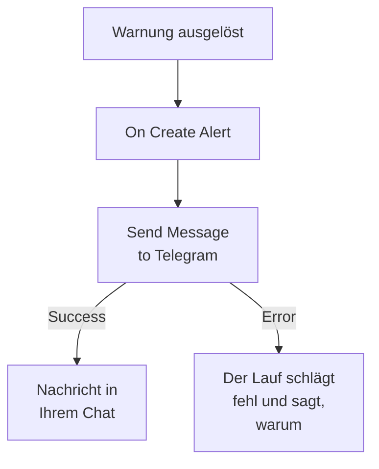

# Telegram

Senden Sie eine Nachricht an einen [Telegram](https://telegram.org)-Chat, eine Gruppe oder einen Kanal, wenn eine Warnung ausgelöst oder ein Vorfall eröffnet wird. Der Arbeitsablaufschritt **Send Message to Telegram** von OneUptime sendet sie als ein Bot, den Sie erstellen, und eine fertige Vorlage baut den Arbeitsablauf für Warnungen. Diese Integration ist **ausgehend**: Der Bot sendet Nachrichten und liest nicht, was im Chat geschrieben wird.

:::cards
- [So funktioniert es](#so-funktioniert-es): Was der Arbeitsablauf tut, wenn eine Warnung ausgelöst wird.
- [Einrichten](#die-integration-einrichten): Ein Bot, sein Chat, dann der Arbeitsablauf: aus der Vorlage oder von Grund auf.
- [Tipps](#tipps): Reiner Text, lange Nachrichten und Vorfälle.
- [Fehlerbehebung](#fehlerbehebung): Was die Fehler von Telegram bedeuten und was zu ändern ist.
:::

## So funktioniert es



Der Schritt sendet den **Message Text** als Ihr Bot über die Bot API von Telegram an den Chat. Er nimmt seinen Ausgang **Success**, wenn Telegram die Nachricht annimmt, und seinen Ausgang **Error**, mit dem Grund von Telegram, wenn Telegram sie ablehnt. Ist mit **Error** nichts verbunden, wie in der Vorlage, schlägt ein Lauf, der nicht senden konnte, fehl, und seine **Schritte** sagen, warum.

## Bevor Sie beginnen

- Ein Telegram-Konto, um den Bot zu erstellen und dem Chat hinzuzufügen.
- In OneUptime das Recht, Arbeitsabläufe und Variablen anzulegen. In OneUptime Cloud brauchen Arbeitsabläufe den Plan **Growth** oder höher.

## Die Integration einrichten

:::steps
### Einen Bot erstellen

Senden Sie in Telegram `/newbot` an [@BotFather](https://t.me/BotFather) und beantworten Sie seine Fragen. Er gibt Ihnen das Token des Bots, etwa `123456789:ABCdefGhIJKlmnoPQRstuVWxyz`. Wer das Token hat, kann als Ihr Bot Nachrichten senden, bewahren Sie es also so sicher wie ein Passwort auf.

### Die ID des Chats finden

1. Fügen Sie den Bot der Gruppe hinzu, oder machen Sie ihn zum Administrator des Kanals. Um einer Person zu schreiben, beginnt diese zuerst einen Chat mit dem Bot.
2. Senden Sie in der Gruppe eine Nachricht, die den Bot erwähnt, etwa `/start@your_bot`, damit der Bot sie sieht.
3. Öffnen Sie `https://api.telegram.org/bot<token>/getUpdates` in einem Browser, mit dem Token des Bots statt `<token>`.
4. Suchen Sie `"chat":{"id":` in der Antwort. Die Zahl danach ist die ID des Chats. Die ID einer Gruppe beginnt mit `-`, die einer großen Gruppe mit `-100`.

Ein öffentlicher Kanal lässt sich statt mit einer ID mit seinem `@username` angeben.

### Den Arbeitsablauf bauen

Beginnen Sie mit der Vorlage, die den ganzen Arbeitsablauf für Warnungen baut, oder von Grund auf.

:::tabs
@tab Aus der Vorlage
1. Öffnen Sie **Arbeitsabläufe** und klicken Sie auf **Arbeitsablauf erstellen**.
2. Geben Sie `Telegram` in **Vorlagen durchsuchen…** ein, klicken Sie auf **Tell Telegram when an alert fires** und dann auf **Diese Vorlage verwenden**.
3. Behalten Sie den Namen **Notify Telegram on new alert** oder ändern Sie ihn, und klicken Sie auf **Weiter**.
4. Fügen Sie das Token in **Telegram Bot Token** und die ID in **Telegram Chat ID** ein, und klicken Sie auf **Arbeitsablauf erstellen**.

Der Arbeitsablauf öffnet sich im **Editor** mit zwei Schritten: **On Create Alert** und **Send Message to Telegram**, der Nummer, Titel, Schweregrad und Status der Warnung sendet. Das Token wird als geheime Variable `telegramBotToken` des Arbeitsablaufs gespeichert, und die ID als `telegramChatId`.
@tab Von Grund auf
1. Speichern Sie das Token als geheime globale Variable: Gehen Sie zu **Arbeitsabläufe → Globale Variablen**, klicken Sie auf **Arbeitsablaufvariable erstellen**, nennen Sie sie `TELEGRAM_BOT_TOKEN` und klicken Sie auf **Weiter**. Fügen Sie das Token in **Inhalt** ein, schalten Sie **Geheimnis** ein und klicken Sie auf **Arbeitsablaufvariable erstellen**.
2. Gehen Sie zu **Arbeitsabläufe**, klicken Sie auf **Arbeitsablauf erstellen**, wählen Sie **Ohne Vorlage beginnen**, geben Sie dem Arbeitsablauf einen Namen und klicken Sie auf **Arbeitsablauf erstellen**.
3. Klicken Sie im **Editor** auf **Wählen Sie, was diesen Arbeitsablauf startet** und wählen Sie **On Create Alert** unter **Beliebt**. Klicken Sie auf den Auslöser: Seine **Fields to pass on** beginnen mit **Titel**, also klicken Sie auf **Feld hinzufügen** und wählen Sie die weiteren Felder, die Ihre Nachricht zeigt, etwa **Warnungsnummer mit Präfix**.
4. Klicken Sie auf **Komponente hinzufügen**, suchen Sie nach `telegram` und klicken Sie auf **Send Message to Telegram**. Verbinden Sie den Ausgang **Success** des Auslösers mit diesem Schritt.
5. Klicken Sie auf den neuen Schritt. Klicken Sie in **Telegram Bot Token** auf **{ }** und wählen Sie `TELEGRAM_BOT_TOKEN` unter **Globale Variablen**. Geben Sie die ID des Chats in **Chat ID** ein, schreiben Sie die Nachricht in **Message Text** und fügen Sie die Felder der Warnung mit **{ }** ein.
:::

Eine Nachricht von Grund auf liest die Felder der Warnung mit Verweisen wie diesen:

```text
🚨 Alert {{local.components.alert-on-create-1.returnValues.model.alertNumberWithPrefix}} fired
Title: {{local.components.alert-on-create-1.returnValues.model.title}}
```

### Einschalten und testen

Schalten Sie **Aktiviert** oben im **Editor** ein. Von nun an wird jede neue Warnung an den Chat gesendet.

Um zu testen, ohne eine Warnung auszulösen, klicken Sie auf **Arbeitsablauf ausführen** und wählen unter **Warnung** eine vorhandene Warnung aus: Die neuesten sind aufgelistet, und wenn Sie ihre Nummer oder einen Teil ihres Titels eintippen, finden Sie eine andere. Klicken Sie auf **Arbeitsablauf manuell ausführen** und bestätigen Sie mit **Ausführen**. Das Panel **Arbeitsablauf-Ausführung** verfolgt den Lauf, und die Nachricht erscheint im Chat. Nimmt der Schritt stattdessen **Error**, schlägt der Lauf fehl, und der Eintrag des Schritts unter **Schritte** sagt, warum: siehe [Fehlerbehebung](#fehlerbehebung).
:::

## Tipps

- **Reiner Text.** Der Schritt sendet den Text so, wie er getippt ist, ohne die Formatierung von Telegram, deshalb erscheinen `*` und `_` so, wie sie sind.
- **Auf die Grenze von 4.096 Zeichen achten.** Telegram nimmt Nachrichten mit bis zu 4.096 Zeichen an. Eine längere wird gekürzt und endet mit "… (truncated — see OneUptime for the full text)", statt abgelehnt zu werden.
- **Auch Vorfälle.** Bauen Sie denselben Arbeitsablauf auf **On Create Incident**, oder auf **On Update Incident** für Statusänderungen. Um nur manche Warnungen zu senden, setzen Sie einen Block **If / Else** vor den Schritt.
- **Die Form des Tokens wird geprüft.** Ein Token, das nicht wie `123456789:ABCdef…` aussieht, beendet den Lauf, bevor etwas gesendet wird, und das Token wird nie ins Protokoll geschrieben.

## Fehlerbehebung

Nimmt der Schritt **Error**, schlägt der Lauf fehl, und der Eintrag des Schritts im Reiter **Schritte** des Laufs nennt den Grund von Telegram. Der Bot muss im Chat sein, prüfen Sie das also zuerst.

:::details Telegram antwortet "Bad Request: chat not found"
Die **Chat ID** ist falsch, oder der Bot kann den Chat nicht sehen: Fügen Sie den Bot der Gruppe hinzu, machen Sie ihn zum Administrator des Kanals, oder bitten Sie die Person, einen Chat mit dem Bot zu beginnen. Die ID einer Gruppe beginnt mit `-`.
:::

:::details Telegram antwortet "Forbidden: bot was blocked by the user" oder "bot is not a member"
Die Person hat den Bot blockiert, oder der Bot wurde aus der Gruppe oder dem Kanal entfernt. Fügen Sie ihn wieder hinzu, oder senden Sie an einen anderen Chat.
:::

:::details Telegram antwortet "Unauthorized"
Telegram hat das Token nicht angenommen: Es wurde bei @BotFather widerrufen oder falsch kopiert. Kopieren Sie das aktuelle Token des Bots von @BotFather und ersetzen Sie den Wert der Variable.
:::

:::details Telegram antwortet "Too Many Requests: retry after"
Telegram begrenzt, wie schnell ein Bot sendet, besonders an eine Gruppe. Eine Häufung von Warnungen kann diese Grenze erreichen: Senden Sie weniger Nachrichten, zum Beispiel nur für manche Schweregrade.
:::

## Nächste Schritte

:::cards
- [Workflow-Komponenten](/docs/workflows/components#telegram): Jede Einstellung des Schritts und was seine Ausgänge bedeuten.
- [Discord](/docs/integrations/discord): Dieselbe Idee, in einem Discord-Kanal.
- [Workflow-Ausführungen](/docs/workflows/runs-and-logs): Lesen Sie, was jeder Lauf des Arbeitsablaufs getan hat.
- [Integrationsübersicht](/docs/integrations/index): Das ausgehende Muster und die anderen Werkzeuge, die Sie verbinden können.
:::
