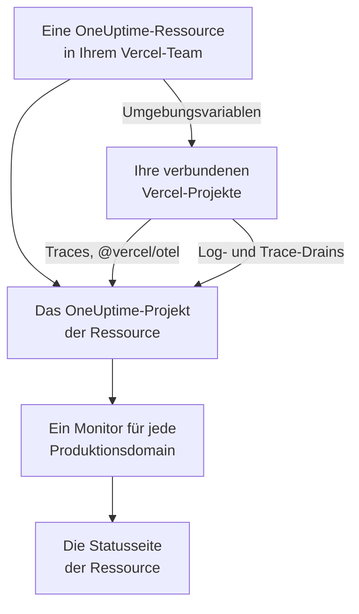

# Vercel

Fügen Sie OneUptime über den [Vercel Marketplace](https://vercel.com/marketplace) zu Ihrem Vercel-Team hinzu. Sie melden sich mit Ihrem Vercel-Konto an und bezahlen über Ihre Vercel-Rechnung, und Ihre Vercel-Projekte bekommen in OneUptime Traces, Logs, Uptime-Überwachung und eine Statusseite, ohne dass Sie etwas von Hand einrichten müssen.

:::cards
- [OneUptime zu Ihrem Vercel-Team hinzufügen](#oneuptime-zu-ihrem-vercel-team-hinzufügen): Eine Ressource, ein Tarif und Ihre Projekte, im Vercel-Dashboard.
- [Traces mit @vercel/otel senden](#traces-mit-vercelotel-senden): Die Umgebungsvariablen sind schon da.
- [Logs und Traces mit Drains senden](#logs-und-traces-mit-drains-senden): Die eigenen Logs und Spans von Vercel, in Pro und Enterprise.
- [Tarife und Abrechnung](#tarife-und-abrechnung): Die Tarife von OneUptime, auf Ihrer Vercel-Rechnung.
:::

## So funktioniert es

Jede OneUptime-Ressource, die Sie in Vercel hinzufügen, ist ein eigenes OneUptime-Projekt. Vercel gibt jedem Vercel-Projekt, das Sie mit der Ressource verbinden, deren Umgebungsvariablen, und diese senden die Traces des Projekts an OneUptime. Drains senden die Logs und Spans von Vercel, und die Produktionsdomain jedes verbundenen Projekts bekommt einen Uptime-Monitor auf der Statusseite der Ressource.



Die Integration ist für OneUptime Cloud (`oneuptime.com`) gedacht. Ein selbst gehostetes OneUptime lässt sich nicht über den Vercel Marketplace hinzufügen: siehe [Selbst gehostetes OneUptime](#selbst-gehostetes-oneuptime).

## Bevor Sie beginnen

- **Ein Vercel-Team**, in einem beliebigen Tarif. Log- und Trace-Drains brauchen den Pro- oder Enterprise-Tarif von Vercel; Traces von `@vercel/otel` funktionieren in jedem Tarif.
- **Eine verifizierte E-Mail-Adresse** in Ihrem Vercel-Konto. OneUptime meldet Sie damit an und legt damit Ihr OneUptime-Konto an, falls Sie noch keines haben.
- **Eine Zahlungsmethode in Vercel**, für jeden Tarif: Monitore und Telemetrie werden nach Nutzung abgerechnet, auch im Free-Tarif. Siehe [Tarife und Abrechnung](#tarife-und-abrechnung).

## OneUptime zu Ihrem Vercel-Team hinzufügen

:::steps
### OneUptime im Vercel Marketplace öffnen

Öffnen Sie im Vercel-Dashboard **Integrations** und dann **Browse Marketplace**; OneUptime finden Sie unter **Observability**. Klicken Sie auf **Install** und akzeptieren Sie die Bedingungen von OneUptime.

### Einen Tarif wählen

Wählen Sie **Free**, **Growth** oder **Scale**. Es sind die Tarife von OneUptime selbst, zu den Preisen auf [oneuptime.com/pricing](https://oneuptime.com/pricing).

### Die Ressource benennen und ihre Einstellungen wählen

Benennen Sie die Ressource nach dem, was sie überwacht, etwa `storefront`: Das OneUptime-Projekt und die Statusseite der Ressource tragen ihren Namen. Zwei Einstellungen sind anfangs eingeschaltet:

- **Monitor production domains**: ein Website-Monitor für die Produktionsdomain jedes Vercel-Projekts, das Sie verbinden.
- **Create a status page**: eine öffentliche Statusseite für die Ressource, die diese Monitore zeigt.

### Ihre Projekte verbinden

Wählen Sie die Vercel-Projekte, die an diese Ressource senden, und die Umgebungen, die ihre Umgebungsvariablen erhalten. Geben Sie der Verbindung kein eigenes Präfix: `@vercel/otel` liest die Variablen unter ihren eigenen Namen.
:::

Die Ressource ist nach wenigen Sekunden bereit. Klicken Sie auf **Open in OneUptime**, um ihr Projekt zu sehen.

## Was Sie mit jeder Ressource bekommen

| Was | Wo Sie es finden |
| --- | --- |
| Ein OneUptime-Projekt, nach der Ressource benannt | Es gehört Ihnen. Ihre Teammitglieder treten ihm bei, wenn sie es aus Vercel öffnen. |
| Ein Ingestion-Schlüssel namens `Vercel` | **Projekteinstellungen → Telemetrie & APM → Ingestion-Schlüssel** |
| Umgebungsvariablen in jedem verbundenen Vercel-Projekt | **Settings → Environment Variables** des Projekts in Vercel |
| Ein Website-Monitor für jedes verbundene Projekt | **Monitore**, nach dem Vercel-Projekt benannt |
| Eine öffentliche Statusseite | **Statusseiten**, nach der Ressource benannt |

Die Umgebungsvariablen sind in jedem verbundenen Projekt dieselben:

| Variable | Wert |
| --- | --- |
| `OTEL_EXPORTER_OTLP_ENDPOINT` | `https://oneuptime.com/otlp` |
| `OTEL_EXPORTER_OTLP_HEADERS` | `x-oneuptime-token=` und der Ingestion-Schlüssel der Ressource |
| `OTEL_EXPORTER_OTLP_PROTOCOL` | `http/protobuf` |
| `ONEUPTIME_TELEMETRY_INGESTION_KEY` | Der Ingestion-Schlüssel allein, den die Drains senden |

Ein Deployment erhält die Variablen beim Build: Stellen Sie ein Projekt erneut bereit, nachdem Sie es verbunden haben.

## Traces mit @vercel/otel senden

`@vercel/otel` ist das OpenTelemetry-Paket von Vercel für Next.js und die anderen Frameworks, die Vercel ausführt. Es liest die Variablen `OTEL_EXPORTER_OTLP_*`, daher braucht ein mit der Ressource verbundenes Projekt nur das Paket.

:::steps
### Das Paket installieren

```bash
npm install @vercel/otel @opentelemetry/api @opentelemetry/api-logs
```

### Das Paket registrieren

Legen Sie `instrumentation.ts` im Stammverzeichnis des Projekts an, oder in `src`, wenn das Projekt diesen Ordner hat, und benennen Sie den Dienst:

```ts title="instrumentation.ts"
import { registerOTel } from "@vercel/otel";

export function register(): void {
  registerOTel({ serviceName: "storefront" });
}
```

### Bereitstellen

Stellen Sie das Projekt bereit. Seine Traces erscheinen in **Traces** unter dem Namen des Dienstes.
:::

Fügen Sie in den Pro- und Enterprise-Tarifen von Vercel auch einen Trace-Drain hinzu: Vercel sendet OneUptime dann seine eigenen Spans für jede Anfrage, zusammen mit denen Ihrer Anwendung, und `@vercel/otel` überlässt sie dem Drain, sodass nichts doppelt ankommt.

## Logs und Traces mit Drains senden

Ein Drain sendet, was Vercel über Ihre Projekte aufzeichnet, an OneUptime: ein Log-Drain ihre Build-, Funktions-, Edge- und Request-Logs, ein Trace-Drain ihre Spans. Drains brauchen den Pro- oder Enterprise-Tarif von Vercel, und Vercel berechnet die Daten, die sie senden, über Ihre Vercel-Rechnung.

:::steps
### Einen Drain hinzufügen

Öffnen Sie in Vercel **Team Settings → Drains** und klicken Sie auf **Add Drain**. Wählen Sie **Logs** oder **Traces** und dann OneUptime unter **Native Integrations**.

### Die Projekte wählen

Wählen Sie die Projekte und, bei Logs, die Quellen und Umgebungen. Der Drain sendet mit dem Ingestion-Schlüssel der Ressource: Sie müssen nichts eingeben.
:::

Jedes Vercel-Projekt ist in OneUptime ein Dienst, benannt nach dem Projekt. Ein Log behält Zeit, Level und Nachricht, und die Daten seiner Anfrage stehen unter den Namen von OpenTelemetry:

| Vercel-Feld | In OneUptime |
| --- | --- |
| `projectName` | Der Dienst, `service.name` |
| `timestamp`, `level`, `message` | Zeit, Schweregrad und Text des Logs |
| `deploymentId`, `environment` | `vercel.deployment.id`, `deployment.environment.name` |
| `proxy.method`, `proxy.path`, `proxy.statusCode` | `http.request.method`, `url.path`, `vercel.proxy.status_code` |
| `traceId`, `spanId` | Der Trace des Logs, verknüpft mit dem Trace in **Traces** |
| Jedes andere Feld | Ein Attribut unter `vercel.`, etwa `vercel.source` |

## Uptime-Monitore und die Statusseite

Wenn Sie ein Vercel-Projekt verbinden, legt OneUptime einen Website-Monitor für seine Produktionsdomain an, den die Sonden von OneUptime prüfen, und fügt ihn der Statusseite der Ressource hinzu. Ein Projekt, das vor seinem ersten Produktions-Deployment verbunden wird, hat noch keine Domain: Sein Monitor wird bei diesem Deployment angelegt. Wenn Sie die Verbindung des Projekts trennen, wird sein Monitor gelöscht.

Jeder dieser Monitore ist ein aktiver Monitor, wird wie jeder andere abgerechnet und funktioniert wie einer, den Sie selbst angelegt haben: siehe [Website-Überwachung](/docs/monitor/website-monitor). Damit keine angelegt werden, schalten Sie **Monitor production domains** in den Einstellungen der Ressource in Vercel aus. Schalten Sie es wieder ein, legt OneUptime die noch fehlenden Monitore an.

## OneUptime aus Vercel öffnen

Klicken Sie an der Ressource auf **Open in OneUptime** oder auf einen ihrer Links in Vercel, und Sie werden mit der E-Mail-Adresse Ihres Vercel-Kontos bei OneUptime angemeldet. Beim ersten Mal treten Sie dem Projekt der Ressource bei: als Admin, wenn Sie Inhaber oder Mitglied des Vercel-Teams sind, und als Mitglied, wenn Sie eine seiner schreibgeschützten Rollen haben.

Gibt es bereits ein OneUptime-Konto mit dieser E-Mail-Adresse, melden Sie sich bei diesem an. Hat es die Zwei-Faktor-Authentifizierung eingeschaltet oder gehört es einem OneUptime-Administrator, melden Sie sich stattdessen mit seinem Passwort an. Im Projekt sind Sie trotzdem.

## Tarife und Abrechnung

| | So funktioniert es |
| --- | --- |
| Tarife | **Free**, **Growth** und **Scale**, zu den Preisen auf oneuptime.com: der Preis des Tarifs pro Benutzer, aktive Monitore zu $1 pro Monitor und Monat und Telemetrie pro GB. |
| Wo Sie bezahlen | Auf Ihrer Vercel-Rechnung, einmal im Monat, für jede Ressource. Vercel zeigt an der Ressource die bisherige Nutzung des Monats, stündlich aktualisiert. |
| Testphasen | Keine Kosten, solange die Testphase des Tarifs läuft: weder für Benutzer noch für Monitore oder Telemetrie. |
| Tarif wechseln | In Vercel an der Ressource, oder in OneUptime unter **Projekteinstellungen → Abrechnung und Rechnungen → Abrechnung**. Eine Änderung an einer der beiden Stellen gilt für beide. |
| Unbezahlte Rechnungen | Vercel versucht die Zahlung 15 Tage lang erneut. Danach ist das Projekt nicht mehr verfügbar, bis die Rechnung bezahlt ist: Seine Daten bleiben erhalten, und nichts wird gelöscht. |

Auf der Rechnung hat jede Ressource eine Zeile für ihre Benutzer, ihre aktiven Monitore, ihre Telemetrie und etwaige Guthabenaufladungen, in Nutzungseinheiten zu $0.01.

## OneUptime entfernen

| Wenn Sie | Was passiert |
| --- | --- |
| Eine Ressource in Vercel löschen | Das Projekt der Ressource wird gelöscht, nachdem seine Nutzung bis dahin abgerechnet ist. Die verbundenen Vercel-Projekte verlieren die Umgebungsvariablen der Ressource bei ihrem nächsten Deployment. |
| OneUptime aus dem Team deinstallieren | Das Projekt jeder Ressource wird gelöscht, und die Schlussrechnung wird verschickt. |
| Das Projekt in OneUptime löschen | Die Ressource wird auch in Vercel gelöscht. |

> [!CAUTION]
> Das Löschen eines Projekts löscht seine Monitore, seine Statusseite, seine Vorfälle und seine Telemetrie endgültig. Exportieren Sie vorher alles, was Sie behalten möchten.

## Selbst gehostetes OneUptime

Ein selbst gehostetes OneUptime lässt sich nicht über den Vercel Marketplace hinzufügen, der nur OneUptime Cloud einrichtet. Ihre Vercel-Projekte können trotzdem Daten dorthin senden:

- **Traces**: Setzen Sie unter **Settings → Environment Variables** des Vercel-Projekts die Variablen aus [Was Sie mit jeder Ressource bekommen](#was-sie-mit-jeder-ressource-bekommen), mit `https://YOUR-ONEUPTIME-HOST/otlp` als Endpunkt und einem Ingestion-Schlüssel Ihres Projekts.
- **Logs**: Fügen Sie unter **Team Settings → Drains** einen eigenen Log-Drain an `https://YOUR-ONEUPTIME-HOST/telemetry/vercel/v1/logs` hinzu, in JSON oder NDJSON. Fügen Sie den Header `x-oneuptime-token` mit Ihrem Ingestion-Schlüssel hinzu und setzen Sie das Signaturgeheimnis des Drains auf denselben Schlüssel: OneUptime nimmt nur Zustellungen an, die Vercel damit signiert hat.

Derselbe eigene Drain funktioniert auch mit OneUptime Cloud, mit `oneuptime.com` als Host.

## Fehlerbehebung

:::details Es kommen keine Traces an
- Stellen Sie das Projekt erneut bereit: Ein Deployment, das gebaut wurde, bevor das Projekt verbunden war, hat keine Variablen `OTEL_EXPORTER_OTLP_*`.
- Prüfen Sie die Namen der Variablen unter **Settings → Environment Variables** des Projekts. Eine Verbindung mit eigenem Präfix benennt sie um, und `@vercel/otel` liest sie dann nicht mehr: Verbinden Sie das Projekt erneut, ohne Präfix.
- Prüfen Sie, ob `instrumentation.ts` die Funktion `registerOTel` aufruft und, bei Next.js 14 und älter, ob `experimental.instrumentationHook` in `next.config.js` eingeschaltet ist.
:::

:::details Vercel zeigt den Drain als fehlerhaft an
Vercel zeigt die Antwort von OneUptime auf die Zustellungen des Drains:

- `403` mit `x-vercel-signature` in der Meldung: Vercel hat die Zustellung nicht mit dem Schlüssel signiert, den es sendet. Prüfen Sie bei einem eigenen Drain dessen Header `x-oneuptime-token` und setzen Sie sein Signaturgeheimnis auf denselben Schlüssel.
- `401`: OneUptime kennt kein Projekt mit dem Schlüssel, den der Drain sendet: Er wurde gelöscht oder an beiden Stellen falsch eingegeben. Nutzen Sie einen Schlüssel aus **Projekteinstellungen → Telemetrie & APM → Ingestion-Schlüssel**.
- `422`: Der Schlüssel wurde ausgeschaltet. Schalten Sie ihn auf derselben Seite wieder ein oder nutzen Sie einen anderen.
:::

:::details Ein verbundenes Projekt hat keinen Monitor
- **Monitor production domains** ist in den Einstellungen der Ressource in Vercel ausgeschaltet.
- Das Projekt hat noch keine Produktionsdomain: Sein Monitor wird bei seinem ersten Produktions-Deployment angelegt.
- Das Projekt hat bereits so viele aktive Monitore, wie sein Tarif erlaubt: Wechseln Sie in einen höheren Tarif und schalten Sie dann **Monitor production domains** aus und wieder ein.
:::

:::details Vercel fordert Sie auf, Ihre E-Mail-Adresse zu verifizieren
OneUptime braucht eine E-Mail-Adresse, die Vercel verifiziert hat, und ein bestehendes OneUptime-Konto mit dieser Adresse muss seine eigene Adresse ebenfalls verifiziert haben. Verifizieren Sie die Adresse und fügen Sie dann die Ressource hinzu oder öffnen Sie OneUptime erneut.
:::

## Nächste Schritte

:::cards
- [Trace-Explorer](/docs/telemetry/traces-explorer): Eine langsame Anfrage und ihre Spans finden.
- [Protokoll-Explorer](/docs/telemetry/logs-explorer): Ihre Vercel-Logs durchsuchen.
- [Statusseiten](/docs/status-pages/index): Die Statusseite der Ressource an Ihre Marke anpassen und Abonnenten hinzufügen.
- [Ingestion-Schlüssel](/docs/telemetry/ingestion-keys): Den Schlüssel der Ressource rotieren oder ausschalten.
:::
