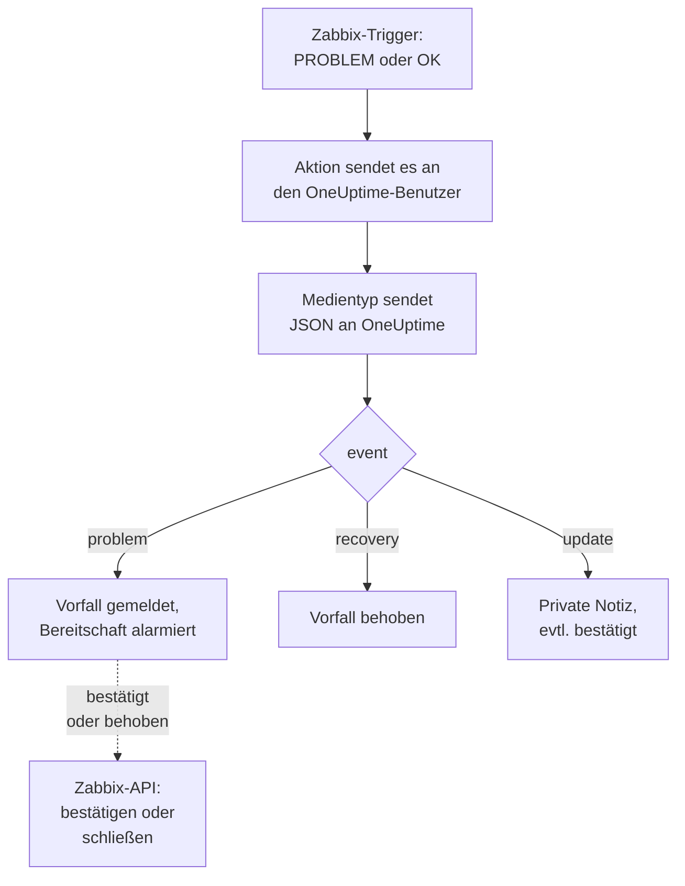

# Zabbix

Senden Sie [Zabbix](https://www.zabbix.com)-Probleme an OneUptime, sodass jedes Problem zu einem Vorfall wird, der Ihr Bereitschaftsteam alarmiert und behoben wird, wenn sich Zabbix erholt. Fertige Workflow-Vorlagen halten beide Seiten auf demselben Stand: Was Personen in Zabbix tun, wird am Vorfall notiert, und wer den Vorfall bestätigt oder behebt, bestätigt oder schließt das Problem in Zabbix. Zabbix sendet jedes Problem über einen Webhook-Medientyp, es gibt also auf keiner Seite etwas zu installieren.

:::cards
- [Wählen Sie, wie OneUptime Probleme empfängt](#wählen-sie-wie-oneuptime-probleme-empfängt): Workflow-Vorlagen oder ein Monitor für eingehende Anfragen.
- [Mit den Vorlagen beginnen](#mit-den-vorlagen-beginnen): Sechs Vorlagen, was sie tun und was sie abfragen.
- [Zabbix konfigurieren](#zabbix-konfigurieren): Ein Medientyp, ein Benutzer und eine Aktion.
- [Fehlerbehebung](#fehlerbehebung): Wenn Probleme nicht ankommen oder Vorfälle offen bleiben.
:::

## So funktioniert es



Zabbix sendet ein Problem an einen Benutzer, über dessen Medien. Hier ist das Medium ein Webhook-Medientyp namens **OneUptime**: Sein Skript sendet ein kleines JSON-Dokument an OneUptime, für jedes Problem, für seine Erholung und für jede Aktualisierung, die jemand in Zabbix daran vornimmt, mit der Ereignis-ID des Problems, seinem Namen, Host und Schweregrad. Über die Ereignis-ID findet OneUptime den Vorfall, den ein Problem eröffnet hat.

## Bevor Sie beginnen

- Ein Zabbix-Server, den Sie verwalten. Diese Anleitung ist für Zabbix 6.0 LTS und 7.0 LTS geschrieben. Webhook-Medientypen funktionieren ab Zabbix 5.0 genauso. Die Vorlagen, die die API von Zabbix aufrufen, brauchen Zabbix 6.4 oder neuer, oder [eine Änderung unter Zabbix 6.0](#unter-zabbix-60).
- Ein Zabbix-Server, der Ihr OneUptime über HTTPS erreicht, und für die Vorlagen, die Zabbix aufrufen, ein OneUptime, das Zabbix erreicht.
- In OneUptime das Recht, Workflows anzulegen, oder Monitore, wenn Sie diesen Weg gehen. Auf OneUptime Cloud brauchen Workflows den Tarif **Growth** oder höher.

## Wählen Sie, wie OneUptime Probleme empfängt

Richten Sie zuerst OneUptime ein: Es gibt Ihnen die URL, an die Zabbix sendet.

| Weg | Nutzen Sie ihn, wenn |
| --- | --- |
| Die Workflow-Vorlagen (empfohlen) | Sie möchten jedes Problem als Vorfall oder Warnung mit seinem Zabbix-Schweregrad, bei High und Disaster an die Bereitschaft gemeldet, bei der Erholung behoben, mit dem darauf notiert, was Personen in Zabbix tun, und Zabbix aus OneUptime heraus bestätigt oder geschlossen. |
| Ein Monitor für eingehende Anfragen | Sie möchten Vorfälle ohne Workflow, in jedem Tarif, und einen Monitor, dessen Status Zabbix folgt. Nichts geht an Zabbix zurück. |

Beide bekommen dasselbe JSON vom selben Medientyp, Sie können also mit einem beginnen und später wechseln, indem Sie in Zabbix eine URL ändern.

## Mit den Vorlagen beginnen

Der Dialog **Arbeitsablauf erstellen** hat sechs Zabbix-Vorlagen, unter **Zabbix** in seiner Kategorieliste: drei für Vorfälle, dann dieselben drei für Warnungen.

| Vorlage | Was sie tut | Was sie abfragt |
| --- | --- | --- |
| **Vorfälle** | | |
| Declare an incident for each Zabbix problem | Der Workflow, an den Zabbix jedes Ereignis sendet. Er meldet für jedes Problem einen Vorfall, alarmiert bei High und Disaster die Bereitschaft, notiert Aktualisierungen aus Zabbix und behebt den Vorfall bei der Erholung. | Zabbix URL |
| Acknowledge or close the Zabbix problem with the incident | Wird der Vorfall bestätigt, bestätigt sie sein Problem. Wird er behoben, schließt sie das Problem, oder bestätigt es, wo Zabbix nicht erlaubt, es von Hand zu schließen. | Zabbix URL, Zabbix API Token |
| Copy incident private notes to the Zabbix problem | Fügt jede private Notiz des Vorfalls seinem Problem als Nachricht hinzu. | Zabbix URL, Zabbix API Token |
| **Warnungen** | | |
| Create an alert for each Zabbix problem | Dasselbe wie für Vorfälle, mit einer Warnung für jedes Problem. | Zabbix URL |
| Acknowledge or close the Zabbix problem with the alert | Dasselbe wie für Vorfälle, nach dem Status der Warnung. | Zabbix URL, Zabbix API Token |
| Copy alert private notes to the Zabbix problem | Fügt jede private Notiz der Warnung ihrem Problem als Nachricht hinzu. | Zabbix URL, Zabbix API Token |

Beginnen Sie mit **Declare an incident for each Zabbix problem**, oder für Warnungen mit **Create an alert for each Zabbix problem**: Der Vorfall oder die Warnung, die sie eröffnet, behält die Ereignis-ID des Problems in ihrem benutzerdefinierten Feld `zabbixEventId`, und die beiden anderen Vorlagen finden das Problem darüber.

### Was die Vorlagen abfragen

- **Zabbix URL**: die Adresse, unter der Sie Zabbix öffnen, etwa `https://zabbix.example.com`, oder `https://example.com/zabbix`, wenn Zabbix unter einem Pfad läuft. Links zu einem Problem führen dorthin, und die Vorlagen, die Zabbix aufrufen, senden ihre Anfragen an dessen `api_jsonrpc.php`. Das Feld lehnt die Adresse einer Seite in Zabbix ab.
- **Zabbix API Token**: ein API-Token des Zabbix-Benutzers, als der der Workflow handelt. [Das API-Token erstellen](#das-api-token-erstellen) zeigt, wie. Es wird als geheime Variable gespeichert und nur an Zabbix gesendet: im Header `Authorization`, oder bei Zabbix 6.0 im Text der Anfrage.

### Probleme mit der Vorlage empfangen

:::steps
1. Gehen Sie zu **Arbeitsabläufe** und klicken Sie auf **Arbeitsablauf erstellen**. Wählen Sie unter **Oder mit einer Vorlage beginnen** in der Kategorieliste **Zabbix**, klicken Sie auf **Declare an incident for each Zabbix problem** und dann auf **Diese Vorlage verwenden**.
2. Füllen Sie **Zabbix URL** aus. Wählen Sie unter **Who to page for High and Disaster problems** die zu alarmierenden Bereitschaftsrichtlinien, oder keine, um niemanden zu alarmieren, und klicken Sie auf **Arbeitsablauf erstellen**. Der Workflow öffnet sich ausgeschaltet im **Editor**.
3. Klicken Sie auf den Trigger **Webhook**, dann auf **URL kopieren**, und bewahren Sie die URL für Zabbix auf.
4. Schalten Sie oben im **Editor** **Aktiviert** ein. Ein ausgeschalteter Workflow antwortet Zabbix mit `400`.
:::

Dann [konfigurieren Sie Zabbix](#zabbix-konfigurieren), damit es seine Probleme an diese URL sendet.

### Was der Workflow tut

Nach dem Trigger **Webhook** liest der Schritt **Check With JavaScript** `read-event-1` das `event`, das der Medientyp sendet, und **Incident From Another Tool**, in der Vorlage für Warnungen **Alert From Another Tool**, tut, was es bedeutet, über die Ereignis-ID des Problems:

| Ereignis | Was der Workflow tut |
| --- | --- |
| `problem` | Meldet einen Vorfall mit dem Titel `Zabbix: <problem> on <host>`, mit dem Schweregrad, auf den der Zabbix-Schweregrad abgebildet wird, und hält ihn von Ihren Statusseiten fern. Seine Beschreibung verlinkt das Problem in Zabbix und nennt den Host, den Schweregrad, den Beginn, seine Betriebsdaten und seine Tags. Bei einem High- oder Disaster-Problem alarmiert er die gewählte Bereitschaftsrichtlinie. Ein Problem, das Zabbix mit derselben Ereignis-ID erneut sendet, eröffnet keinen zweiten Vorfall. |
| `recovery` | Behebt den Vorfall des Problems, sofern er nicht schon behoben ist. Der Grund steht auf seiner Zeitleiste. |
| `update` | Fügt dem Vorfall als private Notiz hinzu, was in Zabbix getan wurde: wer es getan hat, was getan und was geschrieben wurde. Hat die Aktualisierung das Problem bestätigt, bestätigt er auch den Vorfall, sodass die Bereitschaft ihn nicht weiter eskaliert. |

Alles andere, etwa eine Anfrage eines anderen Werkzeugs, bleibt unberührt: `read-event-1` nimmt **No**, und die **Schritte** der Ausführung sagen, warum. Ein Schritt, der fehlschlägt, lässt die Ausführung fehlschlagen, und sein Eintrag unter **Schritte** sagt, warum.

### Schweregrade

In einem neuen Projekt bildet die Vorlage die sechs Schweregrade von Zabbix auf diese Vorfall- und Warnungsschweregrade ab:

| Zabbix-Schweregrad | Vorfall | Warnung | Bereitschaft |
| --- | --- | --- | --- |
| Disaster | Critical Incident | High | Alarmiert |
| High | Critical Incident | High | Alarmiert |
| Average | Major Incident | Low | Nicht alarmiert |
| Warning | Major Incident | Low | Nicht alarmiert |
| Information | Minor Incident | Low | Nicht alarmiert |
| Not classified | Minor Incident | Low | Nicht alarmiert |

Mit eigenen Schweregraden gehen Disaster und High an Ihren schwersten, Average und Warning an den mittleren und Information und Not classified an Ihren leichtesten. Zabbix nummeriert seine Schweregrade von 0 (Not classified) bis 5 (Disaster), und die Vorlage liest die Nummer, eine Umbenennung in Zabbix ändert also nichts.

- Um einen Schweregrad per Namen einem Ihrer Schweregrade zuzuordnen, bearbeiten Sie `SEVERITY_BY_NAME` im Schritt `read-event-1`, etwa `{ 2: 'Minor Incident' }` für Warning.
- Um auch bei Average-Problemen zu alarmieren, setzen Sie **Compare with** des Schritts `if-page-1` **If / Else** auf `3`.

### Bestätigungen und Notizen an Zabbix zurücksenden

:::steps
1. [Erstellen Sie das API-Token](#das-api-token-erstellen).
2. Erstellen Sie einen Workflow aus **Acknowledge or close the Zabbix problem with the incident**. Füllen Sie **Zabbix URL** und **Zabbix API Token** aus, klicken Sie auf **Arbeitsablauf erstellen** und schalten Sie **Aktiviert** ein.
3. Wenn Sie auch Notizen in Zabbix möchten, tun Sie dasselbe mit **Copy incident private notes to the Zabbix problem**.
:::

Die Statusvorlage fragt Zabbix zuerst nach dem Problem, ein Problem, das Zabbix schon bestätigt oder behoben hat, bleibt also unverändert. Um ein Problem zu schließen, braucht sein Trigger in Zabbix **Allow manual close**. Ohne diese Option wird das Problem stattdessen bestätigt, mit einer Nachricht, dass der Vorfall behoben wurde, und Zabbix schließt es, wenn es sich erholt. Vorfälle, die kein Zabbix-Problem eröffnet hat, und als **Privater Vorfall** markierte Vorfälle werden nie an Zabbix gesendet.

### Das API-Token erstellen

:::steps
1. Nutzen Sie den Benutzer `OneUptime`, der [Probleme empfängt](#einen-benutzer-anlegen-der-probleme-empfängt). Zabbix sendet einem Benutzer nicht seine eigenen Aktualisierungen, mit dem Token dieses Benutzers kommen die Bestätigungen und Nachrichten von OneUptime also nie als Aktualisierungen zu OneUptime zurück.
2. Prüfen Sie die Rolle des Benutzers unter **Users → User roles**. Sie braucht **Access to API** aktiviert, und **Acknowledge problems**, **Add problem comments** und **Close problems** erlaubt. Die **User role** erlaubt sie, sofern niemand sie geändert hat.
3. Prüfen Sie die Gruppe des Benutzers unter **Users → User groups**. Die Berechtigung **Read** auf die Hostgruppen genügt, um Probleme zu bestätigen und Nachrichten hinzuzufügen. Um Probleme zu schließen, braucht sie **Read-write**.
4. Gehen Sie zu **Users → API tokens** und klicken Sie auf **Create API token**. Wählen Sie den Benutzer `OneUptime`, entfernen Sie das Häkchen bei **Set expiration date and time** oder notieren Sie das Datum, und klicken Sie auf **Add**.
5. Kopieren Sie das **Auth token**: Zabbix zeigt es nur einmal. Fügen Sie es in **Zabbix API Token** ein.
:::

### Unter Zabbix 6.0

Zabbix 6.0 liest das API-Token aus dem Text der Anfrage, nicht aus ihrem Header `Authorization`. Schalten Sie im Schritt **Update Zabbix Problem** jeder Vorlage, die Zabbix aufruft, **Zabbix 6.0** unter **Weitere Felder** ein. Zabbix 7.2 und neuer lehnen ein Token im Text ab, schalten Sie es also wieder aus, wenn Sie aktualisieren.

## Probleme mit einem Monitor empfangen

Ein [Monitor für eingehende Anfragen](/docs/monitor/incoming-request-monitor) gibt Ihnen eine URL, und seine Kriterien entscheiden, was jede Anfrage bewirkt.

:::steps
### Den Monitor anlegen

Gehen Sie zu **Monitore** und klicken Sie auf **Monitor erstellen**. Wählen Sie unter **Monitortyp** die Option **Eingehende Anfrage**, nennen Sie ihn `Zabbix` und klicken Sie auf **Weiter**.

### Für jedes Problem einen Vorfall melden

Öffnen Sie im Schritt **Kriterien** das erste Kriterium, das den Monitor als offline markiert. Setzen Sie seinen Filter auf **Anfragetext**, **Enthält**, `"status":"1"`. Dieses Kriterium meldet bereits einen Vorfall, wenn sein Filter zutrifft. Füllen Sie den Vorfall aus:

- **Vorfalltitel**: `Zabbix: {{requestBody.name}} on {{requestBody.host}}`.
- **Schweregrad**: der Vorfallschweregrad, den Zabbix-Probleme haben sollen.
- **Bereitschaftsrichtlinien**, unter **Bereitschaft**: die Richtlinien, die alarmiert werden.
- **Vorfall automatisch beheben**, unter **Weitere Felder**: Lassen Sie es eingeschaltet, wie es beginnt. Ohne diese Option werden Erholungen ignoriert, und Vorfälle bleiben offen.

### Einen Vorfall pro Problem eröffnen

Öffnen Sie im selben Kriterium **Einstellungen** und schalten Sie **Vorfälle und Warnungen nach einem Payload-Feld gruppieren** ein. Füllen Sie es wie unten aus, damit jedes Problem seinen eigenen Vorfall bekommt und seine Erholung ihn behebt:

| Feld | Wert |
| --- | --- |
| **Einen eigenen Vorfall eröffnen pro…** | `requestBody.event_id` |
| **Feld, das die Erholung signalisiert** | `requestBody.status` |
| **Wert, der „wiederhergestellt“ bedeutet** | `0` |

### Den Monitor wieder online bringen

Öffnen Sie das zweite Kriterium, das den Monitor als online markiert, und setzen Sie seinen Filter auf **Anfragetext**, **Enthält**, `"status":"0"`.

### Die URL kopieren

Klicken Sie auf **Monitor erstellen**. Die Seite **Übersicht** des Monitors zeigt seine **Heartbeat-URL**. Kopieren Sie sie für Zabbix:

```text
https://oneuptime.com/heartbeat/<secret key>
```

Eine selbst gehostete Installation hat ihren eigenen Host anstelle von `oneuptime.com`.
:::

Der Monitor liest das JSON der Anfrage so, wie es geschrieben ist: `"status":"1"`, ohne Leerzeichen. Unter [Warnungen aus einem anderen System empfangen](/docs/monitor/incoming-request-monitor#warnungen-aus-einem-anderen-system-empfangen) steht, was jede Einstellung tut. Eine Aktualisierung in Zabbix wird ebenfalls mit `"status":"1"` gesendet, was der Monitor erneut als das Problem liest, ohne einen zweiten Vorfall zu eröffnen.

## Zabbix konfigurieren

Zabbix braucht drei Dinge: einen Medientyp, der an OneUptime sendet, einen Benutzer, an den er geht, und eine Aktion, die Probleme an diesen Benutzer sendet.

:::steps
### Den OneUptime-Medientyp anlegen

1. Gehen Sie zu **Alerts → Media types**, unter Zabbix 6.0 zu **Administration → Media types**, und klicken Sie auf **Create media type**.
2. Setzen Sie **Name** auf `OneUptime` und **Type** auf **Webhook**.
3. Fügen Sie diese **Parameters** hinzu. Jeder überträgt ein Zabbix-[Makro](https://www.zabbix.com/documentation/current/en/manual/appendix/macros/supported_by_location) in die Anfrage:

   | Name | Wert |
   | --- | --- |
   | `url` | `{ALERT.SENDTO}` |
   | `event_id` | `{EVENT.ID}` |
   | `event_name` | `{EVENT.NAME}` |
   | `event_value` | `{EVENT.VALUE}` |
   | `event_severity` | `{EVENT.SEVERITY}` |
   | `event_nseverity` | `{EVENT.NSEVERITY}` |
   | `host` | `{HOST.NAME}` |
   | `event_date` | `{EVENT.DATE}` |
   | `event_time` | `{EVENT.TIME}` |
   | `event_opdata` | `{EVENT.OPDATA}` |
   | `event_tags` | `{EVENT.TAGSJSON}` |
   | `trigger_id` | `{TRIGGER.ID}` |
   | `event_update_status` | `{EVENT.UPDATE.STATUS}` |
   | `event_update_action` | `{EVENT.UPDATE.ACTION}` |
   | `event_update_message` | `{EVENT.UPDATE.MESSAGE}` |
   | `event_update_user` | `{USER.FULLNAME}` |

4. Fügen Sie dies in **Script** ein:

   ```javascript
   var params = JSON.parse(value);

   // Zabbix leaves a macro it has no value for as it is written, such as
   // {EVENT.UPDATE.MESSAGE} on a problem: it is sent as nothing.
   function given(text) {
     var written = String(text === undefined || text === null ? "" : text);
     return /^\{[A-Z0-9_.]+\}$/.test(written) || written === "*UNKNOWN*"
       ? ""
       : written;
   }

   var isUpdate = given(params.event_update_status) === "1";
   var payload = {
     source: "zabbix",
     // "problem", "recovery" or "update".
     event: isUpdate
       ? "update"
       : params.event_value === "0"
         ? "recovery"
         : "problem",
     event_id: params.event_id,
     name: params.event_name,
     host: params.host,
     severity: params.event_severity,
     // 0 Not classified, 1 Information, 2 Warning, 3 Average, 4 High, 5 Disaster.
     severity_number: params.event_nseverity,
     // "1" for a problem, "0" for its recovery.
     status: params.event_value,
     date: params.event_date,
     time: params.event_time,
     opdata: given(params.event_opdata),
     tags: [],
     trigger_id: params.trigger_id,
   };

   try {
     var tags = JSON.parse(given(params.event_tags) || "[]");
     payload.tags = Array.isArray(tags) ? tags : [];
   } catch (error) {
     payload.tags = [];
   }

   if (isUpdate) {
     payload.update = {
       action: given(params.event_update_action),
       message: given(params.event_update_message),
       user: given(params.event_update_user),
     };
   }

   var request = new HttpRequest();
   request.addHeader("Content-Type: application/json");

   var response = request.post(params.url, JSON.stringify(payload));

   if (request.getStatus() < 200 || request.getStatus() >= 300) {
     throw (
       "OneUptime responded with HTTP " + request.getStatus() + ": " + response
     );
   }

   return "OK";
   ```

5. Fügen Sie auf dem Tab **Message templates** eine Vorlage für **Problem**, eine für **Problem recovery** und eine für **Problem update** hinzu. Lassen Sie ihren Text leer: Das Skript baut die Anfrage. Zabbix nutzt einen Medientyp nur für die Ereignisarten, für die er eine Vorlage hat.
6. Klicken Sie auf **Add**.

### Einen Benutzer anlegen, der Probleme empfängt

1. Gehen Sie zu **Users → Users**, unter Zabbix 6.0 zu **Administration → Users**, und klicken Sie auf **Create user**. Nennen Sie ihn `OneUptime` und geben Sie ihm eine Benutzergruppe und eine Rolle, die Benachrichtigungen empfangen darf, etwa **User role**.
2. Klicken Sie auf dem Tab **Media** auf **Add**. Setzen Sie **Type** auf `OneUptime` und **Send to** auf die URL, die Sie aus OneUptime kopiert haben. Lassen Sie **When active** und die Schweregrade, wie sie sind, oder entfernen Sie die Haken bei den Schweregraden, die OneUptime nicht bekommen soll.
3. Klicken Sie auf **Add** und dann noch einmal auf **Add**, um den Benutzer zu speichern.

### Probleme mit einer Aktion an OneUptime senden

1. Gehen Sie zu **Alerts → Actions → Trigger actions**, unter Zabbix 6.0 zu **Configuration → Actions**, und klicken Sie auf **Create action**. Nennen Sie sie `Notify OneUptime`.
2. Schränken Sie sie unter **Conditions** ein, wenn Sie möchten, etwa mit **Trigger severity is greater than or equals Warning**. Ohne Bedingungen wird jedes Problem gesendet.
3. Fügen Sie auf dem Tab **Operations** eine Operation hinzu, die über den Medientyp `OneUptime` an den Benutzer `OneUptime` sendet.
4. Fügen Sie dieselbe Operation unter **Recovery operations** hinzu, damit auch Erholungen gesendet werden, und unter **Update operations**, damit in Zabbix vorgenommene Bestätigungen und Kommentare gesendet werden.
5. Klicken Sie auf **Add** und prüfen Sie, dass die Aktion aktiviert ist.
:::

Um manche Probleme an die Vorfallvorlage und andere an die Warnungsvorlage zu senden, geben Sie dem Benutzer `OneUptime` zwei Medien vom Typ `OneUptime`: je eines, das an die URL eines Workflows sendet, jedes mit den Schweregraden, die es bekommen soll.

## Testen

1. Öffnen Sie in Zabbix **Alerts → Media types** und klicken Sie neben `OneUptime` auf **Test**. Tragen Sie die kopierte URL und Beispielwerte ein, etwa `event_id` `12345`, `event_name` `Test problem`, `host` `web-1`, `event_nseverity` `4` und `event_value` `1`. Klicken Sie auf **Test**: Zabbix zeigt die Antwort des Skripts, `OK`, oder den Fehler, den es ausgelöst hat.
2. Öffnen Sie in OneUptime **Protokolle → Ausführungen** des Workflows und prüfen Sie die Ausführung, oder öffnen Sie den Monitor und prüfen Sie, dass ein Vorfall eröffnet wurde.
3. Testen Sie noch einmal mit `event_value` `0` und derselben `event_id`. Der Vorfall wird behoben.

Lassen Sie dann einen echten Trigger auslösen, etwa indem Sie einen Schwellwert kurz senken, und sehen Sie zu, wie das Problem ankommt. Um eine Aktualisierung zu testen, bestätigen Sie das Problem in Zabbix mit einer Nachricht: Der Vorfall bekommt eine private Notiz und wird bestätigt.

## Zabbix-Schweregrade zuordnen

Zabbix sendet seinen Schweregrad als Text: `Not classified`, `Information`, `Warning`, `Average`, `High` oder `Disaster`.

- **Mit den Vorlagen** werden die Schweregrade für Sie abgebildet: siehe [Schweregrade](#schweregrade).
- **Mit dem Monitor** klicken Sie für jede Gruppe von Schweregraden auf **Kriterien hinzufügen** und ziehen das neue Kriterium über das erste: Kriterien werden von oben geprüft, und das erste, das zutrifft, entscheidet. Geben Sie jedem zwei Filter, `"status":"1"` und einen Schweregrad wie `"severity":"Disaster"`, mit **Abgleichsbedingung** auf **Alle**. Geben Sie jedem einen Vorfall mit eigenem **Schweregrad** und **Vorfall automatisch beheben**, und dieselben Gruppierungseinstellungen.

## Fehlerbehebung

:::details In OneUptime kommt nichts an
- Öffnen Sie in Zabbix **Reports → Action log** und prüfen Sie, dass die Aktion das Problem gesendet hat und was zurückkam.
- Senden Sie vom Zabbix-Server selbst eine Anfrage: `curl -i -X POST <url> -H 'Content-Type: application/json' -d '{"source":"zabbix","event":"problem","event_id":"1","name":"Test","host":"test","severity_number":"4","status":"1"}'`.
- Der Monitor antwortet sofort mit `200`, bevor er etwas prüft, selbst bei einem falschen geheimen Schlüssel. Prüfen Sie in der Zeitleiste des Monitors, ob Anfragen ankommen.
- Ein ausgeschalteter Workflow antwortet mit `400`. Schalten Sie oben in seinem **Editor** **Aktiviert** ein.
:::

:::details Zabbix meldet einen Skriptfehler
Öffnen Sie den Medientyp und nutzen Sie **Test**: Zabbix zeigt das Ergebnis des Skripts oder den Fehler, den es ausgelöst hat. Eine Antwort von OneUptime außerhalb von `2xx` löst das Skript mit ihrem Status aus, prüfen Sie also zuerst die URL.
:::

:::details Vorfälle werden eröffnet, aber nie behoben
- Die Aktion braucht **Recovery operations**, sonst sendet Zabbix die Erholung nie.
- Öffnen Sie mit der Vorlage **Protokolle → Ausführungen** des Workflows und die Ausführung der Erholung: Ihr letzter Schritt sagt, warum. Die Erholung eines Problems, das keinen Vorfall eröffnet hat, ändert nichts.
- Mit dem Monitor braucht der Vorfall des Kriteriums **Vorfall automatisch beheben** unter **Weitere Felder**. **Feld, das die Erholung signalisiert** muss `requestBody.status` sein und **Wert, der „wiederhergestellt“ bedeutet** genau `0`.
:::

:::details Zabbix wird nicht bestätigt oder geschlossen
Öffnen Sie die Ausführung der Statusvorlage unter **Protokolle → Ausführungen**: Ihr letzter Schritt sagt, was Zabbix geantwortet hat.

- `Not authorized`: Das API-Token ist falsch, abgelaufen oder deaktiviert, oder Zabbix ist älter als 6.4 (siehe [Unter Zabbix 6.0](#unter-zabbix-60)).
- `Cannot close problem: trigger does not allow manual closing`: Schalten Sie am Trigger **Allow manual close** ein. Die Vorlage bestätigt solche Probleme bereits, statt sie zu schließen.
- `No permissions to referred object or it does not exist!`: Der Benutzer sieht das Problem, braucht aber die Berechtigung **Read-write**, um es zu schließen.
- `Zabbix has no problem with event ID`: Der Benutzer sieht den Host des Problems nicht. Geben Sie seiner Benutzergruppe die Berechtigung **Read** auf die Hostgruppe.
:::

:::details Der Vorfall zeigt einen Verweis statt eines Werts
Ein Verweis auf ein Feld, das die Anfrage nicht hat, bleibt so stehen, wie er geschrieben ist, mit allen Klammern, statt geleert zu werden. Prüfen Sie, dass Zabbix `Content-Type: application/json` sendet und dass die Feldnamen, die Sie verwenden (`name`, `host`, `severity`, `status`, `event_id`), zur Nutzlast des Skripts passen. Öffnen Sie bei einem Workflow die Ausführung unter **Protokolle → Ausführungen** und vergleichen Sie mit dem, was der Trigger empfangen hat. Siehe [Stolperfallen](/docs/workflows/variables#stolperfallen).
:::

:::details Jedes Problem kommt doppelt an
Die Aktion hat vermutlich zwei Operationen, die an denselben Benutzer senden, etwa einen ersten Schritt und einen Eskalationsschritt. Die Vorlage eröffnet pro Ereignis-ID einen Vorfall, egal was ankommt, aber jede Zustellung ist eine Ausführung. Prüfen Sie die **Operations** der Aktion.
:::

## Sicherheit

- **Behandeln Sie die URL wie ein Passwort.** Wer sie hat, kann Vorfälle eröffnen. Wird sie bekannt, setzen Sie sie zurück: mit **URL zurücksetzen** im **Webhook**-Trigger des Workflows oder mit **Geheimen Schlüssel für eingehende Anfragen zurücksetzen** auf der Seite **Einstellungen** des Monitors. Aktualisieren Sie dann **Send to** in den Medien des Zabbix-Benutzers.
- **Links führen zu Ihrem Zabbix.** Die Vorlage verlinkt ein Problem auf der Site, die ihre **Zabbix URL** nennt, egal was eine Anfrage sagt, und schreibt, was Zabbix gesendet hat, als Text.
- **Beschränken Sie das API-Token auf das, was der Workflow tut.** Es ist eine geheime Variable, aus Ausführungsprotokollen entfernt und nur an Zabbix gesendet, im Header `Authorization`, sofern **Zabbix 6.0** nicht eingeschaltet ist. Geben Sie seinem Benutzer eine Rolle mit nicht mehr als den obigen Aktionen, und löschen Sie das Token unter **Users → API tokens**, wenn es bekannt wird.
- **Senden Sie nur, was einen Vorfall braucht.** Nutzen Sie die Bedingungen der Aktion oder die Schweregrade der Benutzermedien, um Probleme mit niedrigem Schweregrad in Zabbix zu lassen.
- **Selbst gehostet?** Lassen Sie Ihren Zabbix-Server Ihr OneUptime über HTTPS durch Ihre Firewall erreichen. Um ein Zabbix in einem privaten Netzwerk aufzurufen, braucht der Workflow [ausgehenden Netzwerkzugriff](/docs/workflows/configuration#ausgehender-netzwerkzugriff).

## Nächste Schritte

:::cards
- [Workflow-Vorlagen](/docs/workflows/authoring): Einen Workflow aus einer Vorlage erstellen und im Editor ändern.
- [Eingehende-Anfrage-Überwachung](/docs/monitor/incoming-request-monitor): Jede Einstellung des Monitors, der Zabbix-Probleme empfängt.
- [Eskalationsregeln](/docs/on-call/escalation-rules): Festlegen, wen eine Bereitschaftsrichtlinie alarmiert, und wann.
- [Integrationsübersicht](/docs/integrations/index): Die anderen Werkzeuge, die Sie verbinden können.
:::
