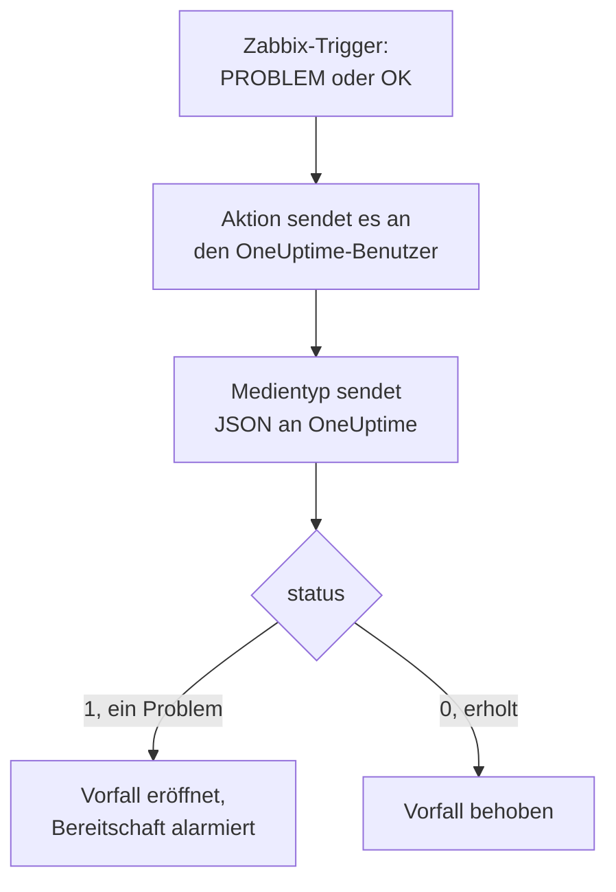

# Zabbix

Senden Sie [Zabbix](https://www.zabbix.com)-Probleme an OneUptime, sodass jedes Problem zu einem Vorfall wird, der Ihr Bereitschaftsteam alarmiert und behoben wird, wenn sich Zabbix erholt. Zabbix sendet jedes Problem über einen Webhook-Medientyp, es gibt also auf keiner Seite etwas zu installieren.

:::cards
- [Wählen Sie, wie OneUptime Probleme empfängt](#wählen-sie-wie-oneuptime-probleme-empfängt): Ein Monitor für eingehende Anfragen oder ein eigener Workflow.
- [Probleme mit einem Monitor empfangen](#probleme-mit-einem-monitor-empfangen): Ein Vorfall pro Problem, bei der Erholung behoben.
- [Zabbix konfigurieren](#zabbix-konfigurieren): Ein Medientyp, ein Benutzer und eine Aktion.
- [Fehlerbehebung](#fehlerbehebung): Wenn Probleme nicht ankommen oder Vorfälle offen bleiben.
:::

## So funktioniert es



Zabbix sendet ein Problem an einen Benutzer, über dessen Medien. Hier ist das Medium ein Webhook-Medientyp namens **OneUptime**: Sein Skript sendet ein kleines JSON-Dokument an OneUptime, mit der Ereignis-ID des Problems, seinem Namen, Host, Schweregrad und Status. Der Status ist `1` für ein Problem und `0` für seine Erholung.

## Bevor Sie beginnen

- Ein Zabbix-Server, den Sie verwalten. Diese Anleitung ist für Zabbix 6.0 LTS und 7.0 LTS geschrieben. Webhook-Medientypen funktionieren ab Zabbix 5.0 genauso.
- Ein Zabbix-Server, der Ihr OneUptime über HTTPS erreicht.
- In OneUptime das Recht, Monitore anzulegen, oder Workflows, wenn Sie diesen Weg gehen.

## Wählen Sie, wie OneUptime Probleme empfängt

Richten Sie zuerst OneUptime ein: Es gibt Ihnen die URL, an die Zabbix sendet.

| Weg | Nutzen Sie ihn, wenn |
| --- | --- |
| Ein Monitor für eingehende Anfragen (empfohlen) | Sie möchten, dass jedes Zabbix-Problem ein Vorfall wird, der die Bereitschaft alarmiert und behoben wird, wenn sich Zabbix erholt. Es gibt nichts zu bauen. |
| Ein Workflow mit einem Webhook-Trigger | Sie brauchen eigene Logik: Probleme filtern, umformen oder zuerst andere Systeme aufrufen. Ein Workflow behebt den Vorfall bei der Erholung nicht von selbst. |

Beide bekommen dasselbe JSON vom selben Medientyp, Sie können also mit einem beginnen und später wechseln, indem Sie in Zabbix eine URL ändern.

## Probleme mit einem Monitor empfangen

Ein [Monitor für eingehende Anfragen](/docs/monitor/incoming-request-monitor) gibt Ihnen eine URL, und seine Kriterien entscheiden, was jede Anfrage bewirkt.

:::steps
### Den Monitor anlegen

Gehen Sie zu **Monitore** und klicken Sie auf **Monitor erstellen**. Wählen Sie unter **Monitortyp** die Option **Eingehende Anfrage**, nennen Sie ihn `Zabbix` und klicken Sie auf **Weiter**.

### Für jedes Problem einen Vorfall melden

Öffnen Sie im Schritt **Kriterien** das erste Kriterium, das den Monitor als offline markiert. Setzen Sie seinen Filter auf **Anfragetext**, **Enthält**, `"status":"1"`. Dieses Kriterium meldet bereits einen Vorfall, wenn sein Filter zutrifft. Füllen Sie den Vorfall aus:

- **Vorfalltitel**: `Zabbix: {{requestBody.name}} on {{requestBody.host}}`.
- **Schweregrad**: der Vorfallschweregrad, den Zabbix-Probleme haben sollen.
- **Bereitschaftsrichtlinien**, unter **Bereitschaft**: die Richtlinien, die alarmiert werden.
- **Vorfall automatisch beheben**, unter **Weitere Felder**: Lassen Sie es eingeschaltet, wie es beginnt. Ohne diese Option werden Erholungen ignoriert, und Vorfälle bleiben offen.

### Einen Vorfall pro Problem eröffnen

Öffnen Sie im selben Kriterium **Einstellungen** und schalten Sie **Vorfälle und Warnungen nach einem Payload-Feld gruppieren** ein. Füllen Sie es wie unten aus, damit jedes Problem seinen eigenen Vorfall bekommt und seine Erholung ihn behebt:

| Feld | Wert |
| --- | --- |
| **Einen eigenen Vorfall eröffnen pro…** | `requestBody.event_id` |
| **Feld, das die Erholung signalisiert** | `requestBody.status` |
| **Wert, der „wiederhergestellt“ bedeutet** | `0` |

### Den Monitor wieder online bringen

Öffnen Sie das zweite Kriterium, das den Monitor als online markiert, und setzen Sie seinen Filter auf **Anfragetext**, **Enthält**, `"status":"0"`.

### Die URL kopieren

Klicken Sie auf **Monitor erstellen**. Die Seite **Übersicht** des Monitors zeigt seine **Heartbeat-URL**. Kopieren Sie sie für Zabbix:

```text
https://oneuptime.com/heartbeat/<secret key>
```

Eine selbst gehostete Installation hat ihren eigenen Host anstelle von `oneuptime.com`.
:::

Der Monitor liest das JSON der Anfrage so, wie es geschrieben ist: `"status":"1"`, ohne Leerzeichen. Unter [Warnungen aus einem anderen System empfangen](/docs/monitor/incoming-request-monitor#warnungen-aus-einem-anderen-system-empfangen) steht, was jede Einstellung tut.

## Probleme mit einem Workflow empfangen

Nutzen Sie einen [Workflow](/docs/workflows/index), wenn Sie zwischen Zabbix und dem Vorfall eigene Schritte brauchen.

:::steps
### Den Workflow anlegen

Gehen Sie zu **Arbeitsabläufe**, klicken Sie auf **Arbeitsablauf erstellen** und dann auf **Ohne Vorlage beginnen**. Nennen Sie ihn `Zabbix problems` und klicken Sie auf **Arbeitsablauf erstellen**.

### Den Webhook-Trigger hinzufügen

Klicken Sie auf den gestrichelten Baustein **Wählen Sie, was diesen Arbeitsablauf startet** und wählen Sie **Webhook**. Klicken Sie auf den Trigger, dann auf **URL kopieren**, und bewahren Sie die URL für Zabbix auf.

### Prüfen, ob es ein Problem ist

Klicken Sie auf **Komponente hinzufügen**, fügen Sie einen **If / Else**-Baustein hinzu und verbinden Sie den Punkt **Out** des Triggers damit. Setzen Sie **Value to check** auf `{{local.components.webhook-1.returnValues.request-body.status}}`, **Comparison** auf **is equal to** und **Compare with** auf `1`.

### Den Vorfall melden

Fügen Sie einen **Create One Incident**-Baustein hinzu und verbinden Sie die Seite **Yes** des **If / Else**-Bausteins damit. Wählen Sie unter **Incident Template** eine Vorlage, die den Schweregrad und die zu alarmierenden Bereitschaftsrichtlinien festlegt (siehe [Vorfallvorlagen](/docs/incidents/settings#vorfall-vorlagen)). Setzen Sie in **JSON Object**, was von Zabbix kommt:

```json
{
  "title": "Zabbix: {{local.components.webhook-1.returnValues.request-body.name}}",
  "description": "Host: {{local.components.webhook-1.returnValues.request-body.host}}\nSeverity: {{local.components.webhook-1.returnValues.request-body.severity}}\nZabbix event: {{local.components.webhook-1.returnValues.request-body.event_id}}"
}
```

Ohne Vorlage braucht **JSON Object** zusätzlich `incidentSeverityId`, die ID eines Vorfallschweregrads des Projekts.

### Ihn einschalten

Schalten Sie oben im **Editor** **Aktiviert** ein. Ein ausgeschalteter Workflow antwortet Zabbix mit `400`.
:::

Eine Erholung nimmt die Seite **No** des **If / Else**-Bausteins, an der nichts angeschlossen ist, die Ausführung endet also dort. Um Vorfälle bei der Erholung zu beheben, nutzen Sie den Monitor.

## Zabbix konfigurieren

Zabbix braucht drei Dinge: einen Medientyp, der an OneUptime sendet, einen Benutzer, an den er geht, und eine Aktion, die Probleme an diesen Benutzer sendet.

:::steps
### Den OneUptime-Medientyp anlegen

1. Gehen Sie zu **Alerts → Media types**, unter Zabbix 6.0 zu **Administration → Media types**, und klicken Sie auf **Create media type**.
2. Setzen Sie **Name** auf `OneUptime` und **Type** auf **Webhook**.
3. Fügen Sie diese **Parameters** hinzu. Jeder überträgt ein Zabbix-[Makro](https://www.zabbix.com/documentation/current/en/manual/appendix/macros/supported_by_location) in die Anfrage:

   | Name | Wert |
   | --- | --- |
   | `url` | `{ALERT.SENDTO}` |
   | `event_id` | `{EVENT.ID}` |
   | `event_name` | `{EVENT.NAME}` |
   | `event_value` | `{EVENT.VALUE}` |
   | `event_severity` | `{EVENT.SEVERITY}` |
   | `host` | `{HOST.NAME}` |
   | `event_date` | `{EVENT.DATE}` |
   | `event_time` | `{EVENT.TIME}` |

4. Fügen Sie dies in **Script** ein:

   ```javascript
   var params = JSON.parse(value);
   var request = new HttpRequest();
   request.addHeader("Content-Type: application/json");

   var payload = {
     source: "zabbix",
     event_id: params.event_id,
     name: params.event_name,
     host: params.host,
     severity: params.event_severity,
     // "1" for a problem, "0" for its recovery.
     status: params.event_value,
     date: params.event_date,
     time: params.event_time,
   };

   var response = request.post(params.url, JSON.stringify(payload));

   if (request.getStatus() < 200 || request.getStatus() >= 300) {
     throw (
       "OneUptime responded with HTTP " + request.getStatus() + ": " + response
     );
   }

   return "OK";
   ```

5. Fügen Sie auf dem Tab **Message templates** eine Vorlage für **Problem** und eine für **Problem recovery** hinzu. Lassen Sie ihren Text leer: Das Skript baut die Anfrage. Zabbix nutzt einen Medientyp nur für die Ereignisarten, für die er eine Vorlage hat.
6. Klicken Sie auf **Add**.

### Einen Benutzer anlegen, der Probleme empfängt

1. Gehen Sie zu **Users → Users**, unter Zabbix 6.0 zu **Administration → Users**, und klicken Sie auf **Create user**. Nennen Sie ihn `OneUptime` und geben Sie ihm eine Benutzergruppe und eine Rolle, die Benachrichtigungen empfangen darf, etwa **User role**.
2. Klicken Sie auf dem Tab **Media** auf **Add**. Setzen Sie **Type** auf `OneUptime` und **Send to** auf die URL, die Sie aus OneUptime kopiert haben. Lassen Sie **When active** und die Schweregrade, wie sie sind, oder entfernen Sie die Haken bei den Schweregraden, die OneUptime nicht bekommen soll.
3. Klicken Sie auf **Add** und dann noch einmal auf **Add**, um den Benutzer zu speichern.

### Probleme mit einer Aktion an OneUptime senden

1. Gehen Sie zu **Alerts → Actions → Trigger actions**, unter Zabbix 6.0 zu **Configuration → Actions**, und klicken Sie auf **Create action**. Nennen Sie sie `Notify OneUptime`.
2. Schränken Sie sie unter **Conditions** ein, wenn Sie möchten, etwa mit **Trigger severity is greater than or equals Warning**. Ohne Bedingungen wird jedes Problem gesendet.
3. Fügen Sie auf dem Tab **Operations** eine Operation hinzu, die über den Medientyp `OneUptime` an den Benutzer `OneUptime` sendet.
4. Fügen Sie dieselbe Operation unter **Recovery operations** hinzu, damit auch Erholungen gesendet werden.
5. Klicken Sie auf **Add** und prüfen Sie, dass die Aktion aktiviert ist.
:::

## Testen

1. Öffnen Sie in Zabbix **Alerts → Media types** und klicken Sie neben `OneUptime` auf **Test**. Tragen Sie die kopierte URL und Beispielwerte ein, etwa `event_id` `12345`, `event_name` `Test problem`, `host` `web-1` und `event_value` `1`. Klicken Sie auf **Test**: Zabbix zeigt die Antwort des Skripts, `OK`, oder den Fehler, den es ausgelöst hat.
2. Öffnen Sie in OneUptime den Monitor und prüfen Sie, dass ein Vorfall eröffnet wurde, oder öffnen Sie **Protokolle → Ausführungen** des Workflows und prüfen Sie die Ausführung.
3. Testen Sie noch einmal mit `event_value` `0` und derselben `event_id`. Mit dem Monitor wird der Vorfall behoben.

Lassen Sie dann einen echten Trigger auslösen, etwa indem Sie einen Schwellwert kurz senken, und sehen Sie zu, wie das Problem ankommt.

## Zabbix-Schweregrade zuordnen

Zabbix sendet seinen Schweregrad als Text: `Not classified`, `Information`, `Warning`, `Average`, `High` oder `Disaster`.

- **Mit dem Monitor** klicken Sie für jede Gruppe von Schweregraden auf **Kriterien hinzufügen** und ziehen das neue Kriterium über das erste: Kriterien werden von oben geprüft, und das erste, das zutrifft, entscheidet. Geben Sie jedem zwei Filter, `"status":"1"` und einen Schweregrad wie `"severity":"Disaster"`, mit **Abgleichsbedingung** auf **Alle**. Geben Sie jedem einen Vorfall mit eigenem **Schweregrad** und **Vorfall automatisch beheben**, und dieselben Gruppierungseinstellungen.
- **Mit dem Workflow** fügen Sie einen [Switch / Case](/docs/workflows/components#switch-case)-Baustein auf `{{local.components.webhook-1.returnValues.request-body.severity}}` hinzu, mit einem Fall pro Schweregrad, und nach jedem Fall einen **Create One Incident**-Baustein mit eigener Vorlage.

## Fehlerbehebung

:::details In OneUptime kommt nichts an
- Öffnen Sie in Zabbix **Reports → Action log** und prüfen Sie, dass die Aktion das Problem gesendet hat und was zurückkam.
- Senden Sie vom Zabbix-Server selbst eine Anfrage: `curl -i -X POST <url> -H 'Content-Type: application/json' -d '{"status":"1","event_id":"1","name":"Test","host":"test"}'`.
- Der Monitor antwortet sofort mit `200`, bevor er etwas prüft, selbst bei einem falschen geheimen Schlüssel. Prüfen Sie in der Zeitleiste des Monitors, ob Anfragen ankommen.
- Ein ausgeschalteter Workflow antwortet mit `400`. Schalten Sie oben in seinem **Editor** **Aktiviert** ein.
:::

:::details Zabbix meldet einen Skriptfehler
Öffnen Sie den Medientyp und nutzen Sie **Test**: Zabbix zeigt das Ergebnis des Skripts oder den Fehler, den es ausgelöst hat. Eine Antwort von OneUptime außerhalb von `2xx` löst das Skript mit ihrem Status aus, prüfen Sie also zuerst die URL.
:::

:::details Vorfälle werden eröffnet, aber nie behoben
- Die Aktion braucht **Recovery operations**, sonst sendet Zabbix die Erholung nie.
- Der Vorfall des Kriteriums braucht **Vorfall automatisch beheben** unter **Weitere Felder**.
- **Feld, das die Erholung signalisiert** muss `requestBody.status` sein und **Wert, der „wiederhergestellt“ bedeutet** genau `0`.
- Ein Workflow behebt Vorfälle bei der Erholung nicht. Nutzen Sie den Monitor.
:::

:::details Der Vorfall zeigt einen Verweis statt eines Werts
Ein Verweis auf ein Feld, das die Anfrage nicht hat, bleibt so stehen, wie er geschrieben ist, mit allen Klammern, statt geleert zu werden. Prüfen Sie, dass Zabbix `Content-Type: application/json` sendet und dass die Feldnamen, die Sie verwenden (`name`, `host`, `severity`, `status`, `event_id`), zur Nutzlast des Skripts passen. Öffnen Sie bei einem Workflow die Ausführung unter **Protokolle → Ausführungen** und vergleichen Sie mit dem, was der Trigger empfangen hat. Siehe [Stolperfallen](/docs/workflows/variables#stolperfallen).
:::

:::details Jedes Problem kommt doppelt an
Die Aktion hat vermutlich zwei Operationen, die an denselben Benutzer senden, etwa einen ersten Schritt und einen Eskalationsschritt. Prüfen Sie die **Operations** der Aktion.
:::

## Sicherheit

- **Behandeln Sie die URL wie ein Passwort.** Wer sie hat, kann Vorfälle eröffnen. Wird sie bekannt, setzen Sie sie zurück: mit **Geheimen Schlüssel für eingehende Anfragen zurücksetzen** auf der Seite **Einstellungen** des Monitors oder mit **URL zurücksetzen** im **Webhook**-Trigger des Workflows. Aktualisieren Sie dann **Send to** in den Medien des Zabbix-Benutzers.
- **Senden Sie nur, was einen Vorfall braucht.** Nutzen Sie die Bedingungen der Aktion oder die Schweregrade der Benutzermedien, um Probleme mit niedrigem Schweregrad in Zabbix zu lassen.
- **Selbst gehostet?** Lassen Sie Ihren Zabbix-Server Ihr OneUptime über HTTPS durch Ihre Firewall erreichen.

## Nächste Schritte

:::cards
- [Eingehende-Anfrage-Überwachung](/docs/monitor/incoming-request-monitor): Jede Einstellung des Monitors, der Zabbix-Probleme empfängt.
- [Eskalationsregeln](/docs/on-call/escalation-rules): Festlegen, wen eine Bereitschaftsrichtlinie alarmiert, und wann.
- [Workflow-Trigger](/docs/workflows/triggers#webhook): Wie die Webhook-URL eines Workflows funktioniert.
- [Integrationsübersicht](/docs/integrations/index): Die anderen Werkzeuge, die Sie verbinden können.
:::
