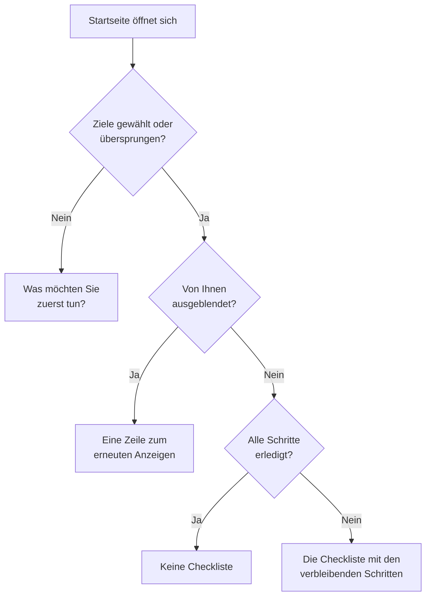

# Startseite & Tastenkürzel

Die Startseite ist die erste Seite, die Sie in einem Projekt sehen. Sie zeigt auf einen Blick, ob gerade etwas Ihre Aufmerksamkeit braucht, und führt ein neues Projekt durch seine erste Einrichtung. Diese Seite erklärt, was die Startseite zeigt, wie Sie jedes Produkt, jede Seite und jede Aktion im Dashboard finden, und die Tastenkürzel, die Ihnen Wege durch Menüs ersparen.

:::cards
- [Was die Startseite zeigt](#was-die-startseite-zeigt): Ob etwas nicht stimmt, was Ihre Aufmerksamkeit braucht, was das Projekt enthält, und alle Produkte.
- [Sich zurechtfinden](#sich-zurechtfinden): Das Menü Produkte und die Leisten oben auf jeder Seite.
- [Suchen](#nach-einer-seite-einer-einstellung-oder-einer-aktion-suchen): Jede Seite, Einstellung oder Aktion finden, indem Sie ihren Namen tippen.
- [Tastenkürzel](#tastenkürzel): Mit zwei Tasten zur Startseite, zu Monitoren oder Vorfällen.
:::

## Was die Startseite zeigt

Öffnen Sie **Startseite** in der Leiste oben, oder drücken Sie von überall `g` und dann `h`. Die Startseite ist die Übersicht Ihres Projekts, eine einzige Seite ohne Seitenmenü. Von oben nach unten zeigt sie:

1. Ein Suchfeld, daneben **Vorfall melden** und **Erstellen**.
2. Eine Zeile, die sagt, ob etwas nicht stimmt, über fünf Zahlen, die zählen, was Aufmerksamkeit braucht.
3. **Willkommen bei OneUptime 👋**, eine Checkliste für ein neues Projekt, bis sie erledigt ist.
4. **Erfordert Aufmerksamkeit**, jedes Problem, das gerade offen ist, mit seinem Namen.
5. **Ihr Projekt**, woraus das Projekt besteht, und **Bevorstehende Wartung**, wenn eine geplant ist.
6. **OneUptime erkunden**, jedes Produkt, eine Kategorie nach der anderen.

### Suchen und erstellen

Das Suchfeld öffnet die Suche, genau wie `Mod` + `K`: Tippen Sie den Namen einer beliebigen Seite, eines Monitors, eines Vorfalls, einer Warnung, einer Statusseite oder einer Bereitschaftsrichtlinie. Siehe [Suchen](#nach-einer-seite-einer-einstellung-oder-einer-aktion-suchen). **Vorfall melden** öffnet das Formular, mit dem Sie einen Vorfall melden. **Erstellen** bietet **Monitor erstellen**, **Wartung planen** und **Ankündigung erstellen** an. Jede davon wird nur Personen angezeigt, die sie verwenden dürfen.

### Die Schlagzeile

Die Zeile ganz oben nennt das Dringendste, was gerade offen ist, in einer passenden Farbe:

| Wann | Die Startseite sagt |
| --- | --- |
| Ein Vorfall ist offen | Wie viele Vorfälle aktiv sind, in Rot |
| Kein Vorfall ist offen, aber es gibt offene Warnungen, nicht betriebsbereite Monitore oder gefährdete SLOs | Wie viele Probleme Aufmerksamkeit erfordern, in Gelb |
| Es gibt kein Problem, und eine Wartung läuft gerade | Wie viele Wartungsereignisse gerade laufen |
| Monitore laufen, und nichts ist offen | **Alle Systeme betriebsbereit** |
| Das Projekt hat noch keine Monitore | **Es wird noch nichts überwacht** |

Daneben zeigt die Startseite, wann sie das Projekt zuletzt geladen hat, und **Aktualisieren** lädt es neu. Wenn Sie nach einer Minute oder länger zu einem Tab mit der Startseite zurückkehren, aktualisiert sie sich von selbst.

Solange noch nichts überwacht wird, endet die Zeile mit der Schaltfläche **Ersten Monitor erstellen**, die die geführte Einrichtung **Wissen, wenn meine Website oder API ausfällt** öffnet. Nur wer Monitore erstellen darf, sieht sie.

### Die fünf Zahlen

Jede Zahl zählt etwas, sagt, ob das Ihre Aufmerksamkeit braucht, und öffnet die Liste dahinter, in dem Produkt, zu dem sie gehört.

| Zahl | Was sie zählt | Wenn die Zahl null ist | Öffnet |
| --- | --- | --- | --- |
| **Aktive Vorfälle** | Vorfälle, die nicht behoben sind | **Alles in Ordnung** | **Vorfälle → Aktive Vorfälle** |
| **Aktive Warnungen** | Warnungen, die nicht behoben sind | **Alles in Ordnung** | **Warnungen → Aktive Warnungen** |
| **Nicht betriebsbereite Monitore** | Monitore, deren Status kein betriebsbereiter ist. Archivierte Monitore und Monitore mit ausgeschalteter Überwachung zählen nicht mit. | **Alle betriebsbereit** | **Monitore → Nicht betriebsbereit** |
| **Laufende Wartung** | Wartungsereignisse, die gerade laufen | **Keine laufenden** | **Geplante Wartung → Laufende Wartungsereignisse** |
| **Gefährdete SLOs** | Eingeschaltete SLOs, die gefährdet sind oder ihr Fehlerbudget aufgebraucht haben | **Budgets in Ordnung** | **SLOs** |

Eine Zahl über null zeigt **Erfordert Aufmerksamkeit**, bei Wartung und SLOs **Läuft gerade** und **Budget wird verbraucht**. Solange ein SLO gefährdet ist, öffnet **Gefährdete SLOs** die Liste **SLOs**, gefiltert auf genau diese SLOs. Ein Projekt ohne Monitore sieht **Noch keine Monitore**, eines ohne SLOs **Noch keine SLOs**: Ein leeres Projekt ist nicht dasselbe wie ein gesundes. Diese beiden öffnen dann die Listen **Monitore** und **SLOs**, in denen Sie einen anlegen.

### Die Willkommens-Checkliste

Wenn ein Projekteigentümer oder Projektadministrator die Startseite eines neuen Projekts zum ersten Mal öffnet, fragt die Karte **Was möchten Sie zuerst tun?** Haken Sie ein oder mehrere Ziele an, etwa **Wissen, wenn meine Website oder API ausfällt** oder **Ich sehe mich nur um**, und klicken Sie auf **Weiter**: Die Checkliste enthält dann die Schritte, die diese Ziele brauchen. **Überspringen** gibt Ihnen die vier Schritte, die jedes Projekt bekommt. Um später neu zu antworten, klicken Sie in der Checkliste auf **Ändern**. Ein Projekt, das schon Monitore, Telemetrie oder Bereitschaft nutzt, wird nicht gefragt.

Jeder Schritt hakt sich selbst ab, sobald die Sache funktioniert, nicht schon, wenn ein Eintrag existiert, und alle, die das Projekt einrichten, sehen auf jedem Gerät dieselbe Liste:

| Schritt | Erledigt, wenn | Öffnet |
| --- | --- | --- |
| **Aus Ihrem bisherigen Tool importieren** | Ein Import aus einem anderen Tool abgeschlossen ist. | **Import aus anderem Tool** |
| **Ersten Monitor erstellen** | Seine erste Prüfung eintrifft. | Die geführte Einrichtung **Wissen, wenn meine Website oder API ausfällt**, oder die Liste **Monitore** für jemanden, der keine Monitore anlegen darf. |
| **Server oder Cluster verbinden** | Seine ersten Metriken eintreffen. | **Hosts** |
| **Erste Logs, Metriken oder Traces senden** | Die ersten Logs, Metriken, Traces, Ausnahmen oder Profile des Projekts eintreffen. | Die geführte Einrichtung **Protokolle, Metriken und Traces senden und dann Warnungen erhalten** |
| **Bereitschaftsrichtlinie einrichten** | Eine Testalarmierung bestätigt wird, eine Alarmierung jemanden erreicht oder eine Bereitschaftsregel eine Richtlinie ausführt, die jemanden erreichen kann. | Die geführte Einrichtung **Die richtige Person alarmieren, wenn etwas ausfällt** |
| **Statusseite veröffentlichen** | Eine Statusseite einen Monitor zeigt. | Die geführte Einrichtung **Statusseite veröffentlichen**, oder die Liste **Statusseiten** für jemanden, der keine Statusseiten anlegen darf. |
| **Team einladen** | Jemand Ihre Einladung annimmt. | **Benutzer** |

Der Schritt, mit dem Sie beginnen, ist mit **Nächster Schritt** markiert. Im Free-Tarif von OneUptime Cloud, der eine Person umfasst, sagt **Team einladen**, dass es den Growth-Tarif braucht, und öffnet **Abrechnung**. Auf einem selbst gehosteten Server, der noch keine E-Mails senden kann, sehen die Administratoren des Servers zuerst **Dieser Server kann noch keine E-Mails senden**; das öffnet das Admin-Dashboard.

Eine geführte Einrichtung erledigt die ganze Aufgabe auf einer Seite, Schritt für Schritt, und endet damit, was sie eingerichtet hat und was als Nächstes zu tun ist. Um eine später wieder zu öffnen, suchen Sie nach ihrem Namen.

Unter den Schritten zeigt **So funktioniert OneUptime** die vier Kernprodukte in der Reihenfolge, in der ein Problem sie durchläuft: **Monitore**, **Vorfälle & Warnungen**, **Bereitschaft** und **Statusseiten**. Klicken Sie auf eines, um es zu öffnen. Darunter steht, was diesen Kreislauf speist, Telemetrie und Infrastruktur, mit Links zu den Seiten [Grundkonzepte](/docs/introduction/core-concepts) und [Glossar](/docs/introduction/glossary).

Die Checkliste verschwindet für alle, sobald jeder Schritt erledigt ist. Um sie früher auszublenden, klicken Sie auf **Ausblenden**: Sie ist dann nur für Sie ausgeblendet, auf jedem Gerät, und eine Zeile bleibt mit **Anzeigen** und **So funktioniert OneUptime**. Wer als Mitglied in das Projekt eingeladen wurde, sieht die Checkliste nicht. **So funktioniert OneUptime** bleibt in jedem Projekt einen Klick entfernt: Öffnen Sie es über **Hilfe** oder mit der Schaltfläche neben **OneUptime erkunden**.

### Erfordert Aufmerksamkeit

**Erfordert Aufmerksamkeit** führt mit Namen auf, was die Zahlen zählen: die offenen Vorfälle, die offenen Warnungen, die nicht betriebsbereiten Monitore, die gefährdeten SLOs und die laufenden Wartungen, das Dringendste zuerst. Jede Zeile zeigt ihren Schweregrad oder Status, sagt, wann ein Vorfall oder eine Warnung begonnen hat und wann eine Wartung endet, und öffnet den Eintrag. Von jeder Art erscheinen bis zu fünf, mit **Alle anzeigen** für den Rest: Es öffnet dieselbe Liste wie die Zahl dieser Art. Wenn nichts offen ist, steht dort **Nichts erfordert Ihre Aufmerksamkeit**.

### Einrichtungsstatus

Wenn etwas in der Einrichtung des Projekts verhindern würde, dass die richtigen Leute Bescheid bekommen, endet **Erfordert Aufmerksamkeit** mit **Einrichtung**: wie viele Dinge einen Blick brauchen. Die Zeile öffnet **Einrichtungsstatus**, eine Liste dessen, was falsch eingerichtet ist, das Schlimmste zuerst, unter **Alarmierungen kommen nicht an**, **Sollte behoben werden** und **Vorschläge**: ein Monitor, der niemanden alarmiert, eine Bereitschaftsrichtlinie, die nie ausgelöst wird, eine Person, die nicht alarmiert werden kann, ausgeschaltete SMS, ein Bereitschaftszeitplan, in dem niemand Dienst hat, eine Statusseite, die keinen Monitor zeigt. Jeder Befund sagt in einem Satz, was nicht stimmt, mit der Schaltfläche, die die Behebung öffnet, und die Befunde eines Monitors sind die Lücken, die seine Karte **Wenn das ausfällt** nennt. Einen Befund, den Ihr Team absichtlich so lässt, können Sie mit einer Begründung für alle ausblenden und unter **Verworfen** wiederherstellen. Die Suche findet die Seite als **Einrichtungsstatus**, und KI fragen beantwortet „Ist meine Einrichtung in Ordnung?“ anhand dieser Seite.

### Ihr Projekt

**Ihr Projekt** zählt die **Monitore**, **Statusseiten**, **Bereitschaftsrichtlinien**, **SLOs**, **Dienste**, **Dashboards** und **Arbeitsabläufe** des Projekts, ohne die archivierten. Jede Zeile öffnet ihre Liste. Hat das Projekt von einer Art noch nichts, steht dort statt einer Zahl **Einrichten**.

**Bevorstehende Wartung** listet die nächsten drei geplanten Wartungsfenster auf, das früheste zuerst. Wenn nichts geplant ist, fehlt dieser Bereich.

### OneUptime erkunden

**OneUptime erkunden** zeigt die Produkte des Menüs **Produkte** Kategorie für Kategorie, beginnend mit den Grundlagen. Jedes Produkt sagt, wofür es da ist, und öffnet sich, wenn Sie darauf klicken. Die Produkte, die Ihr Projekt ausblendet, fehlen dort.

## Sich zurechtfinden

Alles in OneUptime liegt unter **Produkte** in der oberen Leiste. Das Menü führt seine Gruppen als Zeilen einer einzigen Liste und öffnet sich immer mit der ersten davon, den Grundlagen, aufgeklappt: Monitore, Vorfälle, Warnungen, Bereitschaft, Status-Seiten, Geplante Wartung und SLOs. Jede andere Gruppe (Observability, Sicherheit, KI, Code, Ressourcen, Infrastruktur, Cloud, Dashboards & Automatisierung und Einstellungen) ist zu einer Zeile derselben Liste zugeklappt. Jede Zeile nennt die Produkte ihrer Gruppe und sagt, wie viele es sind. Klicken Sie auf eine Zeile, um sie auf- oder zuzuklappen, oder gehen Sie mit den Pfeiltasten zu ihr und drücken Sie **Enter**.

- **Die Suche findet alles.** Tippen Sie in das Suchfeld des Menüs, um jedes Produkt nach seinem Namen, nach dem, was es tut, oder nach einem vertrauten Wort wie `k8s` oder `RUM` zu finden. Die Suche schaut auch in die zugeklappten Gruppen.
- **Sie beginnen dort, wo Sie sind.** Die Gruppe der Seite, auf der Sie sind, klappt von selbst auf, und die Produkte, die Sie zuletzt geöffnet haben, stehen oben.
- **Ihre Auswahl bleibt.** Das Menü merkt sich in Ihrem Browser, welche der anderen Gruppen Sie auf- oder zugeklappt haben. Die Grundlagen sind bei jedem Öffnen des Menüs wieder aufgeklappt, auch wenn Sie sie zugeklappt hatten.
- **Auf dem Telefon** listet die Menüschaltfläche die Produkte genauso auf: die Grundlagen aufgeklappt oben und jede andere Gruppe als eine Zeile, die sich mit einem Tippen öffnet.
- **Produkte, die das Projekt nicht nutzt.** Ein Projektinhaber oder -administrator kann sie unter **Projekteinstellungen → Grundlegend → Produkte** ausblenden. Ein ausgeblendetes Produkt wandert unter **Weitere Produkte**, die letzte Zeile des Menüs: Die Suche findet es weiterhin, seine Seiten funktionieren und seine Daten kommen weiter an. Sobald eines Daten empfängt, sagt die Startseite es denen, die es wieder anzeigen können.
- **Fixieren.** Behalten Sie ein Produkt in der oberen Leiste, neben **Startseite** und **Produkte**: Drücken Sie die Nadel auf seiner Karte im Menü oder **Fixieren** neben dem Titel seiner Seite. Sie können fünf fixieren, und sie folgen Ihnen in jeden Browser. Auf dem Telefon stehen Ihre fixierten Produkte im Menü ganz oben.
- **Was verwendet wird.** In jeder Gruppe außer den Grundlagen und den Einstellungen stehen die Produkte, die Ihr Projekt verwendet, vorn, und eines, das Sie noch nicht eingerichtet haben, zeigt **Nicht eingerichtet**. In OneUptime Cloud nennt ein Produkt, das Ihr Tarif nicht enthält, den Tarif, der es enthält.

### Die Leisten oben

Zwei Leisten ziehen sich oben über jede Seite.

| Wo | Was dort ist |
| --- | --- |
| Oben links | Die Projektauswahl: zu einem anderen Ihrer Projekte wechseln oder ein neues anlegen. |
| Oben rechts | **Suchen** und **KI fragen**, die Benachrichtigungsglocke mit dem, was Sie jetzt braucht (aktive Vorfälle und Warnungen, die Bereitschaftsrichtlinien, in denen Sie Dienst haben, offene Einladungen), **Hilfe**, und Ihr Bild, das Ihr [Konto](/docs/introduction/your-account)-Menü öffnet. |
| Darunter | **Startseite** und **Produkte** links, **Benutzereinstellungen** rechts: wie OneUptime Sie in diesem Projekt erreicht. |

**Hilfe** beginnt mit dem, was beim Lernen hilft: **Schnellstart**, **So funktioniert OneUptime**, **Glossar** und diese Dokumentation (**Dokumentation**). Darunter folgen die Liste **Tastenkürzel** und Support per E-Mail und auf Slack. Auf einem Tablet oder in einem schmalen Fenster fällt **KI fragen** weg, um Platz zu sparen: Sie finden es unter den Aktionen in **Suchen**. Auf einem Telefon wandern **Suchen** und **Hilfe** in die Liste der Menüschaltfläche, ganz nach oben und ganz nach unten; die Glocke und Ihr Bild bleiben.

Ein Wort mit gepunkteter Linie darunter, etwa **Sonden** im Formular eines neuen Monitors, sagt, was es bedeutet, wenn Sie darauf zeigen, mit der Tabulatortaste dorthin wechseln oder darauf tippen. Sein **Mehr lesen** öffnet das Wort im [Glossar](/docs/introduction/glossary).

### Seiten und Listen

Über dem Titel jeder Seite zeigt ein Pfad wie *Projekt › Docker › Einstellungen › Eigentümerregeln*, wo die Seite liegt. Jeder Schritt vor dem letzten öffnet seine Seite.

- **Listen halten sich selbst aktuell.** Wird irgendwo ein Vorfall oder eine Warnung erstellt, bestätigt oder behoben, zeigen die Listen der Vorfälle, Warnungen und Episoden das innerhalb von Sekunden, ohne Neuladen. Solange Sie auf einer Liste mitten in etwas sind, etwa mit markierten Zeilen oder einem offenen Dialog, wartet sie und holt alles nach, wenn Sie fertig sind.
- **Auf dem Telefon klappen die Filter-Chips weg**, hinter **Filter**, sodass die Liste weiter oben beginnt. Die Chips, die Sie gesetzt haben, bleiben sichtbar, mit **Alle löschen**. Drücken Sie **Filter**, um alle Chips zu sehen, und noch einmal, um sie wieder zuzuklappen.
- Der Eintrag **Spalten** im Menü **⋯** einer Liste legt fest, welche Spalten die Liste zeigt und in welcher Reihenfolge, und merkt sie sich für Sie in diesem Browser. Ein Projektinhaber oder ein Projektadministrator kann dort außerdem **Diese Spalten allen in diesem Projekt anzeigen** ankreuzen: Wer für diese Liste keine eigenen Spalten gewählt hat, sieht diese, und **Auf Projektstandard zurücksetzen** setzt Ihre eigenen wieder auf sie zurück.
- Der Eintrag **Kompakte Zeilen** im selben Menü zeichnet die Zeilen jeder Liste niedriger, sodass eine lange Liste etwa ein Fünftel mehr davon zeigt. Die Wahl bleibt in diesem Browser gespeichert.
- **Auf einem Telefon oder in einer Karte, die für ihre Zeilen zu schmal ist, wird eine Liste als Karten gezeigt, eine pro Zeile.** Das Band darüber sagt, wie sie sortiert sind, etwa **Sortiert nach Name**: Drücken Sie darauf, um die Spalte zu wählen, nach der sortiert wird, und **Aufsteigend** oder **Absteigend**.
- **Die Seiten eines Vorfalls beginnen mit seiner Nummer.** Die Überschrift, sein Schritt im Pfad und der Browser-Tab zeigen `INC-42 Checkout is down`, ebenso die Dialoge, die ihn nennen, sodass sich Vorfälle mit demselben Titel unterscheiden lassen. Warnungen, Wartungsereignisse und Episoden machen es genauso.

## Nach einer Seite, einer Einstellung oder einer Aktion suchen

Drücken Sie **Cmd+K** (Mac) oder **Ctrl+K** (Windows und Linux), oder klicken Sie auf das Suchsymbol in der oberen Leiste, und beginnen Sie zu tippen. Die Suche findet:

- **Jede Seite in den Menüs**, unter dem Namen, den das Menü ihr gibt: API-Schlüssel, Gefahrenzone, Bereitschaftspläne, Vorfallsschweregrad, Ihre eigenen Benachrichtigungsmethoden. Jedes Ergebnis sagt, wo es liegt, etwa *Projekteinstellungen › Erweitert*, sodass sich Seiten mit demselben Namen (Benutzerdefinierte Felder in Vorfällen, Warnungen und Monitoren) leicht unterscheiden lassen.
- **Die Einstellungen auf einer Seite**, unter dem Namen, den ihre Karte oder ihr Schalter zeigt: *SSO für die Anmeldung erzwingen* findet SSO, und *Benutzerdefinierte SMTP-Konfigurationen* findet Benachrichtigungskanäle. Tippen Sie den Namen auf Englisch oder in Ihrer Sprache.
- **Aktionen**, nach dem, was Sie tun möchten: Vorfall melden, Monitor erstellen oder Projekt löschen, das die Gefahrenzone öffnet. Eine Aktion, die etwas ändert, wird nur Personen angeboten, die sie ausführen dürfen.
- **Ihre Monitore, Vorfälle, Warnungen, Statusseiten und Bereitschaftsrichtlinien**, nach Namen, und Vorfälle und Warnungen auch nach Nummer, etwa `INC-42`. Jedes Ergebnis für einen Vorfall oder eine Warnung beginnt mit seiner Nummer, sodass sich zwei mit demselben Titel unterscheiden lassen.
- **Die Dokumentation**, in einer Gruppe *Dokumentation* unter allem anderen: die Seiten und Abschnitte, deren Wörter zu Ihrer Eingabe passen, in Ihrer Sprache, auch mit Tippfehler. Jede öffnet sich in einem neuen Tab, damit Sie Ihren Platz behalten.

Die Suche liest, was Sie tippen, so, wie Sie es meinen:

- Groß- und Kleinschreibung, Akzente, Leerzeichen und Bindestriche spielen keine Rolle: *on-call*, *on call* und *oncall* finden dieselben Seiten, und Wörter dürfen in beliebiger Reihenfolge stehen.
- Sie kennt für viele Seiten andere Wörter, auf Englisch: *pager* oder *escalation* für Bereitschaftsrichtlinien, *rota* für Bereitschaftspläne, *2fa* für Zwei-Faktor-Authentifizierung, *delete project* für die Gefahrenzone.
- Fügen Sie den Namen des Produkts hinzu, um eine Suche einzugrenzen: *incident custom fields* findet die Seite Benutzerdefinierte Felder der Vorfälle.
- Ein kleiner Tippfehler wie *incidnet* findet trotzdem, was Sie gemeint haben, wenn nichts genau passt.

Bei leerem Suchfeld listet die Suche die zuletzt geöffneten Seiten, die Aktionen und die Produkte auf.

## Tastenkürzel

Drücken Sie überall im Dashboard `?`, um alle Tastenkürzel zu sehen, oder öffnen Sie **Hilfe** und wählen Sie **Tastenkürzel**. Auf einem Mac ist `Mod` die Befehlstaste, unter Windows und Linux Ctrl (Strg).

| Tasten | Was sie tun |
| --- | --- |
| `Mod` + `K` | Die Befehlspalette öffnen: nach jeder Seite, Einstellung oder Aktion suchen. |
| `Mod` + `I` | KI fragen, zu dem, was Sie gerade ansehen. |
| `/` | Die Liste auf dieser Seite durchsuchen. |
| `?` | Die Tastenkürzel anzeigen. |
| `Esc` | Einen Dialog oder Bereich schließen. |

### Zu einem Produkt springen

Drücken Sie `g` und dann einen Buchstaben, um direkt zu einem Produkt zu springen. Drücken Sie den Buchstaben innerhalb von 1,5 Sekunden nach `g`.

| Tasten | Springt zu |
| --- | --- |
| `g` dann `h` | Startseite |
| `g` dann `m` | Monitore |
| `g` dann `i` | Vorfälle |
| `g` dann `a` | Warnungen |
| `g` dann `o` | Bereitschaft |
| `g` dann `s` | Status-Seiten |
| `g` dann `e` | Geplante Wartung |
| `g` dann `d` | Dashboards |
| `g` dann `l` | Protokolle |
| `g` dann `t` | Traces |

Die Tastenkürzel stehen Ihnen nicht im Weg. `?`, `/` und `g` tun nichts, während Sie in einem Feld tippen, und solange ein Dialog offen ist, navigiert nichts weg, sodass eine versehentliche Taste kein halb ausgefülltes Formular verliert. Jedes andere Produkt ist mit `Mod` + `K` eine Suche entfernt.

## Nächste Schritte

:::cards
- [Schnellstart](/docs/introduction/quickstart): Die Willkommens-Checkliste Schritt für Schritt abarbeiten.
- [Ihr Konto](/docs/introduction/your-account): Ihr Profil, die Sicherheit Ihrer Anmeldung, Sprache und Design.
- [KI fragen](/docs/ai/ask-ai): Was KI fragen für Sie beantworten und tun kann.
- [Grundkonzepte](/docs/introduction/core-concepts): Was Monitore, Vorfälle, Warnungen und Bereitschaft sind.
:::
