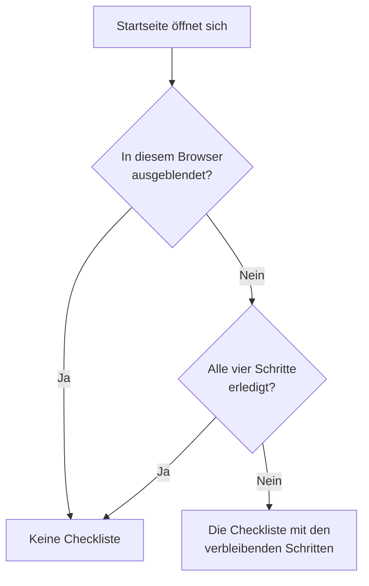

# Startseite & Tastenkürzel

Die Startseite ist die erste Seite, die Sie in einem Projekt sehen. Sie zeigt auf einen Blick, ob gerade etwas Ihre Aufmerksamkeit braucht, und führt ein neues Projekt durch seine erste Einrichtung. Diese Seite erklärt, was die Startseite zeigt, wie Sie jedes Produkt, jede Seite und jede Aktion im Dashboard finden, und die Tastenkürzel, die Ihnen Wege durch Menüs ersparen.

:::cards
- [Was die Startseite zeigt](#was-die-startseite-zeigt): Ob etwas nicht stimmt, was Ihre Aufmerksamkeit braucht, was das Projekt enthält, und alle Produkte.
- [Sich zurechtfinden](#sich-zurechtfinden): Das Menü Produkte und die Leisten oben auf jeder Seite.
- [Suchen](#nach-einer-seite-einer-einstellung-oder-einer-aktion-suchen): Jede Seite, Einstellung oder Aktion finden, indem Sie ihren Namen tippen.
- [Tastenkürzel](#tastenkürzel): Mit zwei Tasten zur Startseite, zu Monitoren oder Vorfällen.
:::

## Was die Startseite zeigt

Öffnen Sie **Startseite** in der Leiste oben, oder drücken Sie von überall `g` und dann `h`. Die Startseite ist die Übersicht Ihres Projekts. Von oben nach unten zeigt sie:

1. Ein Suchfeld, daneben **Vorfall melden** und **Erstellen**.
2. Eine Zeile, die sagt, ob etwas nicht stimmt, über fünf Zahlen, die zählen, was Aufmerksamkeit braucht.
3. **Willkommen bei OneUptime 👋**, eine Checkliste für ein neues Projekt, bis sie erledigt ist.
4. **Erfordert Aufmerksamkeit**, jedes Problem, das gerade offen ist, mit seinem Namen.
5. **Ihr Projekt**, woraus das Projekt besteht, und **Bevorstehende Wartung**, wenn eine geplant ist.
6. **OneUptime erkunden**, jedes Produkt, eine Kategorie nach der anderen.

### Suchen und erstellen

Das Suchfeld öffnet die Suche, genau wie `Mod` + `K`: Tippen Sie den Namen einer beliebigen Seite, eines Monitors, eines Vorfalls, einer Warnung, einer Statusseite oder einer Bereitschaftsrichtlinie. Siehe [Suchen](#nach-einer-seite-einer-einstellung-oder-einer-aktion-suchen). **Vorfall melden** öffnet das Formular, mit dem Sie einen Vorfall melden. **Erstellen** bietet **Monitor erstellen**, **Wartung planen** und **Ankündigung erstellen** an. Jede davon wird nur Personen angezeigt, die sie verwenden dürfen.

### Die Schlagzeile

Die Zeile ganz oben nennt das Dringendste, was gerade offen ist, in einer passenden Farbe:

| Wann | Die Startseite sagt |
| --- | --- |
| Ein Vorfall ist offen | Wie viele Vorfälle aktiv sind, in Rot |
| Kein Vorfall ist offen, aber es gibt offene Warnungen, nicht betriebsbereite Monitore oder gefährdete SLOs | Wie viele Probleme Aufmerksamkeit erfordern, in Gelb |
| Es gibt kein Problem, und eine Wartung läuft gerade | Wie viele Wartungsereignisse gerade laufen |
| Monitore laufen, und nichts ist offen | **Alle Systeme betriebsbereit** |
| Das Projekt hat noch keine Monitore | **Es wird noch nichts überwacht** |

Daneben zeigt die Startseite, wann sie das Projekt zuletzt geladen hat, und **Aktualisieren** lädt es neu. Wenn Sie nach einer Minute oder länger zu einem Tab mit der Startseite zurückkehren, aktualisiert sie sich von selbst.

Solange noch nichts überwacht wird, endet die Zeile mit der Schaltfläche **Ersten Monitor erstellen**, die das Formular zum Erstellen eines Monitors öffnet. Nur wer Monitore erstellen darf, sieht sie.

### Die fünf Zahlen

Jede Zahl zählt etwas, sagt, ob das Ihre Aufmerksamkeit braucht, und öffnet die Liste dahinter.

| Zahl | Was sie zählt | Wenn die Zahl null ist |
| --- | --- | --- |
| **Aktive Vorfälle** | Vorfälle, die nicht behoben sind | **Alles in Ordnung** |
| **Aktive Warnungen** | Warnungen, die nicht behoben sind | **Alles in Ordnung** |
| **Nicht betriebsbereite Monitore** | Monitore, deren Status kein betriebsbereiter ist. Archivierte Monitore zählen nicht mit. | **Alle betriebsbereit** |
| **Laufende Wartung** | Geplante Wartungsereignisse, die gerade laufen | **Keine laufenden** |
| **Gefährdete SLOs** | Eingeschaltete SLOs, die gefährdet sind oder ihr Fehlerbudget aufgebraucht haben | **Budgets in Ordnung** |

Eine Zahl über null zeigt **Erfordert Aufmerksamkeit**, bei Wartung und SLOs **Läuft gerade** und **Budget wird verbraucht**. Ein Projekt ohne Monitore sieht **Noch keine Monitore**, eines ohne SLOs **Noch keine SLOs**: Ein leeres Projekt ist nicht dasselbe wie ein gesundes. Diese beiden öffnen dann die Listen **Monitore** und **SLOs**, in denen Sie einen anlegen.

### Die Willkommens-Checkliste

Die Checkliste führt Sie durch die vier Dinge, die ein Projekt braucht, bevor es nützlich ist. Jeder Schritt öffnet die Seite, auf der Sie ihn erledigen, und hakt sich selbst ab, sobald das Projekt hat, worum er bittet.

| Schritt | Erledigt, wenn | Öffnet |
| --- | --- | --- |
| **Ersten Monitor erstellen** | Das Projekt einen Monitor hat. | Das Formular **Monitor erstellen**, oder die Liste **Monitore** für jemanden, der keine Monitore anlegen darf. |
| **Statusseite veröffentlichen** | Das Projekt eine Statusseite hat. | **Statusseiten** |
| **Team einladen** | Außer Ihnen jemand im Projekt ist oder dazu eingeladen wurde. | **Benutzer** |
| **Bereitschaftsrichtlinie einrichten** | Das Projekt eine Bereitschaftsrichtlinie hat. | **Bereitschaftsdienst** |

Unter den Schritten zeigt **So funktioniert OneUptime** die vier Kernprodukte in der Reihenfolge, in der ein Problem sie durchläuft: **Monitore**, **Vorfälle & Warnungen**, **Bereitschaftsdienst** und **Statusseiten**. Klicken Sie auf eines, um es zu öffnen.

Die Checkliste verschwindet, sobald alle vier Schritte erledigt sind. Um sie früher auszublenden, klicken Sie auf **Ausblenden**. Das Ausblenden gilt für diesen Browser und dieses Projekt; alles, was die Schritte öffnen, finden Sie weiterhin im Menü **Produkte**.

### Erfordert Aufmerksamkeit

**Erfordert Aufmerksamkeit** führt mit Namen auf, was die Zahlen zählen: die offenen Vorfälle, die offenen Warnungen, die nicht betriebsbereiten Monitore, die gefährdeten SLOs und die laufenden Wartungen, das Dringendste zuerst. Jede Zeile zeigt ihren Schweregrad oder Status, sagt, wann ein Vorfall oder eine Warnung begonnen hat und wann eine Wartung endet, und öffnet den Eintrag. Von jeder Art erscheinen bis zu fünf, mit **Alle anzeigen** für den Rest. Wenn nichts offen ist, steht dort **Nichts erfordert Ihre Aufmerksamkeit**.

### Ihr Projekt

**Ihr Projekt** zählt die **Monitore**, **Statusseiten**, **Bereitschaftsrichtlinien**, **SLOs**, **Dienste**, **Dashboards** und **Arbeitsabläufe** des Projekts, ohne die archivierten. Jede Zeile öffnet ihre Liste. Hat das Projekt von einer Art noch nichts, steht dort statt einer Zahl **Einrichten**.

**Bevorstehende Wartung** listet die nächsten drei geplanten Wartungsfenster auf, das früheste zuerst. Wenn nichts geplant ist, fehlt dieser Bereich.

### OneUptime erkunden

**OneUptime erkunden** zeigt die Produkte des Menüs **Produkte** Kategorie für Kategorie, beginnend mit den Grundlagen. Jedes Produkt sagt, wofür es da ist, und öffnet sich, wenn Sie darauf klicken.

### Das Seitenmenü der Startseite

Die Startseite selbst hat kein Seitenmenü: Sie zeigt bereits alles, was das Menü zeigen würde. Die Listen, die sie öffnet, teilen sich eines, das jede Liste mit ihrer Anzahl zeigt und über **Übersicht** zur Startseite zurückführt:

| Abschnitt | Seiten |
| --- | --- |
| **Startseite** | **Übersicht** |
| **Vorfälle** | **Aktive Vorfälle** und **Aktive Episoden** |
| **Warnungen** | **Aktive Warnungen** und **Aktive Episoden** |
| **Monitore** | **Nicht betriebsbereit** |
| **Geplante Ereignisse** | **Laufend** |

Eine Episode fasst zusammengehörige Vorfälle oder Warnungen zusammen, damit Sie sie als eins bearbeiten. Siehe [Grundkonzepte](/docs/introduction/core-concepts#vorfälle-und-warnungen).

## Sich zurechtfinden

Alles in OneUptime liegt unter **Produkte** in der oberen Leiste. Das Menü führt seine Gruppen als Zeilen einer einzigen Liste und öffnet sich immer mit der ersten davon, den Grundlagen, aufgeklappt: Monitore, Vorfälle, Warnungen, Bereitschaftsdienst, Status-Seiten, Geplante Wartung und SLOs. Jede andere Gruppe (Observability, AI, Code, Ressourcen, Infrastruktur, Dashboards & Automatisierung und Einstellungen) ist zu einer Zeile derselben Liste zugeklappt. Jede Zeile nennt die Produkte ihrer Gruppe und sagt, wie viele es sind. Klicken Sie auf eine Zeile, um sie auf- oder zuzuklappen, oder gehen Sie mit den Pfeiltasten zu ihr und drücken Sie **Enter**.

- **Die Suche findet alles.** Tippen Sie in das Suchfeld des Menüs, um jedes Produkt nach seinem Namen, nach dem, was es tut, oder nach einem vertrauten Wort wie `k8s` oder `RUM` zu finden. Die Suche schaut auch in die zugeklappten Gruppen.
- **Sie beginnen dort, wo Sie sind.** Die Gruppe der Seite, auf der Sie sind, klappt von selbst auf, und die Produkte, die Sie zuletzt geöffnet haben, stehen oben.
- **Ihre Auswahl bleibt.** Das Menü merkt sich in Ihrem Browser, welche der anderen Gruppen Sie auf- oder zugeklappt haben. Die Grundlagen sind bei jedem Öffnen des Menüs wieder aufgeklappt, auch wenn Sie sie zugeklappt hatten.
- **Auf dem Telefon** listet die Menüschaltfläche die Produkte genauso auf: die Grundlagen aufgeklappt oben und jede andere Gruppe als eine Zeile, die sich mit einem Tippen öffnet.

### Die Leisten oben

Zwei Leisten ziehen sich oben über jede Seite.

| Wo | Was dort ist |
| --- | --- |
| Oben links | Die Projektauswahl: zu einem anderen Ihrer Projekte wechseln oder ein neues anlegen. |
| Oben rechts | **Suchen** und **KI fragen**, die Benachrichtigungsglocke mit dem, was Sie jetzt braucht (aktive Vorfälle und Warnungen, die Bereitschaftsrichtlinien, in denen Sie Dienst haben, offene Einladungen), **Hilfe**, und Ihr Bild, das Ihr [Konto](/docs/introduction/your-account)-Menü öffnet. |
| Darunter | **Startseite** und **Produkte** links, **Benutzereinstellungen** rechts: wie OneUptime Sie in diesem Projekt erreicht. |

**Hilfe** öffnet diese Dokumentation (**Dokumentation**) und die Liste **Tastenkürzel** und bietet Support per E-Mail und auf Slack. Auf einem schmalen Bildschirm, etwa einem Telefon, fallen **Suchen**, **KI fragen** und **Hilfe** weg, um Platz zu sparen; die Glocke und Ihr Bild bleiben.

### Seiten und Listen

Über dem Titel jeder Seite zeigt ein Pfad wie *Projekt › Docker › Einstellungen › Eigentümerregeln*, wo die Seite liegt. Jeder Schritt vor dem letzten öffnet seine Seite.

- **Listen halten sich selbst aktuell.** Wird irgendwo ein Vorfall oder eine Warnung erstellt, bestätigt oder behoben, zeigen die Listen der Vorfälle, Warnungen und Episoden das innerhalb von Sekunden, ohne Neuladen. Solange Sie auf einer Liste mitten in etwas sind, etwa mit markierten Zeilen oder einem offenen Dialog, wartet sie und holt alles nach, wenn Sie fertig sind.
- **Auf dem Telefon klappen die Filter-Chips weg**, hinter **Filter**, sodass die Liste weiter oben beginnt. Die Chips, die Sie gesetzt haben, bleiben sichtbar, mit **Alle löschen**. Drücken Sie **Filter**, um alle Chips zu sehen, und noch einmal, um sie wieder zuzuklappen.
- **Die Seiten eines Vorfalls beginnen mit seiner Nummer.** Die Überschrift, sein Schritt im Pfad und der Browser-Tab zeigen `INC-42 Checkout is down`, ebenso die Dialoge, die ihn nennen, sodass sich Vorfälle mit demselben Titel unterscheiden lassen. Warnungen, geplante Wartungsereignisse und Episoden machen es genauso.

## Nach einer Seite, einer Einstellung oder einer Aktion suchen

Drücken Sie **Cmd+K** (Mac) oder **Ctrl+K** (Windows und Linux), oder klicken Sie auf das Suchsymbol in der oberen Leiste, und beginnen Sie zu tippen. Die Suche findet:

- **Jede Seite in den Menüs**, unter dem Namen, den das Menü ihr gibt: API-Schlüssel, Gefahrenzone, Bereitschaftspläne, Vorfallsschweregrad, Ihre eigenen Benachrichtigungsmethoden. Jedes Ergebnis sagt, wo es liegt, etwa *Projekteinstellungen › Erweitert*, sodass sich Seiten mit demselben Namen (Benutzerdefinierte Felder in Vorfällen, Warnungen und Monitoren) leicht unterscheiden lassen.
- **Die Einstellungen auf einer Seite**, unter dem Namen, den ihre Karte oder ihr Schalter zeigt: *SSO für die Anmeldung erzwingen* findet SSO, und *Benachrichtigungskanäle* findet Benachrichtigungseinstellungen. Tippen Sie den Namen auf Englisch oder in Ihrer Sprache.
- **Aktionen**, nach dem, was Sie tun möchten: Vorfall melden, Monitor erstellen oder Projekt löschen, das die Gefahrenzone öffnet. Eine Aktion, die etwas ändert, wird nur Personen angeboten, die sie ausführen dürfen.
- **Ihre Monitore, Vorfälle, Warnungen, Statusseiten und Bereitschaftsrichtlinien**, nach Namen, und Vorfälle und Warnungen auch nach Nummer, etwa `INC-42`. Jedes Ergebnis für einen Vorfall oder eine Warnung beginnt mit seiner Nummer, sodass sich zwei mit demselben Titel unterscheiden lassen.

Die Suche liest, was Sie tippen, so, wie Sie es meinen:

- Groß- und Kleinschreibung, Akzente, Leerzeichen und Bindestriche spielen keine Rolle: *on-call*, *on call* und *oncall* finden dieselben Seiten, und Wörter dürfen in beliebiger Reihenfolge stehen.
- Sie kennt für viele Seiten andere Wörter, auf Englisch: *pager* oder *escalation* für Bereitschaftsrichtlinien, *rota* für Bereitschaftspläne, *2fa* für Zwei-Faktor-Authentifizierung, *delete project* für die Gefahrenzone.
- Fügen Sie den Namen des Produkts hinzu, um eine Suche einzugrenzen: *incident custom fields* findet die Seite Benutzerdefinierte Felder der Vorfälle.
- Ein kleiner Tippfehler wie *incidnet* findet trotzdem, was Sie gemeint haben, wenn nichts genau passt.

Bei leerem Suchfeld listet die Suche die zuletzt geöffneten Seiten, die Aktionen und die Produkte auf.

## Tastenkürzel

Drücken Sie überall im Dashboard `?`, um alle Tastenkürzel zu sehen, oder öffnen Sie **Hilfe** und wählen Sie **Tastenkürzel**. Auf einem Mac ist `Mod` die Befehlstaste, unter Windows und Linux Ctrl (Strg).

| Tasten | Was sie tun |
| --- | --- |
| `Mod` + `K` | Die Befehlspalette öffnen: nach jeder Seite, Einstellung oder Aktion suchen. |
| `Mod` + `I` | KI fragen, zu dem, was Sie gerade ansehen. |
| `/` | Die Liste auf dieser Seite durchsuchen. |
| `?` | Die Tastenkürzel anzeigen. |
| `Esc` | Einen Dialog oder Bereich schließen. |

### Zu einem Produkt springen

Drücken Sie `g` und dann einen Buchstaben, um direkt zu einem Produkt zu springen. Drücken Sie den Buchstaben innerhalb von 1,5 Sekunden nach `g`.

| Tasten | Springt zu |
| --- | --- |
| `g` dann `h` | Startseite |
| `g` dann `m` | Monitore |
| `g` dann `i` | Vorfälle |
| `g` dann `a` | Warnungen |
| `g` dann `o` | Bereitschaftsdienst |
| `g` dann `s` | Status-Seiten |
| `g` dann `e` | Geplante Wartung |
| `g` dann `d` | Dashboards |
| `g` dann `l` | Protokolle |
| `g` dann `t` | Traces |

Die Tastenkürzel stehen Ihnen nicht im Weg. `?`, `/` und `g` tun nichts, während Sie in einem Feld tippen, und solange ein Dialog offen ist, navigiert nichts weg, sodass eine versehentliche Taste kein halb ausgefülltes Formular verliert. Jedes andere Produkt ist mit `Mod` + `K` eine Suche entfernt.

## Nächste Schritte

:::cards
- [Schnellstart](/docs/introduction/quickstart): Die Willkommens-Checkliste Schritt für Schritt abarbeiten.
- [Ihr Konto](/docs/introduction/your-account): Ihr Profil, die Sicherheit Ihrer Anmeldung, Sprache und Design.
- [KI fragen](/docs/ai/ask-ai): Was KI fragen für Sie beantworten und tun kann.
- [Grundkonzepte](/docs/introduction/core-concepts): Was Monitore, Vorfälle, Warnungen und Bereitschaft sind.
:::
