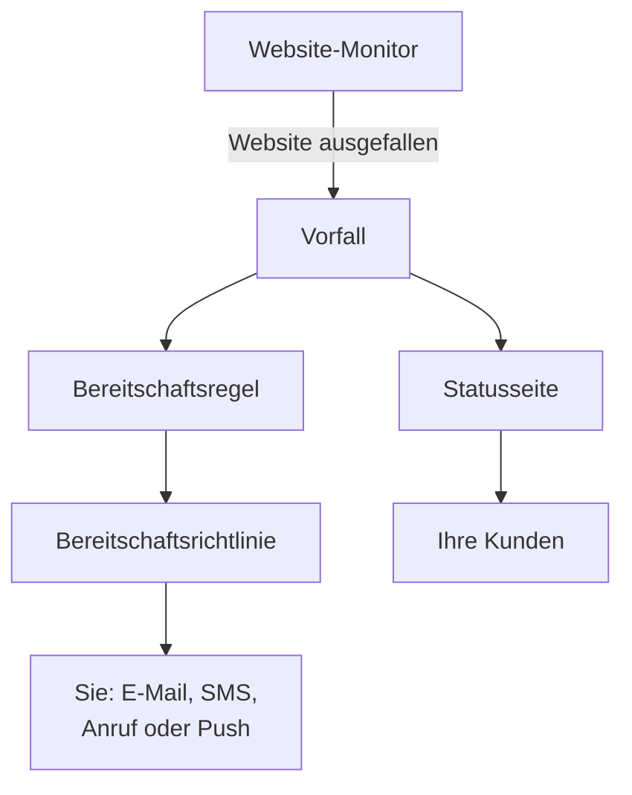

# Schnellstart

Diese Anleitung bringt Sie in etwa fünfzehn Minuten von einem neuen Konto zu einer funktionierenden Einrichtung: einem Monitor, der Ihre Website alle fünf Minuten prüft, einer Bereitschaftsrichtlinie, die Sie alarmiert, wenn die Website ausfällt, und einer Statusseite, die Ihre Kunden informiert. Sie folgt der Checkliste **Willkommen bei OneUptime 👋** auf der Startseite Ihres Projekts und den geführten Einrichtungen, die ihre Schritte öffnen.

Sie kommen von einem anderen Werkzeug? [Importieren Sie zuerst Ihre Einrichtung](/docs/introduction/getting-started#von-einem-anderen-werkzeug-kommend): Ihre Monitore, Bereitschaftspläne und Statusseiten kommen mit.

## Bevor Sie beginnen

- **Ein Konto.** Registrieren Sie sich bei OneUptime Cloud auf [oneuptime.com](https://oneuptime.com/accounts/register) und öffnen Sie den Link in der E-Mail, die Sie erhalten. Öffnen Sie bei Ihrer eigenen Installation diese im Browser und registrieren Sie sich: Das erste Konto wird Master-Admin. Wie Sie eine Installation einrichten, steht unter [Docker Compose](/docs/installation/docker-compose).
- **Eine Website, die Sie überwachen möchten.** Jede Adresse, die über HTTP oder HTTPS antwortet, etwa die Startseite Ihres Unternehmens.

## Ein Projekt erstellen

In OneUptime liegt alles in einem Projekt: Ihre Monitore, Vorfälle, Bereitschaftsrichtlinien, Statusseiten und die Personen, die daran arbeiten.

:::steps
### Ein neues Projekt beginnen

Bei Ihrer ersten Anmeldung zeigt OneUptime **Keine Projekte**. Klicken Sie auf **Neues Projekt erstellen**. Hat Sie bereits jemand zu einem Projekt eingeladen, nehmen Sie die Einladung stattdessen auf derselben Seite an.

### Einen Namen vergeben

Geben Sie einen **Projektname** ein, etwa den Namen Ihres Unternehmens. Bei OneUptime Cloud wählen Sie darunter auch einen Tarif: Free ist bereits ausgewählt, und die kostenpflichtigen Tarife beginnen mit einer kostenlosen Testphase.

### Das Projekt anlegen

Klicken Sie auf **Projekt erstellen**. Die Startseite Ihres Projekts öffnet sich, oben mit der Checkliste **Willkommen bei OneUptime 👋**. Zuerst fragt sie **Was möchten Sie zuerst tun?**: Haken Sie **Wissen, wenn meine Website oder API ausfällt**, **Die richtige Person alarmieren, wenn etwas ausfällt** und **Meine Kunden über eine Statusseite informieren** an, und klicken Sie auf **Weiter**.
:::

## Ihre Website überwachen

:::steps
### Die Website-Einrichtung öffnen

Klicken Sie in der Checkliste auf **Ersten Monitor erstellen**. Damit öffnet sich die geführte Einrichtung **Wissen, wenn meine Website oder API ausfällt**, die Ihre Website prüft, festlegt, wer informiert wird, und einen Test sendet, alles auf einer Seite. Wer keine Monitore erstellen darf, erhält stattdessen die Liste **Monitore**.

### Die Adresse eingeben

Geben Sie unter **Was sollen wir prüfen?** die vollständige Adresse Ihrer Website in **Adresse der Website oder API** ein, etwa `https://example.com`, und klicken Sie auf **Prüfung starten**. Die Sonden prüfen sie sofort und danach alle 5 Minuten: Antwortet die Website nicht oder mit einem Fehler, wechselt der Monitor zu **Offline** und meldet einen Vorfall. Klicken Sie auf **Weiter**.

Im Free-Tarif von OneUptime Cloud werden Monitore nach Nutzung abgerechnet, daher braucht das Projekt eine Zahlungsmethode, bevor es Ihre Website prüfen kann: Ohne sie bittet der Schritt Sie, [eine Zahlungsmethode hinzuzufügen](/docs/configuration/billing#zahlungsmethoden).

### Festlegen, wer informiert wird

Unter **Wer soll informiert werden?** stehen Sie bereits in **Wer alarmiert wird**. Klicken Sie auf **Speichern und weiter**: Dabei wird die Richtlinie `Default on-call policy` angelegt, die Sie bei jedem neuen Vorfall und jeder neuen Warnung im Projekt alarmiert, zunächst per E-Mail. Um auch Teammitglieder zu alarmieren, die schon im Projekt sind, klicken Sie vorher auf **Teammitglieder hinzufügen**.

### Sich selbst einen Test senden

Klicken Sie unter **Test senden** auf **Mir eine Test-Alarmierung senden**, wählen Sie einen **Schweregrad** und klicken Sie auf **Test-Alarmierung senden**. Öffnen Sie den Link in der E-Mail, in der TEST steht, und bestätigen Sie die Alarmierung dort. Klicken Sie dann im Dialog auf **Fertig** und auf **Weiter**: Die Einrichtung endet mit einer Zusammenfassung dessen, was sie eingerichtet hat.
:::

Um jede Option selbst festzulegen oder etwas anderes als eine Website zu prüfen, öffnen Sie **Monitore** im Menü **Produkte** und klicken auf **Monitor erstellen**. [Einen Monitor erstellen](/docs/monitor/create-monitor) beschreibt das Formular und jeden Monitortyp.

Um auch eine API zu prüfen und zu erfahren, was zu tun ist, wenn die erste Prüfung nie zurückkommt, folgen Sie der Anleitung [Erfahren, wenn Ihre Website oder API ausfällt](/docs/guides/website-down).

## Bei einem Ausfall alarmiert werden

Die Website-Einrichtung hat bereits die Richtlinie `Default on-call policy` angelegt, die Sie bei jedem neuen Vorfall und jeder neuen Warnung per E-Mail alarmiert, deshalb hakt die Checkliste **Bereitschaftsrichtlinie einrichten** als erledigt ab. Deren geführte Einrichtung fügt trotzdem Ihr Telefon hinzu, die Personen, die mit Ihnen alarmiert werden, und was passiert, wenn niemand antwortet.

:::steps
### Die Bereitschafts-Einrichtung öffnen

Drücken Sie `Ctrl+K` (`Cmd+K` auf einem Mac), geben Sie `get paged` ein und wählen Sie **Die richtige Person alarmieren, wenn etwas ausfällt**. Solange die Checkliste **Bereitschaftsrichtlinie einrichten** nicht abgehakt hat, öffnet dieser Schritt dieselbe geführte Einrichtung.

### Festlegen, wie Sie erreicht werden

Unter **Wie sollen wir dich erreichen?** ist Ihre Anmelde-E-Mail bereits aufgeführt. Für Push-Benachrichtigungen installieren Sie die App OneUptime On-Call aus dem App Store oder von Google Play, melden sich an und klicken auf **Erneut prüfen**. Um auch per SMS und Anruf erreicht zu werden, klicken Sie auf **SMS und Anrufe einschalten**, geben Ihre Nummer in **Deine Telefonnummer** ein und klicken auf **Code per SMS senden**: Auf OneUptime Cloud werden SMS und Anrufe aus dem Guthaben des Projekts bezahlt, deshalb bittet der Schritt Sie zuerst, Guthaben aufzuladen. Klicken Sie auf **Weiter**.

### Festlegen, wer sonst alarmiert wird

Behalten Sie unter **Wer hat sonst Bereitschaft?** die Richtlinie `Default on-call policy` unter **Bereitschaftsrichtlinie** bei. Um Teammitglieder mit Ihnen zu alarmieren, nehmen Sie sie unter **Zur ersten Eskalationsregel hinzufügen** auf. Klicken Sie auf **Speichern und weiter**.

### Festlegen, was passiert, wenn niemand antwortet

Wählen Sie unter **Was, wenn niemand antwortet?** die Option **Dieselben Personen erneut alarmieren**, solange Sie die einzige Person im Projekt sind. Sobald Teammitglieder dabei sind, alarmiert **Jemand anderen alarmieren** die Person, die Sie unter **Als Nächstes alarmiert** wählen. In OneUptime Cloud bieten nur die kostenpflichtigen Tarife diese Option. Klicken Sie auf **Speichern und weiter**.

### Eine Test-Alarmierung senden

Klicken Sie unter **Test-Alarmierung senden** auf **Diese Richtlinie testen**, wählen Sie einen **Schweregrad** und klicken Sie auf **Test-Alarmierung senden**. Bestätigen Sie die Alarmierung aus der E-Mail, der SMS oder dem Anruf heraus, klicken Sie dann im Dialog auf **Fertig** und auf **Weiter**. Die Einrichtung endet mit **Die Alarmierung ist eingerichtet**.
:::

> [!NOTE]
> SMS und Telefonanrufe sind in einem neuen Projekt ausgeschaltet. Ein Projekteigentümer, ein Billing Admin oder jemand mit Manage Billing schaltet sie in der Karte **Benachrichtigungskanäle** unter **Projekteinstellungen → Benachrichtigungen → Benachrichtigungskanäle** ein.

Zwei Bereitschaftsregeln lösen die Richtlinie aus: eine bei jedem neuen Vorfall und eine bei jeder neuen Warnung. Um die erste zu sehen, öffnen Sie **Vorfälle** im Menü **Produkte**, klappen **Regeln** im Seitenmenü auf und wählen **Bereitschaftsregeln**: Sie trifft auf **Alle Vorfälle** zu. Damit die Richtlinie nur bei manchen Vorfällen ausgelöst wird, etwa bei kritischen, bearbeiten Sie die Regel dort, oder klicken Sie auf **Bereitschaftsregel für Vorfälle erstellen**, um eine eigene anzulegen.

Um eine Richtlinie stattdessen Feld für Feld anzulegen, öffnen Sie **Bereitschaft** im Menü **Produkte** und klicken auf **Bereitschaftsrichtlinie erstellen**. Für weitere Stufen, Rotationen und wie lange jede Stufe wartet, siehe [Eskalationsregeln](/docs/on-call/escalation-rules) und [Bereitschaftspläne](/docs/on-call/schedules).

Für jeden Bildschirm der Einrichtung und was zu tun ist, wenn eine Alarmierung nicht ankommt, folgen Sie der Anleitung [Per Anruf, SMS oder Push alarmiert werden](/docs/guides/paging).

## Eine Statusseite veröffentlichen

:::steps
### Die Statusseiten-Einrichtung öffnen

Klicken Sie in der Checkliste auf **Statusseite veröffentlichen**. Damit öffnet sich die geführte Einrichtung **Statusseite veröffentlichen**, die die Seite benennt, Ihren Monitor darauf setzt und zeigt, was Ihre Kunden sehen. Wer keine Statusseiten erstellen darf, erhält stattdessen die Liste **Statusseiten**. Die Zusammenfassung der Website-Einrichtung öffnet dieselbe Einrichtung, als **Auf einer Statusseite anzeigen**.

### Die Seite benennen und Ihren Monitor wählen

Behalten Sie unter **Benennen Sie sie und wählen Sie aus, was sie zeigt** im Feld **Name der Statusseite** den Vorschlag bei oder geben Sie einen eigenen Namen ein. Haken Sie unter **Was sie zeigt** Ihren Website-Monitor an und klicken Sie auf **Statusseite erstellen**. Ab diesem Moment ist die Seite unter ihrem Link öffentlich: Jeder mit ihrer Adresse kann sie öffnen.

### Die Seite öffnen

Öffnen Sie unter **Das sehen Ihre Kunden** die Adresse unter **Öffentlicher Link**: Ihre Website wird als betriebsbereit angezeigt. Zurück in der Einrichtung klicken Sie auf **Sieht gut aus**. Die Einrichtung endet mit einer Zusammenfassung, die zeigt, was als Nächstes zu tun ist.
:::

Um eine Seite stattdessen von Hand anzulegen, öffnen Sie **Statusseiten** im Menü **Produkte** und klicken auf **Statusseite erstellen**; fügen Sie dann Ihren Monitor mit **Monitore hinzufügen** auf ihrer **Übersicht** hinzu. Wie Sie der Seite Ihr eigenes Logo und Ihre Farben geben, steht unter [Statusseiten – Branding & Domains](/docs/status-pages/branding-and-domains).

Um die Statusseite über HTTPS auf Ihre eigene Domain zu bringen, folgen Sie der Anleitung [Eine Statusseite veröffentlichen](/docs/guides/status-page).

## Ihr Team einladen

Klicken Sie in der Checkliste auf **Team einladen**, oder öffnen Sie **Benutzer** im Menü **Produkte**, unter **Einstellungen**. Klicken Sie auf **Benutzer einladen**, geben Sie die **E-Mail** der Person ein und wählen Sie ein **Team**: Zu Beginn ist das Mitglieder-Team gewählt. Klicken Sie auf **Einladen**. OneUptime schickt der Person die Einladung per E-Mail, und das Team bestimmt, was sie tun darf. Siehe [Benutzer, Teams & Berechtigungen](/docs/permissions/index).

## Ausprobieren

Melden Sie einen Testvorfall, um die ganze Kette arbeiten zu sehen.

:::steps
### Einen Testvorfall melden

Öffnen Sie **Vorfälle** und klicken Sie auf **Vorfall melden**. Geben Sie einen **Titel** ein, etwa `Test incident`, wählen Sie einen **Vorfallsschweregrad** und klicken Sie auf **Weiter**. Wählen Sie unter **Monitore** Ihren Website-Monitor, damit der Vorfall auf Ihrer Statusseite erscheint. Klicken Sie auf **Weiter**, bis Sie die Zusammenfassung erreichen, und dann auf **Vorfall melden**.

### Zusehen, was passiert

Innerhalb von ein, zwei Minuten alarmiert Sie Ihre Bereitschaftsrichtlinie, und der Vorfall erscheint auf Ihrer Statusseite.

### Den Vorfall beheben

Klicken Sie auf der Seite des Vorfalls auf **Beheben**. Die Alarmierung endet, und der Vorfall verschwindet von Ihrer Statusseite.
:::

> [!WARNING]
> Jeder, der Ihre Statusseite öffnet, sieht den Testvorfall, bis Sie ihn beheben. Führen Sie den Test aus, bevor Sie die Adresse der Seite weitergeben.

## Fehlerbehebung

:::details Ich wurde nicht alarmiert
Öffnen Sie den Vorfall und wählen Sie **Bereitschaftsausführungen** in seinem Seitenmenü: Dort steht, ob Ihre Richtlinie lief und wen sie alarmiert hat. Lief sie nicht, prüfen Sie, ob Ihre Bereitschaftsregel aktiviert ist und die Richtlinie nennt. Lief sie, prüfen Sie, ob Ihre Methoden unter **Benutzereinstellungen → Benachrichtigungsmethoden** verifiziert sind.
:::

:::details Der Vorfall erscheint nicht auf meiner Statusseite
Eine Statusseite zeigt einen Vorfall, wenn einer der Monitore des Vorfalls auf der Seite steht. Prüfen Sie, ob der Vorfall Ihren Monitor unter seinen betroffenen Ressourcen führt und ob der Monitor auf der Statusseite steht.
:::

:::details Der Monitor meldet offline, aber meine Website funktioniert
Öffnen Sie den Monitor und prüfen Sie, was die Sonden erhalten haben. Siehe den Abschnitt zur Fehlerbehebung unter [Website-Überwachung](/docs/monitor/website-monitor).
:::

## Nächste Schritte

:::cards
- [Grundkonzepte](/docs/introduction/core-concepts): Die Ideen hinter dem, was Sie gerade eingerichtet haben.
- [Glossar](/docs/introduction/glossary): Jedes Wort, das Ihnen unterwegs begegnet ist, in ein oder zwei Sätzen.
- [Bereitschaftspläne](/docs/on-call/schedules): Die Bereitschaft mit Ihrem Team teilen.
- [Statusseiten – Branding & Domains](/docs/status-pages/branding-and-domains): Die Statusseite zu Ihrer eigenen machen.
- [OpenTelemetry](/docs/telemetry/open-telemetry): Logs, Metriken und Traces aus Ihren Anwendungen senden.
:::
