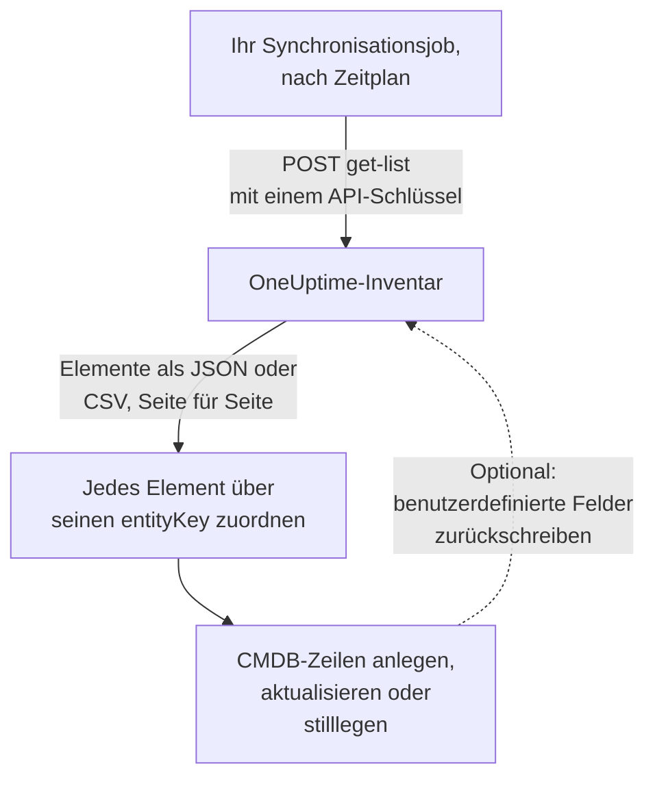

# Export in eine CMDB

Wenn Sie bereits eine CMDB oder ein Asset-Register betreiben, will OneUptime es nicht ersetzen. Was es hat und einer CMDB meist fehlt, ist ein Bild dessen, was tatsächlich läuft, aktuell gehalten, ohne dass es jemand pflegt: erkannt aus Telemetrie und aus den Pollern, die Ihr Netzwerk und Ihre Cloud-Konten ohnehin beobachten. Diese Seite ist das Rezept, um dieses Bild in Ihr eigenes führendes System zu holen.

:::cards
- [Wie eine Synchronisation funktioniert](#wie-eine-synchronisation-funktioniert): Ein geplanter Job, der die Liste liest und über einen stabilen Schlüssel zuordnet.
- [Den Katalog abrufen](#den-katalog-abrufen): Die Anfrage, Seite für Seite, als JSON oder CSV.
- [Asset-Details](#asset-details): Dieselben Fakten und Schlüssel für Hosts und Netzwerkgeräte.
- [Zurückschreiben](#zurückschreiben): Ihre Asset-Tags in OneUptime übertragen und ergänzen, was es nicht sehen kann.
:::

## Wie eine Synchronisation funktioniert

Eine Synchronisation ist ein Job, den Sie nach Zeitplan ausführen. Er liest die Inventarliste über die REST API mit einem API-Schlüssel, ordnet jedes Element über seinen Identitätsschlüssel einer Zeile Ihrer CMDB zu und legt Zeilen passend an, aktualisiert sie oder stellt sie still. Er kann auch Werte in die benutzerdefinierten Felder der Elemente zurückschreiben.



## Was Sie abrufen können

Drei REST-Ressourcen, jede mit den Standard-Endpunkten der [OneUptime API](/docs/api-reference/api-reference):

| Ressource | Endpunkt | Was sie enthält |
| --- | --- | --- |
| Inventarelement | `/api/inventory-item` | Eine Zeile pro Ding in der Umgebung |
| Definitionen benutzerdefinierter Felder | `/api/inventory-item-custom-field` | Das eigene Feldvokabular Ihres Projekts |
| Beziehungen | `/api/inventory-item-relationship` | Die gerichteten Verbindungen zwischen Elementen |

Die nützlichen Spalten eines Inventarelements:

| Spalte | Bedeutung |
| --- | --- |
| `_id` | Die ID von OneUptime: Verwenden Sie sie als Ihre externe Referenz |
| `entityType` | `host`, `k8s.pod`, `network.device`, `appliance`, … |
| `entityKey` | Ein stabiler Identitäts-Hash. Er übersteht Umbenennungen und ist daher der bessere Schlüssel zum Zuordnen |
| `displayName` | Der Name, den Menschen lesen |
| `source` | `discovered`, `inventory` oder `manual` |
| `description` | Freitext |
| `identifyingAttributes` | Die Attribute, die das Element zu dem machen, was es ist, und die sich nie ändern |
| `descriptiveAttributes` | Alles andere, was an ihm beobachtet wurde: siehe [Asset-Details](#asset-details), [Asset-Attribute von Hosts](#asset-attribute-von-hosts) und [Asset-Attribute von Netzwerkgeräten](#asset-attribute-von-netzwerkgeräten) unten |
| `customFields` | Ihre eigenen Felder, nach Feldname geschlüsselt |
| `resourceType` / `resourceId` | Ein Verweis auf den reichhaltigeren OneUptime-Datensatz, falls es einen gibt |
| `firstSeenAt` / `lastSeenAt` | Wann es zuerst und zuletzt beobachtet wurde |
| `isArchived` | Ob es aus der aktiven Liste genommen wurde |

## Bevor Sie beginnen

Eine Synchronisation braucht einen API-Schlüssel, der das Inventar lesen darf. In OneUptime Cloud brauchen API-Schlüssel den Tarif **Growth** oder höher.

:::steps
### Einen API-Schlüssel anlegen

Öffnen Sie **Projekteinstellungen → Erweitert → API-Schlüssel** und klicken Sie auf **API-Schlüssel erstellen**. Geben Sie ihm einen **Name** und wählen Sie unter **Zugriff** **Betrachter**, um alles im Projekt zu lesen, oder **Berechtigungen später wählen**, um ihm nur zu geben, was eine Synchronisation braucht.

### Ihm nur geben, was er braucht

Ein reiner Lese-Export braucht eine einzige Berechtigung, **Read Telemetry Service**: Das Inventar nutzt die Telemetrie-Berechtigungen mit, statt eigene zu haben. Klicken Sie auf der Seite des Schlüssels auf **Berechtigung hinzufügen** und wählen Sie sie aus. Um Werte zurückzuschreiben, fügen Sie auch **Edit Telemetry Service** hinzu.

### Den Schlüssel kopieren

Kopieren Sie den **API-Schlüssel** von der Seite des Schlüssels und stellen Sie ihn Ihrem Job zur Verfügung:

```bash
export ONEUPTIME_API_KEY="your-api-key"
```
:::

Der Schlüssel wird im Header `ApiKey` jeder Anfrage gesendet und liest das Inventar seines eigenen Projekts, daher nennt eine Anfrage kein Projekt.

## Den Katalog abrufen

Senden Sie `POST` an den Listen-Endpunkt mit den Spalten, die Sie möchten. `select` ist erforderlich: Die API gibt nur zurück, worum Sie bitten.

```bash
curl -X POST 'https://oneuptime.com/api/inventory-item/get-list' \
  -H "ApiKey: $ONEUPTIME_API_KEY" \
  -H 'Content-Type: application/json' \
  -d '{
    "query": { "isArchived": false },
    "select": {
      "_id": true,
      "entityType": true,
      "entityKey": true,
      "displayName": true,
      "source": true,
      "customFields": true,
      "descriptiveAttributes": true,
      "lastSeenAt": true
    },
    "sort": { "displayName": "ASC" },
    "limit": 100,
    "skip": 0
  }'
```

Verwenden Sie bei einer selbst gehosteten Installation Ihre eigene OneUptime-Adresse anstelle von `https://oneuptime.com`. Die Antwort ist `{ "data": [...], "count": ... }`, wobei `count` angibt, wie viele Elemente insgesamt passen. Blättern Sie, indem Sie `skip` um Ihr `limit` erhöhen, bis Sie alle haben; `limit` reicht bis 10.000. Datumswerte und IDs außer `_id` kommen verpackt zurück, als `{ "_type": "DateTime", "value": "..." }` und `{ "_type": "ObjectID", "value": "..." }`: Lesen Sie sie aus `value`.

### Nur die Netzwerkgeräte

Grenzen Sie die Liste über `entityType` ein:

```bash
curl -X POST 'https://oneuptime.com/api/inventory-item/get-list' \
  -H "ApiKey: $ONEUPTIME_API_KEY" \
  -H 'Content-Type: application/json' \
  -d '{
    "query": { "entityType": "network.device", "isArchived": false },
    "select": { "_id": true, "entityKey": true, "displayName": true, "customFields": true },
    "limit": 100,
    "skip": 0
  }'
```

Die `descriptiveAttributes` jedes Netzwerkgeräts tragen seinen Hostnamen, seine IP-Adresse, Seriennummer, MAC-Adresse, Marke, sein Modell, seine Firmware, sein Betriebssystem, seine Rolle, seinen Standort und seinen Ort: siehe [Asset-Attribute von Netzwerkgeräten](#asset-attribute-von-netzwerkgeräten) unten. Was der Poller sonst noch weiß, etwa Schnittstellen und Nachbarn, steht im Network-Device-Datensatz selbst: Folgen Sie `resourceId` zu `/api/network-device/:id/get-item` oder rufen Sie `/api/network-device/get-list` direkt ab.

### Als CSV

Jeder Listen-Endpunkt antwortet mit `?output-type=csv` in CSV statt JSON:

```bash
curl -X POST 'https://oneuptime.com/api/inventory-item/get-list?output-type=csv' \
  -H "ApiKey: $ONEUPTIME_API_KEY" \
  -H 'Content-Type: application/json' \
  -d '{ "query": {}, "select": { "displayName": true, "entityType": true, "customFields": true }, "limit": 500, "skip": 0 }' \
  -o inventory.csv
```

Die Liste **Alle Elemente** im Dashboard exportiert auf dieselbe Weise, mit den Spalten benutzerdefinierter Felder, die Sie eingeschaltet haben. Jedes [Asset-Detail](#asset-details) ist dort ebenfalls eine Spalte: **Hostname**, **IP-Adresse**, **Seriennummer**, **Modell** und die übrigen sind zunächst ausgeblendet, also schalten Sie sie in der Spaltenauswahl ein, und der Export enthält eine Spalte pro Fakt, egal ob eine Zeile ein Host oder ein Netzwerkgerät ist.

## Asset-Details

Hosts und Netzwerkgeräte werden mit denselben Fakten beschrieben, gespeichert unter denselben Schlüsseln. Eine CMDB-Spalte enthält die Seriennummer, ob eine Zeile ein Server oder ein Switch ist, und die Karte **Asset-Details** eines Elements im Dashboard zeigt jeden Fakt für beide in derselben Reihenfolge. Ein Fakt, den nichts gemeldet hat, lautet **Unbekannt**, statt wegzufallen, sodass eine Lücke sichtbar ist.

| Fakt | Schlüssel | Bei einem Host | Bei einem Netzwerkgerät |
| --- | --- | --- | --- |
| Hostname | `host.name` | Der Name des Hosts. Er ist die Identität des Hosts und steht daher in `identifyingAttributes` | Der eigene Name des Geräts: sein SNMP-`sysName`, sonst der NetBIOS- oder DNS-Name, den die Erkennung gefunden hat. Nie seine IP-Adresse |
| IP-Adresse | `host.ip` | Jede Adresse, die der Collector meldet | Die Adresse, die OneUptime abfragt, wenn sie eine IP-Adresse ist, sonst die Adresse, in die seine Sonde diesen DNS-Namen aufgelöst hat |
| MAC-Adresse | `host.mac` | Erkannt | Am Gerät eingetragen oder aus der ARP-Tabelle eines abgefragten Routers gelernt |
| Seriennummer | `host.serial_number` | Aufgeprägt | ENTITY-MIB |
| Hersteller | `device.manufacturer` | Aufgeprägt | ENTITY-MIB, sonst was `sysDescr` oder `sysObjectID` nennt |
| Modell | `device.model.name` | Aufgeprägt | ENTITY-MIB, sonst was `sysDescr` nennt |
| Firmware-Version | `device.firmware.version` | Aufgeprägt | ENTITY-MIB, sonst was `sysDescr` nennt |
| Betriebssystem | `os.name` | `os.description` (oder `os.type`) | Was `sysDescr` nennt: Cisco IOS, Junos OS, Arista EOS, Linux |
| Betriebssystemversion | `os.version` | Erkannt | ENTITY-MIB, sonst was `sysDescr` nennt |
| Gerätetyp | `device.type` | Aufgeprägt. Sonst ordnet die Karte ihn nach Betriebssystem und Name ein (Server, Firewall, ...) | Seine Rolle: die, die Sie zugewiesen haben, sonst die, als die die Topologiekarte es zeichnet |
| Standort | `device.location` | Aufgeprägt. Sonst zeigt die Karte seine Cloud-Zone | `sysLocation`. Die Karte zeigt zuerst seinen Standort |

Die [Host-Tabelle](#asset-attribute-von-hosts) und die [Netzwerkgeräte-Tabelle](#asset-attribute-von-netzwerkgeräten) unten sagen im Detail, woher jeder Wert kommt.

## Asset-Attribute von Hosts

`descriptiveAttributes` bei einem Host trägt die Asset-Fakten, die eine CMDB-Zeile üblicherweise braucht, geschlüsselt nach ihrem OpenTelemetry-Attributnamen:

| Feld | Schlüssel | Standardmäßig erfasst? |
| --- | --- | --- |
| IP-Adressen | `host.ip` | Ja: durch Kommas getrennt, wenn die Maschine mehrere hat |
| MAC-Adressen | `host.mac` | Ja: durch Kommas getrennt, eine pro aktiver Schnittstelle, als `AC-DE-48-23-45-67` |
| Architektur | `host.arch` | Ja |
| Maschinen-ID | `host.id` | Ja: die Maschinen-GUID unter Windows, `/etc/machine-id` unter Linux |
| Betriebssystem | `os.type`, `os.description`, `os.version` | Ja |
| Cloud-Platzierung | `cloud.provider`, `cloud.region`, `cloud.availability_zone` | Nur mit einem Cloud-Detektor |
| Seriennummer | `host.serial_number` | Braucht einen Konfigurationsschritt |
| Marke | `device.manufacturer` | Braucht einen Konfigurationsschritt |
| Modell | `device.model.name` | Braucht einen Konfigurationsschritt |
| Firmware-Version (BIOS oder UEFI) | `device.firmware.version` | Braucht einen Konfigurationsschritt |
| Name des Betriebssystems | `os.name` | Nur von SDKs, die ihn melden: Sonst nennt `os.description` das Betriebssystem |
| Gerätetyp | `device.type` | Optional: auf dieselbe Weise aufprägen (`Hypervisor`, `Workstation`) |
| Standort | `device.location` | Optional: auf dieselbe Weise aufprägen (`Frankfurt DC, Rack B4`) |

Alles, was mit Ja markiert ist, stammt aus dem Prozessor `resourcedetection` des Collectors und steht bereits in der Konfiguration, die OneUptime für Sie erzeugt.

Die Schlüssel `cloud.*` brauchen einen Cloud-Detektor in diesem Prozessor: `detectors: [system, env, ec2]`, oder `gcp` bzw. `azure` für die anderen. Die mitgelieferte Konfiguration führt nur `[system, env]` aus, daher bleiben diese drei leer, bis Sie einen hinzufügen.

Seriennummer, Marke, Modell und Firmware haben keinen Ressourcendetektor: Sie liegen in der Firmware der Maschine, gelesen über WMI unter Windows und DMI unter Linux, und werden daher einmal auf die Ressource aufgeprägt, wenn die Maschine bereitgestellt wird. Einen Gerätetyp oder Standort, den Sie in der Zeile haben möchten, prägen Sie auf dieselbe Weise auf. [Inventarattribute](/docs/telemetry/host-otel-collector#inventarattribute-ip-mac-seriennummer-hersteller-modell-firmware) enthält den genauen Ausschnitt für jedes Betriebssystem. `host.manufacturer`, `host.model.name`, `host.firmware.version` und `host.bios.version` werden als andere Schreibweisen akzeptiert und unter den Schlüsseln `device.*` gespeichert (und `device.serial_number` unter `host.serial_number`), sodass eine Synchronisation immer nur einen Schlüssel pro Fakt liest.

`host.id` lohnt einen Blick als Zuordnungsschlüssel, wenn Ihre CMDB bereits nach einer Hardwarekennung schlüsselt: Anders als `entityKey` ist es die eigene ID der Maschine und passt daher zu dem, was ein Endpoint-Management-Tool für denselben Rechner meldet.

Attribute kommen hinzu und werden nie geleert: Eines, das nicht mehr gemeldet wird, bleibt in der Zeile, sodass ein Wert, den Ihre Synchronisation bereits gelesen hat, nie stillschweigend verschwindet.

## Asset-Attribute von Netzwerkgeräten

Ein Netzwerkgerät (`entityType: network.device`) wird aus seinem Network-Device-Datensatz gespiegelt, und seine `descriptiveAttributes` verwenden dieselben Schlüssel, die ein Host für dieselben Fakten verwendet, sodass eine CMDB-Spalte die Seriennummer enthält, ob die Zeile ein Server oder ein Switch ist:

| Feld | Schlüssel | Woher es kommt |
| --- | --- | --- |
| Hostname | `host.name` | Der eigene Name des Geräts: sein SNMP-`sysName`, sonst der NetBIOS- oder Reverse-DNS-Name, den die Erkennung gefunden hat. Fehlt, wenn nur seine IP-Adresse es benennt |
| IP-Adresse | `host.ip` | Die Adresse, die OneUptime abfragt, wenn sie eine IP-Adresse ist. Bei einem Gerät, das über einen DNS-Namen abgefragt wird, die Adresse, in die seine Sonde diesen Namen zuletzt aufgelöst hat |
| DNS-Name | `net.device.dns_name` | Der bei der Erkennung gefundene Reverse-DNS-Name oder der DNS-Name, den OneUptime abfragt |
| MAC-Adresse | `host.mac` | Am Gerät eingetragen oder aus der ARP-Tabelle eines abgefragten Routers gelernt |
| Marke | `device.manufacturer` | ENTITY-MIB `entPhysicalMfgName`, sonst der Hersteller, den `sysDescr` nennt, sonst der Anbieter der `sysObjectID` |
| Modell | `device.model.name` | ENTITY-MIB `entPhysicalModelName`, sonst das Modell, das `sysDescr` nennt |
| Seriennummer | `host.serial_number` | ENTITY-MIB `entPhysicalSerialNum` |
| Firmware-Version | `device.firmware.version` | ENTITY-MIB `entPhysicalFirmwareRev`, sonst die Firmware, die `sysDescr` auf Ubiquiti-, HPE- und Aruba-Geräten nennt |
| Betriebssystem | `os.name` | Das Betriebssystem, das `sysDescr` nennt |
| Software- oder Betriebssystemversion | `os.version` | ENTITY-MIB `entPhysicalSoftwareRev`, sonst das Release, das `sysDescr` nennt |
| Systembeschreibung | `os.description` | `sysDescr` |
| Gerätetyp | `device.type` | Die Rolle, die Sie dem Gerät zugewiesen haben, sonst die Rolle, als die die Topologiekarte es einordnet, unter dem Namen, den Ihr Projekt dafür verwendet |
| Standort | `device.location` | `sysLocation`, außer es ist der Standardwert eines Agenten wie „Sitting on the Dock of the Bay" von Net-SNMP |
| Netzwerkstandort | `oneuptime.site.name` | Die Network Site, der das Gerät zugewiesen ist |
| Abgefragte Adresse | `net.device.hostname` | Die Adresse, die OneUptime abfragt: eine IP-Adresse oder ein DNS-Name. Bleibt für Synchronisationen erhalten, die geschrieben wurden, bevor es `host.name` und `host.ip` gab |

Die ENTITY-MIB-Zeilen füllen sich nach dem ersten SNMP-Walk des Geräts. Ein Gerät, das nicht gewalkt wird, weil es nur per Ping überwacht oder noch nicht abgefragt wurde, erhält Name, Marke, Betriebssystem und Standort trotzdem aus dem, was der letzte Erkennungsscan seiner Adresse über SNMP gelesen hat, und seine MAC-Adresse aus der ARP-Tabelle eines abgefragten Routers. Ein Gerät ohne ENTITY-MIB hat keine Seriennummer oder Firmware zu melden. Seine `sysDescr` nennt bei vielen Plattformen dennoch Modell und Betriebssystem: Ein Cisco Meraki MX meldet `Meraki MX85`, was Marke und Modell ausfüllt. Eine Plattform, deren `sysDescr` keine bekannte Form hat, fügt nichts hinzu, statt zu raten.

Ein am Gerät gespeicherter Wert, eingetragen oder über die API gesetzt, wird nie durch das ersetzt, was die Erkennung liest. Von einem Wert, den der eigene Walk des Geräts gelesen hat, und einem, den ein Scan gelesen hat, gilt der neuere. Was ein Scan gelesen hat, gilt nur, wenn der Scan unter der Adresse dieselbe Maschine gefunden hat: Widerspricht der gelesene Systemname, die `sysObjectID` oder der NetBIOS-Name dem des Geräts, wird nichts verwendet, was er dort gelesen hat. Die Karte **Asset-Details** des Elements zeigt, woher jeder Wert kam und wann.

Der Hostname ist nie die IP-Adresse. Ein Gerät, das nur über seine Adresse benannt ist, hat `host.ip` und kein `host.name`. Sobald sein SNMP-Walk einen Systemnamen meldet, folgt `host.name` beim nächsten Durchlauf.

Diese Werte werden alle fünfzehn Minuten aus dem Network-Device-Datensatz kopiert, und sie **ersetzen** die vorherigen Werte, statt sie zu ergänzen, sodass ein am Gerät gelöschter Wert (etwa eine entfernte MAC-Adresse) auch das Inventarelement verlässt.

Es gibt keine Version für ein *verfügbares Upgrade*: SNMP hat kein Standardobjekt dafür, also erfasst OneUptime die Version, die auf dem Gerät läuft.

## Elemente CMDB-Zeilen zuordnen

Ordnen Sie über `entityKey` zu, nicht über `displayName`. Er ist ein Hash der identifizierenden Attribute des Elements und übersteht daher Umbenennungen und neue Tags: Ein Host, der neu beschriftet wird, behält denselben Schlüssel, während sich sein Anzeigename ändert. `_id` ist genauso stabil und der einfachste Fremdschlüssel, wenn Sie immer nur mit einem Projekt sprechen.

Datumswerte in `customFields` sind ISO-8601-Zeichenketten in UTC, und der CSV-Export schreibt sie so statt in der freundlicheren Form, die das Dashboard zeigt, sodass sie sich ohne Überraschungen beim Parsen importieren lassen.

## Aktuell bleiben

Es gibt keinen Änderungs-Feed. Fragen Sie den Listen-Endpunkt in einem Intervall ab, das Ihnen passt, und vergleichen Sie über `entityKey`. `lastSeenAt` sagt, wann ein Element zuletzt beobachtet wurde, was meist der günstigste Weg ist, zu sehen, was seit Ihrem letzten Lauf verstummt ist.

Ein Element, das zwischen zwei Läufen verschwindet, ist entweder abgelaufen (ein erkanntes Element, das länger als sein Zeitfenster still war), oder sein zugehöriger Datensatz wurde gelöscht. Ein gespiegeltes Element, das Werte benutzerdefinierter Felder trägt, wird archiviert statt gelöscht, wenn sein Datensatz verschwindet, also fragen Sie mit `"isArchived": true` ab, um zu sehen, was ausgemustert wurde, ohne die daran hängenden Asset-Daten zu verlieren.

## Zurückschreiben

Dieselben Endpunkte nehmen Schreibzugriffe an, sodass eine Synchronisation Werte in `customFields` schreiben kann: etwa das Asset-Tag, das Ihre CMDB bereits führt, auf das passende OneUptime-Element geprägt. Der Schlüssel braucht dafür **Edit Telemetry Service**.

Sie können auch Elemente für Dinge hinzufügen, die OneUptime nicht sehen kann, mit `POST /api/inventory-item`, einem `entityType` von `external.service`, `external.database` oder `appliance` und einem `displayName`. OneUptime ermittelt den Identitätsschlüssel für Sie, und diese Elemente laufen nie ab. Der Schlüssel braucht dafür **Create Telemetry Service**.

## Fehlerbehebung

:::details Jede Anfrage wird mit 402 Payment Required abgelehnt
In OneUptime Cloud funktionieren API-Schlüssel nur, solange das Projekt im Tarif **Growth** oder höher ist. Nichts wird gelöscht: Der Schlüssel funktioniert wieder so, wie er ist, sobald das Projekt wieder im Tarif ist. Siehe [API-Schlüssel und SCIM unterhalb ihres Tarifs](/docs/api-reference/api-reference#api-schlüssel-und-scim-unterhalb-ihres-tarifs).
:::

:::details Jede Anfrage antwortet mit 422 You do not have permissions
Der Schlüssel hat keine Berechtigung, die das Inventar liest. Ein mit **Berechtigungen später wählen** angelegter Schlüssel kann nichts, bis er eine bekommt: Fügen Sie auf seiner Seite **Read Telemetry Service** hinzu, wie unter [Bevor Sie beginnen](#bevor-sie-beginnen).
:::

:::details Die Liste kommt ohne die Spalten zurück, die ich brauche
Die Liste liefert nur die Spalten, die `select` nennt, und `_id`. Fügen Sie jede Spalte, die Sie lesen, zu `select` hinzu, `descriptiveAttributes` und `customFields` eingeschlossen.
:::

:::details Ein Element, das ich erwartet habe, fehlt
Archivierte Elemente werden ausgelassen, wenn Sie `"isArchived": false` senden. Ein erkanntes Element wird entfernt, sobald es länger als sein Zeitfenster still war, und ein gespiegeltes verschwindet mit seinem Datensatz. Fragen Sie mit `"isArchived": true` ab, um die archivierten zu sehen.
:::

## Nächste Schritte

:::cards
- [Inventar – Übersicht](/docs/inventory/overview): Woher Elemente kommen und wie lange jedes bleibt.
- [Benutzerdefinierte Inventarfelder](/docs/inventory/custom-fields): Die Felder definieren, die Ihre Synchronisation liest und schreibt.
- [OneUptime-API-Referenz](/docs/api-reference/api-reference): Anfragen, Statuscodes und die Regeln, denen jeder Schreibzugriff folgt.
:::
