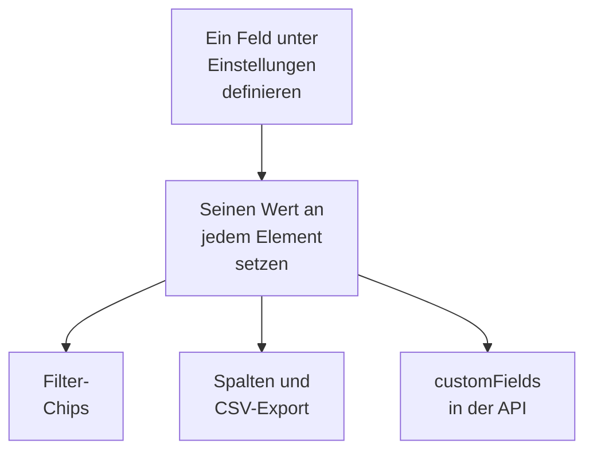

# Benutzerdefinierte Inventarfelder

OneUptime erkennt, was in Ihrer Umgebung steckt. Benutzerdefinierte Felder halten fest, was kein Beobachten verraten kann: die Seriennummer auf dem Aufkleber, das Datum, an dem die Garantie ausläuft, welchem Team etwas gehört, ob es in Betrieb ist oder in einer Schublade mit Ersatzteilen liegt. Definieren Sie die Felder einmal für das Projekt und füllen Sie sie dann an jedem Element aus.

:::cards
- [Wie benutzerdefinierte Felder funktionieren](#wie-benutzerdefinierte-felder-funktionieren): Ein Vokabular an jedem Element, egal aus welcher Quelle.
- [Felder definieren](#felder-definieren): Ein Feld anlegen, seinen Typ wählen, die Optionen eines Dropdowns auflisten.
- [Die Liste filtern](#die-liste-filtern): In zwei Klicks finden, was im nächsten Quartal abläuft.
- [Hinweise und Grenzen](#hinweise-und-grenzen): Umbenennungen, Duplikate, Datumswerte und gelöschte Felder.
:::

## Wie benutzerdefinierte Felder funktionieren

Ein Feld wird einmal für das Projekt definiert, und jedes Element kann einen Wert dafür tragen: die Elemente, die OneUptime erkannt hat, die, die es spiegelt, und die, die Sie von Hand hinzugefügt haben. Ein Feld wird zu einem Filter-Chip über der Liste, zu einer optionalen Spalte und zu einer Spalte des CSV-Exports. Die API liest und schreibt dieselben Werte, unter `customFields` jedes Elements.

> [!NOTE]
> In OneUptime Cloud gehören benutzerdefinierte Felder zum Tarif **Growth** und höher. Darunter lassen sich Felder weder definieren noch auflisten oder ändern: Die API antwortet mit `402 Payment Required`, und die Liste zeigt keine Chips oder Spalten für benutzerdefinierte Felder.

## Felder definieren

:::steps
### Die Seite der benutzerdefinierten Felder öffnen

Gehen Sie zu **Produkte → Ressourcen → Inventar**, öffnen Sie im Seitenmenü **Einstellungen** und dann **Benutzerdefinierte Felder**.

### Ein Feld anlegen

Klicken Sie auf **Benutzerdefiniertes Feld für Inventarelemente erstellen**. Geben Sie ihm einen **Feldname**, optional eine **Feldbeschreibung** und einen **Feldtyp** aus der Tabelle unten.

### Die Optionen eines Dropdowns auflisten

Fügen Sie bei einem Dropdown-Typ seine Optionen unter **Dropdown-Optionen** hinzu. Jede Option kann eine Farbe tragen, die in der Tabellenzelle und im Filter-Chip gleich verwendet wird: Wählen Sie eine der benannten Farben, **Keine Farbe** oder **Benutzerdefinierte Farbe** für einen genauen Farbcode. Ziehen Sie eine Option an ihrem Griff, um ihre Position in der Liste zu ändern.
:::

| Typ | Wofür |
| --- | --- |
| **Text** | Seriennummer, Asset-Tag, Rack-Position, Bestellnummer |
| **Zahl** | Kosten, Höheneinheit im Rack, Anzahl der Ports |
| **Boolescher Wert** | Im Support, im PCI-Geltungsbereich |
| **Dropdown (Einfachauswahl)** | Lebenszyklusstatus, Umgebung, Kritikalität: eine Antwort aus einer festen Liste |
| **Dropdown (Mehrfachauswahl)** | Compliance-Bereiche, Tags: mehrere Antworten aus einer festen Liste |
| **Datum** | Kaufdatum, Garantieablauf, Ende der Lebensdauer |
| **Datum und Uhrzeit** | Zuletzt geprüft am, außer Betrieb genommen am |
| **Langer Text** | Zugangshinweise, Notizen: mehrere Zeilen reiner Text |
| **Formatierter Text (Markdown)** | Notizen mit Formatierung und Links, geschrieben im Markdown-Editor |
| **Datei** | Ein Garantiezertifikat, eine unterschriebene Bestellung, ein Foto des Rack-Etiketts: eine Datei |
| **Mehrere Dateien** | Handbücher, Rechnungen und Fotos: bis zu 10 Dateien |

## Ein durchgespieltes Asset-Vokabular

Ein typisches Hardware-Asset-Register lässt sich direkt auf diese Felder abbilden:

| Feldname | Typ | Beispiel |
| --- | --- | --- |
| `Serial Number` | Text | `FDO24160ABC` |
| `Asset Tag` | Text | `IT-004821` |
| `Purchase Date` | Datum | 2024-03-11 |
| `Warranty Expiry` | Datum | 2027-03-10 |
| `Lifecycle Status` | Dropdown | In Betrieb, Ersatz, In Reparatur, Ausgemustert |
| `Assigned Site` | Dropdown | Rechenzentrum London, Rechenzentrum Frankfurt, Hauptbüro |
| `Owner Team` | Dropdown | Netzwerk, Plattform, Sicherheit |
| `Cost Centre` | Text | `CC-4410` |

Setzen Sie die Werte auf der Seite **Benutzerdefinierte Felder** eines Elements. Jedes Element nimmt sie an, egal aus welcher Quelle, sodass die Switches, die OneUptime erkannt hat, und die Netzwerkgeräte, die es spiegelt, dasselbe Asset-Vokabular tragen wie die Appliances, die Sie von Hand hinzugefügt haben.

## Die Liste filtern

Jedes benutzerdefinierte Feld wird zu einem Filter-Chip über der Liste **Alle Elemente**, und der Chip bietet die Vergleiche an, die zu seinem Typ passen:

| Feldtyp | Vergleiche |
| --- | --- |
| **Text**, **Langer Text**, **Formatierter Text (Markdown)** | ist, ist nicht, enthält, enthält nicht, beginnt mit, endet mit, ist leer, ist nicht leer |
| **Zahl** | ist, ist nicht, ist größer als, ist größer als oder gleich, ist kleiner als, ist kleiner als oder gleich, ist leer, ist nicht leer |
| **Boolescher Wert**, **Dropdown (Einfachauswahl)**, **Dropdown (Mehrfachauswahl)** | ist, ist nicht, ist leer, ist nicht leer |
| **Datum**, **Datum und Uhrzeit** | ist, ist vor, ist nach, ist zwischen, ist leer, ist nicht leer |
| **Datei**, **Mehrere Dateien** | ist |

Ein Chip für **Datei** oder **Mehrere Dateien** fragt nur eines: ob das Feld **Hat Dateien** oder **Keine Dateien** hat.

Chips werden mit UND verknüpft, also ist „Warranty Expiry ist vor 2026-10-01 UND Lifecycle Status ist In Betrieb" eine Ansicht der Liste. Das ist die Frage, für die es ein Asset-Register gibt, und der Grund, die Datumstypen zu verwenden statt eines Datums in einem Textfeld: Ein Textfeld speichert `2026-10-01` bereitwillig und kann dann nicht sagen, was im nächsten Quartal abläuft.

Spalten benutzerdefinierter Felder sind zunächst ausgeblendet: Schalten Sie sie in der Spaltenauswahl ein. Sie lassen sich nicht sortieren, weil die Werte gemeinsam in einer JSON-Spalte liegen, nach der die Liste nicht ordnen kann.

## Hinweise und Grenzen

- Werte werden an jedem Element unter dem Namen des Feldes gespeichert. Ein Feld umzubenennen verschiebt die unter dem alten Namen gespeicherten Werte nicht. Benutzerdefinierte Felder von Vorfällen sind die Ausnahme: Wer eines umbenennt, verschiebt seine Werte mit (siehe [Ein Feld umbenennen](/docs/incidents/settings#ein-feld-umbenennen)).
- Die Optionen eines Dropdowns lassen sich hinzufügen, umbenennen, in eine neue Reihenfolge ziehen und entfernen, nachdem Elemente Werte haben. Eine umbenannte Option ändert sich an jedem Element, das sie hat; eine entfernte Option bleibt an den Elementen, die sie haben, als nicht mehr verfügbare Option angezeigt, es sei denn, Sie wählen für sie eine andere (siehe [Die Optionen eines Dropdowns ändern](/docs/incidents/settings#die-optionen-eines-dropdowns-ändern)).
- Nichts macht einen Wert eindeutig. Zwei Elemente können dieselbe Seriennummer tragen, und nichts hält Sie davon ab.
- Datumswerte werden als ISO-8601-Zeitstempel in UTC gespeichert und in Ihrer eigenen Zeitzone angezeigt.
- Ein Feld zu löschen entfernt es aus der Liste und aus der Filterleiste. Die bereits geschriebenen Werte bleiben an den Elementen.
- Ein Feld vom Typ **Datei** oder **Mehrere Dateien** nimmt Dateien von bis zu 10 MB je Datei, von den Arten, die unter [Dateifelder](/docs/incidents/settings#dateifelder) stehen, hochgeladen im Projekt. Nur wer das Element sehen darf, kann sie herunterladen, und eine Datei wird gelöscht, sobald nichts sie mehr hält.

## Nächste Schritte

:::cards
- [Inventar – Übersicht](/docs/inventory/overview): Woher Elemente kommen und was jede Seite zeigt.
- [Export in eine CMDB](/docs/inventory/cmdb-sync): Die Elemente und ihre benutzerdefinierten Felder in ein anderes System holen.
- [Benutzerdefinierte Felder von Vorfällen](/docs/incidents/settings#benutzerdefinierte-felder): Dieselben Feldtypen an Vorfällen, mit ein paar Extras.
:::
