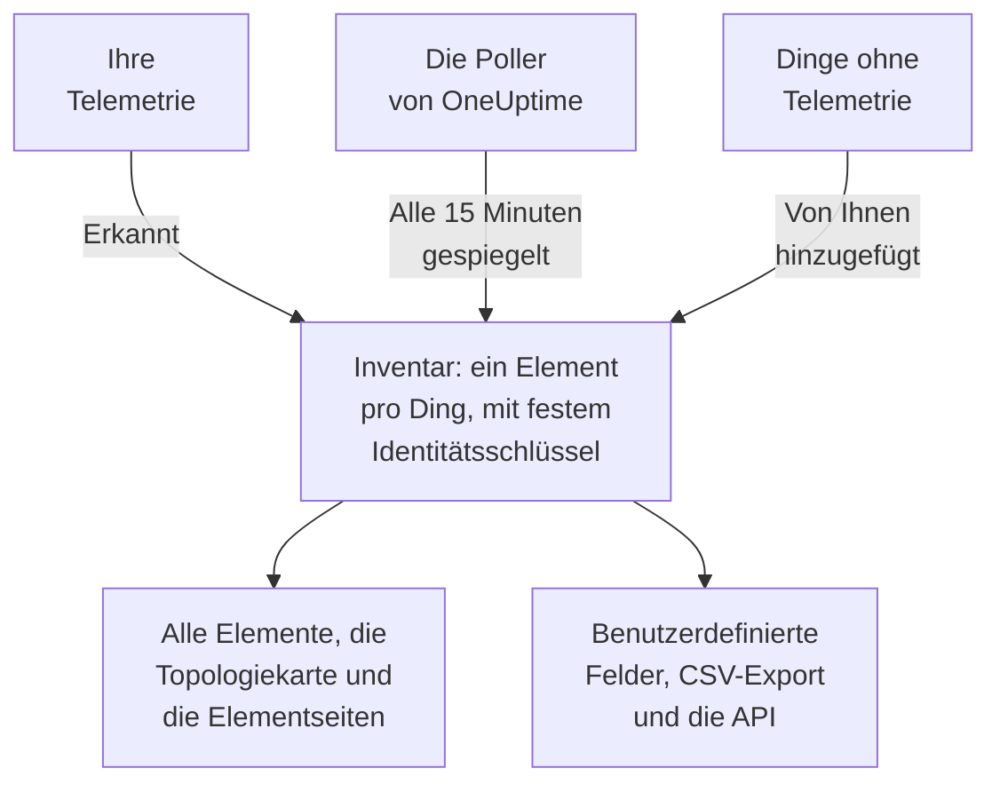

# Inventar – Übersicht

Das Inventar ist eine einzige Liste von allem, was OneUptime über Ihre Umgebung weiß: Dienste, Hosts, Kubernetes-Objekte, virtuelle Maschinen, Netzwerkgeräte, Cloud-Ressourcen, IoT-Geräte, Serverless-Funktionen und die Dinge, die gar keine Telemetrie senden. Das meiste füllt sich von selbst aus dem, was OneUptime ohnehin beobachtet. Sie ergänzen, was das Beobachten nicht verraten kann: wofür etwas da ist, wem es gehört, wann seine Garantie ausläuft. Das [Glossar](/docs/introduction/glossary#was-sie-überwachen) erklärt, was jede Art von Datensatz darin ist.

:::cards
- [Wie Elemente ins Inventar kommen](#wie-elemente-ins-inventar-kommen): Erkannt, gespiegelt oder von Ihnen hinzugefügt.
- [Sich zurechtfinden](#sich-zurechtfinden): Die Seiten des Inventars und die eigenen Seiten jedes Elements.
- [Geräte aus Esper importieren](#geräte-aus-esper-importieren): Jedes Android- und Apple-Gerät, das Ihr Esper-Tenant registriert, stets aktuell.
- [Geräte aus Microsoft Intune importieren](#geräte-aus-microsoft-intune-importieren): Jeder Windows-PC, jeder Mac, jedes iPhone, iPad und Android-Gerät, das Intune verwaltet, stets aktuell.
- [Geräte aus Workspace ONE UEM importieren](#geräte-aus-workspace-one-uem-importieren): Jedes Smartphone, jedes Tablet und jeder Computer, die Workspace ONE verwaltet, stets aktuell.
- [Geräte aus SOTI MobiControl importieren](#geräte-aus-soti-mobicontrol-importieren): Jedes robuste Gerät, jedes Smartphone, jedes Tablet und jeder Computer, die MobiControl verwaltet, stets aktuell.
- [Etwas von Hand hinzufügen](#etwas-von-hand-hinzufügen): Eine Drittanbieter-API, eine externe Datenbank oder eine Appliance.
- [Archivieren statt löschen](#archivieren-statt-löschen): Der Weg, die Liste aufzuräumen, der Bestand hat.
:::

## Wie Elemente ins Inventar kommen

OneUptime beobachtet Ihre Umgebung bereits, um sie zu überwachen, also entsteht der Katalog aus dem, was es sieht, statt aus dem, woran jemand beim Eintippen gedacht hat. Jedes Element hat eine Quelle, und die Quelle entscheidet, wem das Element gehört: ob Sie es bearbeiten können und ob es von selbst verschwinden kann.

| Quelle | In der API | Woher es kommt | Wie lange es bleibt |
| --- | --- | --- | --- |
| **Erkannt** | `discovered` | OpenTelemetry-Ressourcenattribute, gelesen, sobald Telemetrie eintrifft: ein Dienst, ein Host, ein Kubernetes-Objekt oder eine virtuelle Maschine, die Telemetrie senden. | Wird mit jedem Batch erneut registriert. Wird entfernt, sobald es länger als das Zeitfenster seiner Art still war (siehe unten). |
| **Gespiegelt** | `inventory` | Ein Datensatz, den ein OneUptime-Poller pflegt: Netzwerkgeräte, Cloud-Ressourcen, IoT-Geräte, Serverless-Funktionen, RUM-Anwendungen, Docker-Hosts, Podman-Hosts und die Geräte, die eine Verbindung zu einer Geräteverwaltung importiert. Wird alle 15 Minuten kopiert, ein verwaltetes Gerät jedes Mal, wenn seine Verbindung gelesen wird. | So lange wie sein Datensatz. Löschen Sie den Datensatz, verschwindet das Element mit ihm. |
| **Von Ihnen hinzugefügt** | `manual` | Von Ihnen hinzugefügt, für etwas, das OneUptime nicht sehen kann: eine Drittanbieter-API, eine vom Anbieter verwaltete Datenbank, eine Appliance im Rack. | Bis Sie es löschen. Nichts lässt es ablaufen. |

Ein erkanntes oder gespiegeltes Element kann nicht umbenannt werden und keinen anderen Typ bekommen: Seine Quelle würde die Änderung beim nächsten Durchlauf überschreiben. Die Seite **Einstellungen** des Elements sagt stattdessen, wo eine dauerhafte Änderung hingehört. Was Sie jedem Element jederzeit hinzufügen können, egal aus welcher Quelle, sind Werte benutzerdefinierter Felder: siehe [Benutzerdefinierte Inventarfelder](/docs/inventory/custom-fields).

### Wie lange ein stilles Element bleibt

Ein erkanntes Element hat einen Herzschlag. Jedes Mal, wenn Telemetrie für es eintrifft, rückt sein Zeitpunkt der letzten Sichtung vor, und die Spalte **Status** der Liste zeigt, wie aktuell das ist. Das gilt auch für ein verwaltetes Gerät: jedes Mal, wenn es sich bei seiner Geräteverwaltung meldet. Andere gespiegelte Elemente und die von Ihnen hinzugefügten haben keinen Herzschlag, also bleibt ihr Status leer, statt Alarm zu schlagen.

| Status | Bedeutung |
| --- | --- |
| **Live** | In den letzten 30 Minuten gesehen. |
| **Neueste** | Innerhalb des letzten Tages gesehen. |
| **Veraltet** | Seit mehr als einem Tag nicht gesehen. Die Seite **Verstummt** listet diese auf. |

Alle drei Stunden entfernt OneUptime die erkannten Elemente, die länger als das Zeitfenster ihrer Art still waren, auch archivierte, und ihre Werte benutzerdefinierter Felder gehen mit ihnen. Gespiegelte Elemente und die von Ihnen hinzugefügten werden auf diese Weise nie entfernt.

| Art des Elements | Entfernt nach so langer Zeit ohne Telemetrie |
| --- | --- |
| Pods, Deployments, Proxmox-Gäste, OpenStack-Instanzen und virtuelle VMware-Maschinen | 1 Tag |
| Kubernetes-Knoten und -Namespaces, Proxmox-Knoten, OpenStack-Hypervisoren, VMware-Hosts, -Cluster und -Datastores sowie die Datenbanken und entfernten Dienste, die Ihre Traces aufrufen | 7 Tage |
| Dienste, Hosts, Kubernetes-, Proxmox- und Ceph-Cluster, OpenStack-Clouds, Speicher-Arrays, vCenters und Docker-Swarm-Cluster | 30 Tage |

Eine Beziehung, die OneUptime erkannt hat, wird entfernt, sobald sie 30 Tage lang nicht erneut gesehen wurde.

## Sich zurechtfinden

Öffnen Sie **Produkte → Ressourcen → Inventar**. Sein Seitenmenü hat diese Seiten. **Nach Quelle**, **Einstellungen**, **Hilfe** und **Erweitert** sind zunächst eingeklappt: Klicken Sie auf den Titel eines Abschnitts, um ihn zu öffnen.

| Seite | Was Sie dort finden |
| --- | --- |
| **Übersicht** | Wie viele Elemente Sie haben, was sie sind, wie viele verstummt sind und was zuletzt hinzugekommen ist. |
| **Alle Elemente** | Jedes Element. Suchen Sie nach Name, Beschreibung oder Identitätsschlüssel, grenzen Sie die Liste nach Typ, Quelle, Status oder benutzerdefiniertem Feld ein und fügen Sie ein Element von Hand hinzu. |
| **Verwaltete Geräte** | Ihre Verbindungen zu Geräteverwaltungen – Esper, Microsoft Intune, Workspace ONE UEM und SOTI MobiControl – und jedes Gerät, das sie importieren, mit Status, Gruppe, Modell und Betriebssystem. |
| **Topologiekarte** | Wie die Elemente verbunden sind: Dienste, was sie aufrufen, und die Hosts, Pods und Geräte, auf denen sie laufen. |
| **Verstummt** | Die Elemente, von denen seit mehr als einem Tag nichts zu hören war: erkannte Elemente, die keine Telemetrie gesendet haben, und Geräte, die sich nicht mehr bei ihrer Geräteverwaltung melden. |
| **Nach Quelle** | Die Elemente einer Quelle: **Erkannt**, **Gespiegelt** oder **Von Ihnen hinzugefügt**. |
| **Einstellungen → Benutzerdefinierte Felder** | Die Felder, die Ihr Projekt an jedem Element führt. |
| **Hilfe → Dokumentation** | Eine kurze Anleitung zum Inventar mit den Arten von Elementen, die es erkennt. |
| **Erweitert → Archiviert** | Die Elemente, die Sie archiviert haben. Dearchivieren Sie sie hier. |

Öffnen Sie ein Element, und sein eigenes Seitenmenü hat seine **Übersicht** (sein Typ, seine Quelle und sein Status und jedes an ihm beobachtete Attribut), seine **Verbindungen** und seine **Benutzerdefinierte Felder**; seine **Protokolle**, **Traces**, **Metriken**, **Profile** und **Ausnahmen**; und seine **Vorfälle**, **Warnungen** und **Geplante Wartung**. Unter **Erweitert** liegen seine **Einstellungen**, seine **Audit-Protokolle** und **Element löschen**. Die Telemetrieseiten zeigen, was das Element selbst gesendet hat. Die Vorfälle, Warnungen und Wartungsereignisse sind die des Dienstes, Hosts oder Kubernetes-Clusters, für den das Element steht; bei jedem anderen Element sagen diese Seiten, welche Ressource Sie stattdessen ansehen sollten.

### Asset-Details

Ein Host oder ein Netzwerkgerät hat eine Karte **Asset-Details**, die beide auf dieselbe Weise beschreibt: Hostname, IP-Adresse, MAC-Adresse, Seriennummer, Hersteller, Modell, Firmware-Version, Betriebssystem, Betriebssystemversion, Gerätetyp und Standort. Die Karte eines Android-Geräts enthält außerdem seine Sicherheitspatch-Ebene, vom Android-Agenten oder von seiner Geräteverwaltung. Sie sagt auch, ob der Patch **Nicht aktuell** ist, wie die Spalte **Sicherheitspatch-Ebene**, und wie viele Tage alt er ist. Ein Fakt, den nichts gemeldet hat, lautet **Unbekannt**, und die Karte sagt, warum das so ist und wie die unbekannten ausgefüllt werden: ein Gerät, das sie nicht über SNMP meldet, ein noch nicht gelesenes Gerät oder ein Meraki-Gerät, dessen Dashboard sie enthält.

- Die Fakten eines Hosts stammen aus den Ressourcenattributen seiner Telemetrie: seine IP- und MAC-Adressen, Architektur und Betriebssystem von Haus aus, und seine Seriennummer, Marke, Modell und Firmware, sobald Sie sie aufprägen.
- Die Fakten eines Netzwerkgeräts stammen aus seiner SNMP-Abfrage, seiner Rolle und seinem Standort. Was seine Abfrage nicht gelesen hat, stammt aus der Erkennung: dem letzten Scan seiner Adresse, der ARP-Tabelle eines Routers oder der DNS-Abfrage seiner Sonde. Ein Gerät ohne ENTITY-MIB, etwa ein Meraki MX, erhält Marke, Modell und Betriebssystem trotzdem aus seiner Systembeschreibung und seine MAC-Adresse von seinen eigenen Ports. Seine IP-Adresse wird nie als sein Hostname angezeigt.
- Ein Meraki-Gerät übernimmt außerdem, was seine Abfrage leer lässt, aus dem Meraki-Dashboard, darunter seine Seriennummer, sein Modell und seine Firmware, wenn eine [Meraki-Verbindung](/docs/monitor/network-traffic#cisco-meraki-ohne-netflow) seine Organisation liest.

In **Alle Elemente** finden Sie die Android-Geräte, bei denen etwas zu tun ist. Der Filter **Sicherheitspatch-Ebene** listet unter **Nicht aktuell** die Geräte auf, deren Sicherheitspatch-Ebene älter als 90 Tage ist, nach derselben Regel, die auch die Warnung Security Patch Out of Date eines [Host-Monitors](/docs/monitor/host-monitor) anwendet. Der Filter **Agent-Berechtigungen** listet die Geräte auf, auf denen dem [Android-Agenten](/docs/telemetry/android-agent) noch READ_LOGS, READ_DROPBOX_DATA oder der Zugriff auf Nutzungsdaten fehlt. Zu jedem Filter gibt es eine gleichnamige Spalte, ausgeblendet, bis Sie sie einschalten, und sie geht in den CSV-Export ein. Daneben enthält die Spalte **Geräteverwaltungs-ID** die ID, unter der die Geräteverwaltung ein Gerät kennt, etwa die Esper-ID, die `espercli secureadb connect --device` erwartet.

Die Karte zeigt, woher jeder Fakt kam und wann. Die Quelle, die die meisten Fakten teilen, etwa der Collector eines Hosts, die eigene SNMP-Abfrage eines Netzwerkgeräts oder der Erkennungsscan, der es gelesen hat, wird einmal genannt, unter den Fakten. Jede andere Quelle, etwa die ARP-Tabelle eines Routers oder ein am Gerät gespeicherter Wert, wird unter ihrem Fakt genannt. Ein an einem Netzwerkgerät gespeicherter Wert wird nie durch das ersetzt, was die Erkennung liest, und wenn beide sich unterscheiden, zeigt die Karte beide.

Die Karte eines Netzwerkgeräts hat eine Schaltfläche **Aktualisieren** für alle, die Netzwerkgeräte bearbeiten dürfen. Damit wird das Gerät sofort erneut gelesen: Seine Sonde fragt es innerhalb einer Minute ab, und seine Meraki-Verbindung liest die Organisation erneut. Die Karte sagt, wann der neue Lesevorgang eingetroffen ist oder dass die Sonde das Gerät nicht erreichen konnte, und das Element wird vom Gerät kopiert, sobald der Lesevorgang eingetroffen ist.

Dieselben Fakten sind Spalten der Liste **Alle Elemente**, ausgeblendet, bis Sie sie einschalten, und sie gehen in ihren CSV-Export ein. [Export in eine CMDB](/docs/inventory/cmdb-sync#asset-details) listet ihre Schlüssel auf.

### Verbindungen

Die Seite **Verbindungen** eines Elements listet seine Nachbarn in beide Richtungen auf, gruppiert in **Aufrufe**, **Aufgerufen von**, **Läuft auf** und **Zugehörig**. Jede Gruppe zeigt ihre Gesamtzahl (eine Gruppe mit mehr als 100.000 Verbindungen zeigt „100.000+"), und **Mehr anzeigen** blättert durch den Rest, sodass ein ausgelasteter Cluster, Namespace oder Knoten jede Verbindung zeigt statt nur der ersten. Die Seite ist an keinen Zeitraum gebunden: Sie enthält Beziehungen, die von Hand über die API hinzugefügt wurden, und archivierte Nachbarn. Ein Nachbar, der nicht mehr im Inventar ist, wird mit seinem Schlüssel angezeigt.

## Geräte aus Esper importieren

Verbinden Sie einen Esper-Tenant, und jedes Gerät, das er registriert, steht im Inventar: seine Android-Geräte, auch die, deren App nie gestartet wurde, und seine iPhones, iPads und Apple TVs. Jedes Gerät ist ein Host, mit dem, was nur Esper darüber weiß: seine Gruppe, sein Betriebssystem und sein Build, seine Seriennummer und IMEI, sein Akku und Speicher und bei einem Android-Gerät seine Sicherheitspatch-Ebene und seine installierten Apps. Esper sendet nichts von selbst, daher liest OneUptime es nach Zeitplan: die Geräte alle 15 Minuten und die Apps jedes Android-Geräts alle 6 Stunden.

:::steps
### Einen API-Schlüssel in Esper erstellen

Erstellen Sie in der Esper-Konsole einen Schlüssel unter API Key Management. OneUptime liest nur, daher genügt der Schlüssel eines Benutzers, dessen Esper-Rolle Geräte, Gruppen und Apps lesen darf. Ein Schlüssel funktioniert nicht mehr, sobald er ersetzt oder sein Benutzer gelöscht wird.

### Den Tenant verbinden

Gehen Sie zu **Produkte → Ressourcen → Inventar**, dann zu **Verwaltete Geräte**, klicken Sie auf **Geräteverwaltung verbinden**, und wählen Sie **Esper**. Geben Sie den **Tenant** ein, also den Namen vor `.esper.cloud` in der Adresse Ihrer Esper-Konsole (`acme` für `acme.esper.cloud`), und den **API-Schlüssel**. **Weitere Felder** enthält den Namen der Verbindung und wie oft sie gelesen wird.

### Den ersten Lesevorgang prüfen

**Verbinden** testet den Schlüssel, bevor etwas gespeichert wird, und zeigt, wie viele Geräte ein Lesevorgang importieren wird, oder was falsch ist und wie es sich beheben lässt. Der erste Lesevorgang beginnt innerhalb einer Minute, und die Zeile der Verbindung zeigt, wie er verlaufen ist.
:::

| Was Esper meldet | Wo es erscheint |
| --- | --- |
| Modell, Hersteller, Seriennummer, Betriebssystem und seine Version, Build sowie IP- und MAC-Adressen | Die Karte **Asset-Details** des Geräts und die Spalten von **Alle Elemente** |
| Status, letzter Kontakt, Gruppe, Sicherheitspatch-Ebene, IMEI, Akku, Speicher und Esper-Agent | Die Karte **Esper** des Geräts und die Liste **Geräte** unter **Verwaltete Geräte** |
| Apps und ihre Versionen | Die Liste **Installierte Apps** des Geräts |
| Seine Esper-Geräte-ID | Die Spalte **Geräteverwaltungs-ID** von **Alle Elemente** |

### Ein Gerät, nicht zwei

Telemetrie, die eine App oder der Android-Agent von einem Gerät sendet, landet beim selben Element wie das Gerät, das Esper importiert, wenn sie das Gerät so benennt wie Esper. Setzen Sie diese Ressourcenattribute aus der verwalteten Konfiguration, die Esper auf jedem Gerät ausfüllt:

| Ressourcenattribut | Wert der verwalteten Konfiguration | Was es ist |
| --- | --- | --- |
| `host.name` | `${esper.deviceName}` | Der Name des Geräts in Esper, etwa `ESP-ID-AAAAW`. Erforderlich. |
| `host.serial_number` | `${esper.serialNumber}` | Die Seriennummer des Geräts. Optional. |

OneUptime findet das Element eines Geräts über seinen Namen in Esper, dann über seine Seriennummer, und legt nur dann eines an, wenn keines passt. Der Android-Agent setzt beide aus seinen Einstellungen `device_name` und `device_serial`, und [Einrichtung für Android](/docs/rum/android-setup#die-flotte-aus-esper-importieren) zeigt die verwaltete Konfiguration einer App.

### Wenn ein Gerät verstummt oder Esper verlässt

Ein Android-Gerät, das sich 30 Minuten lang nicht bei Esper gemeldet hat, ist **Offline** und zeigt, wie lange sein letzter Kontakt her ist; ein iPhone, iPad oder Apple TV, das sich meldet, wenn der Push-Dienst von Apple es weckt, oft Stunden auseinander, ist nach einem Tag **Offline**. Der **Status** seines Elements folgt seinem letzten Kontakt oder seiner Telemetrie, wenn diese neuer ist, sodass ein Gerät, das einen Tag lang still war, auf der Seite **Verstummt** steht.

Ein aus Esper entferntes Gerät wird als **Entfernt** markiert, und sein Element wird archiviert: Es verschwindet aus der Liste und wartet unter **Erweitert → Archiviert**. Ein Gerät, das zu Esper zurückkehrt, kehrt auch in die Liste zurück. 30 Tage, nachdem es Esper verlassen hat, wird das Gerät gelöscht und mit ihm sein Element, es sei denn, Telemetrie oder Sie haben dem Element etwas hinzugefügt.

### Eine Warnung erhalten, wenn sich ein Gerät nicht mehr meldet

Klicken Sie unter **Verwaltete Geräte** in der Zeile der Verbindung auf **Warnungen einrichten**, und erstellen Sie **Esper Android Device Stopped Checking In** und **Esper Apple Device Stopped Checking In**. Der erste Monitor öffnet für jedes Android-Gerät, das sich seit mehr als einer Stunde nicht bei Esper gemeldet hat, eine eigene Warnung, der zweite für jedes Apple-Gerät nach mehr als einem Tag, jede nach dem Gerät benannt und behoben, sobald sich das Gerät wieder meldet.

Jeder Lesevorgang der Verbindung hält als Metrik `oneuptime.managed_device.check_in.age` fest, vor wie vielen Minuten sich jedes Gerät zuletzt gemeldet hat, und der Monitor prüft alle 5 Minuten den neuesten Wert jedes Geräts. Ein Gerät, auf dem auch der Android-Agent läuft, bleibt **Host Stopped Reporting** überlassen, sodass es nie doppelt warnt, und die Warnung eines aus Esper entfernten Geräts wird behoben. Ein fehlgeschlagener Lesevorgang hält nichts über die Geräte fest, sodass keine ihrer Warnungen geöffnet oder behoben wird, bis wieder ein Lesevorgang gelingt. Für eine Flotte, die nachts ausgeschaltet wird, erhöhen Sie den Schwellenwert des Monitors.

Erstellen Sie auch **Esper Security Patch Out of Date**, dann öffnet jedes Android-Gerät, dessen Sicherheitspatch-Ebene laut Esper älter als 90 Tage ist, eine eigene Warnung, die behoben wird, sobald das Gerät aktualisiert ist. Jeder Lesevorgang hält als Metrik `oneuptime.managed_device.security_patch.age` fest, wie viele Tage alt die Patch-Ebene jedes Android-Geräts ist. Ein Gerät, auf dem der Android-Agent läuft, bleibt **Security Patch Out of Date** seines Hosts überlassen, sodass es nie doppelt warnt.

Erstellen Sie auch **Esper Low Battery** und **Esper Storage Nearly Full**: Jedes Gerät, dessen Akku beim letzten Lesen durch Esper unter 20 % lag, öffnet eine eigene Warnung, ebenso jedes Gerät, dessen Speicher zu mehr als 90 % belegt ist, und jede wird behoben, sobald das Gerät geladen ist oder wieder Platz hat. Jeder Lesevorgang hält beides als die Metriken `oneuptime.managed_device.battery.level` und `oneuptime.managed_device.storage.used` fest. Ein Gerät, auf dem der Android-Agent läuft, bleibt **Low Battery** und **Storage Nearly Full** seines Hosts überlassen, die bei denselben Werten warnen, sodass es nie doppelt warnt.

Die Warnungen eines Geräts stehen auch bei seinem Element: Seine Karte **Esper** listet die offenen Vorfälle und Warnungen zu ihm auf, jede mit einem Link zu ihrer Seite, und bei einem Gerät, das der Android-Agent nicht meldet, listen die Seiten **Warnungen** und **Vorfälle** jede auf, die die Monitore seiner Verbindung zu ihm ausgelöst haben.

### Eine Warnung erhalten, wenn die Verbindung nicht mehr gelesen wird

Erstellen Sie **Esper Connection Stopped Reading**, dann öffnet die Verbindung eine eigene Warnung, sobald so lange kein Lesevorgang gelungen ist, wie ihre Zeile wartet, bevor ihr **Status** auf **Veraltet** steht: drei ihrer Leseintervalle und zehn Minuten mehr, aber nie weniger als eine halbe Stunde, also 55 Minuten beim Standardintervall von 15. Ihr erster Debugging-Schritt listet die letzten Werte der Verbindung auf, jeden mit dem Fehler, an dem sein Lesevorgang scheiterte, und der erste Lesevorgang, der gelingt, behebt sie. Jeder Lesevorgang und jeder, der für die Verbindung fällig wird, hält als Metrik `oneuptime.managed_device.connection.read.age` fest, wie viele Minuten der letzte gelungene her ist. Der Monitor wartet so lange, wie es das Leseintervall der Verbindung beim Erstellen vorgibt. Schalten Sie die Verbindung aus, wird ihre offene Warnung behoben, da bei einer ausgeschalteten Verbindung nichts überfällig ist, und die Warnungen ihrer Geräte bleiben, wie sie sind, bis sie wieder liest. Löschen Sie die Verbindung, wird behoben, was die Monitore, die nur sie lesen, offen hatten, und ihre Überwachung wird ausgeschaltet.

## Geräte aus Microsoft Intune importieren

Verbinden Sie einen Microsoft Intune-Tenant, und jedes Gerät, das Intune verwaltet, steht im Inventar: seine Windows-PCs, Macs, iPhones, iPads, Android-Geräte und Linux-Rechner. Jedes Gerät ist ein Host, mit dem, was Intune darüber weiß: seine Kategorie, sein Betriebssystem und dessen Version, seine Seriennummer und IMEI, seine Konformität, sein Besitzer und seine Registrierung, sein Speicher und die Apps, die Intune darauf erkannt hat. Intune sendet nichts von selbst, daher liest OneUptime es nach Zeitplan: die Geräte alle 15 Minuten und die Apps jedes Geräts alle 6 Stunden.

:::steps
### Eine App in Microsoft Entra registrieren

Öffnen Sie im Microsoft Entra Admin Center `App registrations` und klicken Sie auf `New registration`. Geben Sie ihr einen Namen, behalten Sie `Accounts in this organizational directory only` bei und registrieren Sie sie. Ihre Seite `Overview` zeigt die beiden IDs, nach denen OneUptime fragt: die `Application (client) ID` und die `Directory (tenant) ID`.

### Ihr das Lesen der Intune-Geräte erlauben

Klicken Sie unter `API permissions` auf `Add a permission`, dann auf `Microsoft Graph`, dann auf `Application permissions`, und fügen Sie `DeviceManagementManagedDevices.Read.All` hinzu. Klicken Sie dann auf `Grant admin consent`, was nur ein Administrator des Tenants kann. Diese eine Berechtigung ist alles, was OneUptime braucht: Sie listet die Geräte und die Apps, die Intune darauf erkannt hat, und kann nichts ändern.

### Ein Client-Secret erstellen

Klicken Sie unter `Certificates & secrets` auf `New client secret`, und kopieren Sie seinen `Value`, nicht seine `Secret ID`: Microsoft zeigt den Wert nur einmal. Ein Secret funktioniert nicht mehr, sobald es abläuft. Erstellen Sie also vorher ein neues und geben Sie es ein, wenn Sie die Verbindung bearbeiten.

### Den Intune-Tenant verbinden

Gehen Sie zu **Produkte → Ressourcen → Inventar**, dann zu **Verwaltete Geräte**, klicken Sie auf **Geräteverwaltung verbinden**, und wählen Sie **Microsoft Intune**. Geben Sie die **Tenant-ID**, die **Anwendungs-ID (Client)** und das **Client-Secret** ein. Ist der Tenant in einer Cloud der US-Regierung, wählen Sie sie als **Cloud** unter **Weitere Felder**. **Verbinden** testet die App-Registrierung, bevor etwas gespeichert wird: Es sagt, wie viele Geräte ein Lesevorgang importieren wird, oder was falsch ist und wie Sie es beheben.
:::

Ein Gerät meldet sich etwa alle acht Stunden bei Intune, und sein letzter Kontakt ist der Zeitpunkt, an dem es das zuletzt tat: Ein Gerät, das sich einen Tag lang nicht gemeldet hat, ist **Offline**. Seine Apps sind die, die Intune darauf erkannt hat, und Microsoft Graph listet sie nur in seiner Beta-Version: bei einem privaten Gerät die Apps, die Intune verwaltet. Die Gruppen von Intune sind Microsoft Entra-Gruppen, die diese Berechtigung nicht liest, daher ist die Gruppe eines Geräts seine Gerätekategorie. Nichts über den Benutzer eines Geräts wird gelesen.

Intune benennt ein Gerät so, wie sein Besitzer es genannt hat, daher können zwei Geräte denselben Namen tragen: Jedes iPhone, das niemand umbenannt hat, heißt `iPhone`. Ein Name, den zwei Geräte einer Verbindung teilen, gehört im Inventar keinem von beiden: Jedes wird stattdessen nach seiner Seriennummer benannt und bekommt seinen Namen zurück, sobald kein anderes Gerät ihn mehr trägt.

Um eine Warnung zu erhalten, wenn sich ein Gerät nicht mehr meldet, klicken Sie in der Zeile der Verbindung auf **Warnungen einrichten** und erstellen Sie **Intune Device Stopped Checking In**. Der Monitor öffnet für jedes Gerät, das sich seit mehr als einem Tag nicht bei Intune gemeldet hat, eine eigene Warnung, nach dem Gerät benannt. Ein Laptop, der übers Wochenende aus ist, sieht genauso aus: Erhöhen Sie also den Schwellenwert des Monitors, wenn ein Tag für Ihre Geräte zu früh ist. **Intune Security Patch Out of Date** warnt für jedes Android-Gerät, dessen Sicherheitspatch-Ebene älter als 90 Tage ist, wie die Vorlage von Esper. **Intune Low Battery**, **Intune Storage Nearly Full** und **Intune Connection Stopped Reading** warnen wie die Vorlagen von Esper. Intune kennt den Akku nur von einem iPhone oder einem iPad, so wie bei seiner letzten Meldung, daher warnt **Intune Low Battery** vor diesen.

## Geräte aus Workspace ONE UEM importieren

Verbinden Sie einen Workspace ONE UEM-Server, und jedes Gerät, das er verwaltet, steht im Inventar: seine iPhones, iPads, Macs, Windows-PCs, Android-Geräte und Linux-Rechner. Jedes Gerät ist ein Host, mit dem, was Workspace ONE darüber weiß: seine Organisationsgruppe, sein Betriebssystem und dessen Version, sein Modell, seine Seriennummer und IMEI, seine Konformität, Registrierung und Besitzart, sein Akku, Speicherplatz und Arbeitsspeicher und seine Apps. Workspace ONE sendet nichts von selbst, daher liest OneUptime es nach Zeitplan: die Geräte alle 15 Minuten und die Apps jedes Geräts alle 6 Stunden.

:::steps
### Eine Rolle mit reinem Lesezugriff erstellen

Gehen Sie in der Workspace ONE UEM-Konsole zu `Accounts`, dann zu `Administrators`, dann zu `Roles`, und klicken Sie auf `Add Role`. Wählen Sie unter `API` und dann `REST` für `Devices` und für `Apps` jeweils `Read` aus, sonst nichts. Diese Rolle ist alles, was OneUptime braucht: Sie listet die Geräte und ihre Apps und kann nichts ändern.

### Einen OAuth-Client erstellen

Gehen Sie zu `Groups & Settings`, dann zu `Configurations`, dann zu `OAuth Client Management`, und klicken Sie auf `Add`. Wählen Sie die Organisationsgruppe, deren Geräte OneUptime liest, und geben Sie dem Client die Rolle, die Sie erstellt haben. Kopieren Sie seine `Client ID` und sein `Client Secret`: Workspace ONE zeigt das Secret nur einmal.

### Den Server verbinden

Gehen Sie zu **Produkte → Ressourcen → Inventar**, dann zu **Verwaltete Geräte**, klicken Sie auf **Geräteverwaltung verbinden**, und wählen Sie **Workspace ONE UEM**. Geben Sie die **REST-API-URL** ein, die Sie unter `Groups & Settings`, `All Settings`, `System`, `Advanced`, `API`, `REST API` finden, etwa `https://as1234.awmdm.com`. Behalten Sie **OAuth-Client** unter **Anmelden mit** bei, geben Sie die **Client-ID** und das **Client-Secret** ein, und wählen Sie die **Region** des Token-Dienstes Ihres Rechenzentrums. **Verbinden** testet den Client, bevor etwas gespeichert wird: Es sagt, wie viele Geräte ein Lesevorgang importieren wird, oder was falsch ist und wie Sie es beheben.
:::

Ein Workspace ONE-Server im eigenen Rechenzentrum hat keinen Token-Dienst: Wählen Sie **Administratorkonto** unter **Anmelden mit**, und geben Sie **Benutzername** und **Passwort** eines Administrators mit der Rolle mit reinem Lesezugriff ein, dazu den **REST-API-Schlüssel** aus denselben Einstellungen der REST API, in denen die Basic-Authentifizierung erlaubt sein muss. OneUptime Cloud liest nur Server im öffentlichen Internet, daher liest ein selbst gehostetes OneUptime einen Server in einem privaten Netzwerk.

Ein Gerät meldet sich nach seinem eigenen Zeitplan bei Workspace ONE, ein iPhone oft Stunden auseinander, daher ist ein Gerät, das sich einen Tag lang nicht gemeldet hat, **Offline**. Ein Gerät, das nicht mehr registriert ist, bleibt außen vor. Ein Gerät wird nach dem Namen benannt, den es meldet, nicht nach seinem Anzeigenamen, den Workspace ONE aus dem Namen seines Benutzers bildet, und nichts über den Benutzer eines Geräts wird gelesen. Jede Anfrage zählt gegen das tägliche API-Kontingent des Tenants, daher liest ein Lesevorgang die Apps von höchstens 25 Geräten und der nächste Lesevorgang die der nächsten.

Telemetrie, die eine App oder der Android-Agent von einem Gerät sendet, landet über die Seriennummer des Geräts beim selben Element: Setzen Sie die Einstellung `device_serial` des Android-Agenten in seiner verwalteten Konfiguration auf den Nachschlagewert `{DeviceSerialNumber}`.

Um eine Warnung zu erhalten, wenn sich ein Gerät nicht mehr meldet, klicken Sie in der Zeile der Verbindung auf **Warnungen einrichten** und erstellen Sie **Workspace ONE Device Stopped Checking In**. Der Monitor öffnet für jedes Gerät, das sich seit mehr als einem Tag nicht bei Workspace ONE gemeldet hat, eine eigene Warnung, nach dem Gerät benannt. **Workspace ONE Security Patch Out of Date** warnt für jedes Android-Gerät, dessen Sicherheitspatch-Ebene älter als 90 Tage ist, wie die Vorlage von Esper. **Workspace ONE Low Battery**, **Workspace ONE Storage Nearly Full** und **Workspace ONE Connection Stopped Reading** warnen wie die Vorlagen von Esper. Ein Gerät, das laut Workspace ONE am Strom hängt, an seinem Ladegerät oder in seinem Dock, bleibt bei **Workspace ONE Low Battery** außen vor, und eine offene Warnung dazu wird behoben.

## Geräte aus SOTI MobiControl importieren

Verbinden Sie einen SOTI MobiControl-Server, in der Cloud von SOTI oder im eigenen Rechenzentrum, und jedes Gerät, das er verwaltet, steht im Inventar: seine robusten Android-Geräte, Smartphones, Tablets und Scanner, seine iPhones, iPads und Macs und seine Windows- und Linux-Computer. Jedes Gerät ist ein Host, mit dem, was MobiControl darüber weiß: seine Gerätegruppe, sein Betriebssystem und dessen Version, sein Modell, seine Seriennummer und IMEI, seine Konformität, sein Agent, sein Akku, Speicherplatz und Arbeitsspeicher und seine installierten Anwendungen. MobiControl sendet nichts von selbst, daher liest OneUptime es nach Zeitplan: die Geräte alle 15 Minuten und die Apps jedes Geräts alle 6 Stunden.

:::steps
### Einen MobiControl-Benutzer mit reinem Lesezugriff erstellen

Fügen Sie in der MobiControl-Webkonsole einen eigenen Benutzer von MobiControl hinzu, keinen Benutzer von SOTI Identity. Erlauben Sie in seinen allgemeinen Berechtigungen `Web Console Access` und `View Installed Applications` und sonst nichts, und geben Sie ihm `View Groups` für die Gerätegruppen, die OneUptime liest. Dieser Benutzer ist alles, was OneUptime braucht: Er sieht die Geräte und ihre Apps und kann nichts ändern.

### Einen API-Client erstellen

Gehen Sie in der Webkonsole zu `Global Settings`, dann zu `Services`, dann zu `API Client`, und fügen Sie einen hinzu. Kopieren Sie seine `Client ID` und sein `Client Secret`: MobiControl zeigt das Secret nur einmal. Bei einem Server vor MobiControl 2024.0 erstellen Sie ihn auf dem Server selbst mit `MCAdmin.exe APIClientAdd -n:OneUptime`.

### Den MobiControl-Server verbinden

Gehen Sie zu **Produkte → Ressourcen → Inventar**, dann zu **Verwaltete Geräte**, klicken Sie auf **Geräteverwaltung verbinden**, und wählen Sie **SOTI MobiControl**. Geben Sie den **Server** ein, also die Adresse Ihrer Webkonsole ohne `/MobiControl`, etwa `https://acme.mobicontrolcloud.com`, dazu die **Client-ID** und das **Client-Secret** des API-Clients und dann **Benutzername** und **Passwort** des Benutzers. **Verbinden** testet die Anmeldung, bevor etwas gespeichert wird: Es sagt, wie viele Geräte ein Lesevorgang importieren wird, oder was falsch ist und wie Sie es beheben.
:::

Ein MobiControl-Agent hält eine dauerhafte Verbindung zu seinem Server, daher ist ein Gerät, dessen Agent verbunden ist, online, und eines, dessen Agent seit 30 Minuten nicht verbunden war, **Offline**. Ein iPhone, iPad oder Mac meldet sich über den Push-Dienst von Apple, oft Stunden auseinander, und ist nach einem Tag **Offline**. Ein Gerät, das ein Administrator deaktiviert hat, ist **Deaktiviert**, und eines, dessen Registrierung gerade aufgehoben wird, bleibt außen vor. OneUptime Cloud liest nur Server im öffentlichen Internet, daher liest ein selbst gehostetes OneUptime einen Server in einem privaten Netzwerk. Nichts über den Benutzer eines Geräts wird gelesen.

Telemetrie, die eine App oder der Android-Agent von einem Gerät sendet, landet über die Seriennummer des Geräts beim selben Element: Setzen Sie die Einstellung `device_serial` des Android-Agenten in seiner verwalteten Konfiguration auf das Makro `%SERIALNUM%`.

Um eine Warnung zu erhalten, wenn sich ein Gerät nicht mehr meldet, klicken Sie in der Zeile der Verbindung auf **Warnungen einrichten** und erstellen Sie **SOTI Device Stopped Checking In** und **SOTI Apple Device Stopped Checking In**. Der erste Monitor öffnet für jedes Android-, Windows- oder Linux-Gerät, dessen Agent seit mehr als einer Stunde nicht verbunden war, eine eigene Warnung, der zweite für jedes Apple-Gerät, das sich seit mehr als einem Tag nicht gemeldet hat, jede nach dem Gerät benannt. **SOTI Security Patch Out of Date** warnt für jedes Android-Gerät, dessen Sicherheitspatch-Ebene älter als 90 Tage ist, wie die Vorlage von Esper. **SOTI Low Battery**, **SOTI Storage Nearly Full** und **SOTI Connection Stopped Reading** warnen wie die Vorlagen von Esper. Ein Android-Gerät, das laut MobiControl lädt, bleibt bei **SOTI Low Battery** außen vor, und eine offene Warnung dazu wird behoben.

## Etwas von Hand hinzufügen

Fügen Sie ein Element für etwas hinzu, das OneUptime nie von selbst sehen wird, damit eine Abhängigkeit an einem realen Ort endet und das Ding Ihre benutzerdefinierten Felder tragen kann.

:::steps
### Alle Elemente öffnen

Gehen Sie zu **Produkte → Ressourcen → Inventar** und dann zu **Alle Elemente**.

### Das Element hinzufügen

Klicken Sie auf **Element hinzufügen**. Wählen Sie seinen **Typ**, geben Sie ihm einen **Name** und optional eine **Beschreibung**. Name und Typ zusammen sind die Identität des Elements, daher können zwei Elemente desselben Typs nicht denselben Namen tragen.

### Seine benutzerdefinierten Felder ausfüllen

Öffnen Sie das neue Element. Seine Quelle lautet **Von Ihnen hinzugefügt**, und seine Seite **Benutzerdefinierte Felder** nimmt die Werte auf, die Ihr Projekt erfasst.
:::

Drei Typen können Sie von Hand hinzufügen:

- `external.service` (**Externer Dienst**): eine Drittanbieter-API oder eine Software-as-a-Service-Abhängigkeit.
- `external.database` (**Externe Datenbank**): eine Datenbank, die kein Server ist, den OneUptime abbilden kann. Ein Datenbankserver, selbst betrieben oder verwaltet, von PostgreSQL bis Snowflake, gehört stattdessen unter **Datenbanken → Datenbank erstellen** ([Datenbanken](/docs/telemetry/databases)): Dieser Datensatz verknüpft sich mit den Traces, Containern und Engine-Metriken, die dieselbe Adresse nennen, was ein Inventarelement nie tut, und wer denselben Server auf beiden Wegen anlegt, hat zwei unverbundene Datensätze.
- `appliance` (**Appliance**): Hardware oder Software ohne Agent.

Die Einschränkung verhindert Duplikate. Ein von Hand angelegtes Element eines Typs, den OneUptime beobachten kann, etwa ein Host, wäre nach dem eingetippten Namen verschlüsselt, während das erkannte Element derselben Maschine nach den Attributen verschlüsselt ist, die sie meldet. Die beiden würden nie zusammenfinden, also stünde derselbe Host für immer zweimal in Ihrer Liste.

## Archivieren statt löschen

Archivieren nimmt ein Element aus der Liste, während es seine Identität, seinen Verlauf und seine Werte benutzerdefinierter Felder behält. Es sagt: Das habe ich gesehen, und ich will es nicht in meiner Liste. Ein archiviertes Element sammelt weiter Telemetrie.

| Quelle | Archivieren | Löschen |
| --- | --- | --- |
| **Erkannt** | Bleibt archiviert. | Kommt mit dem nächsten Batch seiner Telemetrie zurück. |
| **Gespiegelt** | Bleibt archiviert. | Kommt mit der nächsten Kopie zurück. Löschen Sie stattdessen den Originaldatensatz. |
| **Von Ihnen hinzugefügt** | Bleibt archiviert. | Endgültig weg. |

Um Elemente zu archivieren, wählen Sie sie in **Alle Elemente** aus und archivieren Sie sie in einem Schritt, oder öffnen Sie ein Element und verwenden Sie die Karte **Archivieren** auf seiner Seite **Einstellungen**. Archivierte Elemente liegen unter **Inventar → Erweitert → Archiviert**, wo Sie sie auswählen und dearchivieren können.

> [!NOTE]
> Wenn ein gespiegeltes Gerät aus seinem zugehörigen Datensatz entfernt wird, entfernt OneUptime auch sein Element, es sei denn, das Element trägt Werte benutzerdefinierter Felder, die Sie eingegeben haben. Diese Werte sind die einzige Kopie, und es gibt kein Rückgängig, also wird das Element archiviert statt gelöscht. Sie finden es unter **Erweitert → Archiviert**, mit allem, was Sie eingetippt haben.

## Beziehungen und Topologie

OneUptime verknüpft Elemente mit gerichteten Beziehungen, sobald es sie beobachtet. **Inventar → Topologiekarte** zeichnet sie, und die Seite **Verbindungen** eines Elements listet seine eigenen auf. Siehe [Topologie](/docs/telemetry/topology).

| Beziehung | Zum Beispiel |
| --- | --- |
| `runs-on` | Ein Pod läuft auf einem Knoten; eine virtuelle Maschine läuft auf ihrem Host. |
| `member-of` | Ein Pod, Knoten oder Namespace ist Mitglied eines Clusters. |
| `hosted-on` | Ein Dienst wird auf einem Host gehostet. |
| `part-of` | Ein Pod ist Teil seines Deployments. |
| `depends-on` | Ein Dienst ruft einen anderen Dienst auf, erkannt an den Spans, die zwischen ihnen wechseln. |

## Nächste Schritte

:::cards
- [Benutzerdefinierte Inventarfelder](/docs/inventory/custom-fields): Seriennummern, Garantiedaten, Eigentümer und Lebenszyklusstatus erfassen.
- [Export in eine CMDB](/docs/inventory/cmdb-sync): Den Katalog in Ihr eigenes führendes System holen.
- [Datenbanken](/docs/telemetry/databases): Die Datenbankserver überwachen, die Ihre Dienste nutzen.
:::
