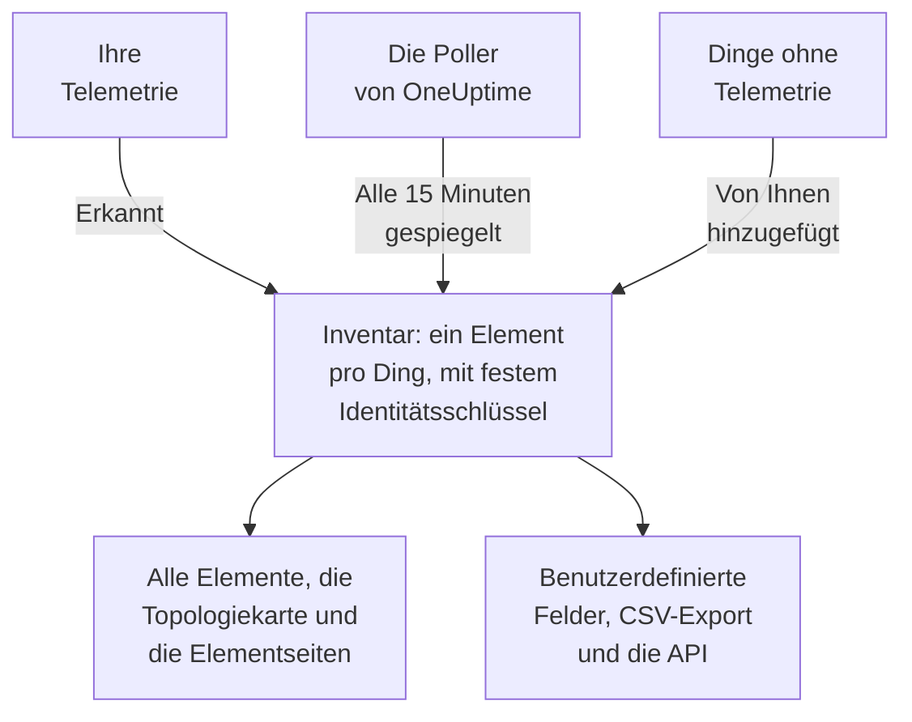

# Inventar – Übersicht

Das Inventar ist eine einzige Liste von allem, was OneUptime über Ihre Umgebung weiß: Dienste, Hosts, Kubernetes-Objekte, virtuelle Maschinen, Netzwerkgeräte, Cloud-Ressourcen, IoT-Geräte, Serverless-Funktionen und die Dinge, die gar keine Telemetrie senden. Das meiste füllt sich von selbst aus dem, was OneUptime ohnehin beobachtet. Sie ergänzen, was das Beobachten nicht verraten kann: wofür etwas da ist, wem es gehört, wann seine Garantie ausläuft.

:::cards
- [Wie Elemente ins Inventar kommen](#wie-elemente-ins-inventar-kommen): Erkannt, gespiegelt oder von Ihnen hinzugefügt.
- [Sich zurechtfinden](#sich-zurechtfinden): Die Seiten des Inventars und die eigenen Seiten jedes Elements.
- [Etwas von Hand hinzufügen](#etwas-von-hand-hinzufügen): Eine Drittanbieter-API, eine externe Datenbank oder eine Appliance.
- [Archivieren statt löschen](#archivieren-statt-löschen): Der Weg, die Liste aufzuräumen, der Bestand hat.
:::

## Wie Elemente ins Inventar kommen

OneUptime beobachtet Ihre Umgebung bereits, um sie zu überwachen, also entsteht der Katalog aus dem, was es sieht, statt aus dem, woran jemand beim Eintippen gedacht hat. Jedes Element hat eine Quelle, und die Quelle entscheidet, wem das Element gehört: ob Sie es bearbeiten können und ob es von selbst verschwinden kann.

| Quelle | In der API | Woher es kommt | Wie lange es bleibt |
| --- | --- | --- | --- |
| **Erkannt** | `discovered` | OpenTelemetry-Ressourcenattribute, gelesen, sobald Telemetrie eintrifft: ein Dienst, ein Host, ein Kubernetes-Objekt oder eine virtuelle Maschine, die Telemetrie senden. | Wird mit jedem Batch erneut registriert. Wird entfernt, sobald es länger als das Zeitfenster seiner Art still war (siehe unten). |
| **Gespiegelt** | `inventory` | Ein Datensatz, den ein OneUptime-Poller pflegt: Netzwerkgeräte, Cloud-Ressourcen, IoT-Geräte, Serverless-Funktionen, RUM-Anwendungen, Docker-Hosts und Podman-Hosts. Wird alle 15 Minuten kopiert. | So lange wie sein Datensatz. Löschen Sie den Datensatz, verschwindet das Element mit ihm. |
| **Von Ihnen hinzugefügt** | `manual` | Von Ihnen hinzugefügt, für etwas, das OneUptime nicht sehen kann: eine Drittanbieter-API, eine vom Anbieter verwaltete Datenbank, eine Appliance im Rack. | Bis Sie es löschen. Nichts lässt es ablaufen. |

Ein erkanntes oder gespiegeltes Element kann nicht umbenannt werden und keinen anderen Typ bekommen: Seine Quelle würde die Änderung beim nächsten Durchlauf überschreiben. Die Seite **Einstellungen** des Elements sagt stattdessen, wo eine dauerhafte Änderung hingehört. Was Sie jedem Element jederzeit hinzufügen können, egal aus welcher Quelle, sind Werte benutzerdefinierter Felder: siehe [Benutzerdefinierte Inventarfelder](/docs/inventory/custom-fields).

### Wie lange ein stilles Element bleibt

Ein erkanntes Element hat einen Herzschlag. Jedes Mal, wenn Telemetrie für es eintrifft, rückt sein Zeitpunkt der letzten Sichtung vor, und die Spalte **Status** der Liste zeigt, wie aktuell das ist. Gespiegelte Elemente und die von Ihnen hinzugefügten haben keinen Herzschlag, also bleibt ihr Status leer, statt Alarm zu schlagen.

| Status | Bedeutung |
| --- | --- |
| **Live** | In den letzten 30 Minuten gesehen. |
| **Neueste** | Innerhalb des letzten Tages gesehen. |
| **Veraltet** | Seit mehr als einem Tag nicht gesehen. Die Seite **Verstummt** listet diese auf. |

Alle drei Stunden entfernt OneUptime die erkannten Elemente, die länger als das Zeitfenster ihrer Art still waren, auch archivierte, und ihre Werte benutzerdefinierter Felder gehen mit ihnen. Gespiegelte Elemente und die von Ihnen hinzugefügten werden auf diese Weise nie entfernt.

| Art des Elements | Entfernt nach so langer Zeit ohne Telemetrie |
| --- | --- |
| Pods, Deployments, Proxmox-Gäste und virtuelle VMware-Maschinen | 1 Tag |
| Kubernetes-Knoten und -Namespaces, Proxmox-Knoten, VMware-Hosts, -Cluster und -Datastores sowie die Datenbanken und entfernten Dienste, die Ihre Traces aufrufen | 7 Tage |
| Dienste, Hosts, Kubernetes-, Proxmox- und Ceph-Cluster, Speicher-Arrays, vCenters und Docker-Swarm-Cluster | 30 Tage |

Eine Beziehung, die OneUptime erkannt hat, wird entfernt, sobald sie 30 Tage lang nicht erneut gesehen wurde.

## Sich zurechtfinden

Öffnen Sie **Produkte → Ressourcen → Inventar**. Sein Seitenmenü hat diese Seiten. **Nach Quelle**, **Einstellungen**, **Hilfe** und **Erweitert** sind zunächst eingeklappt: Klicken Sie auf den Titel eines Abschnitts, um ihn zu öffnen.

| Seite | Was Sie dort finden |
| --- | --- |
| **Übersicht** | Wie viele Elemente Sie haben, was sie sind, wie viele verstummt sind und was zuletzt hinzugekommen ist. |
| **Alle Elemente** | Jedes Element. Suchen Sie nach Name, Beschreibung oder Identitätsschlüssel, grenzen Sie die Liste nach Typ, Quelle, Status oder benutzerdefiniertem Feld ein und fügen Sie ein Element von Hand hinzu. |
| **Topologiekarte** | Wie die Elemente verbunden sind: Dienste, was sie aufrufen, und die Hosts, Pods und Geräte, auf denen sie laufen. |
| **Verstummt** | Die erkannten Elemente, die seit mehr als einem Tag keine Telemetrie gesendet haben. |
| **Nach Quelle** | Die Elemente einer Quelle: **Erkannt**, **Gespiegelt** oder **Von Ihnen hinzugefügt**. |
| **Einstellungen → Benutzerdefinierte Felder** | Die Felder, die Ihr Projekt an jedem Element führt. |
| **Hilfe → Dokumentation** | Eine kurze Anleitung zum Inventar mit den Arten von Elementen, die es erkennt. |
| **Erweitert → Archiviert** | Die Elemente, die Sie archiviert haben. Dearchivieren Sie sie hier. |

Öffnen Sie ein Element, und sein eigenes Seitenmenü hat seine **Übersicht** (sein Typ, seine Quelle und sein Status und jedes an ihm beobachtete Attribut), seine **Verbindungen** und seine **Benutzerdefinierte Felder**; seine **Protokolle**, **Traces**, **Metriken**, **Leistungsprofile** und **Ausnahmen**; und seine **Vorfälle**, **Warnungen** und **Geplante Wartung**. Unter **Erweitert** liegen seine **Einstellungen**, seine **Audit-Protokolle** und **Element löschen**. Die Telemetrieseiten zeigen, was das Element selbst gesendet hat. Die Vorfälle, Warnungen und Wartungsereignisse sind die des Dienstes, Hosts oder Kubernetes-Clusters, für den das Element steht; bei jedem anderen Element sagen diese Seiten, welche Ressource Sie stattdessen ansehen sollten.

### Asset-Details

Ein Host oder ein Netzwerkgerät hat eine Karte **Asset-Details**, die beide auf dieselbe Weise beschreibt: Hostname, IP-Adresse, MAC-Adresse, Seriennummer, Hersteller, Modell, Firmware-Version, Betriebssystem, Betriebssystemversion, Gerätetyp und Standort. Ein Fakt, den nichts gemeldet hat, lautet **Unbekannt**, und die Karte sagt, wie die unbekannten ausgefüllt werden.

- Die Fakten eines Hosts stammen aus den Ressourcenattributen seiner Telemetrie: seine IP- und MAC-Adressen, Architektur und Betriebssystem von Haus aus, und seine Seriennummer, Marke, Modell und Firmware, sobald Sie sie aufprägen.
- Die Fakten eines Netzwerkgeräts stammen aus seiner SNMP-Abfrage, seiner Rolle und seinem Standort. Was seine Abfrage nicht gelesen hat, stammt aus der Erkennung: dem letzten Scan seiner Adresse, der ARP-Tabelle eines Routers oder der DNS-Abfrage seiner Sonde. Ein Gerät ohne ENTITY-MIB, etwa ein Meraki MX, erhält Marke und Modell trotzdem aus seiner Systembeschreibung. Seine IP-Adresse wird nie als sein Hostname angezeigt.
- Ein Meraki-Gerät übernimmt außerdem, was seine Abfrage leer lässt, aus dem Meraki-Dashboard, darunter seine Seriennummer, sein Modell und seine Firmware, wenn eine [Meraki-Verbindung](/docs/monitor/network-traffic#cisco-meraki-ohne-netflow) seine Organisation liest.

Die Karte zeigt, woher jeder Fakt kam und wann. Die Quelle, die die meisten Fakten teilen, etwa der Collector eines Hosts, die eigene SNMP-Abfrage eines Netzwerkgeräts oder der Erkennungsscan, der es gelesen hat, wird einmal genannt, unter den Fakten. Jede andere Quelle, etwa die ARP-Tabelle eines Routers oder ein am Gerät gespeicherter Wert, wird unter ihrem Fakt genannt. Ein an einem Netzwerkgerät gespeicherter Wert wird nie durch das ersetzt, was die Erkennung liest, und wenn beide sich unterscheiden, zeigt die Karte beide.

Die Karte eines Netzwerkgeräts hat eine Schaltfläche **Aktualisieren** für alle, die Netzwerkgeräte bearbeiten dürfen. Damit wird das Gerät sofort erneut gelesen: Seine Sonde fragt es innerhalb einer Minute ab, und seine Meraki-Verbindung liest die Organisation erneut. Die Karte sagt, wann der neue Lesevorgang eingetroffen ist oder dass die Sonde das Gerät nicht erreichen konnte, und das Element wird vom Gerät kopiert, sobald der Lesevorgang eingetroffen ist.

Dieselben Fakten sind Spalten der Liste **Alle Elemente**, ausgeblendet, bis Sie sie einschalten, und sie gehen in ihren CSV-Export ein. [Export in eine CMDB](/docs/inventory/cmdb-sync#asset-details) listet ihre Schlüssel auf.

### Verbindungen

Die Seite **Verbindungen** eines Elements listet seine Nachbarn in beide Richtungen auf, gruppiert in **Aufrufe**, **Aufgerufen von**, **Läuft auf** und **Zugehörig**. Jede Gruppe zeigt ihre Gesamtzahl (eine Gruppe mit mehr als 100.000 Verbindungen zeigt „100.000+"), und **Mehr anzeigen** blättert durch den Rest, sodass ein ausgelasteter Cluster, Namespace oder Knoten jede Verbindung zeigt statt nur der ersten. Die Seite ist an keinen Zeitraum gebunden: Sie enthält Beziehungen, die von Hand über die API hinzugefügt wurden, und archivierte Nachbarn. Ein Nachbar, der nicht mehr im Inventar ist, wird mit seinem Schlüssel angezeigt.

## Etwas von Hand hinzufügen

Fügen Sie ein Element für etwas hinzu, das OneUptime nie von selbst sehen wird, damit eine Abhängigkeit an einem realen Ort endet und das Ding Ihre benutzerdefinierten Felder tragen kann.

:::steps
### Alle Elemente öffnen

Gehen Sie zu **Produkte → Ressourcen → Inventar** und dann zu **Alle Elemente**.

### Das Element hinzufügen

Klicken Sie auf **Element hinzufügen**. Wählen Sie seinen **Typ**, geben Sie ihm einen **Name** und optional eine **Beschreibung**. Name und Typ zusammen sind die Identität des Elements, daher können zwei Elemente desselben Typs nicht denselben Namen tragen.

### Seine benutzerdefinierten Felder ausfüllen

Öffnen Sie das neue Element. Seine Quelle lautet **Von Ihnen hinzugefügt**, und seine Seite **Benutzerdefinierte Felder** nimmt die Werte auf, die Ihr Projekt erfasst.
:::

Drei Typen können Sie von Hand hinzufügen:

- `external.service` (**Externer Dienst**): eine Drittanbieter-API oder eine Software-as-a-Service-Abhängigkeit.
- `external.database` (**Externe Datenbank**): eine Datenbank, die kein Server ist, den OneUptime abbilden kann. Ein Datenbankserver, selbst betrieben oder verwaltet, von PostgreSQL bis Snowflake, gehört stattdessen unter **Datenbanken → Datenbank erstellen** ([Datenbanken](/docs/telemetry/databases)): Dieser Datensatz verknüpft sich mit den Traces, Containern und Engine-Metriken, die dieselbe Adresse nennen, was ein Inventarelement nie tut, und wer denselben Server auf beiden Wegen anlegt, hat zwei unverbundene Datensätze.
- `appliance` (**Appliance**): Hardware oder Software ohne Agent.

Die Einschränkung verhindert Duplikate. Ein von Hand angelegtes Element eines Typs, den OneUptime beobachten kann, etwa ein Host, wäre nach dem eingetippten Namen verschlüsselt, während das erkannte Element derselben Maschine nach den Attributen verschlüsselt ist, die sie meldet. Die beiden würden nie zusammenfinden, also stünde derselbe Host für immer zweimal in Ihrer Liste.

## Archivieren statt löschen

Archivieren nimmt ein Element aus der Liste, während es seine Identität, seinen Verlauf und seine Werte benutzerdefinierter Felder behält. Es sagt: Das habe ich gesehen, und ich will es nicht in meiner Liste. Ein archiviertes Element sammelt weiter Telemetrie.

| Quelle | Archivieren | Löschen |
| --- | --- | --- |
| **Erkannt** | Bleibt archiviert. | Kommt mit dem nächsten Batch seiner Telemetrie zurück. |
| **Gespiegelt** | Bleibt archiviert. | Kommt mit der nächsten Kopie zurück. Löschen Sie stattdessen den Originaldatensatz. |
| **Von Ihnen hinzugefügt** | Bleibt archiviert. | Endgültig weg. |

Um Elemente zu archivieren, wählen Sie sie in **Alle Elemente** aus und archivieren Sie sie in einem Schritt, oder öffnen Sie ein Element und verwenden Sie die Karte **Archivieren** auf seiner Seite **Einstellungen**. Archivierte Elemente liegen unter **Inventar → Erweitert → Archiviert**, wo Sie sie auswählen und dearchivieren können.

> [!NOTE]
> Wenn ein gespiegeltes Gerät aus seinem zugehörigen Datensatz entfernt wird, entfernt OneUptime auch sein Element, es sei denn, das Element trägt Werte benutzerdefinierter Felder, die Sie eingegeben haben. Diese Werte sind die einzige Kopie, und es gibt kein Rückgängig, also wird das Element archiviert statt gelöscht. Sie finden es unter **Erweitert → Archiviert**, mit allem, was Sie eingetippt haben.

## Beziehungen und Topologie

OneUptime verknüpft Elemente mit gerichteten Beziehungen, sobald es sie beobachtet. **Inventar → Topologiekarte** zeichnet sie, und die Seite **Verbindungen** eines Elements listet seine eigenen auf. Siehe [Topologie](/docs/telemetry/topology).

| Beziehung | Zum Beispiel |
| --- | --- |
| `runs-on` | Ein Pod läuft auf einem Knoten; eine virtuelle Maschine läuft auf ihrem Host. |
| `member-of` | Ein Pod, Knoten oder Namespace ist Mitglied eines Clusters. |
| `hosted-on` | Ein Dienst wird auf einem Host gehostet. |
| `part-of` | Ein Pod ist Teil seines Deployments. |
| `depends-on` | Ein Dienst ruft einen anderen Dienst auf, erkannt an den Spans, die zwischen ihnen wechseln. |

## Nächste Schritte

:::cards
- [Benutzerdefinierte Inventarfelder](/docs/inventory/custom-fields): Seriennummern, Garantiedaten, Eigentümer und Lebenszyklusstatus erfassen.
- [Export in eine CMDB](/docs/inventory/cmdb-sync): Den Katalog in Ihr eigenes führendes System holen.
- [Datenbanken](/docs/telemetry/databases): Die Datenbankserver überwachen, die Ihre Dienste nutzen.
:::
