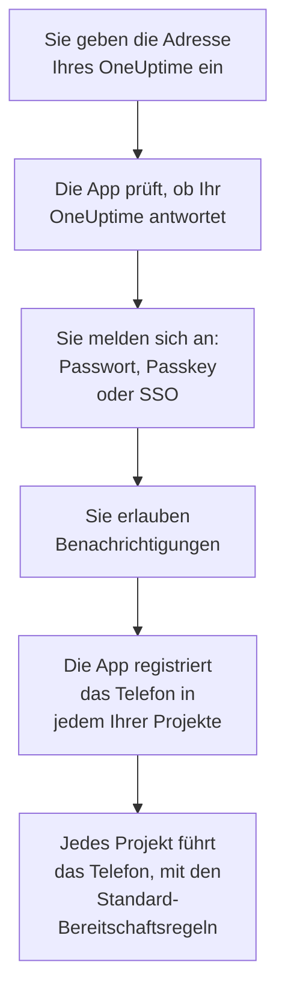
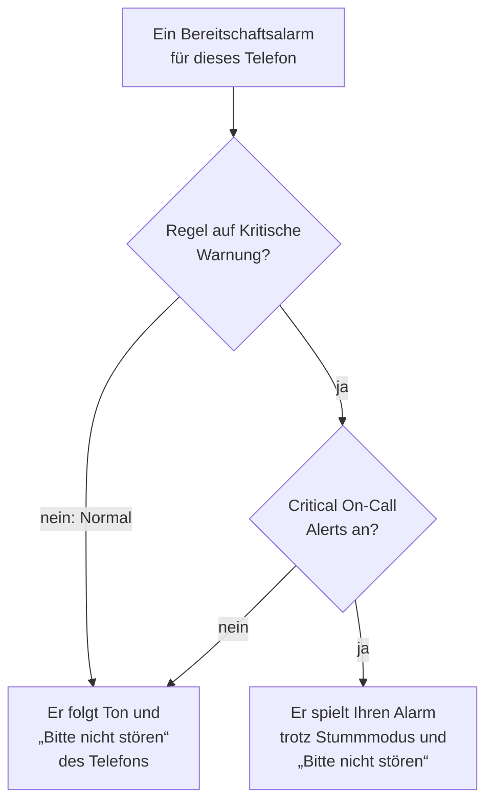

# Android-Installation

Installieren Sie **OneUptime On-Call** auf einem Android-Telefon oder -Tablet, verbinden Sie die App mit Ihrem OneUptime und melden Sie sich an. Schicken Sie sich dann eine Testbenachrichtigung, und lassen Sie dringende Bereitschaftsalarme den Stummmodus und „Bitte nicht stören“ durchbrechen.

:::cards
- [Die App installieren](#die-app-installieren): Von Google Play, oder als APK auf einem Telefon ohne Google Play.
- [Anmelden](#anmelden): Die Adresse Ihres OneUptime, dann Ihr Konto.
- [Prüfen, dass Alarme das Telefon erreichen](#prüfen-dass-alarme-das-telefon-erreichen): Das Telefon im Dashboard finden und testen.
- [Den Stummmodus durchbrechen](#den-stummmodus-durchbrechen): Kritische Warnungen und der Alarmton.
- [Fehlerbehebung](#fehlerbehebung): Probleme mit Anmeldung, Benachrichtigungen und Installation.
:::

## Bevor Sie beginnen

- Ein Telefon oder Tablet mit Android 7.0 oder neuer.
- Ein Konto in einem OneUptime-Projekt. Damit Sie alarmiert werden, müssen Sie außerdem Bereitschaft haben: siehe [Eskalationsregeln](/docs/on-call/escalation-rules).
- Die Adresse Ihres OneUptime: `https://oneuptime.com` bei OneUptime Cloud, oder Ihre eigene, etwa `https://oneuptime.example.com`. Die App verbindet sich nur über HTTPS.

## Die App installieren

:::tabs
@tab Google Play
1. Öffnen Sie auf dem Telefon [OneUptime On-Call bei Google Play](https://play.google.com/store/apps/details?id=com.oneuptime.oncall), oder suchen Sie bei Google Play nach OneUptime On-Call.
2. Tippen Sie auf **Installieren** und dann auf **Öffnen**.

Google Play hält die App auf dem neuesten Stand.
@tab APK
Für ein Telefon ohne Google Play. Das APK wird für jedes OneUptime-Release aus demselben Code gebaut und dem Release auf GitHub angehängt.

1. Öffnen Sie auf dem Telefon [das neueste APK](https://github.com/OneUptime/oneuptime/releases/latest/download/oneuptime-on-call-android-app.apk).
2. Öffnen Sie die heruntergeladene Datei. Wenn Android fragt, erlauben Sie Ihrem Browser, unbekannte Apps zu installieren, und tippen Sie dann auf **Installieren**.
3. Öffnen Sie OneUptime On-Call unter Ihren Apps.

Ein APK aktualisiert sich nicht selbst: Installieren Sie von Zeit zu Zeit das neueste darüber. Ihre Anmeldung und Ihre Einstellungen bleiben erhalten.
:::

## Anmelden

:::steps
### Die Adresse Ihres OneUptime eingeben
Öffnen Sie die App. Behalten Sie auf **Connect your workspace** `https://oneuptime.com` für OneUptime Cloud, oder geben Sie die Adresse Ihres eigenen OneUptime ein, und tippen Sie auf **Connect**. Die App geht weiter, sobald `https://<your-oneuptime>/api/status` antwortet.

### Bei Ihrem Konto anmelden
Nutzen Sie den Weg, auf dem sich Ihr Konto anmeldet:

- Ihre E-Mail-Adresse und Ihr Passwort, dann **Sign In**. **Forgot password?** schickt Ihnen per E-Mail einen Link, mit dem Sie ein neues festlegen.
- **Sign in with a passkey**, sobald Sie im Dashboard einen hinzugefügt haben: siehe [Einen Passkey hinzufügen](/docs/introduction/your-account#einen-passkey-hinzufügen). Ihr Browser öffnet sich, um ihn zu bestätigen, und bringt Sie dann zurück.
- **Sign in with SSO**, wenn Ihre Organisation Single Sign-On nutzt. Wählen Sie Ihren Anbieter, oder geben Sie Ihre geschäftliche E-Mail-Adresse ein und tippen Sie auf **Continue**. Ein sicherer Browser öffnet sich, und Sie sind zurück in der App, sobald Sie sich angemeldet haben.

Ist die Zwei-Faktor-Authentifizierung eingeschaltet, geben Sie den sechsstelligen Code aus Ihrer Authenticator-App ein, oder einen Ihrer Backup-Codes. Ein Sicherheitsschlüssel lässt sich in der App nicht verwenden. Verlangt Ihr Administrator die Zwei-Faktor-Authentifizierung und Sie haben sie noch nicht eingerichtet, richtet die App zuerst mit Ihnen eine Authenticator-App ein.

### Benachrichtigungen erlauben
Wenn Android fragt, ob OneUptime On-Call Benachrichtigungen senden darf, tippen Sie auf **Zulassen**. Android 13 und neuer fragen; ältere Versionen erlauben sie, solange Sie sie nicht ausschalten.

Die App registriert das Telefon dann in jedem Ihrer Projekte. Jedes Projekt führt es unter Ihren Push-Geräten, mit den Standard-Bereitschaftsregeln, sodass Ihre Alarme es von nun an erreichen.
:::

Die App zeigt jeweils ein Projekt: Tippen Sie oben auf einem Bildschirm auf den Namen des Projekts, um zu wechseln. Ein Projekt, das Single Sign-On verlangt, ist unter **Settings → Manage Projects** als **SSO Required** markiert, bis Sie dort auf **Authenticate with SSO** tippen.

## Prüfen, dass Alarme das Telefon erreichen

:::steps
### Das Telefon im Dashboard finden
Öffnen Sie im Dashboard **Benutzereinstellungen → Benachrichtigungsmethoden** und den Tab **Push Notifications**. Das Telefon steht unter **Geräte für Push-Benachrichtigungen**, mit seinem Modellnamen. Jedes Projekt führt seine eigene Liste.

### Einen Test senden
Klicken Sie in der Zeile des Telefons auf **Testbenachrichtigung**. Auf dem Telefon kommt eine Benachrichtigung an; tippen Sie darauf, um die App zu öffnen.
:::

Ihre Bereitschaftsregeln entscheiden, welche Alarme an das Telefon gehen und wie schnell: siehe **Benutzereinstellungen → Bereitschaftsregeln**. Ein neues Telefon bekommt dieselben Standardregeln wie jede andere Methode, die Sie hinzufügen.

## Den Stummmodus durchbrechen

Standardmäßig richtet sich ein Bereitschaftsalarm nach den Toneinstellungen des Telefons: Ein stummgeschaltetes Telefon bleibt still, und „Bitte nicht stören“ hält den Alarm zurück. Kritische Warnungen lassen Bereitschaftsalarme beides durchbrechen. Sie sind aus, bis Sie sie einschalten, für jedes Telefon einzeln.

:::steps
### Critical On-Call Alerts einschalten
Öffnen Sie in der App **Settings** und schalten Sie unter **Notifications** den Schalter **Critical On-Call Alerts** ein.

### Zugriff auf „Bitte nicht stören“ erlauben
Android öffnet seine Liste **Zugriff auf „Bitte nicht stören“**. Schalten Sie den Zugriff für OneUptime On-Call ein und gehen Sie zurück zur App: Sie prüft den Zugriff und sagt unter dem Schalter, ob Alarme durchklingeln.

### Einen Alarmton wählen
Tippen Sie unter dem Schalter auf **Alarm sound**. Neben dem eigenen Ton des Telefons bietet die App Klaxon, Siren, Digital alarm, Smoke alarm und Rising alarm, der leise beginnt und immer lauter wird. Tippen Sie neben einem Ton auf Wiedergabe, um ihn anzuhören. Ein kritischer Alarm spielt mit der Weckerlautstärke des Telefons, lassen Sie diese also aufgedreht.
:::

Nur Bereitschaftsalarme klingeln durch, und nur aus Bereitschaftsregeln, die auf **Kritische Warnung** stehen, der Voreinstellung. Eine Regel auf **Normal** folgt den Einstellungen des Telefons, egal was der Schalter sagt, sodass Sie bei einem kritischen Vorfall geweckt und bei einem kleinen leise alarmiert werden können. Senden Sie bei stummgeschaltetem Telefon eine **Testbenachrichtigung**, um zu hören, was ein Alarm tun wird.

## Verhindern, dass Alarme verspätet ankommen

OneUptime sendet Bereitschaftsalarme mit hoher Priorität, die Android auch einem Telefon zustellt, das seit Stunden ruht. Ein Telefon, das den Akkuverbrauch der App einschränkt, kann sie trotzdem zurückhalten:

- Öffnen Sie **Einstellungen → Apps → OneUptime On-Call → Akku** und wählen Sie **Nicht eingeschränkt**. Manche Telefone nennen es **Akkunutzung durch App**.
- Prüfen Sie unter **Einstellungen → Apps → OneUptime On-Call → Benachrichtigungen**, dass die Benachrichtigungen der App an sind.
- Nehmen Sie OneUptime On-Call von jeder Energiespar- oder Schlafliste aus, die Ihr Telefon führt.

## Die App sperren

Schalten Sie in der App unter **Settings** den Schalter **Biometrics Login** ein, und die App fragt bei jedem Start nach Ihrem Fingerabdruck, Ihrem Gesicht oder der Displaysperre des Telefons. Der Schalter erscheint, sobald auf dem Telefon eine Entsperrung per Fingerabdruck oder Gesicht eingerichtet ist. **Appearance** auf demselben Bildschirm wählt das helle oder das dunkle Aussehen, oder folgt dem Telefon.

## Aktualisieren, abmelden oder deinstallieren

- **Aktualisieren.** Google Play aktualisiert die App. Beim APK installieren Sie das neueste darüber. Die Version der App steht unten auf ihrem Bildschirm **Settings**.
- **Abmelden.** **Settings → Log Out** meldet Sie ab und entfernt das Telefon in jedem Projekt aus Ihren Push-Geräten, zusammen mit seinen Bereitschaftsregeln. Melden Sie sich wieder an, kommt es mit den Standardregeln zurück.
- **Deinstallieren.** Entfernen Sie die App wie jede andere. Waren Sie noch angemeldet, bleibt das Telefon in Ihrer Liste, bis ein Push an es fehlschlägt: OneUptime markiert es dann mit **Keine Benachrichtigungen**. Löschen Sie diesen Eintrag mit **Löschen**: Installieren Sie die App erneut und melden Sie sich an, kommt das Telefon als neuer Eintrag hinzu, mit den Standardregeln.

## Fehlerbehebung

:::details „Could not connect to the server“
Die App konnte `https://<your-oneuptime>/api/status` nicht erreichen. Prüfen Sie die Adresse, einschließlich `https://`. Liegt Ihr OneUptime in einem privaten Netz, verbinden Sie das Telefon zuerst damit, zum Beispiel über Ihr VPN. Öffnen Sie diese Adresse im Browser des Telefons: Sie zeigt `{"status":"ok"}`, wenn das Telefon OneUptime erreicht.
:::

:::details Es kommen keine Benachrichtigungen an
- Prüfen Sie in den Android-Einstellungen, dass Benachrichtigungen für die App an sind, und dass „Bitte nicht stören“ aus ist oder kritische Warnungen an sind.
- Prüfen Sie, dass das Telefon unter **Push Notifications** in **Benutzereinstellungen → Benachrichtigungsmethoden** steht, und senden Sie ihm eine **Testbenachrichtigung**.
- Ist das Telefon mit **Keine Benachrichtigungen** markiert, öffnen Sie die App, während Sie angemeldet sind. Sie registriert das Telefon erneut; siehe [Wenn sich ein Telefon neu registrieren muss](/docs/mobile-desktop-apps/faq-troubleshooting#wenn-sich-ein-telefon-neu-registrieren-muss).
- Prüfen Sie Ihre Bereitschaftsregeln unter **Benutzereinstellungen → Bereitschaftsregeln**.
- Prüfen Sie bei einem selbst gehosteten OneUptime, dass Ihr Server sein Push-Relay erreicht: siehe [Push-Benachrichtigungen](/docs/self-hosted/push-notifications#netzwerkzugriff).
:::

:::details Kritische Warnungen bleiben bei „Bitte nicht stören“ still
Öffnen Sie in der App **Settings**: Die Zeile unter **Critical On-Call Alerts** sagt, was fehlt. Meist wurde der Zugriff auf „Bitte nicht stören“ nicht erlaubt: Erlauben Sie ihn unter **Einstellungen → Benachrichtigungen → Zugriff auf „Bitte nicht stören“** und gehen Sie zurück zur App. Haben Sie einen Alarmton gewählt, muss auch der Benachrichtigungskanal dieses Tons „Bitte nicht stören“ übergehen dürfen.
:::

:::details „App nicht installiert“, wenn Sie das APK installieren
OneUptime On-Call ist bereits aus einer anderen Quelle auf dem Telefon, etwa von Google Play, und Android installiert die eine nicht über die andere. Deinstallieren Sie sie, installieren Sie das APK und melden Sie sich erneut an.
:::

:::details Kein Schalter Biometrics Login
Der Schalter erscheint, sobald in den Android-Einstellungen eine Entsperrung per Fingerabdruck oder Gesicht eingerichtet ist.
:::

## Nächste Schritte

:::cards
- [FAQ & Fehlerbehebung](/docs/mobile-desktop-apps/faq-troubleshooting): Was zu tun ist, wenn ein Telefon keine Alarme mehr bekommt.
- [iOS-Installation](/docs/mobile-desktop-apps/ios-installation): Dieselbe App auf einem iPhone oder iPad.
- [Eskalationsregeln](/docs/on-call/escalation-rules): Festlegen, wer alarmiert wird, und wann.
- [Push-Benachrichtigungen](/docs/self-hosted/push-notifications): Wie ein selbst gehostetes OneUptime Alarme an Telefone schickt.
:::
