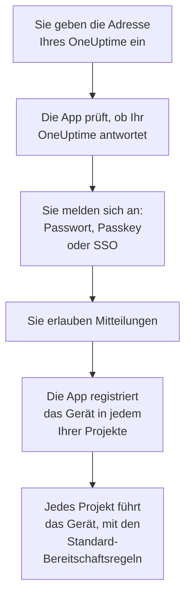

# iOS-Installation

Installieren Sie **OneUptime On-Call** aus dem App Store auf einem iPhone oder iPad, verbinden Sie die App mit Ihrem OneUptime und melden Sie sich an. Schicken Sie sich dann eine Testbenachrichtigung, und lassen Sie dringende Bereitschaftsalarme den Stummmodus und Fokus durchbrechen.

:::cards
- [Die App installieren](#die-app-installieren): Aus dem App Store.
- [Anmelden](#anmelden): Die Adresse Ihres OneUptime, dann Ihr Konto.
- [Prüfen, dass Alarme das Gerät erreichen](#prüfen-dass-alarme-das-gerät-erreichen): Das Gerät im Dashboard finden und testen.
- [Den Stummmodus durchbrechen](#den-stummmodus-durchbrechen): Kritische Warnungen, der Alarmton und seine Lautstärke.
- [Fehlerbehebung](#fehlerbehebung): Probleme mit Anmeldung, Benachrichtigungen und kritischen Warnungen.
:::

## Bevor Sie beginnen

- Ein iPhone oder iPad mit iOS 16.4 oder neuer, bzw. iPadOS 16.4 oder neuer.
- Ein Konto in einem OneUptime-Projekt. Damit Sie alarmiert werden, müssen Sie außerdem Bereitschaft haben: siehe [Eskalationsregeln](/docs/on-call/escalation-rules).
- Die Adresse Ihres OneUptime: `https://oneuptime.com` bei OneUptime Cloud, oder Ihre eigene, etwa `https://oneuptime.example.com`. Die App verbindet sich nur über HTTPS.

## Die App installieren

1. Öffnen Sie auf dem iPhone oder iPad [OneUptime On-Call im App Store](https://apps.apple.com/us/app/oneuptime-on-call/id6759615391), oder suchen Sie im App Store nach OneUptime On-Call.
2. Tippen Sie auf **Laden** und bestätigen Sie mit Face ID, Touch ID oder dem Passwort Ihres Apple Accounts.
3. Tippen Sie auf **Öffnen**, oder öffnen Sie OneUptime On-Call auf dem Home-Bildschirm.

Der App Store hält die App aktuell, solange **App-Updates** unter **Einstellungen → App Store** eingeschaltet ist.

## Anmelden



:::steps
### Die Adresse Ihres OneUptime eingeben
Öffnen Sie die App. Behalten Sie auf **Connect your workspace** `https://oneuptime.com` für OneUptime Cloud, oder geben Sie die Adresse Ihres eigenen OneUptime ein, und tippen Sie auf **Connect**. Die App geht weiter, sobald `https://<your-oneuptime>/api/status` antwortet.

### Bei Ihrem Konto anmelden
Nutzen Sie den Weg, auf dem sich Ihr Konto anmeldet:

- Ihre E-Mail-Adresse und Ihr Passwort, dann **Sign In**. **Forgot password?** schickt Ihnen per E-Mail einen Link, mit dem Sie ein neues festlegen.
- **Sign in with a passkey**, sobald Sie im Dashboard einen hinzugefügt haben: siehe [Einen Passkey hinzufügen](/docs/introduction/your-account#einen-passkey-hinzufügen). Ein Browserfenster öffnet sich, um ihn zu bestätigen, und bringt Sie dann zurück.
- **Sign in with SSO**, wenn Ihre Organisation Single Sign-On nutzt. Wählen Sie Ihren Anbieter, oder geben Sie Ihre geschäftliche E-Mail-Adresse ein und tippen Sie auf **Continue**. Ein sicherer Browser öffnet sich, und Sie sind zurück in der App, sobald Sie sich angemeldet haben.

Ist die Zwei-Faktor-Authentifizierung eingeschaltet, geben Sie den sechsstelligen Code aus Ihrer Authenticator-App ein, oder einen Ihrer Backup-Codes. Ein Sicherheitsschlüssel lässt sich in der App nicht verwenden. Verlangt Ihr Administrator die Zwei-Faktor-Authentifizierung und Sie haben sie noch nicht eingerichtet, richtet die App zuerst mit Ihnen eine Authenticator-App ein.

### Mitteilungen erlauben
Wenn iOS fragt, ob OneUptime On-Call Ihnen Mitteilungen senden darf, tippen Sie auf **Erlauben**.

Die App registriert das iPhone oder iPad dann in jedem Ihrer Projekte. Jedes Projekt führt es unter Ihren Push-Geräten, mit den Standard-Bereitschaftsregeln, sodass Ihre Alarme es von nun an erreichen.
:::

Die App zeigt jeweils ein Projekt: Tippen Sie oben auf einem Bildschirm auf den Namen des Projekts, um zu wechseln. Ein Projekt, das Single Sign-On verlangt, ist unter **Settings → Manage Projects** als **SSO Required** markiert, bis Sie dort auf **Authenticate with SSO** tippen.

## Prüfen, dass Alarme das Gerät erreichen

:::steps
### Das Gerät im Dashboard finden
Öffnen Sie im Dashboard **Benutzereinstellungen → Benachrichtigungsmethoden** und den Tab **Push Notifications**. Das iPhone oder iPad steht unter **Geräte für Push-Benachrichtigungen**, mit seinem Modellnamen. Jedes Projekt führt seine eigene Liste.

### Einen Test senden
Klicken Sie in der Zeile des Geräts auf **Testbenachrichtigung**. Auf dem Gerät kommt eine Mitteilung an; tippen Sie darauf, um die App zu öffnen.
:::

Ihre Bereitschaftsregeln entscheiden, welche Alarme an das Gerät gehen und wie schnell: siehe **Benutzereinstellungen → Bereitschaftsregeln**. Ein neues Gerät bekommt dieselben Standardregeln wie jede andere Methode, die Sie hinzufügen.

## Den Stummmodus durchbrechen

Standardmäßig richtet sich ein Bereitschaftsalarm nach den Toneinstellungen des Geräts: Der Stummmodus hält ihn leise, und ein Fokus wie „Nicht stören“ hält ihn zurück. Kritische Warnungen lassen Bereitschaftsalarme beides durchbrechen. Sie sind aus, bis Sie sie einschalten, für jedes Gerät einzeln.

```mermaid title="Ob ein Bereitschaftsalarm auf einem iPhone oder iPad durchklingelt"
flowchart TB
    Page["Ein Bereitschaftsalarm<br/>für dieses Gerät"]
    Rule{"Regel auf Kritische<br/>Warnung?"}
    Device{"Critical On-Call<br/>Alerts an?"}
    Quiet["Er folgt Ton und<br/>Fokus des Geräts"]
    Loud["Er spielt Ihren Alarm<br/>in Ihrer Lautstärke,<br/>trotz Stummmodus<br/>und Fokus"]
    Page --> Rule
    Rule -->|"nein: Normal"| Quiet
    Rule -->|"ja"| Device
    Device -->|"nein"| Quiet
    Device -->|"ja"| Loud
```

:::steps
### Critical On-Call Alerts einschalten
Öffnen Sie in der App **Settings** und schalten Sie unter **Notifications** den Schalter **Critical On-Call Alerts** ein.

### Kritische Hinweise erlauben
Wenn iOS fragt, ob OneUptime On-Call kritische Hinweise senden darf, tippen Sie auf **Erlauben**. iOS fügt dann unter **Einstellungen → Mitteilungen → OneUptime On-Call** einen Schalter **Kritische Hinweise** für die App hinzu, mit dem Sie es sich später anders überlegen können. Die Zeile unter dem Schalter der App sagt, ob Alarme durchklingeln.

### Einen Alarmton und seine Lautstärke wählen
Tippen Sie unter dem Schalter auf **Alarm sound**. Neben dem eigenen Ton des Geräts für kritische Hinweise bietet die App Klaxon, Siren, Digital alarm, Smoke alarm und Rising alarm, der leise beginnt und immer lauter wird. Tippen Sie neben einem Ton auf Wiedergabe, um ihn anzuhören. Wählen Sie dann die Lautstärke, mit der ein Alarm spielt: 25 %, 50 %, 75 % oder 100 %, die Voreinstellung.
:::

Nur Bereitschaftsalarme klingeln durch, und nur aus Bereitschaftsregeln, die auf **Kritische Warnung** stehen, der Voreinstellung. Eine Regel auf **Normal** folgt den Einstellungen des Geräts, egal was der Schalter sagt, sodass Sie bei einem kritischen Vorfall geweckt und bei einem kleinen leise alarmiert werden können. Senden Sie bei stummgeschaltetem Gerät eine **Testbenachrichtigung**, um zu hören, was ein Alarm tun wird. Die Vorschau auf dem Bildschirm **Alarm sound** spielt mit der Klingeltonlautstärke und im Stummmodus gar nicht; ein echter Alarm klingelt trotz Stummmodus in der Lautstärke, die Sie gewählt haben.

> [!NOTE]
> Kritische Warnungen brauchen OneUptime On-Call 1.5.0 oder neuer aus dem App Store. Frühere Versionen wurden ohne Apples Erlaubnis für kritische Hinweise gebaut, daher hat iOS ihnen den Schalter nie angeboten.

## Verhindern, dass Alarme zurückgehalten werden

Ohne kritische Warnungen können ein Fokus oder eine Zusammenfassung Alarme zurückhalten:

- **Fokus.** Fügen Sie OneUptime On-Call unter **Einstellungen → Fokus** zu den Apps hinzu, die jeder Fokus erlaubt.
- **Geplante Zusammenfassung.** Lassen Sie OneUptime On-Call unter **Einstellungen → Mitteilungen → Geplante Zusammenfassung** heraus: Eine Mitteilung in der Zusammenfassung wartet bis zu deren nächstem Zeitpunkt.
- **Mitteilungen.** Lassen Sie **Mitteilungen erlauben** unter **Einstellungen → Mitteilungen → OneUptime On-Call** eingeschaltet.

## Die App sperren

Schalten Sie in der App unter **Settings** den Schalter **Biometrics Login** ein, und die App fragt bei jedem Start nach Face ID, Touch ID oder Ihrem Code. Der Schalter erscheint, sobald auf dem Gerät Face ID oder Touch ID eingerichtet ist. **Appearance** auf demselben Bildschirm wählt das helle oder das dunkle Aussehen, oder folgt dem Gerät.

## Aktualisieren, abmelden oder die App löschen

- **Aktualisieren.** Der App Store aktualisiert die App; Sie können sie auch über Ihren Account im App Store aktualisieren. Die Version der App steht unten auf ihrem Bildschirm **Settings**.
- **Abmelden.** **Settings → Log Out** meldet Sie ab und entfernt das Gerät in jedem Projekt aus Ihren Push-Geräten, zusammen mit seinen Bereitschaftsregeln. Melden Sie sich wieder an, kommt es mit den Standardregeln zurück.
- **Löschen.** Halten Sie das Symbol der App gedrückt und tippen Sie auf **App entfernen** und dann auf **App löschen**. Waren Sie noch angemeldet, bleibt das Gerät in Ihrer Liste, bis ein Push an es fehlschlägt: OneUptime markiert es dann mit **Keine Benachrichtigungen**. Installieren Sie die App erneut und melden sich an, kommt dieser Eintrag meist mit seinen Regeln zurück; brauchen Sie das Gerät nicht mehr, löschen Sie den Eintrag mit **Löschen**.

## Fehlerbehebung

:::details „Could not connect to the server“
Die App konnte `https://<your-oneuptime>/api/status` nicht erreichen. Prüfen Sie die Adresse, einschließlich `https://`. Liegt Ihr OneUptime in einem privaten Netz, verbinden Sie das Gerät zuerst damit, zum Beispiel über Ihr VPN. Öffnen Sie diese Adresse auf dem Gerät in Safari: Sie zeigt `{"status":"ok"}`, wenn das Gerät OneUptime erreicht.
:::

:::details Es kommen keine Benachrichtigungen an
- Prüfen Sie, dass **Mitteilungen erlauben** unter **Einstellungen → Mitteilungen → OneUptime On-Call** eingeschaltet ist und kein Fokus Alarme zurückhält.
- Prüfen Sie, dass das Gerät unter **Push Notifications** in **Benutzereinstellungen → Benachrichtigungsmethoden** steht, und senden Sie ihm eine **Testbenachrichtigung**.
- Ist das Gerät mit **Keine Benachrichtigungen** markiert, öffnen Sie die App, während Sie angemeldet sind. Sie registriert das Gerät erneut; siehe [Wenn sich ein Telefon neu registrieren muss](/docs/mobile-desktop-apps/faq-troubleshooting#wenn-sich-ein-telefon-neu-registrieren-muss).
- Prüfen Sie Ihre Bereitschaftsregeln unter **Benutzereinstellungen → Bereitschaftsregeln**.
- Prüfen Sie bei einem selbst gehosteten OneUptime, dass Ihr Server sein Push-Relay erreicht: siehe [Push-Benachrichtigungen](/docs/self-hosted/push-notifications#netzwerkzugriff).
:::

:::details Kein Schalter für kritische Hinweise in den iOS-Einstellungen
Schalten Sie zuerst in der App **Critical On-Call Alerts** ein: iOS fügt seinen Schalter erst hinzu, nachdem die App nach kritischen Hinweisen gefragt hat. Sagt die App, dass diese Version keine kritischen Warnungen empfangen kann, aktualisieren Sie OneUptime On-Call aus dem App Store.
:::

:::details Kritische Warnungen bleiben still
Öffnen Sie in der App **Settings**: Die Zeile unter **Critical On-Call Alerts** sagt, was fehlt. Prüfen Sie, dass **Kritische Hinweise** unter **Einstellungen → Mitteilungen → OneUptime On-Call** eingeschaltet ist und die Lautstärke auf dem Bildschirm **Alarm sound** der App nicht niedrig steht.
:::

:::details Kein Schalter Biometrics Login
Der Schalter erscheint, sobald Face ID oder Touch ID unter **Einstellungen → Face ID & Code** oder **Einstellungen → Touch ID & Code** eingerichtet ist.
:::

## Nächste Schritte

:::cards
- [FAQ & Fehlerbehebung](/docs/mobile-desktop-apps/faq-troubleshooting): Was zu tun ist, wenn ein Telefon keine Alarme mehr bekommt.
- [Android-Installation](/docs/mobile-desktop-apps/android-installation): Dieselbe App auf Android.
- [Eskalationsregeln](/docs/on-call/escalation-rules): Festlegen, wer alarmiert wird, und wann.
- [Push-Benachrichtigungen](/docs/self-hosted/push-notifications): Wie ein selbst gehostetes OneUptime Alarme an Telefone schickt.
:::
