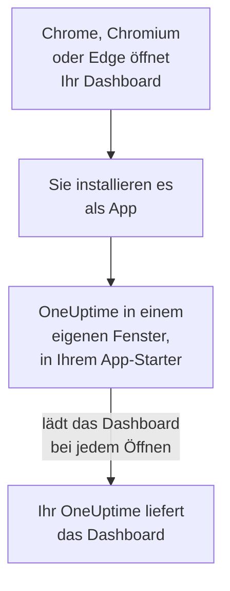

# Linux-Installation

Das OneUptime-Dashboard lässt sich unter Linux als App installieren, aus Google Chrome, Chromium oder Microsoft Edge. Es öffnet sich in einem eigenen Fenster, mit eigenem Eintrag im App-Starter Ihres Desktops, und kann Benachrichtigungen zeigen. Es gibt nichts herunterzuladen: Die App ist das Dashboard Ihres OneUptime und immer so aktuell wie Ihr OneUptime.

:::cards
- [Die App installieren](#die-app-installieren): Aus Chrome, Chromium oder Edge.
- [Aus dem App-Starter öffnen](#aus-dem-app-starter-öffnen): Wie jede andere Desktop-App.
- [Benachrichtigungen auf diesem Computer](#benachrichtigungen-auf-diesem-computer): Den Browser für Push-Benachrichtigungen registrieren.
- [Fehlerbehebung](#fehlerbehebung): Kein Installationssymbol, keine Benachrichtigungen, kein Eintrag im App-Starter.
:::

## So funktioniert die Desktop-App

Die installierte App teilt Anmeldung, Einstellungen und Benachrichtigungserlaubnis mit ihrem Browser. Schließen Sie den Browser, läuft die App in ihrem eigenen Fenster weiter.

## Bevor Sie beginnen

- Ein Linux-Desktop mit einem aktuellen Google Chrome, Chromium oder Microsoft Edge.
- Die Adresse Ihres OneUptime, über HTTPS: `https://oneuptime.com` bei OneUptime Cloud, oder Ihre eigene, etwa `https://oneuptime.example.com`.
- Ein Konto, mit dem Sie sich am Dashboard anmelden können.

## Die App installieren

:::tabs
@tab Chrome
1. Öffnen Sie Ihr OneUptime in Chrome oder Chromium und melden Sie sich an.
2. Klicken Sie auf einer beliebigen Dashboard-Seite auf das Installationssymbol rechts in der Adressleiste und dann auf **Installieren**. Oder öffnen Sie **⋮ → Streamen, speichern und teilen → Seite als App installieren…**.
3. Chrome öffnet OneUptime in einem eigenen Fenster und fügt es Ihrem App-Starter hinzu.
@tab Edge
1. Öffnen Sie Ihr OneUptime in Edge und melden Sie sich an.
2. Klicken Sie auf einer beliebigen Dashboard-Seite auf das Installationssymbol rechts in der Adressleiste und dann auf **Installieren**. Oder öffnen Sie **Einstellungen und mehr (…) → Weitere Tools → Apps → Diese Website als App installieren**.
3. Edge öffnet OneUptime in einem eigenen Fenster und fügt es Ihrem App-Starter hinzu.
:::

Installieren Sie von einer Dashboard-Seite aus, nachdem Sie sich angemeldet haben: Die Anmeldeseite ist nicht die App.

## Aus dem App-Starter öffnen

Der Browser legt für die App einen Desktop-Eintrag an, eine `.desktop`-Datei in `~/.local/share/applications`, sodass OneUptime in GNOME, KDE Plasma und anderen App-Startern erscheint. Heften Sie es dort an Ihr Dock oder Ihre Leiste an, wie jede andere App.

## Benachrichtigungen auf diesem Computer

Die App zeigt Benachrichtigungen über ihren Browser, sobald Sie den Browser in jedem Projekt, aus dem Sie sie bekommen möchten, für Push-Benachrichtigungen registrieren.

:::steps
### Ihre Push-Geräte öffnen
Öffnen Sie in der App **Benutzereinstellungen → Benachrichtigungsmethoden** und den Tab **Push Notifications**.

### Diesen Browser registrieren
Klicken Sie auf **Gerät registrieren**, behalten Sie im Feld **Gerätename** den Vorschlag, etwa `Chrome on Linux`, oder ändern Sie ihn, und klicken Sie erneut auf **Gerät registrieren**. Wenn der Browser fragt, ob OneUptime Benachrichtigungen anzeigen darf, wählen Sie **Zulassen**.

### Einen Test senden
Klicken Sie im Dialog **Browser Registered** auf **Send Test Notification**. Ihr Desktop zeigt die Benachrichtigung über seinen Benachrichtigungsdienst; erscheint nichts, siehe [Fehlerbehebung](#fehlerbehebung).
:::

Ein Browser kann das „Nicht stören“ Ihres Desktops nicht durchbrechen. Für Alarme, die Sie wecken müssen, nutzen Sie die mobile App mit kritischen Warnungen: siehe [Android-Installation](/docs/mobile-desktop-apps/android-installation#den-stummmodus-durchbrechen).

Bei einem selbst gehosteten OneUptime brauchen Browser-Benachrichtigungen die VAPID-Schlüssel des Servers: siehe [Push-Benachrichtigungen](/docs/self-hosted/push-notifications#einrichtung-bei-selbsthosting).

## Updates

Es gibt nichts zu aktualisieren. Die App lädt das Dashboard bei jedem Öffnen von Ihrem OneUptime, sie ändert sich also, wenn Ihr OneUptime aktualisiert wird. Ist ein Fenster seit dem Update offen, laden Sie es mit Strg+R neu.

## Deinstallieren

:::tabs
@tab Chrome
Öffnen Sie im Fenster der App das Menü **⋮**, wählen Sie den Eintrag, der die App deinstalliert, und dann **Entfernen**.
@tab Edge
Öffnen Sie in Edge `edge://apps`, wählen Sie bei OneUptime **Details** und dann **Deinstallieren**.
:::

Die Deinstallation der App meldet ihren Browser nicht ab: Er bekommt weiter Benachrichtigungen. Um sie zu beenden, löschen Sie den Browser unter **Benutzereinstellungen → Benachrichtigungsmethoden** auf dem Tab **Push Notifications** mit **Löschen**.

## Fehlerbehebung

:::details Kein Installationssymbol in der Adressleiste
Öffnen Sie nach der Anmeldung eine Dashboard-Seite, nicht die Anmeldeseite, und prüfen Sie, dass die Adresse mit `https://` beginnt: Browser installieren Apps nur von sicheren Seiten. Erscheint das Symbol trotzdem nicht, nutzen Sie wie oben das Menü des Browsers. Andere Browser installieren Websites eventuell nicht als Apps; nutzen Sie Chrome, Chromium oder Edge.
:::

:::details Es erscheinen keine Benachrichtigungen
- Prüfen Sie unter **Benutzereinstellungen → Benachrichtigungsmethoden** auf dem Tab **Push Notifications**, dass dieser Browser aufgeführt ist, und senden Sie ihm eine **Testbenachrichtigung**.
- Prüfen Sie, dass „Nicht stören“ Ihres Desktops aus ist und seine Benachrichtigungseinstellungen den Browser zulassen.
- Blockiert der Browser Benachrichtigungen für OneUptime, klicken Sie auf das Symbol links in der Adressleiste, erlauben Sie Benachrichtigungen für die Website und registrieren Sie den Browser erneut.
- Bei einem selbst gehosteten OneUptime sagt der Dialog **Gerät registrieren**, wenn der Server keine VAPID-Schlüssel hat.
:::

:::details Die App fehlt im App-Starter
Öffnen Sie sie stattdessen aus dem Browser: `chrome://apps` in Chrome oder Chromium, `edge://apps` in Edge. Ein App-Starter, der Desktop-Einträge nur bei der Anmeldung liest, zeigt sie, nachdem Sie sich ab- und wieder angemeldet haben.
:::

## Nächste Schritte

:::cards
- [Android-Installation](/docs/mobile-desktop-apps/android-installation): Auf Ihrem Telefon alarmiert werden, mit kritischen Warnungen.
- [Windows-Installation](/docs/mobile-desktop-apps/windows-installation): Dieselbe App unter Windows.
- [FAQ & Fehlerbehebung](/docs/mobile-desktop-apps/faq-troubleshooting): Antworten zu beiden Apps.
- [Ihr Konto](/docs/introduction/your-account): Wie OneUptime Sie in jedem Projekt erreicht.
:::
