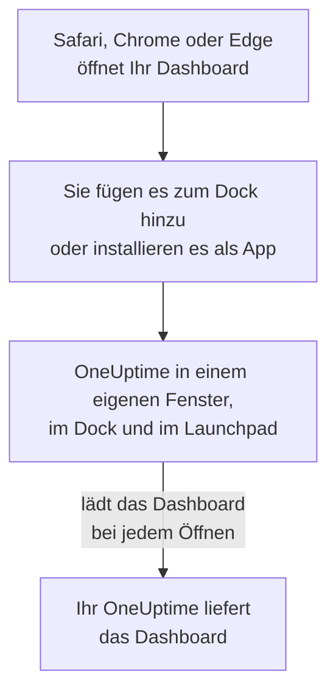

# macOS-Installation

Das OneUptime-Dashboard lässt sich auf einem Mac als App installieren: Fügen Sie es aus Safari zum Dock hinzu, oder installieren Sie es aus Google Chrome oder Microsoft Edge. Es öffnet sich in einem eigenen Fenster, mit eigenem Symbol im Dock und im Launchpad, und kann Mitteilungen zeigen. Es gibt nichts herunterzuladen: Die App ist das Dashboard Ihres OneUptime und immer so aktuell wie Ihr OneUptime.

:::cards
- [Die App installieren](#die-app-installieren): Aus Safari, Chrome oder Edge.
- [Im Dock behalten](#im-dock-behalten): Mit einem Klick öffnen, oder bei der Anmeldung.
- [Mitteilungen auf diesem Mac](#mitteilungen-auf-diesem-mac): Die App für Push-Benachrichtigungen registrieren.
- [Fehlerbehebung](#fehlerbehebung): Kein „Zum Dock hinzufügen“, keine Mitteilungen, erneute Anmeldung.
:::

## So funktioniert die Desktop-App

Eine Safari-Web-App hat ihre eigene Anmeldung, eigene Cookies und Einstellungen, getrennt von Safari. Eine aus Chrome oder Edge installierte App teilt sie mit diesem Browser.

## Bevor Sie beginnen

- macOS Sonoma 14 oder neuer für Safari. Chrome und Edge installieren Apps auf jedem macOS, auf dem sie laufen.
- Die Adresse Ihres OneUptime, über HTTPS: `https://oneuptime.com` bei OneUptime Cloud, oder Ihre eigene, etwa `https://oneuptime.example.com`.
- Ein Konto, mit dem Sie sich am Dashboard anmelden können.

## Die App installieren

:::tabs
@tab Safari
1. Öffnen Sie Ihr OneUptime in Safari und melden Sie sich an.
2. Wählen Sie auf einer beliebigen Dashboard-Seite **Ablage → Zum Dock hinzufügen**, oder klicken Sie in der Symbolleiste auf die Teilen-Taste und dann auf **Zum Dock hinzufügen**.
3. Behalten Sie den Namen oder ändern Sie ihn, und klicken Sie auf **Hinzufügen**.
4. Öffnen Sie OneUptime aus dem Dock und melden Sie sich noch einmal an: Die Web-App teilt die Anmeldung von Safari nicht.
@tab Chrome
1. Öffnen Sie Ihr OneUptime in Chrome und melden Sie sich an.
2. Klicken Sie auf einer beliebigen Dashboard-Seite auf das Installationssymbol rechts in der Adressleiste und dann auf **Installieren**. Oder öffnen Sie **⋮ → Streamen, speichern und teilen → Seite als App installieren…**.
3. Chrome öffnet OneUptime in einem eigenen Fenster und fügt es dem Launchpad hinzu.
@tab Edge
1. Öffnen Sie Ihr OneUptime in Edge und melden Sie sich an.
2. Klicken Sie auf einer beliebigen Dashboard-Seite auf das Installationssymbol rechts in der Adressleiste und dann auf **Installieren**. Oder öffnen Sie **Einstellungen und mehr (…) → Weitere Tools → Apps → Diese Website als App installieren**.
3. Edge öffnet OneUptime in einem eigenen Fenster und fügt es dem Launchpad hinzu.
:::

Installieren Sie von einer Dashboard-Seite aus, nachdem Sie sich angemeldet haben: Die Anmeldeseite ist nicht die App. Safari speichert die Web-App im Ordner „Programme“ Ihres Benutzerordners.

## Im Dock behalten

- **Dock.** Klicken Sie bei geöffneter App bei gedrückter Ctrl-Taste auf ihr Symbol im Dock und wählen Sie **Optionen → Im Dock behalten**. Eine Safari-Web-App ist schon im Dock.
- **Bei der Anmeldung öffnen.** Klicken Sie bei gedrückter Ctrl-Taste auf das Symbol im Dock und wählen Sie **Optionen → Bei der Anmeldung öffnen**.
- **Spotlight.** Drücken Sie Befehl-Leertaste und tippen Sie OneUptime.

## Mitteilungen auf diesem Mac

Die App zeigt Mitteilungen, sobald Sie sie in jedem Projekt, aus dem Sie sie bekommen möchten, für Push-Benachrichtigungen registrieren. Registrieren Sie die Safari-Web-App aus der Web-App heraus: Sie ist ein Browser für sich. Eine aus Chrome oder Edge installierte App wird mit ihrem Browser registriert.

:::steps
### Ihre Push-Geräte öffnen
Öffnen Sie in der App **Benutzereinstellungen → Benachrichtigungsmethoden** und den Tab **Push Notifications**.

### Diese App registrieren
Klicken Sie auf **Gerät registrieren**, behalten Sie im Feld **Gerätename** den Vorschlag, etwa `Safari on macOS`, oder ändern Sie ihn, und klicken Sie erneut auf **Gerät registrieren**. Wenn macOS oder der Browser fragt, ob OneUptime Mitteilungen senden darf, wählen Sie **Erlauben**.

### Einen Test senden
Klicken Sie im Dialog **Browser Registered** auf **Send Test Notification**. Erscheint nichts, sehen Sie sich die Mitteilungseinstellungen des Mac an: siehe [Fehlerbehebung](#fehlerbehebung).
:::

Ein Browser kann einen Fokus wie „Nicht stören“ nicht durchbrechen. Für Alarme, die Sie wecken müssen, nutzen Sie die mobile App mit kritischen Warnungen: siehe [iOS-Installation](/docs/mobile-desktop-apps/ios-installation#den-stummmodus-durchbrechen).

Bei einem selbst gehosteten OneUptime brauchen Browser-Benachrichtigungen die VAPID-Schlüssel des Servers: siehe [Push-Benachrichtigungen](/docs/self-hosted/push-notifications#einrichtung-bei-selbsthosting).

## Updates

Es gibt nichts zu aktualisieren. Die App lädt das Dashboard bei jedem Öffnen von Ihrem OneUptime, sie ändert sich also, wenn Ihr OneUptime aktualisiert wird. Ist ein Fenster seit dem Update offen, laden Sie es mit Befehl-R neu.

## Deinstallieren

:::tabs
@tab Safari
Öffnen Sie im Finder Ihren Benutzerordner, dann dessen Ordner „Programme“, und ziehen Sie OneUptime in den Papierkorb.
@tab Chrome
Öffnen Sie im Fenster der App das Menü **⋮**, wählen Sie den Eintrag, der die App deinstalliert, und dann **Entfernen**.
@tab Edge
Öffnen Sie in Edge `edge://apps`, wählen Sie bei OneUptime **Details** und dann **Deinstallieren**.
:::

Die Deinstallation der App meldet sie nicht ab: Ihr Browser bekommt weiter Mitteilungen. Um sie zu beenden, löschen Sie sie unter **Benutzereinstellungen → Benachrichtigungsmethoden** auf dem Tab **Push Notifications** mit **Löschen**.

## Fehlerbehebung

:::details Kein „Zum Dock hinzufügen“ in Safari
Safari fügt Web-Apps ab macOS Sonoma 14 zum Dock hinzu. Aktualisieren Sie macOS, oder installieren Sie die App stattdessen aus Chrome oder Edge.
:::

:::details Es erscheinen keine Mitteilungen
- Prüfen Sie unter **Benutzereinstellungen → Benachrichtigungsmethoden** auf dem Tab **Push Notifications**, dass die App oder ihr Browser aufgeführt ist, und senden Sie eine **Testbenachrichtigung**.
- Öffnen Sie auf dem Mac **Systemeinstellungen → Mitteilungen** und prüfen Sie, dass OneUptime oder der Browser, aus dem es installiert wurde, Mitteilungen senden darf und dass kein Fokus sie zurückhält.
- Blockiert der Browser Mitteilungen für OneUptime, erlauben Sie sie in seinen Einstellungen für die Website und registrieren Sie erneut.
- Bei einem selbst gehosteten OneUptime sagt der Dialog **Gerät registrieren**, wenn der Server keine VAPID-Schlüssel hat.
:::

:::details Die App fordert Sie erneut zur Anmeldung auf
Eine Safari-Web-App hat ihre eigene Anmeldung: Melden Sie sich in der App an. Eine aus Chrome oder Edge installierte App teilt die Anmeldung ihres Browsers, sodass Abmelden im Browser oder das Löschen seiner Cookies auch sie abmeldet.
:::

## Nächste Schritte

:::cards
- [iOS-Installation](/docs/mobile-desktop-apps/ios-installation): Auf Ihrem iPhone alarmiert werden, mit kritischen Warnungen.
- [Windows-Installation](/docs/mobile-desktop-apps/windows-installation): Dieselbe App unter Windows.
- [FAQ & Fehlerbehebung](/docs/mobile-desktop-apps/faq-troubleshooting): Antworten zu beiden Apps.
- [Ihr Konto](/docs/introduction/your-account): Wie OneUptime Sie in jedem Projekt erreicht.
:::
