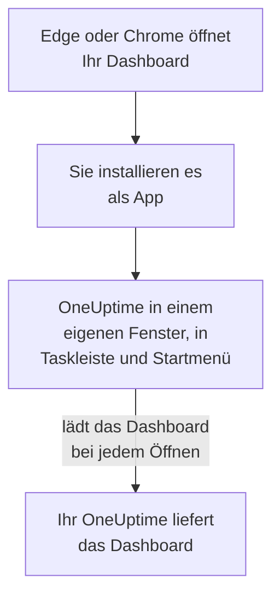

# Windows-Installation

Das OneUptime-Dashboard lässt sich unter Windows als App installieren, aus Microsoft Edge oder Google Chrome. Es öffnet sich in einem eigenen Fenster, mit eigenem Symbol in der Taskleiste und im Startmenü, und kann Benachrichtigungen zeigen. Es gibt nichts herunterzuladen: Die App ist das Dashboard Ihres OneUptime und immer so aktuell wie Ihr OneUptime.

:::cards
- [Die App installieren](#die-app-installieren): Aus Edge oder Chrome, mit wenigen Klicks.
- [Anheften und mit Windows starten](#anheften-und-mit-windows-starten): Immer einen Klick entfernt.
- [Benachrichtigungen auf diesem Computer](#benachrichtigungen-auf-diesem-computer): Den Browser für Push-Benachrichtigungen registrieren.
- [Fehlerbehebung](#fehlerbehebung): Kein Installationssymbol, keine Benachrichtigungen, erneute Anmeldung.
:::

## So funktioniert die Desktop-App

Die installierte App teilt Anmeldung, Einstellungen und Benachrichtigungserlaubnis mit ihrem Browser. Schließen Sie den Browser, läuft die App in ihrem eigenen Fenster weiter.

## Bevor Sie beginnen

- Windows 10 oder Windows 11, mit einem aktuellen Microsoft Edge oder Google Chrome.
- Die Adresse Ihres OneUptime, über HTTPS: `https://oneuptime.com` bei OneUptime Cloud, oder Ihre eigene, etwa `https://oneuptime.example.com`.
- Ein Konto, mit dem Sie sich am Dashboard anmelden können.

## Die App installieren

:::tabs
@tab Edge
1. Öffnen Sie Ihr OneUptime in Edge und melden Sie sich an.
2. Klicken Sie auf einer beliebigen Dashboard-Seite auf das Installationssymbol rechts in der Adressleiste und dann auf **Installieren**. Oder öffnen Sie **Einstellungen und mehr (…) → Weitere Tools → Apps → Diese Website als App installieren**.
3. Edge öffnet OneUptime in einem eigenen Fenster und bietet eventuell an, es an die Taskleiste oder an Start anzuheften.
@tab Chrome
1. Öffnen Sie Ihr OneUptime in Chrome und melden Sie sich an.
2. Klicken Sie auf einer beliebigen Dashboard-Seite auf das Installationssymbol rechts in der Adressleiste und dann auf **Installieren**. Oder öffnen Sie **⋮ → Streamen, speichern und teilen → Seite als App installieren…**.
3. Chrome öffnet OneUptime in einem eigenen Fenster und fügt es dem Startmenü hinzu.
:::

Installieren Sie von einer Dashboard-Seite aus, nachdem Sie sich angemeldet haben: Die Anmeldeseite ist nicht die App. Suchen Sie später im Startmenü nach OneUptime, um sie zu öffnen.

## Anheften und mit Windows starten

- **Taskleiste.** Klicken Sie bei geöffneter App mit der rechten Maustaste auf ihr Symbol in der Taskleiste und wählen Sie **An Taskleiste anheften**.
- **Mit Windows starten.** Öffnen Sie in Edge `edge://apps`, wählen Sie bei OneUptime **Details** und schalten Sie **Automatisch bei der Geräteanmeldung starten** ein. Dieselbe Seite heftet die App an die Taskleiste oder an Start an, oder legt eine Verknüpfung auf dem Desktop an.

## Benachrichtigungen auf diesem Computer

Die App zeigt Benachrichtigungen über ihren Browser, sobald Sie den Browser in jedem Projekt, aus dem Sie sie bekommen möchten, für Push-Benachrichtigungen registrieren.

:::steps
### Ihre Push-Geräte öffnen
Öffnen Sie in der App **Benutzereinstellungen → Benachrichtigungsmethoden** und den Tab **Push Notifications**.

### Diesen Browser registrieren
Klicken Sie auf **Gerät registrieren**, behalten Sie im Feld **Gerätename** den Vorschlag, etwa `Edge on Windows`, oder ändern Sie ihn, und klicken Sie erneut auf **Gerät registrieren**. Wenn der Browser fragt, ob OneUptime Benachrichtigungen anzeigen darf, wählen Sie **Zulassen**.

### Einen Test senden
Klicken Sie im Dialog **Browser Registered** auf **Send Test Notification**. Erscheint nichts, sehen Sie sich die Benachrichtigungseinstellungen von Windows an: siehe [Fehlerbehebung](#fehlerbehebung).
:::

Ein Browser klingelt nicht lauter, als Windows es zulässt: Er kann „Nicht stören“ nicht übergehen. Für Alarme, die Sie wecken müssen, nutzen Sie die mobile App mit kritischen Warnungen: siehe [Android-Installation](/docs/mobile-desktop-apps/android-installation#den-stummmodus-durchbrechen) oder [iOS-Installation](/docs/mobile-desktop-apps/ios-installation#den-stummmodus-durchbrechen).

Bei einem selbst gehosteten OneUptime brauchen Browser-Benachrichtigungen die VAPID-Schlüssel des Servers: siehe [Push-Benachrichtigungen](/docs/self-hosted/push-notifications#einrichtung-bei-selbsthosting).

## Updates

Es gibt nichts zu aktualisieren. Die App lädt das Dashboard bei jedem Öffnen von Ihrem OneUptime, sie ändert sich also, wenn Ihr OneUptime aktualisiert wird. Ist ein Fenster seit dem Update offen, laden Sie es mit Strg+R neu.

## Deinstallieren

:::tabs
@tab Edge
Öffnen Sie `edge://apps`, wählen Sie bei OneUptime **Details** und dann **Deinstallieren**.
@tab Chrome
Öffnen Sie im Fenster der App das Menü **⋮**, wählen Sie den Eintrag, der die App deinstalliert, und dann **Entfernen**.
:::

Windows führt die App auch unter **Einstellungen → Apps → Installierte Apps**, wo **Deinstallieren** sie ebenfalls entfernt.

Die Deinstallation der App meldet ihren Browser nicht ab: Er bekommt weiter Benachrichtigungen. Um sie zu beenden, löschen Sie den Browser unter **Benutzereinstellungen → Benachrichtigungsmethoden** auf dem Tab **Push Notifications** mit **Löschen**.

## Fehlerbehebung

:::details Kein Installationssymbol in der Adressleiste
Öffnen Sie nach der Anmeldung eine Dashboard-Seite, nicht die Anmeldeseite, und prüfen Sie, dass die Adresse mit `https://` beginnt: Browser installieren Apps nur von sicheren Seiten. Erscheint das Symbol trotzdem nicht, nutzen Sie wie oben das Menü des Browsers. Andere Browser installieren Websites eventuell nicht als Apps; nutzen Sie Edge oder Chrome.
:::

:::details Es erscheinen keine Benachrichtigungen
- Prüfen Sie unter **Benutzereinstellungen → Benachrichtigungsmethoden** auf dem Tab **Push Notifications**, dass dieser Browser aufgeführt ist, und senden Sie ihm eine **Testbenachrichtigung**.
- Öffnen Sie in Windows **Einstellungen → System → Benachrichtigungen**: Benachrichtigungen müssen an sein, auch für den Browser, und „Nicht stören“ aus. Windows 10 nennt die Seite „Benachrichtigungen und Aktionen“.
- Blockiert der Browser Benachrichtigungen für OneUptime, klicken Sie auf das Symbol links in der Adressleiste, erlauben Sie Benachrichtigungen für die Website und registrieren Sie den Browser erneut.
- Bei einem selbst gehosteten OneUptime sagt der Dialog **Gerät registrieren**, wenn der Server keine VAPID-Schlüssel hat.
:::

:::details Die App fordert Sie erneut zur Anmeldung auf
Die App teilt die Anmeldung ihres Browsers. Melden Sie sich im Browser ab oder löschen Sie seine Cookies, sind Sie auch in der App abgemeldet.
:::

## Nächste Schritte

:::cards
- [macOS-Installation](/docs/mobile-desktop-apps/macos-installation): Dieselbe App auf einem Mac.
- [Android-Installation](/docs/mobile-desktop-apps/android-installation): Auf Ihrem Telefon alarmiert werden.
- [FAQ & Fehlerbehebung](/docs/mobile-desktop-apps/faq-troubleshooting): Antworten zu beiden Apps.
- [Ihr Konto](/docs/introduction/your-account): Wie OneUptime Sie in jedem Projekt erreicht.
:::
