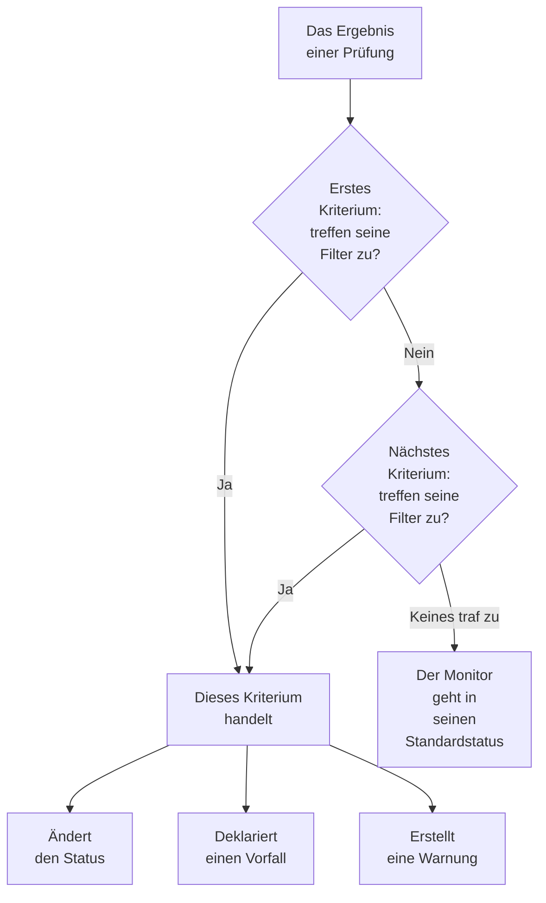
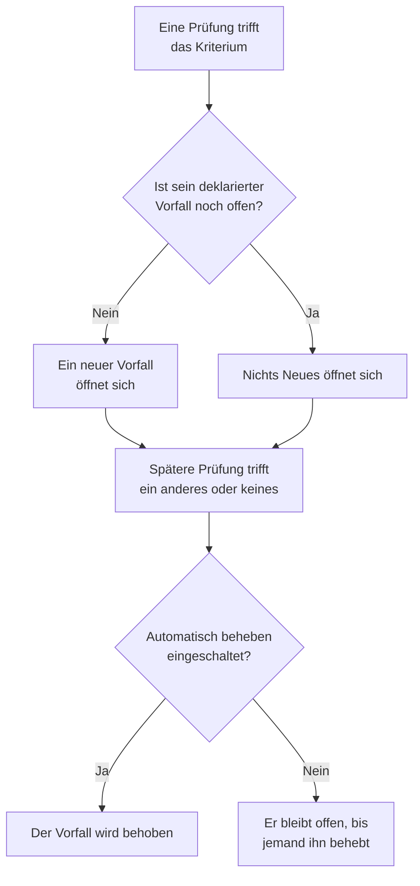

# Monitorkriterien & Status

Die Kriterien eines Monitors entscheiden, was jede Prüfung bedeutet: ob der Monitor erreichbar ist oder ausgefallen, und ob OneUptime einen Vorfall deklariert oder eine Warnung erstellt. Status sind die Liste Ihres Projekts, in der ein Monitor sein kann, von **Betriebsbereit** bis **Offline**. Diese Seite erklärt beides für jeden Monitortyp; die eigene Seite jedes Typs nennt die Filter, die er anbietet.

:::cards
- [Wie Kriterien entscheiden](#wie-kriterien-entscheiden): Von oben nach unten, und der erste Treffer gewinnt.
- [Was ein Kriterium enthält](#was-ein-kriterium-enthält): Filter, eine Abgleichsbedingung, Aktionen und Einstellungen.
- [Die Kriterien eines Monitors ändern](#die-kriterien-eines-monitors-ändern): Kriterien bearbeiten, hinzufügen, umsortieren und testen.
- [Monitorstatus](#monitorstatus): Die vordefinierten Status und eigene Status.
:::

## Wie Kriterien entscheiden

Bei jeder Prüfung eines Monitors bewerten seine Kriterien das Ergebnis von oben nach unten. Das erste Kriterium, dessen Filter zutreffen, entscheidet, was passiert, und die Kriterien darunter werden für diese Prüfung nicht mehr betrachtet. Trifft keines zu, geht der Monitor in seinen **Standard-Überwachungsstatus**.

Die Reihenfolge gehört zur Regel. Ein neuer Monitor listet seine Kriterien vom schlimmsten Fall an: offline, dann eine Warnung, wo sein Typ eine hat (ein Zertifikat oder eine Domäne, die bald abläuft), dann online. Ein breites gesundes Kriterium wie **Is Online** auf **Wahr** trifft auf fast jede Prüfung zu, deshalb kommt es zuletzt: über den anderen würde es jedes Mal zuerst zutreffen, und sie würden nie handeln.

Ein Kriterium, das zutrifft, aber keinen Status ändert, entscheidet die Prüfung trotzdem: Der Monitor behält seinen Status, und die Kriterien darunter warten auf die nächste Prüfung. Der **Standard-Überwachungsstatus** gilt nur, wenn kein Kriterium zutrifft. Bei einem neuen Monitor ist er **Betriebsbereit**; ändern Sie ihn unter **Weitere Felder** unterhalb der Kriterien.

> [!NOTE]
> Ein Monitor, der pro Host, Container, Festplatte oder Schnittstelle einen eigenen Vorfall oder eine eigene Warnung auslöst, bewertet bei jeder Prüfung alle Kriterien, sodass zwei Hosts gleichzeitig zwei verschiedene Kriterien treffen können. Das ist ein Monitor, dessen Abfrage ein **Gruppieren nach** hat, etwa ein Metrik- oder Log-Monitor, oder ein Kriterium, das `*` für jede Festplatte oder Schnittstelle nennt. Ein Monitor für eingehende Anfragen, der Vorfälle nach einem Payload-Feld gruppiert, hält trotzdem beim ersten Treffer an.

## Was ein Kriterium enthält

Öffnen Sie ein Kriterium: Es hat einen Namen und drei Abschnitte, die sich jeweils zu einer einzeiligen Zusammenfassung einklappen lassen.

| Teil | Was er enthält |
| --- | --- |
| **Kriterienname** | Der Name in der Kriterienliste und in der Ursache jedes Vorfalls und jeder Warnung, die das Kriterium öffnet. **Kriterien hinzufügen** benennt ein neues Kriterium nach seinen Filtern, und der Name folgt ihnen, bis Sie einen eigenen eintippen. |
| **Filter** | Was die Prüfung zeigen muss, als ein oder mehrere Filter. Kubernetes- und Metrik-Monitore nennen sie **Warnungsregeln**. |
| **Aktionen** | Was passiert, wenn die Filter zutreffen: den Status ändern, eine Warnung erstellen, einen Vorfall deklarieren oder eine beliebige Kombination davon. |
| **Einstellungen** | **Diese Kriterien aktivieren**, eine optionale **Beschreibung** und, bei Monitoren für eingehende Anfragen, **Vorfälle und Warnungen nach einem Payload-Feld gruppieren**. |

### Filter

Ein Filter liest eine Sache aus der Prüfung und vergleicht sie: einen **Filtertyp** (was gelesen wird, etwa **Antwort-Statuscode**), eine **Filterbedingung** (wie verglichen wird, etwa **Größer als**) und einen **Wert**. Monitore, die Metriken vergleichen, etwa Kubernetes- und Metrik-Monitore, fragen stattdessen nach einer **Bedingung** und einem **Schwellenwert**. Jeder Monitortyp bietet eigene Filtertypen an, die auf seiner Seite aufgeführt sind, zum Beispiel [Website-Überwachung](/docs/monitor/website-monitor#überwachungskriterien).

Ab zwei Filtern erscheint darunter die **Abgleichsbedingung**: **Alle** bedeutet, dass jeder Filter zutreffen muss, **Beliebig**, dass einer genügt. Ein neues Kriterium beginnt mit **Alle**.

Filter, die jede Prüfung messen, etwa **Is Online**, **Antwort-Statuscode** und **Antwortzeit (in ms)**, bieten **Diese Kriterien über einen Zeitraum hinweg auswerten** an. Damit wird ein Fenster der letzten Prüfungen statt nur der neuesten bewertet; es beginnt mit den letzten 5 Minuten und **All Values**, was erst zutrifft, wenn jede Prüfung im Fenster zugetroffen hat. Siehe [Auswertung über einen Zeitraum](/docs/monitor/website-monitor#über-einen-zeitraum-auswerten).

### Aktionen

Jede Aktion ist ein Schalter unter **Aktionen**:

| Schalter | Was er tut |
| --- | --- |
| **Wenn Filter übereinstimmen, Monitorstatus ändern.** | Setzt den Monitor in den Status, der unter **Überwachungsstatus ändern in** gewählt ist. |
| **Wenn Filter übereinstimmen, eine Warnung erstellen.** | Erstellt die Warnungen, die unter **Warnung erstellen** eingerichtet sind. Eine Warnung informiert Ihr Team und erscheint nie auf einer Statusseite. |
| **Wenn Filter übereinstimmen, einen Vorfall deklarieren.** | Deklariert die Vorfälle, die unter **Vorfall erstellen** eingerichtet sind. Ihre Statusseiten können sie anzeigen. |

Ein Vorfall oder eine Warnung fragt nach einem Titel, einem **Schweregrad** und, eingeklappt, nach einer Beschreibung, Eigentümern, Labels und Bereitschaftsrichtlinien. Titel und Beschreibungen können Werte aus der Prüfung enthalten, etwa `{{monitorName}}`: siehe [Vorfall- & Warnmeldungsvorlagen](/docs/monitor/incident-alert-templating). Um jemanden zu alarmieren, wenn das Kriterium zutrifft, wählen Sie eine Richtlinie unter **Bereitschaft**: siehe [Bereitschaftsrichtlinien](/docs/on-call/policies).

### Einstellungen

**Diese Kriterien aktivieren** ist bei jedem neuen Kriterium eingeschaltet. Schalten Sie es aus, um ein Kriterium zu behalten, ohne es zu verwenden: Es wird bei jeder Prüfung übersprungen, ändert keinen Status, öffnet nichts, und sein Kopf zeigt **Deaktiviert**.

**Vorfälle und Warnungen nach einem Payload-Feld gruppieren** öffnet einen Vorfall pro Wert, der in einer eingehenden Anfrage gefunden wird, sodass eine Webhook-Adresse mehrere Vorfälle offen halten kann. Siehe [Vorfallgruppierung einschalten](/docs/monitor/incoming-request-monitor#die-vorfallgruppierung-einschalten).

## Wann Vorfälle und Warnungen öffnen und schließen

Ein Kriterium, das Vorfälle deklariert, öffnet einen, wenn es zutrifft. Sobald sich der Monitor erholt, schließt sich der Vorfall von selbst, wenn das Kriterium es so vorsieht.

- **Einer nach dem anderen.** Solange ein Vorfall, den ein Kriterium deklariert hat, noch offen ist, deklariert dasselbe Kriterium bei einem erneuten Treffer keinen weiteren. Warnungen funktionieren genauso. Ein Monitor, der nach Host oder Payload-Feld gruppiert, hält einen pro Host oder Wert offen, und ein Kriterium eines Monitors für eingehende E-Mails mit **Für jede E-Mail einen neuen Vorfall eröffnen** öffnet einen pro E-Mail.
- **Schließen.** Bei einer späteren Prüfung, bei der ein anderes Kriterium zutrifft oder keines, wird ein Vorfall behoben, dessen Kriterium **Vorfall automatisch beheben** eingeschaltet hat, und ebenso eine Warnung mit **Warnung automatisch beheben**. Beide stehen unter **Weitere Felder** im Vorfall oder in der Warnung, und die Kriterien, mit denen ein neuer Monitor beginnt, haben sie eingeschaltet.
- **Mehrere Sonden.** Ein Monitor, den mehr als eine Sonde prüft, ändert sich nur, wenn seine Sonden übereinstimmen. Siehe [Wie Kriterien ausgewertet werden](/docs/monitor/create-monitor#wie-kriterien-ausgewertet-werden).
- **Ein übergeordneter Monitor, der ausgefallen ist.** Auf der Seite **Konfiguration → Abhängigkeiten** eines Monitors nennt **Hängt von Monitoren ab** die Monitore, auf die er angewiesen ist. Solange einer davon in einem Status ist, der unter **Unterdrücken, wenn der übergeordnete Status ist** steht (jeder Offline-Status, wenn das leer bleibt), öffnet der Monitor keine Vorfälle oder Warnungen. Sein Status ändert sich weiterhin, und was offen ist, wird weiterhin behoben.
- **Geplante Wartung.** Ein Monitor in einem laufenden Wartungsereignis wird nicht geprüft, daher laufen seine Kriterien nicht. Siehe [Geplante Wartung – Übersicht](/docs/scheduled-maintenance/index).

Um zu sehen, wie eine Prüfung bewertet wurde, öffnen Sie die **Übersicht** des Monitors: Die Karte **Monitor-Zusammenfassung** zeigt, welches Kriterium zutraf und was jedes getan hat, einschließlich eines Vorfalls, der übersprungen wurde, weil schon einer offen war.

## Die Kriterien eines Monitors ändern

:::steps
### Die Kriterienseite öffnen

Gehen Sie zu **Monitore** und öffnen Sie den Monitor. Klappen Sie in seinem Seitenmenü **Konfiguration** auf und klicken Sie auf **Kriterien**. Die Karte **Überwachungskriterien** zeigt jedes Kriterium, was es prüft und was es tut.

### Auf Überwachungskriterien bearbeiten klicken

Der Editor zeigt jedes Kriterium aufgeklappt. Klicken Sie auf den Kopf eines Kriteriums, um es auf eine Zeile einzuklappen: seinen Namen, wie viele Filter es hat und was es tut.

### Kriterien hinzufügen, ändern oder umsortieren

**Kriterien hinzufügen** fügt unten eines hinzu, aufgeklappt und nach seinem Filter benannt. Ziehen Sie ein Kriterium am Griff links, um es zu verschieben: Der erste Treffer gewinnt, setzen Sie also den schlimmsten Fall an den Anfang. **Kriterien löschen** entfernt eines; ein Monitor behält mindestens ein Kriterium.

### Die Kriterien speichern

Klicken Sie auf **Änderungen speichern**. Die nächste Prüfung wird nach den neuen Kriterien bewertet.

### Den Monitor testen

Bei einem Monitor, den Sonden prüfen, klicken Sie auf der Karte auf **Monitor testen**, wählen unter **Sonde auswählen** eine Sonde und klicken auf **Test ausführen**. **Überwachungs-Testergebnis** zeigt, was die Prüfung gefunden hat.
:::

Ein manueller Monitor hat keine Kriterien: Sie setzen seinen Status selbst. Siehe [Status aktualisieren](/docs/monitor/manual-monitor#den-status-aktualisieren).

## Monitorstatus

Ein Monitor ist immer in einem der Status Ihres Projekts. Ein neues Projekt hat drei, vom gesündesten bis zum schlimmsten:

| Status | Platz | Farbe | Was OneUptime damit macht |
| --- | --- | --- | --- |
| **Betriebsbereit** | 1 | Grün | Neue Monitore beginnen darin, und er ist der **Standard-Überwachungsstatus** eines neuen Monitors. Vordefiniert. |
| **Beeinträchtigt** | 2 | Gelb | Nichts von selbst: Ein Kriterium von Ihnen setzt einen Monitor hierher. |
| **Offline** | 3 | Rot | Das Offline-Kriterium eines neuen Monitors setzt ihn hierher, und OneUptime behandelt einen Monitor darin als ausgefallen. Vordefiniert. |

Die Liste ist eine Reihenfolge. Wo Monitore gemeinsam angezeigt werden, gewinnt der Status, der in der Liste am weitesten unten steht: Eine Monitor-Gruppe, eine Statusseitengruppe und der Gesamtstatus einer Statusseite zeigen jeweils den schlimmsten Status ihrer Monitore.

### Wo ein Status zählt

| Wo | Was der Status entscheidet |
| --- | --- |
| Die Liste **Monitore** | Den aktuellen Status jedes Monitors. **Nicht betriebsbereit** listet die Monitore in jedem Status außer dem betriebsbereiten, mit einer roten Zahl daneben. |
| Statusseiten | Die Farbe jeder Zeile und ihre Verfügbarkeit: Nur die Status in **Zählt als Ausfallzeit** der Seite zählen dagegen. Eine neue Statusseite beginnt mit jedem Status außer dem betriebsbereiten. Siehe [Auswählen, was auf der Seite angezeigt wird](/docs/status-pages/index#auswählen-was-auf-der-seite-erscheint). |
| Monitor-Gruppen | Den Status der Gruppe: den schlimmsten ihrer Monitore. Siehe [Monitor-Gruppen](/docs/monitor/monitor-groups). |
| SLOs | Die Ausfallzeit, die ein SLO zählt, aus seiner eigenen Liste von Status. Siehe [Welche Status als Ausfallzeit zählen](/docs/slo/introduction#welche-status-als-ausfallzeit-zählen). |
| Abhängigkeiten | Ob ein übergeordneter Monitor die Vorfälle und Warnungen seiner abhängigen Monitore zurückhält: standardmäßig, solange er in einem Offline-Status ist. |

Ein Status, den Sie später hinzufügen, wird nicht in die Liste **Zählt als Ausfallzeit** einer bestehenden Statusseite aufgenommen: Fügen Sie ihn dort selbst hinzu.

### Einen eigenen Status hinzufügen

:::steps
### Monitor-Status öffnen

Gehen Sie zu **Monitore → Einstellungen → Monitor-Status**. **Einstellungen** ist im Seitenmenü eingeklappt: Klappen Sie es zuerst auf. Die Karte **Monitorstatus** listet die Status vom gesündesten bis zum schlimmsten.

### Den Status erstellen

Klicken Sie auf **Monitor-Status erstellen** und füllen Sie **Name**, **Beschreibung** und **Farbe** aus. Der neue Status kommt direkt über den Offline-Status, sodass ein Ausfall weiterhin als das Schlimmste gilt.

### An seinen Platz setzen

Ziehen Sie den Status an seinem Griff. Ein Status weiter unten in der Liste gilt als schlimmer als jeder Status darüber.

### In einem Kriterium verwenden

Ein Status bewirkt nichts, bis ein Kriterium Monitore in ihn setzt. Wählen Sie ihn unter **Überwachungsstatus ändern in** bei dem Kriterium, das ihn setzen soll.
:::

Der betriebsbereite und der Offline-Status sind als **Vordefiniert** markiert: Sie können sie umbenennen und ihre Farbe ändern, aber nicht löschen. In OneUptime Cloud erfordert das Erstellen oder Ändern eines Status den Growth-Plan. Status verwalten können die Rollen Project Owner, Project Admin oder Monitor Admin oder eine benutzerdefinierte Rolle mit der passenden Berechtigung für Monitorstatus.

### Die Status-Zeitachse

Jede Statusänderung wird in der **Status-Zeitachse** des Monitors festgehalten: wann sie begann, wie lange sie dauerte, und **Ursache anzeigen** für das Kriterium, das sie gesetzt hat. **Monitor-Statusereignis erstellen** fügt einen Status von Hand hinzu. Bei einem Monitor, den Sonden prüfen, setzt die nächste Prüfung, die ein Kriterium mit einem Status trifft, diesen Status wieder.

Eine Änderung des Monitorstatus benachrichtigt seine Eigentümer nur, wenn sie **Überwachungsstatus geändert** in ihren Benachrichtigungseinstellungen eingeschaltet haben: Es ist zu Beginn aus. Ein Monitor, der in seinen **Standard-Überwachungsstatus** zurückgeht, weil kein Kriterium zutraf, benachrichtigt niemanden. Siehe [Was für ein neues Mitglied eingeschaltet ist](/docs/notifications/notification-settings#was-für-ein-neues-mitglied-eingeschaltet-ist).

## Einen Monitorstatus archivieren

Archivieren Sie einen Status, den Ihr Team nicht mehr verwenden soll, statt ihn zu löschen. Das Archivieren ändert keinen Monitor: Ein Monitor in diesem Status bleibt darin, bis sich sein Status ändert, und seine Statuszeitachse zeigt ihn weiterhin.

- **Archivieren** steht im Menü **⋯** der Zeile. Es fragt zuerst nach und listet die Monitorkriterien, Vorlagen und Statusseiten auf, die so eingerichtet sind, dass sie den Status verwenden: Sie verwenden ihn weiter, bis Sie sie ändern.
- **Niemand kann ihn erneut auswählen.** Ein Kriterium, das Statusmenü eines Monitors, der Monitorstatus eines Vorfalls oder Wartungsereignisses und die Ausfallstatus einer Statusseite lassen ihn weg. Die API, Terraform und MCP lehnen ihn ab.
- **Archivierte Status werden getrennt aufgeführt**, im eingeklappten Abschnitt **Archivierte Monitor-Status** unter der Tabelle. **Aus Archiv entfernen** stellt einen so wieder her, wie er war.
- **Die eingebauten Status lassen sich nicht archivieren.** Neue Monitore beginnen im Betriebsstatus, und OneUptime behandelt einen Monitor im Offline-Status als ausgefallen. Ihr **Archivieren** ist gesperrt, mit Begründung.

## Fehlerbehebung

:::details Die Website ist ausgefallen, aber der Monitor bleibt betriebsbereit
Ein Kriterium weiter oben in der Liste hat zuerst zugetroffen. Öffnen Sie **Konfiguration → Kriterien** und prüfen Sie die Reihenfolge: Das gesunde Kriterium kommt zuletzt. Prüfen Sie außerdem, dass beim Offline-Kriterium **Diese Kriterien aktivieren** eingeschaltet ist und seine Aktion **Wenn Filter übereinstimmen, Monitorstatus ändern.** mit einem gewählten Status eingeschaltet ist.
:::

:::details Kein Vorfall wurde geöffnet, als der Monitor ausfiel
Prüfen Sie das Kriterium, das zutraf: **Wenn Filter übereinstimmen, einen Vorfall deklarieren.** muss eingeschaltet sein. Ein Vorfall wird nicht deklariert, solange der Vorfall desselben Kriteriums noch offen ist, solange ein übergeordneter Monitor in **Hängt von Monitoren ab** ausgefallen ist oder solange der Monitor in geplanter Wartung ist. Die Karte **Monitor-Zusammenfassung** in der **Übersicht** des Monitors sagt, was davon zutraf.
:::

:::details Der Vorfall bleibt offen, nachdem sich der Monitor erholt hat
Öffnen Sie das Kriterium des Vorfalls und klappen Sie in seinem Vorfall **Weitere Felder** auf: **Vorfall automatisch beheben** muss eingeschaltet sein. Ein Vorfall eines Kriteriums, das Sie inzwischen gelöscht haben, wird vom Monitor nicht behoben: Beheben Sie ihn von Hand.
:::

:::details Die Schaltfläche zum Löschen von Offline ist gesperrt
**Betriebsbereit** und **Offline** sind vordefiniert: OneUptime setzt Monitore in sie, daher können sie umbenannt, aber nicht gelöscht werden. Löschen Sie stattdessen einen eigenen Status oder benennen Sie den vordefinierten um.
:::

## Nächste Schritte

:::cards
- [Einen Monitor erstellen](/docs/monitor/create-monitor): Die drei Schritte eines neuen Monitors.
- [Vorfall- & Warnmeldungsvorlagen](/docs/monitor/incident-alert-templating): Werte aus der Prüfung in Titel und Beschreibungen einsetzen.
- [Monitor-Gruppen](/docs/monitor/monitor-groups): Mehrere Monitore zu einem Status zusammenfassen.
- [Vorfälle – Übersicht](/docs/incidents/index): Was passiert, nachdem ein Kriterium einen Vorfall deklariert.
:::
