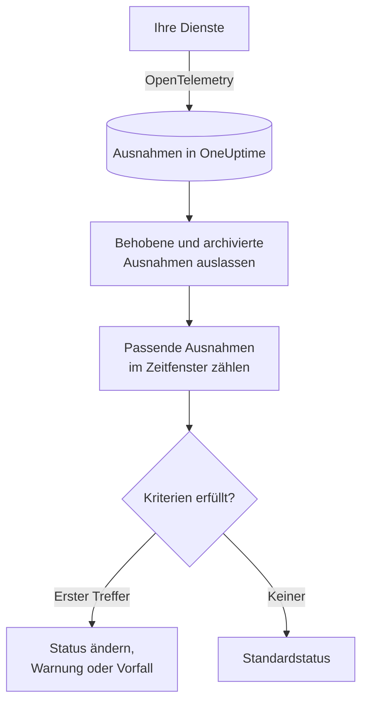

# Ausnahmen-Überwachung

Ein Ausnahmen-Monitor zählt die Ausnahmen, die Ihre Dienste an OneUptime melden und die zu Ihren Filtern passen – Meldung, Ausnahmetyp, Umgebung, Dienst –, über ein Zeitfenster. Erfüllt die Anzahl Ihre Kriterien, ändert er den Status des Monitors, erstellt eine Warnung oder eröffnet einen Vorfall. Damit warnen Sie bei jedem neuen Absturz in der Produktion, bei einem bestimmten Ausnahmetyp oder bei einem plötzlichen Anstieg der Fehler.

:::cards
- [Den Monitor erstellen](#einen-ausnahmen-monitor-erstellen): Wählen, welche Ausnahmen gezählt werden und wann gewarnt wird.
- [Umgebungen](#umgebungen): Den Monitor auf `production` beschränken.
- [Wie er ausgewertet wird](#wie-er-ausgewertet-wird): Was gezählt wird und was das Beheben einer Ausnahme bewirkt.
- [Kriterien](#kriterien): Die Bedingungen und die Voreinstellungen.
:::

## So funktioniert es



Jede Minute zählt OneUptime die Ausnahmen, die zu den Filtern des Monitors passen und innerhalb seines Zeitfensters aufgetreten sind, und lässt dabei Ausnahmen aus, die Sie als behoben markiert oder archiviert haben. Diese Anzahl prüft es von oben nach unten gegen die Kriterien des Monitors, und das erste passende Kriterium entscheidet, was geschieht. Passt keines, kehrt der Monitor zu seinem Standardstatus zurück.

## Bevor Sie beginnen

- Ihre Dienste senden Ausnahmen über OpenTelemetry an OneUptime. Siehe [OpenTelemetry](/docs/telemetry/open-telemetry).
- Um einen Monitor auf eine Umgebung zu beschränken, müssen Ihre Dienste das Ressourcenattribut `deployment.environment` setzen.

## Einen Ausnahmen-Monitor erstellen

:::steps
### Einen neuen Monitor beginnen

Gehen Sie zu **Monitore** und klicken Sie auf **Monitor erstellen**. Oder klicken Sie auf der Seite einer Ausnahme neben **Beheben** auf **Monitor erstellen**: Der neue Monitor überwacht von Anfang an den Typ dieser Ausnahme in ihrem Dienst und alarmiert, wenn sie wieder auftritt.

### Exceptions wählen

Klicken Sie unter **Monitortyp** auf **Weitere Monitortypen** und wählen Sie **Ausnahmen** unter **Telemetrie**, oder tippen Sie `exceptions` in das Suchfeld. Geben Sie einen **Name** ein und klicken Sie dann auf **Weiter**.

### Wählen, worüber der Monitor informiert

Wählen Sie unter **Worüber soll dieser Monitor Sie informieren?** **Jede Ausnahme** oder **Zu viele Ausnahmen**. Jede Wahl füllt die Regel aus, die Sie darunter ändern können. Wählen Sie **Etwas anderes**, um sie selbst einzurichten. **Eine neue Ausnahme**, **Eine behobene Ausnahme kommt zurück** und **Ausnahmen steigen sprunghaft** alarmieren bei einer Ausnahme, die zum ersten Mal auftritt, bei einer, die nach ihrer Behebung zurückkommt, und bei einem Anstieg weit über das Übliche.

### Die zu zählenden Ausnahmen wählen

Legen Sie in **Zu überwachende Ausnahmen** die Felder **Meldung enthält**, **Ausnahmetypen** und **Umgebungen** fest. Ein leer gelassener Filter passt auf jede Ausnahme. **Passende Ausnahmen** unter den Filtern zeigt die Ausnahmen, auf die sie gerade passen.

### Weiter eingrenzen (optional)

Öffnen Sie **Weitere Felder**, um nach Telemetrie-Dienst oder Infrastruktur-Entität zu filtern oder auch behobene und archivierte Ausnahmen zu zählen.

### Festlegen, wann alarmiert wird

Wählen Sie in **Wann alarmieren** eine **Bedingung**, die **Anzahl der Ausnahmen** und ein **Zeitfenster**. Der Satz darunter gibt die Regel in einfachen Worten wieder. Das Diagramm darunter zählt die passenden Ausnahmen in jedem Fenster der letzten Stunden, zeichnet die Zahl der Regel als Linie ein und sagt, wie oft die Regel alarmiert hätte. Seine Schaltfläche schlägt eine Zahl vor, die die Regel in dieser Zeit nicht überschritten hätte. **Alarm bei** legt fest, was die Regel vergleicht: **Ausnahmen**, **Neue Ausnahmen**, **Zurückgekommene Ausnahmen** oder **Ein Anstieg über das Übliche**. Das Diagramm wird nur für **Ausnahmen** gezeichnet.

### Wählen, was passiert

Wählen Sie in **Was passiert** **Warnung erstellen**, **Vorfall melden** oder **Beide**, und geben Sie ihr einen Titel und einen Schweregrad. Solange die Regel zutrifft, zeigt der Monitor den Status unter **Weitere Felder**; trifft sie nicht mehr zu, kehrt der Monitor zu seinem Standardstatus zurück, und die Warnung oder der Vorfall behebt sich selbst.

### Den Monitor erstellen

Klicken Sie auf **Monitor erstellen**. Der Monitor öffnet sich auf seiner Seite **Übersicht**, und seine erste Auswertung läuft innerhalb einer Minute.
:::

## Was er abfragt

| Feld | Worauf es passt | Standard |
| --- | --- | --- |
| **Meldung enthält** | Ausnahmen, deren Meldung diesen Text enthält, ohne Beachtung der Groß-/Kleinschreibung. | Leer: jede Ausnahme |
| **Ausnahmetypen** | Ausnahmen eines dieser Typen, durch Kommas getrennt, etwa `TypeError, NullReferenceException`. Der Typname muss genau übereinstimmen. | Leer: jeder Typ |
| **Umgebungen** | Ausnahmen aus einer dieser Umgebungen, durch Kommas getrennt – siehe [Umgebungen](#umgebungen). | Leer: jede Umgebung |
| **Zeitfenster** (in **Wann alarmieren**) | Ausnahmen der letzten 5 Sekunden bis zu den letzten 24 Stunden. | **Letzte 5 Minuten** |
| **Nach Telemetrie-Dienst filtern** (unter **Weitere Felder**) | Ausnahmen von einem der gewählten Dienste. | Leer: jeder Dienst |
| **Nach Infrastruktur-Entität filtern** (unter **Weitere Felder**) | Ausnahmen von einem der gewählten Hosts, Pods, Container und anderen Entitäten. | Leer: jede Entität |
| **Behobene Ausnahmen einbeziehen** (unter **Weitere Felder**) | Auch Ausnahmen zählen, die als behoben markiert sind. | Aus |
| **Archivierte Ausnahmen einbeziehen** (unter **Weitere Felder**) | Auch Ausnahmen zählen, die archiviert sind. | Aus |

Alle Filter, die Sie festlegen, müssen passen, damit eine Ausnahme gezählt wird.

### Umgebungen

Umgebungen stammen aus dem OpenTelemetry-Ressourcenattribut `deployment.environment` jeder Ausnahme – demselben Wert, nach dem der Ausnahmen-Explorer mit `env:production` filtert. Geben Sie eine Umgebung oder mehrere durch Kommas getrennt ein; eine Ausnahme wird gezählt, wenn ihre Umgebung zu einer davon passt.

Der Abgleich ist exakt und unterscheidet Groß-/Kleinschreibung: `production` passt nicht auf `Production` oder `prod`. Ausnahmen ohne Umgebung werden nicht gezählt, wenn dieser Filter gesetzt ist. Lassen Sie ihn leer, um Ausnahmen aus jeder Umgebung zu zählen, auch solche ohne Umgebung.

Der Umgebungsfilter wird mit jedem anderen Filter kombiniert, sodass ein Monitor, der auf einen Telemetrie-Dienst und `production` beschränkt ist, nur die Produktionsausnahmen dieses Dienstes zählt.

Wenn Sie den Monitor über die API erstellen, setzen Sie `environments` im `exceptionMonitor` des Schritts auf eine Liste von Umgebungsnamen:

```json
{
  "exceptionMonitor": {
    "telemetryServiceIds": [],
    "environments": ["production"],
    "exceptionTypes": [],
    "message": "",
    "includeResolved": false,
    "includeArchived": false,
    "lastXSecondsOfExceptions": 300
  }
}
```

## Wie er ausgewertet wird

- **Jede Minute.** Ein Ausnahmen-Monitor wird nicht von Sonden geprüft, deshalb hat er kein Intervall zum Einstellen und keine Seite **Sonden & Intervall**.
- **Vorkommen, nicht Ausnahmetypen.** Der Monitor zählt jedes Mal, wenn eine passende Ausnahme innerhalb des **Zeitfenster** aufgetreten ist. Eine Ausnahme, die 40-mal geworfen wurde, zählt 40.
- **Behobene und archivierte Ausnahmen werden ausgelassen.** Sofern Sie nicht **Behobene Ausnahmen einbeziehen** oder **Archivierte Ausnahmen einbeziehen** einschalten, zählen die Vorkommen einer Ausnahme, die Sie als behoben markiert oder archiviert haben, nicht. Eine Ausnahme als behoben zu markieren kann daher den Vorfall schließen, den sie eröffnet hat. Tritt eine behobene Ausnahme erneut auf, wird sie automatisch wieder auf unbehoben gesetzt und wieder gezählt.
- **Keine Ausnahmen ergeben die Anzahl 0.**
- **Die eigene Ausfallzeit von OneUptime ist keine Stille.** Solange das Zeitfenster Zeit enthält, in der OneUptime selbst keine Daten empfangen hat – weil es neu startete, aktualisiert wurde oder einen Rückstand aufholte –, wartet die Prüfung: Der Status ändert sich nicht, und kein Vorfall und keine Warnung wird eröffnet oder behoben. Siehe [Wenn OneUptime keine Daten empfängt](/docs/monitor/when-oneuptime-is-not-receiving).
- **Kriterien von oben nach unten.** Das erste passende Kriterium entscheidet; stellen Sie also das schwerwiegendste nach oben.

Jede Statusänderung wird mit ihrem Grund in der **Status-Zeitachse** des Monitors festgehalten.

## Kriterien

Die Kriterien eines Ausnahmen-Monitors haben vier Arten von **Filtertyp**: **Exception Count**, die Anzahl der Ausnahmen, die im Fenster gepasst haben, sowie **New Exceptions**, **Regressed Exceptions** und **Exception Increase (in %)**, die unten beschrieben sind. **Wann alarmieren** richtet ein Kriterium ein, dessen **Bedingung** **Mehr als**, **Mindestens**, **Weniger als**, **Höchstens** oder **Genau** lautet. Für mehrere Kriterien oder eines mit mehr als einem Filter klicken Sie in **Was passiert** unter **Weitere Felder** auf **Als eigene Kriterien bearbeiten**: Jedes Kriterium dort hat eine **Filterbedingung** und einen **Wert**.

| Filterbedingung | Passt, wenn die Anzahl der Ausnahmen … |
| --- | --- |
| **Größer als** | über dem Wert liegt |
| **Größer als oder gleich** | den Wert erreicht oder darüber liegt |
| **Kleiner als** | unter dem Wert liegt |
| **Kleiner als oder gleich** | den Wert erreicht oder darunter liegt |
| **Gleich** | genau dem Wert entspricht |
| **Ungleich** | alles außer dem Wert ist |

Für Ausnahmeanzahlen gibt es keine Anomaliebedingungen: Es gibt keine Baseline, mit der sie verglichen werden könnten.

Ein in „Monitor erstellen“ angelegter Ausnahmen-Monitor beginnt mit der Regel dessen, was Sie unter **Worüber soll dieser Monitor Sie informieren?** gewählt haben:

| Auswahl | Regel | Was passiert |
| --- | --- | --- |
| **Jede Ausnahme** | **Mehr als** `0` in **Letzte 5 Minuten** | Erstellt eine Warnung, die sich selbst behebt |
| **Zu viele Ausnahmen** | **Mehr als** `20` in **Letzte 5 Minuten** | Erstellt eine Warnung, die sich selbst behebt |
| **Eine neue Ausnahme** | **Neue Ausnahmen**: **Mehr als** `0` in **Letzte 10 Minuten** | Erstellt eine Warnung, die sich selbst behebt |
| **Eine behobene Ausnahme kommt zurück** | **Zurückgekommene Ausnahmen**: **Mehr als** `0` in **Letzte 10 Minuten** | Erstellt eine Warnung, die sich selbst behebt |
| **Ausnahmen steigen sprunghaft** | **Ein Anstieg über das Übliche**: **Mehr als** `200` in **Letzte 15 Minuten** | Erstellt eine Warnung, die sich selbst behebt |

Ein über die API oder Terraform ohne Kriterien angelegter Ausnahmen-Monitor beginnt mit diesen Kriterien:

| Kriterium | Filter | Wirkung |
| --- | --- | --- |
| Check if … has exceptions | **Exception Count** **Größer als** `0` | Setzt den Monitor auf offline und eröffnet einen Vorfall, der automatisch behoben wird |
| Check if … has no exceptions | **Exception Count** **Gleich** `0` | Setzt den Monitor auf online |

## Neue, zurückgekommene und sprunghaft steigende Ausnahmen

Neben der Anzahl der Ausnahmen kann ein Ausnahmen-Monitor bei dem alarmieren, womit ein Error-Tracker beginnt. Jedes wird nur gelesen, wenn ein Kriterium es prüft.

| Filtertyp | Was es im Fenster zählt |
| --- | --- |
| **New Exceptions** | Passende Ausnahmen, die zum ersten Mal gesehen wurden und weder behoben noch archiviert sind. |
| **Regressed Exceptions** | Passende Ausnahmen, die Sie behoben haben, die zurückkamen und noch offen sind. |
| **Exception Increase (in %)** | Wie weit die Anzahl passender Ausnahmen über der üblichen liegt: der Tag vor dem Fenster, je Fenster seiner Länge, mindestens eine. Zehn Ausnahmen nach einem ruhigen Tag ergeben 900 %. |

Neue und zurückgekommene Ausnahmen werden nach Dienst, Ausnahmetyp, Umgebung und Meldung gefiltert; der Filter nach Infrastruktur-Entität gilt nur für die anderen beiden.

## Ein Beispiel: nur Produktionsausnahmen

Sie wollen einen Vorfall, wann immer die API in der Produktion eine Ausnahme wirft, und nichts für Staging. Sie wählen **Jede Ausnahme**, setzen **Umgebungen** auf `production`, belassen das **Zeitfenster** bei **Letzte 5 Minuten** und wählen unter **Was passiert** **Vorfall melden**. In den letzten fünf Minuten:

| Ausnahmen | Umgebung | Zustand | Gezählt? |
| --- | --- | --- | --- |
| `TypeError` × 3 | `production` | Aktiv | Ja: 3 |
| `TypeError` × 40 | `staging` | Aktiv | Nein: eine andere Umgebung |
| `TimeoutError` × 2 | keine | Aktiv | Nein: keine Umgebung |
| `NullReferenceException` × 4 | `production` | Nach ihrem Auftreten behoben | Nein: behoben |

Der **Exception Count** ist 3, also passt **Mehr als** `0`: Der Monitor geht offline, und ein Vorfall wird eröffnet. Sobald fünf Minuten ohne aktive Produktionsausnahme vergangen sind, trifft die Regel nicht mehr zu, der Monitor kehrt zu seinem Standardstatus zurück und der Vorfall behebt sich selbst.

## Fehlerbehebung

:::details Ausnahmen erscheinen im Explorer, aber der Monitor zählt 0
Vergleichen Sie den Wert von **Umgebungen** mit dem Filter `env:` des Explorers: Der Abgleich ist exakt und unterscheidet Groß-/Kleinschreibung, und Ausnahmen ohne Umgebung werden ausgelassen, wenn der Filter gesetzt ist. Prüfen Sie dann, ob diese Ausnahmen behoben oder archiviert sind. Öffnen Sie die Seite **Kriterien** des Monitors (unter **Konfiguration**) und klicken Sie auf **Überwachungskriterien bearbeiten**: **Passende Ausnahmen** zeigt, worauf die Filter passen.
:::

:::details Der Vorfall wurde behoben, als ich die Ausnahme behoben habe
Das ist so gewollt. Behobene Ausnahmen werden nicht gezählt, also fiel die Anzahl, und das Kriterium passte nicht mehr. Tritt die Ausnahme erneut auf, wird sie wieder auf unbehoben gesetzt und wieder gezählt. Schalten Sie **Behobene Ausnahmen einbeziehen** ein, um sie trotzdem zu zählen.
:::

:::details Ein Filter nach Ausnahmetyp passt auf nichts
**Ausnahmetypen** werden exakt abgeglichen, mit dem Typnamen, mit dem die Ausnahme gemeldet wurde, etwa `TypeError`. Kopieren Sie den Typ aus dem Ausnahmen-Explorer.
:::

## Nächste Schritte

:::cards
- [Traces-Überwachung](/docs/monitor/traces-monitor): Auf fehlschlagende Spans und Endpunkte warnen.
- [Logs-Überwachung](/docs/monitor/logs-monitor): Auf Log-Volumen und -Inhalt warnen.
- [Vorfall- & Warnmeldungsvorlagen](/docs/monitor/incident-alert-templating): Nützliche Titel und Beschreibungen für Warnungen schreiben.
- [OpenTelemetry](/docs/telemetry/open-telemetry): Ausnahmen an OneUptime senden.
:::
