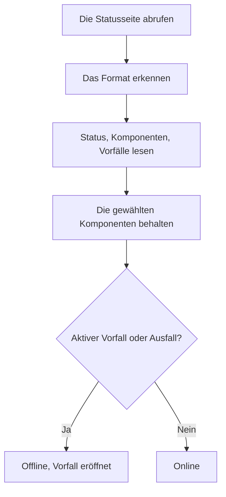

# Externe-Statusseite-Überwachung

Ein Monitor für externe Statusseiten beobachtet die öffentliche Statusseite eines Dienstes, von dem Sie abhängen — AWS, GCP, Azure, GitHub, OpenAI, Anthropic und viele mehr — und alarmiert Sie, wenn dieser Anbieter einen Ausfall oder eine eingeschränkte Leistung meldet. Verwenden Sie ihn, um von Problemen bei Ihren Anbietern zu erfahren, sobald diese sie melden, und sie von Ihren eigenen zu unterscheiden.

Er liest auch Statusseiten, die mit OneUptime erstellt wurden, Ressource für Ressource, und unterscheidet geplante Wartung von einem Ausfall: Beobachten Sie das Projekt eines anderen Teams oder einen Anbieter, dessen Statusseite auf OneUptime läuft.

:::cards
- [Den Monitor erstellen](#einen-monitor-für-externe-statusseiten-erstellen): Eine Statusseiten-URL einfügen und wählen, was beobachtet wird.
- [Komponenten wählen](#komponenten): Nur die Komponenten beobachten, von denen Sie abhängen.
- [Kriterien](#überwachungskriterien): Was von Anfang an als ausgefallen gilt.
- [OneUptime-Statusseiten](#oneuptime-statusseiten): Die Ressourcen eines anderen Projekts und seine Wartung.
- [Beliebte Statusseiten](#beliebte-statusseiten-urls): URLs der Dienste, von denen die meisten Teams abhängen.
:::

## So funktioniert es

Bei jeder Prüfung ruft eine Sonde die Statusseite ab, ermittelt ihr Format und liest den Gesamtstatus, die Komponenten und die aktiven Vorfälle. Haben Sie Komponenten oder eine Komponentengruppe gewählt, zählen nur diese. Die Kriterien entscheiden dann, ob der Monitor online oder offline ist.

Sie können ihn verwenden, um:

- die Verfügbarkeit von Drittanbieterdiensten zu überwachen, von denen Ihre Anwendung abhängt
- alarmiert zu werden, wenn vorgelagerte Anbieter Ausfälle haben
- den Status einzelner Komponenten zu verfolgen
- nur die Komponenten zu beobachten, von denen Sie abhängen (z. B. Git Operations und Pull Requests von GitHub oder die Gruppe "APIs" von OpenAI), damit Vorfälle anderswo auf der Seite Ihren Monitor nicht auslösen
- eingeschränkte Leistung zu erkennen, bevor sie Ihre Nutzer trifft
- Ihre eigenen Vorfälle mit Problemen vorgelagerter Anbieter in Beziehung zu setzen

## Unterstützte Anbieter

| Anbieter | Beschreibung |
| ------------------------ | ---------------------------------------------------------------------- |
| **Auto** (Standard) | Erkennt das Format der Statusseite automatisch |
| **Atlassian Statuspage** | Statusseiten auf Basis von Atlassian Statuspage (JSON-API) |
| **incident.io** | Statusseiten auf Basis von incident.io (z. B. `https://status.openai.com`) |
| **OneUptime Status Page** | Statusseiten, die mit OneUptime erstellt wurden: der Status jeder Ressource und was gerade gewartet wird |
| **RSS** | Statusseiten, die einen RSS-Feed anbieten |
| **Atom** | Statusseiten, die einen Atom-Feed anbieten |

### Automatische Erkennung

Steht der Anbieter auf **Auto**, erkennt OneUptime das Format der Statusseite automatisch, in dieser Reihenfolge:

1. Zuerst versucht es die Statusseiten-API von incident.io (`/proxy/<host>`).
2. Dann versucht es die JSON-API von Atlassian Statuspage (`/api/v2/status.json`, `/api/v2/components.json` und `/api/v2/incidents/unresolved.json`).
3. Danach fragt es nach der Zusammenfassung einer OneUptime-Statusseite (`/status-page-api/summary/<page>`).
4. Schlagen diese fehl, versucht es, die Seite als RSS- oder Atom-Feed zu lesen.
5. Als letzte Rückfallebene führt es eine einfache Prüfung der HTTP-Erreichbarkeit durch.

> [!NOTE]
> incident.io wird zuerst geprüft, weil manche incident.io-Statusseiten (wie `https://status.openai.com`) zusätzlich einen eingeschränkten, Atlassian-kompatiblen Endpunkt anbieten, der Komponentengruppen und aktive Vorfälle auslässt. incident.io zuerst zu prüfen stellt sicher, dass die reicheren, gruppenbewussten Daten verwendet werden.

Die Erreichbarkeitsprüfung ist auch die Rückfallebene, wenn ein ausdrücklich gewählter Anbieter fehlschlägt. Sie sagt nur, ob die Seite antwortet — online bei einer Antwort `2xx` oder `3xx` — und meldet keine Komponenten oder Vorfälle.

## Einen Monitor für externe Statusseiten erstellen

:::steps
### Einen neuen Monitor beginnen

Gehen Sie zu **Monitore** und klicken Sie auf **Monitor erstellen**. Klicken Sie unter **Monitortyp** auf **Weitere Monitortypen** und wählen Sie **Externe Statusseite** unter **Basic Monitoring**, oder tippen Sie `statuspage` in das Suchfeld. Geben Sie einen **Name** ein und klicken Sie dann auf **Weiter**.

### Die Statusseiten-URL eingeben

Geben Sie die **Statusseiten-URL** ein. Lassen Sie den **Anbieter** auf **Auto**, sofern Sie das Format nicht kennen.

### Komponenten wählen, falls nötig

Öffnen Sie **Komponenten** und wählen Sie aus der Liste der Seite die Komponenten, von denen Sie abhängen, etwa `Git Operations` und `Pull Requests` bei GitHub; lassen Sie das Feld leer, um die ganze Seite zu beobachten. Um stattdessen eine Gruppe zu beobachten, öffnen Sie **Weitere Felder** und geben einen **Komponentengruppenfilter** wie `APIs` ein.

### Es testen

Klicken Sie auf **Monitor testen**, um die Seite einmal abzurufen, und prüfen Sie den gefundenen Anbieter, die Komponenten und die Vorfälle.

### Die Kriterien prüfen

Der Kriterienschritt beginnt mit [den Standardkriterien](#standardkriterien), die den Monitor als offline markieren, wenn der Anbieter einen aktiven Vorfall oder einen Ausfall im beobachteten Umfang meldet. Ändern Sie sie bei Bedarf und klicken Sie dann auf **Weiter**.

### Sonden wählen und erstellen

Wählen Sie die **Sonden** und ein **Überwachungsintervall** — es beginnt bei **Alle 5 Minuten** — und klicken Sie dann auf **Monitor erstellen**.
:::

## Konfigurationsoptionen

| Option | Was eingetragen wird | Standard |
| --- | --- | --- |
| **Statusseiten-URL** | Die URL der Statusseite. Bei Seiten auf Basis von Atlassian Statuspage und incident.io ist das meist die Stamm-URL (z. B. `https://status.example.com`). Bei RSS-/Atom-Feeds geben Sie direkt die Feed-URL ein. | — |
| **Anbieter** | **Auto**, um das Format zu erkennen, oder **Atlassian Statuspage**, **incident.io**, **OneUptime Status Page**, **RSS** oder **Atom**, wenn Sie es kennen. | **Auto** |
| **Komponenten** | Die Komponenten, die beobachtet werden, aus der Liste der Seite gewählt oder eingetippt. | Die ganze Seite |
| **Komponentengruppenfilter** | Die Gruppe, auf die der Monitor beschränkt wird. Unter **Weitere Felder**. | Alle Gruppen |
| **Zeitüberschreitung (ms)** | Die längste Wartezeit auf die Statusseite. Unter **Weitere Felder**. | `10000` (10 Sekunden) |
| **Wiederholungen** | Wie oft, im Abstand von einer Sekunde, nach einem fehlgeschlagenen ersten Versuch erneut versucht wird; `0` bedeutet einen einzigen Versuch. Unter **Weitere Felder**. | `3` (bis zu 4 Versuche) |

### Komponenten

Wählen Sie die Komponenten, von denen Sie abhängen, und der Monitor beobachtet nur sie: **External Status Page Component Status** vergleicht nur ihre Status, der Gesamtstatus ist der schlechteste ihrer Status, und **External Status Page Active Incidents** zählt nur die Vorfälle, die mindestens eine von ihnen betreffen. Es bleibt eine einzige Prüfung der Seite, wie viele Sie auch wählen.

Wenn Sie **Komponenten** öffnen, liest Ihr Browser die Liste der Seite von einer Atlassian Statuspage, einer incident.io-Seite oder einer OneUptime-Statusseite und zeigt sie in den Gruppen der Seite; jede Komponente, die nicht betriebsbereit ist, sagt, wie es ihr geht. Ein gewählter Name beobachtet die Komponente mit genau diesem Namen, ohne Beachtung der Groß- und Kleinschreibung: `Copilot` auf der Seite von GitHub ist nicht `Copilot AI Model Providers`.

Lässt sich die Liste nicht lesen (eine interne Seite, eine Seite, die ihre Liste nicht mit Ihrem Browser teilt, ein RSS- oder Atom-Feed), tippen Sie einen Namen ein und drücken Sie die Eingabetaste. Ein `*` steht für beliebigen Text: `*us-east-1*` beobachtet jede Komponente mit `us-east-1` im Namen. Bei einem RSS- oder Atom-Feed zählt ein Eintrag, dessen Titel einen der Namen enthält.

Ein Vorfall, der keine Komponente nennt, zählt nicht, solange Sie gewählte Komponenten beobachten: Nichts sagt, dass er sie betrifft. Ist nichts gewählt, beobachtet der Monitor die ganze Seite, und jeder Vorfall zählt.

Ein Monitor, der mit dem früheren Komponentenname-Filter gespeichert wurde, beobachtet weiter, was er beobachtet hat: Der Filter erscheint in **Komponenten** als dieser Name zwischen Sternen, etwa `*API*`, was auf jede Komponente zutrifft, deren Name ihn enthält.

> [!WARNING]
> Ein Name, der auf nichts zutrifft, beobachtet nichts und sieht gesund aus. **Komponenten** und **Monitor testen** nennen beide die gewählten Komponenten, die die Seite nicht auflistet.

### Komponentengruppenfilter

Ordnet die Statusseite ihre Komponenten in Gruppen, können Sie den Monitor auf eine einzelne Gruppe beschränken. Auf `https://status.openai.com` zum Beispiel beschränkt die Eingabe `APIs` den Monitor auf die API-Dienste von OpenAI.

Ist eine Komponentengruppe gesetzt, werden die **Zahl der aktiven Vorfälle** und der **Gesamtstatus** nur aus den Komponenten dieser Gruppe berechnet — ein Vorfall in einer anderen Gruppe (zum Beispiel ChatGPT) löst einen auf die Gruppe "APIs" beschränkten Monitor nicht aus. Sind auch Komponenten gewählt, zählen nur die gewählten Komponenten der Gruppe.

Die Filterung nach Komponentengruppen wird für die Anbieter **Atlassian Statuspage**, **incident.io** und **OneUptime Status Page** unterstützt. RSS- und Atom-Feeds kennen keine Komponentengruppen.

## Überwachungskriterien

Sie können Kriterien festlegen, die entscheiden, wann der externe Dienst als online oder offline gilt, auf Grundlage von:

| Filtertyp | Was er prüft | Filterbedingungen |
| --- | --- | --- |
| **External Status Page Is Online** | Ob die Statusseite erreichbar ist und Statusdaten liefert | Wahr oder Falsch |
| **External Status Page Overall Status** | Der Gesamtstatus, den die Seite meldet | Gleich, Ungleich, Enthält, Enthält nicht, Beginnt mit, Endet mit |
| **External Status Page Component Status** | Der Status jeder Komponente im Umfang (der gewählten Komponenten oder derer der Gruppe, falls gesetzt): Betriebsbereit, In Wartung, Beeinträchtigte Leistung, Teilweiser Ausfall, Schwerer Ausfall oder Vollständiger Ausfall | Gleich, Ungleich, Enthält, Enthält nicht, Beginnt mit, Endet mit |
| **External Status Page Active Incidents** | Die Zahl der aktuell aktiven Vorfälle auf der Statusseite (nur die, die eine Komponente im Umfang betreffen, wenn Komponenten oder eine Gruppe gewählt sind) | Gleich, Ungleich und die numerischen Vergleiche |
| **External Status Page Response Time (in ms)** | Wie lange das Abrufen der Daten der Statusseite dauert | Größer als, Kleiner als, Größer als oder gleich, Kleiner als oder gleich |

Der Gesamtstatus ist das, was die Seite sagt, seine Werte hängen also vom Anbieter ab: Eine Atlassian Statuspage meldet ihre eigene Beschreibung, etwa `All Systems Operational`; eine OneUptime-Statusseite den schlechtesten Status ihrer Komponenten im Bereich, etwa `under_maintenance`; ein Feed meldet `operational` oder `degraded_performance`; die Erreichbarkeitsprüfung meldet `reachable` oder `unreachable`. Sind Komponenten oder eine Gruppe gewählt, ist er auf jeder Seite der schlechteste Status unter ihnen. Diese Vergleiche beachten die Groß- und Kleinschreibung. Die Zusammenfassung des Monitors zeigt den Gesamtstatus in Worten und Farbe, wie den jeder Komponente (`under_maintenance` lautet **In Wartung**), während die Kriterien den Wert vergleichen, den die Seite meldet. Um auf Ausfälle zu alarmieren, sind **External Status Page Active Incidents** und **External Status Page Component Status** meist zuverlässiger.

Bei einem RSS- oder Atom-Feed zählen die Einträge der letzten 24 Stunden als aktive Vorfälle: ein RSS-Eintrag nach seinem Veröffentlichungsdatum, ein Atom-Eintrag nach seinem Aktualisierungsdatum. Ein Eintrag mit einem Datum in der Zukunft zählt erst ab diesem Datum.

### Standardkriterien

Standardmäßig legt OneUptime Kriterien an, die sich nach dem richten, was für eine Statusseite wirklich zählt — ihren aktiven Vorfällen und dem Zustand ihrer Komponenten, nicht bloß der Erreichbarkeit:

| Kriterium | Filter | Wirkung |
| --- | --- | --- |
| Offline | **Beliebig** von: Die Seite ist nicht online; es gibt mindestens einen aktiven Vorfall im Umfang; eine Komponente im Umfang meldet Beeinträchtigte Leistung, Teilweiser Ausfall, Schwerer Ausfall oder Vollständiger Ausfall | Markiert den Monitor als offline und eröffnet einen Vorfall, der sich selbst behebt, wenn das Kriterium nicht mehr zutrifft |
| Online | **Alle** von: Die Seite ist online; es gibt keine aktiven Vorfälle im Umfang | Markiert den Monitor als online |

Weil die Zahl der aktiven Vorfälle und die Komponentenstatus die gewählten Komponenten und die Gruppe beachten, zielen diese Standardkriterien automatisch nur auf die Komponenten, die Sie interessieren.

## OneUptime-Statusseiten

Wählen Sie **OneUptime Status Page** als Anbieter oder lassen Sie **Auto** stehen, um eine mit OneUptime erstellte Statusseite zu beobachten: das Projekt eines anderen Teams oder die Seite eines Anbieters auf OneUptime Cloud oder einem selbst gehosteten OneUptime. Geben Sie unter **Statusseiten-URL** die eigene Adresse der Seite ein: ihre Domain, etwa `https://status.example.com`, oder `https://oneuptime.com/status-page/<status-page-id>` für eine Seite ohne eigene Domain.

Der Monitor liest die Zusammenfassung der Seite, `/status-page-api/summary/<page>` (siehe [Die Zusammenfassung lesen](/docs/status-pages/public-api#die-zusammenfassung-lesen)): nur das, was die Seite ihren Besuchern zeigt, und sonst nichts vom anderen Projekt. Jede Ressource der Seite, ein Monitor oder eine Monitorgruppe, ist eine Komponente, unter dem Namen, den die Seite ihr gibt, in der Gruppe der Seite; eine Gruppe in einer anderen heißt `Core / Databases`. Wählen Sie Ressourcen unter **Komponenten** oder beobachten Sie eine Gruppe mit **Komponentengruppenfilter**.

Der Status einer Komponente ist der Wert, für den ihr Status auf der Seite steht, sodass die Kriterien zum Komponentenstatus wie bei jeder anderen Statusseite funktionieren:

| Auf der Seite | Komponentenstatus |
| --- | --- |
| Der Betriebsstatus des Projekts | `operational` |
| Ein Status namens `Degraded` | `degraded_performance` |
| Ein Status namens `Offline`, `Down` oder `Major Outage` | `major_outage` |
| Ein Status namens `Partial Outage` | `partial_outage` |
| Ein Status namens `Full Outage` | `full_outage` |
| Ein Status namens `Maintenance` | `under_maintenance` |
| Jeder andere Status | `degraded_performance` |
| Ein Status, den die Seite verbirgt, weil **Aktuellen Status anzeigen** aus ist | `unknown` |

Solange ein laufendes geplantes Wartungsereignis eine Ressource betrifft, weil es einen ihrer Monitore oder einen Monitor ihrer Monitorgruppe nennt, ist die Komponente `under_maintenance`, gleich in welchem Status ihre Monitore sind: Ein Monitor wird nicht geprüft, solange ein Ereignis ihn festhält. Ein Ereignis, das noch bevorsteht oder schon vorbei ist, ändert nichts. Die aktiven Vorfälle der Seite zählen für die Ressourcen, die sie betreffen.

Die [Standardkriterien](#standardkriterien) halten Wartung nie für einen Ausfall: Der Monitor bleibt während der geplanten Arbeiten des anderen Projekts online.

### Wartung des anderen Projekts auf Ihrem Monitor zeigen

:::steps
### Das Kriterium hinzufügen

Klicken Sie in den Kriterien des Monitors auf **Kriterien hinzufügen**. Geben Sie ihm den Filter **External Status Page Component Status**, **Gleich**, **In Wartung** und wählen Sie Ihren Wartungsstatus unter **Überwachungsstatus ändern in**.

### Es ganz nach oben ziehen

Ziehen Sie das neue Kriterium über die anderen: Das erste Kriterium, das zutrifft, gewinnt.

### Mit Monitor testen prüfen

Klicken Sie auf **Monitor testen**, während beim anderen Projekt eine Wartung läuft: Die betroffene Komponente zeigt **In Wartung**.
:::

### Was eine OneUptime-Statusseite den Monitor lesen lässt

Eine Seite, die jeder öffnen kann, wird so gelesen, wie ihre Besucher sie sehen. Eine private Seite, die eine Anmeldung, SSO oder ein Passwort verlangt, kann nicht gelesen werden: Mit **OneUptime Status Page** als Anbieter schlägt die Prüfung fehl und nennt den Grund. Eine Seite mit einer IP-Allowlist muss die Adresse der Sonde zulassen: Beobachten Sie sie von einer Sonde in diesem Netzwerk aus.

## Vorlagenvariablen

Wenn Sie aus Monitoren für externe Statusseiten Vorfälle oder Warnungen erstellen, können Sie diese Variablen in Titeln, Beschreibungen und Behebungshinweisen verwenden (siehe [Vorfall- & Warnmeldungsvorlagen](/docs/monitor/incident-alert-templating)):

| Variable | Beschreibung |
| ------------------------- | ------------------------------------------------------------------------------- |
| `{{isOnline}}`            | Ob die Statusseite online ist (true/false) |
| `{{responseTimeInMs}}`    | Antwortzeit in Millisekunden |
| `{{failureCause}}`        | Grund des Fehlschlags, falls vorhanden |
| `{{overallStatus}}`       | Der Wert des Gesamtstatus |
| `{{activeIncidentCount}}` | Zahl der aktiven Vorfälle (der beobachteten Komponenten, falls welche gewählt sind) |
| `{{componentStatuses}}`   | JSON-Array der Komponentenstatus (`name`, `status`, `description`, `groupName`) |
| `{{provider}}`            | Erkannter Anbieter (Atlassian Statuspage, incident.io, OneUptime Status Page, RSS, Atom); leer nach einer Erreichbarkeitsprüfung |
| `{{componentGroup}}`      | Komponentengruppe, auf die der Monitor beschränkt ist, falls vorhanden |
| `{{componentName}}`       | Die Komponenten, die der Monitor beobachtet, durch Kommas getrennt, falls welche gewählt sind |

## Beliebte Statusseiten-URLs

Hier eine Liste beliebter Statusseiten von Diensten. Viele davon verwenden Atlassian Statuspage oder incident.io, der Anbieter **Auto** erkennt sie also automatisch. Eine Seite, die auf keinem von beiden aufbaut und kein Feed ist, erhält nur die Erreichbarkeitsprüfung — überwachen Sie für solche Seiten stattdessen den RSS- oder Atom-Feed des Anbieters, falls er einen veröffentlicht.

| Dienst | Statusseiten-URL |
| ---------------------------- | --------------------------------------------- |
| AWS                          | `https://health.aws.amazon.com/health/status` |
| Google Cloud Platform        | `https://status.cloud.google.com`             |
| Microsoft Azure              | `https://status.azure.com`                    |
| GitHub                       | `https://www.githubstatus.com`                |
| OpenAI                       | `https://status.openai.com`                   |
| Anthropic                    | `https://status.anthropic.com`                |
| Cloudflare                   | `https://www.cloudflarestatus.com`            |
| Datadog                      | `https://status.datadoghq.com`                |
| PagerDuty                    | `https://status.pagerduty.com`                |
| Twilio                       | `https://status.twilio.com`                   |
| Stripe                       | `https://status.stripe.com`                   |
| Slack                        | `https://status.slack.com`                    |
| Atlassian (Jira, Confluence) | `https://status.atlassian.com`                |
| Vercel                       | `https://www.vercel-status.com`               |
| Netlify                      | `https://www.netlifystatus.com`               |
| DigitalOcean                 | `https://status.digitalocean.com`             |
| Heroku                       | `https://status.heroku.com`                   |
| MongoDB Atlas                | `https://status.cloud.mongodb.com`            |
| Fastly                       | `https://status.fastly.com`                   |
| New Relic                    | `https://status.newrelic.com`                 |
| Sentry                       | `https://status.sentry.io`                    |
| CircleCI                     | `https://status.circleci.com`                 |

## Bewährte Vorgehensweisen

- **Den Anbieter Auto verwenden**, sofern Sie das genaue Format nicht kennen — die automatische Erkennung funktioniert für die meisten Statusseiten gut.
- **Die Komponenten wählen, von denen Sie abhängen** (z. B. Git Operations und Pull Requests von GitHub), damit Vorfälle, die Sie nicht betreffen, keinen Lärm machen.
- **Eine ganze Gruppe beobachten**, wenn Sie von all ihren Komponenten abhängen (z. B. von den "APIs" von OpenAI), damit auch Komponenten beobachtet werden, die sie später hinzubekommt.
- **Mit Ihren eigenen Monitoren kombinieren** — kombinieren Sie Monitore für externe Statusseiten mit Ihren eigenen API- und Website-Monitoren. Fallen beide gleichzeitig aus, führt Sie die vorgelagerte Statusseite schneller zur Ursache.

## Fehlerbehebung

:::details Der Monitor ist offline, aber der Vorfall betrifft einen Teil des Dienstes, den ich nicht nutze
Wählen Sie unter **Komponenten** die Komponenten, von denen Sie abhängen, oder eine Gruppe unter **Komponentengruppenfilter**. Die Zahl der aktiven Vorfälle und die Komponentenstatus zählen dann nur diese; ein Vorfall, der keine Komponente nennt, zählt nicht.
:::

:::details Der Monitor geht nie offline, auch nicht während eines Ausfalls
Ein gewählter Name trifft vielleicht auf nichts auf der Seite zu, was gesund aussieht, oder die Seite erhält nur die Erreichbarkeitsprüfung. Führen Sie **Monitor testen** aus: Es zeigt den gefundenen Anbieter und die Komponenten und nennt jede gewählte Komponente, die die Seite nicht auflistet.
:::

:::details Auto wählt das falsche Format oder findet keine Komponenten
Setzen Sie den **Anbieter** auf den, den die Seite nach Ihrem Wissen verwendet. Bei einem RSS- oder Atom-Feed geben Sie die eigene URL des Feeds ein statt der der Statusseite.
:::

:::details Die Liste unter Komponenten lädt nicht
Ihr Browser liest die Liste direkt von der Statusseite. Eine interne Seite, die Ihr Browser nicht erreicht, eine Seite, die ihre Liste nicht mit anderen Websites teilt, und ein RSS- oder Atom-Feed bieten keine Liste zur Auswahl: Tippen Sie den Namen jeder Komponente so ein, wie die Seite ihn zeigt, und drücken Sie die Eingabetaste. Die Sonden lesen die Seite wie zuvor.
:::

:::details Eine OneUptime-Statusseite zeigt keine Komponenten
Wählen Sie **OneUptime Status Page** als **Anbieter** und klicken Sie auf **Monitor testen**: Das Ergebnis sagt, ob die Seite privat ist oder ihre IP-Allowlist die Sonde aussperrt. Ein selbst gehostetes OneUptime, das länger nicht aktualisiert wurde, liefert noch keine Zusammenfassung: Bis dahin bekommt die Seite die Erreichbarkeitsprüfung oder wird als Feed gelesen.
:::

:::details Eine interne Statusseite ist nicht erreichbar
Eine Sonde lehnt Adressen aus privaten Netzwerken ab, sofern sie sie nicht erreichen darf. Setzen Sie `PROBE_ALLOW_PRIVATE_NETWORK_MONITORS=true` auf einer Sonde in Ihrem Netzwerk — siehe [Zugriff auf private Netzwerke](/docs/self-hosted/private-network-access).
:::

## Nächste Schritte

:::cards
- [Vorfall- & Warnmeldungsvorlagen](/docs/monitor/incident-alert-templating): Den Status des Anbieters in Ihre Vorfalltitel übernehmen.
- [API-Überwachung](/docs/monitor/api-monitor): Ihre eigenen Endpunkte neben dem Status Ihres Anbieters prüfen.
- [Einen Monitor erstellen](/docs/monitor/create-monitor): Die Schritte, die alle Monitortypen teilen.
:::
