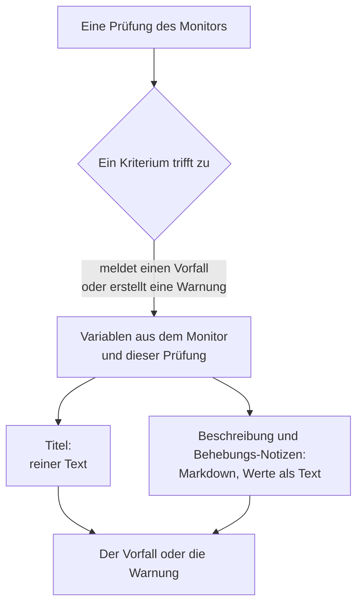

# Vorfall- & Warnmeldungsvorlagen

Wenn ein Kriterium eines Monitors einen Vorfall meldet oder eine Warnung erstellt, füllt es Titel, Beschreibung und Behebungs-Notizen aus einer Vorlage, die Sie schreiben. Setzen Sie Platzhalter wie `{{monitorName}}` oder `{{responseStatusCode}}` in die Form `{{variable}}` hinein, und jeder Vorfall sagt, was schiefgelaufen ist, mit den Werten der Prüfung, die ihn ausgelöst hat.

:::cards
- [Wo Sie eine Vorlage schreiben](#wo-sie-eine-vorlage-schreiben): Titel, Beschreibung und Behebungs-Notizen des Vorfalls oder der Warnung eines Kriteriums.
- [Grundlagen](#grundlagen): Platzhalter, Pfade in Objekte und Listen.
- [Variablen jedes Monitors](#variablen-jedes-monitors): Der Name des Monitors und die betroffene Ressource.
- [Variablen nach Monitortyp](#variablen-nach-monitortyp): Was jede Art von Prüfung meldet.
:::

## So funktionieren Vorlagen

Eine Vorlage wird einmal ausgefüllt, wenn das Kriterium den Vorfall oder die Warnung erstellt. OneUptime sammelt die Variablen aus dem Monitor und aus der Prüfung, die zugetroffen hat, setzt jeden Wert an die Stelle seines Platzhalters und speichert das Ergebnis. Eine spätere Änderung der Vorlage ändert die danach erstellten Vorfälle und Warnungen, nicht die bereits offenen.



- **Der Titel ist reiner Text.** Wo immer er erscheint, lautet er genau so, wie die Vorlage ihn erzeugt hat.
- **Beschreibung und Behebungs-Notizen sind Markdown.** Das Markdown, das Sie schreiben, wird dargestellt, und jeder Wert, den das überwachte System gesendet hat, wird als Text eingesetzt, sodass nichts darin einen Link, ein Bild oder eine Erwähnung hinzufügen kann. Siehe [Werte in Beschreibungen und Behebungs-Notizen](#werte-in-beschreibungen-und-behebungs-notizen).
- **Ein gruppierter Monitor füllt jeden Vorfall für seine eigene Serie aus.** Ein Monitor, der pro Host, Pod oder Gerät einen Vorfall öffnet, füllt jede Vorlage mit den Werten dieser Serie und hängt den Namen der Serie an den Titel an, wenn Ihre Vorlage ihn nicht schon nennt.

## Wo Sie eine Vorlage schreiben

:::steps
### Die Kriterien des Monitors öffnen

Gehen Sie zu **Monitore**, öffnen Sie den Monitor und klicken Sie in seinem Seitenmenü auf **Kriterien**. Klicken Sie auf **Überwachungskriterien bearbeiten**.

### Den Vorfall oder die Warnung einschalten

Schalten Sie in einem Kriterium unter **Aktionen** **Wenn Filter übereinstimmen, einen Vorfall deklarieren.** oder **Wenn Filter übereinstimmen, eine Warnung erstellen.** ein. Das Formular des Vorfalls oder der Warnung öffnet sich darunter.

### Den Titel schreiben

Geben Sie den Titel in **Vorfalltitel** oder **Warnungstitel** ein, zum Beispiel `{{monitorName}} is down`. **Mehr über dynamische Vorlagen erfahren** daneben öffnet **Dynamische Vorlagenvariablen**: jede Variable des Typs dieses Monitors, mit ihrem Inhalt. Klicken Sie auf eine Variable, um sie zu kopieren.

### Beschreibung und Behebungs-Notizen schreiben

Öffnen Sie **Beschreibung** für **Vorfallbeschreibung** oder **Warnungsbeschreibung** und **Weitere Felder** für **Behebungs-Notizen**. Diese Editoren bieten die Variablen selbst an: **Vorlagenvariablen** listet sie unter dem Editor auf, **Variable einfügen** in seiner Werkzeugleiste öffnet dieselbe Liste, und die Eingabe von `{{` öffnet sie an der Cursorposition.

### Die Kriterien speichern

Klicken Sie auf **Änderungen speichern**. Der nächste Vorfall oder die nächste Warnung dieses Kriteriums verwendet die neuen Vorlagen.
:::

## Grundlagen

Ein Platzhalter ist der Name einer Variablen in doppelten geschweiften Klammern. Wenn der Vorfall erstellt wird, ersetzt OneUptime ihn durch den Wert der Variablen und lässt den Text darum herum so, wie Sie ihn geschrieben haben.

```text title="Title template"
{{monitorName}} returned {{responseStatusCode}} in {{responseTimeInMs}} ms
```

Heißt der Monitor `Checkout API`, ist der Statuscode der Antwort `502` und hat die Antwort `842` Millisekunden gedauert, erhält der Vorfall den Titel:

```text title="Title as created"
Checkout API returned 502 in 842 ms
```

### Pfade in Objekte und Listen

Eine Variable, die ein Objekt oder eine Liste enthält, wird mit einem Pfad gelesen, genau wie in [JavaScript-Ausdrücken](/docs/monitor/javascript-expression):

| Schreiben | Um zu lesen | Beispiel |
| --- | --- | --- |
| `{{object.field}}` | Ein Feld eines Objekts, in beliebiger Tiefe | `{{responseBody.error.message}}` |
| `{{list[0]}}` or `{{list.0}}` | Ein Element einer Liste, ab 0 gezählt | `{{diskMetrics[0].usagePercent}}` |
| `{{list[last]}}` | Das letzte Element einer Liste | `{{processes[last].name}}` |
| `{{object}}` | Das ganze Objekt oder die ganze Liste, als JSON | `{{responseBody}}` |

Ein Feldname darf einen Bindestrich enthalten, wie in `{{responseHeaders.content-type}}`. Ein negativer Index wie `[-1]` liest nichts: Verwenden Sie `[last]`.

### Wenn ein Wert fehlt

Ein Platzhalter, dessen Pfad ins Leere führt, bleibt so im Text stehen, wie Sie ihn geschrieben haben, samt Klammern: Hat die Antwort kein Feld `error`, erscheint `{{responseBody.error.id}}` unverändert im Titel. Das gilt auch für eine Variable, die diese Prüfung nicht gemeldet hat, etwa `failureCause` bei einer Prüfung, die nicht fehlgeschlagen ist. Ein Wert, den die Prüfung als leeren Text gemeldet hat, wird durch nichts ersetzt.

Um eine Vorlage zu schreiben, die funktioniert, ob der Monitor gruppiert ist oder nicht, verwenden Sie die Variablen der [betroffenen Ressource](#betroffene-ressource): Es gibt sie immer, und sie sind leer, wenn der Monitor nicht gruppiert ist.

### Werte in Beschreibungen und Behebungs-Notizen

Eine Beschreibung und Behebungs-Notizen sind Markdown: Sie erscheinen auf der Seite des Vorfalls oder der Warnung, in E-Mails und in ihren Slack- und Microsoft-Teams-Kanälen. Die Werte, die eine Vorlage dort einsetzt, sind das, was das überwachte System gesendet hat - ein Antworttext oder -header, eine eingehende Anfrage oder E-Mail, die Labels eines Geräts oder einer Serie -, deshalb wird jeder als Text eingesetzt. Er lautet genau so, wie er gesendet wurde, wo immer die Vorlage ihn einsetzt, und ein Link, ein Bild, ein HTML-Tag oder eine Slack-Erwähnung wie `<!channel>` darin erscheint als Text, statt zu wirken. Eine nackte Webadresse in einem Wert wird trotzdem zum Link, und zwar zu einem, der zeigt, wohin er führt. Das Markdown, das Sie selbst in die Vorlage schreiben, wird so dargestellt, wie Sie es geschrieben haben.

Ein Wert kann beliebig groß sein - ein Antworttext oder ein Log von vielen Megabytes -, und die Benachrichtigung geht trotzdem mit ihm hinaus. Jeder Kanal trägt so viel, wie er aufnimmt, und eine Beschreibung, die für ihn zu lang ist, wird abgeschnitten, an einem Zeilenumbruch, wo es einen gibt, und endet mit „… (truncated — see OneUptime for the full text)“:

- **E-Mail**: Jede Beschreibung, Notiz oder Ursache trägt bis zu etwa 256 KB Text der E-Mail, und der Hinweis am Ende einer längeren verlinkt auf den Vorfall oder die Warnung. Eine ganze E-Mail - ihr Text und ihre Screenshots - bleibt unter 3 MB, was jeder Mailserver und Microsoft Graph annehmen: Ein Screenshot, der neben dem Text keinen Platz hat, wird weggelassen, mit einem Hinweis an seiner Stelle.
- **Die Seite des Vorfalls oder der Warnung** zeigt alles. Eine Beschreibung mit mehr als 128 KB, deren Darstellung lange dauern würde, erscheint als reiner Text, Zeile für Zeile.
- **Slack** trägt höchstens so viel, wie Slack von einer Nachricht zeigt (etwa 30.000 Zeichen). **Microsoft Teams** trägt etwa 40.000 Zeichen in einer Nachricht der OneUptime-App und etwa 12.000 über einen eingehenden Webhook (Statusseiten-Abonnenten, Workflows) - gemessen beim Senden der Nachricht, sodass eine Tabelle als das HTML zählt, zu dem sie wird.
- **SMS, Anrufe, Push-Benachrichtigungen, WhatsApp und Telegram** tragen, was ihre Anbieter annehmen: siehe [Wie die Stufen Personen benachrichtigen](/docs/on-call/escalation-rules#wie-die-stufen-personen-alarmieren).

Jeder Kanal stellt den Text in einer Zeit dar, die mit seiner Länge wächst. Ein Teil, dessen Darstellung einen Renderer weit länger beschäftigen würde - eine Zeile von mehr als 64 KB, ein langer Absatz aus einfachen Zeilen, ein Absatz voller `*`, `_` oder `[`, die nie schließen, Zitate oder Listen, die tiefer als sechzehn Ebenen verschachtelt sind, und auf der Seite des Vorfalls oder der Warnung eine Tabelle oder Liste von mehr als tausend Zeilen -, erscheint an seiner Stelle als reiner Text, und der Rest der Beschreibung wird wie gewohnt dargestellt.

## Für Fortgeschrittene

### Eine Liste durchlaufen

`{{#each path}}` wiederholt den Text bis `{{/each}}` einmal für jedes Element der Liste bei `path`:

```text title="Loop syntax"
{{#each arrayPath}}
  ...text with {{field}} placeholders for each item...
{{/each}}
```

Innerhalb der Schleife:

- `{{field}}` und `{{field.nested}}` lesen das aktuelle Element. Ein Name, den das Element nicht hat, wird im umgebenden Element gesucht, dann in den Variablen der ganzen Vorlage.
- `{{@index}}` ist die Position des Elements, ab 0 gezählt.
- `{{this}}` ist das Element selbst, für eine Liste einfacher Werte wie Zeichenketten.
- Eine Schleife über einen Pfad, der keine Liste ist, oder über eine leere Liste schreibt nichts.
- Schleifen lassen sich verschachteln: Ein `{{#each}}` in einem anderen liest die innere Liste jedes äußeren Elements.

Ein Beispiel: Ein [Eingehende-Anfrage-Monitor](/docs/monitor/incoming-request-monitor), der diese Warnungsbenachrichtigung empfängt:

```json title="Request body"
{
  "receiver": "payments",
  "alerts": [
    { "status": "firing", "labels": { "alertname": "HighLatency" } },
    { "status": "resolved", "labels": { "alertname": "DiskFull" } }
  ]
}
```

und diese Beschreibungsvorlage hat:

```text title="Description template"
Alerts for {{requestBody.receiver}}:
{{#each requestBody.alerts}}
- {{@index}}: {{labels.alertname}} ({{status}})
{{/each}}
```

erstellt einen Vorfall mit der folgenden Beschreibung. Jedes Element behält die Zeilenumbrüche um sich herum, sodass eine Leerzeile die Elemente trennt, und die Beschreibung trotzdem eine einzige Liste zeigt:

```text title="Description as created"
Alerts for payments:

- 0: HighLatency (firing)

- 1: DiskFull (resolved)
```

### Werte eines gruppierten Monitors

Ein metrikbasierter Monitor mit Attributen unter **Gruppieren nach** öffnet einen Vorfall pro Serie, und der Wert jedes Attributs ist eine Variable unter dem Namen des Attributs. Die Gruppierung nach `host.name` ergibt `{{host.name}}`, die Gruppierung nach `resource.k8s.pod.name` ergibt `{{resource.k8s.pod.name}}`. `{{seriesLabels}}` enthält sie alle, als Objekt.

Ein gruppierter [Logs-Monitor](/docs/monitor/logs-monitor) funktioniert genauso: Der Wert jedes Gruppierungsattributs ist eine Variable unter seinem Schlüssel.

## Variablen jedes Monitors

### Monitor

| Variable | Inhalt | Beispiel |
| --- | --- | --- |
| `monitorName` | Der Name des Monitors. | `Checkout API` |
| `monitorId` | Die ID des Monitors. | `a0f78958-da0a-4775-9fd9-c9fc63d3456f` |
| `monitorType` | Der Typ des Monitors. | `Website`, `Synthetic Monitor` |

### Betroffene Ressource

Diese beschreiben die Serie, für die ein gruppierter Monitor den Vorfall geöffnet hat: einen Pod, einen Container, einen Host, eine Festplatte. Bei einem nicht gruppierten Monitor sind sie leer, sodass eine Vorlage sie bei jedem Monitor verwenden kann.

| Variable | Inhalt |
| --- | --- |
| `seriesResourceSuffix` | Die Identität der Serie, mit einem Trennzeichen davor, für das Ende eines Titels. |
| `seriesResourceSummary` | Dieselbe Identität ohne das Trennzeichen, für einen Satz. |
| `seriesResourceBlock` | Jedes Label der Serie, als Markdown-Liste. Am besten in einer Beschreibung. |
| `seriesDebugCommands` | Nur lesende Befehle für genau diese Ressource, etwa `kubectl` oder `docker`, als Markdown-Liste. |

## Variablen nach Monitortyp

### Website- und API-Monitore

| Variable | Inhalt | Typ |
| --- | --- | --- |
| `responseBody` | Der Antworttext: ein Objekt, wenn er JSON ist, sonst der Text. | `JSON` oder `string` |
| `responseHeaders` | Die Antwortheader, nach Namen in Kleinbuchstaben. | `Dictionary<string>` |
| `responseStatusCode` | Der HTTP-Statuscode. | `number` |
| `responseTimeInMs` | Die Antwortzeit in Millisekunden. | `number` |
| `isOnline` | Ob der Monitor die Antwort als online gewertet hat. | `boolean` |

### Eingehende-Anfrage-Monitore

| Variable | Inhalt | Typ |
| --- | --- | --- |
| `requestBody` | Der Anfragetext: ein Objekt, wenn er JSON ist. | `JSON` oder `string` |
| `requestHeaders` | Die Anfrageheader, nach Namen in Kleinbuchstaben. | `Dictionary<string>` |
| `requestMethod` | Die HTTP-Methode, etwa `POST`. | `string` |
| `incomingRequestReceivedAt` | Wann die Anfrage empfangen wurde, als ISO-8601-Zeitstempel. | `string` |

Wenn beim Kriterium **Vorfälle und Warnungen nach einem Payload-Feld gruppieren** eingeschaltet ist, ist auch der Gruppierungsschlüssel eine Variable, benannt nach dem **letzten Segment** des Gruppierungspfads: Die Gruppierung nach `requestBody.alerts[*].labels.alertname` ergibt `{{alertname}}`, die Gruppierung nach `requestBody.alerts[*].fingerprint` ergibt `{{fingerprint}}`. Der ganze `requestBody` steht weiterhin daneben zur Verfügung.

> [!NOTE]
> `[*]` funktioniert nur in den Feldern des Gruppierungspfads. In einer Vorlage liest es nichts, sodass der Platzhalter so stehen bleibt, wie er geschrieben wurde. `{{requestBody.alerts[0].annotations.summary}}` liest immer die erste Warnung der Nutzlast, nicht die, für die der Vorfall geöffnet wurde: Verwenden Sie die Gruppierungsvariable und die gemeinsamen Felder der Nutzlast, etwa `commonLabels` und `commonAnnotations`. Siehe [Eingehende-Anfrage-Überwachung](/docs/monitor/incoming-request-monitor).

### Eingehende-E-Mail-Monitore

| Variable | Inhalt | Typ |
| --- | --- | --- |
| `emailSubject` | Der Betreff der E-Mail. | `string` |
| `emailFrom` | Die E-Mail-Adresse des Absenders. | `string` |
| `emailTo` | An wen die E-Mail ging, mit maskierter eigener Adresse des Monitors. | `string` |
| `emailBody` | Der Text der E-Mail als reiner Text. | `string` |
| `emailReceivedAt` | Wann die E-Mail empfangen wurde, als ISO-8601-Zeitstempel in UTC. | `string` |

In einem Titel wird jede davon auf eine Zeile von höchstens 150 Zeichen gekürzt. Beschreibungen und Behebungs-Notizen erhalten den vollständigen Wert. Siehe [Eingehende-E-Mail-Überwachung](/docs/monitor/incoming-email-monitor#vorlagenvariablen).

### Ping-, IP- und Port-Monitore

| Variable | Inhalt | Typ |
| --- | --- | --- |
| `isOnline` | Ob das Ziel geantwortet hat. | `boolean` |
| `responseTimeInMs` | Die Antwortzeit in Millisekunden. Bei einem Port die DNS-Auflösung und die TCP-Verbindung zusammen. | `number` |
| `failureCause` | Warum die Prüfung fehlgeschlagen ist, wenn sie es ist. | `string` |
| `isTimeout` | Ob bei der Prüfung eine Zeitüberschreitung auftrat. | `boolean` |

### NTP-Monitore

| Variable | Inhalt | Typ |
| --- | --- | --- |
| `isOnline` | Ob der Zeitserver auf die Anfrage der Probe geantwortet hat. | `boolean` |
| `isSynchronized` | Ob er auf Stratum 1 bis 15 geantwortet hat, ohne Schaltsekunden-Alarm und mit echten Zeitstempeln. | `boolean` |
| `stratum` | Das Stratum, das der Server gemeldet hat: 1 für einen Primärserver, 16, wenn nicht synchronisiert, 0 für ein Kiss-o'-Death. | `number` |
| `clockOffsetInMs` | Wie weit die Uhr des Servers von der der Probe abweicht, in Millisekunden. Positiv heißt, der Server geht vor. | `number` |
| `referenceId` | Womit sich der Server synchronisiert: eine Quelle wie `GPS` auf Stratum 1 oder die Adresse seines übergeordneten Servers. | `string` |
| `leapIndicator` | 0 bis 2, wenn alles in Ordnung ist, 3, wenn der Server meldet, dass seine Uhr nicht synchronisiert ist. | `number` |
| `kissCode` | Bei Stratum 0 der Code aus vier Buchstaben, den der Server statt der Zeit gesendet hat, etwa `RATE`. | `string` |
| `responseTimeInMs` | Die Zeit von der Anfrage bis zur Antwort, in Millisekunden. | `number` |
| `roundTripDelayInMs` | Die Netzwerk-Umlaufzeit des Austauschs, ohne die eigene Verarbeitungszeit des Servers. | `number` |
| `rootDelayInMs` | Die Umlaufzeit vom Server zu seiner Referenzuhr, in Millisekunden. | `number` |
| `rootDispersionInMs` | Die eigene Schätzung des Servers für seinen maximalen Fehler, in Millisekunden. | `number` |
| `serverTime` | Die Uhrzeit des Servers beim Senden der Antwort, als ISO-8601-Zeitstempel. | `string` |
| `referenceTime` | Wann die Uhr des Servers zuletzt gestellt oder korrigiert wurde, als ISO-8601-Zeitstempel. | `string` |
| `serverAddress` | Die Adresse, an die die Anfrage ging. | `string` |
| `port` | Der UDP-Port, an den die Anfrage ging. | `number` |
| `failureCause` | Warum der Server nicht geantwortet hat oder warum er nicht synchronisiert ist. | `string` |
| `isTimeout` | Ob der Server nicht rechtzeitig geantwortet hat. | `boolean` |

### SSL-Zertifikat-Monitore

| Variable | Inhalt | Typ |
| --- | --- | --- |
| `isOnline` | Ob die Zertifikatsprüfung erfolgreich war. | `boolean` |
| `isSelfSigned` | Ob das Zertifikat selbstsigniert ist. | `boolean` |
| `createdAt` | Wann das Zertifikat ausgestellt wurde, als ISO-8601-Zeitstempel. | `string` |
| `expiresAt` | Wann das Zertifikat abläuft, als ISO-8601-Zeitstempel. | `string` |
| `commonName` | Der Common Name (CN) des Zertifikats. | `string` |
| `organizationalUnit` | Seine Organisationseinheit (OU). | `string` |
| `organization` | Seine Organisation (O). | `string` |
| `locality` | Sein Ort (L). | `string` |
| `state` | Sein Bundesland oder seine Provinz (ST). | `string` |
| `country` | Sein Land (C). | `string` |
| `serialNumber` | Seine Seriennummer. | `string` |
| `fingerprint` | Sein SHA-1-Fingerabdruck. | `string` |
| `fingerprint256` | Sein SHA-256-Fingerabdruck. | `string` |
| `failureCause` | Warum die Prüfung fehlgeschlagen ist, wenn sie es ist. | `string` |

### DNS-Monitore

| Variable | Inhalt | Typ |
| --- | --- | --- |
| `isOnline` | Ob die Abfrage beantwortet wurde. | `boolean` |
| `responseTimeInMs` | Die Abfragezeit in Millisekunden. | `number` |
| `isTimeout` | Ob bei der Abfrage eine Zeitüberschreitung auftrat. | `boolean` |
| `isDnssecValid` | Das Ergebnis der DNSSEC-Validierung. | `boolean` |
| `records` | Die zurückgegebenen Einträge, jeder als `{type, value, ttl}`. | `Array<Object>` |
| `recordValues` | Nur die Werte der Einträge. | `Array<string>` |
| `failureCause` | Warum die Abfrage fehlgeschlagen ist, wenn sie es ist. | `string` |

### DNSSEC-Monitore

| Variable | Inhalt | Typ |
| --- | --- | --- |
| `isOnline` | Ob die Prüfung abgeschlossen wurde. | `boolean` |
| `domainName` | Die geprüfte Zone. | `string` |
| `isZoneSigned` | Ob die Zone DNSKEY-Einträge hat. | `boolean` |
| `isParentDsPresent` | Ob die übergeordnete Zone DS-Einträge für sie hat. | `boolean` |
| `isChainValid` | Ob die Vertrauenskette validiert wird. | `boolean` |
| `resolverConsensusAd` | Ob jeder Resolver das AD-Flag zurückgegeben hat. | `boolean` |
| `isNameserverConsistent` | Ob jeder autoritative Nameserver dieselbe SOA-Seriennummer zurückgegeben hat. | `boolean` |
| `earliestSignatureExpiration` | Wann die erste RRSIG-Signatur abläuft, als ISO-8601-Zeitstempel. | `string` |
| `daysUntilSignatureExpiry` | Tage, bis diese Signatur abläuft. | `number` |
| `dnskeyCount` | Die Anzahl der DNSKEY-Einträge. | `number` |
| `dsRecordCount` | Die Anzahl der DS-Einträge bei der übergeordneten Zone. | `number` |
| `rrsigCount` | Die Anzahl der gesehenen RRSIG-Einträge. | `number` |
| `responseTimeInMs` | Wie lange die Prüfung gedauert hat, in Millisekunden. | `number` |
| `failureCause` | Warum die Prüfung fehlgeschlagen ist, wenn sie es ist. | `string` |

### Domain-Monitore

| Variable | Inhalt | Typ |
| --- | --- | --- |
| `isOnline` | Ob die Abfrage der Registrierung erfolgreich war. | `boolean` |
| `domainName` | Die abgefragte Domain. | `string` |
| `lookupMethod` | Das Protokoll, das geantwortet hat: RDAP oder WHOIS. | `string` |
| `registrar` | Der Registrar. | `string` |
| `createdDate` | Wann die Domain registriert wurde. | `string` |
| `updatedDate` | Wann sich die Registrierung zuletzt geändert hat. | `string` |
| `expiresDate` | Wann die Registrierung abläuft. | `string` |
| `nameServers` | Die Nameserver der Domain. | `Array<string>` |
| `domainStatus` | Die Statuscodes der Registry, etwa `clientTransferProhibited`. | `Array<string>` |
| `dnssec` | Der DNSSEC-Status bei der Registry. | `string` |
| `responseTimeInMs` | Wie lange die Abfrage gedauert hat, in Millisekunden. | `number` |
| `failureCause` | Warum die Abfrage fehlgeschlagen ist, wenn sie es ist. | `string` |

### Server-/VM-Monitore

| Variable | Inhalt | Typ |
| --- | --- | --- |
| `hostname` | Der Hostname des Servers. | `string` |
| `requestReceivedAt` | Wann der Bericht des Servers empfangen wurde, als ISO-8601-Zeitstempel. | `string` |
| `cpuUsagePercent` | Genutzte CPU, 0 bis 100. | `number` |
| `cpuCores` | Die Anzahl der CPU-Kerne. | `number` |
| `memoryUsagePercent` | Genutzter Arbeitsspeicher, 0 bis 100. | `number` |
| `memoryFreePercent` | Freier Arbeitsspeicher, 0 bis 100. | `number` |
| `memoryTotalBytes` | Gesamter Arbeitsspeicher, in Bytes. | `number` |
| `diskMetrics` | Ein Eintrag pro eingehängter Festplatte. | `Array<Object>` |
| `diskMetrics[].diskPath` | Der Einhängepunkt der Festplatte. | `string` |
| `diskMetrics[].usagePercent` | Belegter Platz auf der Festplatte, 0 bis 100. | `number` |
| `diskMetrics[].freePercent` | Freier Platz auf der Festplatte, 0 bis 100. | `number` |
| `diskMetrics[].totalBytes` | Die Größe der Festplatte, in Bytes. | `number` |
| `processes` | Die laufenden Prozesse, die der Agent gemeldet hat. | `Array<Object>` |
| `processes[].pid` | Die Prozess-ID. | `number` |
| `processes[].name` | Der Name des Prozesses. | `string` |
| `processes[].command` | Der Befehl, mit dem der Prozess gestartet wurde. | `string` |
| `failureCause` | Warum die Prüfung fehlgeschlagen ist, wenn sie es ist. | `string` |

### Synthetische Monitore

Ein synthetischer Monitor führt sein Skript einmal für jeden Browser und jede Bildschirmgröße aus, die er verwenden soll, etwa Chromium auf einem Desktop-Bildschirm und Firefox auf einem mobilen. `syntheticResponses` enthält einen Eintrag pro Lauf: Lesen Sie einen Lauf über seine Position, wie in `{{syntheticResponses[0].browserType}}`, oder alle Läufe mit `{{#each syntheticResponses}}`.

| Variable | Inhalt | Typ |
| --- | --- | --- |
| `failureCause` | Warum die Prüfung fehlgeschlagen ist, wenn sie es ist. | `string` |
| `syntheticResponses` | Ein Eintrag pro Browser und Bildschirmgröße, auf denen das Skript lief. | `Array<Object>` |
| `syntheticResponses[].executionTimeInMs` | Wie lange der Lauf gedauert hat, in Millisekunden. | `number` |
| `syntheticResponses[].result` | Was das Skript zurückgegeben hat. | `string`, `number`, `boolean` oder `JSON` |
| `syntheticResponses[].scriptError` | Der Fehler, mit dem der Lauf endete, falls vorhanden. | `string` |
| `syntheticResponses[].logMessages` | Was der Lauf protokolliert hat. | `Array<string>` |
| `syntheticResponses[].screenshots` | Die Screenshots, die der Lauf gemacht hat, nach Namen, jeder als Base64-Text. Siehe [Einen Screenshot zeigen](#einen-screenshot-zeigen). | `Object` |
| `syntheticResponses[].browserType` | Der Browser des Laufs. | `string` |
| `syntheticResponses[].screenSizeType` | Die Bildschirmgröße des Laufs. | `string` |

#### Einen Screenshot zeigen

Jeder Eintrag von `screenshots` ist ein Screenshot, den das Skript gemacht hat, unter dem Namen, den das Skript ihm gegeben hat (`screenshots["login-page"] = await page.screenshot()`), als Base64-Text. Um einen in der Beschreibung oder den Behebungs-Notizen eines Vorfalls oder einer Warnung zu zeigen, schreiben Sie ein Bild darum herum:

```text title="Description template"
{{syntheticResponses[0].scriptError}}


```

Der Screenshot erscheint dann auf der Seite des Vorfalls oder der Warnung, auf den Statusseiten, die den Vorfall zeigen, in den E-Mail-Benachrichtigungen dazu und in den Slack- und Microsoft-Teams-Nachrichten dazu. In einer E-Mail wird er angehängt und im Text angezeigt, was Gmail, Outlook und Apple Mail alle darstellen, sodass die Person in Bereitschaft sieht, wie die Seite aussah, ohne OneUptime zu öffnen.

- PNG-, JPEG-, GIF- und WebP-Screenshots werden angezeigt. `image/png` funktioniert auch für einen JPEG-Screenshot (`page.screenshot({ type: "jpeg" })`).
- Eine E-Mail trägt höchstens 2 MB an Bildern und höchstens 20 Bilder. Ein Bild, das nicht hineinpasst, wird durch einen Hinweis mit seinem Alternativtext ersetzt, geben Sie also jedem Bild einen Alternativtext. Ein JPEG-Screenshot ist viel kleiner als ein PNG, und ein Screenshot des fehlgeschlagenen Laufs sagt meist mehr als alle Screenshots aller Läufe.
- In Slack und Microsoft Teams erscheint der Screenshot dort, wo die Beschreibung ihn hat: Ein Bild auf einer eigenen Zeile tritt an die Stelle dieser Zeile, und ein Bild mitten in einem Satz, einer Liste oder einer Tabelle hinterlässt dort seinen Alternativtext und wird danach gezeigt. Slack zeigt PNG-, JPEG- und GIF-Screenshots, höchstens 10 und 10 MB pro Nachricht; die OneUptime-App lädt jeden privat in Ihren Slack-Arbeitsbereich hoch und zeigt ihn in der Nachricht. Teams zeigt PNG-, JPEG- und GIF-Screenshots von bis zu 1 MB in der Karte der Nachricht, höchstens 10 und 2 MB pro Nachricht.
- Das Hochladen zu Slack braucht die Berechtigung `files:write` der App. Wenn Ihr Arbeitsbereich Slack verbunden hat, bevor OneUptime danach gefragt hat, verbinden Sie Slack erneut unter **Projekteinstellungen → Arbeitsbereich → Slack** (auf einem selbst gehosteten Server fügen Sie die Berechtigung zuerst Ihrer Slack-App hinzu - siehe [Slack-Integration](/docs/self-hosted/slack-integration#bilder-in-nachrichten)).
- Ein Screenshot, den ein Chat nicht zeigen kann - ein WebP, einer über diesen Grenzen, einer, den Slack oder Teams ablehnt, oder jeder Screenshot in einer Nachricht über einen eingehenden Webhook -, erscheint als sein Alternativtext oder als „[image]“, wenn er keinen hat, geben Sie also jedem Bild einen Alternativtext. Das Base64 des Bildes erreicht den Chat nie.
- Nur ein Bild, das Sie in die Vorlage schreiben, wird angezeigt. Ein Bild in einem Wert, den die überwachte Seite oder das Skript gemeldet hat - eine Fehlermeldung, eine Logzeile -, erscheint weiterhin als Text (siehe [Werte in Beschreibungen und Behebungs-Notizen](#werte-in-beschreibungen-und-behebungs-notizen)).
- OneUptime AI liest den Text um einen Screenshot, nicht den Screenshot. Was eine Untersuchung, ein entworfenes Postmortem oder eine Notiz, der KI-Schritt eines Runbooks oder der KI-Schritt eines Workflows dem Modell gibt, enthält an der Stelle des Bildes einen kurzen Hinweis wie `[image omitted: PNG, 340 KB]`: Ein Modell liest Text, keine Bilder, und das Base64 eines Screenshots wären Hunderttausende Token bei jedem Aufruf. Die Aktivität der Untersuchung sagt, was weggelassen wurde.

Um den Screenshot jedes fehlgeschlagenen Laufs zu zeigen, setzen Sie das Bild in eine Schleife. Hier speichert das Skript jeden Screenshot als `screenshots["failure"]`:

```text title="Description template"
### What the page looked like
{{#each syntheticResponses}}
**{{browserType}} / {{screenSizeType}}**: {{scriptError}}


{{/each}}
```

### Monitore mit eigenem JavaScript-Code

| Variable | Inhalt | Typ |
| --- | --- | --- |
| `result` | Was das Skript zurückgegeben hat. Lesen Sie ein Feld mit einem Pfad, wie in `{{result.status}}`. | `string`, `number`, `boolean` oder `JSON` |
| `executionTimeInMs` | Wie lange das Skript lief, in Millisekunden. | `number` |
| `scriptError` | Der Fehler, mit dem das Skript endete, falls vorhanden. | `string` |
| `logMessages` | Was das Skript mit `console.log` protokolliert hat. | `Array<string>` |
| `failureCause` | Warum die Prüfung fehlgeschlagen ist, wenn sie es ist. | `string` |

### Netzwerkgeräte-Monitore

| Variable | Inhalt | Typ |
| --- | --- | --- |
| `isOnline` | Ob das Gerät erreichbar ist, per Ping **oder** SNMP. Bei jeder Abfrage gesetzt. | `boolean` |
| `responseTimeInMs` | Die Antwortzeit des SNMP-**Walks** in Millisekunden. Nie die Umlaufzeit des Pings. | `number` |
| `failureCause` | Warum der SNMP-Walk fehlgeschlagen ist, wenn er es ist. | `string` |
| `isTimeout` | Ob beim SNMP-Walk eine Zeitüberschreitung auftrat. | `boolean` |
| `oidResponses` | Die abgefragten OIDs, jede als `{oid, name, value, type}`. | `Array<Object>` |
| `{{OID_NAME}}` | Der Wert einer benannten OID, über ihren Namen, wie in `{{sysUpTime}}`. | `string` oder `number` |
| `sysName` | Der Name des Geräts, aus der SNMP-Systemgruppe. | `string` |
| `sysDescr` | Die Beschreibung des Geräts, aus der SNMP-Systemgruppe. | `string` |
| `sysObjectId` | Die registrierte Enterprise-OID des Herstellers: der Fingerabdruck des Geräts. | `string` |
| `sysLocation` | Der Standort des Geräts, aus der SNMP-Systemgruppe. | `string` |
| `downInterfaces` | Schnittstellen, die administrativ aktiv, aber betrieblich ausgefallen sind, jede als `{name, alias, interfaceIndex}`. Braucht die Schnittstellenüberwachung. | `Array<Object>` |
| `interfacesTotal` | Die Anzahl der abgefragten Schnittstellen. | `number` |
| `interfacesUp` | Schnittstellen, die administrativ und betrieblich aktiv sind. | `number` |
| `interfacesDown` | Schnittstellen, die administrativ aktiv, aber betrieblich ausgefallen sind. | `number` |
| `interfaceWalkFailure` | Der Fehler, wenn die Abfrage der Schnittstellen fehlgeschlagen ist. | `string` |
| `tables` | Die SNMP-Tabellen des Geräts, nach Schlüssel: `rowCount`, `rows`, `unhealthyRowCount` und `unhealthyRows` jeder Tabelle, wie in `{{tables.ipsec_tunnels.unhealthyRowCount}}`. | `Object` |
| `snmpTable` | Die SNMP-Tabelle, um die es bei einer Warnung pro Zeile geht. | `string` |
| `snmpTableRow` | Die Zeile, um die es bei einer Warnung pro Zeile geht: ein Tunnel, ein Funkmodul, ein Nachbar. | `string` |
| `trapOid` | Die OID des Traps. Nur, wenn ein SNMP-Trap die Prüfung ausgelöst hat. | `string` |
| `trapSourceIp` | Die Adresse, von der der Trap kam. Nur, wenn ein SNMP-Trap die Prüfung ausgelöst hat. | `string` |
| `trapVarbinds` | Die Varbinds des Traps, jedes als `{oid, value}`. Nur, wenn ein SNMP-Trap die Prüfung ausgelöst hat. | `Array<Object>` |

Ein Netzwerkgerät wird bei jeder Abfrage gepingt und nur dann per SNMP abgefragt, wenn es Zugangsdaten hat, deshalb ist **`isOnline` die einzige Variable oben, die ein reines Ping-Gerät füllt**: Jede andere stammt aus dem SNMP-Walk und bleibt ohne ihn so stehen, wie sie geschrieben wurde. Beginnen Sie Vorlagen, die für Geräte ohne Zugangsdaten verwendet werden könnten, mit `{{isOnline}}` und dem Namen des Geräts. Siehe [Netzwerkgeräte-Überwachung](/docs/monitor/network-device-monitor#what-a-poll-actually-does) dazu, was jede Art von Abfrage erfasst.

### Datenbankzustands-Monitore

| Variable | Inhalt | Typ |
| --- | --- | --- |
| `isOnline` | Ob die Probe sich verbinden und die Basisabfrage ausführen konnte. Fehlende Metriken machen dies nie falsch. | `boolean` |
| `responseTimeInMs` | Die Zeit für die Verbindung und die Basisabfrage, in Millisekunden. | `number` |
| `failureCause` | Warum die Prüfung fehlgeschlagen ist, wenn sie es ist. | `string` |
| `connectionError` | Der Verbindungsfehler, ohne Zugangsdaten und ohne Verbindungszeichenfolge. | `string` |
| `engineVersion` | Die Version, die der Datenbankserver gemeldet hat. | `string` |
| `collectedGroups` | Die Metrikgruppen, die bei dieser Prüfung Werte geliefert haben. | `Array<string>` |
| `unavailableGroups` | Die Gruppen, die nicht erfasst werden konnten, jede als `{group, reason, message, remediation}`. | `Array<Object>` |
| `collectionIssueSummary` | Eine Zeile über jede nicht verfügbare Gruppe, fertig für einen Titel. Leer, wenn alles erfasst wurde. | `string` |
| `metrics` | Die erfassten Werte, nach Seriennamen. | `Object` |

Die Seriennamen in `metrics` enthalten Punkte, etwa `oneuptime.monitor.database.connections.used.percent`, und ein Pfad liest jeden Punkt als Schritt in ein Objekt, sodass eine Vorlage keinen einzelnen Wert aus `metrics` herausgreifen kann. Setzen Sie `{{metrics}}` als Ganzes ein, als JSON, oder verwenden Sie `{{collectionIssueSummary}}`. Eine Metrik, die nicht erfasst wurde, fehlt in `metrics`, statt null zu sein. Um auf einen einzelnen Wert zu reagieren, vergleichen Sie ihn im Kriterium mit einem [JavaScript-Ausdruck](/docs/monitor/javascript-expression).

### Monitore externer Statusseiten

| Variable | Inhalt | Typ |
| --- | --- | --- |
| `overallStatus` | Der Gesamtstatus der Statusseite, etwa `major_outage`. | `string` |
| `activeIncidentCount` | Die Anzahl der auf der Statusseite offenen Vorfälle. | `number` |
| `componentStatuses` | Ihre Komponenten, jede als `{name, status, description, groupName}`. | `Array<Object>` |
| `provider` | Die Art der Statusseite: Atlassian Statuspage, incident.io, RSS oder Atom. | `string` |
| `componentGroup` | Die Komponentengruppe, die der Monitor beobachtet, falls er eine beobachtet. | `string` |
| `componentName` | Die Komponente, die der Monitor beobachtet, falls er eine beobachtet. | `string` |
| `isOnline` | Ob die Statusseite geantwortet hat. | `boolean` |
| `responseTimeInMs` | Wie lange die Statusseite für die Antwort brauchte, in Millisekunden. | `number` |
| `failureCause` | Warum die Prüfung fehlgeschlagen ist, wenn sie es ist. | `string` |

### Metrik- und Infrastruktur-Monitore

Metrics-, Kubernetes-, Docker-, Host-, Podman-, Docker-Swarm-, Proxmox-, VMware-, Ceph- und Storage-Array-Monitore haben eine eigene Variable:

| Variable | Inhalt | Typ |
| --- | --- | --- |
| `metricName` | Der Name der Metrik, die die erste Abfrage des Monitors liest, etwa `container.cpu.time`. | `string` |

Gruppiert haben sie außerdem den Wert jedes Attributs unter **Gruppieren nach** und `seriesLabels`: siehe [Werte eines gruppierten Monitors](#werte-eines-gruppierten-monitors). Ein IoT-Geräte-Monitor hat kein `metricName`, aber ein gruppierter, wie seine Vorlagen es sind, hat `{{device.id}}`.

### Andere Monitortypen

Logs-, Traces-, Exceptions-, Security-Events-, AI-/LLM- und SQL-Query-Monitore haben keine eigenen Variablen. Verwenden Sie die [Variablen jedes Monitors](#variablen-jedes-monitors) und bei einem gruppierten Logs-Monitor die [Gruppenwerte](#werte-eines-gruppierten-monitors).

## Beispiele

### Eine langsame API

```text title="Title"
{{monitorName}} is slow: {{responseTimeInMs}} ms
```

```text title="Description"
### API error
Status: **{{responseStatusCode}}**
Latency: **{{responseTimeInMs}} ms**
Message: `{{responseBody.error.message}}`
```

### Ein Zertifikat kurz vor dem Ablauf

```text title="Title"
Certificate for {{commonName}} expires {{expiresAt}}
```

### Ein Server, dem der Platz ausgeht

```text title="Description"
### {{hostname}}
CPU: **{{cpuUsagePercent}}%**
Memory: **{{memoryUsagePercent}}%**

**Disks:**
{{#each diskMetrics}}
- {{diskPath}}: {{usagePercent}}% used ({{freePercent}}% free)
{{/each}}

**Processes:**
{{#each processes}}
- [{{pid}}] {{name}}: {{command}}
{{/each}}
```

### Eine fehlgeschlagene Ping-, IP- oder Port-Prüfung

```text title="Description"
{{monitorName}} could not be reached: {{failureCause}}
Timed out: {{isTimeout}}
Response time: {{responseTimeInMs}} ms
```

### Jeder Lauf eines synthetischen Monitors

```text title="Description"
### Synthetic monitor results
{{#each syntheticResponses}}
- **{{browserType}} / {{screenSizeType}}**: {{result}} in {{executionTimeInMs}} ms
  - Script error: {{scriptError}}
  - First log line: {{logMessages[0]}}
{{/each}}
```

### Eine Prüfung mit eigenem Code

```text title="Description"
The script ran for {{executionTimeInMs}} ms and returned {{result}}.
Last log line: {{logMessages[last]}}
```

### Ein Netzwerkgerät

Diese setzen voraus, dass das Gerät SNMP-Zugangsdaten hat: Bei einem reinen Ping-Gerät bleibt alles außer `{{isOnline}}` so stehen, wie es geschrieben wurde.

```text title="Title"
{{sysName}}: {{interfacesDown}} interfaces down
```

```text title="Description"
### {{sysName}} ({{sysLocation}})
Online: {{isOnline}}
SNMP walk: {{responseTimeInMs}} ms

{{#each downInterfaces}}
- {{name}} ({{alias}}) is down
{{/each}}
```

### Warnungen von Alertmanager oder Grafana

```text title="Title"
[{{requestBody.status}}] {{requestBody.receiver}}
```

```text title="Description"
### Alerts from {{requestBody.receiver}}
{{#each requestBody.alerts}}
**Alert {{@index}}**: {{labels.alertname}}
- Status: {{status}}
- Summary: {{annotations.summary}}
- Source: {{generatorURL}}
{{/each}}
```

## Fehlerbehebung

:::details Der Titel zeigt den Platzhalter samt Klammern
Der Pfad führt bei dieser Prüfung zu keinem Wert. Vergleichen Sie Namen und Schreibweise der Variablen mit den Tabellen oben, oder öffnen Sie im Kriterium **Mehr über dynamische Vorlagen erfahren**: Dort stehen die Variablen des Typs dieses Monitors. Ein Pfad in einen Antwort- oder Anfragetext muss zum Text passen, wie er gesendet wurde, und `[*]` sowie negative Indizes wie `[-1]` lesen nichts: Verwenden Sie `[0]` oder `[last]`.
:::

:::details Ein Wert erscheint als JSON
Der Pfad endet an einem Objekt oder einer Liste, deshalb wird das Ganze als JSON eingesetzt. Ergänzen Sie den Pfad um das gewünschte Feld, wie in `{{responseBody.error.message}}`, oder durchlaufen Sie eine Liste mit `{{#each}}`.
:::

:::details Eine Schleife schreibt nichts
Der Pfad nach `#each` ist bei dieser Prüfung keine Liste, oder die Liste ist leer. Prüfen Sie den Pfad anhand der Nutzlast und ob jedes `{{#each}}` sein `{{/each}}` hat.
:::

:::details Markdown in einem Wert erscheint als Text
Das ist Absicht: Ein Wert, den das überwachte System gesendet hat, wird als Text eingesetzt, sodass er der Beschreibung nie einen Link, ein Bild oder eine Erwähnung hinzufügen kann. Schreiben Sie die Formatierung stattdessen in die Vorlage um den Wert herum. Siehe [Werte in Beschreibungen und Behebungs-Notizen](#werte-in-beschreibungen-und-behebungs-notizen).
:::

:::details Ein Screenshot erscheint nicht in Slack, Microsoft Teams oder E-Mail
Prüfen Sie Format und Größe des Bildes anhand von [Einen Screenshot zeigen](#einen-screenshot-zeigen). In Slack braucht die OneUptime-App die Berechtigung `files:write`: Verbinden Sie Slack erneut unter **Projekteinstellungen → Arbeitsbereich → Slack**, wenn Ihr Arbeitsbereich es verbunden hat, bevor OneUptime danach gefragt hat.
:::

## Nächste Schritte

:::cards
- [JavaScript-Ausdrücke](/docs/monitor/javascript-expression): Dieselben Platzhalter, in den Bedingungen eines Kriteriums.
- [Einen Vorfall melden](/docs/incidents/declaring-incidents): Was passiert, nachdem ein Kriterium einen gemeldet hat.
- [Synthetische Überwachung](/docs/monitor/synthetic-monitor): Die Screenshots machen, die eine Beschreibung zeigen kann.
- [Eingehende-Anfrage-Überwachung](/docs/monitor/incoming-request-monitor): Webhooks in Vorfälle verwandeln, die nach jeder Warnung benannt sind.
:::
