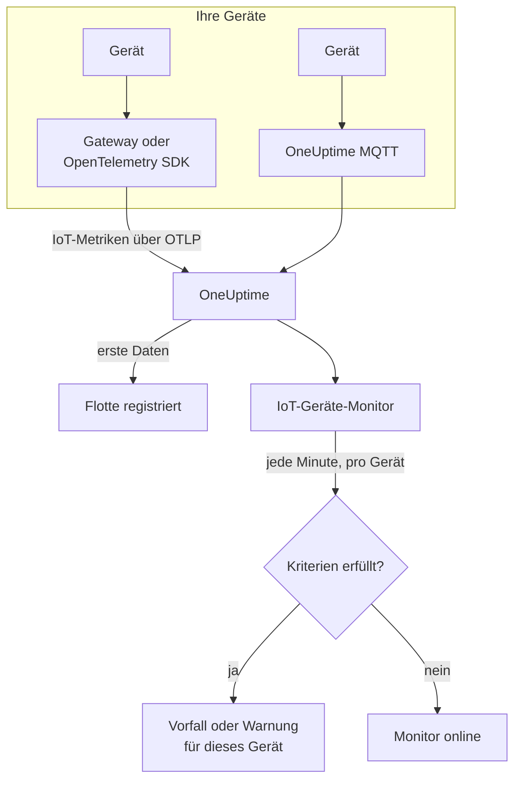

# IoT-Geräte-Überwachung

Ein IoT-Geräte-Monitor beobachtet eine Flotte von Geräten und meldet Ihnen, wenn ein Gerät offline geht, sein Akku schwach wird, sein Signal nachlässt, es überhitzt oder seine CPU dauerhaft ausgelastet bleibt. Er liest die `iot_*`-Metriken, die Ihre Geräte über OpenTelemetry oder MQTT an OneUptime senden, sodass nichts von außen geprüft wird und keine Probe beteiligt ist.

:::cards
- [Den Monitor erstellen](#einen-iot-geräte-monitor-erstellen): Sechs Schritte im Dashboard.
- [Vorlagen](#fertige-warnungsvorlagen): Fünf fertige Warnungen, ein Vorfall pro Gerät.
- [Offline-Erkennung](#offline-erkennung): Wie ein ausgefallenes oder stummes Gerät bemerkt wird.
- [Metriken](#erfasste-metriken): Die `iot_*`-Serien, die der Monitor liest.
:::

## So funktioniert es

Ihre Geräte, oder das Gateway, mit dem sie sprechen, senden ihre Messwerte an OneUptime: über OpenTelemetry oder direkt an den MQTT-Endpunkt von OneUptime. Jeder Messwert trägt den Namen der Flotte, `iot.fleet.name`, und die eigene ID des Geräts, `device.id`. Die ersten Daten registrieren die Flotte.

Ein IoT-Geräte-Monitor ist an eine Flotte gebunden. Jede Minute führt er seine Abfrage über die Metriken dieser Flotte aus und vergleicht das Ergebnis mit seinen Kriterien. Die Vorlagen gruppieren nach `device.id`, sodass 30 Sensoren, die offline sind, 30 Vorfälle öffnen, von denen jeder sein Gerät nennt und sich von selbst auflöst, wenn sein Gerät sich erholt.



## Bevor Sie beginnen

- **Lassen Sie Ihre Geräte Daten senden.** Die [Anleitung zu IoT-Geräten](/docs/telemetry/iot-devices) zeigt, wie Sie Metriken mit einem OpenTelemetry SDK oder Collector oder über MQTT senden.
- **Prüfen Sie, ob die Flotte registriert ist.** Sie erscheint unter **Produkte → Infrastruktur → IoT → Alle Flotten**, benannt nach dem `iot.fleet.name`, den die Geräte senden.
- **Registrieren Sie die Geräte, die Sie erwarten**, im **Geräteregister** der Flotte, um benachrichtigt zu werden, wenn eines verstummt: siehe [Offline-Erkennung](#offline-erkennung).

## Einen IoT-Geräte-Monitor erstellen

:::steps
### Einen neuen Monitor beginnen

Gehen Sie zu **Monitore** und klicken Sie auf **Monitor erstellen**.

### IoT-Gerät wählen

Klicken Sie unter **Monitortyp** auf **Weitere Monitortypen** und wählen Sie **IoT-Gerät** unter **Infrastruktur**, oder geben Sie `iot` in das Suchfeld ein. Geben Sie einen **Name** ein - er wird in den Titeln von Vorfällen und Warnungen verwendet - und klicken Sie auf **Weiter**.

### Die Flotte wählen

Wählen Sie unter **IoT-Monitor-Konfiguration** die Flotte aus **IoT-Flotte**. Jede Flotte, die Daten gesendet hat, steht in der Liste.

### Festlegen, was überwacht wird

Wählen Sie einen der drei Tabs:

- **Quick Setup** - klicken Sie auf eine [Vorlage](#fertige-warnungsvorlagen). Sie setzt die Metrik, die Aggregation, den Zeitbereich, eine Gruppierung nach `device.id` und die Schwellenwerte und ersetzt die Kriterien unten durch ihre eigenen. Den **Zeitbereich** können Sie weiterhin ändern.
- **Custom Metric** - wählen Sie eine Metrik aus **IoT-Metrik** und legen Sie dann **Aggregation** und **Zeitbereich** fest. Die [Filter](#monitor-einstellungen) schränken sie auf ein Gerät oder einen Gerätetyp ein. Eine eigene Metrik wird nicht gruppiert: Sie beurteilt die Flotte als Ganzes.
- **Erweitert** - bauen Sie Abfragen und Formeln selbst unter **Metriken auswählen**, auch über eigene Metriknamen, zum Beispiel den belegten Speicher als Prozentsatz der Speichergröße eines Geräts. Verwenden Sie **Gruppieren nach** `device.id`, um jedes Gerät einzeln zu beurteilen.

### Die Kriterien prüfen

Öffnen Sie jedes Kriterium unter **Monitor-Kriterien** und prüfen Sie **Metrikvariable auswählen**, **Aggregation**, **Bedingung** und **Schwellenwert**. Eine Vorlage füllt diese aus. Mit **Custom Metric** oder **Erweitert** beginnt der Monitor mit den [Standardkriterien](#standardkriterien), die nur bemerken, dass eine Metrik auf null fällt, setzen Sie also Ihren eigenen Schwellenwert.

### Den Monitor erstellen

Klicken Sie auf **Monitor erstellen**. OneUptime öffnet die Seite des Monitors und wertet ihn jede Minute aus. Vorfälle und Warnungen, die er auslöst, erreichen Ihre Bereitschaftsrichtlinien, Slack, Microsoft Teams, E-Mail, SMS und Webhooks wie die jedes anderen Monitors.
:::

> [!TIP]
> Um mehrere Vorlagen auf einmal einzurichten, öffnen Sie die Flotte über **Produkte → Infrastruktur → IoT** und gehen Sie zu **Empfehlungen**. Wählen Sie die gewünschten Vorlagen, legen Sie fest, wer benachrichtigt wird, und OneUptime erstellt einen Monitor pro Vorlage.

## Monitor-Einstellungen

| Feld | Tab | Was es tut |
| --- | --- | --- |
| **IoT-Flotte** | Alle | Erforderlich. Beschränkt jede Abfrage auf `resource.iot.fleet.name`. |
| **Ressourcenbereich** | Custom Metric, Erweitert | Optional. **Gerät** oder **Flotte**: ein exakter Abgleich mit dem Attribut `iot.scope`. Die Wahl einer Metrik setzt ihn auf **Gerät**. |
| **Geräte-ID** | Custom Metric, Erweitert | Optional. Ein Gerät, über seine `device.id`, etwa `sensor-001`. |
| **Gerätetyp** | Custom Metric, Erweitert | Optional. Die Geräte, die diesen `iot.device.type` melden, etwa `sensor` oder `gateway`. |
| **IoT-Metrik** | Custom Metric | Eine Metrik aus dem [Katalog](#erfasste-metriken). |
| **Aggregation** | Custom Metric | Wie Stichproben zusammengefasst werden: **Durchschnitt**, **Maximum**, **Minimum**, **Summe** oder **Anzahl**. Beginnt bei der üblichen Aggregation der Metrik. |
| **Zeitbereich** | Alle | Das gleitende Zeitfenster, das die Abfrage liest, von **Past 1 Minute** bis **Past 365 Days**. Ein neuer Monitor beginnt bei **Past 1 Minute**; Vorlagen setzen ihr eigenes. |
| **Metriken auswählen** | Erweitert | Der Abfrage-Builder: **Metrik**, **Aggregieren nach**, **Nach Attributen filtern**, **Gruppieren nach**, dazu **Metrik hinzufügen** und **Formel hinzufügen**, um Abfragen zu kombinieren. |

Die Filter wirken zusammen: Mit einer **Geräte-ID** und einem **Gerätetyp** passt ein Gerät eines anderen Typs auf nichts.

## Fertige Warnungsvorlagen

**Quick Setup** bietet 5 Vorlagen. Jede baut einen vollständigen Monitor: die Metrikabfrage, eine Gruppierung nach `device.id`, ein Kriterium, das auslöst, und eines, das sich erholt. Schwellenwerte sind Ausgangspunkte, die Sie bearbeiten können.

Ein Kriterium löst nur aus, wenn die Bedingung für jede Minute seines Fensters gilt - außer **Device Offline**, das beim ersten Messwert unter 1 auslöst. Ein Schwellenwertkriterium erholt sich erst 10 % jenseits seines Schwellenwerts, sodass ein Wert, der um die Linie pendelt, nicht flattert.

| Template | Kategorie | Schweregrad | Beobachtet | Löst aus, wenn | Erholt sich, wenn |
| --- | --- | --- | --- | --- | --- |
| Device Offline | Verfügbarkeit | Kritisch | `iot_device_up`, Min pro `device.id`, letzte 30 Minuten | Ein Messwert liegt unter 1, oder ein registriertes Gerät sendet im ganzen Fenster nichts | Wieder bei 1 |
| Low Battery | Stromversorgung | Warnung | `iot_battery_percent`, Avg pro `device.id`, letzte 5 Minuten | Unter 20 % | Bei 22 % oder darüber |
| Weak Signal | Konnektivität | Warnung | `iot_signal_strength_dbm`, Avg pro `device.id`, letzte 5 Minuten | Unter -100 dBm | Bei -90 dBm oder darüber |
| High Temperature | Umgebung | Kritisch | `iot_temperature_celsius`, Max pro `device.id`, letzte 5 Minuten | Über 70 °C | Bei 63 °C oder darunter |
| High CPU Usage | System | Warnung | `iot_cpu_usage_ratio`, Avg pro `device.id`, letzte 5 Minuten | Über 0.9 (90 % seiner CPU) | Bei 0.81 oder darunter |

**Schweregrad** ist die Bezeichnung, die die Auswahl zeigt. Der Vorfall und die Warnung, die eine Vorlage erstellt, beginnen beim schwersten Vorfall- und Warnungsschweregrad Ihres Projekts; ändern Sie sie im Kriterium.

- **Device Offline liest 30 Minuten**, damit ein Gerät, das alle paar Minuten meldet, zwischen zwei Meldungen nicht als offline gilt. Ein Gerät, das seltener als etwa alle 15 Minuten meldet, braucht ein längeres Fenster.
- **High Temperature verwendet Max** in jeder Minute, damit ein heißer Messwert nicht von kühleren in derselben Minute verdeckt wird. Er muss trotzdem in jeder Minute des Fensters heiß bleiben.
- **High CPU Usage vergleicht ein Verhältnis:** `iot_cpu_usage_ratio` reicht von 0 bis 1, sodass 0.9 für 90 % steht.

## Offline-Erkennung

**Device Offline** löst aus, wenn ein Gerät `iot_device_up = 0` meldet. Ein ausgefallenes oder stummes Gerät löst es auf drei Arten aus:

| Wie | Was passiert |
| --- | --- |
| **Das Gateway meldet es** | Das Gateway oder der Collector sendet `iot_device_up = 0` für ein Gerät, das es nicht mehr erreicht. |
| **MQTT Last Will** | Ein Gerät, das mit dem MQTT-Endpunkt von OneUptime verbunden ist, registriert einen Last Will auf seinem Topic `status`. Fällt das Gerät aus, sendet der Broker `iot_device_up = 0` dafür, sobald die Sitzung abbricht: kein Polling, kein Warten auf eine verpasste Meldung. Siehe [Metriken über MQTT senden](/docs/telemetry/iot-devices#metriken-über-mqtt-senden). |
| **Das Gerät ist registriert** | Ein Gerät im **Geräteregister** der Flotte wird erwartet. Sendet es im ganzen Fenster nichts, behandelt der Monitor es, als meldete es `0`, sodass es einen eigenen Vorfall bekommt, der sich von selbst auflöst, wenn das Gerät wieder meldet. |

Ein registriertes Gerät bleibt außerdem als offline im Inventar der Flotte, während ein nicht registriertes nach 15 Minuten Stille entfernt wird. Die Erkennung von Stille braucht die Regel **Treat As Zero** für fehlende Daten beim Kriterium für `iot_device_up`, die Device-Offline-Monitore aus der Vorlage haben. Ein Device-Offline-Monitor, der erstellt wurde, bevor es die Geräteregistrierung gab, braucht sie von Hand gesetzt oder muss aus der Vorlage neu erstellt werden.

> [!NOTE]
> Ein nicht registriertes Gerät, das ohne Last Will oder Gateway-Meldung verstummt, hört nur auf, Daten zu senden, und ein pro Gerät gruppierter Monitor kann es nicht herausgreifen. Registrieren Sie Ihre Geräte, oder geben Sie einem kritischen Gerät einen eigenen Monitor (**Custom Metric**, mit seiner **Geräte-ID**) und setzen Sie **Bei keinen Daten** auf **Auslöser**. Die Erkennung von Stille braucht außerdem mindestens ein anderes Gerät der Flotte, das noch meldet: Eine Flotte, die komplett dunkel wird, etwa bei einem Gateway-Ausfall, löst einen Vorfall für den Monitor aus, nicht einen pro Gerät.

## Erfasste Metriken

Jede Serie trägt das Label `device.id` des Geräts sowie die Attribute `iot.scope`, `iot.device.type` und `iot.device.kind`.

| Metrik | Einheit | Beschreibung |
| --- | --- | --- |
| `iot_device_up` | — | 1, wenn das Gerät läuft, 0, wenn es ausgefallen oder offline ist. |
| `iot_battery_percent` | `%` | Verbleibende Akkuladung, 0 bis 100. Ein sinkender Stand bedeutet, dass das Gerät bald keine Daten mehr meldet. |
| `iot_signal_strength_dbm` | `dBm` | Stärke des Funksignals. Näher an 0 ist stärker; ein schwaches Signal kommt vor Verbindungsabbrüchen. |
| `iot_temperature_celsius` | `°C` | Die Temperatur des Geräts. Ein hoher Wert kann überhitzte Hardware oder ein Problem in ihrer Umgebung bedeuten. |
| `iot_cpu_usage_ratio` | `ratio` | Genutzte CPU, von 0 bis 1, wobei 1 voll ausgelastet bedeutet. |
| `iot_memory_usage_bytes` | `bytes` | Genutzter Speicher. Vergleichen Sie ihn mit der Speichergröße des Geräts, um Speicherdruck zu erkennen. |
| `iot_uptime_seconds` | `s` | Wie lange das Gerät schon läuft. Fällt bei einem Neustart auf null. |

## Überwachungskriterien

Ein Kriterium vergleicht eine der Abfragen oder Formeln des Monitors mit einem Schwellenwert. Die Kriterien eines IoT-Geräte-Monitors bieten einen **Filtertyp**, **Metric Value**: Jede Regel prüft den Metrikwert, mit diesen Feldern.

| Feld | Was es tut |
| --- | --- |
| **Filtertyp** | Immer **Metric Value**, die einzige Prüfung, die dieser Monitor bietet. |
| **Metrikvariable auswählen** | Die zu prüfende Abfrage oder Formel, über ihren Variablennamen. |
| **Aggregation** | Wie die Werte im Fenster zu einer Antwort werden: **Durchschnitt**, **Summe**, **Maximum Value**, **Minimum Value**, **All Values** (jeder Wert muss zutreffen) oder **Any Value** (einer genügt). |
| **Bedingung** | **Greater Than**, **Less Than**, **Greater Than Or Equal To**, **Less Than Or Equal To** oder **Equal To** — oder eine Anomaliebedingung: **Anomalously High**, **Anomalously Low** oder **Anomalous**. |
| **Schwellenwert** | Der Wert, mit dem verglichen wird. Daneben steht eine Einheitenliste, wenn die Metrik eine Einheit hat. Bei Anomaliebedingungen nicht angezeigt. |
| **Empfindlichkeit** | Nur bei Anomaliebedingungen. **Niedrig** (4σ), **Mittel** (3σ, der Standard) oder **Hoch** (2σ). |
| **Baseline-Fenster** | Nur bei Anomaliebedingungen. 14 Tage (der Standard), 28, 60 oder 90 Tage Verlauf. |
| **Bei keinen Daten** | Unter **Weitere Felder**. Was passiert, wenn eine Serie im Fenster keine Stichproben hat: **Ignore** (der Standard) überspringt sie, **Treat As Zero** liest sie als `0`, und **Auslöser** lässt das Kriterium zutreffen. |

Anomaliebedingungen vergleichen jeden Wert mit derselben Stunde der Woche in der Baseline. Sie bleiben im Zustand „Learning“ und lösen nichts aus, bis das Baseline-Fenster genug Verlauf enthält.

### Standardkriterien

Ein Monitor, den Sie nicht aus einer Vorlage bauen, beginnt mit zwei Kriterien:

| Reihenfolge | Kriterium | Trifft zu, wenn | Dann |
| --- | --- | --- | --- |
| 1 | Check if _monitor name_ is offline | Ein beliebiger Wert der ersten Abfrage `0` ist | Markiert den Monitor als **Offline** und meldet den Vorfall „_monitor name_ is offline“, der sich von selbst auflöst, wenn der Monitor sich erholt. |
| 2 | Check if _monitor name_ is online | Ein beliebiger Wert über `0` liegt | Markiert den Monitor als **Betriebsbereit**. |

> [!IMPORTANT]
> Stille trifft auf keines der Kriterien zu: Eine Flotte, die keine Daten mehr sendet, lässt den Monitor, wie er war. Um benachrichtigt zu werden, wenn Daten ausbleiben, setzen Sie **Bei keinen Daten** bei einem Kriterium auf **Auslöser**. Zeit, in der OneUptime selbst nichts empfangen hat, gilt nie als fehlende Daten: Eine Prüfung, deren Fenster sie enthält, wartet stattdessen, wie [Wenn OneUptime keine Daten empfängt](/docs/monitor/when-oneuptime-is-not-receiving) erklärt.

## Terraform

Der [OneUptime-Terraform-Provider](/docs/terraform/monitor-steps) trägt die Konfiguration eines IoT-Geräte-Monitorschritts im Attribut `iot_monitor`: das rohe JSON der Konfiguration `iotMonitor` (`fleetIdentifier`, `resourceFilters`, `metricViewConfig`, `rollingTime`), geschrieben mit `jsonencode()`:

```hcl title="main.tf"
monitor_steps = [{
  iot_monitor = jsonencode({
    fleetIdentifier = "building-a-sensors"
    resourceFilters = {}
    rollingTime     = "Past 5 Minutes"
    metricViewConfig = {
      queryConfigs = [{
        metricAliasData = { metricVariable = "battery_percent", title = "Battery", description = "", legend = "" }
        metricQueryData = {
          filterData = {
            metricName     = "iot_battery_percent"
            attributes     = {}
            aggegationType = "Avg"
            aggregateBy    = {}
          }
          groupByAttributeKeys = ["device.id"]
        }
      }]
      formulaConfigs = []
    }
  })
  criteria = [ /* ... */ ]
}]
```

`fleetIdentifier` ist der `iot.fleet.name` der Flotte, nicht ihre OneUptime-ID.

## Fehlerbehebung

:::details Die Flotte steht nicht in der Liste IoT-Flotte
Flotten registrieren sich selbst aus den Daten der Geräte. Prüfen Sie, ob die Geräte `iot.fleet.name` senden, und folgen Sie der [Anleitung zu IoT-Geräten](/docs/telemetry/iot-devices), um zu bestätigen, dass Daten ankommen.
:::

:::details Ein Vorfall löst für die ganze Flotte aus statt einer pro Gerät
Die Abfrage ist nicht gruppiert. Monitore mit **Custom Metric** beurteilen die Flotte als Ganzes; verwenden Sie eine Vorlage oder **Erweitert** mit **Gruppieren nach** `device.id`.
:::

:::details Ein Gerät ist ausgefallen, aber Device Offline hat nicht ausgelöst
Das Gerät hat keinen Last Will gesendet und kein Gateway hat es gemeldet, es ist also nur verstummt. Registrieren Sie es im **Geräteregister** der Flotte und prüfen Sie, ob **Bei keinen Daten** des Kriteriums für `iot_device_up` auf **Treat As Zero** steht. Siehe [Offline-Erkennung](#offline-erkennung).
:::

:::details Device Offline löst für Geräte aus, die in Ordnung sind
Sie melden seltener, als das 30-Minuten-Fenster fasst, sodass manche Fenster nichts von ihnen enthalten. Verlängern Sie den **Zeitbereich** oder lassen Sie die Geräte häufiger melden. Halten Sie beim WebSocket-MQTT-Endpunkt das MQTT-Keepalive unter 5 Minuten: OneUptime schließt inaktive WebSocket-Verbindungen nach 300 Sekunden, was den Last Will sendet.
:::

:::details Eine Vorlage zeigt keine Daten
Die Vorlagen lesen die `iot_*`-Metriknamen exakt und gruppieren nach dem Label `device.id`. Vergleichen Sie, was Ihre Geräte senden, auf der Seite **Metriken** der Flotte mit den [Metrikkonventionen](/docs/telemetry/iot-devices#metrikkonventionen).
:::

## Nächste Schritte

:::cards
- [IoT-Geräte](/docs/telemetry/iot-devices): Gerätemetriken über OpenTelemetry oder MQTT senden.
- [Metriken-Überwachung](/docs/monitor/metrics-monitor): Auf jede Metrik warnen, nicht nur auf IoT-Metriken.
- [Vorfall- & Warnmeldungsvorlagen](/docs/monitor/incident-alert-templating): Die ID des Geräts in Vorfalltitel schreiben.
:::
