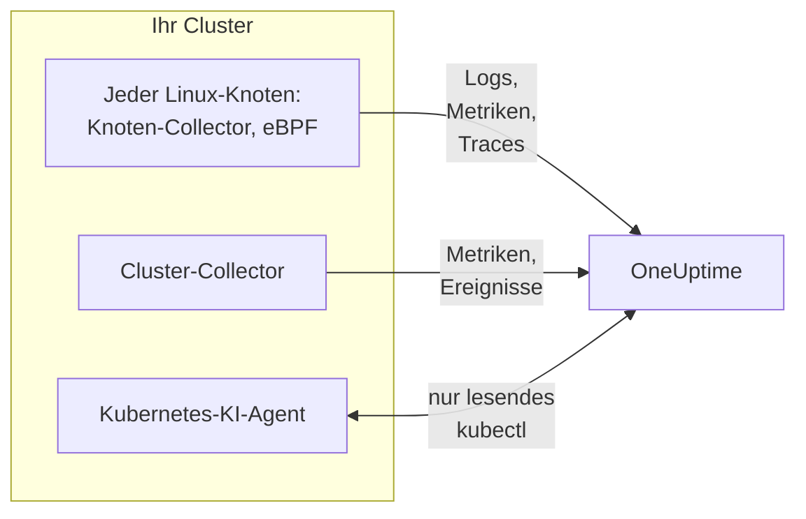

# Kubernetes-Agent (Helm-Installation)

Der OneUptime-Kubernetes-Agent ist ein Helm-Chart, das die Metriken, Ereignisse und Pod-Logs Ihres Clusters, per eBPF erfasste Anwendungs-Traces und die Betriebssystem-Metriken jedes Knotens sammelt und an OneUptime sendet. Ein einziges `helm install` richtet ihn ein, ohne Codeänderungen in Ihren Anwendungen. [Kubernetes-Monitore](/docs/monitor/kubernetes-monitor) warnen auf Grundlage dessen, was er sendet.

:::cards
- [Den Agenten installieren](#den-agenten-installieren): Vier Schritte mit Helm.
- [Ein Preset wählen](#ein-preset-wählen): Standard-Cluster, GKE Autopilot oder EKS Fargate.
- [Häufige Optionen](#häufige-optionen): Die Einstellungen, die die meisten Cluster ändern.
- [Fehlerbehebung](#fehlerbehebung): Ein Diagnoseskript und die üblichen Probleme.
:::

## Was das Chart installiert

Das Chart führt einige Workloads in seinem eigenen Namespace aus. Jeder sendet, was er sammelt, über OTLP an Ihre OneUptime-URL, mit dem Ingestion-Schlüssel, den Sie ihm geben.



| Workload | Art | Was er tut | Standardmäßig an |
| --- | --- | --- | --- |
| Cluster-Collector | Deployment | Cluster-Metriken, Kubernetes-Ereignisse und die vollständigen Spezifikationen von Pods, Knoten und Workloads, aus der Kubernetes-API. | Ja |
| Knoten-Collector | DaemonSet | Pod-Logs aus `/var/log/pods`, Kubelet- und cAdvisor-Metriken und die Betriebssystem-Metriken des Knotens. | Ja |
| eBPF-Instrumentierung (OBI) | DaemonSet | HTTP-, gRPC-, SQL- und Redis-Traces und Anfragemetriken jedes Pods sowie die Service-Map. | Ja |
| Kubernetes-KI-Agent | Deployment | Lässt OneUptime AI nur lesendes `kubectl` ausführen, während sie einen Vorfall oder eine Warnung auf diesem Cluster untersucht. | Ja |
| Log-Tailer | Deployment | Pod-Logs über die Kubernetes-API, wo der Knoten-Collector sie nicht lesen kann. | Mit den Presets `gke-autopilot` und `eks-fargate` |
| eBPF-Profiler | DaemonSet | Fortlaufende CPU-Flammengrafiken jedes Prozesses. | Nein |
| kube-state-metrics | Deployment | Pod-Phasen, Wartegründe von Containern und Ressourcenkontingente. | Nein |

Jedes Agent-Image läuft nur unter Linux, deshalb ist jeder Workload an Linux-Knoten gebunden.

## Bevor Sie beginnen

- **Ein Ingestion-Schlüssel.** Erstellen Sie einen in OneUptime unter **Projekteinstellungen → Telemetrie & APM → Ingestion-Schlüssel**. Der Agent sendet ihn als Header `x-oneuptime-token`, ein Projekt-API-Schlüssel funktioniert hier also nicht.
- **Helm 3** und `kubectl`-Zugriff auf den Cluster. Upgrades verwenden `--reset-then-reuse-values`, was Helm 3.14 oder neuer erfordert.
- **Ein Name für den Cluster**, eindeutig in Ihrem Projekt. Das Chart verweigert die Installation ohne einen: Zwei Cluster mit demselben Namen würden als einer erscheinen.
- **Ausgehendes HTTPS** vom Cluster zu Ihrer OneUptime-URL.

## Den Agenten installieren

:::steps
### Das Helm-Repository hinzufügen

```bash
helm repo add oneuptime https://helm-chart.oneuptime.com
helm repo update
```

### Das Chart installieren

Ersetzen Sie die URL durch Ihre OneUptime-URL und die beiden Platzhalter durch Ihren Ingestion-Schlüssel und den Namen des Clusters:

```bash
helm install oneuptime-agent oneuptime/kubernetes-agent \
  --namespace oneuptime-kubernetes-agent \
  --create-namespace \
  --set oneuptime.url=https://oneuptime.com \
  --set oneuptime.apiKey=<YOUR_API_KEY> \
  --set clusterName=<A_UNIQUE_NAME_FOR_THIS_CLUSTER>
```

Dies verwendet das Preset `standard`. Auf GKE Autopilot oder EKS Fargate [wählen Sie stattdessen deren Preset](#ein-preset-wählen).

### Prüfen, ob die Pods laufen

```bash
kubectl get pods -n oneuptime-kubernetes-agent
```

Jeder Pod sollte innerhalb von ein bis zwei Minuten `Running` erreichen.

### Den Cluster in OneUptime finden

Öffnen Sie **Produkte → Infrastruktur → Kubernetes → Alle Cluster**. Der Cluster erscheint innerhalb weniger Minuten unter seinem Namen, und seine Knoten, Pods und Workloads füllen sich.
:::

## Ein Preset wählen

Manche Kubernetes-Plattformen erlauben einem Workload nicht, ein `hostPath`-Volume einzuhängen oder ein DaemonSet auszuführen, was der Knoten-Collector nutzt. Die Einstellung `preset` wählt, was auf Ihrer funktioniert:

| Preset | Verwenden für | Pod-Logs | Auf jedem Knoten |
| --- | --- | --- | --- |
| `standard` (Standard) | Selbst verwaltet, **EKS on EC2**, **GKE Standard**, **AKS**, minikube, kind, k3s | Der Knoten-Collector liest `/var/log/pods` | Kubelet-, cAdvisor- und Betriebssystem-Metriken |
| `gke-autopilot` | **GKE Autopilot** | Der Log-Tailer liest sie über die Kubernetes-API | Kubelet- und cAdvisor-Metriken, ohne `hostPath` |
| `eks-fargate` | **EKS Fargate** | Der Log-Tailer liest sie über die Kubernetes-API | Nichts: Fargate führt keine DaemonSets aus |

Wenn Sie unsicher sind, lassen Sie `preset` leer, um `standard` zu erhalten. Schlägt die Installation mit einem Pod-Security-Fehler fehl, der `hostPath` nennt, installieren Sie erneut mit `gke-autopilot`, oder mit `eks-fargate` auf EKS Fargate.

GKE Autopilot und EKS Fargate verweigern außerdem privilegierte Pods, die die eBPF-Instrumentierung und das Profiling brauchen, deshalb lassen deren Presets beides weg:

:::tabs
@tab Standard
```bash
helm install oneuptime-agent oneuptime/kubernetes-agent \
  --namespace oneuptime-kubernetes-agent --create-namespace \
  --set oneuptime.url=https://oneuptime.com \
  --set oneuptime.apiKey=<YOUR_API_KEY> \
  --set clusterName=prod
```
@tab GKE Autopilot
```bash
helm install oneuptime-agent oneuptime/kubernetes-agent \
  --namespace oneuptime-kubernetes-agent --create-namespace \
  --set oneuptime.url=https://oneuptime.com \
  --set oneuptime.apiKey=<YOUR_API_KEY> \
  --set clusterName=prod-gke-autopilot \
  --set preset=gke-autopilot
```
@tab EKS Fargate
```bash
helm install oneuptime-agent oneuptime/kubernetes-agent \
  --namespace oneuptime-kubernetes-agent --create-namespace \
  --set oneuptime.url=https://oneuptime.com \
  --set oneuptime.apiKey=<YOUR_API_KEY> \
  --set clusterName=prod-eks-fargate \
  --set preset=eks-fargate
```
:::

## Den Cluster mit Labels versehen

Labels, die Sie bei der Installation übergeben, werden dem Cluster und den Diensten und Hosts zugeordnet, die dieser Agent meldet. `--set oneuptime.labels.<key>=<value>` wird zu einem Projekt-Label namens `<key>:<value>`:

```bash
helm install oneuptime-agent oneuptime/kubernetes-agent \
  --namespace oneuptime-kubernetes-agent \
  --create-namespace \
  --set oneuptime.url=https://oneuptime.com \
  --set oneuptime.apiKey=<YOUR_API_KEY> \
  --set clusterName=prod \
  --set oneuptime.labels.team=payments \
  --set oneuptime.labels.env=production \
  --set oneuptime.labels.region=us-east-1
```

Oder halten Sie sie in einer Values-Datei fest:

```yaml title="values.yaml"
oneuptime:
  url: https://oneuptime.com
  apiKey: <YOUR_API_KEY>
  labels:
    team: payments
    env: production
    region: us-east-1
clusterName: prod
```

```bash
helm install oneuptime-agent oneuptime/kubernetes-agent \
  --namespace oneuptime-kubernetes-agent --create-namespace \
  -f values.yaml
```

Jeder Datensatz, den dieser Agent sendet - Logs, Metriken, Traces und Profile -, trägt dann `team:payments`, `env:production` und `region:us-east-1`. Jedes Label ist ein Ressourcenattribut `oneuptime.label.<key>=<value>`, und OneUptime macht aus jedem Attribut, das mit `oneuptime.label.` beginnt, ein Label. Labels werden ohne Rücksicht auf Groß- und Kleinschreibung abgeglichen, sodass ein vorhandenes Label `Production` wiederverwendet statt verdoppelt wird. Der Agent entfernt nie ein Label, das Sie in OneUptime hinzugefügt haben.

## Pod-Logs

`preset` setzt `logs.mode`, das Sie auch selbst setzen können:

| `logs.mode` | Wie Logs gelesen werden | Gut | Achten Sie auf |
| --- | --- | --- | --- |
| `daemonset` | Ein Knoten-Collector pro Knoten liest die Dateien unter `/var/log/pods` mit. | Geringster Aufwand, skaliert mit den Knoten, keine Last auf dem Kubernetes-API-Server, folgt der Log-Rotation. | Braucht `hostPath` und DaemonSets. |
| `api` | Ein Log-Tailer streamt das Log jedes Containers aus der Kubernetes-API, wie `kubectl logs -f`. | Funktioniert, wo `hostPath` gesperrt ist oder der Pod-Security-Standard `restricted` gilt. | Jeder Container-Stream ist eine langlebige Verbindung zum API-Server. Ein Replikat bewältigt einige tausend Container. |
| `disabled` | Nichts. | Für Anwendungen, die ihre Logs bereits anders senden. | |

Um die Log-Erfassung auszuschalten, setzen Sie `--set logs.enabled=false` und senden Anwendungslogs stattdessen mit den [OpenTelemetry](/docs/telemetry/open-telemetry)-SDKs. Metriken sind nicht betroffen: Der Knoten-Collector läuft weiter.

### Gemischte Cluster (Windows-Knotenpools)

Windows-Knoten führen nie einen Agent-Pod aus. Daten auf Cluster-Ebene über sie und ihre Pods kommen trotzdem an, weil sie aus der Kubernetes-API stammen: Knotenzustände, Pod-Phasen, Kubernetes-Ereignisse und kube-state-metrics. Was Windows-Knoten fehlt, ist das, was auf dem Knoten erfasst wird: Betriebssystem-Metriken, Kubelet- und cAdvisor-Metriken, eBPF-Traces, Profile und im Log-Modus `daemonset` die Pod-Logs.

Um auch die Logs von Pods auf Windows-Knoten zu erfassen, schalten Sie den Hybridmodus ein:

```bash
helm upgrade oneuptime-agent oneuptime/kubernetes-agent \
  --namespace oneuptime-kubernetes-agent --reset-then-reuse-values \
  --set logs.windowsPods.enabled=true
```

Der Log-Tailer läuft dann neben den Knoten-Collectors, nur für die Pods auf Windows-Knoten. Linux-Pods behalten das günstigere Mitlesen der Dateien, und beide teilen die Pods nach Betriebssystem des Knotens auf, sodass keine Logzeile doppelt gesendet wird.

- **Version des Tailer-Images.** Die Aufteilung nur für Windows ist im Image `kubernetes-log-tailer` eingebaut. Ein älteres Image ignoriert sie und liest *jeden* Pod mit, sodass die Logs jedes Linux-Pods doppelt gesendet werden. Pinnen Sie `logs.api.image.tag` nicht auf eine Version, die älter ist als das Release des Charts, und wenn ein Knoten ein altes `release`-Image zwischengespeichert haben könnte, fügen Sie dem Upgrade `--set logs.api.image.pullPolicy=Always` hinzu.
- **Filtern nach Schweregrad.** Ist `filters.logs.minSeverity` gesetzt, wird eine Zeile ohne erkennbaren Schweregrad auf dem Weg des Knoten-Collectors verworfen, auf dem des Log-Tailers aber behalten - siehe [Filterung nach Log-Schweregrad](/docs/telemetry/kubernetes-agent#filterung-nach-log-schweregrad). Windows-Pods können dann mehr Zeilen ohne Stufe senden als Linux-Pods.

## Anwendungs-Traces mit eBPF

Das Chart führt [OpenTelemetry eBPF Instrumentation (OBI)](https://opentelemetry.io/docs/zero-code/obi/) auf jedem Knoten aus. OBI lädt eBPF-Programme in den Linux-Kernel und beobachtet den Netzwerkverkehr jedes Pods, sodass es HTTP- und HTTPS-, gRPC- sowie SQL- und Redis-Aufrufe ohne jede Änderung an Ihren Anwendungen rekonstruieren kann: kein SDK, kein Sidecar. Es sendet sie als Traces und Anfragemetriken an OneUptime.

Ihre Dienste erscheinen innerhalb von ein bis zwei Minuten unter **Produkte → Traces** und auf der Service-Map, mit `k8s.cluster.name` auf den Namen des Clusters gesetzt, sodass Sie nach Cluster filtern können.

### Wann Sie eBPF ausschalten

eBPF ist standardmäßig an. Schalten Sie es mit `--set ebpf.enabled=false` aus, wenn:

- Der Cluster **GKE Autopilot** oder **EKS Fargate** ist. Das erledigen deren Presets für Sie: Diese Plattformen verweigern privilegierte Pods, und OBI muss privilegiert sein, um seine Programme zu laden.
- Die Knoten einen Kernel älter als **Linux 5.8** ohne BTF ausführen. Debian 11, Ubuntu 20.10, Fedora 34, RHEL 9 und neuer sind in Ordnung.
- Ihre Anwendungen bereits Traces mit einem OpenTelemetry-SDK senden und Sie sie nicht doppelt haben wollen.

### Was eBPF sendet

OBI sendet mehrere Arten von Signalen. Jede lässt sich mit `--set ebpf.features.<key>=false` ausschalten:

| Einstellung | Standard | Was sie hinzufügt |
| --- | --- | --- |
| `ebpf.features.httpMetrics` | an | HTTP- und gRPC-Anfragemetriken pro Dienst: Anfragerate, Latenzhistogramme und Fehler. |
| `ebpf.features.spanMetrics` | an | Span-Metriken: Aufrufe und Dauer pro Dienst, Route oder Operation, Span-Art und Status - `traces.span.metrics.calls` und `traces.span.metrics.duration` (Sekunden). |
| `ebpf.features.serviceGraph` | an | Rate und Latenz jedes Aufrufs von einem Dienst zu einem anderen, die die Service-Map zeichnen. |
| `ebpf.features.networkMetrics` | an | Bytes und Pakete zwischen jedem Paar von Pods, über TCP und UDP, mit ihren Kubernetes-Namen. Zeigt jedes Paar von Pods, die miteinander sprechen, auch über Protokolle, die OBI nicht lesen kann. |
| `ebpf.features.networkInterZoneMetrics` | aus | Dasselbe zwischen Zonen. Verdoppelt die Anzahl der Serien: Schalten Sie es nur ein, wenn Sie nach Zonen planen. |
| `ebpf.features.tcpStats` | an | TCP-Statistiken pro Knoten: Umlaufzeiten, fehlgeschlagene Verbindungen und Neuübertragungen. |

### Traces über Dienste hinweg verknüpfen

OBI kann den Trace auch über einen Aufruf hinweg weitergeben: Wenn Pod A Pod B über HTTP oder gRPC aufruft, schließt sich der Span auf der Seite von B dem Trace von A an, ohne SDK in einer der beiden Anwendungen. **Das ist standardmäßig aus.** Schalten Sie es mit `--set ebpf.contextPropagation=true` ein, nachdem Sie die Warnung unten gelesen haben.

| Option | Standard | Was sie tut |
| --- | --- | --- |
| `ebpf.contextPropagation` | aus | Schreibt ein W3C-`traceparent` in ausgehenden Verkehr, sodass Spans über Dienste hinweg verknüpft werden. |
| `ebpf.contextPropagationMode` | `headers` | Wie: `headers` (HTTP/1.1-Anfrageheader, am engsten), `tcp` (eine TCP-Option, über Linux Traffic Control) oder `all` (beides). Wird nur gelesen, wenn `contextPropagation` an ist. |
| `ebpf.trackRequestHeaders` | an | Verfolgt Anfrageheader im Kernel, sodass die empfangende Seite das `traceparent` auch auf einfachen HTTP-Servern findet. Wirkt nur, wenn `contextPropagation` an ist. |

> [!WARNING]
> Jeder Weitergabemodus verändert Verkehr, der bereits unterwegs ist. Bei einfachem HTTP vergrößert OBI die ausgehende Anfrage im Kernel, damit der Header hineinpasst; bei TLS und rohem TCP fügt es über einen Traffic-Control-Hook eine TCP-Option hinzu und schreibt dabei das Paket und seine Prüfsumme neu. Wird die Byte-Buchhaltung der Verbindung danach nicht exakt korrigiert, **desynchronisiert** der Stream: Übertragungen durch einen Proxy wie nginx bleiben mittendrin hängen, sobald eine Antwort etwa 64 KB überschreitet, bis die Verbindung in eine Zeitüberschreitung läuft. Kleine Anfragen funktionieren weiter, sodass es wie ein Fehler der Anwendung oder des Proxys aussieht. Keine Kernel-Version lässt das Umschreiben verschwinden. Traces, Anfragemetriken und die Service-Map funktionieren alle ohne es; ein OpenTelemetry-SDK in Ihren Diensten verknüpft Traces ganz ohne Umschreiben im Kernel. Wenn Sie es einschalten, testen Sie es zuerst auf einem Cluster, der nicht in Produktion ist, und prüfen Sie große Übertragungen durch Ihren Proxy.

### Logs mit Traces verknüpfen

**Standardmäßig aus.** Wenn es an ist, hängt OBI eine Probe an den Systemaufruf `write()` jedes Prozesses, den es instrumentiert, und:

- Eine **JSON-Logzeile** erhält die Felder `trace_id` und `span_id` (Felder, die die Zeile bereits hat, bleiben erhalten). Der Knoten-Collector verschiebt sie in die eigenen Trace-Felder des Log-Datensatzes, sodass die Logs eines Spans in OneUptime einen Klick entfernt sind, ebenso der Trace einer Logzeile.
- **Jede andere Logzeile** wird unverändert erfasst, ohne die Verknüpfung.

```bash
helm upgrade oneuptime-agent oneuptime/kubernetes-agent \
  --namespace oneuptime-kubernetes-agent --reset-then-reuse-values \
  --set ebpf.logToTraceCorrelation=true
```

| Option | Standard | Was sie tut |
| --- | --- | --- |
| `ebpf.logToTraceCorrelation` | `false` | Schaltet den Log-Enricher von OBI und das Übernehmen von `trace_id` durch den Knoten-Collector ein. |
| `ebpf.logEnricher.services` | `[{service: [{exe_path: "*"}]}]` | Welche Prozesse der Enricher berührt. Jeder Eintrag ist ein OBI-Selektor [GlobAttributes](https://opentelemetry.io/docs/zero-code/obi/configure/options/#service-discovery), mit Feldern wie `exe_path`, `languages`, `k8s_pod_labels`, `k8s_pod_annotations`, `open_ports` und `cmd_args`. |

#### APM-Agenten, die damit abstürzen

Der Enricher schreibt den Ausgabepuffer der Anwendung **innerhalb des Prozesses** um: Wenn ein ausgewählter Prozess `write()` aufruft, leert OBI die ursprünglichen Bytes und schreibt eine angereicherte Kopie. APM-Agenten, die über `LD_PRELOAD` geladen werden und `write()` selbst umhüllen, überstehen das nicht:

| APM-Agent | Bibliothek | Was passiert |
| --- | --- | --- |
| Dynatrace OneAgent | `liboneagentproc.so` | Die Anwendung stürzt mit SIGSEGV ab (Exit 139). Das eigene `write()` des Dynatrace-Watchdogs bleibt über sein Limit von 10 Sekunden hängen, und der OneAgent startet in einer Schleife neu. |
| New Relic | `libnewrelic*.so` | Dieselbe Art von Absturz. |
| AppDynamics | `libappdynamics*.so` | Dieselbe Art von Absturz. |
| Datadog | `libdd*.so` | Dieselbe Art von Absturz. |
| Instana | `libinstana*.so` | Dieselbe Art von Absturz. |

**.NET-Anwendungen sind am stärksten betroffen:** Der .NET-Agent von Dynatrace wird immer über `LD_PRELOAD` geladen, und das Konsolenlog von Microsoft.Extensions.Logging ist ungepuffert, sodass jede Zeile diesen Weg nimmt. Python- und Go-Anwendungen sind meist nicht betroffen.

Um es neben einem dieser Agenten zu nutzen, richten Sie `logEnricher.services` nur auf die Pods ohne einen. Der Enricher kann nichts ausschließen, listen Sie also die anzureichernden auf:

```yaml title="values.yaml"
ebpf:
  logToTraceCorrelation: true
  logEnricher:
    services:
      # Enrich only pods with the apm-agent=none label
      - service:
          - k8s_pod_labels:
              apm-agent: "none"
```

Oder wählen Sie nach Laufzeit. Das Laden von Dynatrace über `LD_PRELOAD` zielt auf .NET, sodass das Anreichern nur von Python, Go, Ruby und Node.js es vermeidet:

```yaml title="values.yaml"
ebpf:
  logToTraceCorrelation: true
  logEnricher:
    services:
      - service:
          - languages: "python,go,ruby,nodejs"
```

#### Logs müssen JSON und ungepuffert sein

- **Nur JSON-Zeilen erhalten eine `trace_id`.** Stellen Sie den Logger auf ein JSON-Format um: `structlog`, `pino`, `winston`, `serilog`, `logback-json`, klog `--logging-format=json` und ähnliche.
- **Gepufferte Ausgabe bricht die Verknüpfung**, weil `write()` dann in einem anderen Thread als die Anfrage geschieht. In **Python** setzen Sie `PYTHONUNBUFFERED=1`. In **.NET** rufen Sie beim Start `Console.SetOut(new StreamWriter(Console.OpenStandardOutput()) { AutoFlush = true })` auf; `AddConsole()` von Microsoft.Extensions.Logging und die asynchronen Sinks von Serilog funktionieren nicht, das einfache `WriteTo.Console()` von Serilog schon.
- Greenlet, gevent, Tornado und andere eigene asynchrone Laufzeitumgebungen werden nicht abgedeckt.

### eBPF abstimmen

| Option | Standard | Was sie tut |
| --- | --- | --- |
| `ebpf.enabled` | `true` | Führt das eBPF-DaemonSet aus. `false` lässt es weg. |
| `ebpf.image.tag` | `v0.14.0` | Das OBI-Image. OBI ist vor 1.0: Pinnen Sie eine getestete Version und testen Sie erneut, bevor Sie sie ändern. |
| `ebpf.autoTargetExe` | `*` | Globs der zu instrumentierenden ausführbaren Dateien, durch Kommas getrennt. Schränken Sie sie ein, etwa auf `*/python,*/java`, um weniger Laufzeitumgebungen zu instrumentieren. |
| `ebpf.excludeExePaths` | Shells, Cluster-Infrastruktur, Service-Mesh-Sidecars, CNI-Agenten, Browser, ClickHouse, Collectors und OBI selbst | Globs der zu überspringenden ausführbaren Dateien, durch Kommas getrennt. Ein breiter Glob überspringt auch Ihre eigenen Binärdateien. |
| `ebpf.logLevel` | `info` | `debug`, `info`, `warn` oder `error`. |
| `ebpf.printTraces` | `false` | Gibt Spans zusätzlich im eigenen Log von OBI aus, um zu prüfen, was es erfasst. |
| `ebpf.resources.*` | `100m` CPU und `512Mi` Speicher angefordert, `2000m` und `2Gi` als Limits | Erhöhen Sie sie für Knoten mit viel Verkehr oder vielen kurzlebigen Prozessen. |

Um zu prüfen, dass OBI läuft und Verkehr sieht:

```bash
kubectl get pods -n oneuptime-kubernetes-agent -l component=ebpf-instrument
kubectl logs -n oneuptime-kubernetes-agent -l component=ebpf-instrument --tail=200
```

## Fortlaufendes CPU-Profiling

Der [OpenTelemetry eBPF Profiler](https://github.com/open-telemetry/opentelemetry-ebpf-profiler) kann ebenfalls auf jedem Knoten laufen, als Image `otel/opentelemetry-collector-ebpf-profiler`. Er tastet 19-mal pro Sekunde ab, was jeder Prozess ausführt, in Go, Java, .NET, Python, Ruby, Node.js, PHP, Perl, C, C++ und Rust, und sendet die Profile an OneUptime. Sie erscheinen unter **Produkte → Performance-Profile** und als Flammengrafik an jedem Trace-Span.

**Profiling ist standardmäßig aus:** Es kostet pro Knoten mehr CPU und Speicher als die eBPF-Instrumentierung. Schalten Sie es mit `--set profiling.enabled=true` ein.

Ist auch die eBPF-Instrumentierung an (der Standard), trägt jede Stichprobe den Trace, zu dem sie gehört, sodass ein Span seine eigene Flammengrafik hat. Dafür bittet das Chart OBI, den laufenden Trace-Kontext verfügbar zu halten (`OTEL_EBPF_BPF_POPULATE_TRACE_CONTEXT=true`), was instrumentierte Anwendungen bei jedem asynchronen Kontextwechsel ein wenig kostet. Setzen Sie `profiling.obiProcessContext=false` für Flammengrafiken ohne Verknüpfung zu Spans.

Profiling braucht **Linux 5.10** oder neuer und einen privilegierten Pod mit den Prozess-IDs des Knotens: Es kann nicht auf GKE Autopilot oder EKS Fargate laufen, und deren Presets lassen es aus. Auf Knoten, die selbst Container sind, wie bei kind oder k3d, kann es Prozesse nicht unterscheiden, und fast keine Stichprobe wird einem Span zugeordnet.

| Option | Standard | Was sie tut |
| --- | --- | --- |
| `profiling.enabled` | `false` | Führt das Profiler-DaemonSet aus. |
| `profiling.image.tag` | `0.152.0` | Das Profiler-Image. Es ist vor 1.0: Pinnen Sie eine getestete Version. |
| `profiling.samplesPerSecond` | `19` | Wie viele Stichproben pro Sekunde. 19 vermeidet den Gleichlauf mit üblichen Timer-Frequenzen. |
| `profiling.offCpuThreshold` | `0` | Ein Wert über 0 bis 1 profiliert auch die Zeit außerhalb der CPU, was Sperrkonflikte und blockierende E/A zeigt, zu etwas höheren Kosten. |
| `profiling.tracers` | `""` (jede Laufzeitumgebung) | Die zu ladenden Sprach-Tracer, durch Kommas getrennt, etwa `go,python`. |
| `profiling.obiProcessContext` | `true` | Verknüpft Stichproben mit den Traces von OBI und lässt OBI den Trace-Kontext dafür verfügbar halten. |

## Weitere Datenerfassung

| Option | Standard | Was sie hinzufügt |
| --- | --- | --- |
| `hostMetrics.enabled` | an | Die Betriebssystem-Metriken jedes Knotens aus `/proc` und `/sys`: E/A-Warteschlangen der Festplatten, Inodes der Dateisysteme, Fehler der Netzwerkschnittstellen, Paging und Load Average. Läuft im Knoten-Collector, ohne zusätzliche Pods. |
| `kubeletstats.utilizationMetrics.enabled` | an | CPU und Speicher von Containern und Pods als Prozentsatz ihrer Anforderung und ihres Limits, die die Sättigungsmonitore für CPU und Speicher lesen. Immer 0 für einen Pod ohne Anforderung oder Limit. |
| `kubeletstats.volumeMetrics.enabled` | an | Der freie und gesamte Platz jedes PVC (`k8s.volume.available`, `k8s.volume.capacity`), den der Monitor PVC Low Disk Space liest. Eine Serie pro PVC und Pod. |
| `cadvisor.enabled` | an | CPU-Drosselung und OOM-Kills aus dem `/metrics/cadvisor` jedes Kubelets: `container_cpu_cfs_throttled_seconds_total`, `container_cpu_cfs_periods_total` und `container_oom_events_total`, und sonst nichts. |
| `kubeStateMetrics.enabled` | aus | Pod-Phasen (Pending, Terminating), Pods, die nicht eingeplant werden können, Wartegründe von Containern (CrashLoopBackOff, ImagePullBackOff) und die Nutzung von Ressourcenkontingenten, aus kube-state-metrics. `kubeStateMetrics.mode: bundled` (der Standard) führt ein kleines kube-state-metrics für Sie aus; `external` liest eines, das Sie bereits betreiben, unter `kubeStateMetrics.endpoint`. |
| `auditLogs.enabled` | aus | Das Kubernetes-Audit-Log, `/var/log/kubernetes/audit.log`: jede Anfrage an die API, von wem, auf was. Nur selbst verwaltete Cluster: verwaltete (EKS, GKE, AKS, DOKS) senden es an den Cloud-Anbieter. |
| `csi.enabled` | aus | Die Metriken von CSI-Speichertreibern, aus Pods mit dem Label `app=csi-driver` oder `app.kubernetes.io/component=csi-driver`: Zeiten zum Anhängen und Lösen von Volumes, Bereitstellungsfehler, IOPS. |
| `coreDns.enabled` | aus | Die Metriken von CoreDNS unter `:9153/metrics`: Abfragerate, Latenz, Cache-Treffer und Fehler. |
| `controlPlane.enabled` | aus | etcd, der API-Server, der Scheduler und der Controller-Manager. Nur selbst verwaltete Cluster: verwaltete stellen sie nicht bereit. |
| `cost.enabled` | aus | Was jeder Workload kostet. Siehe [Kubernetes-Kosten-Observability](/docs/telemetry/kubernetes-cost). |

## Häufige Optionen

| Option | Standard | Was sie tut |
| --- | --- | --- |
| `oneuptime.url` | (erforderlich) | Ihre OneUptime-URL. |
| `oneuptime.apiKey` | (erforderlich) | Der Ingestion-Schlüssel, aus **Projekteinstellungen → Telemetrie & APM → Ingestion-Schlüssel**. Wird als Header `x-oneuptime-token` gesendet; ein Projekt-API-Schlüssel funktioniert nicht. |
| `clusterName` | (erforderlich) | Der Name des Clusters, eindeutig im Projekt. Jeder Datensatz trägt ihn als `k8s.cluster.name`. |
| `preset` | (leer: `standard`) | `standard`, `gke-autopilot` oder `eks-fargate`. Siehe [Ein Preset wählen](#ein-preset-wählen). |
| `oneuptime.labels` | `{}` | Labels für jeden Datensatz dieses Agenten. Siehe [Den Cluster mit Labels versehen](#den-cluster-mit-labels-versehen). |
| `namespaceFilters.rules` | Lässt `kube-system` aus `podLogs` und `ebpfDiscovery` heraus | Regeln, die Namespaces ein- oder ausschließen, für `podLogs`, `ebpfDiscovery`, `metrics` und `traces`. Muster können `*` verwenden, und Ausschließen gewinnt immer. |
| `filters.logs.minSeverity` | `""` | Verwirft Pod-Logzeilen unter dieser Stufe: `TRACE`, `DEBUG`, `INFO`, `WARN`, `ERROR` oder `FATAL`. |
| `filters.metrics.exclude` | `[]` | Zu verwerfende Metriknamen. |
| `sampling.traces.percentage` | `100` | Der Anteil der zu behaltenden Traces, von 0 bis 100. Ganze Traces werden behalten oder verworfen. |
| `logs.enabled` | `true` | Erfasst Pod-Logs. |
| `logs.mode` | (aus `preset`) | `daemonset`, `api` oder `disabled`. Überschreibt das Preset. |
| `logs.windowsPods.enabled` | `false` | Liest auch Pods auf Windows-Knoten mit. Siehe [Gemischte Cluster](#gemischte-cluster-windows-knotenpools). |
| `logs.api.replicas` | `1` | Replikate des Log-Tailers, im Modus `api`. |
| `ebpf.enabled` | `true` | eBPF-Traces und Anfragemetriken. Siehe [Anwendungs-Traces mit eBPF](#anwendungs-traces-mit-ebpf). |
| `profiling.enabled` | `false` | CPU-Flammengrafiken. Siehe [Fortlaufendes CPU-Profiling](#fortlaufendes-cpu-profiling). |
| `kubeStateMetrics.enabled` | `false` | Cluster-Zustand aus kube-state-metrics. |
| `aiAgent.enabled` | `true` | Der Kubernetes-KI-Agent. Siehe [Kubernetes-KI-Agent](/docs/telemetry/kubernetes-agent#kubernetes-ki-agent) dazu, was er tun darf. |

Die [`values.yaml`](https://github.com/OneUptime/oneuptime/blob/master/HelmChart/Public/kubernetes-agent/values.yaml) des Charts listet und erklärt jede Option, und [Kubernetes-Agent](/docs/telemetry/kubernetes-agent) behandelt Filtern, Sampling und das Begrenzen der Datenmenge.

## Upgrade

```bash
helm repo update
helm upgrade oneuptime-agent oneuptime/kubernetes-agent \
  --namespace oneuptime-kubernetes-agent \
  --reset-then-reuse-values
```

`--reset-then-reuse-values` (Helm 3.14 und neuer) behält die Werte, die Sie gesetzt haben - das Preset, den Clusternamen, Filter - und übernimmt jeden anderen Wert aus dem neuen Chart. Fügen Sie neue `--set` danach hinzu. Unter Helm 3.13 oder älter führen Sie das Upgrade stattdessen mit den Werten durch, die Sie gesetzt haben:

```bash
helm repo update
helm get values oneuptime-agent --namespace oneuptime-kubernetes-agent -o yaml > values.yaml && \
  helm upgrade oneuptime-agent oneuptime/kubernetes-agent \
  --namespace oneuptime-kubernetes-agent -f values.yaml
```

Verwenden Sie für Upgrades nicht `--reuse-values`: Es behält auch die Standardwerte des Charts, von dem aus Sie aktualisieren, sodass die Standardwerte eines neueren Charts, darunter sein eBPF-Image, nie greifen. Läuft ein Release mit den Standardwerten eines älteren Charts, enden die Hinweise, die Helm nach der Installation oder dem Upgrade ausgibt, mit einer Warnung und dem Befehl, der das behebt.

> [!WARNING]
> **Die eBPF-Span-Metriken haben neue Namen.** `ebpf.features.spanMetrics` sendet jetzt `traces.span.metrics.calls` und `traces.span.metrics.duration` (Sekunden) statt `traces_spanmetrics_calls_total` und `traces_spanmetrics_latency`: dieselben Serien, unter den Namen, die OBI beibehält (die alten hat es als veraltet markiert). Ein Dashboard, ein Diagramm oder ein Metrik-Monitor auf einem alten Namen erhält nach dem Upgrade keine neuen Daten, ohne Fehler - stellen Sie ihn auf den neuen Namen um und aktualisieren Sie jeden Eintrag in `filters.metrics`, der einen alten nennt.

## Deinstallation

```bash
helm uninstall oneuptime-agent --namespace oneuptime-kubernetes-agent
kubectl delete namespace oneuptime-kubernetes-agent
```

## Fehlerbehebung

:::details Der Cluster zeigt Disconnected, oder es kommen keine Daten an
Führen Sie das Diagnoseskript des Charts aus. Es prüft die Pods, den Ingestion-Schlüssel und den Weg aus dem Cluster heraus, fragt OneUptime, ob der Schlüssel akzeptiert wird, und gibt ein einziges Urteil aus. Es liest nur und ändert nichts:

```bash
curl -fsSL https://raw.githubusercontent.com/OneUptime/oneuptime/master/HelmChart/Public/kubernetes-agent/troubleshoot.sh \
  | bash -s -- -n oneuptime-kubernetes-agent
```

Die übliche Ursache, besonders nach einer Neuinstallation, ist ein falscher oder widerrufener Ingestion-Schlüssel: OneUptime lehnt ihn ab, und der Collector verwirft jeden Stapel, während seine Pods `Running` bleiben.
:::

:::details Die Installation schlägt mit "hostPath volumes are not allowed" fehl
Der Cluster sperrt `hostPath`. Wechseln Sie zu einem Preset, das Logs über die Kubernetes-API liest; es lässt auch eBPF weg:

```bash
helm repo update
helm upgrade oneuptime-agent oneuptime/kubernetes-agent \
  --namespace oneuptime-kubernetes-agent \
  --reset-then-reuse-values \
  --set preset=gke-autopilot
```

Auf EKS Fargate verwenden Sie `--set preset=eks-fargate`.
:::

:::details Agent-Pods hängen in ImagePullBackOff auf Windows-Knoten
Ältere Charts haben die DaemonSets des Agenten auf Windows-Knoten eingeplant, wo ihre Linux-Images nie gezogen werden können. Führen Sie `helm upgrade` aus: Das aktuelle Chart bindet jeden Workload an Linux-Knoten, und die hängenden Pods verschwinden. Um die Logs von Pods auf Windows-Knoten zu erfassen, siehe [Gemischte Cluster](#gemischte-cluster-windows-knotenpools).
:::

:::details In OneUptime kommen keine Logs an
Prüfen Sie die Pods des Agenten und ihre Logs:

```bash
kubectl get pods -n oneuptime-kubernetes-agent
kubectl logs -n oneuptime-kubernetes-agent -l app.kubernetes.io/part-of=oneuptime --tail=200
```

Im Modus `api` antwortet der Log-Tailer unter `/healthz`, Port 13133, mit dem Stand seiner Exporte: Erreichen Sie ihn mit `kubectl port-forward`.
:::

:::details Die eBPF-Pods sind in CrashLoopBackOff oder starten nicht
Lesen Sie das Log von OBI:

```bash
kubectl logs -n oneuptime-kubernetes-agent -l component=ebpf-instrument --tail=200
```

- **Der Kernel ist zu alt oder hat kein BTF.** OBI braucht Linux 5.8 oder neuer mit BTF; prüfen Sie es mit `uname -r` auf einem Knoten. Wenn Sie ihn nicht aktualisieren können, schalten Sie eBPF mit `--set ebpf.enabled=false` aus.
- **Privilegierte Pods werden verweigert.** Manche Cluster verweigern sie auch außerhalb von Autopilot und Fargate. Schalten Sie eBPF aus.
- **OBI läuft, aber es kommen keine Traces an.** Setzen Sie `--set ebpf.printTraces=true` und lesen Sie das Log von OBI erneut. Spans dort bedeuten, dass der Export zu OneUptime fehlschlägt: Prüfen Sie die URL und den Ingestion-Schlüssel. Keine Spans dort können bedeuten, dass der Verkehr von einer TLS-Bibliothek verschlüsselt wird, die OBI nicht lesen kann, etwa einer statisch gelinkten.
:::

:::details Große Übertragungen hängen, nachdem die Trace-Verknüpfung eingeschaltet wurde
Das ist `ebpf.contextPropagation`, das Verkehr umschreibt: siehe die Warnung unter [Traces über Dienste hinweg verknüpfen](#traces-über-dienste-hinweg-verknüpfen). Schalten Sie es mit `--set ebpf.contextPropagation=false` aus.
:::

:::details Anwendungen stürzen mit Exit-Code 139 ab, nachdem die Log-Verknüpfung eingeschaltet wurde
In denselben Pods läuft ein APM-Agent, der über `LD_PRELOAD` geladen wird: siehe [APM-Agenten, die damit abstürzen](#apm-agenten-die-damit-abstürzen). Schalten Sie `ebpf.logToTraceCorrelation` aus oder richten Sie `ebpf.logEnricher.services` auf Pods ohne diesen Agenten.
:::

:::details Ein Log-Tailer reicht für den Cluster nicht aus (Modus api)
Teilen Sie die Namespaces auf mehrere Releases auf, jedes mit eigenen Namespace-Regeln installiert:

```bash
helm install oneuptime-agent-ns-a oneuptime/kubernetes-agent \
  --set preset=gke-autopilot \
  --set-json 'namespaceFilters.rules=[{"action":"include","namespaces":["app-a","app-b"],"scopes":["podLogs"]}]' \
  ...
```

Eine Erhöhung von `logs.api.replicas` fügt Tailer hinzu, aber jeder liest jeden erlaubten Namespace, sodass Sie die Namespaces trotzdem aufteilen müssen, um Duplikate zu vermeiden.
:::

## Nächste Schritte

:::cards
- [Kubernetes-Überwachung](/docs/monitor/kubernetes-monitor): Auf das warnen, was der Agent sendet.
- [Kubernetes-Agent](/docs/telemetry/kubernetes-agent): Filtern, Sampling, der KI-Agent und das Begrenzen der Datenmenge.
- [Kubernetes-Kosten-Observability](/docs/telemetry/kubernetes-cost): Sehen, was jeder Workload kostet.
- [Traces-Überwachung](/docs/monitor/traces-monitor): Auf die Traces warnen, die eBPF erfasst.
:::
