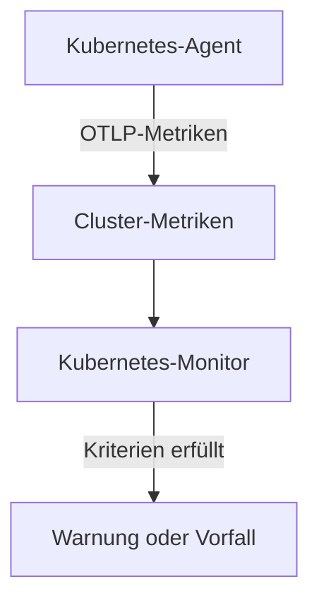

# Kubernetes-Überwachung

Ein Kubernetes-Monitor warnt anhand der Metriken, die der OneUptime-Kubernetes-Agent aus einem Cluster sendet: Knoten, Pods, Container, Workloads, Autoscaler und die Steuerungsebene. Beginnen Sie mit einer fertigen Warnungsvorlage, wählen Sie eine einzelne Metrik oder schreiben Sie Ihre eigene Abfrage, und legen Sie dann den Schwellenwert fest, der eine Warnung oder einen Vorfall auslöst.

:::cards
- [Den Agent installieren](/docs/monitor/kubernetes-agent): Ein Helm-Befehl bringt den Cluster in OneUptime.
- [Den Monitor erstellen](#einen-kubernetes-monitor-erstellen): Den Cluster wählen, dann eine Vorlage, eine Metrik oder eine Abfrage.
- [Warnungsvorlagen](#fertige-warnungsvorlagen): Sechsundzwanzig fertige Warnungen, von einem verstummten Cluster bis etcd.
- [Kriterien](#überwachungskriterien): Statische Schwellenwerte und Anomalieerkennung.
:::

## So funktioniert es

Der Agent sendet die Metriken des Clusters über OTLP an OneUptime, jede mit dem Namen des Clusters versehen (`k8s.cluster.name`, das `clusterName` des Charts). Die ersten Daten unter einem neuen Namen registrieren den Cluster unter **Kubernetes**, und von da an lässt sich der Cluster in einem Kubernetes-Monitor auswählen. Jede Minute fragt der Monitor diese Metriken über seinen **Zeitbereich** ab, aggregiert sie und vergleicht das Ergebnis mit seinen Kriterien.

## Bevor Sie beginnen

- Der OneUptime-Kubernetes-Agent läuft im Cluster. Siehe [Kubernetes-Agent (Helm-Installation)](/docs/monitor/kubernetes-agent); der Cluster erscheint wenige Minuten nach der Installation unter **Kubernetes**.
- Für die Vorlagen der Steuerungsebene (**etcd No Leader**, **API Server Request Saturation**, **Scheduler Backlog**): die Erfassung der Steuerungsebene durch den Agent, `controlPlane.enabled`, die den API-Server ohne Weiteres liest; etcd und der Scheduler brauchen zusätzlich ihre eingetragenen Endpunkte (siehe [Control-Plane-Überwachung aktivieren](/docs/telemetry/kubernetes-agent#control-plane-überwachung-aktivieren)). Verwaltete Cluster (EKS, GKE, AKS) stellen diese Endpunkte nicht bereit, daher erhalten diese Monitore dort nie Daten.
- Für die Kostenvorlagen (**Cluster Daily Cost Over Budget**, **Namespace Daily Cost Over Budget**, **High Idle Spend**): die Kostenüberwachung des Agents, standardmäßig eingeschaltet außer mit den Presets `gke-autopilot` und `eks-fargate` (siehe [Kubernetes-Kosten-Observability](/docs/telemetry/kubernetes-cost)).

## Einen Kubernetes-Monitor erstellen

:::steps
### Einen neuen Monitor beginnen

Gehen Sie zu **Monitore** und klicken Sie auf **Monitor erstellen**. Wählen Sie unter **Weitere Monitortypen** den Eintrag **Kubernetes** – oder geben Sie `k8s` in das Suchfeld ein.

### Den Cluster wählen

Wählen Sie ihn unter **Kubernetes-Cluster**. Die Liste enthält jeden Cluster, aus dem der Agent gemeldet hat. Nach der Auswahl zeigt eine Zeile unter dem Feld, ob Daten ankommen. **Kubernetes-Cluster hinzufügen** öffnet Einrichtungsschritte mit Ihren bereits eingetragenen Schlüsseln, die auf die ersten Daten warten.

### Festlegen, was überwacht wird

Ein neuer Monitor beginnt mit **Cluster Stopped Reporting** unter **Worüber benachrichtigt wird**; **Ändern** wählt eine andere Vorlage. **Custom Metric** und **Erweitert** liegen unter **Weitere Felder**:

| Wo | Was Sie wählen |
| --- | --- |
| **Worüber benachrichtigt wird** | Eine [fertige Warnungsvorlage](#fertige-warnungsvorlagen). Sie füllt Metrik, Bereich, Zeitbereich und Kriterien aus; den **Zeitbereich** können Sie weiterhin ändern. |
| **Custom Metric** | Eine Metrik aus dem [Metrikkatalog](#metrikkatalog), dann ihren **Ressourcenbereich**, Filter, **Aggregation** (Durchschnitt, Maximum, Minimum, Summe oder Anzahl) und **Zeitbereich**. |
| **Erweitert** | Den **Ressourcenbereich**, Filter und **Zeitbereich** sowie unter **Metriken auswählen** Ihre eigenen Metrikabfragen und Formeln, mit einem Live-Diagramm des Ergebnisses. |

### Die Kriterien festlegen

Legen Sie fest, wann der Monitor seinen Status ändert und wann er eine Warnung oder einen Vorfall auslöst – siehe [Überwachungskriterien](#überwachungskriterien). Eine Vorlage hat sie bereits ausgefüllt: Prüfen Sie die Schwellenwerte, Schweregrade und Bereitschaftsrichtlinien.

### Den Monitor speichern

Füllen Sie das Formular fertig aus und speichern Sie. Der Monitor erscheint unter **Monitore**, und sein Status folgt ab der ersten Auswertung Ihren Kriterien.
:::

## Konfigurationsoptionen

### Ressourcenbereich und Filter

**Ressourcenbereich** legt die Ebene fest, auf der die Metrik ausgewertet wird, und bestimmt, welche Filter das Formular anzeigt. Jeder Filter ist optional.

| Bereich | Überwacht | Filter |
| --- | --- | --- |
| Cluster | Den gesamten Cluster | — |
| Namespace | Ressourcen in einem Namespace | **Namespace** |
| Workload | Ein Deployment, StatefulSet, DaemonSet, einen Job oder CronJob | **Namespace**, **Workload-Art**, **Workload-Name** |
| Knoten | Einen Knoten des Clusters | **Knotenname** |
| Pod | Einen Pod | **Namespace**, **Pod-Name** |

Die Metriken eines Containers und eines Pods tragen die Namen der Workloads, zu denen der Pod gehört (ein Pod eines Deployments trägt den Namen des Deployments und den seines ReplicaSets), sodass der Bereich Workload die Container und Pods dieses Workloads überwacht. Die eigenen Metriken eines Workloads, etwa die fehlgeschlagenen Pods eines Jobs, tragen nur den Namen ihres eigenen Workloads: Grenzen Sie sie auf die Art dieses Workloads ein.

### Zeitbereich

**Zeitbereich** ist das Zeitfenster, das die Metrikabfrage bei jeder Auswertung des Monitors abdeckt, von **Past 1 Minute** bis **Past 365 Days**. Kurze Zeitfenster (1 bis 15 Minuten) eignen sich für Warnungen; längere glätten verrauschte Metriken.

### Metrikabfragen und Formeln

Im Tab **Erweitert** nennt jede Abfrage eine Metrik, wie ihre Werte aggregiert werden, und optionale Attributfilter. Eine **Formel** kombiniert Abfragen mit Arithmetik – die Vorlagen zur Knotenauslastung teilen zum Beispiel die Nutzung durch die zuweisbare Kapazität.

## Metrikkatalog

Der Tab **Custom Metric** bietet diese Metriken an, gruppiert nach Ressourcentyp:

| Kategorie | Metriken |
| --- | --- |
| Pod | Pod-CPU-Nutzung, Pod-Speichernutzung, Pod-Phase (Code), Pod-Dateisystemnutzung, Volume-Kapazität, Freier Volume-Speicher, Pod-Auslastung des Speicherlimits, Pod-Auslastung des CPU-Limits, Pod-Netzwerk-I/O (kumuliert, beide Richtungen) |
| Knoten | Knoten-CPU-Nutzung, Zuweisbare CPU des Knotens, Knoten-Speichernutzung, Arbeitsspeicher-Working-Set des Knotens, Knoten-Dateisystemnutzung, Zuweisbarer Arbeitsspeicher des Knotens, Ready-Bedingung des Knotens, MemoryPressure-Bedingung des Knotens, DiskPressure-Bedingung des Knotens, PIDPressure-Bedingung des Knotens, Verfügbares Dateisystem des Knotens, Dateisystemkapazität des Knotens |
| Container | Container-Neustarts, Container-Neustarts (Zuwachs), CPU-Limit des Containers, CPU-Anforderung des Containers, Speicherlimit des Containers, Speicheranforderung des Containers, Container bereit, Verfügbares Dateisystem des Containers, Dateisystemkapazität des Containers |
| Workload | Verfügbare Replikate des Deployments, Gewünschte Replikate des Deployments, Gewünschte Knoten des DaemonSets, Falsch geplante Knoten des DaemonSets, Bereite Knoten des DaemonSets, Gewünschte Replikate des StatefulSets, Bereite Replikate des StatefulSets, Fehlgeschlagene Pods des Jobs, Fehlgeschlagene Pods des Jobs (Zuwachs), Erfolgreiche Pods des Jobs |
| HPA | Aktuelle Replikate des HPA, Gewünschte Replikate des HPA, Maximale Replikate des HPA, Minimale Replikate des HPA |
| Steuerungsebene | etcd hat einen Leader, Laufende Anfragen des API-Servers, Ausstehende Pods des Schedulers |
| Kosten | Clusterkosten, Leerlaufkosten, Workload-Kosten, Kosteneffizienz des Workloads |

> [!NOTE]
> **Pod-CPU-Nutzung** und **Knoten-CPU-Nutzung** sind in Kernen angegeben, nicht in Prozent: `0.18` ist 0,18 eines Kerns. **Pod-Phase (Code)** ist ein Code (1 Pending, 2 Running, 3 Succeeded, 4 Failed, 5 Unknown) – aggregieren Sie ihn mit Maximum oder Minimum, niemals mit Summe. Metriken der Steuerungsebene kommen nur an, wenn die Erfassung der Steuerungsebene durch den Agent eingeschaltet ist. **Ready-Bedingung des Knotens** ist 1 bei Ready, 0 bei NotReady und -1 bei Unknown, was ein ausgefallener Knoten meldet: Warnen Sie bei weniger als 1. **Container-Neustarts** ist der laufende Neustartzähler des Containers; **Container-Neustarts (Zuwachs)** sendet der Agent mit jeder Messung: die Neustarts seit seiner vorigen Messung des Containers, sodass ihre Summe über ein Zeitfenster die Neustarts darin ergibt. Sie trägt, was **Container-Neustarts** trägt, einschließlich der Workload-Namen des Pods des Containers, aber nicht die ID des Containers, die sich bei jedem Neustart ändert. **Fehlgeschlagene Pods des Jobs** ist der laufende Zähler fehlgeschlagener Pods eines Jobs; **Fehlgeschlagene Pods des Jobs (Zuwachs)** sendet der Agent mit jeder Messung: die Pods des Jobs, die seit seiner vorigen Messung des Jobs fehlgeschlagen sind, sodass ihre Summe über ein Zeitfenster die Fehlschläge darin ergibt. Sie trägt, was **Fehlgeschlagene Pods des Jobs** trägt: den Namen und den Namespace des Jobs.

## Überwachungskriterien

### Was ausgewertet wird

Diese Monitore werten immer den **Metrikwert** aus – den Wert der konfigurierten Metrikabfrage oder Formel. Das Kriterienformular hat keine Auswahl für den Filtertyp; es zeigt **Metrik**, **Aggregation**, **Bedingung** und **Schwellenwert**.

### Aggregationsarten

| Aggregation | Beschreibung |
| --- | --- |
| Durchschnitt | Durchschnittswert über das Zeitfenster |
| Summe | Summe aller Werte |
| Maximalwert | Höchster Wert im Zeitfenster |
| Minimalwert | Niedrigster Wert im Zeitfenster |
| Alle Werte | Alle Werte müssen das Kriterium erfüllen und das ganze Zeitfenster abdecken |
| Beliebiger Wert | Mindestens ein Wert muss zutreffen |

### Bedingungen

Statische Schwellenwerte werden mit dem **Schwellenwert** verglichen, den Sie eingeben: **Größer als**, **Kleiner als**, **Größer als oder gleich**, **Kleiner als oder gleich**, **Gleich** und **Ungleich**. **Keine Daten** trifft zu, wenn die Abfrage im Zeitfenster nichts lieferte, **Daten vorhanden**, wenn sie etwas lieferte.

Die Anomalieerkennung anhand einer Baseline braucht keinen Schwellenwert. Wählen Sie eine dieser Bedingungen, und das Formular zeigt stattdessen **Empfindlichkeit** und **Baseline-Fenster**:

| Bedingung | Trifft zu, wenn der Wert |
| --- | --- |
| **Anomal hoch** | Über den erwarteten Bereich steigt |
| **Anomal niedrig** | Unter den erwarteten Bereich fällt |
| **Anomal** | Den erwarteten Bereich in eine der beiden Richtungen verlässt |

Jeder Messwert wird mit einer Baseline derselben Stunde der Woche verglichen, die aus dem **Baseline-Fenster** gebildet wird (standardmäßig 14 Tage; 28, 60 oder 90 Tage). **Empfindlichkeit** legt fest, wie breit der erwartete Bereich ist: **Niedrig (4σ — nur eklatante Abweichungen)**, **Mittel (3σ — empfohlen)**, der Standard, oder **Hoch (2σ — verrauschter, sehr stabile Dienste)**. Anomaliebedingungen bleiben im Zustand „Learning“ und lösen keine Warnungen aus, bis diese Stunde der Woche zwei Wochen Verlauf hat. Dieser Monitor filtert seine Abfragen nach Attributen, daher wird jede Abfrage, und jede Reihe einer gruppierten Abfrage, mit ihrem eigenen Verlauf verglichen, so weit zurück, wie Ihre Metriken aufbewahrt werden. Sind das weniger als zwei Wochen, bleibt eine Summe, eine Anzahl oder eine Abfrage auf einem Histogramm dauerhaft in diesem Zustand, und alles andere wird mit allen Reihen der Metrik verglichen. Ein Perzentil eines Histogramms bleibt immer in diesem Zustand.

**Bei keinen Daten** unter **Weitere Felder** entscheidet, was geschieht, wenn die Abfrage im Zeitfenster nichts liefert: **Ignore** (der Standard) trifft nicht zu, **Auslöser** behandelt die Stille als das Problem, und **Treat As Zero** vergleicht eine Null. Zeit, in der OneUptime selbst keine Daten empfing, gilt nie als fehlende Daten: Eine Prüfung, deren Zeitfenster solche Zeit enthält, wartet stattdessen, wie [Wenn OneUptime keine Daten empfängt](/docs/monitor/when-oneuptime-is-not-receiving) erklärt.

## Fertige Warnungsvorlagen

Unter **Worüber benachrichtigt wird** stehen diese Vorlagen, gruppiert nach Kategorie. Jede füllt zwei Kriterien aus: eines, das den Monitor als offline markiert und einen Vorfall und eine Warnung auslöst, solange die Bedingung gilt, und eines, das ihn wieder online setzt, wenn sie nicht mehr gilt.

| Vorlage | Kategorie | Löst aus, wenn | Schweregrad |
| --- | --- | --- | --- |
| Cluster Stopped Reporting | Verfügbarkeit | Vom Agent des Clusters 10 Minuten lang keine Daten eintreffen | Kritisch |
| CrashLoopBackOff Detection | Workload | Ein Container innerhalb von 15 Minuten neu gestartet ist und weniger als die Hälfte davon bereit war | Kritisch |
| Pod Stuck in Pending | Planung | Ein Pod in jedem Messwert eines 15-Minuten-Zeitfensters in der Phase Pending ist | Warnung |
| Node Not Ready | Knoten | Ein Knoten NotReady meldet oder seinen Status nicht mehr meldet (Unknown) | Kritisch |
| Node Under Pressure | Knoten | Ein Knoten 10 Minuten lang MemoryPressure, DiskPressure oder PIDPressure meldet | Warnung |
| High Node CPU Utilization | Knoten | Die durchschnittliche CPU-Nutzung eines Knotens über 90 % seiner zuweisbaren CPU liegt | Warnung |
| High Node Memory Utilization | Knoten | Das durchschnittliche Speicher-Working-Set eines Knotens über 85 % seines zuweisbaren Arbeitsspeichers liegt | Warnung |
| Deployment Replica Mismatch | Workload | Ein Deployment 15 Minuten lang weniger verfügbare Replikate als gewünscht hat | Warnung |
| StatefulSet Replica Mismatch | Workload | Ein StatefulSet 15 Minuten lang weniger bereite Replikate als gewünscht hat | Warnung |
| Job Failures | Workload | Ein Pod eines Jobs innerhalb von 15 Minuten fehlgeschlagen ist | Warnung |
| etcd No Leader | Steuerungsebene | etcd keinen gewählten Leader hat | Kritisch |
| API Server Request Saturation | Steuerungsebene | Der API-Server während des gesamten Zeitfensters 200 oder mehr laufende Anfragen hält | Kritisch |
| Scheduler Backlog | Planung | Die Warteschlange ausstehender Pods des Schedulers 5 Minuten lang nicht leer ist | Warnung |
| High Node Disk Usage | Speicher | Das Dateisystem eines Knotens zu mehr als 85 % voll ist | Warnung |
| Node Image Disk Almost Full | Speicher | Der Datenträger, auf dem ein Knoten seine Container-Images ablegt, zu mehr als 85 % voll ist | Warnung |
| PVC Almost Full | Speicher | Ein Persistent Volume Claim zu mehr als 90 % voll ist | Warnung |
| DaemonSet Pods Not Ready | Workload | Ein DaemonSet 15 Minuten lang Knoten ohne einen bereiten Pod von ihm hat | Warnung |
| DaemonSet Misscheduled Nodes | Workload | Ein DaemonSet Pods auf Knoten ausführt, die nicht mehr zu seinem Node-Selector, seiner Affinität oder seinen Tolerations passen | Warnung |
| High Node CPU Request Commitment | Knoten | Die summierten CPU-Requests der Container eines Knotens 90 % seiner zuweisbaren CPU übersteigen | Warnung |
| High Node Memory Request Commitment | Knoten | Die summierten Speicher-Requests der Container eines Knotens 90 % seines zuweisbaren Arbeitsspeichers übersteigen | Warnung |
| HPA Saturated at Max Replicas | Workload | Ein über seine `minReplicas` skalierter HPA bei 90 % oder mehr seiner `maxReplicas` läuft | Kritisch |
| Pod Memory Saturating Container Limit | Workload | Ein Pod mehr als 90 % seines Container-Speicherlimits nutzt | Kritisch |
| Pod CPU Saturating Container Limit | Workload | Ein Pod mehr als 90 % seines Container-CPU-Limits nutzt | Warnung |
| Cluster Daily Cost Over Budget | Kosten | Die Kosten des Clusters über den vergangenen Tag 100 übersteigen, ein Budget, das Sie auf Ihr eigenes setzen | Warnung |
| Namespace Daily Cost Over Budget | Kosten | Die Kosten eines Namespaces über den vergangenen Tag 20 übersteigen, ein Budget, das Sie auf Ihr eigenes setzen | Warnung |
| High Idle Spend | Kosten | Mehr als 40 % der Kosten des Clusters über den vergangenen Tag auf Leerlaufkapazität entfallen | Warnung |

Vorlagen auf objektbezogenen Metriken werten jeden Knoten, Pod, jedes Deployment, jeden Job, jedes DaemonSet oder jeden HPA einzeln aus, sodass ein Cluster mit mehreren fehlerhaften Pods einen Vorfall pro Pod erhält statt eines für den ganzen Cluster.

Die Kostenvorlagen lesen die Metriken, die OneUptime aus den stündlichen Kostenzeilen des Agents schreibt, einen Punkt pro Stunde, und addieren daher den vergangenen Tag; ihre Budgets sind in der Währung des Clusters angegeben, standardmäßig USD.

**High Node CPU Request Commitment** und **High Node Memory Request Commitment** zählen nur die Requests von Pods, die nicht beendet sind, so wie der Scheduler. Der Cluster meldet die Requests eines Pods, der Succeeded oder Failed ist, etwa eines beendeten Jobs, weiter, bis der Pod gelöscht wird: Diese werden nicht mitgezählt.

**Node Image Disk Almost Full** liest den Datenträger, auf den laut kubelet jeder laufende Container seine eigenen Dateien schreibt, weil der Agent den Image-Datenträger eines Knotens nicht selbst meldet. Bei den üblichen Aufteilungen ist das der Image-Datenträger, aber nicht auf jedem Knoten: Wo ein Knoten seine Images auf seinem Root-Dateisystem ablegt, wie die meisten, ist es das Root-Dateisystem, sodass die Vorlage zusammen mit **High Node Disk Usage** auslöst; mit dem geteilten Image-Dateisystem des kubelet (`KubeletSeparateDiskGC`) ist es der Datenträger, auf den die Container schreiben, nicht der der Images; und ein Knoten ohne laufenden Container meldet nichts. Die Empfehlungen eines Clusters bieten sie an, sobald ein Knoten seine Images auf einem eigenen Datenträger ablegt, was die Knotenliste dann in einer Spalte **Image-Datenträger** zeigt; unter **Worüber benachrichtigt wird** steht sie für jeden Cluster. Standardmäßig löscht das kubelet ungenutzte Images, sobald ein Datenträger mit den Images zu 85 % voll ist, und verdrängt Pods, wenn weniger als 15 % davon frei sind; daher lösen diese Vorlage und **High Node Disk Usage** bei 85 % aus und setzen den Monitor bei 80 % wieder online, dem Stand, auf den die Garbage Collection der Images den Datenträger bringt. Auf einem Knoten, dessen Images einen eigenen Datenträger haben, verdrängt das kubelet Pods nach seinem Root-Dateisystem ab 90 %, sodass **High Node Disk Usage** dort auslöst, bevor die Verdrängung beginnt.

**Cluster Stopped Reporting** löst aus, wenn zehn Minuten lang nichts vom Agent des Clusters eintrifft: Der Agent wurde deinstalliert oder stürzt immer wieder ab, sein API-Schlüssel wurde widerrufen, er hat die Verbindung zu OneUptime verloren, oder der API-Server des Clusters antwortet ihm nicht mehr. Sobald wieder Daten eintreffen, wird sie aufgelöst. Bleiben die Daten aus, haben die anderen Vorlagen nichts zu vergleichen und behalten ihren letzten Status, daher ist es diese Vorlage, die Ihnen das meldet.

> [!NOTE]
> **CrashLoopBackOff Detection** addiert `k8s.container.restarts.increase`, das der Agent mit jeder Messung sendet: die Neustarts seit seiner vorigen Messung des Containers. So zählt die Vorlage jeden Neustart, egal wie weit die Messungen auseinanderliegen, sie löst sich von selbst, sobald die Neustarts aufhören, und ein neu erstellter Pod beginnt eine neue Zählung, statt als Neustarts gelesen zu werden. Ein älterer Agent sendet `k8s.container.restarts.increase` nicht: [Aktualisieren Sie ihn](/docs/monitor/kubernetes-agent#upgrade) zuerst. Ein Monitor, der vorher aus der Vorlage erstellt wurde, liest, wie stark `k8s.container.restarts` innerhalb jeder Minute gewachsen ist, und übersieht damit etwa die Hälfte der Neustarts einer Crash-Schleife: Löschen Sie ihn und erstellen Sie die Vorlage neu.

> [!NOTE]
> **Job Failures** addiert `k8s.job.failed_pods.increase`, das der Agent mit jeder Messung sendet: die Pods des Jobs, die seit seiner vorigen Messung des Jobs fehlgeschlagen sind. So zählt die Vorlage jeden Fehlschlag, egal wie weit die Messungen auseinanderliegen, sie löst sich von selbst, sobald die Fehlschläge aufhören, und ein unter demselben Namen neu erstellter Job beginnt eine neue Zählung, statt als Fehlschläge gelesen zu werden. Die Fehlschläge vor der ersten Messung eines Jobs durch den Agenten sind der Ausgangspunkt seiner Zählung; ein Job, der in seiner ersten halben Minute fehlschlägt und es nie erneut versucht, kann also unbemerkt bleiben. Ein älterer Agent sendet `k8s.job.failed_pods.increase` nicht: [Aktualisieren Sie ihn](/docs/monitor/kubernetes-agent#upgrade) zuerst. Ein Monitor, der vorher aus der Vorlage erstellt wurde, liest, wie stark `k8s.job.failed_pods` innerhalb jeder Minute gewachsen ist, und übersieht damit etwa die Hälfte der Fehlschläge: Löschen Sie ihn und erstellen Sie die Vorlage neu.

### Ursachen erkennen, nicht nur Symptome

Die Vorlagen auf Knotenebene (High Node CPU Utilization, High Node Memory Utilization, Node Not Ready, Pod Stuck in Pending) lösen am *Ende* einer Kette der Ressourcenerschöpfung aus, wenn der Cluster bereits beeinträchtigt ist. Drei Vorlagen lösen an ihrem *Anfang* aus, wo meist auch die Lösung liegt:

- **Pod Memory Saturating Container Limit** und **Pod CPU Saturating Container Limit** erkennen einen Workload, der an seinen eigenen Limits klebt. Das Überschreiten eines Speicherlimits führt sofort zu einem OOMKill; das Überschreiten eines CPU-Limits lässt den Kernel den Pod drosseln, sodass er langsamer wird, ohne je einen Fehler zu melden. Beides ist die übliche Ursache hinter CrashLoopBackOff und unerklärlicher Latenz.
- **HPA Saturated at Max Replicas** erkennt einen Autoscaler ohne Spielraum. Ein Workload, dessen Limits pro Pod zu niedrig sind, wird gedrosselt oder beendet, was genau die Metrik aufbläht, nach der der HPA skaliert – also fügt der Autoscaler weiter Replikate hinzu, die alle gleichermaßen unterversorgt sind, bis er an seine Obergrenze stößt. Die Limits anzuheben ist die Lösung; `maxReplicas` anzuheben macht es schlimmer.

Aktivieren Sie sie gemeinsam in jedem Namespace, in dem ein automatisch skalierter Workload läuft: Die Kombination unterscheidet „braucht wirklich mehr Kapazität“ von „pro Pod zu knapp bemessen“.

> [!NOTE]
> Die beiden Pod-Limit-Vorlagen teilen die Nutzung des Pods durch die **Summe** der Limits seiner Container, sodass Pods mit Sidecars korrekt gemessen werden. Die Speicherangabe des Kubelets für einen Pod enthält freigebbaren Seitencache, sodass ein dateiintensiver Workload in der Speichervorlage hoch liegen kann, ohne je per OOMKill beendet zu werden: Lesen Sie es als „nähert sich dem Limit“, nicht als „wird gleich beendet“.

## Fehlerbehebung

:::details Der Cluster steht nicht in der Liste Kubernetes-Cluster
Cluster registrieren sich selbst aus den Daten des Agents, unter dem `clusterName`, mit dem der Agent installiert wurde. Prüfen Sie, ob die Pods des Agents laufen und ob der Cluster unter **Produkte → Infrastruktur → Kubernetes → Alle Cluster** aufgeführt ist. [Kubernetes-Agent (Helm-Installation)](/docs/monitor/kubernetes-agent) behandelt die Installation und was zu prüfen ist, wenn keine Daten ankommen.
:::

:::details Eine Vorlage der Steuerungsebene löst nie aus
**etcd No Leader**, **API Server Request Saturation** und **Scheduler Backlog** lesen Metriken, die nur die Erfassung der Steuerungsebene durch den Agent sammelt. Schalten Sie `controlPlane.enabled` in den Helm-Werten des Agents ein; standardmäßig ist sie aus. Damit wird der API-Server gelesen. etcd und der Scheduler laufen auf den Control-Plane-Knoten, daher brauchen **etcd No Leader** und **Scheduler Backlog** zusätzlich `controlPlane.etcd.endpoints` und `controlPlane.scheduler.endpoints`, gesetzt auf Adressen, die der Pod des Agents erreicht (siehe [Control-Plane-Überwachung aktivieren](/docs/telemetry/kubernetes-agent#control-plane-überwachung-aktivieren)). Verwaltete Cluster (EKS, GKE, AKS) stellen diese Endpunkte nicht bereit, daher erhalten diese Monitore dort nie Daten.
:::

:::details Ein CPU-Schwellenwert löst nie aus
**Pod-CPU-Nutzung** und **Knoten-CPU-Nutzung** sind in Kernen angegeben, nicht in Prozent, ein Schwellenwert von `80` bedeutet also 80 Kerne. Legen Sie den Schwellenwert in Kernen fest, oder beginnen Sie mit **High Node CPU Utilization** oder **Pod CPU Saturating Container Limit**, die einen Prozentwert vergleichen.
:::

:::details CrashLoopBackOff Detection hat bei einem Neustart nicht ausgelöst
Die Vorlage löst aus, wenn ein Container innerhalb von 15 Minuten neu startet, während er weniger als die Hälfte davon bereit war; ein Container, der einmal neu gestartet hat und sofort wieder da war, löst also keine Benachrichtigung aus. Sie liest `k8s.container.restarts.increase`, das ein älterer Agent nicht sendet: [Aktualisieren Sie den Agenten](/docs/monitor/kubernetes-agent#upgrade). Ein Monitor, der vorher aus der Vorlage erstellt wurde, liest, wie stark `k8s.container.restarts` zwischen zwei Messungen derselben Minute gewachsen ist, und übersieht die Neustarts zwischen den Messungen zweier Minuten: Löschen Sie ihn und erstellen Sie die Vorlage neu. Wenn `filters.metrics.include` die Metriken aufzählt, die der Agent sendet, nehmen Sie `k8s.container.restarts.increase` mit auf. Ein Monitor, der auf einen Workload eingegrenzt ist, braucht außerdem die Workload-Namen an `k8s.container.restarts.increase`, die ein älterer Agent nicht mitsendet: [Aktualisieren Sie den Agenten](/docs/monitor/kubernetes-agent#upgrade).
:::

:::details Job Failures hat bei einem fehlgeschlagenen Job nicht ausgelöst
Die Vorlage löst aus, wenn ein Pod eines Jobs innerhalb von 15 Minuten fehlschlägt, und löst sich fünfzehn Minuten nach dem letzten Fehlschlag. Sie liest `k8s.job.failed_pods.increase`, das ein älterer Agent nicht sendet: [Aktualisieren Sie den Agenten](/docs/monitor/kubernetes-agent#upgrade). Ein Monitor, der vorher aus der Vorlage erstellt wurde, liest, wie stark `k8s.job.failed_pods` zwischen zwei Messungen derselben Minute gewachsen ist, und übersieht die Fehlschläge zwischen den Messungen zweier Minuten: Löschen Sie ihn und erstellen Sie die Vorlage neu. Die Fehlschläge vor der ersten Messung eines Jobs durch den Agenten sind der Ausgangspunkt seiner Zählung; ein Job, dessen einziger Pod in seiner ersten halben Minute fehlschlägt, bleibt also unbemerkt. Wenn `filters.metrics.include` die Metriken aufzählt, die der Agent sendet, nehmen Sie `k8s.job.failed_pods.increase` mit auf. Ein Monitor, der auf einen Workload eingegrenzt ist, muss den Job selbst nennen: Die fehlgeschlagenen Pods eines Jobs tragen seinen Namen und Namespace, nicht den des CronJobs, der ihn erstellt hat.
:::

## Nächste Schritte

:::cards
- [Kubernetes-Agent (Helm-Installation)](/docs/monitor/kubernetes-agent): Den Agent mit Helm installieren, aktualisieren und abstimmen.
- [Kubernetes-Agent](/docs/telemetry/kubernetes-agent): Namespace-Filter, Metriken der Steuerungsebene, Filter nach Protokoll-Schweregrad und der KI-Agent.
- [Metriken-Überwachung](/docs/monitor/metrics-monitor): Bei jeder Metrik warnen, auch bei den benutzerdefinierten und eBPF-Metriken des Agents.
- [Vorfall- & Warnmeldungsvorlagen](/docs/monitor/incident-alert-templating): Den betroffenen Pod oder Knoten in Vorfalltitel aufnehmen.
:::
