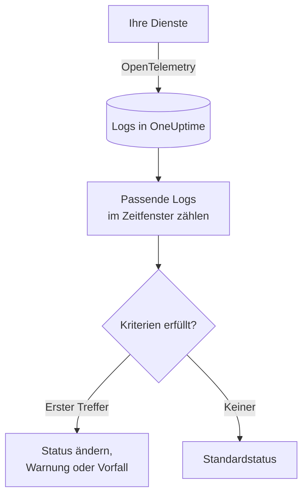
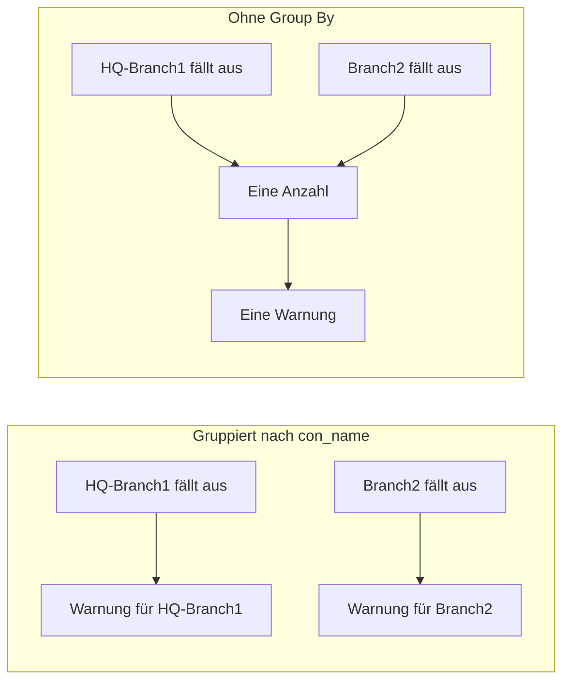

# Logs-Überwachung

Ein Logs-Monitor zählt die Logs, die Ihre Dienste an OneUptime senden und die zu Ihren Filtern passen – Text, Schweregrad, Dienst, Attribute –, über ein Zeitfenster. Erfüllt die Anzahl Ihre Kriterien, ändert er den Status des Monitors, erstellt eine Warnung oder eröffnet einen Vorfall. Damit erkennen Sie Fehlerspitzen, eine bestimmte Fehlermeldung oder einen Dienst, der keine Logs mehr schreibt.

:::cards
- [Den Monitor erstellen](#einen-logs-monitor-erstellen): Wählen, welche Logs gezählt werden und wann gewarnt wird.
- [Wie er ausgewertet wird](#wie-er-ausgewertet-wird): Das Zeitfenster, die Anzahl und der Minutentakt.
- [Kriterien](#kriterien): Schwellenwerte, Anomalieerkennung und die Voreinstellungen.
- [Warnungen pro Gruppe](#warnungen-pro-gruppe-group-by): Eine Warnung pro Tunnel, Benutzer oder Schnittstelle.
:::

## So funktioniert es



Jede Minute zählt OneUptime die Logs, die zu den Filtern des Monitors passen und innerhalb seines Zeitfensters eingetroffen sind. Diese Anzahl prüft es von oben nach unten gegen die Kriterien des Monitors, und das erste passende Kriterium entscheidet, was geschieht. Passt keines, kehrt der Monitor zu seinem Standardstatus zurück.

## Bevor Sie beginnen

- Ihre Dienste senden Logs über OpenTelemetry (oder eine andere Log-Quelle, die OneUptime aufnimmt) an OneUptime. Siehe [OpenTelemetry](/docs/telemetry/open-telemetry).
- Um nach einem Wert innerhalb der Logzeile zu filtern oder zu gruppieren, etwa einem Tunnel- oder Benutzernamen, wandeln Sie ihn zuerst mit einer [Log-Pipeline](/docs/telemetry/log-pipelines) in ein Attribut um.

## Einen Logs-Monitor erstellen

:::steps
### Einen neuen Monitor beginnen

Gehen Sie zu **Monitore** und klicken Sie auf **Monitor erstellen**. Oder suchen Sie im Log-Explorer nach den Logs, über die Sie informiert werden wollen, und klicken Sie in seiner Werkzeugleiste auf **Monitor erstellen** (die Glocke): Der neue Monitor überwacht von Anfang an die Suche, die Schweregrade, die Dienste und die Attribute des Explorers.

### Logs wählen

Klicken Sie unter **Monitortyp** auf **Weitere Monitortypen** und wählen Sie **Protokolle** unter **Telemetrie**, oder tippen Sie `logs` in das Suchfeld. Geben Sie einen **Name** ein und klicken Sie dann auf **Weiter**.

### Wählen, worüber der Monitor informiert

Wählen Sie unter **Worüber soll dieser Monitor Sie informieren?** **Zu viele Fehler**, **Eine Meldung erscheint** oder **Logs bleiben aus**. Jede Wahl füllt die zu überwachenden Logs und die Regel aus, die Sie darunter ändern können. Wählen Sie **Etwas anderes**, um beides selbst einzurichten.

### Die zu zählenden Logs wählen

Legen Sie in **Zu überwachende Logs** die Felder **Protokollschweregrad** und **Meldung enthält** fest. Ein leer gelassener Filter passt auf jedes Log. **Passende Logs** unter den Filtern zeigt die Logs, auf die sie gerade passen.

### Weiter eingrenzen (optional)

Öffnen Sie **Weitere Felder**, um nach Telemetrie-Dienst, Infrastruktur-Entität oder Attribut zu filtern. Für eine Warnung pro Tunnel, Benutzer oder Schnittstelle statt einer für den ganzen Monitor fügen Sie das Attribut unter **Group by Attributes** hinzu – siehe [Warnungen pro Gruppe](#warnungen-pro-gruppe-group-by).

### Festlegen, wann alarmiert wird

Wählen Sie in **Wann alarmieren** eine **Bedingung**, die **Anzahl der Logs** und ein **Zeitfenster**. Der Satz darunter gibt die Regel in einfachen Worten wieder. Das Diagramm darunter zählt die passenden Logs in jedem Fenster der letzten Stunden, zeichnet die Zahl der Regel als Linie ein und sagt, wie oft die Regel alarmiert hätte. Seine Schaltfläche schlägt eine Zahl vor, die die Regel in dieser Zeit nicht überschritten hätte.

### Wählen, was passiert

Wählen Sie in **Was passiert** **Warnung erstellen**, **Vorfall melden** oder **Beide**, und geben Sie ihr einen Titel und einen Schweregrad. Solange die Regel zutrifft, zeigt der Monitor den Status unter **Weitere Felder**; trifft sie nicht mehr zu, kehrt der Monitor zu seinem Standardstatus zurück, und die Warnung oder der Vorfall behebt sich selbst.

### Den Monitor erstellen

Klicken Sie auf **Monitor erstellen**. Der Monitor öffnet sich auf seiner Seite **Übersicht**, und seine erste Auswertung läuft innerhalb einer Minute.
:::

## Was er abfragt

| Feld | Worauf es passt | Standard |
| --- | --- | --- |
| **Protokollschweregrad** | Logs mit einem der gewählten Schweregrade. | Leer: jeder Schweregrad |
| **Meldung enthält** | Logs, deren Text diesen Text enthält, ohne Beachtung der Groß-/Kleinschreibung. | Leer: jedes Log |
| **Zeitfenster** (in **Wann alarmieren**) | Logs der letzten 5 Sekunden bis zu den letzten 24 Stunden. | **Letzte 5 Minuten** |
| **Group by Attributes** | Kein Filter: zählt jede Kombination der Werte dieser Attribute getrennt. | Leer: eine Anzahl |
| **Behoben durch Attribute** | Kein Filter: das Log, das eine Gruppe behebt. Erscheint, sobald **Group by Attributes** ein Attribut hat; siehe [Durch ein Log behoben](#durch-ein-log-behoben). | Leer: eine Gruppe wird behoben, wenn ihre Logs aufhören |
| **Nach Telemetrie-Dienst filtern** (unter **Weitere Felder**) | Logs von einem der gewählten Dienste. | Leer: jeder Dienst |
| **Nach Infrastruktur-Entität filtern** (unter **Weitere Felder**) | Logs von einem der gewählten Hosts, Pods, Container und anderen Entitäten. | Leer: jede Entität |
| **Nach Attributen filtern** (unter **Weitere Felder**) | Logs, deren Attribute jede Bedingung erfüllen. Jede Bedingung hat ihren eigenen Operator, etwa „gleich“ oder „enthält“. | Leer: keine Bedingung |

Alle Filter, die Sie festlegen, müssen passen, damit ein Log gezählt wird.

### Log-Schweregrad

Jedes Log wird mit einem von sieben Schweregraden gespeichert. Bei OpenTelemetry-Logs stammt er aus der Schweregradnummer des Logs; wählen Sie also den Schweregrad, nicht den Text, den Ihr Logger ausgegeben hat:

| Schweregrad | OpenTelemetry-Schweregradnummern |
| --- | --- |
| **Trace** | 1–4 |
| **Debug** | 5–8 |
| **Informationen** | 9–12 |
| **Warnung** | 13–16 |
| **Fehler** | 17–20 |
| **Fatal** | 21–24 |
| **Nicht angegeben** | Alles andere |

## Wie er ausgewertet wird

- **Jede Minute.** Ein Logs-Monitor wird nicht von Sonden geprüft, deshalb hat er kein Intervall zum Einstellen und keine Seite **Sonden & Intervall**.
- **Eine Zahl pro Auswertung.** Der Monitor zählt die Logs, die zu jedem Filter passen und innerhalb des **Zeitfenster** vor der Auswertung eingetroffen sind. Mit **Letzte 5 Minuten** blickt jede Auswertung fünf Minuten zurück, sodass sich die Fenster aufeinanderfolgender Auswertungen überlappen.
- **Keine Logs ergeben die Anzahl 0.** Ein Dienst, der keine Logs mehr schreibt, liefert 0 – genau darauf achtet **Logs bleiben aus**.
- **Die eigene Ausfallzeit von OneUptime ist keine Stille.** Solange das Zeitfenster Zeit enthält, in der OneUptime selbst keine Daten empfangen hat – weil es neu startete, aktualisiert wurde oder einen Rückstand aufholte –, wartet die Prüfung: Der Status ändert sich nicht, und kein Vorfall und keine Warnung wird eröffnet oder behoben. Siehe [Wenn OneUptime keine Daten empfängt](/docs/monitor/when-oneuptime-is-not-receiving).
- **Kriterien von oben nach unten.** Das erste passende Kriterium entscheidet; stellen Sie also das schwerwiegendste nach oben. Ein gruppierter Monitor arbeitet anders: Er prüft jedes Kriterium für jede Gruppe – siehe [Die Auswertung der Kriterien unterscheidet sich](#die-auswertung-der-kriterien-unterscheidet-sich).

Jede Statusänderung wird mit ihrem Grund in der **Status-Zeitachse** des Monitors festgehalten.

## Kriterien

Die Kriterien eines Logs-Monitors haben einen **Filtertyp**: **Log Count**, die Anzahl der Logs, die im Fenster gepasst haben. **Wann alarmieren** richtet ein Kriterium ein, dessen **Bedingung** **Mehr als**, **Mindestens**, **Weniger als**, **Höchstens**, **Genau**, **Ungewöhnlich hoch**, **Ungewöhnlich niedrig** oder **Ungewöhnlich hoch oder niedrig** lautet. Für mehrere Kriterien oder eines mit mehr als einem Filter klicken Sie in **Was passiert** unter **Weitere Felder** auf **Als eigene Kriterien bearbeiten**: Jedes Kriterium dort hat eine **Filterbedingung** und, bei einer Schwellenwertbedingung, einen **Wert**.

| Filterbedingung | Passt, wenn die Anzahl der Logs … |
| --- | --- |
| **Größer als** | über dem Wert liegt |
| **Größer als oder gleich** | den Wert erreicht oder darüber liegt |
| **Kleiner als** | unter dem Wert liegt |
| **Kleiner als oder gleich** | den Wert erreicht oder darunter liegt |
| **Gleich** | genau dem Wert entspricht |
| **Anomalously High** | über dem Bereich liegt, der für diese Stunde der Woche erwartet wird |
| **Anomalously Low** | unter diesem Bereich liegt |
| **Anomalous** | außerhalb dieses Bereichs liegt, in die eine oder andere Richtung |

Die Anomaliebedingungen haben keinen **Wert**. Wählen Sie eine **Empfindlichkeit** – Niedrig, Mittel (der Standard) oder Hoch – und, in den eigenen Kriterien, ein **Baseline-Fenster** von 14 (der Standard), 28, 60 oder 90 Tagen. OneUptime rechnet die Anzahl in eine Rate pro Minute um und vergleicht sie mit derselben Stunde der Woche über dieses Fenster. Die Baseline umfasst nur die Dienste und Schweregrade des Monitors: Seine Text- und Attributfilter gehören nicht dazu. Solange diese Stunde der Woche nicht genug Verlauf hat, lernt das Kriterium noch und löst nicht aus.

Ein in „Monitor erstellen“ angelegter Logs-Monitor beginnt mit der Regel dessen, was Sie unter **Worüber soll dieser Monitor Sie informieren?** gewählt haben:

| Auswahl | Regel | Was passiert |
| --- | --- | --- |
| **Zu viele Fehler** | **Protokollschweregrad** **Fehler** und **Fatal**, **Mehr als** `10` in **Letzte 5 Minuten** | Erstellt eine Warnung, die sich selbst behebt |
| **Eine Meldung erscheint** | **Mehr als** `0` in **Letzte 5 Minuten** | Erstellt eine Warnung, die sich selbst behebt |
| **Logs bleiben aus** | **Genau** `0` in **Letzte 10 Minuten** | Meldet einen Vorfall, der sich selbst behebt |

Ein über die API oder Terraform ohne Kriterien angelegter Logs-Monitor beginnt mit diesen Kriterien:

| Kriterium | Filter | Wirkung |
| --- | --- | --- |
| Check if … is offline | **Log Count** **Gleich** `0` | Setzt den Monitor auf offline und eröffnet einen Vorfall, der automatisch behoben wird |
| Check if … is online | **Log Count** **Größer als** `0` | Setzt den Monitor auf online |

## Ein Beispiel: eine Fehlerspitze

Sie wollen einen Vorfall, wenn der Checkout-Dienst in fünf Minuten mehr als 50 Fehler protokolliert:

- **Protokollschweregrad**: **Fehler**
- **Zeitfenster**: **Letzte 5 Minuten**
- **Nach Telemetrie-Dienst filtern**: `checkout`
- **Wann alarmieren**: **Mehr als** `50`
- **Was passiert**: **Vorfall melden**

Vier aufeinanderfolgende Auswertungen:

| Zeit | Fehler-Logs der letzten 5 Minuten | Regel trifft zu? | Was geschieht |
| --- | --- | --- | --- |
| 10:00 | 12 | Nein | Der Monitor ist online. |
| 10:01 | 64 | Ja | Der Monitor geht offline, und ein Vorfall wird eröffnet. |
| 10:02 | 81 | Ja | Weiterhin offline. Der Vorfall ist schon offen, also wird kein zweiter eröffnet. |
| 10:06 | 9 | Nein | Der Monitor ist wieder online, und der Vorfall behebt sich selbst, weil **Vorfall automatisch beheben** eingeschaltet ist. |

Weil sich die Fenster überlappen, hält ein einzelner Fehlerschub die Anzahl bis zu fünf Minuten nach seinem Ende hoch. Verwenden Sie ein kürzeres Fenster für einen Monitor, der sich schneller erholen soll.

## Warnungen pro Gruppe (Group By)

**Group by Attributes** teilt die Anzahl eines Logs-Monitors in eine Anzahl pro unterschiedlicher Kombination von Attributwerten auf – eine pro IPsec-Tunnel, pro VPN-Benutzer, pro Firewall-Schnittstelle – und wertet die Kriterien für jede Gruppe getrennt aus. Es ist das Gegenstück für Logs zum [Group By](/docs/monitor/metrics-monitor#warnungen-pro-reihe-group-by) eines Metriken-Monitors.

### Eine Warnung pro Gruppe

Ohne Group By ist ein Monitor, der auf beendete IPsec-Tunnel achtet, eine einzige Anzahl für den ganzen Monitor und löst **eine Warnung für den ganzen Monitor** aus. Solange diese Warnung offen ist, erzeugt ein zweiter ausfallender Tunnel nichts Neues – der Monitor warnt ja bereits.

Mit Group By auf dem Tunnelnamen eröffnet das Beenden des Tunnels `HQ-Branch1` seine eigene Warnung, und das Beenden des Tunnels `Branch2` zehn Minuten später eröffnet daneben eine **zweite, separate Warnung**.



### Unabhängige Behebung

Die Warnung oder der Vorfall jeder Gruppe wird für sich behoben. Sobald eine Gruppe die Kriterien nicht mehr erfüllt – `HQ-Branch1` protokolliert innerhalb des Zeitfensters keine Beendigungen mehr –, wird ihre Warnung behoben, während die von `Branch2` offen bleibt, bis auch `Branch2` aufhört. Die Erholung einer Gruppe schließt nie die Warnung einer anderen.

Ein Logs-Monitor sieht Ereignisse, keinen Zustand: Die Warnung einer Gruppe wird behoben, sobald diese Gruppe ein ganzes Zeitfenster lang nichts protokolliert hat, das die Kriterien erfüllt – ob der Tunnel wieder da ist oder nicht, es sei denn, der Monitor nennt das Log, das seine Rückkehr meldet, wie unten beschrieben.

### Durch ein Log behoben

Ein Gerät, das einen Tunnel als ausgefallen meldet, meldet ihn in der Regel auch wieder als aktiv. **Behoben durch Attribute** benennt dieses Log: Ist es gesetzt, bleibt die Warnung oder der Vorfall einer Gruppe offen, bis ein Log mit diesen Attributen für dieselbe Gruppe eintrifft, statt behoben zu werden, wenn die Logs der Gruppe aufhören.

Nehmen Sie einen Monitor, der Logs mit `event.name` = `vpn.tunnel_down` zählt, gruppiert nach `event.device` und `vpn.tunnel.name`, mit **Behoben durch Attribute** gesetzt auf `event.name` = `vpn.tunnel_up`. Fällt der Tunnel `HQ-Branch1` aus, öffnet das seine Warnung. Die Warnung bleibt über Nacht offen, obwohl die Firewall nichts mehr zu dem Tunnel protokolliert, und wird behoben, wenn die Firewall `HQ-Branch1` als aktiv meldet. Bricht der Tunnel erneut ab, öffnet das eine neue Warnung.

- Das Feld erscheint, sobald **Group by Attributes** ein Attribut hat. Es nimmt bis zu 10 Attribute auf, und ein behebendes Log trägt sie alle.
- Ein behebendes Log gehört zu einer Gruppe, wenn es für die Group-by-Attribute die Werte der Gruppe hat; beide Arten von Logs müssen diese Attribute also tragen.
- Die Telemetriedienste und das Zeitfenster des Monitors gelten auch für behebende Logs. Seine Text- und Schweregradfilter nicht: Sie beschreiben das Problem.
- Eine Gruppe, deren neuestes Log ein behebendes ist, wird geschlossen. Eine, die das Problem danach erneut protokolliert hat, bleibt offen.
- Sie können eine Warnung weiterhin selbst beheben.

[Netzwerkereignisse](/docs/monitor/network-events) legt diese Monitore für Sie an, ein Klick pro Warnung.

### Beispiel: eine Warnung pro Sophos-IPsec-Tunnel

Dies setzt voraus, dass die Syslog-Zeilen der Firewall mit einem [Key=Value-Parser](/docs/telemetry/log-pipelines#keyvalue-parser) ohne Zielpräfix in Attribute zerlegt werden, sodass der Tunnelname das Attribut `con_name` ist:

```text
log_component="IPSec" con_name="HQ-Branch1" status="Terminated" message="IPSec Connection HQ-Branch1 between 10.171.4.117 and 10.171.4.118 for Child HQ-Branch1 terminated."
```

:::steps
1. Erstellen Sie einen **Protokolle**-Monitor und wählen Sie **Eine Meldung erscheint**.
2. Setzen Sie **Meldung enthält** auf `terminated` und das **Zeitfenster** auf **Letzte 5 Minuten**.
3. Fügen Sie unter **Weitere Felder** den Attributfilter `log_component` = `IPSec` hinzu.
4. Fügen Sie unter **Group by Attributes** das Attribut `con_name` hinzu.
5. Belassen Sie die Regel bei **Mehr als** `0`, und geben Sie der Warnung oder dem Vorfall den Titel `IPsec tunnel {{con_name}} terminated`.
:::

Jeder Tunnel, der eine Beendigung protokolliert, erhält nun seine eigene Warnung – `IPsec tunnel HQ-Branch1 terminated`, `IPsec tunnel Branch2 terminated` –, und jede wird für sich behoben.

### Gruppenwerte in Titeln und Beschreibungen

Der Wert jedes Group-By-Attributs ist eine [Vorlagenvariable](/docs/monitor/incident-alert-templating) im Titel, in der Beschreibung und in den Hinweisen zur Behebung der Warnung oder des Vorfalls, genau wie die Labels einer Metrikreihe: Gruppieren nach `con_name` liefert `{{con_name}}`. Ein Schlüssel mit Punkten wird als Pfad gelesen, `sophos.con_name` also als `{{sophos.con_name}}`. Nennt der Titel die Gruppe noch nicht, wird sie angehängt (`IPsec tunnel terminated - Con Name: HQ-Branch1`), und `{{seriesResourceSuffix}}` und `{{seriesResourceSummary}}` funktionieren wie bei Metrik-Monitoren.

### Wie Gruppen gezählt werden

- Bis zu 10 Attribute. Jede unterschiedliche Kombination ihrer Werte ist eine Gruppe.
- Ein Log ohne ein Group-By-Attribut wird unter einem **leeren Wert** dafür gezählt; Logs ohne das Attribut bilden also eine eigene Gruppe, deren Warnung keinen Wert dafür nennt. Kommt jede Warnung ohne Gruppenwert an, prüfen Sie den Attributschlüssel – eine Log-Pipeline mit Zielpräfix speichert `con_name` als `sophos.con_name`.
- Gruppenwerte, die länger als 256 Zeichen sind, werden auf 256 gekürzt.
- Pro Prüfung werden höchstens **100 Gruppen** ausgewertet: die 100 mit den meisten Logs. Passen mehr, werden die übrigen bei dieser Prüfung übersprungen und eine Warnung wird protokolliert – grenzen Sie die Filter des Monitors ein, um sie abzudecken.

### Die Auswertung der Kriterien unterscheidet sich

- **Jedes Kriterium wird ausgewertet**, wie bei einem gruppierten Metriken-Monitor, sodass verschiedene Gruppen zugleich verschiedene Kriterien erfüllen können. Eine Gruppe, die zwei Kriterien erfüllt, erhält trotzdem nur eine Warnung, vom ersten; ordnen Sie die Kriterien also mit dem schwerwiegendsten zuerst.
- **Eine Gruppe existiert nur, wenn sie im Zeitfenster etwas protokolliert hat.** Kriterien mit **Gleich 0** und **Kleiner als** lösen daher nur für Gruppen aus, die mindestens einmal protokolliert haben; um zu warnen, wenn gar keine Logs mehr eintreffen, verwenden Sie einen Monitor ohne Group By.
- **Anomalieerkennung** (**Anomalously High**, **Anomalously Low**, **Anomalous**) wird nicht pro Gruppe ausgewertet – ihre Baseline umfasst den ganzen Monitor –, daher passen diese Filter bei einem gruppierten Monitor nie.
- Der Status des Monitors folgt dem ersten Kriterium, das irgendeine Gruppe erfüllt. Erfüllt keine Gruppe ein Kriterium, kehrt der Monitor zu seinem Standardstatus zurück.

## Fehlerbehebung

:::details Der Monitor ist offline, aber mein Dienst schreibt Logs
Die Anzahl war 0, die Filter passen also auf keines der Logs, die der Dienst sendet. Öffnen Sie die Seite **Kriterien** des Monitors (unter **Konfiguration**) und klicken Sie auf **Überwachungskriterien bearbeiten**: **Passende Logs** zeigt, worauf die Filter gerade passen, und das Diagramm in **Wann alarmieren** zählt sie in jedem Fenster. Die üblichen Ursachen sind ein Schweregrad, der nach dem vom Logger ausgegebenen Text statt nach seiner Schweregradnummer gewählt wurde (siehe [Log-Schweregrad](#log-schweregrad)), ein Dienst- oder Attributfilter, der nicht passt, und ein Zeitfenster, das kürzer ist als die Pause zwischen den Logs des Dienstes.
:::

:::details Es gab eine Spitze, aber nichts hat gewarnt
Die Kriterien werden von oben nach unten geprüft, und der erste Treffer entscheidet. Ein breites Kriterium über dem erwarteten, etwa **Log Count** **Größer als** `0`, passt zuerst und stoppt den Rest. Stellen Sie das schwerwiegendste Kriterium nach oben.
:::

:::details Ein Anomaliekriterium löst nie aus
Es lernt noch: Die Stunde der Woche, mit der es vergleicht, hat noch nicht genug Verlauf. Bei einem Monitor mit **Group by Attributes** passen Anomaliebedingungen nie – verwenden Sie dort einen Schwellenwert.
:::

:::details Gruppenwarnungen kommen ohne Gruppenwert an
Logs ohne das Group-By-Attribut werden unter einem leeren Wert gezählt. Prüfen Sie den genauen Namen des Schlüssels im Log-Explorer: Eine Log-Pipeline mit Zielpräfix speichert `con_name` als `sophos.con_name`.
:::

## Nächste Schritte

:::cards
- [Protokoll-Pipelines](/docs/telemetry/log-pipelines): Logzeilen in Attribute zerlegen, nach denen Sie filtern und gruppieren können.
- [Vorfall- & Warnmeldungsvorlagen](/docs/monitor/incident-alert-templating): Gruppenwerte und Anzahlen in Titel und Beschreibungen setzen.
- [Metriken-Überwachung](/docs/monitor/metrics-monitor): Auf eine Metrik warnen, pro Host oder pro Container.
- [Traces-Überwachung](/docs/monitor/traces-monitor): Auf die gleiche Weise auf fehlschlagende Spans warnen.
:::
