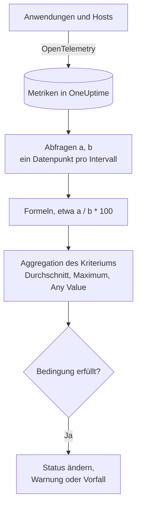

# Metriken-Überwachung

Ein Metriken-Monitor fragt die Metriken ab, die Ihre Anwendungen und Ihre Infrastruktur an OneUptime senden, verknüpft sie mit Formeln, wenn Sie ein Verhältnis oder eine Summe brauchen, und prüft das Ergebnis über einen gleitenden Zeitbereich gegen Ihre Kriterien. Nutzen Sie ihn für Anfrageraten, Fehlerquoten, Warteschlangentiefen, CPU, Speicher und Festplatten – jede numerische Reihe –, mit einer Warnung pro Host oder Container, wenn Sie ihn gruppieren.

:::cards
- [Den Monitor erstellen](#einen-metriken-monitor-erstellen): Abfragen, Formeln, ein Zeitbereich und Kriterien.
- [Wie er ausgewertet wird](#wie-er-ausgewertet-wird): Datenpunkte, Formeln und die Aggregation der Kriterien.
- [Ein Beispiel](#ein-beispiel-eine-wachsende-warteschlange): Dieselben Daten unter jeder Aggregation.
- [Warnungen pro Reihe](#warnungen-pro-reihe-group-by): Eine Warnung pro Host, Container oder Einhängepunkt.
:::

## So funktioniert es

Jede Minute führt OneUptime jede Metrikabfrage des Monitors über seinen Zeitbereich aus. Eine Abfrage liefert einen Datenpunkt pro Zeitintervall, und Formeln verknüpfen die Abfragen Intervall für Intervall. Jedes Kriterium reduziert dann die Datenpunkte der Abfrage oder Formel, die es prüft – auf ihren Durchschnitt, ihr Maximum oder eine Prüfung jedes Punkts – und vergleicht das Ergebnis mit seinem Schwellenwert.

## Bevor Sie beginnen

- Ihre Anwendungen oder Ihre Infrastruktur senden Metriken über OpenTelemetry an OneUptime. Siehe [OpenTelemetry](/docs/telemetry/open-telemetry).
- Kennen Sie den Namen der Metrik und die Attribute, nach denen Sie filtern oder gruppieren wollen. Die Listen **Metrik** und **Gruppieren nach** bieten nur Namen und Attribute an, die OneUptime empfangen hat.

## Einen Metriken-Monitor erstellen

:::steps
### Einen neuen Monitor beginnen

Gehen Sie zu **Monitore** und klicken Sie auf **Monitor erstellen**. Oder bauen Sie im Metrik-Explorer das Diagramm, das Sie überwachen wollen, und klicken Sie auf **Monitor aus dieser Ansicht erstellen**: Der neue Monitor beginnt mit seinen Abfragen.

### Metrics wählen

Klicken Sie unter **Monitortyp** auf **Weitere Monitortypen** und wählen Sie **Metriken** unter **Telemetrie**, oder tippen Sie `metrics` in das Suchfeld. Geben Sie einen **Name** ein und klicken Sie dann auf **Weiter**.

### Die Metrikabfragen hinzufügen

Wählen Sie in **Zu überwachende Metrik** eine **Metrik** und wie sie per **Aggregieren nach** zusammengefasst wird. Öffnen Sie **Filter & Gruppierung**, um nach Attributen zu filtern oder nach einem davon zu **Gruppieren nach**. Klicken Sie auf **Metrik hinzufügen** für eine weitere Abfrage oder auf **Formel hinzufügen**, um sie zu verknüpfen. Das Diagramm unter den Abfragen zeigt die letzten Stunden mit dem Wert der Regel als rote Linie, sodass Sie die Werte sehen, die die Regel prüfen wird.

### Festlegen, wann alarmiert wird

Wählen Sie in **Wann alarmieren**, wie die Metrik **Gemessen als** wird, ein **Zeitfenster**, eine **Bedingung** und einen **Wert**. Hat der Schritt mehr als eine Abfrage oder Formel, wählen Sie auch die **Metrik**, die die Regel liest. Der Satz darunter gibt die Regel in einfachen Worten wieder.

### Wählen, was passiert

Wählen Sie in **Was passiert** **Warnung erstellen**, **Vorfall melden** oder **Beide**, und geben Sie ihr einen Titel und einen Schweregrad. Solange die Regel zutrifft, zeigt der Monitor den Status unter **Weitere Felder**; trifft sie nicht mehr zu, kehrt der Monitor zu seinem Standardstatus zurück, und die Warnung oder der Vorfall behebt sich selbst.

### Den Monitor erstellen

Klicken Sie auf **Monitor erstellen**. Der Monitor öffnet sich auf seiner Seite **Übersicht**, und seine erste Auswertung läuft innerhalb einer Minute.
:::

## Was er abfragt

### Metrikabfragen

| Feld | Was es tut | Standard |
| --- | --- | --- |
| **Metrik** | Die abzufragende Metrik. | Pflichtfeld |
| **Aggregieren nach** | Wie die Werte in jedem Zeitintervall zu einem Datenpunkt zusammengefasst werden: Durchschn., Summe, Min, Max, Anzahl oder ein Perzentil – P50, P75, P90, P95 oder P99. | Durchschn. |
| **Nach Attributen filtern** (unter **Filter & Gruppierung**) | Nur Reihen, deren Attribute zu diesen Bedingungen passen. | Kein Filter |
| **Gruppieren nach** (unter **Filter & Gruppierung**) | Eine Reihe pro eindeutigem Wert dieser Attribute – siehe [Warnungen pro Reihe](#warnungen-pro-reihe-group-by). | Eine Reihe |

Jede Abfrage und jede Formel erhält eine Variable – `a`, `b`, `c` und so weiter – in der Reihenfolge, in der Sie sie hinzufügen.

### Formeln

Eine Formel verknüpft Abfragevariablen mit `+`, `-`, `*`, `/`, `%`, `^` und Klammern, Intervall für Intervall. Sie können die Variablen mit oder ohne vorangestelltes `$` schreiben:

- `a / b * 100` – der Anteil von `b`, den `a` ausmacht, in Prozent
- `a + b` – zwei Metriken addiert
- `a - b` – der Unterschied zwischen ihnen

### Gleitendes Zeitfenster

Das **Zeitfenster** in **Wann alarmieren** legt fest, wie weit jede Auswertung zurückblickt: **Letzte 1 Minute**, **Letzte 5 Minuten**, **Letzte 10 Minuten**, **Letzte 15 Minuten**, **Letzte 30 Minuten**, **Letzte 1 Stunde**, **Letzte 2 Stunden**, **Letzte 3 Stunden**, **Letzte 6 Stunden**, **Letzte 12 Stunden**, **Letzte 24 Stunden**, **Letzte 2 Tage**, **Letzte 3 Tage**, **Letzte 7 Tage**, **Letzte 14 Tage**, **Letzte 30 Tage**, **Letzte 60 Tage**, **Letzte 90 Tage**, **Letzte 180 Tage** oder **Letzte 365 Tage**.

Je länger das Fenster, desto breiter jedes Zeitintervall, sodass ein Datenpunkt für mehr Zeit steht:

| Zeitfenster | Ein Datenpunkt pro |
| --- | --- |
| Letzte 1 Minute bis Letzte 3 Stunden | Minute |
| Letzte 6 Stunden, Letzte 12 Stunden | 5 Minuten |
| Letzte 24 Stunden | 15 Minuten |
| Letzte 2 Tage, Letzte 3 Tage | 30 Minuten |
| Letzte 7 Tage | Stunde |
| Letzte 14 Tage, Letzte 30 Tage | Tag |
| Letzte 60 Tage bis Letzte 180 Tage | Woche |
| Letzte 365 Tage | Monat |

## Wie er ausgewertet wird

- **Jede Minute.** Ein Metriken-Monitor wird nicht von Sonden geprüft, deshalb hat er kein Intervall zum Einstellen und keine Seite **Sonden & Intervall**.
- **Erst die Abfragen, dann die Formeln.** Jede Abfrage liefert mit ihrem **Aggregieren nach** einen Datenpunkt pro Zeitintervall des Zeitbereichs. Formeln werden für jedes Intervall aus den Datenpunkten der Abfragen berechnet.
- **Dann das Maß der Regel.** Die Regel reduziert die Datenpunkte ihrer Metrik auf das, was sie mit ihrem Wert vergleicht, wie **Gemessen als** sagt:

| Gemessen als | In den eigenen Kriterien | Die Bedingung wird geprüft gegen … |
| --- | --- | --- |
| Der Durchschnitt | Durchschnitt | den Durchschnitt der Datenpunkte |
| Die Summe | Summe | die Summe der Datenpunkte |
| Der höchste Wert | Maximum Value | den höchsten Datenpunkt |
| Der niedrigste Wert | Minimum Value | den niedrigsten Datenpunkt |
| Jeder Wert (das ganze Zeitfenster) | All Values | jeden Datenpunkt: Alle müssen die Bedingung erfüllen und den ganzen Zeitbereich abdecken |
| Irgendein Wert (zu irgendeinem Zeitpunkt) | Any Value | jeden Datenpunkt: Es genügt, wenn einer die Bedingung erfüllt |

- **Kriterien von oben nach unten.** Bei einem Monitor ohne Group By entscheidet das erste passende Kriterium; stellen Sie also das schwerwiegendste nach oben. Ein gruppierter Monitor prüft jedes Kriterium für jede Reihe – siehe [Die Auswertung der Kriterien unterscheidet sich](#die-auswertung-der-kriterien-unterscheidet-sich).
- **Keine Daten sind nicht null.** Liefert die Abfrage im Zeitbereich keine Datenpunkte, tut die Regel, was **Wenn keine Daten vorliegen** unter **Weitere Felder** in **Wann alarmieren** sagt: **Nichts** (der Standard – die Regel trifft nicht zu), **Als null zählen** oder **Alarmieren, als ob sie zuträfe**.
- **Jeder Wert braucht den ganzen Zeitbereich.** Eine Reihe erfüllt eine Regel, die als **Jeder Wert (das ganze Zeitfenster)** gemessen wird, erst, wenn ihre Datenpunkte den Zeitbereich abdecken – von seinem Anfang bis jetzt, ohne eine Lücke von mehr als einem fehlenden Datenpunkt. Kommen alle Daten des Monitors verspätet an, wie die von CloudWatch, tritt sein neuester Datenpunkt an die Stelle von jetzt. Ein Host, ein Container oder ein Deployment, das gerade erst Daten sendet oder eine Weile still war, wartet, bis es Daten für einen ganzen Zeitbereich hat, und das Auswertungsprotokoll zeigt, wie weit es ist: `Waiting for 15 minutes of data: 2 of 15 minutes so far`. Eine Reihe, deren Warnung oder Vorfall schon offen ist, wird allein nach ihren Datenpunkten beurteilt, sodass eine kurze Lücke in ihren Daten die Warnung oder den Vorfall nicht behebt. Sendet die Metrik seltener, als der Zeitbereich lang ist, zählt ein einzelner Datenpunkt für den ganzen Bereich, sobald er ein paar Minuten alt ist; um zu beurteilen, wie lange ein Wert anhält, sollte der Zeitbereich mindestens zwei Meldeintervalle lang sein.
- **Die eigene Ausfallzeit von OneUptime ist keine Stille.** Solange der Zeitbereich Zeit enthält, in der OneUptime selbst keine Daten empfangen hat – weil es neu startete, aktualisiert wurde oder einen Rückstand aufholte –, wartet die Prüfung: Der Status ändert sich nicht, und kein Vorfall und keine Warnung wird eröffnet oder behoben, was auch immer **Wenn keine Daten vorliegen** sagt. Siehe [Wenn OneUptime keine Daten empfängt](/docs/monitor/when-oneuptime-is-not-receiving).

## Kriterien

Diese Monitore werten immer den **Metric Value** aus – den aggregierten Wert der konfigurierten Metrikabfrage oder Formel. **Wann alarmieren** richtet ein Kriterium aus **Gemessen als**, **Zeitfenster**, **Bedingung** und **Wert** ein. Hat die Metrik eine Einheit, wählen Sie die Einheit des Werts daneben. Seine **Bedingung** lautet **Über**, **Mindestens**, **Unter**, **Höchstens**, **Genau**, **Ungewöhnlich hoch**, **Ungewöhnlich niedrig** oder **Ungewöhnlich hoch oder niedrig**. Für mehrere Kriterien, etwa Schweregradstufen, klicken Sie in **Was passiert** unter **Weitere Felder** auf **Als eigene Kriterien bearbeiten**: Jedes Kriterium dort hat eine **Metrik**, eine **Aggregation**, eine **Bedingung** und einen **Schwellenwert**.

| Bedingung | Passt, wenn der Wert … |
| --- | --- |
| **Größer als** | über dem Schwellenwert liegt |
| **Größer als oder gleich** | den Schwellenwert erreicht oder darüber liegt |
| **Kleiner als** | unter dem Schwellenwert liegt |
| **Kleiner als oder gleich** | den Schwellenwert erreicht oder darunter liegt |
| **Gleich** | genau dem Schwellenwert entspricht |
| **Anomalously High** | über dem Bereich liegt, der für diese Stunde der Woche erwartet wird |
| **Anomalously Low** | unter diesem Bereich liegt |
| **Anomalous** | außerhalb dieses Bereichs liegt, in die eine oder andere Richtung |
| **Keine Daten** | fehlt: Die Abfrage hat im Zeitfenster nichts gesendet |
| **Daten vorhanden** | vorhanden ist: Die Abfrage hat im Zeitfenster etwas gesendet |

Die Anomaliebedingungen haben keinen Schwellenwert. **Wann alarmieren** zeigt stattdessen **Empfindlichkeit** – Niedrig, Mittel (der Standard) oder Hoch –, die eigenen Kriterien zusätzlich ein **Baseline-Fenster** – 14 Tage (der Standard), 28, 60 oder 90 –, und jeder Datenpunkt wird mit der Baseline derselben Stunde der Woche verglichen, die aus diesem Fenster gebildet wird. Solange diese Stunde der Woche nicht genug Verlauf hat, lernt das Kriterium noch und erzeugt keine Warnungen.

Ein in „Monitor erstellen“ angelegter Metriken-Monitor beginnt mit einer Regel auf seiner ersten Abfrage: **Der Durchschnitt** über **Letzte 5 Minuten**, **Über** dem **Wert**, den Sie eingeben, und **Warnung erstellen**.

Ein neuer, über die API oder Terraform ohne Kriterien angelegter Metriken-Monitor beginnt mit zwei Kriterien auf seiner ersten Abfrage, beide mit der Aggregation **Any Value**:

| Kriterium | Bedingung | Wirkung |
| --- | --- | --- |
| Check if … is offline | **Gleich** `0` | Setzt den Monitor auf offline und eröffnet einen Vorfall, der automatisch behoben wird |
| Check if … is online | **Größer als** `0` | Setzt den Monitor auf online |

> [!NOTE]
> Das Offline-Kriterium löst bei einem gemeldeten Wert von 0 aus, nicht bei Stille. Um zu warnen, wenn eine Metrik nicht mehr eintrifft, setzen Sie ihr **Bei keinen Daten** auf **Auslöser**.

## Ein Beispiel: eine wachsende Warteschlange

Sie wollen einen Vorfall, wenn die Checkout-Warteschlange tief bleibt. Abfrage `a` ist das Gauge `checkout.queue.depth` mit **Aggregieren nach** Max, und das **Zeitfenster** ist **Letzte 5 Minuten**. Eine Auswertung sieht diese fünf Datenpunkte von je einer Minute:

| Minute | 10:01 | 10:02 | 10:03 | 10:04 | 10:05 |
| --- | --- | --- | --- | --- | --- |
| `a` | 640 | 980 | 1.500 | 1.620 | 1.100 |

Eine Regel **Über** `1000` ergibt für jede Art, wie sie **Gemessen als** wird, eine andere Antwort:

| Gemessen als | Verglichen mit 1.000 | Passt? |
| --- | --- | --- |
| Der Durchschnitt | 1.168 | Ja |
| Die Summe | 5.840 | Ja |
| Der höchste Wert | 1.620 | Ja |
| Der niedrigste Wert | 640 | Nein |
| Jeder Wert (das ganze Zeitfenster) | 640, 980, 1.500, 1.620, 1.100 | Nein – zwei Punkte liegen nicht über 1.000 |
| Irgendein Wert (zu irgendeinem Zeitpunkt) | 640, 980, 1.500, 1.620, 1.100 | Ja – 1.500 schon |

**Der Durchschnitt** alarmiert bei einem anhaltenden Rückstau und ignoriert eine einzelne tiefe Minute; **Jeder Wert (das ganze Zeitfenster)** wartet, bis jede Minute im Bereich tief ist; **Irgendein Wert (zu irgendeinem Zeitpunkt)** alarmiert bei der ersten tiefen Minute.

## Warnungen pro Reihe (Group By)

**Gruppieren nach** in einer Metrikabfrage teilt diese Abfrage in eine Reihe pro eindeutigem Attributwert auf – eine pro Host, eine pro Container, eine pro Einhängepunkt –, und ein Monitor mit gesetztem Group By wertet jede Reihe unabhängig aus. Diese eine Einstellung macht den Unterschied zwischen „die Flotte ist ungesund“ und „`prod-db-01` ist ungesund“.

### Eine Warnung pro Gruppe

Mit Group By auf `host.name` löst ein Festplattennutzungs-Monitor, der fünfzig Hosts überwacht, **eine Warnung (oder einen Vorfall) pro überschreitendem Host** aus. Füllt sich Host A, eröffnet er seine eigene Warnung; füllt sich Host B zehn Minuten später, eröffnet er daneben eine zweite, separate Warnung.

Ohne Group By ist derselbe Monitor ein einzelner Skalar: Die Abfrage fasst alle Hosts zu einer Zahl zusammen, und der Monitor löst **eine Warnung für den ganzen Monitor** aus. Solange diese Warnung offen ist, erzeugt ein zweiter überschreitender Host nichts – der Monitor warnt bereits, es gibt also nichts Neues auszulösen, und die Bereitschaft erfährt nie von Host B. **Group By zu setzen ist der Weg zu Warnungen pro Host.** Wenn Sie pro Host, pro Container oder pro Einhängepunkt alarmiert werden wollen, setzen Sie es.

### Unabhängige Behebung

Jede Warnung pro Gruppe verfolgt ihre eigene Gruppe. Fällt Host A wieder unter den Schwellenwert, wird seine Warnung für sich behoben, und die Warnung von Host B bleibt offen, bis sich Host B erholt. Die Erholung einer Gruppe schließt nie die Warnung einer anderen.

### Die Auswertung der Kriterien unterscheidet sich

- **Gruppierte Monitore werten jedes Kriterium aus.** Schweregradstufen können daher zugleich bei verschiedenen Gruppen auslösen: Mit „Critical – größer als 95“ über „Warning – größer als 80“ eröffnet ein Host bei 96 % bei derselben Prüfung eine kritische Warnung und ein Host bei 85 % eine Warnungsstufe. Ein Host, der beide Stufen überschreitet, erhält trotzdem genau eine Warnung – vom ersten passenden Kriterium; **ordnen Sie die Kriterien also mit dem schwerwiegendsten zuerst**.
- **Ungruppierte Monitore halten beim ersten passenden Kriterium an.** Nur dieses eine Kriterium löst aus – ein weiterer Grund, das warnende Kriterium über das gesunde zu stellen: Ein breites gesundes Kriterium an erster Stelle passt bei fast jeder Prüfung und verhindert, dass das warnende darunter je ausgewertet wird.

| Host | Belegte Festplatte | Critical (> 95) | Warning (> 80) | Ausgelöste Warnung |
| --- | --- | --- | --- | --- |
| `prod-db-01` | 96 % | Ja | Ja | Critical |
| `prod-db-02` | 85 % | Nein | Ja | Warning |
| `prod-db-03` | 40 % | Nein | Nein | Keine |

### Ein Attribut zum Gruppieren wählen

Gruppieren Sie nach einem Attribut, das wirklich ein eigenes Ding bezeichnet, für das Sie jemanden alarmieren würden: das Host-Attribut für eine flottenweite Host-Metrik, das Container- oder Pod-Attribut für eine Container-Metrik, das Einhängepunkt- oder Geräteattribut für eine Dateisystem- oder Festplatten-E/A-Metrik, das Schnittstellenattribut für eine Netzwerkmetrik. Die Auswahlliste **Gruppieren nach** wird aus den Attributen gefüllt, die Ihr Collector tatsächlich sendet; wählen Sie also aus der Liste, statt einen Schlüssel von Hand einzugeben.

Gruppieren Sie keine Metrik, die schon ein einzelner Skalar für das ganze System ist – ein clusterweites Leader-Flag, ein Scheduler-Rückstau oder die CPU eines einzelnen Hosts in einem Monitor für einen einzelnen Host. Ein solches Gruppieren erzeugt genau eine Reihe und ändert nichts außer den Titeln der Warnungen.

Die Werte des Gruppierungsattributs stehen auch als [Vorlagenvariablen](/docs/monitor/incident-alert-templating) im Titel, in der Beschreibung und in den Hinweisen zur Behebung der Warnung oder des Vorfalls bereit – Gruppieren nach `host.name` lässt den Titel `Disk almost full on {{host.name}}` lauten.

## Fehlerbehebung

:::details Das Diagramm zeigt eine Überschreitung, aber der Monitor hat nicht gewarnt
Prüfen Sie zuerst **Gemessen als**: **Jeder Wert (das ganze Zeitfenster)** passt nur, wenn jeder Datenpunkt im Zeitbereich überschreitet, und **Der Durchschnitt** glättet eine kurze Spitze. **Jeder Wert (das ganze Zeitfenster)** wartet außerdem, bis eine Reihe Daten für den ganzen Zeitbereich hat; ein Host oder Deployment, das gerade erst Daten sendet, wird also noch nicht beurteilt. Prüfen Sie dann, ob die Regel die gemeinte Abfrage oder Formel liest (`a` ist nicht die Formel `c`) und ob der **Wert** in der erwarteten Einheit angegeben ist.
:::

:::details Die Metrik kam nicht mehr an, und nichts geschah
Ein Zeitbereich ohne Datenpunkte ist kein Wert von 0. Mit **Wenn keine Daten vorliegen** auf seinem Standard, **Nichts**, trifft die Regel nicht zu. Setzen Sie es unter **Weitere Felder** in **Wann alarmieren** auf **Alarmieren, als ob sie zuträfe**, um bei Stille zu warnen.
:::

:::details Ich bekomme eine Warnung für die ganze Flotte
Die Abfrage hat kein **Gruppieren nach**, also werden alle Hosts zu einer Zahl zusammengefasst. Gruppieren Sie die Abfrage nach dem Host-, Container- oder Einhängepunkt-Attribut – siehe [Warnungen pro Reihe](#warnungen-pro-reihe-group-by).
:::

:::details Ein Anomaliekriterium löst nie aus
Es lernt noch: Die Stunde der Woche, mit der es vergleicht, hat innerhalb des **Baseline-Fenster** noch nicht genug Verlauf.
:::

## Nächste Schritte

:::cards
- [Vorfall- & Warnmeldungsvorlagen](/docs/monitor/incident-alert-templating): Den Host und den Wert in die Titel von Warnungen setzen.
- [Logs-Überwachung](/docs/monitor/logs-monitor): Auf Log-Volumen und -Inhalt warnen, pro Gruppe.
- [Host-Überwachung](/docs/monitor/host-monitor): Fertige CPU-, Speicher- und Festplattenprüfungen für Ihre Hosts.
- [OpenTelemetry](/docs/telemetry/open-telemetry): Metriken an OneUptime senden.
:::
