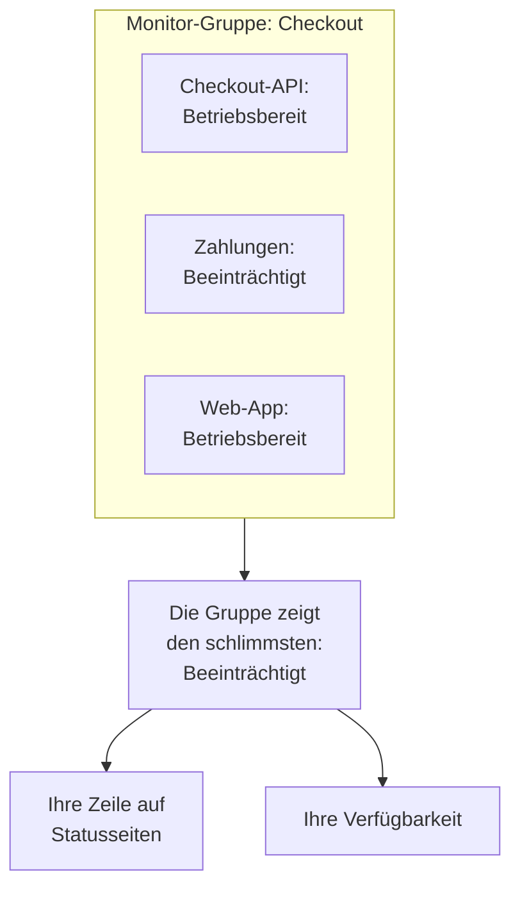

# Monitor-Gruppen

Eine Monitor-Gruppe fasst mehrere Monitore zu einem Status zusammen. Gruppieren Sie die Monitore, die zusammen einen Dienst bilden, etwa Checkout: seine API, seinen Zahlungsdienst und seine Web-App. Die Gruppe zeigt den schlimmsten Status unter ihnen, hat eine eigene Verfügbarkeit, und eine Statusseite kann die ganze Gruppe als eine Zeile anzeigen.

:::cards
- [Wie der Status einer Gruppe ermittelt wird](#wie-der-status-einer-gruppe-ermittelt-wird): Der schlimmste Status unter ihren Monitoren.
- [Monitor-Gruppen einschalten](#monitor-gruppen-einschalten): Ein Schalter in den Projekteinstellungen.
- [Eine Monitor-Gruppe erstellen](#eine-monitor-gruppe-erstellen): Benennen Sie sie, dann fügen Sie ihre Monitore hinzu.
- [Eine Gruppe auf einer Statusseite anzeigen](#eine-gruppe-auf-einer-statusseite-anzeigen): Eine Zeile für die ganze Gruppe.
:::

## Wie der Status einer Gruppe ermittelt wird

Eine Gruppe beginnt bei Ihrem betriebsbereiten Status und übernimmt den schlimmsten Status unter ihren Monitoren: den, der in der Liste der Monitorstatus Ihres Projekts am weitesten unten steht. Geht ein Monitor auf **Beeinträchtigt**, ist die ganze Gruppe **Beeinträchtigt**; geht einer auf **Offline**, ist sie **Offline**.

- **Archivierte Monitore zählen nicht.** Ein archivierter Monitor wird nicht geprüft, sein Status ist also eingefroren; die Gruppe lässt ihn aus.
- **Eine leere Gruppe ist betriebsbereit.** Eine Gruppe ohne Monitore, oder nur mit archivierten, zeigt Ihren betriebsbereiten Status. Bis Sie einen Monitor hinzufügen, zeigt das Dashboard an Stelle ihres Status **Noch keine Monitore**.
- **Die Reihenfolge bestimmen Sie.** Welcher Status der schlimmste ist, folgt der Reihenfolge unter **Monitore → Einstellungen → Monitor-Status**. Siehe [Monitorstatus](/docs/monitor/criteria-and-statuses#monitorstatus).

Eine Monitor-Gruppe ist keine Statusseitengruppe. Eine Statusseitengruppe ist eine Überschrift auf einer Statusseite, die Zeilen enthält. Eine Monitor-Gruppe ist eine Zeile, die für mehrere Monitore steht, und jede Statusseite kann sie anzeigen.

## Bevor Sie beginnen

- **Ihr Plan.** In OneUptime Cloud erfordern Monitor-Gruppen den Scale-Plan.
- **Der Schalter.** Monitor-Gruppen sind ausgeblendet, bis **Monitor-Gruppen** für das Projekt eingeschaltet ist (siehe unten). Das Einschalten erfordert die Rolle Project Owner oder eine benutzerdefinierte Rolle mit der Berechtigung Edit Project oder Manage Billing.
- **Ihre Rolle.** Gruppen erstellen, ändern und löschen können die Rollen Project Owner, Project Admin, Project Member, Monitor Admin oder Monitor Member oder eine benutzerdefinierte Rolle mit den passenden Berechtigungen für Monitor-Gruppen. Ein Viewer kann Gruppen sehen, aber nicht ändern.

## Monitor-Gruppen einschalten

:::steps
### Feature-Flags öffnen

Gehen Sie zu **Projekteinstellungen → Erweitert → Feature-Flags**. **Erweitert** ist im Seitenmenü eingeklappt: Klappen Sie es zuerst auf.

### Den Schalter umlegen

Legen Sie den Schalter **Monitor-Gruppen** um. Er speichert sofort: **Monitor-Gruppen** erscheint im Seitenmenü **Monitore**, und der Eintrag **Monitore** jeder Statusseite heißt nun **Ressourcen**, wo Sie eine Gruppe hinzufügen können.
:::

Wenn Sie den Schalter wieder ausschalten, verschwindet **Monitor-Gruppen** aus dem Menü. Keine Gruppe wird gelöscht.

## Eine Monitor-Gruppe erstellen

:::steps
### Monitor-Gruppen öffnen

Gehen Sie zu **Monitore → Monitor-Gruppen**. Die Karte **Monitor-Gruppen** listet jede Gruppe mit ihrem **Aktueller Status**, ihren Labels und Eigentümern.

### Die Gruppe erstellen

Klicken Sie auf **Monitor-Gruppe erstellen**, geben Sie einen **Name** und, wenn Sie möchten, eine **Beschreibung** ein, und klicken Sie unten im Formular auf **Monitor-Gruppe erstellen**. Die Gruppe beginnt ohne Monitore.

### Ihre Monitore hinzufügen

Öffnen Sie die Gruppe: Solange sie keinen Monitor hat, bietet ihre **Übersicht** **Monitore hinzufügen** an. Später klicken Sie in ihrem Seitenmenü auf **Monitore** und dann auf **Monitore hinzufügen**. Wählen Sie unter **Monitore** jeden Monitor der Gruppe und klicken Sie auf **Monitore hinzufügen**.

### Ihren Status prüfen

Klicken Sie auf **Übersicht**. **Aktueller Status** zeigt den jetzigen Status der Gruppe, und **Verfügbarkeits-Diagramm** zeigt ihre letzten 90 Tage, einen Balken pro Tag.
:::

Um einen Monitor aus der Gruppe zu nehmen, klicken Sie in **Monitore in der Gruppe** in seiner Zeile auf **Entfernen**. Der Monitor selbst ändert sich nicht. Ein Monitor kann zu mehr als einer Gruppe gehören.

## Die Seiten einer Gruppe

Öffnen Sie eine Gruppe, um ihre Seiten im Seitenmenü zu sehen:

| Seite | Was sie zeigt |
| --- | --- |
| **Übersicht** | **Details der Überwachungsgruppe**, **Aktueller Status** und **Verfügbarkeits-Diagramm** mit der Verfügbarkeit der Gruppe in Prozent über die letzten 90 Tage. Eine Gruppe ohne Monitore bietet statt des Diagramms **Monitore hinzufügen** an. |
| **Monitore** | **Monitore in der Gruppe**, mit **Monitore hinzufügen** und **Entfernen**. |
| **Vorfälle** | Die Vorfälle auf einem beliebigen Monitor der Gruppe. |
| **Warnungen** | Die Warnungen auf einem beliebigen Monitor der Gruppe. |
| **Eigentümer** | Die Personen und Teams, die für die Gruppe verantwortlich sind. Die Seite steht unter **Erweitert**, das eingeklappt beginnt. |
| **Audit-Protokolle** | Wer die Gruppe wann geändert hat, ebenfalls unter **Erweitert**. |
| **Gruppe löschen** | Löscht die Gruppe, ebenfalls unter **Erweitert**. |

Die Verfügbarkeit in der **Übersicht** zählt jeden Status außer dem betriebsbereiten als Ausfallzeit. Eine Statusseite zählt nur die Status in ihrer eigenen Liste **Zählt als Ausfallzeit**: siehe [Auswählen, was auf der Seite angezeigt wird](/docs/status-pages/index#auswählen-was-auf-der-seite-erscheint).

Die Liste **Monitor-Gruppen** kann Gruppen nach Eigentümer und Label filtern, Labels und Eigentümer für viele Gruppen auf einmal setzen und Gruppen als JSON exportieren oder importieren.

## Eine Gruppe auf einer Statusseite anzeigen

:::steps
### Die Ressourcen der Statusseite öffnen

Gehen Sie zu **Statusseiten**, öffnen Sie die Seite und klicken Sie in ihrem Seitenmenü auf **Ressourcen**.

### Den Dialog auf eine Gruppe umstellen

Klicken Sie auf **Monitor hinzufügen**. Klicken Sie unter dem Monitor-Auswahlfeld auf **Fügen Sie stattdessen eine Monitor-Gruppe hinzu.** Das Auswahlfeld wird zu **Monitor-Gruppe**.

### Die Gruppe wählen und hinzufügen

Wählen Sie die Gruppe. **Anzeigename**, der Name, den Besucher lesen, übernimmt den Namen der Gruppe, bis Sie einen eigenen eintippen. Klicken Sie auf **Monitor hinzufügen**: Die Zeile erscheint auf der Seite mit dem Status der Gruppe.
:::

Auf der Statusseite steht die Zeile für jeden Monitor der Gruppe:

- **Ihr Status.** Es ist der Status der Gruppe: der schlimmste ihrer Monitore.
- **Ihre Vorfälle.** Ein Vorfall auf einem beliebigen Monitor der Gruppe erscheint auf der Seite, und die Gruppe wird unter den betroffenen Ressourcen genannt.
- **Ihre Abonnenten.** Ein Abonnent, der die Gruppe wählt, erfährt von jedem Monitor darin. Siehe [Abonnenten Ressourcen und Ereignistypen wählen lassen](/docs/status-pages/subscribers#abonnenten-ressourcen-und-ereignistypen-wählen-lassen).

Für die übrigen Optionen der Zeile, etwa ihre Verfügbarkeit und ihr Verlaufsdiagramm, siehe [Statusseiten – Ressourcen & Gruppen](/docs/status-pages/resources-and-groups).

> [!WARNING]
> Wenn Sie eine Monitor-Gruppe löschen, wird auch ihre Zeile auf jeder Statusseite gelöscht, die sie anzeigt. Die Monitore der Gruppe und ihre Vorfälle werden nicht gelöscht.

## API und Terraform

Eine Gruppe ist `/api/monitor-group`, und jeder Monitor darin ist eine Zeile von `/api/monitor-group-resource`, die eine `monitorGroupId` mit einer `monitorId` verbindet. In Terraform heißen sie `oneuptime_monitor_group` und `oneuptime_monitor_group_resource`: siehe [Monitor-Gruppe](/docs/terraform/examples#monitor-gruppe).

## Fehlerbehebung

:::details Monitor-Gruppen fehlt im Menü Monitore
Der Schalter **Monitor-Gruppen** ist aus. Schalten Sie ihn unter **Projekteinstellungen → Erweitert → Feature-Flags** ein. In OneUptime Cloud erfordern Gruppen außerdem den Scale-Plan.
:::

:::details Die Gruppe zeigt Offline, aber die meisten ihrer Monitore laufen
Das ist die Regel: Die Gruppe zeigt ihren schlimmsten Monitor. Öffnen Sie **Monitore** in der Gruppe, um den ausgefallenen Monitor zu finden, oder entfernen Sie einen Monitor, der nicht in die Gruppe gehört.
:::

:::details Eine Statusseite kann die Gruppe nicht hinzufügen
**Fügen Sie stattdessen eine Monitor-Gruppe hinzu.** erscheint im Dialog nur, solange der Schalter **Monitor-Gruppen** für das Projekt eingeschaltet ist.
:::

## Nächste Schritte

:::cards
- [Monitorkriterien & Status](/docs/monitor/criteria-and-statuses): Was den Status jedes Monitors setzt.
- [Statusseiten – Ressourcen & Gruppen](/docs/status-pages/resources-and-groups): Die Zeilen einer Statusseite anordnen.
- [Abonnenten & Ankündigungen](/docs/status-pages/subscribers): Kunden über die Vorfälle einer Gruppe informieren.
:::
