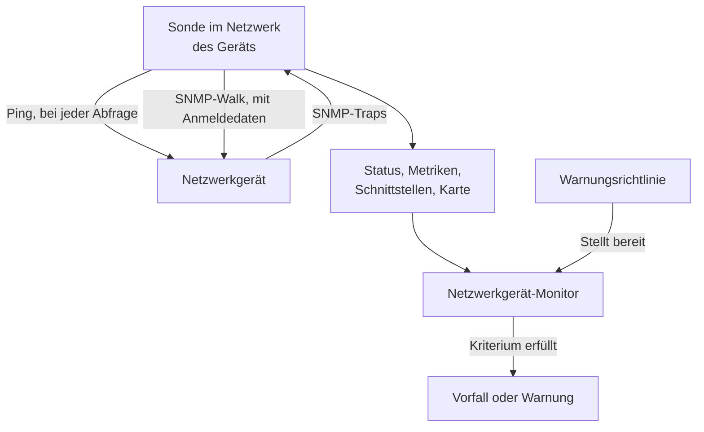
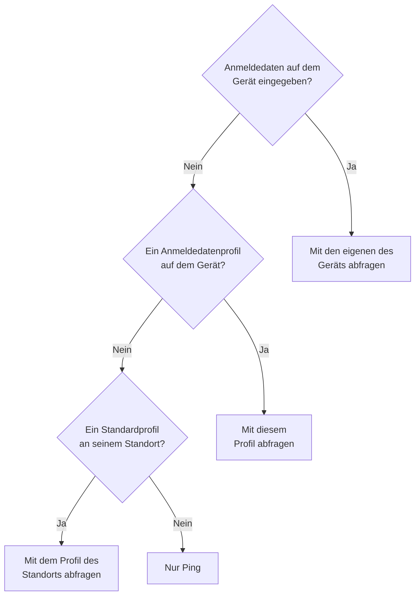
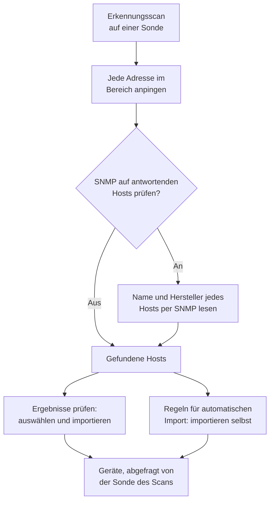
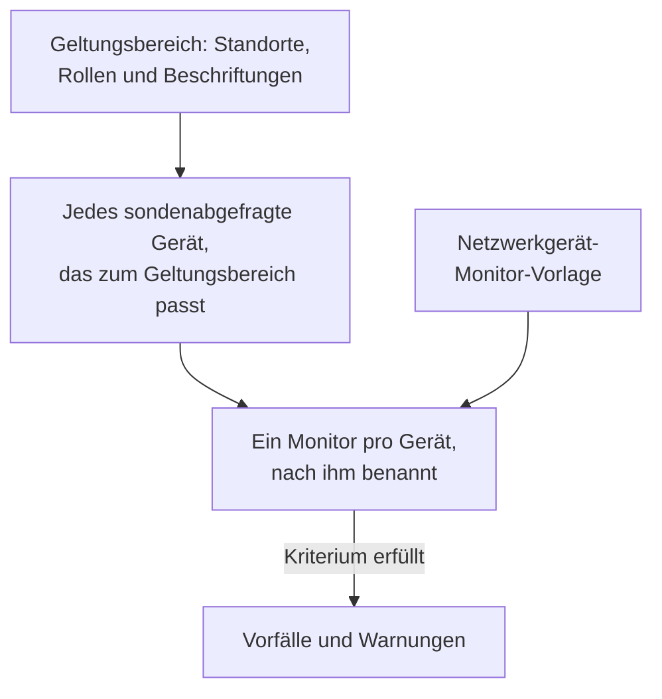
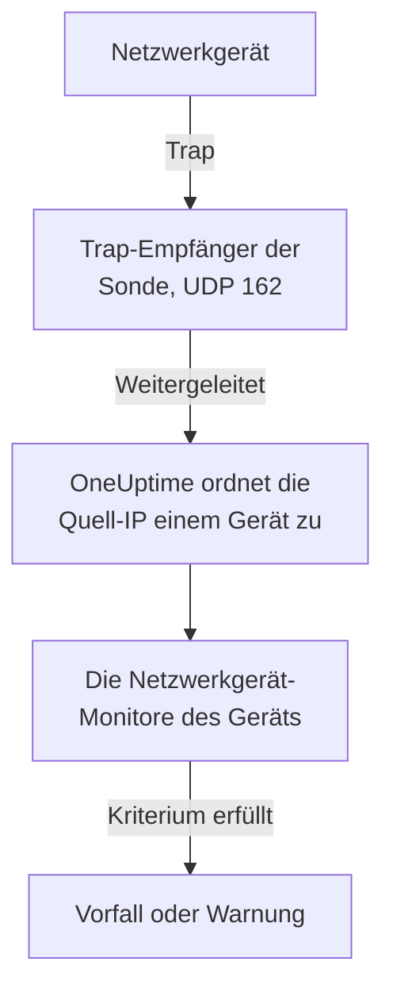

# Netzwerkgeräte-Überwachung

Überwachen Sie Switches, Router, Firewalls, Access Points, PDUs, Kameras und Drucker: alles mit einer Adresse in Ihrem Netzwerk, ob es SNMP spricht oder nicht.

Fügen Sie ein Gerät mit seiner Adresse und einer Sonde hinzu, und die Sonde pingt es nach Zeitplan an: Das Gerät erhält einen Status (erreichbar oder ausgefallen), einen Platz auf der Netzwerkkarte und eine Stimme in der Integrität seines Standorts. Geben Sie ihm SNMP-Anmeldedaten, und dieselbe Sonde fragt es zusätzlich per SNMP-Walk ab: Schnittstellen und die Optiken darin, Hardware-Inventar, LLDP- und CDP-Nachbarn sowie Integritäts-OIDs. Fügen Sie einen Monitor hinzu, oder eine Warnungsrichtlinie für eine ganze Flotte, und seine Abfragen und Traps lösen Vorfälle und Warnungen aus.

:::cards
- [Ein Gerät hinzufügen](#ein-netzwerkgerät-hinzufügen): Seine Adresse und eine Sonde, auf einer Seite.
- [Ein Netzwerk erkennen](#geräte-mit-einem-netzwerkscan-erkennen): Einen Adressbereich durchsuchen und importieren, was antwortet.
- [Geräte per SNMP auslesen](#snmp-anmeldedaten-und-anmeldedatenprofile): Schnittstellen, Optiken, Inventar und Integrität.
- [Gewarnt werden](#warnungen): Ein Monitor für ein Gerät, eine Richtlinie für eine Flotte.
- [Die Karte ansehen](#netzwerktopologie): Nachbarn live gezeichnet, als PDF exportiert.
- [Ein Problem beheben](#fehlerbehebung): Ausstehende Geräte, fehlschlagende Walks, fehlende Traps.
:::

## So funktioniert es



Gerät und Monitor haben unterschiedliche Aufgaben:

| Teil | Was er tut | Wann Sie ihn brauchen |
| --- | --- | --- |
| Das Gerät | Seine Sonde fragt es nach dem eigenen Zeitplan des Geräts ab. Jede Abfrage erfasst Erreichbarkeit, Ping-Round-Trip-Zeit und Paketverlust; eine Abfrage mit SNMP-Anmeldedaten liest zusätzlich Identität, Schnittstellen, Nachbarn und Integritäts-OIDs des Geräts. | Immer: Das Gerät ist das, was Sie hinzufügen. |
| Ein Monitor | Wertet Kriterien gegen jedes Abfrageergebnis und jeden Trap des Geräts aus und eröffnet Vorfälle und Warnungen. | Nur für Vorfälle und Warnungen. Status, Inventar, Diagramme und die Karte brauchen keinen Monitor. |

## Bevor Sie beginnen

- **Eine Sonde, die das Gerät erreicht.** Die Sonde pingt und fragt das Gerät aus ihrem eigenen Netzwerk ab, ein Gerät an einer privaten Adresse braucht also eine [benutzerdefinierte Sonde](/docs/probe/custom-probe) in diesem Netzwerk: Eine Sonde im öffentlichen Internet erreicht es nicht.
- **SNMP, für mehr als Ping.** Optional. Ein v1- oder v2c-Community-String oder ein SNMPv3-Benutzer auf dem Gerät, mit UDP 161 offen von der Sonde aus. Ohne SNMP wird das Gerät nur angepingt.
- **Traps, Syslog und Flows.** Optional. Die Sonde nimmt SNMP-Traps auf UDP 162 an, Syslog auf UDP 5140, sobald Sie es einschalten, und Flow-Datensätze auf UDP 2055, 4739 und 6343; öffnen Sie diese Ports von Ihren Geräten zur Sonde.

## Die Netzwerkübersicht

**Netzwerk → Übersicht** ist der Einstieg in den Netzwerkbereich, und sie beginnt mit der Antwort: einem Satz, der sagt, ob Ihr Netzwerk gesund ist, und wenn nicht, was falsch ist, die schlimmste Nachricht zuerst.

| Was sie sagt | Wann |
| --- | --- |
| **3 Geräte sind ausgefallen** | Die Sonde oder der Monitor eines Geräts erreicht es nicht. |
| **2 Standorte erfordern Aufmerksamkeit** | Jedes Gerät antwortet, aber die Integrität eines Standorts ist nicht betriebsbereit. |
| **5 Schnittstellen sind ausgefallen** | Jedes Gerät antwortet, aber Ports sind dunkel. |
| **2 Geräte melden ihre Details nicht** | Sie antworten auf Ping, aber ihr SNMP-Walk schlägt fehl, ihre Schnittstellen und ihre Integrität werden also nicht aktualisiert: meist die Anmeldedaten. |
| **Warten auf die erste Prüfung** | Geräte wurden hinzugefügt, und ihre Sonde hat sie noch nicht geprüft. |
| **Alle 40 Geräte sind erreichbar** | Jedes Gerät antwortet. Geräte, die noch auf ihre erste Prüfung warten, werden in einer eigenen Zeile gezählt. |

Darunter sagt eine Zeile, ob irgendetwas einen Vorfall auslöst, wenn ein Gerät ausfällt: wie viele [Warnungsrichtlinien](#warnungsrichtlinien) aktiv sind, oder ein Link **Warnungen einrichten**, wenn keine aktiv ist. Die Schaltflächen **Gerät hinzufügen** und **Geräte erkennen** daneben öffnen die jeweiligen Formulare, und die Kacheln und Listen darunter liefern die Details: Geräte und Standorte, die Aufmerksamkeit brauchen, die Flotte nach Hersteller und die letzten Scans.

Solange noch nichts hinzugefügt wurde, zeigt die Übersicht stattdessen die zwei Einstiege: **Geräte erkennen** durchsucht einen Adressbereich, damit Sie auswählen können, was Sie hinzufügen, am besten für ein ganzes Netzwerk oder einen neuen Standort, und **Ein einzelnes Gerät hinzufügen** fügt eines über seine IP-Adresse oder seinen Hostnamen hinzu.

Das Netzwerkmenü zeigt, was Sie täglich öffnen: **Übersicht**, **Geräte**, **Standorte**, **Karte**, **Datenverkehr** und **Erkennung**. Der Rest ist in Abschnitte eingeklappt, und ein Abschnitt öffnet sich von selbst auf jeder seiner Seiten:

| Abschnitt | Seiten |
| --- | --- |
| **Topologie** | **Gerätetopologie**, **Endpunkte**, **Latenzmatrix**, **Standortverbindungen**, **Geräteverbindungen** |
| **Regeln** | **Regeln für automatischen Import**, **Standortzuweisungsregeln**, **Eigentümerregeln**, **Beschriftungsregeln**, **Verbindungsregeln** |
| **Einstellungen** | **Warnungsrichtlinien**, **SNMP-Anmeldedaten**, **Geräterollen**, **Standorttypen**, **OID-Erfassungsvorlagen** |
| **Erweitert** | **Archivierte Geräte** |

## Ein Netzwerkgerät hinzufügen

:::steps
### Die Geräteliste öffnen
Gehen Sie zu **Netzwerk → Geräte** und klicken Sie auf **Gerät hinzufügen**. **Gerät hinzufügen** in der Netzwerk-**Übersicht** öffnet dasselbe Formular.

### Die Adresse des Geräts eingeben
Geben Sie unter **Hostname** seine IP-Adresse oder seinen Hostnamen ein. Lassen Sie **Name** leer, um das Gerät nach seinem Hostnamen zu benennen.

### Standort und Sonde prüfen
Wählen Sie den **Standort** des Geräts, wenn Sie Standorte verwenden. **Sonde** füllt sich mit der Standardsonde des Standorts oder mit der einzigen benutzerdefinierten Sonde des Projekts; achten Sie darauf, dass sie das Gerät erreicht.

### Das Gerät hinzufügen
Klicken Sie auf **Gerät hinzufügen**. Innerhalb weniger Minuten pingt die Sonde das Gerät an, und sein Status wird **Up** oder **Ausgefallen**. Mit SNMP-Anmeldedaten füllt sich nach dem ersten erfolgreichen Walk auch seine Übersicht mit der Identität, den Schnittstellen und der Integrität des Geräts.
:::

Das Formular ist eine Seite — der Hostname, ein Name, der Standort und die Sonde —, darunter eingeklappt **SNMP** und **Weitere Felder**. Es fragt nicht, wie das Gerät überwacht wird: Jedes Gerät, das Sie hinzufügen, wird von seiner Sonde abgefragt, und die [Überschreibung mit gebundenem Monitor](#die-überschreibung-mit-gebundenem-monitor) befindet sich für die wenigen Geräte, die sie brauchen, auf der **Einstellungen**-Seite des Geräts.

Die Details eines Geräts — Name, Beschreibung, Rolle, Standort, Beschriftungen und Adressen — bearbeiten Sie danach an einer Stelle: in der Karte **Geräteeinstellungen** auf seiner **Einstellungen**-Seite. Die Karte **Gerätedetails** in seiner Übersicht zeigt sie an, mit einem Link **In den Einstellungen bearbeiten**.

### Das Gerät

| Feld | Beschreibung | Pflichtfeld |
| --- | --- | --- |
| Hostname | Die IP-Adresse oder der Hostname, den die Sonde anpingt und per SNMP abfragt, sobald das Gerät Anmeldedaten hat. | Ja |
| Name | Ein sprechender Name, etwa core-switch-01. Lassen Sie ihn leer, und das Gerät wird nach seinem Hostnamen benannt. Die API macht es genauso: Ein ohne Namen angelegtes Gerät wird nach seinem Hostnamen benannt. | Nein |
| Standort | Der [Netzwerkstandort](/docs/monitor/network-sites), an dem sich das Gerät befindet. Die Integrität des Standorts ergibt sich aus seinen Geräten, und ein Standort mit Standardsonde füllt die Sonde unten aus. | Nein |
| Sonde | Die Sonde, die dieses Gerät anpingt, es per SNMP abfragt, wenn es Anmeldedaten hat, und seine Traps, sein Syslog und seine [Flow-Datensätze](/docs/monitor/network-traffic) empfängt. Sie muss das Gerät direkt erreichen: Eine Sonde im öffentlichen Internet erreicht keine private Adresse. | Ja |

**Sonde** füllt sich, wo es geht, von selbst: Ein Projekt mit genau einer benutzerdefinierten Sonde beginnt mit dieser, und die Auswahl eines Standorts ersetzt sie durch die [Standardsonde des Standorts](/docs/monitor/network-sites#überwachungsstandards). Eine Sonde, die Sie selbst gewählt haben, überschreibt sie nie. Legen Sie an Ihren Standorten eine Standardsonde fest, und ein Gerät lässt sich allein mit seiner Adresse hinzufügen.

### Weitere Felder (eingeklappt)

| Feld | Beschreibung | Pflichtfeld |
| --- | --- | --- |
| Beschreibung | Freitext. | Nein |
| Geräterolle | Core-Switch, Access-Switch, Firewall und so weiter. Sie legt die Ebene des Geräts auf der Karte fest und grenzt Warnungsrichtlinien ein. | Nein |
| MAC-Adresse | Die eigene MAC des Geräts. Die Karte setzt damit ein Gerät, das weder LLDP noch CDP spricht, an den Switch-Port, der es gelernt hat; siehe [Nur angepingte Geräte und ihr Switch-Port](#nur-angepingte-geräte-und-ihr-switch-port). Meist für Sie aus der ARP-Tabelle eines Routers gelernt. | Nein |
| Zusätzlich einen Ping-Monitor für Vorfälle erstellen | Die Sonde pingt das Gerät bereits an und gibt ihm einen Status; ein Ping-Monitor macht aus fehlgeschlagenen Pings einen Vorfall. Kreuzen Sie es an, und beim Speichern wird einer auf den Hostnamen angelegt und an das Gerät gebunden. Er zählt für Ihren Tarif, und seine Vorfälle bleiben aus, bis Sie sie auf der Seite des Monitors einschalten. | Nein |

Das Ankreuzen des Ping-Monitors zeigt **Ping von Sonden**, die eigenen Sonden des Monitors. Sie müssen das Netzwerk des Geräts erreichen; lassen Sie das Feld leer, um die Standardsonden des Projekts zu verwenden. Um für viele Geräte auf einmal zu warnen, verwenden Sie stattdessen [Warnungsrichtlinien](#warnungsrichtlinien).

### SNMP (eingeklappt, optional)

Lassen Sie den Abschnitt eingeklappt, und das Gerät wird nur angepingt: Der eingeklappte Abschnitt sagt das in einem Satz. Das Gerät erhält trotzdem ab der ersten Abfrage einen Status und steht in seinem Standort und auf der Karte, hat aber keine Schnittstellen, kein Inventar und keine Integritäts-OIDs, bis es Anmeldedaten hat. Öffnen Sie den Abschnitt, um einen Community-String oder einen v3-Benutzer einzugeben oder ein gespeichertes Anmeldedatenprofil auszuwählen.

:::tabs
@tab SNMP v1 / v2c
| Feld | Beschreibung | Pflichtfeld |
| --- | --- | --- |
| SNMP-Version | V1, V2c oder V3. | Ja, beginnt mit V2c |
| SNMP-Community-String | Der v1- oder v2c-Community-String, etwa `public`. | Nein: leer heißt nur Ping |
| SNMP-Port | Der UDP-Port, auf dem der Agent lauscht. | Nein, standardmäßig 161 |
| SNMP-Anmeldedatenprofil | Ein gespeicherter Satz von Anmeldedaten, statt sie hier einzugeben. | Nein |
@tab SNMPv3
| Feld | Beschreibung | Pflichtfeld |
| --- | --- | --- |
| SNMP-v3-Sicherheitsstufe | No Auth, No Priv; Auth, No Priv; oder Auth, Priv. | Ja |
| SNMP-v3-Benutzername | Der auf dem Gerät eingerichtete Sicherheitsname (Benutzer). | Ja: leer heißt nur Ping |
| SNMP-v3-Authentifizierungsprotokoll | MD5, SHA, SHA-256 oder SHA-512. | Mit Authentifizierung |
| SNMP-v3-Authentifizierungsschlüssel | Die Authentifizierungs-Passphrase. | Mit Authentifizierung |
| SNMP-v3-Privacy-Protokoll | DES, AES oder AES-256. | Mit Verschlüsselung |
| SNMP-v3-Privacy-Schlüssel | Die Passphrase für die Verschlüsselung. | Mit Verschlüsselung |
:::

Auf dem Gerät eingegebene Anmeldedaten haben Vorrang vor einem daneben gewählten Anmeldedatenprofil, und der Standort des Geräts kann ebenfalls ein Standardprofil tragen. Anmeldedaten in einem Profil werden verschlüsselt gespeichert. Auf einem Gerät eingegebene Anmeldedaten sind durch dieselben Leseberechtigungen geschützt, werden aber nicht verschlüsselt gespeichert: ein Grund mehr, gemeinsam genutzte Anmeldedaten in einem Profil zu halten.

## Viele Geräte auf einmal ändern

Ein Erkennungsscan im Netzwerk eines Kunden bringt Dutzende Geräte, die zu einem Standort gehören, eine Rolle teilen und von einem Hersteller stammen. Sie öffnen nicht jedes einzeln: Wählen Sie sie in der Liste **Geräte** aus, indem Sie Zeilen ankreuzen oder alle Geräte wählen, die zu den Filtern passen, und öffnen Sie **Massenaktionen**.

| Aktion | Was sie tut |
| --- | --- |
| **Standort festlegen** / **Standort entfernen** | Verschiebt jedes ausgewählte Gerät in den gewählten Standort, wo es zur Integrität des Standorts zählt; ein Gerät ohne eigene Sonde übernimmt die Standardsonde des Standorts. **Standort entfernen** nimmt die Geräte aus ihren Standorten. Ein Gerät, auf das eine Standortzuweisungsregel passt, kehrt bei seiner nächsten Abfrage zum Standort der Regel zurück; für Geräte, die die Erkennung immer wieder findet, legen Sie deshalb besser eine Regel unter **Netzwerk → Regeln → Standortzuweisungsregeln** an; der Dialog **Standort festlegen** verlinkt dorthin. |
| **Geräterolle festlegen** / **Geräterolle entfernen** | Gibt jedem ausgewählten Gerät eine Rolle, etwa den zwanzig Switches, die alle „Access Switch“ sind. Rollen sind die des Projekts, unter **Netzwerk → Einstellungen → Geräterollen**, wohin der Dialog verlinkt. **Geräterolle entfernen** ermittelt die Rolle jedes Geräts erneut aus seiner SNMP-Identität. |
| **Hersteller-Vorlage anwenden** | Fügt jedem ausgewählten Gerät die Integritäts-OIDs und SNMP-Tabellen einer [Hersteller-Vorlage](#hersteller-integritätsvorlagen) hinzu. **Hersteller jedes Geräts erkennen**, die erste Auswahl im Dialog, wählt für jedes Gerät die eigene Vorlage anhand dessen, was sein SNMP-Walk meldet, sodass eine gemischte Auswahl überall die richtige bekommt; oder wählen Sie eine Vorlage für alle. |

Jede Aktion ist ein Dialog und ein Speichern für die ganze Auswahl, und jedes Gerät durchläuft dieselben Prüfungen wie eine Bearbeitung auf seiner eigenen Einstellungen-Seite: Berechtigungen, den Beschriftungs- und Eigentümerbereich Ihrer Rolle und die Grenzen dessen, was ein Gerät erfassen darf.

**Hersteller-Vorlage anwenden** zeigt vorher, was passieren wird: wie viele Geräte welche Vorlage bekommen und wie viele es unverändert lässt, und warum. Es ergänzt, was jedes Gerät bereits erfasst, und entfernt nichts, und ein Gerät, das schon alles aus der Vorlage hat, wird nicht erneut geschrieben. Es lässt ein monitorgestütztes Gerät unverändert (nichts fragt es ab), ein Gerät, das mit einer [OID-Erfassungsvorlage](#oid-erfassungsvorlagen) verknüpft ist (die Vorlage bestimmt, was es erfasst, fügen Sie die OIDs des Herstellers also dort hinzu), und beim Abgleichen ein Gerät, das noch nicht per SNMP abgefragt wurde oder dessen Hersteller keine Vorlage hat.

Wenn eine Aktion fertig ist, listet sie, wie viele Geräte sich geändert haben, welche fehlgeschlagen sind und warum — ein Gerät, das Ihre Rolle nicht bearbeiten darf, eine Liste über ihrer Grenze — und welche sie nicht geändert hat und warum: ein Gerät, das schon in diesem Standort oder dieser Rolle ist, oder eines, das die Hersteller-Vorlage unverändert lässt.

Die übrigen Massenaktionen werden dort beschrieben, wo sie hingehören: **OID-Sammlungsvorlage festlegen** unter [OID-Erfassungsvorlagen](#oid-erfassungsvorlagen), **Set SNMP Credential Profile**, **Switch to Probe Polling** und **Ping-Monitore erstellen** unter [Gesammelt](#gesammelt), und **Shorten Names to Hostname** unter [Wie erkannte Geräte benannt werden](#wie-erkannte-geräte-benannt-werden).

## Was eine Abfrage tatsächlich tut

Jede Abfrage eines sondenabgefragten Geräts ist ein Ping. Wenn das Gerät brauchbare SNMP-Anmeldedaten hat, führt die Sonde zusätzlich einen vollständigen SNMP-Walk aus. Beide laufen nebeneinander, und der Walk wartet nie auf den Ping, sodass SNMP-Geräte hinter einer ACL, die ICMP verwirft, trotzdem **Up** melden.

| Ergebnis | Nur angepingtes Gerät | Gerät mit SNMP-Anmeldedaten |
| --- | --- | --- |
| Status (Up oder Ausgefallen) | Aus dem Ping | Aus dem Ping oder dem Walk: Es genügt, wenn einer antwortet |
| Ping-Round-Trip-Zeit und Paketverlust | Als Gerätemetriken erfasst | Als Gerätemetriken erfasst |
| SNMP-Antwortzeit | — | Die Dauer des Walks, nie die des Pings |
| Schnittstellen, Nachbarn, Endpunkte | — | Aus einem erfolgreichen Walk |
| Systemidentität, Hersteller, Modell, Seriennummer | — | Aus einem erfolgreichen Walk |
| Integritäts-OIDs und SNMP-Tabellen | — | Aus einem erfolgreichen Walk |

Brauchbare Anmeldedaten sind ein v1- oder v2c-Satz mit Community-String oder ein v3-Satz mit Benutzername, gefunden über die [Anmeldedatenkette](#snmp-anmeldedaten-und-anmeldedatenprofile). Ein leerer Satz wird übersprungen, ein Gerät wird also nie mit einer erratenen Standard-Community abgefragt.

Der Paketverlust nutzt die Reihe des [Ping-Monitors](/docs/monitor/ping-monitor), er liest sich also im ganzen Produkt gleich. Die Round-Trip-Zeit hat eine eigene Reihe, `oneuptime.monitor.ping.round.trip.time`, weil bei einem Netzwerkgerät die einfache Antwortzeit die des SNMP-Walks ist. Die **Metriken**-Seite des Geräts zeigt die Schnittstellenauslastung und die Integritäts-OIDs; die Round-Trip-Zeit der letzten Stunde zeigt die Seitenleiste des Geräts auf der Karte.

### „SNMP schlägt fehl“ ist nicht „Ausgefallen“

Ein Gerät, das auf Ping antwortet, dessen Walk aber fehlschlägt, ist **Up** und markiert mit **SNMP schlägt fehl**, und beide Hälften zählen:

- Es ist erreichbar, weil unter dieser Adresse etwas antwortet. Es rot zu färben, würde ein einwandfrei laufendes Gerät in Ihre Vorfallzahl bringen.
- SNMP schlägt fehl, weil seine Schnittstellen, sein Inventar und seine Integritäts-OIDs nicht mehr aktualisiert werden, fast immer wegen der Anmeldedaten, eines abgeschalteten SNMP-Agenten oder einer ACL. Nichts anderes auf der Seite würde Ihnen sagen, dass die Zahlen eingefroren sind.

Ein Gerät, bei dem Ping und Walk beide fehlschlagen, ist schlicht **Ausgefallen**, die Markierung steht also immer nur neben einem grünen Status.

### Den Status eines Geräts lesen

Jede Stelle, die ein Gerät zeigt — die Geräteliste, die Geräte-Seite eines Standorts, die Übersicht, die Karte —, verwendet dieselben drei Urteile und dieselben Zusätze daneben.

| Urteil | Bedeutet |
| --- | --- |
| **Up** | Die letzte Abfrage (Ping oder SNMP) oder der gebundene Monitor hat das Gerät erreicht. |
| **Ausgefallen** | Die letzte Abfrage (Ping oder SNMP) oder der gebundene Monitor konnte das Gerät nicht erreichen. |
| **Ausstehend** | Noch kein Urteil: nie abgefragt, keine Sonde zugewiesen oder kein Monitor gebunden. |

| Zusatz | Erscheint, wenn | Was zu tun ist |
| --- | --- | --- |
| **Veraltet** | Seit deutlich mehr als dem Intervall des Geräts keine Abfrage versucht wurde. | Prüfen Sie, ob die Sonde des Geräts online ist und mit ihrer Flotte Schritt hält. |
| **Keine Sonde** | Das Gerät wird von einer Sonde abgefragt, hat aber keine, oder seine Abfrage ist aus. | Weisen Sie eine Sonde zu, die es erreicht; bis dahin fragt nichts es ab. |
| **Kein Monitor** | Das Gerät nutzt die [Überschreibung mit gebundenem Monitor](#die-überschreibung-mit-gebundenem-monitor), und nichts ist gebunden. | Binden Sie einen Monitor oder stellen Sie es wieder auf Sondenabfrage um. |
| **SNMP schlägt fehl** | Per Ping erreichbar, aber der letzte SNMP-Walk ist fehlgeschlagen. | Prüfen Sie die Anmeldedaten, den SNMP-Agenten oder eine ACL. |

Die Liste **Geräte** hat einen Filter **SNMP** mit drei Werten: **OK** (der letzte Walk war erfolgreich), **Fehlerhaft** (der letzte Walk ist fehlgeschlagen) und **Nicht konfiguriert** (nur angepingt, keine Anmeldedaten oder nie abgefragt). „Bei welchen Geräten funktionieren die Anmeldedaten nicht mehr“ ist damit ein Klick. Die Spalte **Schnittstellen (aktiv / ausgefallen)** der Liste zeigt **Kein SNMP** statt `0 / 0` für ein Gerät, das angepingt und nie abgefragt wird: Null funktionierende Ports wären eine andere Aussage, und eine falsche.

## SNMP-Anmeldedaten und Anmeldedatenprofile

Ein Gerät wird mit dem ersten brauchbaren Satz von Anmeldedaten abgefragt, der in dieser Reihenfolge gefunden wird, und die Suche endet beim ersten Treffer:



Der Standort-Schritt liest den eigenen Standort des Geräts und nicht weiter: Ein Gerät in einer Einheit übernimmt kein Profil, das an der Region darüber festgelegt ist. Die Standardsonde eines Standorts reicht dagegen den Baum hinunter, weil eine Sonde einmal auf das Gerät kopiert wird, während Anmeldedaten bei jeder Abfrage neu gelesen werden; [Netzwerkstandorte](/docs/monitor/network-sites#überwachungsstandards) beschreibt die Details.

### Die Seite SNMP-Anmeldedaten

**Netzwerk → Einstellungen → SNMP-Anmeldedaten** enthält die Anmeldedatenprofile des Projekts. Ein Profil ist ein benannter Satz — ein v1- oder v2c-Community-String oder ein v3-Benutzer mit Sicherheitsstufe, Protokollen und Schlüsseln —, auf den beliebig viele Geräte und Standorte verweisen. Nichts wird auf die Geräte kopiert, das Rotieren eines Community-Strings ist also eine Bearbeitung hier, und jedes Gerät, das das Profil nutzt, übernimmt den neuen Wert bei seiner nächsten Abfrage.

Geheimnisse in einem Profil werden verschlüsselt gespeichert, und nur Rollen, die die eigenen Anmeldedaten eines Geräts lesen dürfen, dürfen sie lesen. Ein Gerät oder Standort, das sein Profil anzeigt, zeigt dessen Namen und Version, nie seine Geheimnisse.

Ein Profil, auf das noch ein Gerät oder Standort verweist, kann nicht gelöscht werden: Das Löschen wird mit einer Zählung dessen abgelehnt, was im Weg ist. Verschieben Sie diese Geräte und Standorte auf ein anderes Profil oder entfernen Sie das Profil bei ihnen, und löschen Sie es dann.

### Ein Gerät wieder zu einem nur angepingten Gerät machen

Auf der **Einstellungen**-Seite des Geräts hat **Einstellungen bearbeiten** im Schritt **SNMP-Anmeldedaten** ein Kontrollkästchen **Nur Ping — die eigenen SNMP-Anmeldedaten dieses Geräts entfernen**. Es entfernt beim Speichern den eigenen Community-String und den v3-Benutzernamen des Geräts. Es gibt dieses Kästchen, weil das Leeren des richtigen Felds nicht offensichtlich ist: Ein v3-Gerät bleibt abfragbar, solange sein Benutzername besteht, was immer Sie sonst leeren.

Das Entfernen der eigenen Anmeldedaten des Geräts entfernt kein Profil. Wenn das Gerät oder sein Standort noch eines nennt, wird das Gerät weiter damit abgefragt; entfernen Sie auch das Profil, damit das Gerät nur angepingt wird.

### Gesammelt

Wählen Sie Geräte in der Liste **Geräte** aus und verwenden Sie:

- **Set SNMP Credential Profile** / **Clear SNMP Credential Profile**: ein Profil einer Auswahl zuweisen oder es wieder entfernen.
- **Switch to Probe Polling**: für Geräte mit der Überschreibung mit gebundenem Monitor. Wählen Sie eine Sonde, und jedes ausgewählte Gerät wird ab dann nach seinem Zeitplan angepingt und abgefragt, sobald es Anmeldedaten hat. Ein bereits gebundener Monitor bleibt gebunden; der Status des Geräts kommt jetzt von der Sonde.
- **Ping-Monitore erstellen**: für Geräte mit der Überschreibung mit gebundenem Monitor; legt auf dem Hostnamen jedes Geräts einen Ping-Monitor an und bindet ihn, sodass das Gerät Up oder Ausgefallen anzeigt.

Die Seite **Geräte** zeigt ein Banner, wenn das Projekt Geräte mit der Überschreibung mit gebundenem Monitor ohne gebundenen Monitor hat — Geräte, die nichts abfragt und über die nichts berichtet —, und verlinkt auf die Auswahl, die sie behebt.

## Überwachungsstandards des Standorts

Ein [Netzwerkstandort](/docs/monitor/network-sites#überwachungsstandards) trägt zwei Standards für die Geräte darin. Seine **Standardsonde** wird auf ein Gerät kopiert, das ohne eigene Sonde im Standort angelegt oder dorthin verschoben wird. Sein **Standard-SNMP-Anmeldedatenprofil** wird bei jeder Abfrage eines Geräts im Standort gelesen, das keine eigenen Anmeldedaten hat. Legen Sie beide an einem Standort fest, und ein Gerät dort lässt sich allein mit seiner Adresse hinzufügen und wird ab der ersten Abfrage angepingt und abgefragt. Die Anleitung zu Standorten sagt, wie weit jeder Standard den Standortbaum hinunterreicht.

## Die Überschreibung mit gebundenem Monitor

Manche Geräte kann keine Sonde erreichen oder sinnvoll anpingen: ein Gerät hinter einer NAT, eine Appliance, deren Integrität eine HTTP-Prüfung besser beurteilt, ein Dienst, dessen eigentliches Signal eine Port-Prüfung ist. Für diese hat **Einstellungen bearbeiten** auf der **Einstellungen**-Seite des Geräts eine **Überwachungsmethode**:

| Methode | Bedeutung |
| --- | --- |
| **Sonde** | Der Standard. Von der zugewiesenen Sonde nach ihrem Zeitplan angepingt und per SNMP abgefragt, wenn es Anmeldedaten hat. |
| **Gebundener Monitor** | Der Status eines vorhandenen Monitors ist der Status dieses Geräts. |

Das Umstellen eines Geräts auf **Gebundener Monitor** beendet seine Abfrage. Sonde, Intervall und Abfrageschalter verschwinden aus der Karte **Abfrage & Datenerfassung**, die alten Abfrageergebnisse des Geräts werden gelöscht, und sein Status kommt von dem Monitor, den Sie binden. Das Binden ist optional: Bis dahin zeigt das Gerät **Ausstehend**, markiert mit **Kein Monitor**.

Das Zurückstellen auf **Sonde** stellt die Abfrage wieder her und fragt nach einer Sonde. Ein gebundener Monitor bleibt gebunden und warnt weiter; er bestimmt nur nicht mehr den Status des Geräts.

Die meisten Geräte brauchen das nicht. Jedes sondenabgefragte Gerät hat bereits einen Erreichbarkeitsstatus, Sie müssen also keinen Ping-Monitor binden, um einen zu bekommen; binden Sie einen Monitor, wenn Sie dessen Vorfälle wollen.

## Abfrage & Datenerfassung

Die Abfrage befindet sich auf der **Einstellungen**-Seite des Geräts, in der Karte **Abfrage & Datenerfassung** (**Abfrage bearbeiten**). Die Standardwerte passen zu einem neuen Gerät, es braucht also keine Feinabstimmung:

| Einstellung | Beschreibung | Standard |
| --- | --- | --- |
| Sonde | Die Sonde, die das Gerät abfragt. | Beim Hinzufügen des Geräts festgelegt |
| Abfrage aktiviert | Die Sonde fragt das Gerät nach dem Zeitplan unten ab. Schalten Sie sie aus, um die Abfrage anzuhalten, ohne das Gerät zu löschen. | An |
| Abfrageintervall (Minuten) | Wie oft die Sonde das Gerät abfragt. Mindestens 1 Minute. | 5 |
| Schnittstellen abfragen | Bei jeder Abfrage die Schnittstellentabellen (IF-MIB) abfragen: Status, Bandbreite, Auslastung und Fehler jedes Ports, dazu die LLDP- und CDP-Nachbarn für die Karte. | An |
| Verbundene Endpunkte erfassen | Zusätzlich die ARP- und Bridge-Forwarding-Tabellen abfragen, um zu finden, was am Gerät angeschlossen ist: POS-Terminals, Drucker, Telefone, Laptops. Aus einer ARP-Tabelle ergänzt es außerdem die MAC-Adresse von Geräten, die unter diesen Adressen registriert sind. Kostet zusätzliche Walks pro Abfrage. | Aus |
| OID-Erfassungsvorlage | Eine gemeinsame, benannte OID-Liste, die das Gerät erfasst. Eine Änderung der Vorlage ändert jedes verknüpfte Gerät bei seiner nächsten Abfrage. | Keine |
| Gerätespezifische Integritäts-OIDs | Zusätzliche OIDs, die nur dieses Gerät erfasst, zusätzlich zu denen seiner Vorlage. | Keine |
| Integritätsvorlage des Herstellers automatisch anwenden | Wenn der Hersteller des Geräts erkannt ist und seine eigene OID-Liste leer ist, die Liste bei der nächsten Abfrage aus der Vorlage des Herstellers füllen. | Aus; an für Geräte, die die Erkennung importiert |
| Device-Specific SNMP Tables | Zusätzliche [SNMP-Tabellen](#snmp-tabellen), die nur dieses Gerät abfragt, zusätzlich zu denen seiner Vorlage. Eine Tabelle mit demselben Schlüssel wie eine Vorlagentabelle ersetzt diese auf diesem Gerät. | Keine |

Alles ab **Schnittstellen abfragen** abwärts braucht SNMP-Anmeldedaten: Auf einem nur angepingten Gerät bleiben diese Einstellungen gespeichert und haben keinen Walk, auf den sie wirken.

### Schnittstellen abfragen

Mit **Schnittstellen abfragen** an und gefundenen Anmeldedaten erfasst jede Abfrage für jede Schnittstelle den Betriebs- und den administrativen Status, die Bits ein- und ausgehend, die Auslastung und die Fehler. Derselbe Walk sammelt die LLDP- und CDP-Nachbarn für die Karte.

Schalten Sie eine Schnittstelle auf der Seite **Schnittstellen** des Geräts stumm, etwa einen Laborport oder eine absichtlich getrennte Verbindung, und sie bleibt im Inventar, fällt aber aus Warnungen und Metriken heraus. Ein fehlgeschlagener Walk löscht das Gesammelte nie halb: Der letzte Schnittstellen-Schnappschuss bleibt, und das Gerät wird mit **SNMP schlägt fehl** markiert, damit ihn niemand für aktuell hält.

### Hersteller-Integritätsvorlagen

Im Editor **Integritäts-OIDs** wendet **Integritätsvorlage des Herstellers** einen vorgefertigten Satz OIDs für den Hersteller des Geräts an. Viele Vorlagen bringen auch [SNMP-Tabellen](#snmp-tabellen) mit, hinzugefügt über **Add a Vendor's Tables** im Editor **SNMP Tables**.

| Hersteller-Vorlage | Integritäts-OIDs | SNMP-Tabellen |
| --- | --- | --- |
| Generic (Host Resources MIB) | CPU-Last, gesamter und verfügbarer RAM, Load Average | CPU-Kerne (eine Zeile pro Kern, wie auch immer die Plattform sie nummeriert) |
| Arista EOS | CPU-Last, Load Average, gesamter und verfügbarer RAM | — |
| Cambium Networks cnMatrix | CPU, RAM, Flash, Temperatur, Versorgungsspannung | Lüfter, PoE-Ports, redundantes Netzteil |
| Cambium Networks Enterprise Wi-Fi (cnPilot, XV, XE, XH) | CPU, freier Speicher, WLAN-Clients, cnMaestro-Verbindung | WLAN-Funkmodule (Band, Kanal, Breite, Sendeleistung, Clients, Grundrauschen, Airtime, Zustand), SSIDs |
| Cisco IOS / IOS-XE | CPU, belegter und freier Speicher, Temperatur, Lüfterzustand, Netzteilzustand | — |
| Dell Force10 / OS9 | CPU, Speicher | — |
| Extreme Networks EXOS / Switch Engine | CPU, Temperatur, Übertemperaturalarm, Stromzustand | Netzteile, Lüfter, Speicher pro Steckplatz, Stack-Mitglieder |
| Extreme Networks Fabric Engine / VOSS | vIST-Sitzung, Anzahl der I-SIDs | Fabric-Nachbarschaften (IS-IS), nach Nachbar benannt, CPU und Speicher pro Steckplatz, Temperatursensoren, Lüfter, Netzteile |
| Extreme Networks IQ Engine (HiveOS) Access Points | CPU, Speicher, WLAN-Clients, Temperatur | WLAN-Funkmodule (Kanal, Sendeleistung, Grundrauschen), SSIDs |
| Extreme Networks Wireless Controller (XIQ-C, ExtremeWireless) | Access Points, aktive Access Points, WLAN-Clients | Access Points (Zustand, Clients, Adresse, Software), WLAN-Funkmodule (Band, Kanal, Breite, Grundrauschen, belegte Airtime), WLANs (SSID, Clients) |
| Fortinet FortiGate | CPU, Speicher, Festplatte | — |
| HPE / Aruba ProCurve | CPU, gesamter und freier Speicher | — |
| HPE Aruba Instant (AOS 8) | Clustername, Firmware-Version, Conductor | Access Points (Status, Modell, CPU, Speicher), WLAN-Funkmodule nach Access Point benannt (Kanal, Sendeleistung, Grundrauschen, Auslastung, Clients, Zustand), SSIDs (Clients) |
| HPE Aruba Mobility Controller (AOS 8) | Access Points, WLAN-Clients, Controller-Rolle | Access Points (Status, Modell, AP-Gruppe), WLAN-Funkmodule nach Access Point benannt (Band, Kanal, Sendeleistung, Auslastung, Clients, Modus), SSIDs (Clients, Access Points aktiv und ausgefallen), Prozessoren, Speicher |
| Huawei VRP | CPU, Speicher, Temperatur | — |
| Juniper Junos | CPU, Speicherpuffer, Temperatur | — |
| MikroTik RouterOS | CPU-Last, Temperatur, Spannung | — |
| Palo Alto PAN-OS | Management-CPU, Sitzungsauslastung, aktive Sitzungen | — |
| Sophos Firewall (SFOS / XGS) | Speicher, Festplatte, Swap, HA-Zustand und Partnerzustand, IPsec-Dienst, CPU-Temperatur (SFOS v22 und neuer) | IPsec-Tunnel (Status braucht SFOS v20 und neuer), CPU-Kerne |
| TP-Link Omada Access Points (EAP) | WLAN-Clients | — |
| Ubiquiti EdgeOS / EdgeSwitch / UniFi Switches | CPU-Last, gesamter und verfügbarer RAM | — |
| Ubiquiti UniFi Access Points | Isoliert-Zustand, Load Average, gesamter und verfügbarer RAM | WLAN-Funkmodule (Band, Airtime), SSIDs (Band, Kanal, Clients, Sendeleistung, Verbindungsqualität), CPU-Kerne |

Die OIDs der Vorlage werden in die eigene Liste des Geräts kopiert, wo Sie sie kürzen oder ergänzen können. Nachdem der erste Walk den Hersteller erkannt hat, schlägt die Geräteseite die passende Vorlage vor. Der Abgleich liest die `sysObjectID` des Geräts und seine `sysDescr` dort, wo eine Enterprise-Nummer zwei Betriebssysteme beherbergt: Extreme Fabric Engine auf universeller Hardware meldet dieselbe Enterprise-Nummer (1916) wie EXOS, und nur seine Beschreibung (`…-FabricEngine (9.0.4.0)`) unterscheidet sie. UniFi-Access-Points werden auf dieselbe Weise von den Routern von Ubiquiti unterschieden (`U6-Pro 6.6.50.15098`), auch wenn ältere Firmware mit dem Net-SNMP-Zweig antwortet, und IQ-Engine-Access-Points von den Aerohive-Switches, die ihren Zweig teilen (`AP230, HiveOS 8.2r1`).

Geräte mit **Integritätsvorlage des Herstellers automatisch anwenden** an erhalten die OIDs und Tabellen der Vorlage bei ihrer ersten Abfrage: Geräte, die eine Regel für den automatischen Import hereinbringt, und Geräte, die aus **Ergebnisse prüfen** mit eingeschaltetem Vorlagenschalter importiert werden, der an ist, solange Sie ihn nicht ausschalten. Um vielen Geräten auf einmal ihre Vorlage zu geben, etwa einer erkannten Flotte, die älter ist als der Schalter, wählen Sie sie in der Liste **Geräte** aus und verwenden **Hersteller-Vorlage anwenden** (siehe [Viele Geräte auf einmal ändern](#viele-geräte-auf-einmal-ändern)).

Das Anwenden einer Hersteller-Vorlage ist eine einmalige Kopie, Änderungen der Vorlage werden also nicht weitergegeben. Für mehr als ein einzelnes Gerät verwenden Sie stattdessen eine **OID-Erfassungsvorlage**; die Hersteller-Vorlagen werden beim Anlegen einer solchen als Ausgangspunkt angeboten.

### OID-Erfassungsvorlagen

Eine **OID-Erfassungsvorlage** (**Netzwerk → Einstellungen → OID-Erfassungsvorlagen**) ist eine benannte OID-Liste, meist nach einem Gerätetyp benannt, etwa „Cisco Catalyst 9300“, mit der beliebig viele Geräte verknüpft sind. Die Verknüpfung ist live, keine Kopie: Die OID-Liste eines Geräts wird bei jeder Abfrage zusammengestellt, eine Änderung der Vorlage ändert also, was jedes verknüpfte Gerät bei seiner nächsten Abfrage erfasst, ohne Synchronisierungsschritt.

Prüfen Sie, bevor Sie eine anlegen, ob Sie sie brauchen. Bits ein- und ausgehend pro Port, Betriebsstatus, Auslastung und Fehler pro Sekunde werden bei jeder Abfrage für jeden Port ohne jede OID erfasst (siehe [Schnittstellen abfragen](#schnittstellen-abfragen)), und für sie kann bereits pro Port gewarnt werden. Vorlagen sind für das, was nicht pro Port ist: CPU, Speicher, Temperatur, Lüfter, Netzteile, BGP-Peers.

Für den Umstieg von Zabbix:

| Zabbix | OneUptime |
| --- | --- |
| Template | OID-Erfassungsvorlage |
| Item | Eine OID auf dieser Vorlage |
| Discovery-Regel „Network interfaces by SNMP“ mit Item-Prototypen | Eingebaut und für die Schnittstellenzähler immer aktiv: nichts zu schreiben |
| Trigger | Monitor-Kriterien |
| Trigger-Prototyp, einer pro erkannter Schnittstelle | Ein Kriterium mit **Schnittstelle** auf `*`, das sich pro Port auffächert |
| Discovery-Regel über eine andere SNMP-Tabelle (Tunnel, Funkmodule, Lüfter) mit Item-Prototypen | Eine [SNMP-Tabelle](#snmp-tabellen) auf der Vorlage |
| Trigger-Prototyp auf einer solchen Tabelle | Ein Kriterium SNMP Table Value oder SNMP Table Row Is Unhealthy mit **Row** auf `*` |
| Host-Gruppe | Beschriftungen |
| Aktion „Link template on host discovery“ | Die **OID-Erfassungsvorlage** einer Regel für automatischen Import |
| Aktion auf einer Host-Gruppe („bei jedem Switch warnen“) | Eine [Warnungsrichtlinie](#warnungsrichtlinien) |

Eine OID auf einer Vorlage wird so erfasst, wie sie geschrieben ist, eine OID, die eine Zeile einer Tabelle nennt (`…ifSpeed.3`), erfasst also nur diese Zeile, egal was am Tag der Abfrage auf Index 3 steht. Alles, was eine Liste ist — Tunnel, Funkmodule, Lüfter, Nachbarn —, gehört in eine [SNMP-Tabelle](#snmp-tabellen), die jede Zeile abfragt und Zeilen folgt, wenn sie kommen und gehen. Schnittstellendaten pro Port brauchen keines von beiden: Der Schnittstellen-Walk erfasst Betriebsstatus, Bits ein- und ausgehend pro Sekunde, Auslastung und eine kombinierte Fehlerrate pro Sekunde als Reihen. Fehler pro Richtung, Verwerfungen, administrativer Status und Verbindungsgeschwindigkeit landen im Schnittstelleninventar des Geräts, sind aber keine Reihen, und für sie kann nicht gewarnt werden.

Es gibt drei Wege, Geräte zu verknüpfen, und bei einer Flotte, die die Erkennung laufend findet, zählt der dritte am meisten:

- Ein Gerät nach dem anderen, in der Karte **Abfrage & Datenerfassung** des Geräts.
- Gesammelt, indem Sie Geräte in der Liste **Geräte** auswählen und **OID-Sammlungsvorlage festlegen** verwenden. Die Spalte **Vorlage** der Liste zeigt, welche Geräte womit verknüpft sind.
- Automatisch, indem Sie an einer Regel für den automatischen Import eine OID-Erfassungsvorlage festlegen, sodass jedes Gerät, das ein Scan importiert, im Moment seiner Anlage verknüpft wird.

Ein Gerät erfasst zuerst die OIDs seiner Vorlage, dann seine eigenen **Gerätespezifische Integritäts-OIDs**. Nennen beide dieselbe OID, wird sie einmal erfasst, wobei Name und Beschreibung des Geräts gewinnen, und Vorlageneinträge behalten ihren Platz, sodass gerätespezifische Ergänzungen sie nie verdrängen.

| Grenze | Wert |
| --- | --- |
| Integritäts-OIDs, die ein Gerät abfragt | 200 |
| OIDs auf einer Vorlage | 150 |
| Eigene OIDs eines verknüpften Geräts | 50 |
| Eigene OIDs eines nicht verknüpften Geräts | 200 |

Die Grenzen addieren sich, ein verknüpftes Gerät kann also nie mehr als 200 OIDs abfragen. Ein Überschreiten ist ein Validierungsfehler beim Speichern, nie ein stilles Abschneiden bei der Abfrage, und das Verknüpfen eines Geräts, das schon mehr als 50 eigene hat, wird mit einer Meldung abgelehnt, wie viele zu entfernen sind.

Eine Vorlage, mit der noch Geräte verknüpft sind, kann nicht gelöscht werden. Heben Sie zuerst die Verknüpfungen auf, etwa mit der Massenaktion **OID-Erfassungsvorlage entfernen**, damit ein Löschen nie stillschweigend die Erfassung einer ganzen Flotte beendet.

### Eigene OIDs

Fügen Sie beliebige OIDs hinzu, die bei jeder Abfrage erfasst werden sollen, auf einer Vorlage oder als gerätespezifische Ergänzungen:

| Feld | Beschreibung | Pflichtfeld |
| --- | --- | --- |
| OID | Die numerische OID, etwa 1.3.6.1.2.1.1.1.0. | Ja |
| Name | Ein sprechender Name für die OID, etwa sysDescr. | Nein |
| Beschreibung | Wofür die OID steht. | Nein |

Die erfassten Werte erscheinen als Diagramme auf der **Metriken**-Seite des Geräts, und die Kriterien **SNMP OID Value** und **SNMP OID Exists** warnen dafür. Die OID-Auswahl dieser Kriterien listet die OIDs, die das gewählte Gerät erfasst, die seiner Vorlage und seine eigenen, Sie müssen also nichts eintippen.

Lange OID-Listen werden auf mehrere SNMP-GET-Anfragen verteilt, sodass jede in ein UDP-Datagramm passt. Wenn Sie Ihre OID-Listen kurz gehalten haben, weil eine ältere Version ein Gerät, das mit `tooBig` antwortete, als offline meldete, ist das nicht mehr nötig.

### SNMP-Tabellen

Manches, was ein Gerät weiß, ist eine Liste: eine Zeile pro IPsec-Tunnel, WLAN-Funkmodul, SSID, Fabric-Nachbar, Lüfter oder Netzteil. Eine SNMP-Tabelle ist durch ihre Spalten definiert, und jede Zeile wird bei jeder Abfrage abgefragt, ein Tunnel, der hinzukommt, umbenannt oder gelöscht wird, wird also verfolgt, ohne dass jemand etwas bearbeitet.

| Feld | Was es tut |
| --- | --- |
| Name und Schlüssel | Wie die Tabelle heißt. Der Schlüssel (Buchstaben, Ziffern und Unterstriche, aus dem Namen gebildet, wenn er leer bleibt) ist das, was Kriterien, Metriken und Vorlagenvariablen verwenden, eine Umbenennung der Tabelle bricht also nie eine Warnung. |
| Art | Was die Zeilen sind: VPN-Tunnel, WLAN-Access-Points, WLAN-Funkmodule, WLAN-SSIDs, Routing-Nachbarn, Hardware oder generisch. Die WLAN-Arten speisen die [WLAN-Seite](#der-wlan-tab) des Geräts. |
| Spalten | Die Spalten-OIDs, die erfasst werden (die OID des Tabelleneintrags plus die Spaltennummer, etwa `1.3.6.1.4.1.2604.5.1.6.1.1.1.1.9` für den Status eines Sophos-Tunnels), jede mit einem Namen und optional einer Einheit, einer Rolle (Status, Band, Kanal, Kanalbreite, Sendeleistung, Clients, Grundrauschen, Auslastung, SSID), Wertbezeichnungen und gesunden Werten. |
| Zeilennamen | Optionale Spalten, deren Werte jede Zeile benennen, etwa der Verbindungsname eines Tunnels. Ohne sie werden Zeilen nach ihrem Index benannt. Ein Name kann aus einer Nachbartabelle mit demselben Index kommen (Fabric Engine benennt IS-IS-Nachbarschaften aus `rcIsisAdjHostName`) oder aus einer übergeordneten Tabelle, deren Index den dieser Tabelle beginnt (Aruba Instant benennt jedes Funkmodul nach seinem Access Point). Eine nach einem Namen indizierte Tabelle (ArubaOS indiziert seine SSIDs nach der SSID) wird nach ihrem dekodierten Index benannt. |
| Zeilenlimit | Wie viele Zeilen behalten werden: standardmäßig 100, höchstens 250. |

Zahlen werden als Zahlen gelesen, und Text, der mit einer Zahl beginnt, als diese Zahl (`"36"`, `"-95 dBm"`, `"80MHz"`), weil viele Hersteller Zahlen in Zeichenketten schreiben. Setzen Sie den Werttyp einer Spalte auf **Text only** für Werte, die nur numerisch aussehen. **Value labels** machen aus Codes Wörter (`0=inactive, 1=active`): Der Rohwert ist weiterhin das, was in Diagrammen gezeigt und verglichen wird, die Bezeichnung das, was angezeigt wird. **Healthy values** (`1`) sagen, welche Werte bedeuten, dass alles in Ordnung ist: Sie färben die Zeile auf der Seite **SNMP Tables** des Geräts und steuern das Kriterium **SNMP Table Row Is Unhealthy**.

Manche Spalten von Hersteller-Vorlagen **passen** die gelesene Zahl außerdem **an**, für MIBs, die einen Wert in einer eigenen Einheit halten: ArubaOS meldet die Sendeleistung verdoppelt (gelesen × 0.5), Aruba Instant das Grundrauschen ohne Vorzeichen (× −1), Aerohive das Grundrauschen plus 256 (− 256) und der Controller von Extreme die Kanalbreite in 20-MHz-Schritten (× 20). Die angepasste Zahl ist das, was angezeigt, in Diagrammen gezeigt und verglichen wird, **Noise Floor Greater Than -80** bedeutet also bei jedem Hersteller dasselbe, und der Tabelleneditor zeigt die Rechnung unter der Spalte.

Tabellen kommen aus einer [OID-Erfassungsvorlage](#oid-erfassungsvorlagen), gemeinsam für jedes verknüpfte Gerät (bis zu 10 Tabellen), oder vom Gerät selbst unter **Device-Specific SNMP Tables** (bis zu 10 weitere). Sie werden bei jeder Abfrage nach Schlüssel zusammengeführt, die Vorlage zuerst, und eine Gerätetabelle mit demselben Schlüssel ersetzt die der Vorlage. Beide Editoren bieten **Add a Vendor's Tables** an.

Die Sonde fragt jede Spalte als Teilbaum ab, innerhalb eines Budgets von 30 Sekunden, das sich alle Tabellen des Geräts teilen. Eine Tabelle, die nicht abgefragt werden kann, sagt warum und lässt die Abfrage nie fehlschlagen: Die Seite **SNMP Tables** des Geräts behält ihre letzten guten Zeilen und sagt, dass der letzte Walk fehlgeschlagen ist, während Kriterien nur beurteilen, was dieser Walk geliefert hat, eine Zeitüberschreitung wird also nie als leere Tabelle gelesen. Jede numerische Zelle wird als Metrik `oneuptime.monitor.snmp.table.value` erfasst, mit den Attributen `snmpTableKey`, `snmpTableName`, `snmpTableColumn`, `snmpTableColumnOid`, `snmpTableRow` und `snmpTableRowIndex`, ein Dashboard kann also den Status jedes Tunnels oder die Sendeleistung jedes Funkmoduls zeigen, und ein Metrik-Monitor kann nach `snmpTableRow` gruppieren.

### Der WLAN-Tab

Ein Gerät, dessen Walk eine WLAN-Tabelle enthält — Access Points, Funkmodule oder SSIDs, wie die WLAN-Vorlagen der Hersteller sie mitbringen —, bekommt eine Seite **Wi-Fi**. Sie beginnt mit den aktiven Access Points (bei einem Controller), den eingeschalteten Funkmodulen, den Clients und den SSIDs und listet dann jeden Access Point, den ein Controller verwaltet, mit Zustand, Funkmodulen und Clients; jedes Funkmodul mit Band, Kanal, Frequenz, Kanalbreite, Sendeleistung, Clients, Grundrauschen und Airtime; und jede SSID mit Band und Clients. Spalten werden über ihre Rolle gefunden, die Tabellen jedes Herstellers, die ihre Spalten kennzeichnen, erscheinen also gleich.

Hersteller verteilen diese Angaben unterschiedlich, und die Seite setzt sie wieder zusammen:

- Die Frequenz wird aus Band und Kanal mit dem 802.11-Kanalplan berechnet (2.4, 5 und 6 GHz). Ein Controller, der die Frequenz dort meldet, wo seine MIB Kanal sagt (der von Extreme), wird umgekehrt gelesen.
- Ein Funkmodul, das kein Band meldet, wird über seinen Kanal eingeordnet: 1 bis 14 ist 2.4 GHz, 32 bis 177 ist 5 GHz, und eine Nummer, die nur 6 GHz verwendet (37, 53, 181…), ist 6 GHz.
- UniFi meldet Kanal, Sendeleistung und Clients pro SSID: Ein Funkmodul übernimmt sie von den SSIDs auf seinem Band.
- Aruba zählt Clients pro Funkmodul: Die Clients eines Access Points sind die seiner Funkmodule.
- Eine Schnittstelle, die kein Netzwerk aussendet (IQ Engine listet jede Schnittstelle, für diese mit N/A), wird nicht als SSID aufgeführt.

Ein Gerät, das noch kein WLAN meldet, lässt die Seite die Vorlage seines Herstellers nennen, abgeglichen aus der letzten Abfrage wie beim automatischen Anwenden, und mit **Vorlage anwenden** anwenden; die Funkmodule erscheinen nach der nächsten Abfrage.

### Unterstützte WLAN-Hersteller

Was jeder WLAN-Hersteller per SNMP meldet und was nur seine Cloud hat:

| Hersteller | Access Points und Controller | Hersteller-Vorlage | Per SNMP gelesen | Braucht die Cloud-API des Herstellers (nicht gebaut) |
| --- | --- | --- | --- | --- |
| Cambium Networks | Enterprise-WLAN-Access-Points (cnPilot, XV, XE, XH) | Cambium Networks Enterprise Wi-Fi (cnPilot, XV, XE, XH) | Band, Kanal, Breite, Sendeleistung, Clients, Grundrauschen, Airtime und Zustand jedes Funkmoduls; SSIDs; CPU, Speicher | Flottenansichten in cnMaestro |
| Ubiquiti UniFi | UniFi-Access-Points (UAP, U6, U7, UK) | Ubiquiti UniFi Access Points | Band und Airtime jedes Funkmoduls; Kanal, Clients und Sendeleistung jeder SSID; CPU pro Kern, Speicher | Daten pro Client und Standortansichten in der UniFi Network Application |
| HPE Aruba | Instant-Cluster (AOS 8), über ihren virtuellen Controller | HPE Aruba Instant (AOS 8) | Status, CPU und Speicher jedes Access Points; Kanal, Sendeleistung, Grundrauschen, Auslastung, Clients und Zustand jedes Funkmoduls; SSIDs mit Clients | — |
| HPE Aruba | Mobility Controller (AOS 8) | HPE Aruba Mobility Controller (AOS 8) | Status jedes verwalteten Access Points; Band, Kanal, Sendeleistung, Auslastung und Clients jedes Funkmoduls; SSIDs mit Clients; CPU und Speicher des Controllers | — |
| HPE Aruba | Access Points unter AOS 10, verwaltet von Aruba Central | — | Erreichbarkeit (Ping) | Funkmodule, SSIDs und Clients: die Aruba-Central-API |
| Extreme Networks | IQ-Engine-Access-Points (HiveOS) | Extreme Networks IQ Engine (HiveOS) Access Points | Kanal, Sendeleistung und Grundrauschen jedes Funkmoduls; SSIDs; CPU, Speicher, Clients, Temperatur | Client- und Flottenansichten in ExtremeCloud IQ |
| Extreme Networks | ExtremeCloud IQ Controller (früher Extreme Campus Controller) und ExtremeWireless-Controller | Extreme Networks Wireless Controller (XIQ-C, ExtremeWireless) | Zustand und Clients jedes Access Points; Band, Kanal, Breite, Grundrauschen und belegte Airtime jedes Funkmoduls; WLANs mit Clients | — |
| TP-Link | Omada-Access-Points (EAP) | TP-Link Omada Access Points (EAP) | Die Anzahl der Clients, auf Firmware mit der EAP-Client-MIB von TP-Link | Funkmodule, Kanäle und SSIDs: die Omada-Controller-API |
| Juniper | Mist-Access-Points | — | Erreichbarkeit (Ping); Access Points, die ausfallen und zurückkommen, über die Webhooks von Mist | Alles andere: die Mist-Cloud-API |

Die Vorlagen werden aus `sysObjectID` und `sysDescr` jedes Geräts abgeglichen, das automatische Anwenden, **Hersteller jedes Geräts erkennen** der Massenaktion **Hersteller-Vorlage anwenden** und die WLAN-Seite wählen sie also, ohne dass man es ihnen sagt, außer der von TP-Link, die Sie selbst anwenden. So schalten Sie SNMP ein, je Hersteller:

- **Cambium**: In cnMaestro wird SNMP pro AP-Gruppe festgelegt (Configuration → Wi-Fi Profiles → AP Groups → Management → SNMP), mit einer v2c-Community oder einem v3-Benutzer. Fügen Sie jeden Access Point hinzu.
- **Ubiquiti UniFi**: Schalten Sie SNMP in der UniFi Network Application ein, die es auf den verwalteten Geräten setzt. Fügen Sie jeden Access Point hinzu.
- **HPE Aruba Instant**: Schalten Sie SNMP für den Cluster ein und fügen Sie die Adresse seines virtuellen Controllers als ein Gerät hinzu; er antwortet für jeden Access Point.
- **HPE Aruba Mobility Controller**: Fügen Sie den Controller hinzu; Campus-Access-Points antworten selbst nicht auf SNMP.
- **Extreme IQ Engine**: Schalten Sie SNMP in der Netzwerkrichtlinie ein, die ExtremeCloud IQ an die Access Points verteilt, und fügen Sie jeden Access Point hinzu.
- **Extreme Wireless Controller**: Schalten Sie SNMP in den Verwaltungseinstellungen des Controllers ein und fügen Sie den Controller hinzu.
- **TP-Link Omada**: Schalten Sie SNMP für den Standort im Omada Controller ein (Network Config → SNMP), fügen Sie die Access Points hinzu und wenden Sie die Vorlage auf ihrer Einstellungen-Seite oder mit **Hersteller-Vorlage anwenden** an.
- **Juniper Mist**: Mist-Access-Points antworten nicht auf SNMP. Fügen Sie sie als nur angepingte Geräte für die Erreichbarkeit hinzu und senden Sie den Webhook `device-updowns` von Mist an einen [Monitor für eingehende Anfragen](/docs/monitor/incoming-request-monitor), damit ein Access Point, der offline geht, einen Vorfall auslöst.

Die Tabelle eines Controllers behält bis zu 250 Zeilen: Bei einem Controller mit mehr als 250 Access Points oder Funkmodulen werden die übrigen nicht aufgeführt, und die Tabelle sagt das. Seine Zahlen der Access Points und Clients sind Integritäts-OIDs und zählen daher alles.

### Transceiver

Die SFP-, SFP+-, SFP28- und QSFP-Optiken in den Ports eines Geräts werden bei jeder Abfrage gelesen, die Schnittstellen abfragt: Es gibt nichts einzuschalten und keine Vorlage anzuwenden. Für jede Optik behält OneUptime:

- Was sie ist: Hersteller, Teilenummer, Seriennummer, Revision, Typ und Wellenlänge, wie die Optik sie meldet. Optiken von Drittanbietern (FS.com, FLEXOPTIX, Carritech und die übrigen) lesen sich genauso wie die eigenen des Switch-Herstellers.
- Ihre Messwerte: Temperatur, Versorgungsspannung, Laser-Bias-Strom sowie Sende- und Empfangsleistung aus ihrer digitalen optischen Überwachung (DOM, auch DDM genannt). Ein QSFP meldet Leistung und Bias pro Lane.
- Die eigenen Schwellenwerte des Geräts: die unteren und oberen Warn- und Alarmgrenzen, die der Switch für jeden Messwert meldet. Eine Optik wird an diesen gemessen und an nichts anderem; OneUptime erfindet nie eigene Grenzen.
- Einen Monat Empfangsleistung: den Tagesdurchschnitt der schwächsten Lane über die letzten 30 Tage. Ein verschmutzter Stecker, eine geknickte Faser oder eine verschleißende Optik zeigt sich hier Wochen, bevor die Verbindung abbricht.

Die Seite **Schnittstellen** des Geräts beginnt mit einer Karte **Transceiver**: Probleme zuerst, dann eine Zeile pro Optik mit Port, was sie ist, einem Status in Worten und ihren Messwerten. Ein Messwert über einem Schwellenwert wird eingefärbt und benannt (**Alarm niedrig**, **Warnung hoch**), und ein kleines Diagramm der Empfangsleistung des Monats steht neben dem RX-Wert; die Zeile eines QSFP zeigt seine schlechteste Lane. Klicken Sie auf eine Zeile für jede Lane gegen jeden Schwellenwert, den Verlauf der Empfangsleistung mit ihrem besten Tag und die Identität der Optik. Ein Gerät, das keine Optiken meldet, nur mit Kupferports oder einem Agenten, der sie nicht bereitstellt, zeigt gar keine Karte.

| Status | Bedeutet |
| --- | --- |
| Gesund | Jeder Messwert, für den das Gerät Schwellenwerte hat, liegt innerhalb. |
| Warnung | Ein Messwert liegt auf oder über einem Warnschwellenwert. |
| Alarm | Ein Messwert liegt auf oder über einem Alarmschwellenwert, oder das Gerät meldet einen Signalverlust oder einen Senderfehler. |
| Nicht erkannt | Der Port hatte eine Optik und meldet keine mehr, während der Port noch aktiviert ist. Die Seite nennt weiterhin, was dort war. |
| Keine Schwellenwerte | Die Optik meldet Messwerte, aber das Gerät meldet keine Grenzen, an denen sie zu messen wären. Warnen Sie dafür mit **SNMP Transceiver Reading**. |
| Erkannt | Die Optik meldet gar keine Diagnosedaten: üblich bei Kupfer-SFPs und Direct-Attach-Kabeln. |
| Port deaktiviert | Der Port ist abgeschaltet, sein Laser ist also absichtlich aus: Seine Messwerte werden angezeigt, aber nie beurteilt. |

Die `sysObjectID` des Geräts bestimmt, woher die Messwerte kommen: zuerst aus der eigenen Tabelle des Herstellers, wo sie enthält, was die Standardtabelle nicht hat, und aus ENTITY-SENSOR-MIB als Rückfall.

| Geräte | Gelesen aus | Schwellenwerte |
| --- | --- | --- |
| Cisco | CISCO-ENTITY-SENSOR-MIB, über ENTITY-MIB den Ports zugeordnet | Ja |
| Arista | ENTITY-SENSOR-MIB, mit Schwellenwerten aus ARISTA-ENTITY-SENSOR-MIB | Ja |
| Juniper | JUNIPER-DOM-MIB, mit Messwerten pro Lane für Optiken mit mehreren Lanes | Ja |
| HPE Comware und H3C | HH3C-TRANSCEIVER-INFO-MIB | Ja |
| HPE Aruba ProCurve / ArubaOS-Switch | HP-ICF-TRANSCEIVER-MIB | Ja |
| MikroTik RouterOS | MIKROTIK-MIB (`mtxrOpticalTable`), mit Flags für Signalverlust und Senderfehler | Nein |
| Cambium Networks cnMatrix (4.5 und neuer) | CAMBIUM-NETWORKS-TRANSCEIVER-MIB | Nein |
| Jedes andere Gerät | ENTITY-SENSOR-MIB (RFC 3433), über ENTITY-MIB den Ports zugeordnet | Nein |

Die erste Abfrage liest alles. Spätere Abfragen lesen nur, was sich ändert — die Messwerte und die Seriennummern, an denen eine getauschte Optik zu erkennen ist —, und der Rest (Schwellenwerte, Identität, welche Optik in welchem Port steckt) wird erneut gelesen, wenn eine Optik eingesteckt, entfernt oder getauscht wird, und mindestens einmal pro Stunde. Ein Gerät ohne eine dieser MIBs kostet eine Anfrage pro versuchter MIB. Das Lesen hat sein eigenes Budget von 20 Sekunden, und ein Lesen, das in eine Zeitüberschreitung läuft oder abgebrochen wird, behält die letzten guten Optiken des Geräts, statt sie als verschwunden zu melden.

Eine Optik, die in einem aktivierten Port fehlt, erscheint sofort als **Nicht erkannt** auf der Seite und zählt für Warnungen nach zwei Abfragen in Folge als fehlend, ein Agent, der einmal leer antwortet, alarmiert also niemanden. Eine Optik, die aus einem abgeschalteten Port gezogen wird, wird einfach vergessen, und eine stummgeschaltete Schnittstelle behält ihre Optik auf der Seite, löst aber nie eine Warnung aus.

Jeder Messwert ist auch eine Gerätemetrik, eine Reihe pro Port und Lane, in den Einheiten, die die Seite zeigt: `oneuptime.monitor.snmp.transceiver.temperature` (°C), `oneuptime.monitor.snmp.transceiver.voltage` (V), `oneuptime.monitor.snmp.transceiver.bias.current` (mA), `oneuptime.monitor.snmp.transceiver.tx.power` und `oneuptime.monitor.snmp.transceiver.rx.power` (dBm), mit den Attributen `interfaceName`, `interfaceIndex` und `lane`. Ein Dashboard kann das Licht einer Verbindung über Monate zeigen, und ein Metrik-Monitor kann dafür warnen.

Eine Untersuchung durch OneUptime AI zu einem Vorfall oder einer Warnung eines Netzwerkgerät-Monitors beginnt mit den Optiken der betroffenen Ports: ob sie noch erkannt werden, jeder Messwert gegen die Schwellenwerte des Geräts und die Empfangsleistung der letzten Wochen. Die KI kann auch die Optiken jedes Geräts lesen, wenn Sie danach fragen.

### Geräteidentität

Nach dem ersten erfolgreichen Walk liest OneUptime die SNMPv2-Systemgruppe und, wo das Gerät es unterstützt, ENTITY-MIB und füllt den Gerätedatensatz: Systemname, Beschreibung, Standort, Kontakt, Betriebszeit, Hersteller, Modell, Seriennummer und Firmware-Version. Die Enterprise-OID des Herstellers (`sysObjectID`) ist der Fingerabdruck des Geräts: Sie benennt den Hersteller und wählt die passende Hersteller-Vorlage. Dieselben Angaben erscheinen im [Inventar](/docs/inventory/cmdb-sync#network-device-asset-attributes) neben jedem anderen Asset.

Ein nur angepingtes Gerät behält den Namen und die Adresse, die Sie oder ein Erkennungsscan ihm gegeben haben: Es gibt keinen SNMP-Agenten, den man nach etwas Besserem fragen könnte.

## Geräte mit einem Netzwerkscan erkennen

Statt Geräte einzeln hinzuzufügen, durchsuchen Sie von einer Sonde aus einen Adressbereich und importieren, was antwortet.



:::steps
### Die Erkennung öffnen
Gehen Sie zu **Netzwerk → Erkennung** und klicken Sie auf **Scan starten**. **Geräte erkennen** in der Netzwerk-**Übersicht** öffnet dasselbe Formular.

### Sagen, was gescannt wird
Geben Sie im Schritt **Scanziel** den Bereich ein, prüfen Sie die **Sonde** und entscheiden Sie, ob **SNMP auf antwortenden Hosts prüfen** aktiv sein soll.

### Zu versuchende Anmeldedaten hinzufügen
Mit SNMP an fragt der Schritt **SNMP-Anmeldedaten** nach den Sätzen von Anmeldedaten, die versucht werden. Mit SNMP aus gibt es keinen zweiten Schritt: Der Scan ist ein [reiner Ping-Scan](#reine-ping-scans), und **Scan starten** steht auf der ersten Seite.

### Den Scan starten
Klicken Sie auf **Scan starten**. Die Sonde durchsucht den Bereich und meldet, wie viele Hosts sie gescannt hat und wie viele geantwortet haben: wie viele auf SNMP geantwortet haben, oder bei einem reinen Ping-Scan, wie viele auf Ping.

### Importieren, was gefunden wurde
Klicken Sie beim fertigen Scan auf **Ergebnisse prüfen**, wählen Sie die gewünschten Geräte aus und klicken Sie auf **Import Selected**.
:::

| Feld | Beschreibung | Pflichtfeld |
| --- | --- | --- |
| Scanziel | Die zu scannenden Adressen, in [CIDR- oder Oktettbereichsschreibweise](#schreibweise-des-scanziels). | Ja |
| Sonde | Die Sonde, die den Scan ausführt. Sie muss den Bereich direkt erreichen. Ein Projekt mit genau einer benutzerdefinierten Sonde beginnt mit dieser. | Ja |
| SNMP auf antwortenden Hosts prüfen | Ein Scan pingt zuerst den Bereich an; dies entscheidet, ob die antwortenden Hosts dann per SNMP nach Name und Hersteller gefragt werden. Schalten Sie es für einen [reinen Ping-Scan](#reine-ping-scans) aus. Wird beim Anlegen des Scans gewählt und ist danach fest. Standardmäßig an. | Nein |
| SNMP-Konfigurationen | Der zweite Schritt: die zu versuchenden Sätze von Anmeldedaten, der Reihe nach. Jeder Host wird mit jedem Satz gefragt, bis einer antwortet, fügen Sie also einen Satz pro Gruppe von Geräten hinzu, die Version und Community oder v3-Benutzer teilen. | Wenn SNMP-Prüfung an ist |

Unter **Weitere Felder** auf dem ersten Schritt eingeklappt, für die Scans, die sie brauchen:

| Feld | Beschreibung | Standard |
| --- | --- | --- |
| Name | Wofür der Scan ist, damit Sie ihn von anderen Scans unterscheiden. Die Liste zeigt das Scanziel, wenn er leer ist. | Leer |
| Windows-Namen nachschlagen (NetBIOS) | Jeden Host ohne SNMP-Systemnamen über UDP 137 nach seinem NetBIOS-Namen fragen, seinem Windows-Computernamen. Dieser Name hat Vorrang vor dem Reverse-DNS-Namen des Hosts. Nur private Adressen und benutzerdefinierte Sonden; siehe [Wie erkannte Geräte benannt werden](#wie-erkannte-geräte-benannt-werden). | An |
| Geräte nach ihrem kurzen Hostnamen benennen | Importierte Geräte nach dem ersten Teil eines vollqualifizierten Hostnamens benennen: `core-sw-01` statt `core-sw-01.corp.example.com`. | Aus |
| Diesen Scan wiederholen | Den Scan in einem Intervall erneut ausführen, dem **Intervall für erneuten Scan (Minuten)**, mindestens 15 Minuten, damit die Erkennung weiterläuft; siehe [Regeln für den automatischen Import](#automatisch-importieren-mit-regeln-für-den-automatischen-import). Hosts, die ein wiederholter Scan findet, warten auf Ihre Prüfung, es sei denn, eine Regel für den automatischen Import passt auf sie. | Aus |

### Schreibweise des Scanziels

Das Scanziel nimmt zwei Schreibweisen an, beide nur für IPv4. CIDR ist ein zusammenhängendes Subnetz:

```text
192.168.1.0/24
10.0.5.0/28
```

Die Netzwerk- und die Broadcast-Adresse werden übersprungen, ein `/24` durchsucht also 254 Hosts. `/31` und `/32` haben keine Netzwerk- oder Broadcast-Adresse zum Überspringen, jede Adresse darin wird also gescannt.

In einem Oktettbereich darf jedes der vier Oktette statt einer Zahl ein inklusiver Bereich `low-high` sein:

```text
10.16-22.0-255.51-66
10.48-50.0-255.51-66
192.168.1.10-40
10.0.0.5
```

Jede Adresse im Ergebnis wird gescannt, und keine gilt als Netzwerk- oder Broadcast-Adresse, weil es keine Präfixlänge gibt, aus der sich eine ableiten ließe: `10.0.0.0-255` schließt `10.0.0.0` und `10.0.0.255` ein.

- Jedes Oktett ist eine Zahl von 0 bis 255 oder ein Bereich, dessen untere Grenze zuerst kommt. `10.22-16.0.1` wird als umgekehrter Bereich abgelehnt, statt still nichts zu scannen.
- Eine bloße Adresse (`10.0.0.5`) scannt genau diesen Host.
- Ein Scan umfasst höchstens 32.768 Adressen. Ein größeres Ziel wird beim Speichern des Scans abgelehnt: Teilen Sie es auf mehrere Scans auf oder grenzen Sie die Bereiche ein.

Ziele werden beim Speichern des Scans geprüft, ein Tippfehler erscheint also im Formular statt Minuten später als fehlgeschlagener Scan.

Oktettbereiche gibt es für Netzwerke, die nicht wie CIDR-Blöcke geformt sind. `10.16-22.0-255.51-66` durchsucht `.51` bis `.66` in jedem `/24` von `10.16` bis `10.22`: 28.672 Adressen. In CIDR geschrieben bräuchte das 1.792 Scans, und der kleinste CIDR-Block, der es enthält (`10.16.0.0/13`), umfasst 512k Adressen, 98% davon nicht der Mühe wert.

### Was ein Scan importiert

Jeder Host, den ein Scan findet, wird als sondenabgefragtes Gerät importiert, mit der Sonde des Scans zugewiesen und eingeschalteter Abfrage, er hat also ab seiner ersten Abfrage einen Status. Was sich zwischen den Hosts unterscheidet, ist, was mitkommt:

- Hosts, die auf SNMP geantwortet haben, werden mit der antwortenden Adresse als Hostname, dem wie unten gewählten Namen und den Anmeldedaten importiert, die geantwortet haben, ein v3-Scan importiert also Geräte, die sofort per v3 abfragbar sind und gleich Schnittstellen und Inventar erfassen.
- Hosts, die auf Ping, aber nicht auf SNMP geantwortet haben — jeder Host, den ein [reiner Ping-Scan](#reine-ping-scans) findet, und die Hosts, die ein SNMP-Scan nicht identifizieren konnte —, werden ohne Anmeldedaten importiert. Die Sonde pingt sie nach ihrem Zeitplan an; fügen Sie später Anmeldedaten hinzu, auf dem Gerät oder als Profil auf ihm oder seinem Standort, und dieselbe Sonde beginnt, sie auch abzufragen.

Bereits registrierte Geräte werden markiert und übersprungen. Binden Sie einen [Ping](/docs/monitor/ping-monitor)- oder [IP](/docs/monitor/ip-monitor)-Monitor nur dann an ein importiertes Gerät, wenn Sie die Vorfälle dieses Monitors wollen; für eine Flotte ist eine [Warnungsrichtlinie](#warnungsrichtlinien) meist die bessere Antwort.

Wenn ein Scan SNMP-Hosts gefunden hat, bietet **Ergebnisse prüfen** den Schalter **Bei jedem SNMP-Host beim ersten Abruf die Hersteller-Vorlage anwenden (empfohlen)** an, standardmäßig an: Jedes importierte SNMP-Gerät bekommt die [Hersteller-Vorlage](#hersteller-integritätsvorlagen) für das, was sein erster Walk meldet, ihre Integritäts-OIDs und SNMP-Tabellen, genau wie Geräte, die eine Regel für den automatischen Import hereinbringt. Ein Gerät, dessen Hersteller keine Vorlage hat, bleibt, wie es ist. Schalten Sie den Schalter für einen Stapel aus, der ohne beginnen soll.

### Wie erkannte Geräte benannt werden

Ein erkannter Host wird nach dem ersten dieser Namen benannt, den er hat:

1. Sein SNMP-Systemname (`sysName`), der Name, den das Gerät selbst meldet. Ein Platzhalter wie `localhost` oder eine IP-Adresse zählt nicht.
2. Sein NetBIOS-Name, der Computername, den ein Windows- oder Samba-Host selbst meldet, wenn der Scan **Windows-Namen nachschlagen (NetBIOS)** aktiviert hat. Er behält die Schreibweise, die der Host meldet: `WB0024KDS03`.
3. Sein Reverse-DNS-Name, der PTR-Eintrag, den die Sonde nach dem Scan nachschlägt.
4. Seine IP-Adresse.

Die eigenen Namen des Geräts kommen zuerst, weil seine Besitzer sie verwenden: Ein Windows-Host namens `WB0024KDS03` behält diesen Namen, auch wenn seine Reverse-Zone ihn `wb-0024-kds03.wbhq.com` nennt. Der Reverse-DNS-Name bleibt ebenfalls erhalten: **Ergebnisse prüfen** zeigt ihn neben der Adresse, und das Gerät behält ihn als seinen **DNS-Name**. NetBIOS kürzt einen Computernamen auf 15 Zeichen, ein NetBIOS-Name, der der Anfang eines längeren Reverse-DNS-Namens ist (`WB-0024-KITCHEN` für `wb-0024-kitchen-display-03.wbhq.com`), weicht also dem Reverse-DNS-Namen.

**Ergebnisse prüfen** zeigt den Namen, den ein Gerät bekommen wird, und es bekommt denselben Namen, ob Sie es dort importieren oder eine [Regel für den automatischen Import](#automatisch-importieren-mit-regeln-für-den-automatischen-import) es tut. Der Hostname des Geräts ist immer seine IP-Adresse. Solange der Name eines Geräts noch der ist, den die Erkennung ihm gegeben hat, zeigt seine Übersicht als **Namensquelle**, woher der Name kam.

**Geräte nach ihrem kurzen Hostnamen benennen** kürzt einen vollqualifizierten Namen auf seine erste Komponente: `core-sw-01.corp.example.com` wird als `core-sw-01` importiert. Das gilt für einen Reverse-DNS-Namen und für einen `sysName`, der ein vollqualifizierter Hostname ist; alles andere (`Core Switch`, `ubuntu-22.04`, eine IP-Adresse) bleibt, wie es ist. Es ändert nur, wie Geräte heißen, ein erneuter Scan ist also nicht nötig: **Ergebnisse prüfen** und Regeln für den automatischen Import verwenden es, wenn sie das nächste Mal einen Host benennen, und bereits importierte Geräte behalten ihre Namen.

Ein Gerät, das von einem Host mit Reverse-DNS-Namen importiert wurde, behält den vollen Namen als seinen **DNS-Name**, ob der Scan kurze Namen verwendet oder nicht. Er wird in der Übersicht des Geräts angezeigt, die Suche der Liste **Geräte** findet ihn, und Standortzuweisungsregeln gleichen Hostnamenmuster damit ab, eine Regel `*.store-0660.corp.example.com` ordnet also weiterhin ein Gerät zu, dessen Name seine Domain verloren hat. Ein NetBIOS-Name wird nie als DNS-Name gespeichert: Der Host meldet ihn über sich selbst, und er ist kein DNS-Eintrag.

> [!WARNING]
> Beschriftungs- und Eigentümerregeln gleichen den Namen des Geräts ab. Ein Muster, das für DNS-Namen (`*.wbhq.com`) oder volle Namen (`*.corp.example.com`) geschrieben wurde, passt nicht auf ein Gerät, das nach seinem eigenen oder seinem kurzen Namen benannt ist. Standortzuweisungsregeln versuchen auch den DNS-Namen und passen daher weiterhin.

Um bereits importierte Geräte zu kürzen, wählen Sie sie in der Liste **Geräte** aus und verwenden **Shorten Names to Hostname**. Die Bestätigung zeigt, wie viele Geräte umbenannt werden, mit Beispielen. Ein Gerät ohne DNS-Namen behält seinen vollen Namen als DNS-Namen, es sei denn, dieser Name ist auch sein SNMP-Systemname oder lang genug, um beim Import gekürzt worden zu sein. Ein Gerät wird übersprungen, wenn ein anderes Gerät schon seinen kurzen Namen hat, wenn zwei ausgewählte Geräte denselben kurzen Namen bekämen oder wenn sich sein Name nach Ihrer Auswahl geändert hat. Standortzuweisungsregeln laufen für jedes umbenannte Gerät erneut; Beschriftungs- und Eigentümerregeln nicht, verwenden Sie also [Jetzt ausführen](/docs/configuration/run-rules-now) bei einer Regel, die Gerätenamen abgleicht. Bestehende Ping-Monitore behalten ihre Namen, und Metrikreihen, die mit dem Gerätenamen beschriftet sind, beginnen eine neue Reihe unter dem neuen Namen.

:::details NetBIOS-Namen: wie die Abfrage funktioniert
Windows- und Samba-Hosts haben oft keinen SNMP-Agenten, ohne dies würden sie also unter einem Reverse-DNS-Namen aufgeführt, den ihre Besitzer womöglich nicht verwenden, oder unter ihrer Adresse. Mit **Windows-Namen nachschlagen (NetBIOS)** an fragt die Sonde nach dem Scan jeden Host ohne SNMP-Systemnamen mit einer NBSTAT-Anfrage an UDP 137 nach seinem NetBIOS-Namen, Hosts ohne Reverse-DNS-Namen zuerst. Die Option ist für neue Scans an und für Scans aus der Zeit vor ihr aus; sie ein- oder auszuschalten behält die Ergebnisse des Scans und wirkt beim nächsten Lauf des Scans. Sie ist nach bestem Bemühen:

- Gefragt werden nur Hosts an privaten (`10.0.0.0/8`, `172.16.0.0/12`, `192.168.0.0/16`) und Carrier-Grade-NAT-Adressen (`100.64.0.0/10`). Öffentliche Adressen nie.
- Globale Sonden senden die Anfragen nie, was immer der Scan sagt. Führen Sie den Scan von einer [benutzerdefinierten Sonde](/docs/probe/custom-probe) im Netzwerk aus und erlauben Sie UDP 137 von der Sonde und die Antworten zurück.
- Der Name behält die Schreibweise, die der Host meldet (`FILESRV01`), und wird nur verwendet, wenn er 1 bis 15 Zeichen hat, eine gültige Hostnamen-Komponente ist und einen Buchstaben enthält.
- Die Abfrage fragt höchstens 2.000 Hosts pro Scan und verlängert das Ende des Scans um bis zu etwa eine Minute. Eine benutzerdefinierte Sonde kann die Zahl der Hosts mit `PROBE_DISCOVERY_NETBIOS_MAX_HOSTS` erhöhen. Wenn die Obergrenze oder das Zeitlimit sie vorzeitig beendet, sagt die Statusmeldung des Scans, wie viele Hosts nicht gefragt wurden, und ein Host, der nicht antwortet, behält seinen Reverse-DNS-Namen oder seine Adresse als Namen.
- NBSTAT-Anfragen an viele Hosts können Regeln von Intrusion-Detection-Systemen auslösen. Schalten Sie die Option bei Scans von Netzwerken aus, wo das zählt, oder informieren Sie vorher Ihr Sicherheitsteam.
:::

:::details Wenn ein Host keinen Namen hat
Ein Host, der in **Ergebnisse prüfen** unter seiner Adresse aufgeführt ist, zeigt **No name found** und ein (i) daneben. Fahren Sie mit der Maus über das (i) oder fokussieren Sie es, um zu sehen, was jeder Weg der Benennung ergeben hat:

- SNMP: Der Scan hat SNMP nicht geprüft, der Host hat nicht geantwortet, oder er hat ohne Systemnamen oder mit einem geantwortet, der kein Name sein kann, etwa `localhost` oder eine IP-Adresse.
- NetBIOS: Die Option ist für den Scan aus, der Scan lief auf einer globalen Sonde, die Adresse wurde nicht gefragt (eine öffentliche Adresse, oder die Host- bzw. Zeitgrenze war erreicht), oder der Host hat auf UDP 137 nicht geantwortet.
- Reverse-DNS: Der DNS-Server der Sonde hat keinen PTR-Eintrag für die Adresse, hat einen zurückgegeben, der kein gültiger Hostname ist, hat nicht rechtzeitig geantwortet, ist fehlgeschlagen (SERVFAIL), hat die Anfrage abgelehnt oder war nicht erreichbar; oder die Adresse wurde nie nachgeschlagen, weil dem Scan die Zeit für Namensabfragen ausging oder der DNS-Server überhaupt nicht antwortete.

Die Sonde schlägt Namen über ihre eigenen DNS-Server nach, die in `/etc/resolv.conf` dort, wo sie läuft: die des Hosts bei den mitgelieferten Docker-Compose-Sonden, das DNS des Clusters bei einer Sonde in Kubernetes. Das sind womöglich nicht die Server, die Ihr Arbeitsplatzrechner fragt; wenn also ein Host, von dem Sie wissen, dass er einen PTR-Eintrag hat, keinen Eintrag zeigt, führen Sie `nslookup <address>` im Container oder Pod der Sonde aus, um zu vergleichen. Eine Abfrage, die in eine Zeitüberschreitung läuft oder fehlschlägt, wird einmal wiederholt, solange die Zeit des Scans für Namensabfragen reicht, wobei jeder konfigurierte Nameserver der Reihe nach gefragt wird (bis zu drei), und nur das „kein PTR-Eintrag“ des ersten Nameservers ist endgültig. Wenn Abfragen weiterhin fehlschlagen, sagt die Statusmeldung des Scans, für wie viele Hosts, und ein erneuter Scan versucht es wieder. Namen in `/etc/hosts` der Sonde werden verwendet, bevor DNS gefragt wird.
:::

:::details Bessere Namen, die später gefunden werden
Ein Scan findet nicht immer beim ersten Mal den besten Namen eines Hosts. Die Teilergebnisse, die ein laufender Scan hochlädt, enthalten keine Namen, weil Reverse-DNS- und NetBIOS-Namen einmal nach dem Scan nachgeschlagen werden; ein Host, der aus ihnen importiert wird — von einer Regel für den automatischen Import oder aus **Ergebnisse prüfen**, während der Scan noch läuft —, wird also zunächst nach seiner IP-Adresse benannt. Eine NetBIOS-Antwort kann verloren gehen, und ein Host kann nach dem Import einen SNMP-Agenten bekommen.

Ein Gerät, das die Erkennung benannt hat, merkt sich deshalb, woher sein Name kam. Wenn ein abgeschlossener Scan seiner Adresse einen besseren Namen findet — seinen SNMP-Systemnamen oder NetBIOS-Namen statt seines Reverse-DNS-Namens, irgendeinen Namen statt seiner IP-Adresse —, wird das Gerät auf den Namen umbenannt, den ein Import ihm jetzt geben würde, und sein DNS-Name wird ergänzt, wenn es keinen hat. Hat schon ein anderes Gerät diesen Namen, wird das Gerät mit seiner Adresse in Klammern benannt (`FILESRV01 (10.0.0.5)`), und ist auch das vergeben, behält es seinen Namen.

Ein Name wird immer nur verbessert: Ein Gerät behält seinen Namen, wenn sich sein DNS-Eintrag ändert oder ein späterer Scan keine NetBIOS-Antwort bekommt. Ein Gerät mit DNS-Namen wird nur von einem Scan umbenannt, der genau diesen DNS-Namen unter seiner Adresse findet; wenn die Adresse inzwischen zu einer anderen Maschine gehört (etwa ein umgezogenes DHCP-Lease), übernimmt das Gerät also nicht den Namen dieser Maschine. Ein Gerät, das Sie umbenannt haben — auf seiner Einstellungen-Seite, über die API oder mit **Shorten Names to Hostname** —, wird nie von einem Scan umbenannt. Geräte, die importiert wurden, bevor die Erkennung die Herkunft von Namen festhielt, behalten ihre Namen, außer dass eines, das ein noch laufender Scan unter seiner IP-Adresse importiert hat, umbenannt wird, wenn dieser Scan abschließt.
:::

### Automatisch importieren mit Regeln für den automatischen Import

Jeden Scan von Hand zu prüfen, skaliert nicht über die ersten paar Subnetze hinaus. Unter **Netzwerk → Regeln → Regeln für automatischen Import** schreiben Sie den Import einmal fest: Eine Regel sagt, welche erkannten Hosts sie übernimmt (einen IP-Bereich und optionale Muster für Systemname, Beschreibung und `sysObjectID`) und optional, welche Monitor-Vorlage und welche [OID-Erfassungsvorlage](#oid-erfassungsvorlagen) die importierten Geräte bekommen. Eine als Ausschluss markierte Regel übernimmt nichts und legt gegen die anderen ein Veto ein: So werden Drucker und Telefone aus einer breiten Subnetzregel herausgenommen.

Regeln haben keinen eigenen Zeitplan und brauchen keinen. Aktivierte Regeln laufen von selbst gegen die Ergebnisse jedes Scans, sobald sie eintreffen, einschließlich der Teilergebnisse, die ein langer Scan hochlädt, während er noch läuft, Hosts werden also innerhalb einer Minute nach ihrem Fund importiert statt am Ende des Bereichs. Schalten Sie bei einem Erkennungsscan **Diesen Scan wiederholen** ein, und das Paar wird zu einer dauerhaften Einrichtung: Der Scan durchsucht seinen Bereich in Ihrem Intervall erneut, und jeder neue Host, den er findet, wird importiert, ohne dass jemand etwas drückt.

Das Speichern einer Regel wendet sie auch auf Ergebnisse an, die das Projekt bereits hat: Eine Regel, die Sie heute schreiben oder aktivieren, erreicht innerhalb etwa einer Minute Hosts, die in den letzten 24 Stunden erkannt wurden, eine Regel, die nach einem einmaligen Scan geschrieben wird, wartet also nicht auf einen Scan, der nie wieder läuft. Ältere Ergebnisse bleiben unberührt, weil der Import eines im letzten Monat erkannten Bestands eine Entscheidung ist und keine Nebenwirkung des Speicherns einer Regel. Die zwei Schaltflächen einer Regel sind der Weg, diese Entscheidung zu treffen, und sie erreichen jeden Scan des Projekts, wie alt er auch ist:

- **Probelauf** wertet jeden abgeschlossenen Scan aus und meldet, was die Regel importieren und überwachen würde. Nichts wird geschrieben, es ist also der sichere Weg zu sehen, was eine Regel übernehmen würde, bevor Sie sie auf einem laufenden Bestand aktivieren. Auch eine deaktivierte Regel kann einen Probelauf machen; nur ein echter Lauf braucht sie aktiviert, weshalb eine im Dashboard angelegte Regel mit **Aktiviert** aus beginnt: Probelauf machen, dann einschalten.
- **Regel ausführen** macht dieselbe Auswertung und führt den Import aus.

**Wer eine Regel ausführen darf.** Ein Lauf erreicht jeden Scan des Projekts, das Drücken von **Probelauf** oder **Regel ausführen** braucht also Berechtigungen, die das ganze Projekt erreichen: die Berechtigung, die Regel zu bearbeiten, Netzwerkgeräte anzulegen und - wenn die Regel eine Monitor-Vorlage hat - Monitore anzulegen, jeweils auf alle Ressourcen des Projekts bezogen. Eine auf Beschriftungen oder auf eigene Geräte beschränkte Berechtigung genügt nicht, und eine Sperre eines Teams mit Beschriftungen auf das Anlegen von Geräten oder Monitoren lehnt den Lauf ab. **Jetzt ausführen** einer Standortzuweisungs- oder Gerätebeschriftungsregel braucht die Berechtigung, die Regel zu bearbeiten und Netzwerkgeräte zu bearbeiten, ebenso auf das ganze Projekt bezogen (siehe [Regeln auf bestehende Ressourcen anwenden](/docs/configuration/run-rules-now#bevor-sie-beginnen), wo jede Berechtigung genannt wird).

Große Bestände werden in abgemessenen Stapeln importiert. Das Anlegen eines Geräts oder eines Monitors durchläuft die ganze Verarbeitung — Standortzuweisung, Eigentümer, Beschriftungen und bei Monitoren Tarif, Status und Statusseiten —, ein Lauf legt also jeweils einige Hundert von jedem an statt Zehntausende auf einmal. Ein Druck auf **Regel ausführen** treibt so viele Stapel an, wie der Bestand braucht, und meldet die Summe, ein Scan von 900 Routern ist also ein Druck. Wenn ein Lauf mit offener Arbeit stoppt, sagt der Bericht genau, wie viel („Stopped at the run cap with 409 active Network Device monitors still to create“), und ein erneuter Druck setzt fort: Bereits importierte Hosts und bereits angelegte Monitore werden übersprungen, ein erneuter Lauf fügt also nie doppelt hinzu.

Geräte und Monitore sind getrennte Arbeit mit getrennten Grenzen: Eine Regel, die eine Monitor-Vorlage bekommt, nachdem ihre Geräte importiert wurden, legt gar keine Geräte an, nur Monitore, und ihr Bericht sagt das.

### Reine Ping-Scans

Schalten Sie **SNMP auf antwortenden Hosts prüfen** aus, und der Scan ist ein einfacher ICMP-Scan: Er pingt jede Adresse im Bereich an, meldet die, die geantwortet haben, und sendet überhaupt kein SNMP-Paket. Der Schritt SNMP-Anmeldedaten verschwindet aus dem Formular, es ist also eine Seite mit **Scan starten** darauf, und keine Version, kein Community-String und keine v3-Anmeldedaten werden abgefragt oder im Scan gespeichert.

Die Wahl fällt beim Anlegen des Scans und kann nicht geändert werden: Ein als reiner Ping-Scan angelegter Scan bleibt einer, auch bei jedem Lauf eines wiederholten Scans. Um denselben Bereich anders zu scannen, legen Sie einen zweiten Scan an.

Greifen Sie zu einem, wenn:

- Sie keine SNMP-Anmeldedaten für den Bereich haben: ein Labor, ein Mandantennetz, ein geerbtes Subnetz. Ein reiner Ping-Scan sagt Ihnen, was dort lebt, ohne dass Sie zuerst einen Community-String raten.
- Sie eine Inventurrunde statt einer Identitätsprüfung wollen: was in diesem Bereich antwortet, nicht welches Modell es ist. Er ist auch der schnellere der beiden, weil er die SNMP-Prüfung und ihre Zeitüberschreitung pro Host bei Hosts überspringt, die auf Ping antworten, aber nicht per SNMP mit Ihnen sprechen.

Zwei Dinge, die Sie vor einem Lauf wissen sollten:

- Die Sonde braucht eine Laufzeit, die ICMP erlaubt. Der Scan führt das `ping` des Betriebssystems aus, der Container der Sonde braucht also die Capability `NET_RAW` und das Programm. Die eigenen Bereitstellungen von OneUptime haben beides: `docker-compose.base.yml` und `probeContainerSecurityContext` des Helm-Charts fügen `NET_RAW` hinzu, und das Sonden-Image installiert `iputils-ping`. Ein Fehler hier bedeutet meist, dass ein gehärteter Kubernetes-`securityContext` `NET_RAW` entfernt hat oder ein eigenes Sonden-Image `ping` weggelassen hat. Ein reiner Ping-Scan hat dann nichts mehr zu versuchen und schlägt mit einer Meldung fehl, die das sagt, statt einen leeren Bereich zu melden. Wenn Ping mitten im Lauf nicht mehr funktioniert, behält der Scan die Hosts, die er schon bestätigt hat, und sagt, dass der Bereich nicht vollständig geprüft wurde.
- Alles, was er findet, wird als sondenabgefragtes Gerät ohne Anmeldedaten importiert und ab der ersten Abfrage von der Sonde des Scans angepingt. Fügen Sie Anmeldedaten hinzu, auf dem Gerät oder als Profil auf ihm oder seinem Standort, wann immer Sie sie haben, und die Sonde beginnt, das Gerät auch abzufragen.

Ein reiner Ping-Scan findet nur Hosts, die auf ICMP-Echo antworten. Hosts, die Ping verwerfen (Windows-Hosts standardmäßig, und oft Management-VLANs), bleiben für ihn unsichtbar, auch wenn sie auf SNMP antworten. Ein SNMP-Scan deckt diesen Fall ab: Wenn sein Ping-Durchgang überhaupt keinen SNMP-Antwortenden findet, geht er zurück und fragt auch die stillen Adressen per SNMP. Wenn Sie also verwaltete Geräte in einem Bereich erwarten und ein reiner Ping-Scan leer zurückkommt, scannen Sie ihn erneut mit **SNMP auf antwortenden Hosts prüfen** an.

## Warnungen

Die Abfrage liefert Status, Inventar und Diagramme. Vorfälle, Warnungen und Benachrichtigungen brauchen einen Monitor, und es gibt zwei Wege zu einem: eine Warnungsrichtlinie, die auf jedem Gerät einer Menge einen Monitor hält, oder einen Monitor, den Sie für ein Gerät anlegen.

### Warnungsrichtlinien

Unter **Netzwerk → Einstellungen → Warnungsrichtlinien** werden die Warnungen einer Flotte einmal festgeschrieben. Eine Richtlinie sagt, welche Geräte (ein Geltungsbereich aus Standorten, Geräterollen und Beschriftungen) und wofür sie gewarnt werden (eine Netzwerkgerät-Monitor-Vorlage), sodass „jeder Lager-Switch löst einen Vorfall aus, wenn er unerreichbar wird“ eine Zeile ist statt zweihundert Monitore.



OneUptime hält dann pro passendem Gerät einen Netzwerkgerät-Monitor, aus der Vorlage erstellt, während Geräte hinzukommen, zwischen Standorten wandern, neu beschriftet, archiviert und entfernt werden; der zweihundertunderste Switch ist in dem Moment abgedeckt, in dem er erkannt wird. Eine Änderung an wenigen Geräten wird sofort angewendet, und eine Durchsicht alle fünf Minuten zieht größere Änderungen nach, etwa das Verschieben von tausend Geräten in einen Standort.

- **Geltungsbereich** ist UND über die Arten und ODER innerhalb einer Art: Ein Gerät muss zu den Standorten und den Rollen und den Beschriftungen passen, wobei „in Standort A oder Standort B“ von jedem der beiden erfüllt wird. Eine leere Art passt auf alles, eine Richtlinie mit allen Arten leer deckt also jedes Gerät des Projekts ab, und die Tabelle schreibt **Alle Geräte** daneben.
- Abgedeckt sind nur sondenabgefragte Geräte, die eine Sonde haben. Ein Gerät mit der Überschreibung mit gebundenem Monitor hat schon einen eigenen Monitor, und ein archiviertes Gerät bleibt unberührt.
- Bereitgestellte Monitore werden nach dem Gerät benannt und mit der Vorlage synchron gehalten: Ändern Sie die Kriterien der Vorlage, und jeder Monitor folgt; ändern Sie einen bereitgestellten Monitor von Hand, und die nächste Synchronisierung überschreibt es. Das Deaktivieren einer Richtlinie legt ihre Monitore still, ohne sie zu löschen; das Löschen einer Richtlinie löscht die Monitore, die sie bereitgestellt hat.
- Eine Vorlage kann nur eine Richtlinie tragen und kann nicht gleichzeitig von einer Regel für den automatischen Import gewählt werden, weil ein bereitgestellter Monitor zu einem Gerät und einer Vorlage gehört. Das Formular lehnt solche Auswahlen mit einem Satz ab. Eine Richtlinie überdauert ihre Vorlage: Sie behält Namen und Geltungsbereich, stellt nichts bereit, bis eine andere Vorlage gewählt wird, und erscheint in der Tabelle ohne Vorlage.

> [!IMPORTANT]
> Jeder Monitor, den eine Richtlinie bereitstellt, zählt für Ihren Tarif. Eine Richtlinie über einen großen Bestand bedeutet viele Monitore aus einem Speichern, deshalb nennt die Bestätigung der empfohlenen Richtlinie die Zahl der Geräte des Projekts, bevor sie etwas anlegt.

Die Spalte **Abgedeckte Geräte** der Tabelle zeigt **Noch nicht gezählt** bis zur ersten Synchronisierung der Richtlinie, und **Letzte Synchronisierung** sagt, wann das war oder warum es fehlgeschlagen ist.

Solange es keine Richtlinien gibt, bietet die Seite **Empfohlene Richtlinie erstellen** an: eine Monitor-Vorlage **Network device alert pack (recommended)**, die das [empfohlene Warnungspaket](#empfohlenes-warnungspaket) trägt, und eine Richtlinie **Alert on every device**, die sie auf das ganze Projekt anwendet. Die Vorlage wird über eine Markierung in ihrer Beschreibung wiedergefunden, die Aktion legt also nie eine zweite Kopie an, und sie ist eine Monitor-Vorlage, die Sie auch für selbst angelegte Monitore verwenden können. Grenzen Sie den Geltungsbereich der Richtlinie danach ein, wenn das ganze Projekt zu viel ist.

### Ein Gerät nach dem anderen

Öffnen Sie die Seite des Geräts und klicken Sie auf **Monitor erstellen** in der Karte **Monitore, die für dieses Gerät warnen**. Das Monitorformular öffnet sich mit dem Typ Netzwerkgerät und dem gewählten Gerät, und das [empfohlene Warnungspaket](#empfohlenes-warnungspaket) ist ausgefüllt: Prüfen Sie es, legen Sie Schweregrade und Bereitschaftsrichtlinien fest und speichern Sie.

Um einen stattdessen unter **Monitore** anzulegen:

1. Gehen Sie zu **Monitore** und klicken Sie auf **Monitor erstellen**.
2. Wählen Sie **Netzwerkgerät** als Monitortyp.
3. Wählen Sie das Netzwerkgerät, für das gewarnt werden soll. Alles über das Erfassen von Daten — Hostname, Anmeldedaten, Zeitplan, Schnittstellen-Walks, Integritäts-OIDs — kommt vom Gerät; der Monitor wählt nur über seine Kriterien, wofür gewarnt wird.

Ein Netzwerkgerät-Monitor hat kein eigenes Intervall: Er wird jedes Mal ausgewertet, wenn die Abfrageergebnisse des Geräts eintreffen, und jedes Mal, wenn ein Trap vom Gerät eintrifft.

### Standardwerte für benutzerdefinierte Felder

Wenn Ihr Projekt benutzerdefinierte Monitorfelder definiert — Hersteller, Konfigurationselement, zuständiger Dienst, was immer Ihre CMDB braucht —, kann eine Monitor-Vorlage sie ausfüllen. Öffnen Sie die Vorlage unter **Monitore → Einstellungen → Vorlagen** und legen Sie ihre **Standardwerte für benutzerdefinierte Felder** fest.

Jeder danach aus dieser Vorlage erstellte Monitor trägt diese Werte: die, die Sie mit **Überwachung aus Vorlage erstellen** anlegen, und die, die eine Regel für den automatischen Import oder eine Warnungsrichtlinie anlegt, wenn ein [Erkennungsscan](#geräte-mit-einem-netzwerkscan-erkennen) tausend Geräte auf einmal hereinbringt.

- Ein Feld, das in der Vorlage leer bleibt, ist kein Standardwert: Jeder Monitor beantwortet es weiter selbst, eine Vorlage kann also den Hersteller für eine Switch-Flotte vorgeben, während das Konfigurationselement pro Gerät bleibt.
- Standardwerte gelten beim Anlegen eines Monitors, nicht für bereits bestehende Monitore. **Benutzerdefinierte Felder mit verknüpften Monitoren synchronisieren** in derselben Karte überträgt sie auf die bestehenden Monitore. Es überschreibt die Felder, für die die Vorlage Standardwerte hat, auch von Hand eingegebene Werte, und seine Bestätigung nennt diese Felder vorher; Felder, die die Vorlage leer lässt, werden nie angefasst.

Ein einfaches **Aus Vorlage synchronisieren** lässt benutzerdefinierte Felder unberührt: Das Übertragen von Kriterien oder eines Intervalls schreibt nie die Werte auf Ihren Monitoren um.

## Überwachungskriterien

Kriterien prüfen jedes Abfrageergebnis und jeden Trap und eröffnen Vorfälle oder Warnungen.

### Verfügbare Filtertypen

| Filtertyp | Was er prüft | Bei einer reinen Ping-Abfrage |
| --- | --- | --- |
| SNMP Device Is Online | Ob das Gerät erreichbar ist, per Ping oder SNMP: dasselbe Urteil wie sein Status. | Ausgewertet |
| SNMP Walk Is Succeeding | Ob der letzte SNMP-Walk erfolgreich war. Falsch ist der Zustand „SNMP schlägt fehl“: erreichbar, aber Schnittstellen und Inventar werden nicht mehr aktualisiert. | Nicht ausgewertet |
| SNMP Response Time (in ms) | Die Antwortzeit des Walks in Millisekunden, nie die des Pings. | Nicht ausgewertet |
| SNMP OID Value | Der Wert, den eine OID zurückgegeben hat. | Nicht ausgewertet |
| SNMP OID Exists | Ob eine OID einen Wert zurückgibt. | Nicht ausgewertet |
| SNMP Interface Is Down | Wahr, wenn eine administrativ aktivierte Schnittstelle betrieblich ausgefallen ist. | Nicht ausgewertet |
| SNMP Interface Utilization (in %) | Die Verbindungsauslastung der am stärksten belasteten Schnittstelle. | Nicht ausgewertet |
| SNMP Interface Errors (per second) | Die Fehlerrate der schlechtesten Schnittstelle. | Nicht ausgewertet |
| SNMP Transceiver Not Detected | Wahr, wenn ein Port, der eine Optik hatte, zwei Abfragen in Folge keine gemeldet hat, während der Port aktiviert ist. | Nicht ausgewertet |
| SNMP Transceiver Past Alarm Threshold | Wahr, wenn ein Messwert einer Optik auf oder über einem Alarmschwellenwert liegt, den das Gerät meldet, oder das Gerät einen Signalverlust oder einen Senderfehler meldet. | Nicht ausgewertet |
| SNMP Transceiver Past Warning Threshold | Dasselbe für die Warnschwellenwerte; eine Optik über einem Alarmschwellenwert zählt ebenfalls. | Nicht ausgewertet |
| SNMP Transceiver RX Power Drop (in dB) | Wie weit die Empfangsleistung einer Optik unter ihrem besten Tagesdurchschnitt der letzten 30 Tage liegt. | Nicht ausgewertet |
| SNMP Transceiver Reading | Ein Messwert — RX- oder TX-Leistung (dBm), Temperatur (°C), Versorgungsspannung (V) oder Bias-Strom (mA) — gegen einen eigenen Wert, für Geräte, die keine Schwellenwerte melden. Erfüllt, wenn irgendeine Lane irgendeiner Optik im Geltungsbereich passt. | Nicht ausgewertet |
| SNMP Table Value | Eine Spalte einer [SNMP-Tabelle](#snmp-tabellen), Zeile für Zeile. Erfüllt, wenn irgendeine Zeile im Geltungsbereich passt; Row `*` löst eine Warnung pro Zeile aus. | Nicht ausgewertet |
| SNMP Table Row Is Unhealthy | Wahr, wenn eine Zeile im Geltungsbereich einen Status außerhalb der gesunden Werte ihrer Spalte hat. Row `*` löst eine Warnung pro Zeile aus. | Nicht ausgewertet |
| SNMP Table Row Count | Wie viele Zeilen eine Tabelle oder die Zeilen im Geltungsbereich hat. | Nicht ausgewertet |
| SNMP Trap Received (Trap OID) | Erfüllt, wenn ein Trap mit der angegebenen OID vom Gerät eintrifft. | Von Traps ausgelöst |
| SNMP Trap Varbind Value | Die Werte, die ein Trap trägt, oder ein Varbind davon. | Von Traps ausgelöst |

Bei einer Abfrage ohne Walk liefern die als „Nicht ausgewertet“ markierten Kriterien kein Urteil statt eines fehlschlagenden. Ein Kriterium, das bei zu hoher SNMP-Antwortzeit einen Vorfall eröffnet, kann bei einem nur angepingten Gerät nicht auslösen, ein nur angepingtes Gerät mit Walk-basierten Kriterien löst also nie einen Fehlalarm aus.

Die Schnittstellenprüfungen brauchen **Schnittstellen abfragen** an in den Abfrageeinstellungen des Geräts, was standardmäßig der Fall ist. Die OID-Prüfungen lesen die konfigurierten Integritäts-OIDs des Geräts. Administrativ deaktivierte Schnittstellen sind absichtlich aus und zählen nie als Fehler.

Kriterien für SNMP-Tabellen wählen eine Tabelle, eine Spalte (für SNMP Table Value) und einen Zeilenbereich. Leer beurteilt jede Zeile als eine kombinierte Warnung; `*` löst für jede Zeile eine eigene Warnung aus, die sich jeweils selbst auflöst und nach ihrer Zeile benannt ist; alles andere nennt eine Zeile nach Name oder Index. Zahlen werden als Zahlen verglichen, und Text sowohl mit dem Rohwert als auch mit seiner Bezeichnung, Not Equal To `active` und Not Equal To `1` erkennen also beide einen ausgefallenen Sophos-Tunnel. Eine Tabelle, deren Walk bei dieser Abfrage fehlgeschlagen ist, wird nicht ausgewertet, statt als leer gelesen zu werden, und Tabellenkriterien beurteilen nur den aktuellen Walk, keinen Zeitraum.

Transceiver-Kriterien haben einen Geltungsbereich wie die Schnittstellenprüfungen: leer beurteilt jede Optik als eine kombinierte Warnung, `*` löst für jeden Port mit Optik eine eigene Warnung aus (die sich jeweils selbst auflöst und nach ihrem Port benannt ist), und alles andere nennt einen Port nach Name oder Alias. Sie beurteilen die [Transceiver](#transceiver) des Geräts zum Stand dieser Abfrage, die ihre Geschichte schon mitbringen — wie viele Abfragen eine Optik gefehlt hat, einen Monat Empfangsleistung —, sie werden also auch nicht über einen Zeitraum ausgewertet. Eine Abfrage, deren Transceiver-Lesen fehlgeschlagen ist, lässt sie das letzte gute Lesen beurteilen, eine offene Warnung löst sich also nicht bei einer Abfrage auf, die nicht nachsehen konnte.

### Empfohlenes Warnungspaket

Klicken Sie im Kriterienformular auf **Empfohlene Warnungen hinzufügen**, um einen vorgefertigten Satz von Kriterien hinzuzufügen: die Warnungen, die die meisten Netzwerkbetreiber wollen, ohne sie jedes Mal von Hand zu bauen. Das Paket ist ausgefüllt, wenn Sie einen Monitor von der Geräteseite aus anlegen, und es ist das, was die Vorlage der empfohlenen Warnungsrichtlinie trägt.

| Kriterium | Löst aus, wenn | Erzeugt |
| --- | --- | --- |
| Device unreachable | Das Gerät antwortet weder auf Ping noch auf SNMP. | Vorfall |
| SNMP walk failing | Das Gerät antwortet auf Ping, aber sein SNMP-Walk schlägt fehl. | Warnung |
| Interface down | Eine administrativ aktivierte Schnittstelle fällt betrieblich aus. | Vorfall |
| Interface saturated | Eine Schnittstelle läuft über 80% Auslastung. | Warnung |
| Interface errors | Eine Schnittstelle protokolliert mehr als 1 Fehler pro Sekunde. | Warnung |
| Transceiver not detected | Eine Optik wird in einem noch aktivierten Port zwei Abfragen in Folge nicht mehr erkannt. | Warnung |
| Transceiver past its alarm threshold | Ein Messwert einer Optik liegt über einem Alarmschwellenwert, den das Gerät meldet, oder das Gerät meldet einen Signalverlust oder einen Senderfehler. | Warnung |
| Transceiver RX power dropping | Eine Optik empfängt mindestens 2 dB weniger Licht als an ihrem besten Tag der letzten 30. | Warnung |

Wenn das Gerät [SNMP-Tabellen](#snmp-tabellen) abfragt, die gesunde Werte deklarieren, fügt das Paket außerdem ein Kriterium **SNMP Table Row Is Unhealthy** pro solcher Tabelle hinzu, mit Row `*`: einen Vorfall pro Zeile für Tunnel, Routing-Nachbarn und die Access Points eines Controllers („IPsec Tunnels: row unhealthy“, oder „Access Points: row unhealthy“ für einen Access Point, der von seinem Controller verschwunden ist), und eine Warnung pro Zeile für Hardwaretabellen und Funkmodule.

SNMP walk failing ist bewusst eine Warnung statt eines Vorfalls: Das Gerät ist nicht ausgefallen, jemanden um 2 Uhr nachts deswegen zu wecken, wäre also falsch, aber sein Inventar wird nicht mehr aktualisiert, und jemand sollte die Anmeldedaten in Ordnung bringen. Bei einem nur angepingten Gerät löst es nie aus, weil das Kriterium nicht ausgewertet wird, wenn kein Walk lief.

Die drei Transceiver-Kriterien lösen eine Warnung pro Port aus (`*`) und sind aus demselben Grund Warnungen statt Vorfälle: Eine dunkle Optik nimmt ihre Schnittstelle bereits außer Betrieb, und Interface down alarmiert dafür, während diese sagen, warum, oder warnen, bevor es passiert. 2 dB sind etwa ein Drittel des Lichts: deutlich mehr als die wenigen Zehntel dB, um die eine gesunde Verbindung von Tag zu Tag schwankt, und früh genug, um einen Stecker zu reinigen, bevor die Verbindung ihre Reserve verliert. Keines von ihnen kann bei einem Gerät auslösen, das keine Optiken meldet.

Legen Sie nach dem Hinzufügen des Pakets wie üblich für jedes Kriterium Schweregrade und Bereitschaftsrichtlinien fest; die Schwellenwerte sind wie bei jedem selbst gebauten Kriterium bearbeitbar.

## SNMP-Traps

Die Abfrage erkennt ein Problem bei der nächsten Abfrage; Traps erkennen es in Sekunden. Jede Sonde betreibt einen SNMP-Trap-Empfänger, der v1- und v2c-Traps und Informs annimmt und an OneUptime weiterleitet.



### Den Trap-Empfänger einschalten

Der Empfänger ist standardmäßig an und lauscht auf UDP 162. Konfigurieren Sie ihn auf der Sonde mit Umgebungsvariablen:

| Umgebungsvariable | Beschreibung | Standard |
| --- | --- | --- |
| `PROBE_SNMP_TRAP_RECEIVER_ENABLED` | Auf `false` setzen, um den Trap-Empfänger abzuschalten. | `true` |
| `PROBE_SNMP_TRAP_RECEIVER_PORT` | Der UDP-Port, auf dem der Empfänger lauscht. | `162` |
| `PROBE_SNMP_TRAP_RATE_LIMIT_PER_MINUTE` | Wie viele Traps er pro Minute weiterleitet, bevor er den Rest verwirft. | `300` |

Wenn die Sonde in Docker läuft, veröffentlichen Sie den UDP-Port, damit Traps sie erreichen:

```bash
docker run ... -p 162:162/udp oneuptime/probe
```

Außerhalb von Docker braucht ein Port unter 1024 erhöhte Rechte: Führen Sie die Sonde mit ihnen aus, oder setzen Sie `PROBE_SNMP_TRAP_RECEIVER_PORT` auf einen Port über 1024 und senden Sie die Traps Ihrer Geräte dorthin. Ein fehlgeschlagenes Binden wird protokolliert und beeinträchtigt die Abfrage nie.

Richten Sie dann das Trap-Ziel Ihrer Geräte auf die Sonde, auf Cisco IOS zum Beispiel:

```text
snmp-server host <probe-ip> traps version 2c <community>
```

### Wie Traps Monitoren zugeordnet werden

Traps werden über das Geräteinventar zugeordnet:

1. Ein Trap trifft beim Empfänger einer Sonde ein und wird an OneUptime weitergeleitet.
2. OneUptime sucht die dieser Sonde zugewiesenen Netzwerkgeräte, deren Hostname, oder eine ihrer **Weitere Adressen**, die Quell-IP-Adresse des Traps ist.
3. Der Trap wird im Trap-Verlauf des Geräts protokolliert, und jeder Netzwerkgerät-Monitor auf einem passenden Gerät wertet ihn gegen seine Kriterien aus, typischerweise einen Filter **SNMP Trap Received (Trap OID)**.

Die Zuordnung erfolgt über die Adresse, nicht über Anmeldedaten, ein nur angepingtes Gerät kann also trotzdem Traps empfangen: Ein Gerät, für das Sie keine Leseberechtigungen haben, kann sie trotzdem senden. Registrieren Sie das Gerät mit der Adresse, von der es Traps sendet, oder fügen Sie diese Adresse auf seiner **Einstellungen**-Seite zu seinen **Weitere Adressen** hinzu. Generische SNMPv1-Traps (coldStart, linkDown, linkUp und so weiter) werden in ihre Standard-SNMPv2-Benachrichtigungs-OIDs umgewandelt, linkDown passt also unabhängig von der SNMP-Version auf die Trap-OID `1.3.6.1.6.3.1.1.5.3`.

#### Beispiel: einen Vorfall bei linkDown auslösen

- **Filtertyp**: SNMP Trap Received (Trap OID)
- **Filterbedingung**: Equal To
- **Wert**: `1.3.6.1.6.3.1.1.5.3`

Der Filter bietet auch Contains, Starts With und Ends With an, ein Kriterium kann also eine Familie von Enterprise-Traps über ein OID-Präfix erfassen.

#### Beispiel: Ereignisse unterscheiden, die eine Trap-OID teilen

Manche Hersteller senden jedes Ereignis als denselben Trap und legen das Ereignis in einen Text-Varbind: Jede Benachrichtigung einer Sophos Firewall ist `sfosNotification` (`1.3.6.1.4.1.2604.5.1.8.1.1`) mit der Nachricht in `sfosTrapMessage` (`1.3.6.1.4.1.2604.5.1.8.1.2`). Kombinieren Sie beides in einem Kriterium:

- **SNMP Trap Received (Trap OID)**: Equal To `1.3.6.1.4.1.2604.5.1.8.1.1`
- **SNMP Trap Varbind Value**: Varbind-OID `1.3.6.1.4.1.2604.5.1.8.1.2`, Contains `IPSec`

Ein negativer Filter (Not Contains, Not Equal To, Is Empty) ist nur erfüllt, wenn kein Varbind im Geltungsbereich auf seine positive Form passt. Lassen Sie die Varbind-OID leer, um jeden Varbind zu durchsuchen, den der Trap trägt.

## Vorlagenvariablen für Warnungen

Vorlagen für Vorfälle und Warnungen eines Netzwerkgerät-Monitors können diese Variablen verwenden:

| Variable | Beschreibung |
| --- | --- |
| `{{isOnline}}` | Ob das Gerät per Ping oder SNMP erreichbar ist (true oder false) |
| `{{responseTimeInMs}}` | Die Dauer des SNMP-Walks in Millisekunden |
| `{{failureCause}}` | Die Fehlermeldung, wenn der SNMP-Walk fehlgeschlagen ist |
| `{{oidResponses}}` | Die OID-Antworten, als Array |
| `{{OID_NAME}}` | Der Wert einer OID, nach ihrem Namen: `{{sysUpTime}}` |
| `{{sysName}}` | Der Gerätename aus der SNMP-Systemgruppe |
| `{{sysDescr}}` | Die Gerätebeschreibung aus der SNMP-Systemgruppe |
| `{{sysObjectId}}` | Die Enterprise-OID des Herstellers (der Fingerabdruck des Geräts) |
| `{{sysLocation}}` | Der Gerätestandort aus der SNMP-Systemgruppe |
| `{{downInterfaces}}` | Die Schnittstellen, die administrativ aktiv, aber betrieblich ausgefallen sind, jede mit `name`, `alias` und `interfaceIndex` |
| `{{interfacesTotal}}` | Wie viele Schnittstellen abgefragt wurden |
| `{{interfacesUp}}` | Schnittstellen, die administrativ und betrieblich aktiv sind |
| `{{interfacesDown}}` | Schnittstellen, die administrativ aktiv, aber betrieblich ausgefallen sind |
| `{{interfaceWalkFailure}}` | Die Fehlermeldung, wenn der Schnittstellen-Walk fehlgeschlagen ist |
| `{{trapOid}}` | Die Trap-OID, bei Prüfungen, die ein Trap ausgelöst hat |
| `{{trapSourceIp}}` | Die Adresse, von der der Trap kam, bei Prüfungen, die ein Trap ausgelöst hat |
| `{{trapVarbinds}}` | Die Varbinds, die der Trap trug, jeder mit `oid` und `value` |
| `{{tables.<key>.rowCount}}` | Die in einer [SNMP-Tabelle](#snmp-tabellen) abgefragten Zeilen, nach ihrem Schlüssel: `{{tables.ipsec_tunnels.rowCount}}` |
| `{{tables.<key>.unhealthyRowCount}}` / `{{tables.<key>.unhealthyRows}}` | Die Zeilen mit einem Status außerhalb ihrer gesunden Werte, jede mit `name`, `index` und `values.<column>` |
| `{{tables.<key>.rows}}` | Jede Zeile (bis zu 50), jede mit `name`, `index` und `values.<column>`, mit Spaltennamen in Kleinbuchstaben und Leerzeichen als `_` |
| `{{snmpTable}}` / `{{snmpTableRow}}` | Bei einer Warnung pro Zeile (Row `*`) die Tabelle und die Zeile, um die es geht |

`{{isOnline}}` wird bei jeder Abfrage gefüllt. Jede andere Variable kommt aus dem SNMP-Walk, bei einer reinen Ping-Abfrage sind sie also alle leer: Schreiben Sie Vorlagen, die mit `{{isOnline}}` und dem Namen des Geräts beginnen, wenn der Geltungsbereich einer Richtlinie Geräte ohne Anmeldedaten einschließen könnte. Die Schnittstellen- und Systemvariablen brauchen außerdem eingeschaltetes Schnittstellen-Walking, und die Trap-Variablen werden nur gesetzt, wenn ein Trap die Prüfung ausgelöst hat. Ein Vorfalltitel wie dieser:

```text
{{downInterfaces.0.name}} on {{sysName}} is down
```

lautet dann „Gi0/1 on core-switch-01 is down“. [Vorlagen für Vorfälle und Warnungen](/docs/monitor/incident-alert-templating) erklärt die Vorlagen allgemein.

## Netzwerktopologie

**Netzwerk → Topologie → Gerätetopologie** ist eine Live-Karte Ihres Netzwerks, gebaut aus den LLDP-Nachbarn, die Schnittstellen-Walks sammeln, ergänzt um CDP in Cisco-Umgebungen. Verwaltete Geräte sind gefüllt und nicht verwaltete LLDP-Partner hohl; die Farbe eines Knotens ist der Status seines Geräts, und ein Klick auf ein verwaltetes Gerät öffnet es.

Damit sich die Karte füllt:

- Geben Sie den Geräten SNMP-Anmeldedaten. Nachbartabellen kommen aus dem Walk, ein nur angepingtes Gerät erscheint also auf der Karte, meldet aber keine eigenen Nachbarn.
- Lassen Sie **Schnittstellen abfragen** in den Abfrageeinstellungen der Geräte an: Die Nachbartabellen werden mit den Schnittstellen abgefragt.
- Schalten Sie LLDP, oder CDP auf Cisco-Geräten, auf den Geräten selbst ein.

Klicken Sie auf einen nicht verwalteten Partner, und **Zur Überwachung hinzufügen** registriert ihn als sondenabgefragtes Gerät. Es übernimmt die Sonde, auf die sich seine Nachbarn einigen, wird also ab seiner ersten Abfrage angepingt, und Sie können später Anmeldedaten hinzufügen, wenn sich herausstellt, dass es SNMP hat.

### Die Karte als PDF exportieren

**PDF exportieren**, oben auf der Karte, lädt die Karte, die Sie gerade sehen, als PDF herunter, das Sie an eine Bewertung, einen Änderungsantrag oder eine Vorfallnachbesprechung anhängen oder offline lesen können. Jede Ansicht der Gerätekarte hat es: **Gerätetopologie**, ein Standort auf der **Karte** und der Tab **Netzwerk** von **Topologie**.

Das PDF enthält:

- Die ganze Karte, nicht nur den Teil auf dem Bildschirm, als Vektoren gezeichnet, damit sie bei jedem Zoom scharf bleibt. Jedes Gerät hat seinen Namen, die Form für seinen Typ und die Farbe für seinen Status (Up, Down oder Unknown). Jede Verbindung ist in ihrem Zustand gezeichnet, und Geräte ohne Verbindungen sind unter **Mit nichts verknüpft** gruppiert.
- Ihre Sicht darauf: das gewählte Layout, die Geräte, die Sie verschoben haben, und Ihre Filter — ausgeblendete Knotentypen, das Endpunkt-VLAN, ein Integritätsfilter oder eine Suche, die die nicht passenden Geräte abblendet. Die Kopfzeile sagt, welche Filter aktiv waren.
- Die Legende und eine Kopfzeile mit dem Projekt, dem Standort und dem Zeitpunkt des Exports.
- Zwei Tabellen: jedes Gerät (Typ, Art, Status, Hersteller und Modell, Adresse, Schnittstellen und Anzahl der Verbindungen) und jede Verbindung (der Port an jedem Ende, ihr Zustand, ihre Auslastung und wie sie gefunden wurde).

Ein kleiner Standort passt auf eine A4-Seite. Ein größeres Netzwerk bekommt eine größere erste Seite, damit Gerätenamen beim Hineinzoomen lesbar bleiben, und die Tabellen folgen auf A4-Seiten. Das PDF ist immer hell, welches Design Sie auch verwenden, und wird in Ihrem Browser aus der Karte auf dem Bildschirm erstellt. Sein Text ist auf Englisch: Namen in Schriften, die seine eingebaute Schriftart nicht darstellen kann, etwa Chinesisch, Japanisch oder Kyrillisch, werden ersetzt, und das PDF sagt das.

### Ping und Traceroute von der Karte

Ein Klick auf ein verwaltetes Gerät auf der Karte öffnet seine Seitenleiste, und deren Abschnitt **Konnektivität** beantwortet die zwei Fragen, die meist auf „ist es erreichbar?“ folgen: Wie lief es bisher, und kann ich es gerade erreichen?

- **Round-Trip-Zeit, letzte Stunde** ist ein kleines Diagramm der Ping-Round-Trip-Zeit des Geräts aus seinen eigenen Abfragen, mit dem aktuellen, dem durchschnittlichen und dem Spitzenwert darunter und dem schlechtesten Paketverlust der Stunde daneben. **Metriken öffnen** öffnet die **Metriken**-Seite des Geräts. Ein Gerät, das in der letzten Stunde nicht angepingt wurde, zeigt **Keine Ping-Daten in der letzten Stunde.**
- **Ping** sendet fünf ICMP-Echo-Anfragen an das Gerät und meldet, ob es geantwortet hat, die minimale, durchschnittliche und maximale Round-Trip-Zeit, den Jitter und den Paketverlust. Ein Gerät, das auf einige davon antwortet, wird als erreichbar gemeldet, mit Paketverlust.
- **Traceroute** meldet den Weg von der Sonde zum Gerät Hop für Hop — die Hop-Nummer, den antwortenden Host und seine Round-Trip-Zeit —, wobei Hops mit Zeitüberschreitung als `* * *` markiert sind und, wenn die Route das Gerät nicht erreicht hat, der Hop genannt wird, an dem sie abbrach.

Beide laufen von der zugewiesenen Sonde des Geräts, nicht vom OneUptime-Server, die Antwort ist also die Sicht von dort, wo das Gerät tatsächlich überwacht wird. Die Sonde holt die Anfrage innerhalb von etwa zehn Sekunden ab, und das Ergebnis erscheint, sobald sie zurückmeldet. Hat die Sonde nach zwei Minuten nicht geantwortet, sagt die Seitenleiste das und schlägt vor zu prüfen, ob die Sonde online ist und eine Version mit Diagnosefunktion ausführt. Ein Gerät ohne Sonde zeigt statt der Schaltflächen einen Hinweis auf seine **Einstellungen**-Seite. Eine Diagnose auszuführen braucht die Berechtigung **Create Network Device Diagnostic**, die Projektmitglieder haben; ohne sie sind die Schaltflächen ausgeblendet, das Round-Trip-Diagramm wird aber weiter angezeigt.

Ergebnisse werden zwei Tage aufbewahrt und dann gelöscht. Dieselben Werkzeuge stehen in der Übersicht des Geräts in der Karte **Konnektivitätstools**, für den Fall, dass Sie beim Gerät statt bei der Karte ankommen.

### Nur angepingte Geräte und ihr Switch-Port

Eine Kasse, ein Mobilteil, ein Kiosk oder eine Kamera spricht weder LLDP noch CDP, nichts, was sie meldet, kann sie also auf der Karte platzieren. Ihr Switch weiß es aber: Jeder abgefragte Switch meldet seine Forwarding-Tabelle, welche MAC er an welchem Port gelernt hat, und die Karte zeichnet damit das Kabel des Geräts, vom Switch zum eigenen Knoten des Geräts, mit dem Port und dem VLAN, an dem es gelernt wurde. Die Verbindung wird bei jedem Laden der Karte aus dem letzten Walk ermittelt, wenn das Gerät also an einen anderen Port oder Switch wandert, folgt die Karte bei der nächsten Abfrage.

Dafür muss die Karte wissen, welche gelernte MAC die des Geräts ist. Es gibt zwei Wege, und Sie brauchen selten einen davon von Hand:

- Aus einer ARP-Tabelle: Wenn ein Router am Standort, oder ein beliebiges abgefragtes Gerät, dessen Walk eine ARP-Tabelle liefert, **Verbundene Endpunkte erfassen** an hat, ordnet die Tabelle jeder Adresse eine MAC zu, und ein registriertes Gerät, dessen Hostname diese Adresse ist, bekommt seine **MAC-Adresse** eingetragen. Eine so gelernte MAC wird korrigiert, wenn ein späterer Walk die Adresse einer anderen MAC zuordnet; eine von Ihnen eingegebene MAC wird nie angefasst. Geräte, die über ihre IP-Adresse registriert sind, wie die Erkennung sie importiert, brauchen nichts weiter.
- Durch Eingeben: Setzen Sie die **MAC-Adresse** am Gerät, auf seiner **Einstellungen**-Seite oder in der Karte der Übersicht, wenn sein Hostname ein DNS-Name ist oder am Standort kein Router abgefragt wird. Jede der üblichen Schreibweisen wird akzeptiert.

Der Switch, an dem das Gerät hängt, braucht **Verbundene Endpunkte erfassen** ebenfalls an: Von dort kommt der Port. Adressen werden innerhalb des Standorts des Geräts zugeordnet, da jede Filiale eine `10.0.0.5` hat; eine MAC passt unabhängig vom Standort.

Die Übersicht des Geräts hat eine Karte **Verbunden mit**, die Switch, Port und VLAN nennt. Auf der Karte zeigt die Seitenleiste des Geräts dasselbe unter **Verbunden mit**, und die Seitenleiste der Verbindung sagt, dass sie aus der Forwarding-Tabelle des Switches gelernt wurde. Die Eltern-Kind-Ansicht zeichnet das Gerät unter seinem Switch. Eine Verbindung, die Sie für dasselbe Paar unter **Geräteverbindungen** von Hand gezeichnet haben, verschmilzt mit der gelernten, statt sie zu verdoppeln: Der gelernte Port ersetzt einen vertippten, und ein Elternteil, das Sie an der von Hand gezeichneten Verbindung festgelegt haben, bleibt erhalten.


## Bewährte Vorgehensweisen

- **Registrieren Sie alles und fügen Sie Anmeldedaten hinzu, wo Sie können.** Ein Gerät ohne SNMP-Anmeldedaten hat trotzdem einen Status, einen Standort und einen Platz auf der Karte, lassen Sie also nichts weg, während Sie einen Community-String suchen.
- **Legen Sie Überwachungsstandards an Ihren Standorten fest.** Eine Standardsonde und ein Standard-Anmeldedatenprofil pro Standort bedeuten, dass ein neues Gerät allein mit seiner Adresse hinzugefügt werden kann und das Rotieren der Anmeldedaten eines Standorts eine Bearbeitung ist.
- **Bevorzugen Sie Anmeldedatenprofile vor Anmeldedaten pro Gerät und SNMPv3 vor v2c.** Das Rotieren eines Community-Strings betrifft dann ein Profil statt Hunderter Geräte, und v3 bringt Authentifizierung und Verschlüsselung.
- **Erst erkennen, dann importieren.** Ein Erkennungsscan ist schneller und weniger fehleranfällig als das Hinzufügen von Hand, und alles, was er findet, wird ab dem Import abgefragt.
- **Schreiben Sie die Warnungen einer Flotte als Richtlinie fest.** Eine Richtlinie deckt die Geräte ab, die Sie gleich erkennen werden, ebenso wie die, die Sie haben; von Hand gebaute Monitore decken nur die ab, die Sie hatten.
- **Registrieren Sie Geräte mit der Adresse, von der sie Traps senden**, oder führen Sie diese Adresse unter **Weitere Adressen**: Traps werden über die Quell-IP zugeordnet.
- **Lassen Sie das Schnittstellen-Walking bei Switches und Routern an und schalten Sie Verbundene Endpunkte erfassen bei den Switches und dem Router jedes Standorts ein.** Der Schnittstellen-Walk speist Schnittstellenwarnungen, Auslastung und die Karte; die Endpunkt-Walks setzen jedes nur angepingte Gerät an den Port, an dem es steckt.
- **Behalten Sie die Überschreibung mit gebundenem Monitor Geräten vor, die keine Sonde erreichen kann.** Sie schaltet die Abfrage ab und damit Schnittstellen, Inventar und die eigenen Metriken des Geräts.

## Fehlerbehebung

:::details Ein Gerät bleibt auf Ausstehend
Ein Gerät zeigt **Ausstehend**, solange noch nichts über es berichtet hat. Lesen Sie den Zusatz neben dem Status:

- **Keine Sonde**: Weisen Sie eine Sonde zu oder schalten Sie **Abfrage aktiviert** wieder ein. Bis dahin fragt nichts das Gerät ab.
- **Kein Monitor**: Das Gerät nutzt die [Überschreibung mit gebundenem Monitor](#die-überschreibung-mit-gebundenem-monitor), und nichts ist gebunden. Binden Sie einen Monitor oder verwenden Sie **Switch to Probe Polling**, damit seine Sonde es anpingt.
- Gar kein Zusatz: Das Gerät hat eine Sonde und wartet auf seine erste Abfrage. In einer großen Flotte verteilt eine Sonde pro Zyklus eine begrenzte Zahl von Geräten, die erste Abfrage kann also länger dauern als das Intervall des Geräts.

Wenn ein nur angepingtes Gerät stundenlang auf Ausstehend bleibt, während Geräte mit Anmeldedaten auf derselben Sonde in Ordnung sind, prüfen Sie die Version dieser Sonde. Eine Sonde aus der Zeit vor der Ping-zuerst-Abfrage kann ein Gerät nicht anpingen, und ihr ein Gerät ohne Anmeldedaten zu geben, würde sie mit einer Standard-Community abfragen und ein gesundes Gerät als ausgefallen melden lassen. Der Server hält deshalb nur angepingte Geräte von einer alten Sonde zurück und protokolliert pro Stapel eine Warnung, die die Sonde und die Zahl der zurückgehaltenen Geräte nennt. Diese Geräte bleiben auf Ausstehend, sichtbar wartend und nie fälschlich ausgefallen, bis die Sonde aktualisiert ist; dann melden sie beim nächsten Zyklus, ohne dass sonst etwas zu tun ist.
:::

:::details Ein Gerät ist Up, aber mit „SNMP schlägt fehl“ markiert
Das Gerät antwortet auf Ping, sein SNMP-Walk aber nicht. In der Reihenfolge der Wahrscheinlichkeit:

- Die Anmeldedaten sind falsch oder wurden rotiert. Prüfen Sie die [Anmeldedatenkette](#snmp-anmeldedaten-und-anmeldedatenprofile): Die eigenen Anmeldedaten des Geräts haben Vorrang vor seinem Profil, das Vorrang vor dem seines Standorts hat.
- SNMP ist auf dem Gerät nicht aktiviert, oder der Agent ist gestoppt.
- Eine ACL oder Firewall blockiert UDP 161 von der Sonde.
- Bei v3 passt der Benutzername, das Authentifizierungsprotokoll oder der Schlüssel, das Datenschutzprotokoll oder der Schlüssel oder die Sicherheitsstufe nicht zum Gerät.

Das Gerät behält in der Zwischenzeit seine letzten Schnittstellen und sein Inventar: Sie sind eingefroren, nicht gelöscht, und genau das sagt Ihnen die Markierung.
:::

:::details Die Spalte Schnittstellen zeigt „Kein SNMP“
Das Gerät wurde abgefragt, und es wurde kein Walk versucht, weil nirgendwo in seiner Kette brauchbare Anmeldedaten gefunden wurden. Fügen Sie Anmeldedaten auf dem Gerät hinzu, verweisen Sie es auf ein Anmeldedatenprofil oder legen Sie an seinem Standort ein Standardprofil fest. Für ein Telefon, eine Kamera oder eine PDU ist das ein normaler Zustand: Nicht jedes Gerät muss abgefragt werden.
:::

:::details Schnittstellen erscheinen nicht bei einem Gerät mit Anmeldedaten
- Prüfen Sie, ob **Schnittstellen abfragen** in den Abfrageeinstellungen des Geräts an ist.
- Prüfen Sie die Vorlagenvariable `{{interfaceWalkFailure}}` und die Protokolle des Monitors: Das Gerät schränkt den IF-MIB-Teilbaum für Ihre Anmeldedaten womöglich ein.
:::

:::details Ein nur angepingtes Gerät hängt nicht an seinem Switch
Die Karte zeichnet das Kabel eines nur angepingten Geräts aus der Forwarding-Tabelle seines Switches, wofür drei Dinge zusammenpassen müssen:

- Der Switch erfasst Endpunkte: **Verbundene Endpunkte erfassen** an in seinen Abfrageeinstellungen, mit Anmeldedaten, mit denen der Walk gelingt. Die Übersicht des Geräts zeigt eine Karte **Verbunden mit**, sobald ein Switch es gelernt hat.
- Die MAC des Geräts ist bekannt: Seine **MAC-Adresse** ist gesetzt, oder ein Router am Standort erfasst Endpunkte, und der Hostname des Geräts ist die Adresse, die die ARP-Tabelle dieses Routers zuordnet. Ein über einen DNS-Namen registriertes Gerät ohne MAC kann nicht zugeordnet werden; geben Sie die MAC also ein.
- Derselbe Standort: Eine Adresse wird nur einem Gerät am selben Standort wie der Switch zugeordnet, der sie gelernt hat. Ein Gerät ohne Standort wird über die Adresse nur zugeordnet, wenn auch dieser Switch keinen Standort hat; ist der Switch an einem Standort, setzen Sie das Gerät an denselben. Eine MAC passt unabhängig vom Standort.

Hängt das Gerät hinter einem nicht verwalteten Switch oder einem Hub, lernt der verwaltete Switch jede MAC dahinter an einem Port, und das ist der Port, den die Karte zeichnet: die physische Wahrheit aus Sicht des verwalteten Switches.
:::

:::details Nur einige erkannte Geräte wurden importiert
Der Laufbericht beantwortet das, im Dialog, der sich am Ende eines Laufs öffnet, statt in einem Protokoll. Ein Lauf, der an seinem Stapellimit stoppte, sagt das und nennt, was übrig ist: Drücken Sie erneut **Regel ausführen**, und er setzt dort fort, wo er stoppte. Ein Lauf, der fertig wurde, aber weniger Hosts übernommen hat als erwartet, sagt, wo der Rest geblieben ist: durch eine Ausschlussregel ausgeschlossen, unter dieser Adresse bereits registriert oder von den Kriterien der Regel nicht erfasst.

Wenn die Geräte alle da sind, die Monitore aber nicht: Geräte und Monitore sind getrennte Arbeit, eine Regel, die ihre Monitor-Vorlage bekam, nachdem ihre Geräte importiert waren, meldet also keine importierten Geräte und nur angelegte Monitore. Das ist die Regel, die genau die verbliebene Arbeit tut, kein fehlgeschlagener Import; siehe [Automatisch importieren mit Regeln für den automatischen Import](#automatisch-importieren-mit-regeln-für-den-automatischen-import).
:::

:::details Eine SNMP-Tabelle zeigt keine Zeilen
- Das Gerät hat unter diesen Spalten-OIDs nichts zurückgegeben. Fragen Sie eine aus dem Netzwerk der Sonde ab (`snmpwalk -v2c -c <community> <device> <column OID>`): Eine Spalte, die das Gerät nicht implementiert, hat keine Zeilen.
- Die SNMP-Ansicht Ihrer Anmeldedaten enthält diesen Teilbaum womöglich nicht; ein eingeschränkter v3-Benutzer sieht oft nur die Systemgruppe und IF-MIB.
- Der Sophos-Tunnelstatus braucht SFOS v20 oder neuer; die Client-Zahlen von Cambium zeigen vor Firmware 6.5.3 den Wert 0.
- Eine WLAN-Tabelle bleibt leer, bis SNMP dort eingeschaltet ist, wo der Hersteller es festlegt (siehe [Unterstützte WLAN-Hersteller](#unterstützte-wlan-hersteller)); Juniper-Mist-Access-Points und die AOS-10-Access-Points von Aruba Central antworten überhaupt nicht auf SNMP.
- Eine Tabelle, die unter **Waiting for the first walk** aufgeführt ist, wurde noch nicht abgefragt; sie erscheint nach der nächsten erfolgreichen SNMP-Abfrage des Geräts.
:::

:::details Die Karte Transceiver erscheint nicht
- Das Gerät meldet keine Optiken, oder keine, die es per SNMP bereitstellt. Fragen Sie ENTITY-SENSOR-MIB aus dem Netzwerk der Sonde ab (`snmpwalk -v2c -c <community> <device> 1.3.6.1.2.1.99.1.1.1.1`): Keine Zeilen bedeutet, dass der Agent Sensoren nicht auf diesem Weg meldet.
- **Schnittstellen abfragen** ist in den Abfrageeinstellungen des Geräts aus: Transceiver werden mit dem Schnittstellen-Walk gelesen und den Ports zugeordnet, die er findet.
- Die SNMP-Ansicht Ihrer Anmeldedaten enthält womöglich ENTITY-MIB oder die Transceiver-Tabelle des Herstellers nicht; ein eingeschränkter v3-Benutzer sieht oft nur die Systemgruppe und IF-MIB.
- Ein Cambium-cnMatrix-Switch meldet seine Transceiver ab Firmware 4.5.
:::

:::details Traps kommen nicht an
- Veröffentlichen und erlauben Sie UDP 162 bis zur Sonde, oder den Port in `PROBE_SNMP_TRAP_RECEIVER_PORT`.
- Prüfen Sie, ob der Hostname des Geräts, oder eine seiner **Weitere Adressen**, die Adresse ist, von der es Traps sendet: So werden Traps Geräten zugeordnet.
- Prüfen Sie die Protokolle der Sonde auf Bind-Fehler: Port belegt oder keine Rechte für einen Port unter 1024.
:::

:::details SNMP aus dem Netzwerk der Sonde testen
Bevor Sie einem Gerät Anmeldedaten hinzufügen, testen Sie sie mit den Kommandozeilenwerkzeugen aus dem eigenen Netzwerk der Sonde:

:::tabs
@tab SNMP v2c
```bash
snmpget -v2c -c public 192.168.1.1 1.3.6.1.2.1.1.1.0
```
@tab SNMPv3
```bash
snmpget -v3 -u username -l authPriv -a SHA -A authpassword -x AES -X privpassword 192.168.1.1 1.3.6.1.2.1.1.1.0
```
:::

Eine Antwort mit der Beschreibung des Geräts bedeutet, dass die Sonde es mit diesen Anmeldedaten abfragen kann.
:::

## Nächste Schritte

:::cards
- [Netzwerkstandorte](/docs/monitor/network-sites): Geräte zu Orten gruppieren und ihre Integrität den Baum hinauf zusammenfassen.
- [Netzwerkverkehr](/docs/monitor/network-traffic): Aus den Flow-Datensätzen Ihrer Geräte sehen, wer mit wem spricht.
- [Leitfäden für Netzwerkhersteller](/docs/monitor/network-vendor-guides): Sophos, Extreme und Cambium, von Anfang bis Ende.
- [Paketmitschnitt](/docs/probe/packet-capture): Pakete auf der Sonde eines Geräts für Wireshark mitschneiden.
:::
