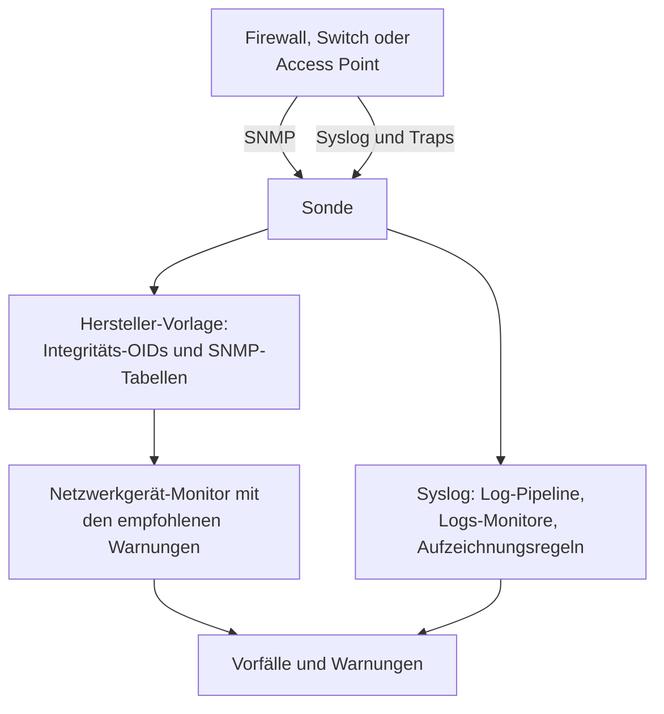

# Leitfäden für Netzwerkhersteller (Sophos, Extreme, Cambium)

So überwachen Sie drei verbreitete Umgebungen von Anfang bis Ende mit OneUptime: eine Sophos Firewall (XGS, SFOS) mit ihren IPsec-Tunneln, WAN-Verbindungen und SD-WAN; Switches von Extreme Networks (EXOS / Switch Engine und Fabric Engine / VOSS) mit ihrer Fabric; und cnMatrix-Switches und Enterprise-WLAN-Access-Points von Cambium Networks, bis hinunter zu Kanal und Sendeleistung jedes Funkmoduls.

:::cards
- [Sophos Firewall](#sophos-firewall-xgs-sfos): Tunnel, WAN-Verbindungen, Gateways und SD-WAN.
- [Extreme Networks](#extreme-networks-exos-switch-engine-und-fabric-engine-voss): Switches, die Fabric und ihre Hardware.
- [Cambium Networks](#cambium-networks-enterprise-wlan-und-cnmatrix): Access Points bis zu jedem Funkmodul, und cnMatrix-Switches.
:::

## So funktioniert es

Jeder Leitfaden verwendet dieselben Bausteine:

- Ein [Netzwerkgerät](/docs/monitor/network-device-monitor) pro Box, abgefragt von einer Sonde, die es erreicht, mit einer Hersteller-Vorlage, die die richtigen Integritäts-OIDs und [SNMP-Tabellen](/docs/monitor/network-device-monitor#snmp-tabellen) mitbringt.
- Ein Netzwerkgerät-Monitor pro Gerät für Warnungen. Legen Sie ihn von der Seite des Geräts aus an, damit die [empfohlenen Warnungen](/docs/monitor/network-device-monitor#empfohlenes-warnungspaket) für Sie ausgefüllt werden, einschließlich einer Warnung pro Zeile für jede Tabelle, die weiß, wie gesund aussieht. Für eine Flotte hält eine [Warnungsrichtlinie](/docs/monitor/network-device-monitor#warnungsrichtlinien) auf jedem Gerät einen.
- Für das, was ein Hersteller nur in seinen Logs meldet: Syslog an die Sonde, eine [Log-Pipeline](/docs/telemetry/log-pipelines), die jede Zeile in Attribute verwandelt, [Logs-Monitore mit Group By](/docs/monitor/logs-monitor#warnungen-pro-gruppe-group-by), um einmal pro Tunnel oder Gateway zu warnen, und [Log-Aufzeichnungsregeln](/docs/telemetry/log-recording-rules), um die Zahlen in diesen Logs als Diagramme zu zeigen.

## Sophos Firewall (XGS / SFOS)

| Was Sie sehen wollen | Woher es kommt |
| --- | --- |
| Integrität der Firewall: Speicher, Festplatte, Swap, HA-Zustand, IPsec-Dienst, CPU pro Kern | SNMP, mit der Hersteller-Vorlage **Sophos Firewall (SFOS / XGS)** |
| Der Status jedes IPsec-Tunnels, nach Namen | Die SNMP-Tabelle `ipsec_tunnels` (SFOS v20 und neuer) |
| Status, Durchsatz, Auslastung und Fehler jeder WAN-Verbindung | Der Schnittstellen-Walk der WAN-Ports |
| Latenz, Paketverlust und Jitter jeder WAN-Verbindung | Ping-Monitore und Geräteabfragen von OneUptime-Sonden |
| Gateway erreichbar und ausgefallen, SD-WAN-SLA erfüllt oder nicht, SD-WAN-Routenänderungen | Das Syslog der Firewall |
| SD-WAN-Latenz, Jitter und Paketverlust pro Gateway, als Diagramme | Log-Aufzeichnungsregeln über die SD-WAN-SLA-Logs |

Sophos meldet die Integrität von Gateways und SD-WAN nicht per SNMP, in keiner SFOS-Version: Sie steht nur in den Logs der Firewall und in den Warnungen von Sophos Central, weshalb die letzten drei Zeilen über Syslog laufen.

### Die Firewall registrieren

:::steps
1. Schalten Sie auf der Firewall SNMP unter **Administration → SNMP** ein: Fügen Sie einen SNMPv3-Benutzer oder eine v2c-Community hinzu und erlauben Sie der Adresse der Sonde, sie abzufragen.
2. Gehen Sie in OneUptime zu **Netzwerk → Geräte** und klicken Sie auf **Gerät hinzufügen**. Geben Sie die Management-Adresse der Firewall ein, wählen Sie eine Sonde, die sie erreicht, und fügen Sie die SNMP-Anmeldedaten unter **SNMP** hinzu.
3. Wenden Sie auf der **Einstellungen**-Seite des Geräts unter **Abfrage & Datenerfassung** die Vorlage **Sophos Firewall (SFOS / XGS)** aus **Integritätsvorlage des Herstellers** an und fügen Sie ihre Tabellen über **Add a Vendor's Tables** hinzu. Oder schalten Sie **Integritätsvorlage des Herstellers automatisch anwenden** ein, und die erste Abfrage erledigt beides.
:::

Nach der nächsten Abfrage listet die Seite **SNMP Tables** des Geräts jede IPsec-Verbindung mit ihrem Status (active, inactive, partially active) sowie die CPU-Kerne. SFOS nummeriert seine Kerne ab 196608, weshalb die CPU aus einer Tabelle kommt statt aus einem einzelnen `hrProcessorLoad.1`.

### Für jeden IPsec-Tunnel warnen

Klicken Sie auf der Seite des Geräts auf **Monitor erstellen**. Die empfohlenen Warnungen enthalten **IPsec Tunnels: row unhealthy**, ein Kriterium **SNMP Table Row Is Unhealthy** auf der Tabelle `ipsec_tunnels` mit Row `*`: Es eröffnet einen Vorfall pro Tunnel, der nicht aktiv ist, nach dem Tunnel benannt, und löst jeden auf, wenn sein Tunnel zurückkommt.

Ein Tunnel, den Sophos als aktiv meldet, hat nur seine Security Associations aufgebaut. Um zu belegen, dass Verkehr durch ihn fließt, fügen Sie einen [Ping-Monitor](/docs/monitor/ping-monitor) von einer Sonde an einem Standort zu einem Host auf der anderen Seite jedes Tunnels hinzu, und zeichnen Sie den Tunnel als Standortverbindung unter **Netzwerk → Topologie → Standortverbindungen** zwischen den beiden [Standorten](/docs/monitor/network-sites), gebunden an diesen Monitor: Die Verbindung auf der Karte übernimmt dann die Farbe des Monitors.

### WAN-Verbindungen

- **Integrität der Ports.** Der Schnittstellen-Walk misst bereits Status, Bits ein- und ausgehend, Auslastung und Fehler jedes WAN-Ports. Auf dem Monitor der Firewall warnt ein Kriterium **SNMP Interface Is Down** oder **SNMP Interface Utilization (in %)** mit **Schnittstelle** auf dem Namen des WAN-Ports, oder `*` für jeden Port, pro Verbindung.
- **Qualität des Pfads.** Latenz, Paketverlust und Jitter jeder Verbindung werden von außerhalb der Firewall gemessen: ein Ping-Monitor von den Cloud-Sonden von OneUptime zur öffentlichen Adresse jeder WAN-Verbindung und ein Ping-Monitor von einer Sonde am Standort zum Gateway jedes Providers. Kriterien für Paketverlust und Jitter auf diesen Monitoren warnen pro Verbindung, und **Netzwerk → Topologie → Latenzmatrix** zeigt jede Sonde gegen jeden Monitor auf einen Blick.
- **Datenverkehr.** SFOS exportiert NetFlow v5. Senden Sie es an die Sonde auf UDP 2055, wo der Flow-Collector der Sonde standardmäßig lauscht, und die Seite **Datenverkehr** des Geräts zeigt, wer über jede WAN-Verbindung mit wem spricht; [Netzwerkverkehr](/docs/monitor/network-traffic) beschreibt die Details.

### Gateways und SD-WAN aus dem Syslog

:::steps
1. Schalten Sie den Syslog-Empfänger der Sonde ein: Setzen Sie `PROBE_SYSLOG_RECEIVER_ENABLED=true` auf der Sonde. Er lauscht standardmäßig auf UDP 5140 (`PROBE_SYSLOG_RECEIVER_PORT` ändert das); veröffentlichen Sie den Port, wenn die Sonde in Docker läuft. Nachrichten werden dem Netzwerkgerät zugeordnet, dessen Hostname, oder eine seiner **Weitere Adressen**, die Adresse des Absenders ist, und erscheinen auf der Seite **Protokolle** des Geräts.
2. Fügen Sie auf der Firewall unter **System services → Log settings** einen Syslog-Server hinzu, der auf die Sonde und diesen Port zeigt, und kreuzen Sie die Log-Typen **Event** für IPsec und Gateways und den Log-Typ **SD-WAN** an: Die SLA-Logs bleiben aus, bis er angekreuzt ist.
3. Legen Sie unter **Protokolle → Einstellungen → Pipelines** eine Pipeline an, deren Filter die Logs der Firewall erfasst, etwa `attributes.networkDevice.name = 'hq-firewall'`, und fügen Sie einen **Key=Value Parser** mit **Zielpräfix** `sophos` hinzu. Fügen Sie eine Zeile der Firewall in seinen Tester ein, um die genauen Attributnamen Ihrer SFOS-Version zu sehen; [das Sophos-Beispiel](/docs/telemetry/log-pipelines#beispiel-sophos-xgs-firewall) geht es Schritt für Schritt durch.
4. Legen Sie [Logs-Monitore](/docs/monitor/logs-monitor) auf den Logs der Firewall an, jeden mit **Group by Attributes**, damit jeder Tunnel und jedes Gateway einzeln warnt, und dem Kriterium **Log Count** **Greater Than** `0` über einige Minuten. Die Zeilen unten sind die drei für den Anfang.
5. Zeigen Sie die SD-WAN-Qualität als Diagramm: Mit eingeschaltetem SD-WAN-Logging schreibt die Firewall eine SLA-Zusammenfassung pro Profil und Gateway (`latency`, `jitter`, `packet_loss`). Legen Sie unter **Protokolle → Einstellungen → Aufzeichnungsregeln** eine Regel pro Zahl an, etwa den Durchschnitt von `sophos.latency` gruppiert nach `sophos.gw_name` und `sophos.profile_name`, und zeigen Sie die Ergebnisse als Diagramm, oder warnen Sie dafür mit einem [Metrik-Monitor](/docs/monitor/metrics-monitor), der nach Gateway gruppiert. [Log-Aufzeichnungsregeln](/docs/telemetry/log-recording-rules) geht dieses Beispiel durch.
:::

| Warnung | Zu zählende Logs | Gruppieren nach |
| --- | --- | --- |
| IPsec-Tunnel beendet | Attribut `sophos.log_component` = `IPSec`, Body enthält `terminated` | `sophos.con_name` |
| Gateway ausgefallen | Attribut `sophos.log_component` = `Gateway`, Body enthält `is Down` | `sophos.gatewayname` |
| SD-WAN-SLA nicht erfüllt | Attribut `sophos.log_type` = `SD-WAN`, Body enthält `SLA not met` | `sophos.gw_name` |

Die Syslog-Ereignisse ergänzen die SNMP-Tabelle: Sie kommen in dem Moment, in dem ein Tunnel abbricht, während die Tabelle auch einen Tunnel erfasst, der nie zustande kam.

### Traps

Jede Sophos-Benachrichtigung ist derselbe Trap, `sfosNotification` (`1.3.6.1.4.1.2604.5.1.8.1.1`), mit dem Ereignis als Text in `sfosTrapMessage` (`1.3.6.1.4.1.2604.5.1.8.1.2`). Um für eine Art von Ereignis zu warnen, kombinieren Sie **SNMP Trap Received (Trap OID)** Equal To `1.3.6.1.4.1.2604.5.1.8.1.1` mit **SNMP Trap Varbind Value** auf diesem Varbind, zum Beispiel Contains `IPSec`. Stellen Sie das Trap-Ziel der Firewall auf SNMP v2c: Der Trap-Empfänger der Sonde nimmt v1- und v2c-Traps an.

## Extreme Networks (EXOS / Switch Engine und Fabric Engine / VOSS)

| Was Sie sehen wollen | Woher es kommt |
| --- | --- |
| EXOS: CPU, Temperatur und ihr Alarm, Stromzustand, Netzteile, Lüfter, Speicher pro Steckplatz, Stack-Mitglieder | Die Vorlage **Extreme Networks EXOS / Switch Engine** |
| Fabric Engine: CPU und Speicher pro Steckplatz, Temperatursensoren, Lüfter, Netzteile, vIST-Sitzung, Anzahl der I-SIDs | Die Vorlage **Extreme Networks Fabric Engine / VOSS** |
| Jede Fabric-Connect-Nachbarschaft (IS-IS), nach ihrem Nachbarn benannt | Die Tabelle `isis_adjacencies` der Fabric-Engine-Vorlage |
| Ports, LLDP-Nachbarn, die Netzwerkkarte | Der Schnittstellen-Walk, bei beiden |

### Welche Vorlage

Fabric Engine auf der universellen Hardware von Extreme (die Serien 5000 und 7000) meldet dieselbe Enterprise-Nummer wie EXOS: Nur seine Systembeschreibung (`7520-48Y-8C-FabricEngine (9.0.4.0)`) sagt, welches Betriebssystem läuft. OneUptime liest beides, das automatische Anwenden und der Vorschlag der Geräteseite wählen also die richtige Vorlage, und ältere VSP-Switches melden den Avaya/Nortel-Zweig und werden direkt als Fabric Engine erkannt.

### Warnungen für Fabric und Hardware

Die empfohlenen Warnungen auf einem Fabric-Engine-Switch enthalten **Fabric Adjacencies (IS-IS): row unhealthy**, einen Vorfall pro Nachbar, dessen Nachbarschaft nicht aufgebaut ist. Fabric Engine sendet außerdem einen Trap, wenn sich eine Nachbarschaft ändert, `rcnIsisPlsbAdjStateTrap` (`1.3.6.1.4.1.2272.1.21.0.281`), und ein Kriterium **SNMP Trap Received (Trap OID)** darauf warnt innerhalb von Sekunden, vor der nächsten Abfrage.

Netzteile, Lüfter, Temperatursensoren und Stack-Mitglieder sind Tabellen, die ihre gesunden Werte deklarieren, jede bekommt also in den empfohlenen Warnungen eine Warnung pro Zeile.

### Flows und WLAN

EXOS und Fabric Engine exportieren Flows als sFlow und IPFIX. Senden Sie sFlow an die Sonde auf UDP 6343 oder IPFIX auf UDP 4739, und die Seite **Datenverkehr** des Geräts zeigt seinen Verkehr; siehe [Netzwerkverkehr](/docs/monitor/network-traffic).

IQ-Engine-Access-Points (HiveOS) und ExtremeCloud IQ Controller haben eigene Hersteller-Vorlagen, die die Seite **Wi-Fi** des Geräts füllen. [Unterstützte WLAN-Hersteller](/docs/monitor/network-device-monitor#unterstützte-wlan-hersteller) beschreibt sie, zusammen mit Ubiquiti UniFi, HPE Aruba, TP-Link Omada und Juniper Mist.

## Cambium Networks (Enterprise-WLAN und cnMatrix)

### Access Points

:::steps
1. Schalten Sie SNMP auf den Access Points ein. In cnMaestro wird SNMP pro AP-Gruppe festgelegt: **Configuration → Wi-Fi Profiles → AP Groups → Management → SNMP**. Schalten Sie es mit einer v2c-Lese-Community oder einem SNMPv3-Benutzer ein.
2. Fügen Sie jeden Access Point mit seiner Management-Adresse und diesen Anmeldedaten hinzu und wenden Sie die Vorlage **Cambium Networks Enterprise Wi-Fi (cnPilot, XV, XE, XH)** an, oder schalten Sie das automatische Anwenden ein.
3. Öffnen Sie die Seite **Wi-Fi** des Geräts. Sie zeigt, wie viele Funkmodule eingeschaltet sind, die Clients und SSIDs, dann Band, Kanal, Frequenz, Kanalbreite, Sendeleistung, Clients, Grundrauschen und Airtime jedes Funkmoduls und jede SSID mit ihren Clients. Die Frequenz wird aus Band und Kanal berechnet; der Access Point meldet sie nicht.
:::

Nützliche Warnungen, alle auf der Tabelle `wifi_radios` mit Row `*`, sodass jedes Funkmodul einzeln warnt:

| Warnung | Kriterium |
| --- | --- |
| Ein Funkmodul wurde abgeschaltet | **SNMP Table Row Is Unhealthy**, Teil der empfohlenen Warnungen |
| Die Sendeleistung hat sich geändert | **SNMP Table Value**, Spalte TX Power, Not Equal To Ihre geplante Leistung |
| Ein überlastetes Funkmodul | **SNMP Table Value**, Spalte Clients, Greater Than Ihre Grenze |
| Ein verrauschter Kanal | **SNMP Table Value**, Spalte Noise Floor, Greater Than `-80` |

Jeder numerische Wert eines Funkmoduls ist auch eine Metrik (`oneuptime.monitor.snmp.table.value`, eine Reihe pro Funkmodul und Spalte), Kanal, Leistung und Clients lassen sich also auf einem Dashboard über die Zeit zeigen; ein Kanal, der sich ständig ändert, ist DFS bei der Arbeit.

Cambium meldet die Gesamtzahl der Clients erst ab Firmware 6.5.3; ältere Firmware liefert 0.

### cnMatrix-Switches

Die Vorlage **Cambium Networks cnMatrix** erfasst CPU, RAM, Flash, Temperatur und Versorgungsspannung sowie Lüfter, das redundante Netzteil und die PoE-Leistung jedes Ports als Tabellen. Ports und LLDP-Nachbarn kommen wie bei jedem Switch aus dem Schnittstellen-Walk.

### cnMaestro-Alarme

cnMaestro kann seine Alarme, etwa einen Access Point, der offline geht, an einen HTTPS-Webhook senden. Richten Sie ihn auf einen [Monitor für eingehende Anfragen](/docs/monitor/incoming-request-monitor), um diese Alarme neben den SNMP-Daten in OneUptime-Vorfälle zu verwandeln.

## Fehlerbehebung

:::details Die Tabelle IPsec Tunnels hat keinen Status
Der Tunnelstatus braucht SFOS v20 oder neuer. Prüfen Sie auch, ob die SNMP-Ansicht Ihrer Anmeldedaten den Sophos-Enterprise-Baum (`1.3.6.1.4.1.2604`) enthält: Ein eingeschränkter v3-Benutzer sieht oft nur die Systemgruppe und IF-MIB.
:::

:::details Von der Firewall kommt kein Syslog an
Der Syslog-Empfänger der Sonde ist standardmäßig aus: Setzen Sie `PROBE_SYSLOG_RECEIVER_ENABLED=true` und veröffentlichen Sie UDP 5140, oder Ihren `PROBE_SYSLOG_RECEIVER_PORT`, zur Sonde. Nachrichten werden einem Gerät über die Adresse des Absenders zugeordnet, der Hostname der Firewall in OneUptime, oder eine ihrer **Weitere Adressen**, muss also die Adresse sein, von der sie Syslog sendet.
:::

:::details Ein Fabric-Engine-Switch hat die EXOS-Vorlage bekommen
Die Vorlage wird aus der Systembeschreibung des Switches gewählt. Prüfen Sie, ob die Übersicht des Geräts eine Beschreibung zeigt, die Fabric Engine nennt (etwa `7520-48Y-8C-FabricEngine (9.0.4.0)`); wenn ja, entfernen Sie die EXOS-OIDs und -Tabellen und wenden Sie **Extreme Networks Fabric Engine / VOSS** aus **Integritätsvorlage des Herstellers** an.
:::

:::details Cambium-Access-Points melden 0 Clients
Die Gesamtzahl der Clients braucht Firmware 6.5.3 oder neuer. Auf älterer Firmware melden die Funkmodule weiterhin Kanal, Leistung und Grundrauschen.
:::

## Nächste Schritte

:::cards
- [Netzwerkgeräte-Überwachung](/docs/monitor/network-device-monitor): Alles, was ein Gerät erfasst, und jedes Kriterium, für das es warnen kann.
- [Log-Pipelines](/docs/telemetry/log-pipelines): Firewall-Logs in Attribute zerlegen.
- [Logs-Monitor](/docs/monitor/logs-monitor): Einmal pro Tunnel oder Gateway warnen.
:::
