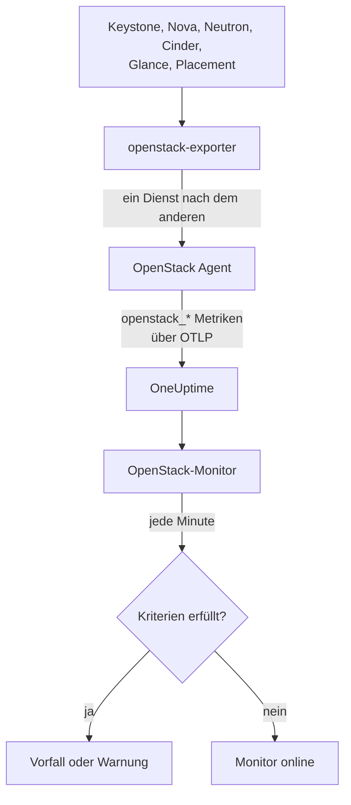

# OpenStack-Überwachung

Ein OpenStack-Monitor überwacht eine Cloud - ihre APIs, die Worker dahinter, Hypervisoren, Instanzen, Netzwerke, Speicherpools und Projektquoten - und meldet sich, wenn eine API nicht mehr antwortet, ein Worker ausfällt, ein Hypervisor keinen Platz mehr hat oder ein Pool vollläuft. Er liest die `openstack_*`-Serien, die der OneUptime OpenStack Agent vom openstack-exporter sammelt, oder die eine Probe von den APIs der Cloud sammelt.

:::cards
- [Monitor erstellen](#openstack-monitor-erstellen): Sechs Schritte im Dashboard.
- [Vorlagen](#vorgefertigte-warnungsvorlagen): Fertige Warnungen, ein Vorfall pro Worker, Instanz, Netzwerk oder Region.
- [Prüfungen von außen](#prüfungen-von-außen): Ob tatsächlich jemand eine Instanz starten kann, von einer Probe außerhalb der Cloud aus.
- [Identitätsattribute](#identitätsattribute): So nehmen Sie eine Region, einen Host oder ein Projekt gezielt ins Visier.
- [Metriken](#erfasste-metriken): Jede Serie, über die der Monitor benachrichtigen kann.
:::

## So funktioniert es

Der Agent ist ein OpenTelemetry Collector samt openstack-exporter, den Sie auf einem Rechner betreiben, der die APIs der Cloud erreicht. Er liest jeden OpenStack-Dienst in einer eigenen Erfassung, sodass ein ausfallendes Nova nur die Serien von Nova kostet, und er liest schonend: Compute, Network, Volume und Placement alle 2 Minuten, Identity und Image alle 5.

Jede Serie trägt den Namen der Cloud, `openstack.cloud.name`, und jeder Datenpunkt `openstack.region.name` und `openstack_service`. Eine Cloud ist ein Keystone, und ein OpenStack-Monitor gehört zu genau einer Cloud. Jede Minute führt er seine Abfrage über die Metriken dieser Cloud aus und vergleicht das Ergebnis mit seinen Kriterien.



## Bevor Sie beginnen

- **Erfassen Sie die Metriken der Cloud** mit dem OpenStack Agent oder [einer Probe](/docs/telemetry/openstack-agentless). **Dokumentation** unter **Produkte → Infrastruktur → OpenStack** führt Sie durch die Installation des Agents.
- **Prüfen Sie, ob die Cloud registriert ist.** Sie erscheint nach der ersten Erfassung unter **Produkte → Infrastruktur → OpenStack**, benannt nach dem `OPENSTACK_CLOUD_NAME` des Agents.

## OpenStack-Monitor erstellen

:::steps
### Neuen Monitor starten

Gehen Sie zu **Monitore** und klicken Sie auf **Monitor erstellen**.

### OpenStack wählen

Klicken Sie unter **Monitortyp** auf **Weitere Monitortypen** und wählen Sie **OpenStack** unter **Infrastruktur**, oder geben Sie `openstack` in das Suchfeld ein. Geben Sie im Feld **Name** einen Namen ein - er wird in Titeln von Vorfällen und Warnungen verwendet - und klicken Sie auf **Weiter**.

### Cloud auswählen

Wählen Sie unter **OpenStack Monitor Configuration** die Cloud bei **OpenStack-Cloud** aus. Jede Cloud, die Daten gesendet hat, steht in der Liste. Nach der Auswahl zeigt eine Zeile unter dem Feld, ob Daten eintreffen.

### Festlegen, was überwacht wird

Ein neuer Monitor startet mit **Cloud Stopped Reporting** unter **Worüber benachrichtigt wird**. So überwachen Sie etwas anderes:

- **Ändern** - wählen Sie eine andere [Vorlage](#vorgefertigte-warnungsvorlagen). Sie legt Metrik, Attributfilter, Aggregation, Zeitbereich, Gruppierung und Schwellenwerte fest und ersetzt die Kriterien darunter durch ihre eigenen. Den **Zeitbereich** können Sie weiterhin ändern.
- **Custom Metric** (unter **Weitere Felder**) - wählen Sie eine Metrik bei **OpenStack-Metrik**, legen Sie dann **Aggregation** und **Zeitbereich** fest und grenzen Sie sie mit den [Filtern](#monitor-einstellungen) ein.
- **Erweitert** (unter **Weitere Felder**) - erstellen Sie Abfragen und Formeln selbst unter **Metriken auswählen**, mit Filtern auf Attributen wie `status`, `adminState` oder `resourcetype`. Mit **Gruppieren nach** einem [Identitätsattribut](#identitätsattribute) beurteilen Sie jeden Teil für sich.

### Kriterien prüfen

Öffnen Sie jedes Kriterium unter **Kriterien** und prüfen Sie **Metrik**, **Aggregation**, **Bedingung** und **Schwellenwert**. Eine Vorlage füllt diese aus. Bei **Custom Metric** oder **Erweitert** startet der Monitor mit den Standardkriterien, die nur bemerken, dass die Metrik keine Daten sendet. Legen Sie daher Ihren eigenen Schwellenwert fest.

### Monitor erstellen

Klicken Sie auf **Monitor erstellen**. OneUptime öffnet die Seite des Monitors und wertet ihn jede Minute aus. Vorfälle und Warnungen, die er auslöst, stehen auch auf den Seiten **Vorfälle** und **Warnungen** der Cloud.
:::

> [!TIP]
> Um mehrere Vorlagen auf einmal einzurichten, öffnen Sie die Cloud unter **Produkte → Infrastruktur → OpenStack** und gehen Sie zu **Empfehlungen**. Wählen Sie die gewünschten Vorlagen, legen Sie fest, wer benachrichtigt wird, und OneUptime erstellt pro Vorlage einen Monitor.

## Monitor-Einstellungen

| Feld | Tab | Was es bewirkt |
| --- | --- | --- |
| **OpenStack-Cloud** | Alle | Erforderlich. Beschränkt jede Abfrage auf `resource.openstack.cloud.name`. |
| **Region** | Benutzerdefinierte Metrik, Erweitert | Optional. Eine Region: `openstack.region.name`. Jede Serie trägt sie. |
| **Verfügbarkeitszone** | Benutzerdefinierte Metrik, Erweitert | Optional. Eine Zone: `availability_zone` bei Hypervisoren, Instanzen, Volumes und Neutron-Agents, `zone` bei den Workern von Nova und Cinder. |
| **Hypervisor** | Benutzerdefinierte Metrik, Erweitert | Optional. Ein Host: `hostname` bei Workern, Hypervisoren und Placement, `hypervisor_hostname` bei Instanzen. Die Worker von Nova nennen den Kurznamen des Hosts, Hypervisoren, Placement und Instanzen seinen vollen Namen. Verwenden Sie daher den, den die Serie angibt. |
| **Dienst** | Benutzerdefinierte Metrik, Erweitert | Optional. Das Binary eines Workers, etwa `nova-compute`: `service`. |
| **Projekt-ID** | Benutzerdefinierte Metrik, Erweitert | Optional. Ein Projekt: `tenant_id` bei den Serien von Nova und Cinder sowie bei Netzwerken und Subnetzen, `project_id` bei Floating IPs, Routern und Adressverfügbarkeit. |
| **OpenStack-Metrik** | Benutzerdefinierte Metrik | Eine Metrik aus dem [Katalog](#erfasste-metriken). |
| **Aggregation** | Benutzerdefinierte Metrik | Wie Messwerte zusammengefasst werden: **Durchschnitt**, **Maximum**, **Minimum**, **Summe** oder **Anzahl**. Beginnt mit der üblichen Aggregation der Metrik. |
| **Zeitbereich** | Alle | Das gleitende Fenster, das die Abfrage liest, von **Past 1 Minute** bis **Past 365 Days**. Ein neuer Monitor beginnt bei **Letzte 15 Minuten**; Vorlagen legen ihr eigenes fest. |
| **Metriken auswählen** | Erweitert | Der Abfrage-Builder: **Metrik**, **Aggregieren nach**, **Nach Attributen filtern**, **Gruppieren nach**, dazu **Metrik hinzufügen** und **Formel hinzufügen**, um Abfragen zu kombinieren. |

Ein Filter grenzt nur eine Serie ein, die sein Label trägt: `openstack_nova_up` hat kein Projekt, daher lässt ein Projektfilter sie unverändert.

Halten Sie das Fenster bei mindestens drei Erfassungen dessen, was Sie lesen: 6 Minuten für Compute, Network, Volume und Placement, 15 für Identity und Image. Ein kürzeres Fenster enthält nicht genug Erfassungen, damit die Option **Alle Werte** eine Dauer bedeutet.

## Identitätsattribute

Jede Serie trägt `openstack.cloud.name` als **Ressourcenattribut** und `openstack.region.name` sowie `openstack_service` als Datenpunktattribute. Den Rest sagen die eigenen Labels des Exporters:

| Teil | Serie | Labels, die ihn identifizieren |
| --- | --- | --- |
| API | `openstack_*_up` | `openstack.region.name`, `openstack_service` |
| Worker | `openstack_nova_agent_state`, `openstack_neutron_agent_state`, `openstack_cinder_agent_state` | `hostname`, `service`. `adminState` sagt, ob ein Operator ihn eingeschaltet gelassen hat. Gruppieren Sie bei Cinder nie nach `uuid`: Der Exporter erfindet bei jeder Erfassung eine neue |
| Hypervisor | `openstack_placement_resource_*`, `openstack_nova_vcpus_*` | `hostname` (sein voller Name), bei Placement `resourcetype` |
| Instanz | `openstack_nova_server_status` | `uuid`, `name`, `tenant_id`, `hypervisor_hostname`, `status`. Der Wert ist ein Code: Filtern Sie nach dem Wort in `status` |
| Volume | `openstack_cinder_volume_gb` | `id`, `name`, `tenant_id`, `status` |
| Speicherpool | `openstack_cinder_pool_capacity_*` | `name`, `volume_backend_name` |
| Netzwerk | `openstack_neutron_network_ip_availabilities_*` | `network_id`, `network_name`, `cidr`, `ip_version` |
| Router | `openstack_neutron_l3_agent_of_router` | `router_id`, `agent_host`, `ha_state`, `agent_alive`, `agent_admin_up` |
| Projekt | `openstack_nova_limits_*`, `openstack_cinder_limits_*` | `tenant_id`, `tenant` |

In Monitorfiltern und Gruppierungsschlüsseln beginnt ein Ressourcenattribut mit `resource.` (`resource.openstack.cloud.name`), ein Datenpunktattribut nicht (`openstack.region.name`, `hostname`, `status`). Ein leeres Label erreicht OneUptime nicht, daher ist `disabledReason` nur bei einem Worker vorhanden, den jemand deaktiviert hat.

## Vorgefertigte Warnungsvorlagen

OneUptime liefert 120 Vorlagen für häufige OpenStack-Probleme mit, und die Liste **Worüber benachrichtigt wird** bietet sie an. Die Seite Empfehlungen einer Cloud bietet eine Vorlage für Heat, Magnum, Ironic, Manila, Octavia, Trove, Designate, Gnocchi oder Swift nur einer Cloud an, die diesen Dienst betreibt, eine über eine Serie, die nur eine Probe sendet, nur einer Cloud, die eine Probe erfasst, und eine über eine [Prüfung von außen](#prüfungen-von-außen) nur einer Cloud, bei der diese Prüfung aktiviert ist: Bei jeder anderen Cloud existieren ihre Serien nicht, sodass sie nie auslösen könnte. Jede erstellt einen vollständigen Monitor: die Metrikabfrage, ihre Attributfilter, eine Gruppierung nach dem, worum es bei einem Vorfall geht, ein Kriterium, das auslöst, und eines, das wieder zurücksetzt. Die Schwellenwerte entsprechen den Linien, die die eigenen Seiten der Cloud zeichnen, und sind Ausgangspunkte, die Sie anpassen können.

Jede Vorlage liest mindestens drei Erfassungen dessen, was sie überwacht, und löst nur aus, wenn die Bedingung im gesamten Fenster gilt. Ein Schwellenwert auf einen Anteil setzt sich 10 % hinter seiner Linie zurück, sodass ein Wert, der dort schwankt, nicht flattert.

| Vorlage | Kategorie | Schweregrad | Überwacht | Löst aus, wenn | Setzt zurück, wenn |
| --- | --- | --- | --- | --- | --- |
| Cloud Stopped Reporting | Verfügbarkeit | Kritisch | `openstack_identity_up`, Anzahl über die ganze Cloud, **letzte 15 Minuten** | Keine Daten im ganzen Fenster: Der Agent wurde gestoppt oder erreicht OneUptime nicht, oder der Exporter kann sich nicht bei Keystone anmelden | Wieder Daten eintreffen |
| Identity API Down | Verfügbarkeit | Kritisch | `openstack_identity_up` und `scrape_samples_scraped` für `identity`, Min pro Region, **letzte 15 Minuten** | Jeder Aufruf schlug fehl, oder die Erfassung kam leer zurück, weil der Exporter sich nicht anmelden konnte | Beide 1 oder mehr anzeigen |
| Compute API Down | Verfügbarkeit | Kritisch | `openstack_nova_up` und `scrape_samples_scraped` für `compute`, Min pro Region, **letzte 10 Minuten** | Jeder Aufruf schlug fehl, oder die Erfassung kam leer zurück, weil der Exporter die API von Nova nicht erreichen konnte | Beide 1 oder mehr anzeigen |
| Network API Down | Verfügbarkeit | Kritisch | `openstack_neutron_up` und `up` für `network`, Min pro Region, **letzte 10 Minuten** | Jeder Aufruf schlug fehl, oder der Exporter antwortete nicht | Beide 1 anzeigen |
| Block Storage API Down | Verfügbarkeit | Kritisch | `openstack_cinder_up` und `up` für `volume`, Min pro Region, **letzte 10 Minuten** | Jeder Aufruf schlug fehl, oder der Exporter antwortete nicht | Beide 1 anzeigen |
| Image API Down | Verfügbarkeit | Kritisch | `openstack_glance_up` und `up` für `image`, Min pro Region, **letzte 15 Minuten** | Jeder Aufruf schlug fehl, oder der Exporter antwortete nicht | Beide 1 anzeigen |
| Placement API Down | Verfügbarkeit | Kritisch | `openstack_placement_up` und `up` für `placement`, Min pro Region, **letzte 10 Minuten** | Jeder Aufruf schlug fehl, oder der Exporter antwortete nicht | Beide 1 anzeigen |
| Compute Service Down | Steuerungsebene | Kritisch | `openstack_nova_agent_state`, gefiltert auf `service = nova-compute` und `adminState = enabled`, Min pro Host, **letzte 10 Minuten** | Unter 1: Ein aktiviertes nova-compute ist ausgefallen. Eines, das jemand deaktiviert hat, löst nie aus | Aktiv oder deaktiviert |
| Compute Service Disabled | Steuerungsebene | Warnung | `openstack_nova_agent_state`, gefiltert auf `service = nova-compute` und `adminState = disabled`, eine Anzahl pro Host, **letzte 10 Minuten** | Über 0: Ein `nova-compute` wurde deaktiviert, und kein laufendes Wartungsereignis deckt seinen Host, seine Verfügbarkeitszone oder die Cloud ab. Eines, das sich selbst deaktiviert hat, weil libvirt ausfiel (sein Grund beginnt mit `AUTO:`), bleibt still, solange libvirt Service Down offen ist. Projekte werden darüber nicht informiert | Es wieder aktiviert ist oder ein Ereignis es abdeckt |
| Scheduler or Conductor Down | Steuerungsebene | Warnung | `openstack_nova_agent_state`, gefiltert auf `nova-scheduler` oder `nova-conductor` und `adminState = enabled`, Min pro Host und Binary, **letzte 10 Minuten** | Unter 1. Die anderen arbeiten weiter, solange noch einer übrig ist | Aktiv oder deaktiviert |
| Every Scheduler or Conductor Down | Steuerungsebene | Kritisch | Dasselbe, Max pro Region und Binary, **letzte 10 Minuten** | Unter 1: Keiner läuft mehr, sodass nichts Neues starten kann | Einer läuft |
| Network Agent Down | Steuerungsebene | Kritisch | `openstack_neutron_agent_state`, gefiltert auf `adminState = up`, Min pro Host und Binary, **letzte 10 Minuten** | Unter 1: Ein eingeschalteter Agent lebt nicht. Einer, den jemand ausgeschaltet hat, löst nie aus | Lebendig oder ausgeschaltet |
| Block Storage Service Down | Steuerungsebene | Kritisch | `openstack_cinder_agent_state`, gefiltert auf `adminState = enabled`, Min pro Host und Binary, **letzte 10 Minuten** | Unter 1: Ein aktivierter Cinder-Dienst ist ausgefallen. Einer, den jemand deaktiviert hat, löst nie aus | Aktiv oder deaktiviert |
| vCPU Allocation High | Compute | Warnung | `openstack_placement_resource_*`, gefiltert auf `resourcetype = VCPU`, Nutzung / ((gesamt - reserviert) x Verhältnis), pro Hypervisor, **letzte 10 Minuten** | Über 90 %: Zuteilung, nicht Last | Bei oder unter 81 % |
| Memory Allocation High | Compute | Warnung | Dasselbe, `resourcetype = MEMORY_MB` | Über 90 % | Bei oder unter 81 % |
| Local Disk Allocation High | Compute | Warnung | Dasselbe, `resourcetype = DISK_GB` | Über 90 % | Bei oder unter 81 % |
| Hypervisor CPU Saturated | Compute | Warnung | `openstack.hypervisor.instances.cpu.utilization`, pro Hypervisor, **letzte 15 Minuten**. Benötigt den Exporter von libvirt oder Ceilometer | Über 90 % seiner CPU-Threads: Last, nicht Zuteilung. Seine Seite nennt die verantwortlichen Instanzen | Bei oder unter 81 % |
| Hypervisor Memory Pressure | Compute | Warnung | `openstack.hypervisor.instances.memory.utilization`, pro Hypervisor, **letzte 15 Minuten**. Benötigt den Exporter von libvirt oder das Polling von `memory.resident` durch Ceilometer | Über 90 % seines Speichers: genutzt, nicht zugesagt | Bei oder unter 81 % |
| Instance CPU Saturated | Compute | Warnung | `openstack.instance.cpu.utilization`, Max pro Instanz, **letzte 15 Minuten**. Benötigt den Exporter von libvirt oder Ceilometer | Über 95 % ihrer vCPUs | Bei oder unter 85,5 % |
| Instance Disk Latency High | Compute | Warnung | `openstack.instance.disk.read.latency` und `openstack.instance.disk.write.latency`, Max pro Instanz und Disk, **letzte 15 Minuten**. Benötigt den Exporter von libvirt oder das Polling von `disk.device.read.latency` und `disk.device.write.latency` durch Ceilometer | Über 50 ms pro Anfrage. Eine Disk ohne Anfragen hat keine Latenz, sodass eine ruhende nie auslöst | Bei oder unter 45 ms oder sie nicht mehr genutzt wird |
| Instances in Error | Compute | Warnung | `openstack_nova_server_status`, gefiltert auf `status = ERROR`, Anzahl pro Region, **letzte 10 Minuten** | Über 0 | Keine mehr übrig ist |
| Instance Stuck Building | Compute | Warnung | `openstack_nova_server_status`, gefiltert auf `status = BUILD` oder `BUILD(spawning)`, Max pro Instanz, **letzte 1 Stunde** | Bei jeder Erfassung eine Stunde lang in diesem Status | Sie ihn verlassen hat |
| Instance Stuck Transitioning | Compute | Warnung | Dasselbe für `REBUILD`, `RESIZE`, `REVERT_RESIZE`, `MIGRATING`, `REBOOT`, `HARD_REBOOT` und `PASSWORD`, **letzte 1 Stunde** | Bei jeder Erfassung eine Stunde lang in einem davon | Sie ihn verlassen hat |
| Instance Stuck in Verify Resize | Compute | Warnung | Dasselbe für `VERIFY_RESIZE`, **letzte 1 Stunde** | Eine Stunde lang wartet jemand auf Bestätigung oder Rücknahme | Bestätigt oder zurückgenommen |
| Router Not Active | Netzwerk | Warnung | `openstack_neutron_routers_not_active`, Max pro Region, **letzte 10 Minuten** | Über 0 | Bei 0 |
| Floating IP Not Active | Netzwerk | Warnung | `openstack_neutron_floating_ips_associated_not_active`, Max pro Region, **letzte 10 Minuten** | Über 0: Eine genutzte ist nicht ACTIVE. Eine freie soll inaktiv sein | Bei 0 |
| External IP Pool Nearly Full | Netzwerk | Warnung | `openstack_neutron_network_ip_availabilities_*` für `ip_version = 4`, zusammen mit `is_external = true` bei `openstack_neutron_network`, pro Netzwerk, **letzte 10 Minuten** | Über 90 % der IPv4-Adressen eines externen Netzwerks. Das Netzwerk eines Tenants löst nie aus | Bei oder unter 81 % |
| Network Out of IPs | Netzwerk | Kritisch | Dasselbe | Bei 100 %: keine Adresse mehr frei | Unter 90 % |
| Router Without Active Agent | Netzwerk | Kritisch | `openstack_neutron_l3_agent_of_router`, gefiltert auf `agent_admin_up = true`, Max pro Router, **letzte 10 Minuten** | Unter 1: Kein Agent, der ihn hält, lebt. Still bei OVN, das keine solchen Agents hat | Einer lebt |
| Router With Two Active Agents | Netzwerk | Kritisch | Dasselbe, gefiltert auf `ha_state = active` und `agent_alive = true`, Anzahl pro Router, **letzte 10 Minuten** | Über 1: ein Split-Brain. Still bei OVN | Bei oder unter 1 |
| Storage Pool Warning | Speicher | Warnung | `openstack_cinder_pool_capacity_*`, (gesamt - frei) / gesamt, pro Pool, **letzte 10 Minuten** | Über 85 % | Bei oder unter 76,5 % |
| Storage Pool Critical | Speicher | Kritisch | Dasselbe | Über 95 % | Bei oder unter 85,5 % |
| Volumes in Error | Speicher | Warnung | `openstack_cinder_volume_status_counter` für jedes Fehlerwort, Max pro Region und Wort, **letzte 10 Minuten** | Über 0 | Bei 0 |
| Volume Stuck | Speicher | Warnung | `openstack_cinder_volume_gb` für jedes Durchgangsstatus-Wort, Max pro Volume, **letzte 30 Minuten** | Bei jeder Erfassung 30 Minuten lang in diesem Status | Es ihn verlassen hat |
| Image Stuck | Speicher | Warnung | `openstack_glance_image_created_at` für jedes Durchgangsstatus-Wort, Max pro Image, **letzte 1 Stunde** | Bei jeder Erfassung eine Stunde lang in diesem Status | Es ihn verlassen hat oder gelöscht wurde |
| Orchestration API Down | Verfügbarkeit | Kritisch | `openstack_heat_up` und `up` für `orchestration`, Min pro Region, **letzte 15 Minuten** | Jeder Aufruf schlug fehl, was auch ein gestoppter `heat-engine` anzeigt, oder der Exporter antwortete nicht | Beide 1 anzeigen |
| Kubernetes Clusters API Down | Verfügbarkeit | Kritisch | `openstack_container_infra_up` und `up` für `container-infra`, Min pro Region, **letzte 15 Minuten** | Jeder Aufruf schlug fehl, oder der Exporter antwortete nicht | Beide 1 anzeigen |
| Rating API Down | Verfügbarkeit | Kritisch | `openstack_cloudkitty_up` und `up` für `rating`, Min pro Region, **letzte 15 Minuten**. Nur eine Probe sendet dies | Die API von CloudKitty antwortet nicht, sodass sich die Bewertung der Projekte nicht mehr bewegt | Beide 1 anzeigen |
| Heat Engine Down | Steuerungsebene | Warnung | `openstack_heat_agent_state`, Min pro Host, **letzte 15 Minuten**. Nur eine Probe sendet dies | Heat führt einen `heat-engine` als ausgefallen auf. Wenn alle Engines gestoppt sind, kann Heat sie nicht auflisten, und stattdessen löst Orchestration API Down aus | Er 1 anzeigt oder Heat seinen Eintrag entfernt |
| Magnum Conductor Down | Steuerungsebene | Kritisch | `openstack_container_infra_agent_state` mit `adminState=enabled`, Min pro Host, **letzte 15 Minuten**. Nur eine Probe sendet dies | Magnum führt einen aktivierten `magnum-conductor` als ausgefallen auf. Die API von Magnum antwortet weiter, sodass nichts anderes dies meldet | Er 1 anzeigt oder jemand ihn deaktiviert |
| Stack Failed | Orchestrierung | Warnung | `openstack_heat_stack_status` mit jedem `*_FAILED`-Status, pro Stack, **letzte 15 Minuten** | Ein Stack hält im ganzen Fenster einen Fehlerstatus | Er aktualisiert oder gelöscht wird |
| Stack Stuck In Progress | Orchestrierung | Warnung | `openstack_heat_stack_status` mit jedem `*_IN_PROGRESS`-Status, pro Stack, **letzte 2 Stunden** | Ein Stack hält im ganzen Fenster einen Status in Bearbeitung, über die Stunde hinaus, die Heat ihm gibt, sofern niemand eine längere Zeit gewählt hat | Er seinen nächsten Status erreicht oder gelöscht wird |
| Kubernetes Cluster Failed | Orchestrierung | Warnung | `openstack_container_infra_cluster_status` mit jedem `*_FAILED`-Status, pro Cluster, **letzte 15 Minuten** | Ein Cluster hält im ganzen Fenster einen Fehlerstatus | Er aktualisiert oder gelöscht wird |
| Kubernetes Cluster Stuck | Orchestrierung | Warnung | `openstack_container_infra_cluster_status` mit jedem `*_IN_PROGRESS`-Status, pro Cluster, **letzte 2 Stunden** | Ein Cluster hält im ganzen Fenster einen Status in Bearbeitung. Nur der Conductor von Magnum schaltet einen weiter | Er seinen nächsten Status erreicht oder gelöscht wird |
| Shared File Systems API Down | Verfügbarkeit | Kritisch | `openstack_sharev2_up` und `up` für `sharev2`, Min pro Region, **letzte 15 Minuten** | Jeder Aufruf schlug fehl, oder der Exporter antwortete nicht. Jede Anmeldeinformation, mit der eine Anmeldung gelingt, zeigt 1, daher kann dies keine abgelehnte Anmeldeinformation sein | Beide 1 anzeigen |
| Manila Service Down | Steuerungsebene | Warnung | `openstack_sharev2_agent_state` mit `adminState=enabled`, Min pro Host und Dienst, **letzte 15 Minuten**. Nur eine Probe sendet dies | Manila führt einen aktivierten Dienst als gestoppt oder ausgefallen auf. Seine API antwortet weiter, sodass nichts anderes dies meldet | Er 1 anzeigt oder jemand ihn deaktiviert |
| Share in Error | Speicher | Warnung | `openstack_sharev2_share_gb` mit jedem Fehlerstatus, pro Share, **letzte 15 Minuten** | Ein Share hält im ganzen Fenster einen Fehlerstatus | Er behoben oder gelöscht wird |
| Share Stuck | Speicher | Warnung | `openstack_sharev2_share_gb` mit jedem Durchgangsstatus, pro Share, **letzte 1 Stunde** | Ein Share hält im ganzen Fenster einen Durchgangsstatus. Manila hat kein eigenes Timeout für ein langsames Backend. Einer, der migriert oder gesichert wird, wird nicht überwacht | Er seinen nächsten Status erreicht oder gelöscht wird |
| Load Balancers API Down | Load Balancer | Kritisch | `openstack_loadbalancer_up`, Min pro Region, **letzte 15 Minuten** | Unter 1. Eine gestoppte Octavia-API gibt dem Exporter des Agents eine leere Antwort statt einer 0, genau wie eine Cloud ohne Octavia. Bei der Cloud eines Agents bleibt dies daher still, und die Seiten der Cloud sagen, wann Octavia zuletzt zu hören war | 1 anzeigt oder verschwunden ist |
| Load Balancer in Error | Load Balancer | Kritisch | `openstack_loadbalancer_loadbalancer_status` mit `provisioning_status=ERROR`, Anzahl pro Load Balancer, **letzte 15 Minuten** | Ein Load Balancer hält im ganzen Fenster provisioning ERROR. Octavia wiederholt keinen davon | Er wieder ACTIVE ist oder gelöscht wird |
| Load Balancer Stuck Pending | Load Balancer | Warnung | `openstack_loadbalancer_loadbalancer_status` mit jedem `PENDING_*`-Provisioning-Status, Anzahl pro Load Balancer, **letzte 1 Stunde** | Ein Load Balancer hält im ganzen Fenster einen PENDING-Status: Der Worker von Octavia ist gestoppt oder hat die Anfrage verloren | Er ACTIVE oder ERROR erreicht oder gelöscht wird |
| Load Balancer With Two Masters | Load Balancer | Kritisch | `openstack_loadbalancer_amphora_status` mit `role=MASTER` und `status=ALLOCATED`, Anzahl pro Load Balancer, **letzte 15 Minuten**. Benötigt eine Anmeldeinformation, die Amphoren auflisten darf | Mehr als eine zugewiesene Amphore meldet MASTER für einen Load Balancer | Nur noch eine es meldet |
| Amphora in Error | Load Balancer | Kritisch | `openstack_loadbalancer_amphora_status` mit `status=ERROR`, Anzahl pro Amphore, **letzte 15 Minuten**. Benötigt eine Anmeldeinformation, die Amphoren auflisten darf | Eine Amphore hält im ganzen Fenster ERROR: Der Health Manager konnte sie nicht ersetzen | Sie ersetzt wird |
| Pool Has No Healthy Members | Load Balancer | Kritisch | `openstack_loadbalancer_pool_status` mit `operating_status=ERROR`, Anzahl pro Pool, **letzte 15 Minuten** | Jedes Mitglied eines Pools besteht seinen Health Check nicht, während der Pool und sein Load Balancer weiterhin ACTIVE bereitgestellt sind | Ein Mitglied wieder gesund ist |
| DNS API Down | Verfügbarkeit | Kritisch | `openstack_designate_up`, Min pro Region, **letzte 15 Minuten**. Nur eine Probe bietet dies an | Unter 1. Ein gestopptes Designate gibt dem Exporter des Agents eine leere Antwort, genau wie eine Cloud ohne Designate, sodass eine vom Agent erfasste Cloud nur melden kann, dass sie verstummt ist | 1 anzeigt |
| DNS Zone in Error | Netzwerk | Warnung | Eine Anzahl von `openstack_designate_zone_status` mit `status=ERROR`, pro Zone, **letzte 15 Minuten** | Eine Zone zeigt im ganzen Fenster `ERROR`: Ihr Worker hat es aufgegeben, sie auf einen DNS-Server zu schreiben | Sie etwas anderes anzeigt |
| DNS Zone Stuck Pending | Netzwerk | Warnung | Eine Anzahl von `openstack_designate_zone_status` mit `status=PENDING`, pro Zone, **letzte 30 Minuten** | Eine Zone zeigt im ganzen Fenster `PENDING`. Ihr Worker gibt nach wenigen Minuten auf, sodass nichts daran arbeitet | Sie etwas anderes anzeigt |
| DNS Recordset in Error | Netzwerk | Warnung | Eine Anzahl von `openstack_designate_recordsets_status` mit `status=ERROR` und jedem Typ, den jemand anfordert, pro Zone, **letzte 15 Minuten** | Ein Recordset außer dem SOA und NS einer Zone zeigt `ERROR`. Diese beiden zeigen `ERROR` zusammen mit ihrer Zone, was DNS Zone in Error meldet | Es etwas anderes anzeigt |
| Metrics API Down | Verfügbarkeit | Kritisch | `openstack_gnocchi_up` und `up` für `gnocchi`, Min pro Region, **letzte 15 Minuten** | Das Lesen von Gnocchi durch den Exporter schlug fehl, oder der Exporter antwortete nicht. Eine Anmeldeinformation, die Gnocchi ablehnt, zeigt dasselbe, daher wird dies einer Cloud, deren Anmeldeinformation Gnocchi nie gelesen hat, nicht angeboten | Beide 1 anzeigen |
| Gnocchi No Processors | Metriken | Kritisch | `openstack_gnocchi_status_metricd_processors`, Max pro Region, **letzte 15 Minuten** | Der Status von Gnocchi nennt keinen Prozessor. Seine API antwortet und nimmt weiter Messwerte an, sodass **Metrics API Down** dazu nichts sagt | Er einen nennt |
| Gnocchi Backlog Growing | Metriken | Warnung | `openstack_gnocchi_status_measures_to_process`, eine Linie durch die **letzten 2 Stunden** | Die Linie überschreitet innerhalb der nächsten Stunde 10.000 Messwerte. Ein Rückstand darüber, der schrumpft, löst nicht aus | Die Linie 9.000 nicht mehr erreicht |
| Object Storage API Down | Verfügbarkeit | Kritisch | `openstack_object_store_up` und `up` für `object-store`, Min pro Region, **letzte 15 Minuten** | Das Lesen von Swift durch den Exporter schlug fehl, oder der Exporter antwortete nicht. Eine Anmeldeinformation, die Swift ablehnt, zeigt dasselbe, daher wird dies einer Cloud, deren Anmeldeinformation Swift nie gelesen hat, nicht angeboten | Beide 1 anzeigen |
| Object Container Growth Forecast | Speicher | Warnung | `openstack_object_store_bytes`, eine Linie durch die **letzten 7 Tage**, pro Container | Die Linie überschreitet innerhalb der nächsten Woche 1 TiB. Ändern Sie dies auf das, worüber Ihre Cloud informieren soll | Die Linie 90 % davon nicht mehr erreicht |
| Key Manager API Down | Verfügbarkeit | Kritisch | `openstack_barbican_up`, Min pro Region, **letzte 15 Minuten**. Nur eine Probe bietet dies an | Unter 1. Der Exporter hat überhaupt keinen Reader für Barbican | 1 anzeigt |
| Swift Storage Server Not Answering | Speicher | Warnung | `openstack_object_store_recon_up`, Min pro Server, **letzte 15 Minuten**. Nur eine Probe bietet dies an, wo die Einstellungen der Cloud ihre Storage-Server nennen | Der Server antwortet nicht auf `/recon`. Der Proxy von Swift antwortet auch ohne ihn weiter | Er antwortet |
| Swift Rings Differ | Speicher | Warnung | `openstack_object_store_recon_rings_differ`, Min pro Ring, **letzte 15 Minuten**. Nur eine Probe bietet dies an | Die genannten Server melden für einen Ring unterschiedliche Prüfsummen | Sie übereinstimmen |
| Swift Replication Stale | Speicher | Warnung | `openstack_object_store_recon_replication_age_seconds`, Min pro Server und Ring, **letzte 15 Minuten**. Nur eine Probe bietet dies an | Ein Server hat vor mehr als 6 Stunden zuletzt einen Durchlauf beendet | Einer einen beendet |
| Databases API Down | Verfügbarkeit | Kritisch | `openstack_trove_up` und `up` für `database`, Min pro Region, **letzte 15 Minuten** | Das Lesen von Trove durch den Exporter schlug fehl, oder der Exporter antwortete nicht. Er liest die Management-API von Trove, daher zeigt eine abgelehnte Anmeldeinformation dasselbe wie eine gestoppte API, und einer Cloud, deren Anmeldeinformation Trove nie gelesen hat, wird dies nicht angeboten | Beide 1 anzeigen |
| Database Instance in Error | Datenbanken | Warnung | Eine Anzahl von `openstack_trove_instance_status` mit jedem Fehlerstatus, pro Instanz, **letzte 15 Minuten** | Eine Instanz hält im ganzen Fenster einen Fehlerstatus | Sie behoben oder gelöscht wird |
| Database Instance Stuck | Datenbanken | Warnung | Eine Anzahl von `openstack_trove_instance_status` mit jedem Durchgangsstatus, pro Instanz, **letzte 1 Stunde** | Eine Instanz hält im ganzen Fenster einen Durchgangsstatus. Trove hat keine Liste seiner Worker, daher zeigt dies an, dass `trove-taskmanager` gestoppt ist | Sie ihren nächsten Status erreicht oder gelöscht wird |
| Database Volume Nearly Full | Datenbanken | Warnung | `openstack_trove_instance_volume_used_gb` über `openstack_trove_instance_volume_size_gb`, pro Instanz, **letzte 15 Minuten** | Bei oder über 85 %. Eine Instanz, die nicht läuft, zeigt 0 belegt. Keine Aufzeichnung enthält eine laufende | Sie vergrößert wird oder schrumpft |
| Bare Metal API Down | Bare Metal | Kritisch | `openstack_ironic_up`, Min pro Region, **letzte 15 Minuten** | Unter 1. Meldet sich nur dort, wo ein Lesen von Ironic dies aussagen kann: eine Probe oder Exporter 1.7.0. Ein gestopptes Ironic gibt dem Exporter des Agents nichts zu lesen, genau wie eine Cloud ohne Ironic, sodass es dort still bleibt und die Seiten der Cloud sagen, wann Ironic zuletzt zu hören war | 1 anzeigt oder verschwunden ist |
| Bare Metal Conductor Down | Bare Metal | Warnung | `openstack_ironic_agent_state`, Min pro Host, **letzte 15 Minuten**. Nur eine Probe sendet dies, und nur dort, wo die Richtlinie der Cloud ihrer Anmeldeinformation erlaubt, die Conductors von Ironic zu lesen: Standardmäßig lehnt sie die eines Projekts ab | Ironic führt einen Conductor als nicht lebendig auf. Seine API antwortet weiter, und jeder Node zeigt wie zuvor, sodass nichts anderes dies meldet | Er 1 anzeigt oder Ironic seinen Eintrag entfernt |
| Bare Metal Node in Error | Bare Metal | Warnung | `openstack_ironic_node` für jeden fehlgeschlagenen `provision_state`, Max pro Node, **letzte 15 Minuten** | Bei jeder Erfassung 15 Minuten lang in diesem Zustand, in Wartung oder nicht | Er ihn verlassen hat oder gelöscht wurde |
| Bare Metal Node Stuck Transitioning | Bare Metal | Warnung | `openstack_ironic_node` für jeden Durchgangs-`provision_state` mit `maintenance = false`, Max pro Node, **letzte 2 Stunden** | Bei jeder Erfassung 2 Stunden lang in diesem Zustand. Ein langes Löschen der Disk kann tatsächlich so lange dauern, was die Seite eines Nodes erkennen kann und dies nicht | Er ihn verlassen hat oder gelöscht wurde |
| Bare Metal Node in Maintenance Too Long | Bare Metal | Warnung | `openstack_ironic_node` mit `maintenance = true`, Max pro Node, **letzte 7 Tage** | Bei jeder Erfassung 7 Tage lang in Wartung. Benötigt, dass Ihre Metriken so lange aufbewahrt werden | Er aus der Wartung ist oder gelöscht wurde |
| Bare Metal Power State Unexpected | Bare Metal | Warnung | `openstack_ironic_node` mit `provision_state = active`, `power_state = power off` und `maintenance = false`, Max pro Node, **letzte 15 Minuten** | Bei jeder Erfassung 15 Minuten lang. Eine Instanz, die ihr Eigentümer gestoppt hat, zeigt dasselbe, was die Seite eines Nodes erkennen kann und dies nicht | Er eingeschaltet ist oder nicht mehr bereitgestellt wird |
| Project Quota Nearly Reached | Projekte | Warnung | `openstack_nova_limits_*` und `openstack_cinder_limits_volume_*`, genutzt / max pro Projekt, **letzte 3 Stunden** | Über 90 % seiner Quote für vCPU, Speicher, Instanzen oder Volumes. Benötigt, dass die [Limits-Serien eingeschaltet sind](#limits-serien-einschalten) | Bei oder unter 81 % |
| Token Issue Failing | Verfügbarkeit | Kritisch | `openstack_check_token_success`, Min pro Region, **letzte 5 Minuten**. Benötigt aktivierte API-Prüfungen | Unter 1: Keystone hat der Probe kein Token ausgestellt | Ein Token ausgestellt wird |
| Service API Check Failing | Verfügbarkeit | Kritisch | `openstack_check_api_success`, Min pro Region und `service_type`, **letzte 5 Minuten**. Benötigt aktivierte API-Prüfungen | Unter 1: Dieser Dienst antwortete nicht, für jeden Dienst im Katalog | Er antwortet oder den Katalog verlässt |
| Public Certificate Expiring in 30 Days | Verfügbarkeit | Warnung | `openstack_check_certificate_expiry_days`, Min pro Region, Host und Port, **letzte 5 Minuten**. Benötigt aktivierte API-Prüfungen | Weniger als 30 Tage verbleibend | 33 Tage oder mehr verbleiben oder der Endpunkt den Katalog verlässt |
| Public Certificate Expiring in 7 Days | Verfügbarkeit | Kritisch | Dasselbe | Weniger als 7 Tage verbleibend | 7,7 Tage oder mehr verbleiben oder der Endpunkt den Katalog verlässt |
| Instance Boot Failing | Compute | Kritisch | `openstack_check_lifecycle_phase_success`, gefiltert auf `phase = boot`, Min pro Region, **letzte 5 Minuten**. Benötigt aktivierte Lifecycle-Prüfung | Unter 1: Der letzte Lauf konnte keine Instanz starten | Ein Lauf eine startet |
| Instance Boot Slow | Compute | Warnung | `openstack_check_lifecycle_step_duration_seconds`, gefiltert auf `step = server_active`, Max pro Region, **letzte 5 Minuten**. Benötigt aktivierte Lifecycle-Prüfung | Über 300 Sekunden, das eigene `build_timeout` von Tempest | Bei oder unter 270 Sekunden oder ein Lauf, der nicht gestartet hat, wofür Instance Boot Failing zuständig ist |
| Volume Attach Failing | Speicher | Kritisch | `openstack_check_lifecycle_phase_success`, gefiltert auf `phase = volume`, Min pro Region, **letzte 5 Minuten**. Benötigt den aktivierten Volume-Teil der Prüfung | Unter 1: Der letzte Lauf konnte kein Volume erstellen oder anhängen | Ein Lauf eines anhängt |
| Floating IP Unreachable | Netzwerk | Kritisch | `openstack_check_lifecycle_phase_success`, gefiltert auf `phase = floating_ip`, Min pro Region, **letzte 5 Minuten**. Benötigt den aktivierten Floating-IP-Teil der Prüfung | Unter 1: Der letzte Lauf konnte seinen Server nicht über eine Floating IP erreichen | Ein Lauf einen über eine erreicht |
| Flavor Can No Longer Be Placed | Kapazität | Warnung | `openstack_capacity_flavor_fits`, **pro Flavor und Region** | Kein Host hat Platz für einen weiteren, 10 Minuten lang. Nur Flavors, die jemand anfordern kann, und nie einer, der für jeden Host zu groß ist oder dessen einziger Platz auf einem Host liegt, den jemand deaktiviert hat | Ein Host Platz hat oder der Flavor nicht mehr überwacht wird |
| Capacity Forecast Under 14 Days | Kapazität | Warnung | `openstack_capacity_days_until_full`, **pro Zone und Ressourcenklasse, externem Netzwerk oder Speicherpool** | Weniger als 14 Tage bis voll bei seinem Wachstum der letzten Woche, 10 Minuten lang. Still bei weniger als einem Tag Verlauf oder wenn es nicht wächst | Über 15,4 Tage oder keine Prognose mehr |
| Reserved Headroom Gone | Kapazität | Warnung | `openstack_capacity_can_lose_a_host`, **pro Zone** | Sie könnte ihren größten Host nicht verlieren und trotzdem aufnehmen, was darauf läuft, 10 Minuten lang. Still bei einer Zone mit einem Host oder mit einem Host, den jemand deaktiviert hat | Sie könnte es, oder die Zone nicht mehr beurteilt wird |

Der **Schweregrad** ist das Label, das die Auswahl anzeigt. Der Vorfall und die Warnung, die eine Vorlage erstellt, beginnen mit dem schwersten Vorfall- und Warnungsschweregrad Ihres Projekts; ändern Sie sie in den Kriterien.

- **Up-, Alive- und State-Serien verwenden Min**, sodass jedes einzelne Down 0 ergibt. **Anzahlen und Info-Serien verwenden Max.** Nichts verwendet Summe, weil ein Monitor Ein-Minuten-Buckets über Serien und Erfassungen hinweg liest und eine Summe sie zusammenzählt.
- **Jede Vorlage außer Cloud Stopped Reporting gruppiert nach dem, worum es bei einem Vorfall geht:** Host und Binary eines Workers, die Region einer API, eine Instanz, ein Router, ein Netzwerk, ein Pool, ein Projekt. Der Vorfall nennt es zusammen mit den [nächsten auszuführenden Befehlen](#nächste-auszuführende-befehle).
- **Der Wert einer Status-Serie ist ein Code**, keine Anzahl: `openstack_nova_server_status` zeigt 4 für eine Instanz in ERROR. Vorlagen filtern nach dem Wort in `status`.
- **Eine Serie, die gerade erst erschienen ist, wartet ein volles Fenster ab,** sodass eine Instanz, ein Volume oder ein Image, das einmal auf dem Weg zu etwas anderem gesehen wurde, nichts auslöst. Jede Vorlage weiß anhand der eigenen `_up`-Serie ihres Dienstes, wie oft dieser Dienst erfasst wird.
- **Eine Serie, die verschwindet, gilt als zurückgesetzt:** ein Worker, den jemand deaktiviert hat, die letzte gelöschte Instanz in ERROR, ein entfernter Pool. Jede Vorlage liest die `_up`-Serie ihres Dienstes neben ihrer eigenen, sodass sie einen verschwundenen Teil von einer verstummten Cloud unterscheiden kann. Wenn gar nichts mehr eintrifft, bleiben ihre Vorfälle offen, und **Cloud Stopped Reporting** meldet sich stattdessen.
- **Wenn eine API ausfällt, verschwinden auch ihre eigenen Serien**, sodass die anderen Vorlagen dieses Dienstes zurückgesetzt werden und ein Fenster nach ihrer Rückkehr erneut auslösen, falls der Fehler noch besteht. Wenn alle APIs gleichzeitig als ausgefallen erscheinen, schauen Sie zuerst auf den Exporter.
- **Eine Cloud, die keinen solchen Dienst hat, bleibt still.** Der Exporter antwortet mit nichts für einen Dienst, der nicht im Katalog der Cloud steht, und **Netzwerk**, **Block Storage**, **Image** und **Placement API Down** werten das nicht als Ausfall. **Identität** und **Compute API Down** tun es, weil der Exporter so auch meldet, dass die API von Keystone oder Nova ganz gestoppt ist, und jede Cloud beide hat.

### Wenn eine auslöst

Ist `nova-compute` gestoppt, fällt seine Zeile auf der Seite **Dienste** der Cloud innerhalb weniger Minuten auf down:


Hat das das ganze Fenster der Vorlage gedauert, öffnet **Compute Service Down** einen Vorfall, der den Host nennt und sich von selbst auflöst, sobald der Dienst wieder da ist:


### Was die Dienste sagen

Sieben weitere Vorlagen lesen die Logs einer Cloud statt ihrer Metriken, sind also Logs-Monitore, und sie benötigen das [Logs-Profil](/docs/telemetry/openstack#dienstprotokolle) des Agents. Jede liest nur die Logs dieser Cloud, zählt, wonach sie sucht, und löst sich von selbst auf, sobald die Anzahl sinkt.

| Vorlage | Kategorie | Schweregrad | Liest | Löst aus, wenn | Setzt zurück, wenn |
| --- | --- | --- | --- | --- | --- |
| No Valid Host | Service-Logs | Warnung | Zeilen, die ein Dienst auf `WARNING` oder schlimmer geschrieben hat und die `No valid host was found` enthalten, **letzte 15 Minuten** | Eine oder mehr | Keine mehr im Fenster |
| RabbitMQ Connection Lost | Service-Logs | Kritisch | `AMQP server on <host> is unreachable`, `Unable to connect to AMQP server`, `Connection failed` oder `MessagingTimeout` von oslo.messaging, **letzte 5 Minuten** | 5 oder mehr | Weniger als 5 |
| Database Connection Lost | Service-Logs | Kritisch | `DBConnectionError`, `SQL connection failed` oder `Lost connection` und `Can't connect` von MySQL, **letzte 5 Minuten** | 5 oder mehr | Weniger als 5 |
| Too Many Errors from a Service | Service-Logs | Warnung | Zeilen mit `ERROR` und `CRITICAL`, pro Dienst und Maschine, **letzte 5 Minuten** | 50 oder mehr | Weniger als 50 |
| Token Validation Failing | Service-Logs | Kritisch | Ein `Authorization failed for token` eines Dienstes, **letzte 5 Minuten** | 10 oder mehr. Eines ist die veraltete Sitzung von jemandem. Ein Controller, dessen Fernet-Schlüssel von denen der anderen abweichen, zeigt sich so, und keine Zeile sagt mehr, vergleichen Sie also `/etc/keystone/fernet-keys` auf jedem | Weniger als 10 |
| Instance Action Failed | Ereignisse | Warnung | `compute.exception` und jedes `instance.*.error`, pro Instanz, Ereignis und Grund, **letzte 15 Minuten**. Benötigt [Benachrichtigungen](/docs/telemetry/openstack#benachrichtigungen-einschalten) oder eine Probe | Eines oder mehr | Keines mehr im Fenster |
| Scheduling Failed | Ereignisse | Warnung | Der Fehler einer Compute-Aufgabe mit `NoValidHost`, etwa `compute_task.build_instances.error`, was Nova sendet. Ebenso `scheduler.create_volume` von Cinder und `scheduler.select_destinations.error`, das die Dokumentation von Nova nennt und das unsere Testclouds nie gesendet haben. Pro Instanz, Ereignis und Grund, **letzte 15 Minuten**. Benötigt dasselbe | Eines oder mehr | Keines mehr im Fenster |

### Worauf die Cloud aufbaut

Diese lesen, was [der Agent unter der Cloud liest](/docs/telemetry/openstack#worauf-die-cloud-steht), sobald Sie es benannt haben. Ein Fenster liest mindestens drei Erfassungen. Nichts verwendet Summe, und eine Serie, die verschwindet, gilt als zurückgesetzt. Jede wurde nach dem geschrieben, was echte Cluster meldeten, als sie absichtlich kaputt gemacht wurden.

| Vorlage | Schweregrad | Überwacht | Löst aus, wenn | Ein Vorfall pro |
| --- | --- | --- | --- | --- |
| RabbitMQ Down | Kritisch | `up`, **letzte 5 Minuten** | Kein Node antwortet | Region |
| RabbitMQ Node Down | Warnung | `up`, **letzte 10 Minuten** | Ein Node antwortet nicht | Maschine |
| RabbitMQ Partition Detected | Kritisch | `erlang_vm_dist_node_state`, **letzte 5 Minuten** | Jeder Node antwortet, und eine Verbindung zwischen zweien ist nicht up | Region |
| RabbitMQ Memory Alarm | Kritisch | `rabbitmq_alarms_memory_used_watermark`, **letzte 5 Minuten** | Über 0: Er nimmt keine Nachrichten mehr an | Maschine |
| RabbitMQ Disk Alarm | Kritisch | `rabbitmq_alarms_free_disk_space_watermark`, **letzte 5 Minuten** | Über 0: Er nimmt keine Nachrichten mehr an | Maschine |
| RabbitMQ File Descriptors High | Warnung | Offen gegenüber erlaubt, **letzte 5 Minuten** | Über 90 % | Maschine |
| RabbitMQ Messages Unacknowledged | Warnung | `rabbitmq_queue_messages_unacked`, **letzte 10 Minuten** | Über 1000 | Maschine |
| RabbitMQ Queue Without Consumers | Warnung | Jede Queue aus `/metrics/detailed`, **letzte 10 Minuten** | Nachrichten bereit und niemand liest. Eine Reply- oder Fanout-Queue bleibt außen vor | Queue |
| MariaDB Cluster Down | Kritisch | `up`, `mysql_up` und `wsrep_cluster_status`, **letzte 5 Minuten** | Kein Node antwortet, oder kein Node ist in der Primary-Komponente | Region |
| Galera Cluster Size Dropped | Warnung | Gelesene Nodes gegenüber `wsrep_cluster_size`, **letzte 10 Minuten** | Galera zählt weniger Nodes, als Sie genannt haben | Region |
| Galera Node Not Ready | Warnung | `wsrep_ready`, **letzte 10 Minuten** | Unter 1 bei eingeschaltetem Galera | Maschine |
| Galera Node Out of Sync | Warnung | `wsrep_local_state`, **letzte 10 Minuten** | Nicht Synced, es sei denn `wsrep_desync` sagt, dass jemand das verlangt hat, wie es ein Backup tut | Maschine |
| MariaDB Too Many Connections | Warnung | Verbunden gegenüber erlaubt, **letzte 5 Minuten** | Über 80 % | Maschine |
| MariaDB Slow Queries | Warnung | `mysql_slow_queries_increase`, **letzte 10 Minuten** | Über 10 pro Minute | Maschine |
| Memcached Cluster Down | Warnung | `memcached_up`, **letzte 5 Minuten** | Keiner antwortet. Nichts bleibt stehen, und die APIs werden langsam | Region |
| Memcached No Connections | Warnung | `memcached_current_connections` und Befehle, **letzte 15 Minuten** | Unter 10 Verbindungen und niemand fragt an. Er zeigt nie 0: Seine eigenen Listener und der Exporter halten einige | Region |
| Memcached Evictions High | Warnung | `memcached_items_evicted_increase`, **letzte 10 Minuten** | Über 100 pro Minute | Maschine |
| HAProxy Down | Kritisch | `up`, **letzte 5 Minuten** | Keiner antwortet | Region |
| HAProxy Backend Down | Kritisch | `haproxy_backend_status` für `DOWN`, **letzte 5 Minuten** | Down auf jedem Load Balancer, der antwortet | Backend |
| HAProxy Server Down | Warnung | `haproxy_server_status` für `DOWN`, **letzte 10 Minuten** | Ein Server ist down, und sein Backend hat weitere | Backend |
| API 5xx Rate High | Kritisch | `haproxy_backend_http_responses_increase`, **letzte 5 Minuten** | Über 5 %, mit verbleibenden Servern zum Antworten | Backend |
| API 4xx Rate High | Warnung | Dasselbe, **letzte 5 Minuten** | Über 25 %. HAProxy zählt nach Klasse, sodass hier eine Welle von 401ern sichtbar wird | Backend |
| OVN Controller Not Running | Kritisch | `ovnc_encap_ip` und `ovnc_rconn_queued`, **letzte 5 Minuten** | Ein Chassis, das einen hatte, hat keinen mehr | Maschine |
| Northbound or Southbound Database Without a Leader | Kritisch | `ovn_raft_cluster_leader`, **letzte 5 Minuten** | Kein Mitglied sagt, dass es führt | Datenbank |
| OVN Northd Not Active | Kritisch | `ovn_northd_status`, **letzte 10 Minuten** | Keiner ist aktiv, so erscheint auch, wenn alle Datenbanken von OVN gestoppt sind | Region |
| Geneve Transmit Errors | Warnung | `ovs_interface_tx_errors_increase` für `type = geneve`, **letzte 10 Minuten** | Fehler in jeder Minute | Maschine |
| Open vSwitch Service Down | Kritisch | `ovs_memory_rules_total`, **letzte 5 Minuten** | Von einer Maschine verschwunden, die sie hatte, während der Exporter antwortet | Maschine |
| Exporter Lost Open vSwitch's Database | Warnung | `ovs_build_info`, **letzte 10 Minuten** | Von einer Maschine verschwunden, die sie hatte, während Open vSwitch antwortet. Starten Sie den Exporter neu | Maschine |
| Network Exporter Target Down | Warnung | `up`, **letzte 10 Minuten** | openstack-network-exporter antwortet nicht | Maschine |
| libvirt Service Down | Kritisch | `libvirt_up`, **letzte 5 Minuten** | Unter 1. nova-compute deaktiviert sich selbst, sodass Compute Service Down und Compute Service Disabled still bleiben | Maschine |
| libvirt Exporter Target Down | Warnung | `up`, **letzte 10 Minuten** | prometheus-libvirt-exporter antwortet nicht | Maschine |

**Ein Fehler öffnet einen Vorfall.** Ein gestopptes RabbitMQ nimmt `nova-compute` und, bei ML2/OVS, die Agents von Neutron mit, jeweils mit einer eigenen Vorlage. Was mit etwas ausfällt, wartet daher länger als dieses, und sein Monitor ist mit dem verknüpft, auf den er wartet: eine Monitor-Abhängigkeit, die für Sie angelegt wird, wenn beide aus diesen Vorlagen stammen, gleich welchen Sie zuerst erstellen. Solange RabbitMQ Down in einer Region offen ist, öffnet das, was davon abhängt, dort nichts und erscheint auf der eigenen Seite als down. Es wartet nach der Auflösung von RabbitMQ Down noch 10 Minuten weiter, weil der Agent diese Worker alle 2 bis 5 Minuten liest und ein Worker, der danach noch down ist, ein anderes Problem hat.

| Was ausfällt | Was darauf wartet |
| --- | --- |
| RabbitMQ Down | RabbitMQ Node Down, jede Worker- und API-Vorlage sowie die Logs-Vorlagen RabbitMQ Connection Lost und Too Many Errors from a Service |
| MariaDB Cluster Down | Die Node- und Größen-Vorlagen von Galera, jede Worker- und API-Vorlage, Cloud Stopped Reporting sowie die Logs-Vorlagen Database Connection Lost, Token Validation Failing und Too Many Errors from a Service |
| HAProxy Down | Die anderen Vorlagen von HAProxy, jede API-Vorlage und Cloud Stopped Reporting |
| OVN Controller Not Running, Open vSwitch Service Down | Network Agent Down, für `ovn-controller`, `neutron-ovn-agent` und `neutron-openvswitch-agent` und keine anderen, in dieser Region |
| Northbound or Southbound Database Without a Leader | OVN Northd Not Active |

Ein Exporter benennt eine Maschine nach der Adresse, unter der er sie erreicht, und Neutron nach ihrem Hostnamen, sodass sich beide nicht nach Maschine zuordnen lassen. Solange der ovn-controller einer Maschine down ist, wartet ein `ovn-controller`-Agent, der auf einer anderen Maschine der Region down ist, mit ihm.

Der Vorfall nennt, was er mitreißt, und eine Warnung zu einem Worker, während seine Abhängigkeit down ist, nennt, wodurch sie vermutlich verursacht wird.

### Limits-Serien einschalten

Die drei **Kapazität**-Vorlagen lesen Serien, die OneUptime selbst aus dem Inventar der Cloud schreibt, alle zwei Minuten, solange die Cloud berichtet. Keine Exporter-Serie enthält eine Zone oder die Anzahl eines Flavors. Was sie bedeuten, steht unter [Kapazität](/docs/telemetry/openstack#kapazität). Alle drei betreffen die Zuteilung, also das, was zugesagt wurde, und keine betrifft die Last.

**Project Quota Nearly Reached** liest `openstack_nova_limits_*` und `openstack_cinder_limits_*`, die standardmäßig aus sind, weil sie pro Projekt API-Aufrufe kosten. Die Vorlage bleibt still, bis Sie sie einschalten: Führen Sie das `install.sh` des Agents erneut mit `OPENSTACK_COLLECT_QUOTAS=true` aus. Ein zweiter Exporter liest sie dann einmal pro Stunde, und die Vorlage wartet auf drei dieser Messungen. Bei einer Cloud, die eine Probe liest, schalten Sie **Projektlimits** unter **Datenerfassung** auf ihrer Seite **Einstellungen** ein.

### Nächste auszuführende Befehle

Ein Vorfall, den eine Vorlage öffnet, nennt, was für den benannten Teil auszuführen ist, immer nur lesend und für die eigene Region. Zum Beispiel:

| Der Vorfall nennt | Er schlägt vor |
| --- | --- |
| Ein nova-compute | `openstack compute service list --host <host> --service nova-compute --long`, `openstack server list --all-projects --host <host>` |
| Einen Neutron-Agent | `openstack network agent list --host <host> --long` |
| Einen Cinder-Dienst | `openstack volume service list --host <host> --service <binary> --long` |
| Einen Hypervisor | `openstack hypervisor show <hypervisor>` |
| Eine Instanz | `openstack server show <instance>`, `openstack server event list <instance> --long` |
| Einen Router | `openstack router show <router>`, `openstack network agent list --router <router> --long` |
| Ein Netzwerk | `openstack ip availability show <network>`, `openstack floating ip list --network <network> --long` |
| Ein Projekt | `openstack limits show --absolute --project <project>` |
| Einen Bare-Metal-Node | `openstack baremetal node show <node>`, `openstack baremetal node maintenance unset <node>`, sobald er fertig ist |

## Erfasste Metriken

Die folgenden Metriken sind der Katalog, den das Monitor-Formular anbietet. **Lesezugriffe** ist ihre übliche Aggregation, mit der ein Formular beginnt. Größen in GiB und MiB sind das, was die eigenen Felder `_gb` und `_mb` von OpenStack enthalten.

### Verfügbarkeit

| Metrik | Einheit | Liest | Beschreibung |
| --- | --- | --- | --- |
| `up` | - | Min | Ob der Exporter diese Erfassung überhaupt beantwortet hat (1) oder nicht (0): Er wurde gestoppt, lief in ein Timeout oder antwortete mit einem Fehler. 1 sagt nichts über die API selbst, weil der Exporter auch antwortet, wenn er sie nicht erreichen konnte. Vom Collector des Agents gemeldet, eine Serie pro Dienst und Region. |
| `scrape_samples_scraped` | `count` | Min | Mit wie vielen Serien der Exporter eine Erfassung beantwortet hat. 0 bedeutet, er hatte nichts zu sagen: Er konnte sich nicht bei Keystone anmelden oder die API von Nova nicht erreichen, um eine Microversion auszuhandeln, und diese Fehler hinterlassen überhaupt keine Serien des Exporters. Vom Collector des Agents gemeldet, eine Serie pro Dienst und Region. |
| `openstack_identity_up` | - | Min | Ob die API von Keystone die Aufrufe des Exporters beantwortet hat (1) oder jeder einzelne fehlschlug (0). Wenn die Anmeldung bei Keystone gar nicht möglich ist, antwortet der Exporter mit nichts, sodass diese Serie verschwindet, statt 0 zu zeigen. |
| `openstack_nova_up` | - | Min | Ob die API von Nova die Aufrufe des Exporters beantwortet hat (1) oder jeder einzelne fehlschlug (0). Wenn die API von Nova gar nicht erreichbar ist, antwortet der Exporter mit nichts, sodass diese Serie verschwindet, statt 0 zu zeigen. |
| `openstack_neutron_up` | - | Min | Ob die API von Neutron die Aufrufe des Exporters beantwortet hat (1) oder jeder einzelne fehlschlug (0). |
| `openstack_cinder_up` | - | Min | Ob die API von Cinder die Aufrufe des Exporters beantwortet hat (1) oder jeder einzelne fehlschlug (0). |
| `openstack_glance_up` | - | Min | Ob die API von Glance die Aufrufe des Exporters beantwortet hat (1) oder jeder einzelne fehlschlug (0). |
| `openstack_placement_up` | - | Min | Ob die API von Placement die Aufrufe des Exporters beantwortet hat (1) oder jeder einzelne fehlschlug (0). |

### Steuerungsebene

| Metrik | Einheit | Liest | Beschreibung |
| --- | --- | --- | --- |
| `openstack_nova_agent_state` | - | Min | Ob ein Nova-Worker (nova-compute, nova-scheduler, nova-conductor) läuft (1) oder down ist (0), eine Serie pro Worker. adminState sagt enabled oder disabled, und ein deaktivierter ist geplante Arbeit, mit seinem Grund in disabledReason. hostname ist der Kurzname des Hosts bei Nova, während Hypervisor- und Placement-Serien den vollen Namen nennen. forced_down sagt, dass ein Operator Nova mitgeteilt hat, er sei down: Nur eine Probe sendet es. |
| `openstack_neutron_agent_state` | - | Min | Ob ein Neutron-Agent lebt (1) oder nicht (0), eine Serie pro Host und Binary. adminState sagt up oder down, und einer, der auf down gesetzt wurde, ist geplante Arbeit. dhcp_network_count sagt, wie viele Netzwerke ein DHCP-Agent bedient: Nur eine Probe sendet es. |
| `openstack_cinder_agent_state` | - | Min | Ob ein Cinder-Dienst (cinder-volume, cinder-scheduler, cinder-backup) läuft (1) oder down ist (0), eine Serie pro Host und Binary. adminState sagt enabled oder disabled, und ein deaktivierter ist geplante Arbeit. Das Label uuid wird bei jeder Erfassung neu erfunden, gruppieren Sie also nie danach. |

### RabbitMQ

| Metrik | Einheit | Liest | Beschreibung |
| --- | --- | --- | --- |
| `erlang_vm_dist_node_state` | - | Min | Der Zustand der Verbindung dieses Nodes zu einem anderen: 3 ist up, 1 ist ausstehend, was ein durch eine Partition abgetrennter Peer anzeigt. Ein Peer, der gestoppt ist, hat gar keine Serie. |
| `rabbitmq_alarms_memory_used_watermark` | - | Max | 1, solange dieser Node seine Speicher-Watermark überschritten hat. RabbitMQ stoppt dabei jeden Publisher im Cluster. |
| `rabbitmq_alarms_free_disk_space_watermark` | - | Max | 1, solange dieser Node weniger freien Speicherplatz als sein Limit hat. RabbitMQ stoppt dabei jeden Publisher im Cluster. |
| `rabbitmq_process_open_fds` | `count` | Max | File Descriptors, die dieser Node offen hat. Jede Verbindung hält einen. |
| `rabbitmq_process_max_fds` | `count` | Max | Wie viele File Descriptors dieser Node öffnen darf. |
| `rabbitmq_queue_messages_unacked` | `count` | Max | Nachrichten, die die Queues dieses Nodes zugestellt haben und die nicht bestätigt wurden. Eine Anzahl, die nur steigt, ist ein Consumer, der nicht mehr arbeitet, ohne loszulassen. |
| `rabbitmq_queue_messages` | `count` | Max | Nachrichten in den Queues dieses Nodes, bereit oder unbestätigt. |
| `rabbitmq_connections` | `count` | Max | Verbindungen, die dieser Node hält. |
| `rabbitmq_detailed_queue_messages_ready` | `count` | Max | Nachrichten, die in einer Queue warten, vom Detailed-Endpunkt von RabbitMQ. Reply- und Fanout-Queues bleiben außen vor. |
| `rabbitmq_detailed_queue_consumers` | `count` | Max | Consumer einer Queue, vom Detailed-Endpunkt von RabbitMQ. Reply- und Fanout-Queues bleiben außen vor. |

### MariaDB und Galera

| Metrik | Einheit | Liest | Beschreibung |
| --- | --- | --- | --- |
| `mysql_up` | - | Min | Ob MariaDB seinen Exporter beantwortet hat (1) oder nicht (0). Der Exporter läuft daneben, sodass ein gestopptes MariaDB hier 0 anzeigt, statt zu verschwinden. |
| `mysql_global_status_wsrep_cluster_status` | - | Max | 1, solange dieser Node in der Primary-Komponente ist, sonst 0. Ein MariaDB, das niemand geclustert hat, zeigt ebenfalls 0, lesen Sie es also zusammen mit Galera On. |
| `mysql_global_variables_wsrep_on` | - | Max | 1, wo Galera eingeschaltet ist. Die Pakete von MariaDB bauen Galera ein, sodass ein Server, den niemand geclustert hat, auch die übrigen dieser Serien meldet, mit diesem auf 0. |
| `mysql_global_status_wsrep_cluster_size` | `count` | Min | Wie viele Nodes dieser Node für den Cluster angibt. |
| `mysql_global_status_wsrep_ready` | - | Min | 1, solange dieser Node Abfragen annimmt, 0, solange er sie ablehnt. |
| `mysql_global_status_wsrep_local_state` | - | Min | Wo dieser Node steht, als Code statt als Menge: 4 ist Synced, 3 Joined, 2 Donor oder Desynced, 1 Joining und 0 außerhalb der Primary-Komponente. |
| `mysql_global_variables_wsrep_desync` | - | Max | 1, solange jemand diesen Node angewiesen hat, aus dem Takt zu fallen, meist für ein Backup. Das ist geplante Arbeit, und dafür löst keine Warnung aus. |
| `mysql_global_status_threads_connected` | `count` | Max | Verbindungen, die dieser Node hält. |
| `mysql_global_variables_max_connections` | `count` | Max | Wie viele Verbindungen dieser Node annimmt. |
| `mysql_slow_queries_increase` | `count` | Max | Wie viele Abfragen über long_query_time dieser Node seit der letzten Erfassung gezählt hat: um wie viel mysql_global_status_slow_queries gewachsen ist. |

### Memcached

| Metrik | Einheit | Liest | Beschreibung |
| --- | --- | --- | --- |
| `memcached_up` | - | Min | Ob Memcached seinen Exporter beantwortet hat (1) oder nicht (0). Der Exporter läuft daneben, sodass ein gestopptes Memcached hier 0 anzeigt, statt zu verschwinden. |
| `memcached_current_connections` | `count` | Max | Verbindungen, die dieses Memcached hält. Es zeigt nie 0, weil seine eigenen Listener und der Exporter einige halten. |
| `memcached_commands_increase` | `count` | Max | Wie oft dieses Memcached seit der letzten Erfassung nach jedem Befehl gefragt wurde: um wie viel memcached_commands_total gewachsen ist. |
| `memcached_items_evicted_increase` | `count` | Max | Wie viele Einträge dieses Memcached seit der letzten Erfassung vorzeitig verworfen hat, um Platz zu schaffen: um wie viel memcached_items_evicted_total gewachsen ist. |

### HAProxy

| Metrik | Einheit | Liest | Beschreibung |
| --- | --- | --- | --- |
| `haproxy_backend_status` | - | Max | Eine Serie pro Zustand, in dem ein Backend sein könnte, mit 1 auf dem Zustand, in dem es ist. Das Label state ist das Wort. |
| `haproxy_server_status` | - | Max | Eine Serie pro Zustand, in dem ein Server eines Backends sein könnte, mit 1 auf dem Zustand, in dem er ist. Das Label state ist das Wort. Wartung gilt weder als up noch als down. |
| `haproxy_backend_active_servers` | `count` | Min | Wie viele Server jedes Backend up hat. Ein Abschnitt ohne Server zeigt für immer 0, sodass dies allein nie sagt, dass ein Backend down ist. |
| `haproxy_backend_http_responses_increase` | `count` | Max | Wie viele Antworten jedes Backend seit der letzten Erfassung gegeben hat, nach Klasse: 2xx, 3xx, 4xx und 5xx. HAProxy zählt nicht feiner, sodass ein 401 ein 4xx ist. |

### OVN und Open vSwitch

| Metrik | Einheit | Liest | Beschreibung |
| --- | --- | --- | --- |
| `ovnc_encap_ip` | - | Min | 1 auf einer Maschine, die als OVN-Chassis eingerichtet ist, mit ihrer Tunneladresse als Label. Sie wird aus Open vSwitch gelesen, bleibt also bestehen, während ovn-controller gestoppt ist, und verschwindet mit Open vSwitch. |
| `ovnc_rconn_queued` | `count` | Max | Wie viele OpenFlow-Nachrichten ovn-controller seit seinem Start in die Warteschlange gestellt hat. Nur ein laufender ovn-controller hat diese Serie, wofür sie hier gelesen wird. |
| `ovn_raft_cluster_leader` | - | Max | 1 auf dem Mitglied einer OVN-Datenbank, das sie führt, und 0 auf den anderen. openstack-network-exporter liest Southbound auf einer Maschine mit den Sockets beider Datenbanken, sodass Northbound nur dort erscheint, wo eine Maschine kein Southbound zu lesen hat. |
| `ovn_northd_status` | - | Max | 1 auf dem ovn-northd, der aktiv ist, und 0 auf einem Standby. Sie zeigt überall 0, wenn die Datenbanken von OVN gestoppt sind. |
| `ovs_memory_rules_total` | `count` | Max | Wie viele OpenFlow-Regeln ovs-vswitchd hält. Sie wird über den eigenen Socket von ovs-vswitchd abgefragt, sodass sie verschwindet, wenn er stoppt, und sofort zurückkommt, wenn er startet. |
| `ovs_build_info` | - | Max | 1, solange openstack-network-exporter die Datenbank von Open vSwitch lesen kann, mit seiner Version als Label. Version 0.3.0 verbindet sich nur einmal mit dieser Datenbank, sodass sie nach einem Neustart von Open vSwitch weg bleibt, bis auch der Exporter neu startet. |
| `ovs_interface_tx_errors_increase` | `count` | Max | Wie viele Sendefehler die Geneve-Tunnel einer Maschine seit der letzten Erfassung gemeldet haben. Der Agent behält die Interfaces von Geneve und keine anderen, weil eine Maschine ein Interface pro Port hat. |

### libvirt

| Metrik | Einheit | Liest | Beschreibung |
| --- | --- | --- | --- |
| `libvirt_up` | - | Min | Ob libvirt seinen Exporter beantwortet hat (1) oder nicht (0). Der Exporter läuft daneben, sodass er bei gestopptem libvirt weiter antwortet, mit diesem Wert auf 0. |

### Compute

| Metrik | Einheit | Liest | Beschreibung |
| --- | --- | --- | --- |
| `openstack_placement_resource_total` | - | Max | Wie viel von einer Ressource ein Hypervisor hat, vor jedem Allocation Ratio: vCPUs für VCPU, MiB für MEMORY_MB, GiB für DISK_GB, nach dem Label resourcetype. hostname ist der volle Name des Hypervisors. |
| `openstack_placement_resource_reserved` | - | Max | Wie viel von einer Ressource Placement auf einem Hypervisor vor Instanzen zurückhält, in denselben Einheiten wie Placement Capacity. |
| `openstack_placement_resource_allocation_ratio` | `ratio` | Max | Um das Wievielfache Placement die Ressource eines Hypervisors überbucht. Was es zusagt, ist (Kapazität - reserviert) x dieses Verhältnis. |
| `openstack_placement_resource_usage` | - | Max | Wie viel von einer Ressource Placement Instanzen auf einem Hypervisor zugesagt hat. Das ist Zuteilung, nicht Last: Eine ruhende Instanz hält alles davon. |
| `openstack_placement_resource_generation` | `count` | Max | Wie oft sich das Inventar eines Hypervisors geändert hat, wie Placement es zählt. Sie steigt bei jeder Änderung, sagt also, dass sich etwas geändert hat, nicht was. |
| `openstack_placement_resource_provider_allocations` | - | Max | Wie viel von einer Ressource ein Consumer, seine uuid, auf einem Hypervisor hält. |
| `openstack_placement_flavor_fits` | `count` | Max | Wie viele weitere eines Flavors laut Placement passen würden, Host für Host gezählt, aus `GET /allocation_candidates`: eine Serie für die Region und eine für jede Zone und jedes Aggregat. Der Reihe nach gelesen, einige Flavors pro Erfassung, und dazwischen als zuletzt gelesen gesendet. Nur eine Probe fragt dies ab. |
| `openstack_nova_vcpus_available` | `count` | Max | Die vCPUs, die ein Hypervisor hat, was auch immer der Name sagt, vor jedem Allocation Ratio. Nova hat bei Microversion 2.88 aufgehört, dies zu melden, sodass den Serien von Placement zu trauen ist. |
| `openstack_nova_vcpus_used` | `count` | Max | Die vCPUs, die Nova Instanzen auf einem Hypervisor zugesagt hat. Zuteilung, nicht Last. |
| `openstack_nova_memory_available_bytes` | `bytes` | Max | Der Speicher, den ein Hypervisor hat, was auch immer der Name sagt, vor jedem Allocation Ratio. |
| `openstack_nova_memory_used_bytes` | `bytes` | Max | Der Speicher, den Nova Instanzen auf einem Hypervisor zugesagt hat. Zuteilung, nicht Last. |
| `openstack_nova_local_storage_available_bytes` | `bytes` | Max | Die lokale Disk, die ein Hypervisor hat, was auch immer der Name sagt, vor jedem Allocation Ratio. |
| `openstack_nova_local_storage_used_bytes` | `bytes` | Max | Die lokale Disk, die Nova Instanzen auf einem Hypervisor zugesagt hat. Zuteilung, nicht Nutzung. |
| `openstack_nova_free_disk_bytes` | `bytes` | Min | Die lokale Disk, die Nova auf einem Hypervisor als frei zählt. Sie kann negativ werden, wenn ein Hypervisor mehr zugesagt hat, als er hat. |
| `openstack_nova_current_workload` | `count` | Max | Wie viele Build-, Resize-, Snapshot-, Migrate- und Rescue-Vorgänge auf einem Hypervisor laufen. Es ist nicht die CPU-Last. |
| `openstack_nova_running_vms` | `count` | Max | Wie viele ACTIVE-Instanzen ein Hypervisor hat. hostname ist der volle Name des Hypervisors. |
| `openstack_nova_server_status` | - | Max | Eine Serie pro Instanz, deren Wert ein numerischer Code für ihren Status ist: ACTIVE ist 0, BUILD ist 1, ERROR ist 4. Lesen Sie das Wort aus dem Label status und filtern Sie danach: Der Code ist weder eine Anzahl noch ein Schweregrad. Der Exporter des Agents lässt address_ipv4 und address_ipv6 in einer echten Cloud leer, und eine Probe füllt sie aus den Adressen, die Nova auflistet. hypervisor_hostname, host_id und availability_zone sind leer, bis die Instanz geplant ist. image_id nennt das Image, von dem sie gestartet wurde: Nur eine Probe sendet es, und nicht für eine Instanz, die von einem Volume gestartet wurde. network_names listet die Netzwerke auf, in denen sie eine Adresse hat, als JSON-Array ihrer Namen: Nur eine Probe sendet es. |
| `openstack_nova_server_local_gb` | `GiB` | Max | Die lokale Disk, die eine Instanz hält. _Standardmäßig aus:_ Löschen Sie `--disable-metric=nova-server_local_gb` aus dem Exporter. |
| `openstack_nova_total_vms` | `count` | Max | Wie viele Instanzen die Region hat, in jedem Status. |
| `openstack_nova_instances_by_status` | `count` | Max | Wie viele Instanzen in jedem Status sind, eine Serie pro Status in jeder Region. Eine Cloud über der Zusammenfassungsgröße behält dies anstelle einer Serie pro Instanz. Andere Clouds senden es nicht. |
| `openstack_nova_instances_by_project` | `count` | Max | Wie viele Instanzen jedes Projekt hält, eine Serie pro Projekt in jeder Region. Eine Cloud über der Zusammenfassungsgröße behält dies anstelle einer Serie pro Instanz. Andere Clouds senden es nicht. |
| `openstack_nova_flavors` | `count` | Max | Wie viele Flavors die Region hat. |
| `openstack_nova_flavor` | `count` | Max | Eine Serie pro Flavor, immer 1, mit ihrer Größe in den Labels vcpus, ram (MiB) und disk (GiB). |
| `openstack_nova_availability_zones` | `count` | Max | Wie viele Verfügbarkeitszonen Nova in der Region hat. |
| `openstack_nova_security_groups` | `count` | Max | Wie viele Sicherheitsgruppen Nova in der Region meldet. Der Agent lässt sie mit `--disable-metric=nova-security_groups` weg, weil Nova diese Route nicht mehr hat. |
| `openstack.instance.cpu.usage` | `{cpu}` | Max | Wie viele CPU-Threads ihres Hypervisors diese Instanz nutzt, berechnet aus ihrer kumulierten CPU-Zeit. Nur gemeldet, wo der Exporter von libvirt oder Ceilometer gelesen wird. |
| `openstack.instance.cpu.utilization` | `%` | Max | Diese CPU als Anteil der eigenen vCPUs der Instanz. 100 bedeutet, jede vCPU ist ausgelastet, und sie kann über 100 zeigen, während die eigenen Threads von QEMU für sie arbeiten. Nur gemeldet, wo der Exporter von libvirt oder Ceilometer gelesen wird. |
| `openstack.instance.cpu.contention` | `%` | Max | Wie viel der Zeit die vCPUs der Instanz laufen wollten und der Hypervisor sie warten ließ, als Anteil ihrer vCPUs: Der Gast nennt das Steal. Es sagt, dass ein Nachbar das Problem ist, nicht die Instanz. Vom Exporter von libvirt. Kein veröffentlichtes Ceilometer hat sein Meter `cpu.delay` bisher, und es wird gelesen, sobald eines es hat. |
| `openstack.instance.memory.usage` | `By` | Max | Was der Gast laut seinem Balloon-Treiber nutzt. Ein Gast ohne einen hat keinen solchen Wert. Nur gemeldet, wo der Exporter von libvirt oder Ceilometer gelesen wird. |
| `openstack.instance.memory.resident` | `By` | Max | Was die Instanz tatsächlich vom Speicher ihres Hypervisors hält, was auch immer der Gast zu nutzen angibt, und das ist mehr als die Größe ihres Flavors, weil QEMU selbst darin enthalten ist. Gemeldet, wo der Exporter von libvirt gelesen wird oder Ceilometer `memory.resident` abfragt. |
| `openstack.instance.disk.read.rate` | `By/s` | Max | Bytes pro Sekunde, die diese Instanz von einer Disk liest, ihrem `device`. Nur gemeldet, wo der Exporter von libvirt oder Ceilometer gelesen wird. |
| `openstack.instance.disk.write.rate` | `By/s` | Max | Bytes pro Sekunde, die diese Instanz auf eine Disk schreibt. Nur gemeldet, wo der Exporter von libvirt oder Ceilometer gelesen wird. |
| `openstack.instance.disk.read.operations` | `{operation}/s` | Max | Leseanfragen pro Sekunde auf einer Disk dieser Instanz. Nur gemeldet, wo der Exporter von libvirt oder Ceilometer gelesen wird. |
| `openstack.instance.disk.write.operations` | `{operation}/s` | Max | Schreibanfragen pro Sekunde auf einer Disk dieser Instanz. Nur gemeldet, wo der Exporter von libvirt oder Ceilometer gelesen wird. |
| `openstack.instance.disk.read.latency` | `ms` | Max | Wie lange ein Lesevorgang auf einer Disk dieser Instanz im Durchschnitt dauerte. Eine Disk ohne Lesevorgänge hat keinen Wert, statt 0 zu zeigen. Nur gemeldet, wo der Exporter von libvirt oder Ceilometer gelesen wird. |
| `openstack.instance.disk.write.latency` | `ms` | Max | Wie lange ein Schreibvorgang auf einer Disk dieser Instanz im Durchschnitt dauerte. Eine Disk ohne Schreibvorgänge hat keinen Wert, statt 0 zu zeigen. Nur gemeldet, wo der Exporter von libvirt oder Ceilometer gelesen wird. |
| `openstack.instance.network.receive.rate` | `By/s` | Max | Bytes pro Sekunde, die diese Instanz auf einem Netzwerk-Interface erreichen, ihrem `device`. Nur gemeldet, wo der Exporter von libvirt oder Ceilometer gelesen wird. |
| `openstack.instance.network.transmit.rate` | `By/s` | Max | Bytes pro Sekunde, die diese Instanz auf einem Netzwerk-Interface verlassen. Nur gemeldet, wo der Exporter von libvirt oder Ceilometer gelesen wird. |
| `openstack.hypervisor.instances.cpu.usage` | `{cpu}` | Max | Wie viele CPU-Threads dieses Hypervisors seine Instanzen zusammen nutzen. Die eigenen Prozesse des Hosts sind nicht darin: Das Produkt Host hat sie, wo der Agent von OneUptime darauf läuft. Nur gemeldet, wo der Exporter von libvirt oder Ceilometer gelesen wird. |
| `openstack.hypervisor.instances.cpu.utilization` | `%` | Max | Das als Anteil der CPU-Threads, die dieser Hypervisor hat, vor jedem Allocation Ratio. 100 bedeutet, jeder Thread ist ausgelastet. Nur gemeldet, wo der Exporter von libvirt oder Ceilometer gelesen wird und sobald das Inventar weiß, was der Hypervisor hat. |
| `openstack.hypervisor.instances.memory.resident` | `By` | Max | Was die Instanzen dieses Hypervisors tatsächlich zusammen von dessen Speicher halten, was auch immer ihnen zugesagt wurde. Nur gemeldet, wo der Exporter von libvirt oder Ceilometer gelesen wird. |
| `openstack.hypervisor.instances.memory.utilization` | `%` | Max | Das als Anteil des Speichers, den dieser Hypervisor hat, vor jedem Allocation Ratio. Nur gemeldet, wo der Exporter von libvirt oder Ceilometer gelesen wird und sobald das Inventar weiß, was der Hypervisor hat. |
| `openstack.hypervisor.instances.reporting` | `{instance}` | Max | Wie viele Instanzen diese Serien ergeben, sodass eine Summe von einer Summe unterschieden werden kann, bei der einige fehlen. Nur gemeldet, wo der Exporter von libvirt oder Ceilometer gelesen wird. |

### Netzwerk

| Metrik | Einheit | Liest | Beschreibung |
| --- | --- | --- | --- |
| `openstack_neutron_routers_not_active` | `count` | Max | Wie viele Router in der Region einen anderen Status als ACTIVE haben. Zeigt 0, wenn alles in Ordnung ist. |
| `openstack_neutron_floating_ips_associated_not_active` | `count` | Max | Wie viele Floating IPs in der Region an etwas angehängt und nicht ACTIVE sind. Eine freie soll down sein und zählt hier daher nicht. Zeigt 0, wenn alles in Ordnung ist. |
| `openstack_neutron_l3_agent_of_router` | - | Max | Eine Serie pro Router und L3-Agent, der ihn hält: 1, solange der Agent lebt, 0, wenn nicht, mit den Labels ha_state (active oder standby) und agent_admin_up. Ein Router ist in Ordnung, solange irgendein Agent lebt, lesen Sie sie also mit Max pro Router. Eine Cloud mit OVN hat keine solchen Agents und damit keine solche Serie. |
| `openstack_neutron_network_ip_availabilities_total` | `count` | Max | Wie viele Adressen ein Subnetz hat, eine Serie pro Subnetz jedes Netzwerks. |
| `openstack_neutron_network_ip_availabilities_used` | `count` | Max | Wie viele Adressen eines Subnetzes vergeben sind, eine Serie pro Subnetz jedes Netzwerks. |
| `openstack_neutron_network` | - | Max | Eine Serie pro Netzwerk, deren Wert ein numerischer Code für seinen Status ist: ACTIVE ist 0, BUILD ist 1, DOWN ist 2, ERROR ist 3. Ob es extern ist, steht im Label is_external. |
| `openstack_neutron_networks` | `count` | Max | Wie viele Netzwerke die Region hat. |
| `openstack_neutron_subnet` | `count` | Max | Eine Serie pro Subnetz, immer 1, mit seinen Details in Labels. |
| `openstack_neutron_subnets` | `count` | Max | Wie viele Subnetze die Region hat. |
| `openstack_neutron_subnets_total` | `count` | Max | Wie viele Subnetze einer Präfixlänge ein Subnetz-Pool insgesamt fassen könnte. _Standardmäßig aus:_ Löschen Sie `--disable-metric=neutron-subnets_total` aus dem Exporter. |
| `openstack_neutron_subnets_used` | `count` | Max | Wie viele Subnetze einer Präfixlänge ein Subnetz-Pool vergeben hat. _Standardmäßig aus:_ Löschen Sie `--disable-metric=neutron-subnets_total` aus dem Exporter. |
| `openstack_neutron_subnets_free` | `count` | Min | Wie viele Subnetze einer Präfixlänge ein Subnetz-Pool noch zu vergeben hat. _Standardmäßig aus:_ Löschen Sie `--disable-metric=neutron-subnets_total` aus dem Exporter. |
| `openstack_neutron_router` | `count` | Max | Eine Serie pro Router, immer 1, mit den Labels status und admin_state_up. |
| `openstack_neutron_routers` | `count` | Max | Wie viele Router die Region hat. |
| `openstack_neutron_floating_ip` | `count` | Max | Eine Serie pro Floating IP, immer 1, mit ihrem Status und dem Router, über den sie läuft, in Labels. Eine freie zeigt DOWN ohne router_id. |
| `openstack_neutron_floating_ips` | `count` | Max | Wie viele Floating IPs die Region hat. |
| `openstack_neutron_security_groups` | `count` | Max | Wie viele Sicherheitsgruppen Neutron in der Region hat. |
| `openstack_neutron_port` | `count` | Max | Eine Serie pro Port, immer 1, mit den Labels status und binding_vif_type. Der Agent lässt sie aus, weil das Auflisten jedes Ports mit einer Admin-Anmeldeinformation Neutron in einer großen Cloud überlasten kann. _Standardmäßig aus:_ Löschen Sie `--disable-metric=neutron-port` aus dem Exporter. |
| `openstack_neutron_ports` | `count` | Max | Wie viele Ports die Region hat. Der Agent lässt sie aus, weil das Auflisten jedes Ports mit einer Admin-Anmeldeinformation Neutron in einer großen Cloud überlasten kann. _Standardmäßig aus:_ Löschen Sie `--disable-metric=neutron-ports` aus dem Exporter. |
| `openstack_neutron_ports_no_ips` | `count` | Max | Wie viele ACTIVE-Ports keine Adresse haben. Der Agent lässt sie zusammen mit den anderen Port-Serien aus. _Standardmäßig aus:_ Löschen Sie `--disable-metric=neutron-ports_no_ips` aus dem Exporter. |
| `openstack_neutron_ports_lb_not_active` | `count` | Max | Wie viele Load-Balancer-Ports nicht ACTIVE sind. Der Agent lässt sie zusammen mit den anderen Port-Serien aus. _Standardmäßig aus:_ Löschen Sie `--disable-metric=neutron-ports_lb_not_active` aus dem Exporter. |
| `openstack_neutron_vpn_endpoint_groups` | `count` | Max | Wie viele VPN-Endpunktgruppen die Region hat. |
| `openstack_neutron_vpn_ike_policies` | `count` | Max | Wie viele VPN-IKE-Richtlinien die Region hat. |
| `openstack_neutron_vpn_ipsec_policies` | `count` | Max | Wie viele VPN-IPsec-Richtlinien die Region hat. |
| `openstack_neutron_vpn_services` | `count` | Max | Wie viele VPN-Dienste die Region hat. |
| `openstack_neutron_vpn_service` | - | Max | Eine Serie pro VPN-Dienst, deren Wert ein numerischer Code für seinen Status ist: ACTIVE ist 0, DOWN ist 1, BUILD ist 2, ERROR ist 3. |
| `openstack_neutron_vpn_siteconnections` | `count` | Max | Wie viele VPN-Site-Verbindungen die Region hat. |
| `openstack_neutron_vpn_siteconnection` | - | Max | Eine Serie pro VPN-Site-Verbindung, deren Wert ein numerischer Code für ihren Status ist: ACTIVE ist 0, DOWN ist 1, BUILD ist 2, ERROR ist 3. |

### Speicher

| Metrik | Einheit | Liest | Beschreibung |
| --- | --- | --- | --- |
| `openstack_cinder_pool_capacity_total_gb` | `GiB` | Max | Wie viel ein Cinder-Speicherpool fasst, wie sein Backend es angibt. |
| `openstack_cinder_pool_capacity_free_gb` | `GiB` | Min | Wie viel eines Cinder-Speicherpools frei ist, wie sein Backend es angibt. |
| `openstack_cinder_volume_status_counter` | `count` | Max | Wie viele Volumes in jedem Status sind, eine Serie pro Statuswort im Label status. Ein bekannter Status ohne Volumes zeigt 0. |
| `openstack_cinder_volume_gb` | `GiB` | Max | Eine Serie pro Volume, deren Wert seine Größe ist, mit seinem Statuswort im Label status. Bei einer Cloud, die eine Probe erfasst, sagt das Label pool, welcher Pool es hält, für eine Anmeldeinformation, die Cinder als Admin behandelt. |
| `openstack_cinder_volume_status` | - | Max | Eine Serie pro Volume, deren Wert ein numerischer Code für seinen Status ist. Der Exporter hat sie als veraltet markiert: Lesen Sie das Label status von Volume Size oder Volumes by Status. |
| `openstack_cinder_volumes` | `count` | Max | Wie viele Volumes die Region hat. |
| `openstack_cinder_snapshots` | `count` | Max | Wie viele Volume-Snapshots die Region hat. |
| `openstack_cinder_snapshot_gb` | `GiB` | Max | Eine Serie pro Volume-Snapshot, deren Wert seine Größe ist, mit seinem Statuswort im Label status. Nur eine Probe sendet dies: Der Exporter des Agents zählt Snapshots nur. |
| `openstack_cinder_backup_gb` | `GiB` | Max | Eine Serie pro Volume-Backup, deren Wert seine Größe ist, mit seinem Statuswort im Label status, sodass ein Backup, das immer wieder fehlschlägt, sichtbar wird. Nur eine Probe sendet dies: Der Exporter des Agents hat keine Backups. |

### Kapazität

OneUptime schreibt diese selbst, aus dem Inventar der Cloud, alle zwei Minuten, solange die Cloud berichtet. Nichts erfasst sie. Jede ist Zuteilung, also das, was zugesagt wurde, und nichts davon ist Last.

| Metrik | Einheit | Liest | Was sie enthält |
| --- | --- | --- | --- |
| `openstack_capacity_allocated` | - | Max | Was von etwas zugeteilt ist, das sich füllt: die Ressourcenklasse einer Zone, die IPv4-Adressen eines externen Netzwerks oder die Bytes eines Speicherpools. `capacity_scope`, `capacity_name` und `resourcetype` sagen, welches. Zählt mit, was verlorene und deaktivierte Hosts halten, weil diese Instanzen existieren. |
| `openstack_capacity_total` | - | Max | Was davon zugeteilt werden kann, von den Hosts, die geben können: (gesamt - reserviert) x Allocation Ratio, für eine Zone. |
| `openstack_capacity_days_until_full` | `d` | Max | Wie viele Tage, bis es voll ist, bei seinem Wachstum der letzten Woche, und 0, wenn es das ist. Keine Serie bei weniger als einem Tag Verlauf oder wenn es nicht wächst. |
| `openstack_capacity_flavor_fits` | `count` | Max | Wie viele weitere eines Flavors passen, Host für Host gezählt, in jeder Region. `source` sagt, ob Placement geantwortet hat oder Inventare addiert wurden. Nur Flavors, die jemand anfordern kann, und keiner, der für jeden Host zu groß ist. |
| `openstack_capacity_can_lose_a_host` | - | Min | 1, wenn eine Zone ihren größten Host verlieren und trotzdem aufnehmen könnte, was darauf läuft, und 0, wenn nicht, pro Ressourcenklasse. Keine Serie für eine Zone mit einem Host oder mit einem Host, den jemand deaktiviert hat. |

### Images

| Metrik | Einheit | Liest | Beschreibung |
| --- | --- | --- | --- |
| `openstack_glance_images` | `count` | Max | Wie viele Images die Region hat. |
| `openstack_glance_image_bytes` | `bytes` | Max | Eine Serie pro Image, deren Wert seine Größe ist. |
| `openstack_glance_image_created_at` | `seconds` | Max | Eine Serie pro Image, deren Wert der Zeitpunkt seiner Erstellung als Unix-Zeit ist. |

### Identität

| Metrik | Einheit | Liest | Beschreibung |
| --- | --- | --- | --- |
| `openstack_identity_project_info` | `count` | Max | Eine Serie pro Projekt, immer 1, mit den Labels name, domain und enabled. |
| `openstack_identity_projects` | `count` | Max | Wie viele Projekte die Cloud hat. |
| `openstack_identity_domain_info` | `count` | Max | Eine Serie pro Domain, immer 1, mit den Labels name und enabled. |
| `openstack_identity_domains` | `count` | Max | Wie viele Domains die Cloud hat. |
| `openstack_identity_users` | `count` | Max | Wie viele Benutzer die Cloud hat. |
| `openstack_identity_groups` | `count` | Max | Wie viele Gruppen die Cloud hat. |
| `openstack_identity_regions` | `count` | Max | Wie viele Regionen Keystone kennt. |

### Orchestrierung

Eine Cloud, die Heat oder Magnum betreibt, hat diese. Eine Cloud ohne sie hat keine davon, und keine ihrer Seiten oder Empfehlungen erwähnt sie.

| Metrik | Einheit | Liest | Beschreibung |
| --- | --- | --- | --- |
| `openstack_heat_up` | | Min | Ob die API von Heat geantwortet hat. Ein gestoppter `heat-engine` zeigt ebenfalls 0, weil die API von Heat eine Engine nach ihren Listen fragt. |
| `openstack_heat_stack_status` | | Max | Eine Serie pro Stack, mit `id`, `name`, `project_id` und `status`. Ihr Wert ist ein Code, lesen Sie also ihr Label `status`. `project_id` ist leer für alles unterhalb eines Admins. |
| `openstack_heat_stack_status_counter` | `count` | Max | Wie viele Stacks jeden Status halten, pro Region. |
| `openstack_heat_agent_state` | | Min | Ob Heat jeden `heat-engine` als up auflistet. Nur eine Probe sendet dies. |
| `openstack_container_infra_up` | | Min | Ob die API von Magnum geantwortet hat. Ein gestoppter `magnum-conductor` lässt sie auf 1. |
| `openstack_cloudkitty_up` | | Min | Ob die API von CloudKitty geantwortet hat, bei einer Cloud, die es betreibt. Nur eine Probe sendet dies. |
| `openstack_cloudkitty_rated` | | Max | Was CloudKitty für ein Projekt in einem Monat bewertet hat, einmal pro Stunde, nach Projekt und Monat. Eine Zahl, in welcher Einheit auch immer seine Tarife sind. Nur eine Probe sendet dies. |
| `openstack_container_infra_total_clusters` | `count` | Max | Wie viele Cluster Magnum für diese Anmeldeinformation aufgelistet hat. |
| `openstack_container_infra_cluster_status` | | Max | Eine Serie pro Cluster, mit `uuid`, `name`, `stack_id`, `status`, `node_count`, `master_count` und `project_id`. Ihr Wert ist ein Code, lesen Sie also ihr Label `status`. `project_id` kommt leer vom Exporter. |
| `openstack_container_infra_cluster_masters` | `count` | Max | Wie viele Control-Plane-Nodes für jeden Cluster angefordert wurden. |
| `openstack_container_infra_cluster_nodes` | `count` | Max | Wie viele Worker-Nodes für jeden Cluster angefordert wurden. |
| `openstack_container_infra_agent_state` | | Min | Ob Magnum jeden `magnum-conductor` als up auflistet. Nur eine Probe sendet dies. |

### Shared File Systems

Nur eine Cloud, die Manila betreibt, sendet diese, und eine Cloud ohne es zeigt keine Spur davon.

| Metrik | Einheit | Liest | Beschreibung |
| --- | --- | --- | --- |
| `openstack_sharev2_up` | | Min | Ob die API von Manila geantwortet hat. Eine gestoppte API zeigt 0, und jede Anmeldeinformation, mit der eine Anmeldung gelingt, zeigt 1. Ein gestopptes `manila-share` lässt dies auf 1. |
| `openstack_sharev2_share_gb` | `GiB` | Max | Eine Serie pro Share, mit `id`, `name`, `project_id`, `availability_zone`, `share_proto`, `share_type` und `status`. Ihr Wert ist nie 0, sodass sie sagt, dass ein Share eine Weile einen Status hält. |
| `openstack_sharev2_share_status` | | Max | Eine Serie pro Share. Ihr Wert ist ein Code, und der von `creating` ist 0, lesen Sie also ihr Label `status`. |
| `openstack_sharev2_share_status_counter` | `count` | Max | Wie viele Shares jeden Status halten, pro Region. |
| `openstack_sharev2_shares_counter` | `count` | Max | Wie viele Shares Manila für diese Anmeldeinformation aufgelistet hat, pro Region. |
| `openstack_sharev2_agent_state` | | Min | Ob Manila jeden Dienst als up auflistet, wobei `state` `stopped` für einen sagt, der sauber heruntergefahren wurde, und `down` für einen, der gestorben ist. Nur eine Probe sendet dies. |

### Load Balancer

Nur eine Cloud, die Octavia betreibt, sendet diese, und eine Cloud ohne es zeigt keine Spur davon. Die Serien von Octavia tragen ihren Status in Labels und einen Code in ihrem Wert, und der Code einer gesunden ist 0, sodass eine Vorlage liest, welche Serien vorhanden sind, und nie den Wert.

| Metrik | Einheit | Liest | Beschreibung |
| --- | --- | --- | --- |
| `openstack_loadbalancer_up` | | Min | Ob ein Lesen von Octavia weit genug kam, um etwas zu sagen. Eine gestoppte API gibt keine 0, nur eine leere Antwort. |
| `openstack_loadbalancer_loadbalancer_status` | | Max | Eine Serie pro Load Balancer, mit `provisioning_status`, `operating_status`, `provider`, `vip_address` und `project_id`. Ihr Wert ist ein Code für den Betriebsstatus: Lesen Sie die Wörter. |
| `openstack_loadbalancer_pool_status` | | Max | Eine Serie pro Pool, mit `provisioning_status`, `operating_status`, `protocol` und `lb_algorithm`. Ein Pool, dessen Mitglieder alle down sind, zeigt trotzdem 0: Lesen Sie `operating_status`. |
| `openstack_loadbalancer_amphora_status` | | Max | Eine Serie pro Amphore, mit `status`, `role`, `compute_id`, `loadbalancer_id` und `cert_expiration`, ein Text und keine Zahl. Nur ein Admin darf Amphoren auflisten. |
| `openstack_loadbalancer_listener_status` | | Max | Eine Serie pro Listener, immer 1, mit `provisioning_status`, `operating_status`, `protocol`, `protocol_port` und `loadbalancer_id`. Nur eine Probe sendet dies. |
| `openstack_loadbalancer_member_status` | | Max | Eine Serie pro Pool-Mitglied, immer 1, mit `operating_status` vor allem, `pool_id`, `address`, `protocol_port` und `weight`. Nur eine Probe sendet dies. |
| `openstack_loadbalancer_stats_active_connections` | `{connection}` | Max | Im Moment der Messung offene Verbindungen, pro Load Balancer. Nur eine Probe sendet dies: Sie liest die API von Octavia. |
| `openstack_loadbalancer_stats_connections_per_second` | `{connection}/s` | Max | Pro Sekunde geöffnete Verbindungen, pro Load Balancer, zwischen zwei Messungen. Nur eine Probe sendet dies. |
| `openstack_loadbalancer_stats_bytes_in_per_second` | `By/s` | Max | Pro Sekunde eingegangene Bytes, pro Load Balancer. Nur eine Probe sendet dies. |
| `openstack_loadbalancer_stats_bytes_out_per_second` | `By/s` | Max | Pro Sekunde gesendete Bytes, pro Load Balancer. Nur eine Probe sendet dies. |
| `openstack_loadbalancer_stats_request_errors_per_second` | `{request}/s` | Max | Pro Sekunde fehlgeschlagene Anfragen, pro Load Balancer. Nur eine Probe sendet dies. |
| `openstack_loadbalancer_listener_stats_active_connections` | `{connection}` | Max | Dasselbe, pro Listener. Nur eine Probe sendet dies. |
| `openstack_loadbalancer_listener_stats_connections_per_second` | `{connection}/s` | Max | Dasselbe, pro Listener. Nur eine Probe sendet dies. |
| `openstack_loadbalancer_listener_stats_bytes_in_per_second` | `By/s` | Max | Dasselbe, pro Listener. Nur eine Probe sendet dies. |
| `openstack_loadbalancer_listener_stats_bytes_out_per_second` | `By/s` | Max | Dasselbe, pro Listener. Nur eine Probe sendet dies. |
| `openstack_loadbalancer_listener_stats_request_errors_per_second` | `{request}/s` | Max | Dasselbe, pro Listener. Nur eine Probe sendet dies. |
| `openstack_loadbalancer_total_loadbalancers` | `count` | Max | Wie viele Load Balancer Octavia für diese Anmeldeinformation aufgelistet hat, pro Region. |
| `openstack_loadbalancer_total_pools` | `count` | Max | Wie viele Pools Octavia für diese Anmeldeinformation aufgelistet hat, pro Region. |
| `openstack_loadbalancer_total_amphorae` | `count` | Max | Wie viele Amphoren Octavia für diese Anmeldeinformation aufgelistet hat, pro Region. |

### DNS

Nur eine Cloud, die Designate betreibt, sendet diese, und eine Cloud ohne es zeigt keine Spur davon.

| Metrik | Einheit | Liest | Beschreibung |
| --- | --- | --- | --- |
| `openstack_designate_up` | | Min | 1, wenn der Exporter die Zonen von Designate gelesen hat. Eine gestoppte API sagt gar nichts, sodass dies verstummt, statt 0 zu zeigen. 0 bedeutet also, dass Designate geantwortet und die Zonen verweigert hat, was jede Anmeldeinformation unterhalb eines Admins bekommt. |
| `openstack_designate_zones` | `count` | Max | Wie viele Zonen Designate aufgelistet hat, pro Region. |
| `openstack_designate_zone_status` | | Max | Eine Serie pro Zone, mit `id`, `name`, `tenant_id`, `type` und `status`. Ihr Wert ist ein Code, und der von `PENDING` ist 0, lesen Sie also ihr Label `status`. |
| `openstack_designate_recordsets` | `count` | Max | Wie viele Recordsets jede Zone hält. Der Exporter macht dafür bei jeder Erfassung einen Aufruf pro Zone. |
| `openstack_designate_recordsets_status` | | Max | Eine Serie pro Recordset, mit `id`, `name`, `type`, `zone_id`, `zone_name` und `status`. Ihr Wert ist ein Code, und der von `PENDING` ist 0, lesen Sie also ihr Label `status`. |
| `openstack_designate_agent_state` | | Min | Ob Designate jeden seiner Dienste als up auflistet. Nur eine Probe sendet dies. |

### Metriken

Nur eine Cloud, die Gnocchi betreibt, sendet diese, und eine Cloud ohne es zeigt keine Spur davon.

| Metrik | Einheit | Liest | Beschreibung |
| --- | --- | --- | --- |
| `openstack_gnocchi_up` | | Min | Ob das Lesen von Gnocchi durch den Exporter geantwortet hat. Er liest den Status von Gnocchi, was nur ein Admin darf, sodass jede Anmeldeinformation unterhalb davon 0 zeigt, genau wie eine gestoppte API. |
| `openstack_gnocchi_status_measures_to_process` | `count` | Max | Wie viele Messwerte `gnocchi-metricd` noch zu verarbeiten hat. |
| `openstack_gnocchi_status_metric_having_measures_to_process` | `count` | Max | Wie viele Metriken wartende Messwerte haben. |
| `openstack_gnocchi_status_metricd_processors` | `count` | Max | Wie viele Prozessoren der Status von Gnocchi nennt. |

### Objektspeicher

Nur eine Cloud, die Swift betreibt, sendet diese, und eine Cloud ohne es zeigt keine Spur davon.

| Metrik | Einheit | Liest | Beschreibung |
| --- | --- | --- | --- |
| `openstack_object_store_up` | | Min | Ob das Lesen von Swift durch den Exporter geantwortet hat. Eine Anmeldeinformation, die Swift ablehnt, zeigt 0, genau wie ein gestoppter Proxy. |
| `openstack_object_store_bytes` | `bytes` | Max | Wie viel ein Container hält, mit `container_name`. Nur die des eigenen Projekts der Anmeldeinformation, ohne Projekt-Label. |
| `openstack_object_store_recon_servers` | `count` | Max | Wie viele der Storage-Server von Swift die Einstellungen der Cloud für `/recon` nennen. Nur eine Probe sendet dies. |
| `openstack_object_store_recon_up` | | Min | Ob ein genannter Server `/recon` beantwortet hat, mit `address`. Nur eine Probe sendet dies. |
| `openstack_object_store_recon_servers_not_answering` | `count` | Max | Wie viele der genannten Server nicht antworten. Nur eine Probe sendet dies. |
| `openstack_object_store_recon_replication_age_seconds` | `s` | Min | Wie lange es her ist, dass ein Server zuletzt einen Replikationsdurchlauf beendet hat, mit `address` und `ring`. Nur eine Probe sendet dies. |
| `openstack_object_store_recon_replication_failures` | `count` | Max | Wie viele Versuche dieses Durchlaufs fehlschlugen, mit `address` und `ring`. Nur eine Probe sendet dies. |
| `openstack_object_store_recon_oldest_replication_seconds` | `s` | Max | Die längste Wartezeit davon. Nur eine Probe sendet dies. |
| `openstack_object_store_recon_unmounted_drives` | `count` | Max | Wie viele Laufwerke laut einem Server nicht eingehängt sind, mit `address`. Nur eine Probe sendet dies. |
| `openstack_object_store_recon_rings_differ` | | Min | Ob die genannten Server für einen Ring unterschiedliche Prüfsummen melden, mit `ring`. Nur eine Probe sendet dies. |
| `openstack_object_store_recon_rings_differing` | `count` | Max | Bei wie vielen Rings sie das tun. Nur eine Probe sendet dies. |
| `openstack_object_store_objects` | `count` | Max | Wie viele Objekte ein Container hält, mit `container_name`. Nur die des eigenen Projekts der Anmeldeinformation, ohne Projekt-Label. |

### Key Manager

Nur eine Probe sendet diese, bei einer Cloud, deren Katalog Barbican nennt: Der Exporter hat dafür keinen Reader. Eine Cloud ohne es zeigt keine Spur davon, und eine Cloud, die der Agent erfasst, ebenfalls nicht.

| Metrik | Einheit | Liest | Beschreibung |
| --- | --- | --- | --- |
| `openstack_barbican_up` | | Min | Ob die API von Barbican geantwortet hat. Eine Anmeldeinformation, die sie ablehnt, zeigt 1, weil sie geantwortet hat. Nur eine Probe sendet dies. |
| `openstack_barbican_secrets` | `count` | Max | Wie viele Secrets das eigene Projekt dieser Anmeldeinformation hält. Nur eine Probe sendet dies. |
| `openstack_barbican_orders` | `count` | Max | Wie viele Orders das eigene Projekt dieser Anmeldeinformation hält. Nur eine Probe sendet dies. |
| `openstack_barbican_containers` | `count` | Max | Wie viele Secret-Container das eigene Projekt dieser Anmeldeinformation hält. Nur eine Probe sendet dies. |

### Datenbanken

Nur eine Cloud, die Trove betreibt, sendet diese, und eine Cloud ohne es zeigt keine Spur davon.

| Metrik | Einheit | Liest | Beschreibung |
| --- | --- | --- | --- |
| `openstack_trove_up` | | Min | Ob das Lesen von Trove durch den Exporter geantwortet hat. Er liest die Management-API von Trove, was nur ein Admin darf, sodass jede Anmeldeinformation unterhalb davon 0 zeigt, genau wie eine gestoppte API. Ein gestopptes `trove-taskmanager` lässt dies auf 1. |
| `openstack_trove_total_instances` | `count` | Max | Wie viele Datenbankinstanzen Trove aufgelistet hat, pro Region. |
| `openstack_trove_instance_status` | | Max | Eine Serie pro Instanz, mit `id`, `name`, `tenant_id`, `datastore_type`, `datastore_version` und `status`. Ihr Wert ist ein Code, lesen Sie also ihr Label `status`. |
| `openstack_trove_instance_volume_size_gb` | `GiB` | Max | Wie viele GiB das Volume jeder Instanz fasst. |
| `openstack_trove_instance_volume_used_gb` | `GiB` | Max | Wie viele GiB des Volumes jeder Instanz ihre Datenbank belegt hat. Eine Instanz, die nicht läuft, zeigt 0, was auch immer sie hält. |

### Bare Metal

Nur eine Cloud, die Ironic betreibt, sendet diese, und eine Cloud ohne es zeigt keine Spur davon.

| Metrik | Einheit | Liest | Beschreibung |
| --- | --- | --- | --- |
| `openstack_ironic_up` | | Min | 1, wenn ein Lesen von Ironic weit genug kam, um etwas zu sagen. Ist es gestoppt, antwortet der Exporter, den der OpenStack Agent betreibt, mit einem leeren 200, wie bei einer Cloud ohne Ironic, sodass diese Serie verstummt, statt 0 zu zeigen: Eine Probe und Exporter 1.7.0 können 0 melden. |
| `openstack_ironic_node` | | Max | Eine Serie pro Node, den Ironic dieser Anmeldeinformation zeigt, immer 1: Was sie sagt, steht in ihren Labels, ihrem Provision-State, Power-State und ob sie in Wartung ist. Ironic zeigt einem Projekt nur die Nodes, die es besitzt. |
| `openstack_ironic_node_provision_updated_at` | `seconds` | Max | Wann Ironic den Provision-State dieses Nodes zuletzt wechseln sah, als Unix-Zeit. Auch die Heartbeats eines Deploy-Agents bewegen ihn, sodass ein langes Löschen kein hängender Node ist. Ein Node, der sich nie bewegt hat, hat keine solche Serie. |
| `openstack_ironic_node_updated_at` | `seconds` | Max | Wann sich der Eintrag dieses Nodes zuletzt geändert hat, als Unix-Zeit. Ein Node, der sich nie geändert hat, hat keine solche Serie. |
| `openstack_ironic_agent_state` | | Min | 1, solange Ironic einen Conductor lebendig nennt, 0, sobald sein Heartbeat veraltet ist. Nur eine Probe sendet dies: Der Exporter hat keine solche Serie, und einer Anmeldeinformation, die auf ein Projekt beschränkt ist, wird die Liste verweigert. |

### Projekte

| Metrik | Einheit | Liest | Beschreibung |
| --- | --- | --- | --- |
| `openstack_nova_limits_vcpus_max` | `count` | Max | Wie viele vCPUs ein Projekt nutzen darf, und -1 für kein Limit. _Standardmäßig aus:_ Führen Sie das `install.sh` des Agents mit `OPENSTACK_COLLECT_QUOTAS=true` aus, um es einmal pro Stunde zu lesen. |
| `openstack_nova_limits_vcpus_used` | `count` | Max | Wie viele vCPUs die Instanzen eines Projekts halten. _Standardmäßig aus:_ Führen Sie das `install.sh` des Agents mit `OPENSTACK_COLLECT_QUOTAS=true` aus, um es einmal pro Stunde zu lesen. |
| `openstack_nova_limits_memory_max` | `MiB` | Max | Wie viel Speicher in MiB ein Projekt nutzen darf, und -1 für kein Limit. _Standardmäßig aus:_ Führen Sie das `install.sh` des Agents mit `OPENSTACK_COLLECT_QUOTAS=true` aus, um es einmal pro Stunde zu lesen. |
| `openstack_nova_limits_memory_used` | `MiB` | Max | Wie viel Speicher in MiB die Instanzen eines Projekts halten. _Standardmäßig aus:_ Führen Sie das `install.sh` des Agents mit `OPENSTACK_COLLECT_QUOTAS=true` aus, um es einmal pro Stunde zu lesen. |
| `openstack_nova_limits_instances_max` | `count` | Max | Wie viele Instanzen ein Projekt haben darf, und -1 für kein Limit. _Standardmäßig aus:_ Führen Sie das `install.sh` des Agents mit `OPENSTACK_COLLECT_QUOTAS=true` aus, um es einmal pro Stunde zu lesen. |
| `openstack_nova_limits_instances_used` | `count` | Max | Wie viele Instanzen ein Projekt hat. _Standardmäßig aus:_ Führen Sie das `install.sh` des Agents mit `OPENSTACK_COLLECT_QUOTAS=true` aus, um es einmal pro Stunde zu lesen. |
| `openstack_cinder_limits_volume_max_gb` | `GiB` | Max | Wie viel Volume-Speicherplatz ein Projekt nutzen darf, und -1 für kein Limit. _Standardmäßig aus:_ Führen Sie das `install.sh` des Agents mit `OPENSTACK_COLLECT_QUOTAS=true` aus, um es einmal pro Stunde zu lesen. |
| `openstack_cinder_limits_volume_used_gb` | `GiB` | Max | Wie viel Volume-Speicherplatz ein Projekt belegt. _Standardmäßig aus:_ Führen Sie das `install.sh` des Agents mit `OPENSTACK_COLLECT_QUOTAS=true` aus, um es einmal pro Stunde zu lesen. |
| `openstack_cinder_limits_backup_max_gb` | `GiB` | Max | Wie viel Backup-Speicherplatz ein Projekt nutzen darf, und -1 für kein Limit. _Standardmäßig aus:_ Führen Sie das `install.sh` des Agents mit `OPENSTACK_COLLECT_QUOTAS=true` aus, um es einmal pro Stunde zu lesen. |
| `openstack_cinder_limits_backup_used_gb` | `GiB` | Max | Wie viel Backup-Speicherplatz ein Projekt belegt. _Standardmäßig aus:_ Führen Sie das `install.sh` des Agents mit `OPENSTACK_COLLECT_QUOTAS=true` aus, um es einmal pro Stunde zu lesen. |
| `openstack_cinder_volume_type_quota_gigabytes` | `GiB` | Max | Wie viel von einem Volume-Typ ein Projekt nutzen darf. _Standardmäßig aus:_ Führen Sie das `install.sh` des Agents mit `OPENSTACK_COLLECT_QUOTAS=true` aus, um es einmal pro Stunde zu lesen. |
| `openstack_nova_quota_cores` | `count` | Max | Die vCPU-Quote eines Projekts. Ihr Label type sagt, welche Zahl es ist: in_use, reserved oder limit. _Standardmäßig aus:_ Löschen Sie `--disable-metric=nova-quota_cores` aus dem Exporter. |
| `openstack_nova_quota_instances` | `count` | Max | Die Instanzquote eines Projekts. Ihr Label type sagt, welche Zahl es ist: in_use, reserved oder limit. _Standardmäßig aus:_ Löschen Sie `--disable-metric=nova-quota_cores` aus dem Exporter. |
| `openstack_nova_quota_ram` | `MiB` | Max | Die Speicherquote eines Projekts in MiB. Ihr Label type sagt, welche Zahl es ist: in_use, reserved oder limit. _Standardmäßig aus:_ Löschen Sie `--disable-metric=nova-quota_cores` aus dem Exporter. |
| `openstack_nova_quota_key_pairs` | `count` | Max | Die Key-Pair-Quote eines Projekts. Ihr Label type sagt, welche Zahl es ist: in_use, reserved oder limit. _Standardmäßig aus:_ Löschen Sie `--disable-metric=nova-quota_cores` aus dem Exporter. |
| `openstack_nova_quota_metadata_items` | `count` | Max | Die Quote eines Projekts für Metadaten-Einträge pro Instanz. Ihr Label type sagt, welche Zahl es ist: in_use, reserved oder limit. _Standardmäßig aus:_ Löschen Sie `--disable-metric=nova-quota_cores` aus dem Exporter. |
| `openstack_nova_quota_server_groups` | `count` | Max | Die Server-Group-Quote eines Projekts. Ihr Label type sagt, welche Zahl es ist: in_use, reserved oder limit. _Standardmäßig aus:_ Löschen Sie `--disable-metric=nova-quota_cores` aus dem Exporter. |
| `openstack_nova_quota_server_group_members` | `count` | Max | Die Quote eines Projekts für Mitglieder pro Server Group. Ihr Label type sagt, welche Zahl es ist: in_use, reserved oder limit. _Standardmäßig aus:_ Löschen Sie `--disable-metric=nova-quota_cores` aus dem Exporter. |
| `openstack_nova_quota_fixed_ips` | `count` | Max | Die Fixed-IP-Quote eines Projekts in Nova, die moderne Clouds Neutron überlassen. Ihr Label type sagt, welche Zahl es ist: in_use, reserved oder limit. _Standardmäßig aus:_ Löschen Sie `--disable-metric=nova-quota_cores` aus dem Exporter. |
| `openstack_nova_quota_floating_ips` | `count` | Max | Die Floating-IP-Quote eines Projekts in Nova, die moderne Clouds Neutron überlassen. Ihr Label type sagt, welche Zahl es ist: in_use, reserved oder limit. _Standardmäßig aus:_ Löschen Sie `--disable-metric=nova-quota_cores` aus dem Exporter. |
| `openstack_nova_quota_security_groups` | `count` | Max | Die Sicherheitsgruppen-Quote eines Projekts in Nova, die moderne Clouds Neutron überlassen. Ihr Label type sagt, welche Zahl es ist: in_use, reserved oder limit. _Standardmäßig aus:_ Löschen Sie `--disable-metric=nova-quota_cores` aus dem Exporter. |
| `openstack_nova_quota_security_group_rules` | `count` | Max | Die Quote eines Projekts für Sicherheitsgruppenregeln in Nova, die moderne Clouds Neutron überlassen. Ihr Label type sagt, welche Zahl es ist: in_use, reserved oder limit. _Standardmäßig aus:_ Löschen Sie `--disable-metric=nova-quota_cores` aus dem Exporter. |
| `openstack_nova_quota_injected_files` | `count` | Max | Die Quote eines Projekts für eingefügte Dateien pro Instanz. Ihr Label type sagt, welche Zahl es ist: in_use, reserved oder limit. _Standardmäßig aus:_ Löschen Sie `--disable-metric=nova-quota_cores` aus dem Exporter. |
| `openstack_nova_quota_injected_file_content_bytes` | `bytes` | Max | Die Quote eines Projekts für die Größe einer eingefügten Datei. Ihr Label type sagt, welche Zahl es ist: in_use, reserved oder limit. _Standardmäßig aus:_ Löschen Sie `--disable-metric=nova-quota_cores` aus dem Exporter. |
| `openstack_nova_quota_injected_file_path_bytes` | `bytes` | Max | Die Quote eines Projekts für die Länge des Pfads einer eingefügten Datei. Ihr Label type sagt, welche Zahl es ist: in_use, reserved oder limit. _Standardmäßig aus:_ Löschen Sie `--disable-metric=nova-quota_cores` aus dem Exporter. |
| `openstack_neutron_quota_network` | `count` | Max | Die Netzwerkquote eines Projekts. Ihr Label type sagt, welche Zahl es ist: used, reserved oder limit. _Standardmäßig aus:_ Führen Sie das `install.sh` des Agents mit `OPENSTACK_COLLECT_QUOTAS=true` aus, um es einmal pro Stunde zu lesen. |
| `openstack_neutron_quota_subnet` | `count` | Max | Die Subnetzquote eines Projekts. Ihr Label type sagt, welche Zahl es ist: used, reserved oder limit. _Standardmäßig aus:_ Führen Sie das `install.sh` des Agents mit `OPENSTACK_COLLECT_QUOTAS=true` aus, um es einmal pro Stunde zu lesen. |
| `openstack_neutron_quota_subnetpool` | `count` | Max | Die Subnetz-Pool-Quote eines Projekts. Ihr Label type sagt, welche Zahl es ist: used, reserved oder limit. _Standardmäßig aus:_ Führen Sie das `install.sh` des Agents mit `OPENSTACK_COLLECT_QUOTAS=true` aus, um es einmal pro Stunde zu lesen. |
| `openstack_neutron_quota_port` | `count` | Max | Die Port-Quote eines Projekts. Ihr Label type sagt, welche Zahl es ist: used, reserved oder limit. _Standardmäßig aus:_ Führen Sie das `install.sh` des Agents mit `OPENSTACK_COLLECT_QUOTAS=true` aus, um es einmal pro Stunde zu lesen. |
| `openstack_neutron_quota_router` | `count` | Max | Die Router-Quote eines Projekts. Ihr Label type sagt, welche Zahl es ist: used, reserved oder limit. _Standardmäßig aus:_ Führen Sie das `install.sh` des Agents mit `OPENSTACK_COLLECT_QUOTAS=true` aus, um es einmal pro Stunde zu lesen. |
| `openstack_neutron_quota_floatingip` | `count` | Max | Die Floating-IP-Quote eines Projekts. Ihr Label type sagt, welche Zahl es ist: used, reserved oder limit. _Standardmäßig aus:_ Führen Sie das `install.sh` des Agents mit `OPENSTACK_COLLECT_QUOTAS=true` aus, um es einmal pro Stunde zu lesen. |
| `openstack_neutron_quota_security_group` | `count` | Max | Die Sicherheitsgruppen-Quote eines Projekts. Ihr Label type sagt, welche Zahl es ist: used, reserved oder limit. _Standardmäßig aus:_ Führen Sie das `install.sh` des Agents mit `OPENSTACK_COLLECT_QUOTAS=true` aus, um es einmal pro Stunde zu lesen. |
| `openstack_neutron_quota_security_group_rule` | `count` | Max | Die Quote eines Projekts für Sicherheitsgruppenregeln. Ihr Label type sagt, welche Zahl es ist: used, reserved oder limit. _Standardmäßig aus:_ Führen Sie das `install.sh` des Agents mit `OPENSTACK_COLLECT_QUOTAS=true` aus, um es einmal pro Stunde zu lesen. |
| `openstack_neutron_quota_rbac_policy` | `count` | Max | Die RBAC-Richtlinien-Quote eines Projekts. Ihr Label type sagt, welche Zahl es ist: used, reserved oder limit. _Standardmäßig aus:_ Führen Sie das `install.sh` des Agents mit `OPENSTACK_COLLECT_QUOTAS=true` aus, um es einmal pro Stunde zu lesen. |

### Prüfungen

Was eine Probe von außerhalb der Cloud findet: siehe [Prüfungen von außen](#prüfungen-von-außen). Nichts erfasst diese, sie sind also leer, bis jemand die Prüfungen einschaltet. Jede trägt `openstack.region.name`.

| Metrik | Einheit | Liest | Beschreibung |
| --- | --- | --- | --- |
| `openstack_check_token_success` | - | Min | Ob Keystone der Probe, die diese Cloud von außen prüft, ein Token ausgestellt hat: 1, wenn ja, 0, wenn nicht. |
| `openstack_check_token_duration_seconds` | `s` | Max | Wie lange Keystone für die Ausstellung dieses Tokens brauchte. |
| `openstack_check_api_success` | - | Min | Ob ein Dienst im Katalog einen Ein-Zeilen-Lesevorgang beantwortet hat: 1, wenn er antwortete oder diese Anmeldeinformation ablehnte, weil dann seine API funktioniert, und 0, wenn er fehlschlug, in ein Timeout lief oder nicht erreichbar war. Labels `service_type`, `service_name`, `outcome`. |
| `openstack_check_api_duration_seconds` | `s` | Max | Wie lange dieser Dienst für die Antwort brauchte. Labels `service_type`, `service_name`. |
| `openstack_check_certificate_expiry_days` | `d` | Min | Tage, bis das Zertifikat auf einem Endpunkt, den der Katalog nennt, abläuft, negativ, sobald es abgelaufen ist. Labels `host`, `port`. |
| `openstack_check_lifecycle_success` | - | Min | Ob der zuletzt beendete Lifecycle-Lauf in einer Region jeden Schritt bestanden hat: 1 oder 0. Jede Minute erneut gemeldet, bis der nächste Lauf endet, sodass sein Durchschnitt über einen Monat angibt, wie viel vom Monat jemand eine Instanz hätte starten können. |
| `openstack_check_lifecycle_phase_success` | - | Min | Was jeder Teil der Lifecycle-Prüfung zuletzt ergab: Label `phase`, eines aus `credential`, `boot`, `floating_ip`, `volume` und `cleanup`. Ein Teil, den ein Lauf nicht erreichte, behält, was er zuletzt ergab. |
| `openstack_check_lifecycle_step_success` | - | Min | Ob jeder Schritt des letzten Laufs bestanden hat: Label `step`. Schritte, die er nicht erreichte, haben keine Serie. |
| `openstack_check_lifecycle_step_duration_seconds` | `s` | Max | Wie lange jeder Schritt des letzten Laufs dauerte, für die Schritte, die bestanden haben: Label `step`. `server_active` ist der Start selbst. |
| `openstack_check_lifecycle_run_duration_seconds` | `s` | Max | Wie lange der letzte Lauf dauerte, von seiner ersten bis zu seiner letzten Anfrage. |
| `openstack_check_lifecycle_run_age_seconds` | `s` | Max | Wie lange her es ist, dass der letzte Lauf endete. |
| `openstack_check_lifecycle_leftovers` | `count` | Max | Wie viele Dinge der letzte Lauf nicht löschen konnte. |
| `openstack_check_lifecycle_janitor_removed` | `count` | Max | Wie viele Dinge der Janitor zu Beginn des letzten Laufs entfernt hat: was ein gestorbener Lauf zurückließ. |
| `openstack_check_lifecycle_refused` | - | Max | 1, solange die Prüfung sich weigert, mit ihrer Anmeldeinformation zu schreiben, sodass kein Lauf ein Ergebnis hat. |

## Prüfungen von außen

Jeder Dienst kann gesund melden, während niemand eine Instanz starten kann. Das `/healthcheck` von `oslo.middleware` zeigt nur, dass ein Dienst erreichbar ist, der aussagekräftigste Test ist also, das zu tun, was Benutzer tun. Eine Probe tut es von außerhalb der Cloud, weil eine Prüfung innerhalb einer ausgefallenen Cloud nichts aussagt. Schalten Sie sie auf der Seite **Prüfungen** der Cloud ein. [Die Anleitung](/docs/telemetry/openstack#die-cloud-von-außen-prüfen) beschreibt, wie, und was die Lifecycle-Prüfung genau erstellt und anfassen darf.

- **API-Prüfungen** laufen standardmäßig jede Minute und lesen nur. Keystone stellt ein Token aus, jeder Dienst im Katalog beantwortet einen authentifizierten Ein-Zeilen-Lesevorgang, und das Zertifikat jedes Endpunkts wird auf sein Ablaufdatum gelesen. Es gibt keine Liste zu pflegen: Ein Dienst, den jemand zum Katalog hinzufügt, wird ab dann geprüft.
- **Die Lifecycle-Prüfung** läuft standardmäßig alle 30 Minuten, und nur, wenn Sie zustimmen. In einem Projekt, das ihr allein gehört, muss sie einen Server erstellen, auf `ACTIVE` warten, optional eine Floating IP anhängen und anpingen, optional ein Volume erstellen und anhängen und dann alles löschen. Die Dauer jedes Schritts ist eine Serie.

### Ein Vorfall pro Region, von einem fehlgeschlagenen zu einem guten Lauf

Ein Lifecycle-Lauf meldet einmal alle 30 Minuten, und eine Vorlage liest mehrere Erfassungen. Was der letzte Lauf fand, wird daher mit der API-Prüfung jeder Minute erneut gemeldet, solange er der letzte ist. Ein Vorfall öffnet sich innerhalb von Minuten nach einem fehlgeschlagenen Lauf und schließt sich innerhalb von Minuten nach dem nächsten bestandenen Lauf, gleich welches Intervall gilt. Der Vorfall eines fehlgeschlagenen Laufs nennt den Schritt und den Fehler, den Nova oder Cinder gab, gelesen aus dem, was der Lauf meldete. Ein Fehler ist Freitext und daher kein Label: Ein Start, der beim nächsten Mal anders fehlschlägt, ist derselbe Vorfall.

Stille ist keine Erholung. Ein Ergebnis, das älter als zweieinhalb Intervalle ist, wird nicht mehr gemeldet, und auch nichts mehr, sobald die Probe stoppt, sodass ein offener Vorfall offen bleibt, statt als gelöst zu erscheinen.

### Auf diesen Serien aufbauen

Diese Namen und Labels sind stabil, und SLOs und Statusseiten können darauf aufbauen.

- `openstack_check_lifecycle_success` ist das aussagekräftigste Signal dafür, dass eine Region funktioniert. Zu jedem Zeitpunkt zeigt es, ob der letzte Lauf bestanden hat, sodass sein Durchschnitt über einen Monat der Anteil des Monats ist, in dem jemand eine Instanz hätte starten können.
- `openstack_check_api_success` und `openstack_check_token_success` beantworten dasselbe für jede API, einmal pro Minute.
- Eine Prüfung, die ihre eigene Anmeldeinformation ablehnt oder übersprungen wurde, weil ein anderer Lauf laufen könnte, sagt nichts über die Cloud und lässt diese Serien, wie sie waren.

## Überwachungskriterien

Ein Kriterium vergleicht eine der Abfragen oder Formeln des Monitors mit einem Schwellenwert. Die Kriterien eines OpenStack-Monitors haben keinen **Filtertyp**: Jede Regel prüft den Metrikwert, mit diesen Feldern.

| Feld | Was es bewirkt |
| --- | --- |
| **Metrik** | Die zu prüfende Abfrage oder Formel, mit ihrem Variablennamen. |
| **Aggregation** | Wie die Werte im Fenster zu einer Antwort werden: **Durchschnitt**, **Summe**, **Maximalwert**, **Minimalwert**, **Alle Werte** (jeder Wert muss passen, über das ganze Fenster) oder **Beliebiger Wert** (einer genügt). |
| **Bedingung** | **Größer als**, **Kleiner als**, **Größer als oder gleich**, **Kleiner als oder gleich** oder **Gleich** — oder eine Anomaliebedingung: **Anomal hoch**, **Anomal niedrig** oder **Anomal**. **Keine Daten** trifft zu, wenn die Abfrage im Fenster nichts gesendet hat, **Daten vorhanden**, wenn sie irgendetwas gesendet hat. **Steigt voraussichtlich über** und **Fällt voraussichtlich unter** treffen zu, wenn der Trend der Metrik über das Fenster bis zum Ende von **Prognosezeitraum** den Schwellenwert überschritten haben wird. |
| **Schwellenwert** | Der Wert, mit dem verglichen wird. Daneben steht eine Einheitenliste, wenn die Metrik eine Einheit hat. Bei Anomaliebedingungen nicht angezeigt. |
| **Empfindlichkeit** | Nur Anomaliebedingungen. **Niedrig** (4σ), **Mittel** (3σ, der Standard) oder **Hoch** (2σ). |
| **Baseline-Fenster** | Nur Anomaliebedingungen. 14 Tage (der Standard), 28, 60 oder 90 Tage Verlauf. |
| **Bei keinen Daten** | Unter **Weitere Felder**. Was passiert, wenn das Fenster keine Messwerte hat: **Ignore** (der Standard), **Treat As Zero** oder **Auslöser**. |

Anomaliebedingungen vergleichen jeden Wert mit derselben Stunde der Woche in der Baseline. Sie bleiben im Zustand „Learning“ und lösen nichts aus, bis das Baseline-Fenster genug Verlauf enthält. Dieser Monitor filtert seine Abfragen nach Attributen, sodass jede Abfrage und jede Serie einer gruppierten mit ihrem eigenen Verlauf verglichen wird, so weit zurück, wie Ihre Metriken aufbewahrt werden. Sind das weniger als zwei Wochen, bleibt eine Summe, eine Anzahl oder eine Abfrage auf einem Histogramm für immer in diesem Zustand, und alles andere wird mit jeder Serie der Metrik verglichen. Ein Perzentil eines Histogramms bleibt immer in diesem Zustand.

Einige Kriterien als Ausgangspunkt:

- **Das nova-compute einer Zone ist down:** `openstack_nova_agent_state`, gefiltert auf `service = nova-compute`, `adminState = enabled` und `zone = nova`, Minimum, gruppiert nach `hostname`, **Kleiner als** `1`, über die letzten 10 Minuten.
- **Ein Host trägt zu viele Instanzen:** `openstack_nova_running_vms`, Maximum, gruppiert nach `hostname`, **Größer als** die Zahl, die ein Host tragen sollte.
- **Ein Speicherpool hat wenig Platz übrig:** `openstack_cinder_pool_capacity_free_gb`, Minimum, gruppiert nach `name`, **Kleiner als** `100`.
- **Zu viele Instanzen starten gleichzeitig:** `openstack_nova_server_status`, gefiltert auf `status = BUILD`, Anzahl, gruppiert nach `openstack.region.name`, **Größer als** `20`.

### Standardkriterien

Ein Monitor, den Sie nicht aus einer Vorlage erstellen, startet mit zwei Kriterien:

| Reihenfolge | Kriterium | Trifft zu, wenn | Dann |
| --- | --- | --- | --- |
| 1 | Check if _monitor name_ is offline | Die erste Abfrage im ganzen Fenster keine Daten hat | Setzt den Monitor auf **Offline** und erklärt den Vorfall „_monitor name_ is offline“, der sich von selbst auflöst, wenn sich der Monitor erholt. |
| 2 | Check if _monitor name_ is online | Die erste Abfrage Daten hat | Setzt den Monitor auf **Betriebsbereit**. |

> [!IMPORTANT]
> Ein Wert von `0` sind Daten, sodass eine Metrik, die oft null ist, etwa Neustarts oder Fehler, den Monitor nicht offline setzt. Um bei einem Wert zu benachrichtigen, beginnen Sie mit einer Vorlage oder fügen Sie ein Kriterium mit einem Schwellenwert hinzu. Wenn gar keine Daten eintreffen und kein Kriterium zutrifft, behält der Monitor seinen Status, und offene Vorfälle bleiben offen: Stille ist keine Erholung. Zeit, in der OneUptime selbst nichts empfing, sind nie keine Daten: Eine Prüfung, deren Fenster sie enthält, wartet stattdessen, wie [Wenn OneUptime keine Daten empfängt](/docs/monitor/when-oneuptime-is-not-receiving) erklärt.

## Terraform

Der [OneUptime Terraform-Provider](/docs/terraform/monitor-steps) trägt die Konfiguration eines OpenStack-Monitor-Schritts im Attribut `openstack_monitor`: das rohe JSON der Konfiguration `openstackMonitor` (`cloudIdentifier`, `resourceFilters`, `metricViewConfig`, `rollingTime`).

```hcl title="main.tf"
monitor_steps = [{
  openstack_monitor = jsonencode({
    cloudIdentifier = "production"
    resourceFilters = { regionName = "RegionOne" }
    rollingTime     = "Past 10 Minutes"
    metricViewConfig = {
      queryConfigs = [{
        metricAliasData = { metricVariable = "compute_service_up", title = "Compute Service", description = "", legend = "" }
        metricQueryData = {
          filterData = {
            metricName     = "openstack_nova_agent_state"
            attributes     = { service = "nova-compute", adminState = "enabled" }
            aggegationType = "Min"
            aggregateBy    = {}
          }
          groupByAttributeKeys = ["openstack.region.name", "hostname", "service"]
        }
      }]
      formulaConfigs = []
    }
  })
  criteria = [ /* ... */ ]
}]
```

`cloudIdentifier` ist der `openstack.cloud.name` der Cloud - der `OPENSTACK_CLOUD_NAME`, mit dem der Agent gestartet wurde - nicht ihre OneUptime-ID.

## Fehlerbehebung

:::details Die Cloud steht nicht in der Cloud-Liste
Eine Cloud registriert sich selbst anhand der Daten des Agents. Prüfen Sie, ob die Container des Agents laufen und er OneUptime mit seinem Token erreichen kann.
:::

:::details Project Quota Nearly Reached löst nie aus
Seine Serien sind standardmäßig aus. Siehe [Limits-Serien einschalten](#limits-serien-einschalten).
:::

:::details Router Without Active Agent löst nie aus
Eine Cloud mit OVN hat keine L3-Agents, sodass `openstack_neutron_l3_agent_of_router` dort nicht existiert und die beiden Router-Agent-Vorlagen still bleiben.
:::

:::details Block Storage API Down hat nicht ausgelöst, als Keystone ausfiel
Ohne Keystone kann der Exporter für keinen Dienst etwas lesen und beantwortet jede Erfassung mit nichts. **Identity API Down** und **Cloud Stopped Reporting** sind die, die auslösen.
:::

:::details Ein Worker, den ich deaktiviert habe, erscheint noch in einem Diagramm
Vorlagen filtern einen Worker nach `adminState`, sodass einer, den jemand deaktiviert hat, nie auslöst, aber ein Diagramm ohne Filter zeichnet ihn weiterhin. Sein `disabledReason` sagt, warum er deaktiviert wurde.
:::

:::details Ein Filter auf einen Host trifft nichts
Die Worker von Nova nennen in `hostname` den Kurznamen des Hosts, während Hypervisoren, Placement und Instanzen seinen vollen Namen nennen. Verwenden Sie den Namen, den die Serie angibt.
:::

## Nächste Schritte

:::cards
- [Proxmox-Monitor](/docs/monitor/proxmox-monitor): Dieselbe Art von Monitor für Proxmox VE.
- [VMware-Monitor](/docs/monitor/vmware-monitor): Dieselbe Art von Monitor für vCenter.
- [Vorfälle](/docs/incidents/index): Was passiert, nachdem ein Kriterium einen Vorfall erklärt.
:::
