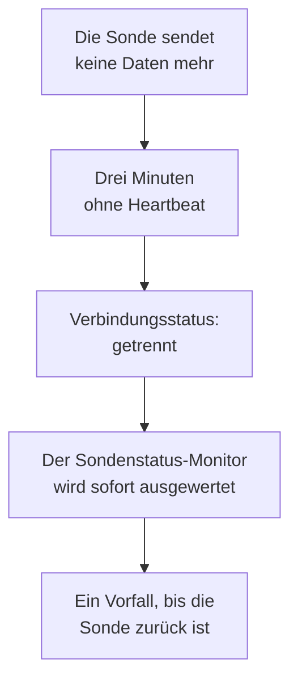

# Sondenstatus-Monitor

Ein Sondenstatus-Monitor meldet Ihnen, wenn eine Sonde keine Daten mehr sendet: ein Vorfall, wenn sie getrennt wird, der sich von selbst löst, sobald sie zurück ist. Richten Sie ihn auf Ihre benutzerdefinierten Sonden oder, bei einem selbst gehosteten OneUptime, auf die globale Sonde, auf der jeder Monitor läuft. So bleiben die Monitore einer verstummten Sonde nie ungeprüft, ohne dass es jemand merkt.

:::cards
- [Einen erstellen](#einen-sondenstatus-monitor-erstellen): Die Sonden auswählen und die Standardkriterien behalten.
- [Kriterien](#kriterien): Die verbundenen oder getrennten Sonden zählen, jetzt oder über ein Zeitfenster.
- [Metriken](#metriken): Wie viele Sonden verbunden waren, Minute für Minute.
:::

## So funktioniert es

OneUptime wertet jeden Sondenstatus-Monitor einmal pro Minute aus, und noch einmal in dem Moment, in dem sich eine seiner Sonden verbindet oder trennt. Es liest den Verbindungsstatus jeder Sonde, den auch die Seite der Sonde zeigt: Eine Sonde gilt als getrennt, wenn drei Minuten lang nichts von ihr gekommen ist. War OneUptime selbst ausgefallen oder hat nichts empfangen, wartet es volle drei Minuten, bevor es eine Sonde als getrennt einstuft, sodass ein Upgrade von OneUptime nie einen Vorfall auslöst.

Eine Sonde, die ausgefallen bleibt, ist ein Vorfall, nicht einer pro Minute. Der Monitor bleibt offline und sein Vorfall offen, bis jede überwachte Sonde wieder verbunden ist; dann löst sich der Vorfall von selbst.

Ein Monitor kann die Sonden seines eigenen Projekts und die globalen Sonden überwachen. Eine gelöschte Sonde wird in keine Richtung gezählt. Ist keine der überwachten Sonden mehr übrig, behält der Monitor seinen Status, und seine Übersicht weist nach einem Tag darauf hin.

## Einen Sondenstatus-Monitor erstellen

:::steps
### Einen neuen Monitor beginnen

Gehen Sie zu **Monitore** und klicken Sie auf **Monitor erstellen**.

### Sondenstatus wählen

Klicken Sie unter **Monitortyp** auf **Weitere Monitortypen** und wählen Sie **Sondenstatus** unter **Sonstige**. Geben Sie einen **Name** ein und klicken Sie auf **Weiter**.

### Die Sonden auswählen

Wählen Sie unter **Zu überwachende Sonden** die Sonden aus. Ein neuer Monitor beginnt mit den eigenen Sonden Ihres Projekts. Ein selbst gehostetes OneUptime ohne eigene Sonde beginnt mit seinen globalen Sonden; auf OneUptime Cloud betreibt OneUptime die globalen Sonden, daher wählt ein Projekt sie selbst aus, wenn es sie überwachen möchte.

### Den Monitor erstellen

Behalten Sie die unten beschriebenen Standardkriterien und klicken Sie auf **Monitor erstellen**. Der Monitor wird sofort ausgewertet, und seine Übersicht listet jede Sonde, die er überwacht, getrennte zuerst.
:::

> [!TIP]
> **Diese Sonde überwachen**, auf der Seite einer Sonde und im Menü ihrer Zeile unter **Monitore → Einstellungen → Sonden**, öffnet **Monitor erstellen** mit einem Sondenstatus-Monitor, der diese Sonde überwacht und nach ihr benannt ist.

## Kriterien

Die Filter eines Sondenstatus-Monitors zählen Sonden:

| Filter | Was er zählt |
| --- | --- |
| **Disconnected Probes** | Die überwachten Sonden, die getrennt sind. |
| **Connected Probes** | Die überwachten Sonden, die verbunden sind. |

Beide sind ganze Zahlen und werden mit **Größer als**, **Kleiner als**, **Gleich** und den übrigen Vergleichen geprüft. Ein neuer Monitor beginnt mit zwei Kriterien:

| Kriterium | Filter | Was es bewirkt |
| --- | --- | --- |
| Check if a probe is disconnected | **Disconnected Probes** größer als `0` | Setzt den Monitor auf offline und meldet einen Vorfall mit dem Titel `Probe disconnected: {{disconnectedProbeNames}}`, der sich von selbst löst. |
| Check if every probe is connected | **Disconnected Probes** gleich `0` | Setzt den Monitor auf betriebsbereit. |

**Connected Probes** eignet sich für einen Monitor, der mehrere Sonden überwacht und eine verlieren darf: **Connected Probes** kleiner als `2` meldet erst dann einen Vorfall, wenn weniger als zwei übrig sind.

### Länger warten vor einem Vorfall

Eine Sonde gilt erst nach drei Minuten Stille als getrennt, ein kurzer Neustart löst also nichts aus. Um länger zu warten, aktivieren Sie unter dem Filter **Diese Kriterien über einen Zeitraum hinweg auswerten** und wählen unter **Auswerten** **All Values** und unter **Für die letzten (in Minuten)** ein Zeitfenster. Bei fünf Minuten muss eine Sonde weitere fünf Minuten getrennt bleiben, bevor der Vorfall gemeldet wird.

## Metriken

Jede Auswertung zeichnet zwei Reihen am Monitor auf: `oneuptime.monitor.probes.connected` und `oneuptime.monitor.probes.disconnected`, die Zahl der überwachten Sonden, die verbunden und getrennt waren. Sie werden auf der Seite **Metriken** des Monitors dargestellt, und ein Dashboard oder ein Metrik-Monitor liest sie wie jede andere Reihe.

## Vorlagenvariablen

Die Vorfall- und Warnungsvorlagen eines Sondenstatus-Monitors können neben den Variablen jedes Monitors diese verwenden:

| Variable | Wert |
| --- | --- |
| `{{disconnectedProbeNames}}` | Die Namen der getrennten Sonden, durch Kommas getrennt. |
| `{{disconnectedProbeCount}}` | Wie viele der Sonden getrennt sind. |
| `{{connectedProbeNames}}` | Die Namen der verbundenen Sonden, durch Kommas getrennt. |
| `{{connectedProbeCount}}` | Wie viele der Sonden verbunden sind. |
| `{{probeStatusSummary}}` | Ein Satz, der die getrennten Sonden nennt, etwa `1 of 3 probes is disconnected: EU Probe.`, oder sagt, dass alle Sonden verbunden sind. |
| `{{probes}}` | Jede Sonde, jeweils mit `probeName`, `isConnected`, `isGlobalProbe` und `lastAliveAt`. |

## Fehlerbehebung

:::details Der Monitor wartet auf Daten
Ein neuer Monitor zeigt seine erste Auswertung innerhalb von ein bis zwei Minuten. Überwacht er keine Sonde, zeigt er stattdessen **Nicht eingerichtet**: Wählen Sie die Sonden unter **Kriterien** aus.
:::

:::details Eine Sonde ist ausgefallen, aber es wurde kein Vorfall gemeldet
Eine Sonde gilt nach drei Minuten ohne Heartbeat als getrennt, nach einem Ausfall von OneUptime selbst noch später. Prüfen Sie, ob der Monitor deaktiviert ist oder in einem Wartungsfenster liegt und ob seine Kriterien weiterhin einen Vorfall melden.
:::

## Nächste Schritte

:::cards
- [Benutzerdefinierte Sonden](/docs/probe/custom-probe): Eine Sonde im eigenen Netzwerk betreiben.
- [Monitor-Kriterien und Status](/docs/monitor/criteria-and-statuses): Wie Kriterien den Status eines Monitors bestimmen.
- [Vorfall- und Warnungsvorlagen](/docs/monitor/incident-alert-templating): Den Vorfall formulieren, den ein Monitor meldet.
:::
