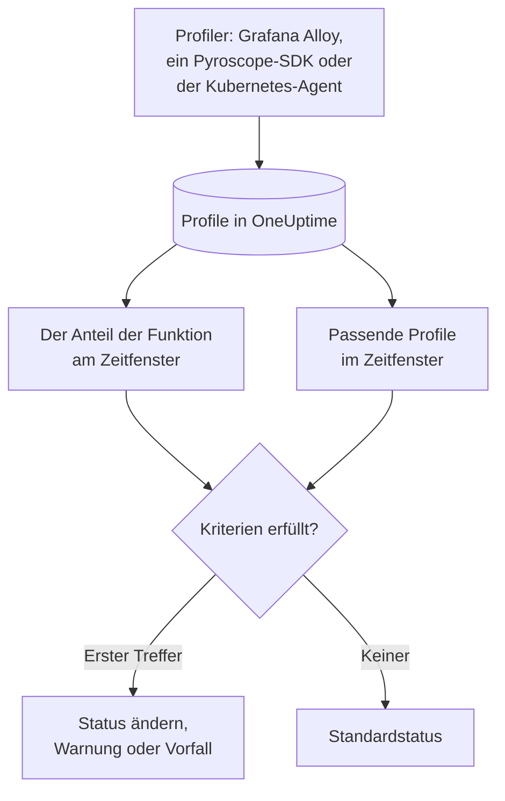

# Profile-Überwachung

Ein Profile-Monitor liest die kontinuierlichen Profile, die Ihre Dienste an OneUptime senden, und warnt bei zwei Dingen: wenn eine Funktion einen größeren Anteil der Zeit beansprucht, als sie sollte, etwa ein Parser, der nach einem Deployment schwerer geworden ist, und wenn von einem Dienst keine Profile mehr eintreffen. Jede Minute misst er, wie viel seines Zeitfensters durch die Funktion lief, die Sie nennen, zählt die Profile, die zu seinen Filtern passen, und ändert den Status des Monitors, erstellt eine Warnung oder eröffnet einen Vorfall, wenn Ihre Kriterien erfüllt sind.

:::cards
- [Den Monitor erstellen](#einen-profile-monitor-erstellen): Aus einer Funktion im Profiler oder über Monitor erstellen.
- [Was er abfragt](#was-er-abfragt): Die Funktion, die Profilart, die Dienste und das Fenster.
- [Kriterien](#kriterien): Der Anteil einer Funktion am Fenster oder die Anzahl der Profile.
- [Eine Funktion wird schwerer](#beispiel-eine-funktion-wird-schwerer): Warnen, wenn der Anteil einer Funktion springt.
:::

## So funktioniert es



Jede Minute liest OneUptime die Profile, die zu den Filtern des Monitors passen und innerhalb seines Zeitfensters begonnen haben. Es zählt sie und misst, wenn der Monitor eine Funktion nennt, den Anteil der Zeit dieses Fensters, der durch die Funktion lief. Diese Zahlen prüft es von oben nach unten gegen die Kriterien des Monitors, und das erste passende Kriterium entscheidet, was geschieht. Passt keines, kehrt der Monitor zu seinem Standardstatus zurück.

## Bevor Sie beginnen

- Ihre Dienste senden kontinuierliche Profiling-Daten an OneUptime, über Grafana Alloy (eBPF), ein Pyroscope-SDK oder den OneUptime-Kubernetes-Agent. Siehe [Kontinuierliches Profiling](/docs/telemetry/profiles).
- Um eine Funktion zu beobachten, kennen Sie ihren Namen oder einen Teil ihres Datei- oder Paketpfads, so wie der Profiler sie zeigt.

## Einen Profile-Monitor erstellen

:::steps
### Aus dem Profiler oder über Monitor erstellen beginnen

Am schnellsten geht es von der Funktion selbst aus: Öffnen Sie in **Leistungsprofile** die Funktion und klicken Sie auf den Link, der eine Warnung zu ihrem Anteil anbietet. **Monitor erstellen** öffnet sich mit einem Monitor, der für diese Funktion und ihren Dienst ausgefüllt ist, mit einem Schwellenwert über dem, was sie heute beansprucht, wie unter [Beispiel: Eine Funktion wird schwerer](#beispiel-eine-funktion-wird-schwerer) beschrieben. Andernfalls gehen Sie zu **Monitore** und klicken auf **Monitor erstellen**.

### Profiles wählen

Klicken Sie unter **Monitortyp** auf **Weitere Monitortypen** und wählen Sie **Profile** unter **Telemetrie**, oder geben Sie `profiles` in das Suchfeld ein. Geben Sie einen **Name** ein und klicken Sie dann auf **Weiter**.

### Wählen, was er liest

Setzen Sie in **Konfiguration des Profil-Monitors** das Feld **Funktion** auf die zu beobachtende Funktion, **Was analysiert werden soll** auf die Profilart und **Profile überwachen für (Zeit)** auf das Fenster. Ein neuer Monitor liest **CPU-Zeit** über die **Letzte 5 Minuten**. **Was dieser Monitor jetzt liest** unter den Feldern zeigt, wie viele Profile passen und wie viel des Fensters die Funktion heute beansprucht, damit Sie den Schwellenwert darüber setzen können. Öffnen Sie **Weitere Felder**, um nach Telemetrie-Dienst oder Infrastruktur-Entität zu filtern.

### Die Kriterien festlegen

Ein über **Monitor erstellen** begonnener Monitor hat zwei Kriterien: offline, mit einem Vorfall, wenn die **Anzahl der Profile** 0 ist, und online, wenn sie über 0 liegt. Um bei der Funktion zu warnen, fügen Sie einen Filter **Funktionsanteil (in %)** hinzu – siehe [Kriterien](#kriterien).

### Den Monitor erstellen

Klicken Sie auf **Monitor erstellen**. Der Monitor öffnet sich auf seiner Seite **Übersicht**, und seine erste Auswertung läuft innerhalb einer Minute.
:::

### Über die API oder Terraform erstellen

Der Schritt eines Monitors enthält dieselben Einstellungen wie seine Konfiguration `profileMonitor`. Diese beobachtet `parseOrder` in den CPU-Profilen eines Dienstes über die letzten fünf Minuten:

```json
{
  "profileMonitor": {
    "telemetryServiceIds": [],
    "profileTypes": ["cpu"],
    "profileType": "",
    "functionName": "parseOrder",
    "attributes": {},
    "lastXSecondsOfProfiles": 300
  }
}
```

Setzen Sie die ID des Dienstes in `telemetryServiceIds`, oder lassen Sie die Liste leer, um Profile von jedem Dienst zu lesen, und lassen Sie `functionName` leer, um nur Profile zu zählen. Erstellen Sie über die [API](/docs/api-reference/api-reference) oder [Terraform](/docs/terraform/monitor-steps) einen Monitor mit dem Monitortyp `Profiles` und einem Schritt, der diese Konfiguration und mindestens ein Kriterium enthält. In Terraform übergeben Sie die Konfiguration als Attribut `profile_monitor` des Schritts, geschrieben mit `jsonencode()`.

## Was er abfragt

| Feld | Was es erfasst | Standard |
| --- | --- | --- |
| `profileTypes` | Profile eines dieser Typen, exakt verglichen, etwa `cpu`. | Leer: jeder Typ |
| `profileType` | Profile, deren Typ diesen Text enthält, ohne Beachtung der Groß- und Kleinschreibung. Ist er gesetzt, wird `profileTypes` ignoriert. | Leer |
| `functionName` | Der Code, dessen Anteil **Funktionsanteil (in %)** misst: Stack-Frames, deren Funktionsname oder Dateipfad diesen Text enthält, ohne Beachtung der Groß- und Kleinschreibung. | Leer: es wird kein Anteil gemessen |
| `telemetryServiceIds` | Profile von einem dieser Telemetrie-Dienste. | Leer: jeder Dienst |
| `entityKeys` | Profile von einem dieser Hosts, Pods, Container und anderer Infrastruktur-Entitäten. | Leer: jede Entität |
| `attributes` | Profile, deren Attribute diese Werte haben. | Leer: keine Bedingung |
| `lastXSecondsOfProfiles` | Profile, die innerhalb dieser Anzahl Sekunden vor der Auswertung begonnen haben. | Keiner: immer setzen, sonst wird jedes gespeicherte Profil gezählt und die Anzahl fällt nie auf 0 |

Alle Filter, die Sie setzen, müssen passen, damit ein Profil gelesen wird. Im Formular setzt **Funktion** den Wert `functionName`, **Was analysiert werden soll** setzt `profileTypes` (**Jede Profilart** lässt es leer), **Profile überwachen für (Zeit)** setzt `lastXSecondsOfProfiles`, und **Nach Telemetrie-Dienst filtern** und **Nach Infrastruktur-Entität filtern** setzen `telemetryServiceIds` und `entityKeys`.

## Wie er ausgewertet wird

- **Jede Minute.** Ein Profile-Monitor wird nicht von Sonden geprüft, deshalb hat er kein Intervall zum Einstellen und keine Seite **Sonden & Intervall**.
- **Zwei Zahlen pro Auswertung.** Der Monitor zählt die Profile, die zu jedem Filter passen und innerhalb von `lastXSecondsOfProfiles` begonnen haben, und misst den Anteil der Funktion an denselben Profilen. Ein Profiler lädt in regelmäßigen Abständen hoch; lassen Sie dem Fenster also Raum für mehrere Uploads.
- **Eine Einheit auf einmal.** Ein Anteil summiert Samples einer Einheit: Mischen die gelesenen Arten Einheiten, etwa CPU-Zeit in Nanosekunden aus einem SDK und Sample-Anzahlen aus eBPF, liest er die Einheit mit den meisten Samples im Fenster.
- **Keine Profile ergeben die Anzahl 0 und keinen Anteil.** Ein Dienst, dessen Profiler nicht mehr hochlädt, liefert die Anzahl 0, und ein Kriterium **Funktionsanteil (in %)** passt nicht auf ein Fenster, in dem nichts liegt: Warnen Sie bei der **Anzahl der Profile**, um zu erfahren, dass das Profiling aufgehört hat.
- **Die eigene Ausfallzeit von OneUptime ist keine Stille.** Solange das Zeitfenster Zeit enthält, in der OneUptime selbst keine Daten empfangen hat – weil es neu startete, aktualisiert wurde oder einen Rückstand aufholte –, wartet die Prüfung: Der Status ändert sich nicht, und kein Vorfall und keine Warnung wird eröffnet oder behoben. Siehe [Wenn OneUptime keine Daten empfängt](/docs/monitor/when-oneuptime-is-not-receiving).
- **Kriterien von oben nach unten.** Das erste passende Kriterium entscheidet; stellen Sie also das schwerwiegendste nach oben.

Jede Statusänderung wird mit ihrem Grund in der **Status-Zeitachse** des Monitors festgehalten.

## Kriterien

Die Kriterien eines Profile-Monitors vergleichen eine von zwei Zahlen mit einem Wert.

**Funktionsanteil (in %)** ist der Anteil der Zeit des Fensters, von 0 bis 100, der durch die Funktion des Monitors lief: Jeder Stack mit einem Frame, der zu `functionName` passt, zählt einmal, in welcher Tiefe auch immer, sodass der eigene Code der Funktion und alles, was sie aufruft, darin enthalten sind.

| Filterbedingung | Passt, wenn der Anteil der Funktion … |
| --- | --- |
| **Größer als** | über dem Wert liegt |
| **Größer als oder gleich** | den Wert erreicht oder darüber liegt |
| **Kleiner als** | unter dem Wert liegt |
| **Kleiner als oder gleich** | den Wert erreicht oder darunter liegt |

**Anzahl der Profile** ist die Anzahl der Profile, die im Fenster gepasst haben:

| Filterbedingung | Passt, wenn die Anzahl der Profile … |
| --- | --- |
| **Größer als** | über dem Wert liegt |
| **Größer als oder gleich** | den Wert erreicht oder darüber liegt |
| **Kleiner als** | unter dem Wert liegt |
| **Kleiner als oder gleich** | den Wert erreicht oder darunter liegt |
| **Gleich** | genau dem Wert entspricht |
| **Ungleich** | alles außer dem Wert ist |

Für Profilanzahlen gibt es keine Anomaliebedingungen: Es gibt keine Baseline, mit der sie verglichen werden könnten.

## Beispiel: Eine Funktion wird schwerer

`parseOrder` im Checkout-Dienst beansprucht 18 % seiner CPU-Zeit. Ein Deployment, das eine größere Nutzlast parst, soll nicht unbemerkt bleiben:

1. Wählen Sie in **Leistungsprofile** den Checkout-Dienst und öffnen Sie `parseOrder`.
2. Klicken Sie auf den Link, der eine Warnung zu ihrem Anteil anbietet. Der Profiler schlägt 30 % vor: die Hälfte über dem heutigen Anteil, mindestens 10 Punkte mehr, aufgerundet auf ein Vielfaches von 5.
3. **Monitor erstellen** öffnet sich mit einem Profile-Monitor des Checkout-Dienstes, der **CPU-Zeit** über die **Letzte 5 Minuten** liest, mit zwei Kriterien: **Funktionsanteil (in %)** **Größer als** `30` löst eine Warnung aus, die sich selbst behebt, und setzt den Monitor auf beeinträchtigt; **Kleiner als oder gleich** `30` setzt ihn auf betriebsbereit. Der Vorfall ist ausgefüllt, aber ausgeschaltet: Schalten Sie ihn ein, um jemanden zu alarmieren.
4. Klicken Sie auf **Monitor erstellen**.

Wenn das Deployment `parseOrder` 45 % der CPU-Zeit beanspruchen lässt, löst die nächste Auswertung die Warnung aus. Bringt eine Korrektur sie wieder unter 30 %, behebt sich die Warnung selbst.

## Beispiel: Profile kommen nicht mehr an

Der Checkout-Dienst führt ein Pyroscope-SDK aus, das CPU-Profile hochlädt. Sie wollen einen Vorfall, wenn diese fünf Minuten lang ausbleiben:

- `profileTypes`: `["cpu"]`, `telemetryServiceIds`: der Checkout-Dienst, `lastXSecondsOfProfiles`: `300`
- Kriterium 1: **Anzahl der Profile** **Gleich** `0` – den Monitor auf offline setzen und einen Vorfall eröffnen
- Kriterium 2: **Anzahl der Profile** **Größer als** `0` – den Monitor auf online setzen

Solange das SDK hochlädt, zählt jede Auswertung einige Profile, und Kriterium 2 hält den Monitor online. Wird der Dienst ohne das SDK ausgerollt, fällt die Anzahl fünf Minuten nach dem letzten Upload auf 0, Kriterium 1 passt, und der Vorfall wird eröffnet. Der erste Upload nach der Korrektur hebt die Anzahl wieder über 0, und der Vorfall behebt sich selbst, wenn **Vorfall automatisch beheben** dafür eingeschaltet ist.

## Fehlerbehebung

:::details Der Monitor zählt 0, aber in OneUptime erscheinen Profile
Prüfen Sie die Filter anhand der Profile, die Sie sehen: `profileTypes` muss genau zum Typ passen, und `telemetryServiceIds` muss die richtigen Dienst-IDs enthalten. Ein kurzes `lastXSecondsOfProfiles` kann auch zwischen zwei Uploads fallen.
:::

:::details Der Anteil der Funktion bleibt bei 0 %
Kein Frame im Fenster enthält den Funktionstext. Öffnen Sie die Funktion im Profiler und kopieren Sie ihren Namen so, wie er dort steht; ein Teil des Namens genügt, und die Groß- und Kleinschreibung spielt keine Rolle. Prüfen Sie dann, ob der Dienst die Profilart sendet, die **Was analysiert werden soll** liest.
:::

## Nächste Schritte

:::cards
- [Kontinuierliches Profiling](/docs/telemetry/profiles): Profile senden und im Profiler lesen.
- [Monitor-Schritte](/docs/terraform/monitor-steps): Die Schrittkonfiguration aus Terraform übergeben.
- [Traces-Überwachung](/docs/monitor/traces-monitor): Auf fehlschlagende Spans warnen.
- [Metriken-Überwachung](/docs/monitor/metrics-monitor): Auf CPU, Speicher und andere Metriken warnen.
:::
