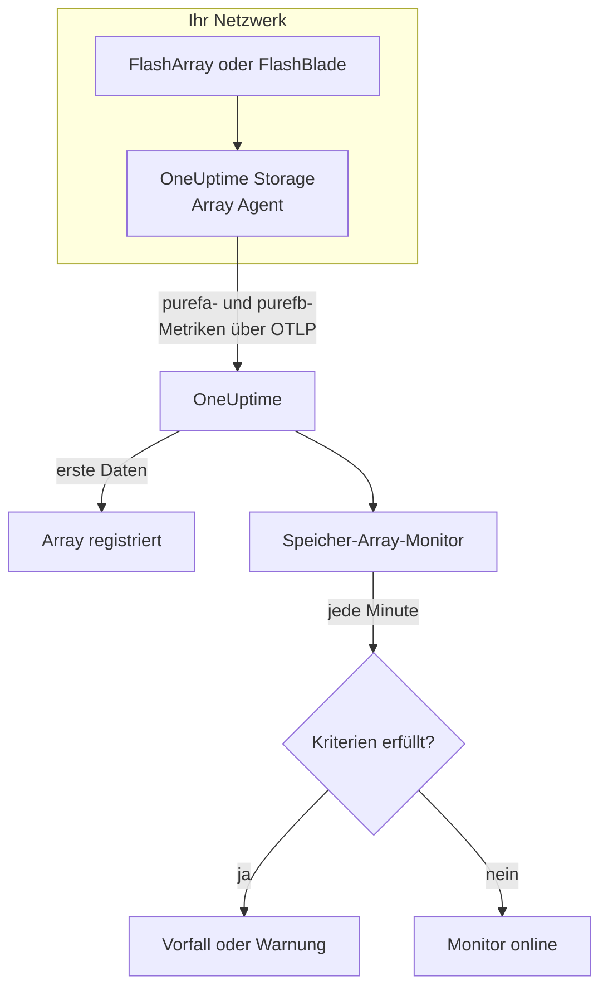

# Speicher-Array-Überwachung

Ein Speicher-Array-Monitor beobachtet ein Speicher-Array und meldet Ihnen, wenn das Array eine eigene Warnung auslöst, ihm der Platz ausgeht, es langsamer wird, Hardware oder einen Hostpfad verliert oder bei der Replikation zurückfällt. Er funktioniert mit Pure Storage FlashArray, Pure Storage FlashBlade und NetApp ONTAP (Amazon FSx for NetApp ONTAP eingeschlossen) und liest die Metriken, die der OneUptime Storage Array Agent sammelt: Pures Serien `purefa_*` und `purefb_*` sowie die Serien `netapp_*`, die NetApp Harvest von einem ONTAP-Cluster liest.

Er funktioniert auch mit Dell PowerStore (`dell.powerstore`), aus den Serien `powerstore_*` von Dell.

:::cards
- [Den Monitor erstellen](#einen-speicher-array-monitor-erstellen): Sechs Schritte im Dashboard.
- [Vorlagen](#fertige-warnungsvorlagen): Fertige Warnungen, ein Vorfall pro Volume, Host, Appliance oder Komponente.
- [Wie Pures Serien funktionieren](#wie-pures-serien-aufgebaut-sind): Ein Metrikname, viele Werte. Die von ONTAP [haben einen eigenen Abschnitt](#wie-ontaps-serien-aufgebaut-sind).
- [Metriken](#erfasste-metriken): Jede Serie, auf die der Monitor warnen kann.
:::

## So funktioniert es

Der OneUptime Storage Array Agent läuft auf einem Rechner, der die Verwaltungsschnittstelle des Arrays erreicht. Er liest die Metriken des Arrays mit einem nur lesenden API-Token, versieht sie mit dem Namen des Arrays, `storage.array.name`, und seiner Plattform, `storage.system`, und sendet sie über OTLP an OneUptime. Die ersten Daten registrieren das Array.

Ein Dell PowerMax (`dell.powermax`) braucht keinen Agent: Eine OneUptime-Sonde meldet sich alle 5 Minuten mit einem Konto mit Lesezugriff bei Unisphere for PowerMax an und sendet jedes Array, das es verwaltet, auf dieselbe Weise, benannt nach seiner Symmetrix ID, bis Sie es umbenennen ([Dell PowerMax](/docs/telemetry/storage-arrays#dell-powermax)).

Ein Speicher-Array-Monitor ist an ein Array gebunden. Jede Minute führt er seine Abfrage über die Metriken dieses Arrays aus und vergleicht das Ergebnis mit seinen Kriterien.



## Bevor Sie beginnen

- **Installieren Sie den Storage Array Agent** dort, wo er das Array über HTTPS erreicht, mit dem API-Token eines Benutzers, der die Rolle **readonly** des Arrays hat. Die [Anleitung zum Storage Array Agent](/docs/telemetry/storage-arrays) behandelt den Benutzer, das Token und die Installation, über `ONEUPTIME_URL`, `ONEUPTIME_TELEMETRY_INGESTION_KEY`, `STORAGE_ARRAY_NAME` sowie Adresse und Token des Arrays (`PURE_FA_ENDPOINT` und `PURE_FA_API_TOKEN` oder `PURE_FB_ENDPOINT` und `PURE_FB_API_TOKEN`) beziehungsweise bei ONTAP die Adresse des Clusters und einen schreibgeschützten REST-Benutzer (`NETAPP_ONTAP_ENDPOINT`, `NETAPP_ONTAP_USERNAME` und `NETAPP_ONTAP_PASSWORD`).
- **Prüfen Sie, ob das Array registriert ist.** Es erscheint unter **Produkte → Infrastruktur → Speicher-Arrays → Alle Speicher-Arrays**, benannt nach `STORAGE_ARRAY_NAME` des Agenten, etwa eine Minute nach der ersten Abfrage.
- **Für ein Dell PowerMax** verbinden Sie stattdessen das Unisphere for PowerMax, das es verwaltet, unter **Produkte → Infrastruktur → Speicher-Arrays → Verbindungen**, wie [Dell PowerMax](/docs/telemetry/storage-arrays#dell-powermax) erklärt.

## Einen Speicher-Array-Monitor erstellen

:::steps
### Einen neuen Monitor beginnen

Gehen Sie zu **Monitore** und klicken Sie auf **Monitor erstellen**.

### Speicher-Array wählen

Klicken Sie unter **Monitortyp** auf **Weitere Monitortypen** und wählen Sie **Speicher-Array** unter **Infrastruktur**, oder geben Sie `storage` in das Suchfeld ein. Geben Sie einen **Name** ein - er wird in den Titeln von Vorfällen und Warnungen verwendet - und klicken Sie auf **Weiter**.

### Das Array wählen

Wählen Sie unter **Storage Array Monitor Configuration** das Array aus **Speicher-Array**. Jedes Array, das Daten gesendet hat, steht in der Liste. Seine Plattform entscheidet, welche Metriken und Vorlagen das Formular anbietet. Nach der Auswahl zeigt eine Zeile unter dem Feld, ob Daten ankommen. **Speicher-Array hinzufügen** öffnet Einrichtungsschritte mit Ihren bereits eingetragenen Schlüsseln, die auf die ersten Daten warten.

### Festlegen, was überwacht wird

Ein neuer Monitor beginnt mit **Array Stopped Reporting** unter **Worüber benachrichtigt wird**. So überwachen Sie etwas anderes:

- **Ändern** - wählen Sie eine andere [Vorlage](#fertige-warnungsvorlagen). Sie setzt die Metrik, die Label-Filter, die Aggregation, den Zeitbereich und die Schwellenwerte und ersetzt die Kriterien unten durch ihre eigenen. Den **Zeitbereich** können Sie weiterhin ändern.
- **Custom Metric** (unter **Weitere Felder**) - wählen Sie eine Metrik aus **Storage Array Metric** und legen Sie dann **Aggregation** und **Zeitbereich** fest. Die [Filter](#monitor-einstellungen) schränken sie auf ein Volume, einen Host, einen Pod, eine Komponente, ein Dateisystem oder einen Bucket ein.
- **Erweitert** (unter **Weitere Felder**) - bauen Sie Abfragen und Formeln selbst unter **Metriken auswählen**, zum Beispiel die belegte Kapazität als `purefa_array_space_bytes` gefiltert auf `space=capacity` minus derselben Metrik gefiltert auf `space=empty`. Verwenden Sie **Gruppieren nach** mit dem Label eines Objekts, um jedes Objekt einzeln zu beurteilen.

### Die Kriterien prüfen

Öffnen Sie jedes Kriterium unter **Kriterien** und prüfen Sie **Metrik**, **Aggregation**, **Bedingung** und **Schwellenwert**. Eine Vorlage füllt diese aus. Mit **Custom Metric** oder **Erweitert** beginnt der Monitor mit den [Standardkriterien](#standardkriterien), die nur bemerken, dass die Metrik keine Daten sendet, setzen Sie also Ihren eigenen Schwellenwert.

### Den Monitor erstellen

Klicken Sie auf **Monitor erstellen**. OneUptime öffnet die Seite des Monitors und wertet ihn jede Minute aus. Vorfälle und Warnungen, die er auslöst, stehen auch auf den Seiten **Vorfälle** und **Warnungen** des Arrays.
:::

> [!TIP]
> Um mehrere Vorlagen auf einmal einzurichten, öffnen Sie das Array über **Produkte → Infrastruktur → Speicher-Arrays** und gehen Sie zu **Empfehlungen**. Wählen Sie die gewünschten Vorlagen, legen Sie fest, wer benachrichtigt wird, und OneUptime erstellt einen Monitor pro Vorlage.

## Monitor-Einstellungen

| Feld | Tab | Was es tut |
| --- | --- | --- |
| **Speicher-Array** | Alle | Erforderlich. Beschränkt jede Abfrage auf `resource.storage.array.name`, sodass zwei Arrays, die beide ein Volume namens `vol-01` haben, nie vermischt werden. |
| **Volume** | Custom Metric, Erweitert | Ein Volume: bei einem FlashArray über das Label `name`, etwa `vol-db-01` (ein Volume in einem Pod oder einer Volume-Gruppe heißt `pod::volume` oder `group/volume`); bei ONTAP über das Label `volume`, das sich zwei SVMs teilen können. |
| **Host** | Custom Metric, Erweitert | Nur FlashArray. Ein Host, wie das Array ihn kennt, über das Label `host`, etwa `esxi-01`. |
| **Pod** | Custom Metric, Erweitert | Nur FlashArray. Ein ActiveCluster- oder ActiveDR-Pod, über das Label `name` oder `local_pod` bei Serien von Replikationsverbindungen. |
| **Hardwarekomponente** | Custom Metric, Erweitert | Eine Hardwarekomponente, etwa `CH0.BAY1` oder `CT0`: das Label `component_name` bei einem FlashArray, `name` bei einem FlashBlade und bei ONTAP das Label, mit dem ihre Serie sie benennt (`node`, `disk`, `shelf` oder `port`). |
| **Dateisystem** | Custom Metric, Erweitert | Nur FlashBlade. Ein Dateisystem, über das Label `name`. |
| **Bucket** | Custom Metric, Erweitert | Nur FlashBlade. Ein Objektspeicher-Bucket, über das Label `name`. |
| **Storage Array Metric** | Custom Metric | Eine Metrik aus dem [Katalog](#erfasste-metriken). Das Formular fügt den Label-Filter hinzu, der ihr ihre Bedeutung gibt, und gruppiert sie nach dem Objekt, das sie beschreibt, sodass jedes Volume, jeder Host oder jede Komponente einzeln beurteilt wird. |
| **Aggregation** | Custom Metric | Wie Stichproben zusammengefasst werden: **Durchschnitt**, **Maximum**, **Minimum**, **Summe** oder **Anzahl**. Beginnt bei der üblichen Aggregation der Metrik. |
| **Zeitbereich** | Alle | Das gleitende Zeitfenster, das die Abfrage liest, von **Past 1 Minute** bis **Past 365 Days**. Ein neuer Monitor beginnt bei **Letzte 5 Minuten**, eine eigene Metrik eines Dateisystems oder Buckets bei **Letzte 15 Minuten**; Vorlagen setzen ihr eigenes. |
| **Metriken auswählen** | Erweitert | Der Abfrage-Builder: **Metrik**, **Aggregieren nach**, **Nach Attributen filtern**, **Gruppieren nach**, dazu **Metrik hinzufügen** und **Formel hinzufügen**, um Abfragen zu kombinieren. |

Der Agent liest den Array-Endpunkt alle 60 Sekunden und Volumes, Hosts und Pods alle 2 Minuten, sodass ein Fenster von 5 Minuten immer eine Stichprobe enthält. Die Dateisysteme und Buckets eines FlashBlade liest er alle 5 Minuten, daher 15, und FlashArray-Verzeichnisse alle 30 Minuten: Geben Sie einem Verzeichnis-Monitor ein Fenster von 60 Minuten. Bei ONTAP liest Harvest die Leistung des Clusters jede Minute und seine Konfiguration, seinen Zustand und seine EMS-Ereignisse alle 3 Minuten, sodass ein Fenster von 5 Minuten immer eine Stichprobe enthält.

Einen PowerStore liest er alle 5 Minuten und den Zustand seines Clusters alle 60 Sekunden: Geben Sie einem PowerStore-Monitor ein Fenster von 15 Minuten.

## Wie Pures Serien aufgebaut sind

Pure legt mehrere Werte auf **einen** Metriknamen und unterscheidet sie mit einem Label:

- **`dimension`** bei den Leistungsserien. `purefa_array_performance_latency_usec` trägt die Leselatenz (`usec_per_read_op`), die Schreiblatenz (`usec_per_write_op`), die Latenz gespiegelter Schreibvorgänge sowie SAN-, Warteschlangen-, QoS- und Servicezeit jeder davon. Filtern Sie immer auf eine `dimension`: Ein Durchschnitt über alle mischt eine Leselatenz von 200 µs mit einem Warteschlangenwert.
- **`space`** bei den Kapazitätsserien: `capacity`, `empty`, `snapshots`, `total_provisioned`, `total_physical`, `available_ratio` und weitere.

Mehrere Serien tragen ihren Zustand in einem **Label**, mit einem Wert, der immer 1 ist:

| Serie | Zustandslabel | Eine Serie pro |
| --- | --- | --- |
| `purefa_alerts_open` | `severity`, mit `summary`, `code` und `component_type` | Offene Warnung |
| `purefa_hw_component_status` | `component_status` | Hardwarekomponente |
| `purefa_host_connectivity_info` | `status`, mit `details` | Host |
| `purefa_drive_capacity_bytes` | `component_status` (der Wert ist die Kapazität des Laufwerks) | Laufwerk |

Eine auf einen schlechten Zustand gefilterte Serie existiert nur, solange sich etwas in diesem Zustand befindet, also bedeutet keine Serie gesund. Deshalb ist **Max über 0 löst aus und 0 erholt sich** die richtige Form für sie, und so sind die Vorlagen gebaut: Ihre Erholungskriterien zählen eine fehlende Serie als null. Bleibt gar keine Serie übrig, erholt sich eine solche Vorlage nur, wenn `purefa_info`, `purefb_info` oder `powermax_array_info` im selben Fenster eingetroffen ist, sodass ein Array, das nicht mehr berichtet, nichts schließt.

Die Serien eines PowerMax tragen jeweils einen einzigen Wert und sind nach ihm benannt: `powermax_array_response_time_usec` unterscheidet Lese- von Schreibvorgängen mit `operation`. Seine Zustandsserien existieren ebenso nur, solange etwas nicht stimmt: `powermax_alert_open`, solange Unisphere eine Warnung offen hat, `powermax_director_offline`, solange ein Director nicht online ist, `powermax_port_offline`, solange ein Port, auf den sich jemand verlässt, ausgefallen ist, und `powermax_srdf_group_not_healthy`, solange eine SRDF-Gruppe angehalten oder offline ist.

In Monitorfiltern und Gruppierungsschlüsseln beginnen die Attribute des Agenten mit `resource.` (`resource.storage.array.name`, `resource.storage.system`), Pures eigene Labels dagegen nicht (`name`, `host`, `component_name`, `dimension`, `space`, `severity`), ebenso wenig die von PowerMax (`storage_group`, `volume`, `director`, `port_id`, `srdf_group`).

## Wie die Serien von PowerStore aufgebaut sind

Der Exporter von Dell schreibt einen Wert pro Metrikname, daher braucht eine PowerStore-Serie keinen Label-Filter. Ihre Labels benennen das Objekt: `appliance_id` eine Appliance, `name` ein Bauteil, ein Volume oder ein Dateisystem, und `volume_id`, `fc_port_id`, `eth_port_id`, `nas_id` oder `volume_group_id` das Objekt einer Leistungsserie. Ihre Zustandsserien sind 1, solange alles gesund ist, und sonst 0, daher lösen die Vorlagen unter 1 aus. Ihre eigenen Warnungen kommen per Syslog an, und ihre Vorlagen, Protokoll-Monitore, stehen nach ihrer Tabelle unten.

## Wie ONTAPs Serien aufgebaut sind

NetApp Harvest benennt jede Serie `netapp_<object>_<counter>` und das Objekt über seine Labels: ein Volume über `volume` innerhalb seiner `svm`, ein Aggregat über `aggr`, eine LUN über `lun` innerhalb ihres `volume` und ihrer `svm`, einen Knoten über `node`, einen Datenträger über `disk`, ein Shelf über `shelf`, eine SnapMirror-Beziehung über `destination_location`. Latenzen sind Mikrosekunden pro Operation, `_ops` Operationen pro Sekunde, `_data` Bytes pro Sekunde.

Die Zustände von ONTAP kommen auf drei Arten:

| Serie | Zustand | Eine Serie pro |
| --- | --- | --- |
| `netapp_*_new_status` | 1 fehlerfrei, online, aktiv oder laufend, 0 nicht | Objekt, bei jeder Abfrage |
| `netapp_health_*_alerts` | Wert 1, mit `severity` (`error` oder `warning`) und dem Grund in seinen Labels | Offenes Problem: ein defekter Datenträger, ein Shelf-Fehler, ein Knoten, der seinen Partner nicht übernehmen kann, ein ausgefallener Port, eine Systemzustandswarnung |
| `netapp_ems_events` | Wert 1, mit `message`, `severity` und den Parametern des Ereignisses | EMS-Ereignis, für die eine Abfrage, die es erfasst hat; die Aufhebung eines gepaarten Ereignisses wird noch einmal als 0 exportiert |

Ein Zustand als Zahl löst aus, wenn jeder Messwert des Fensters unter 1 liegt, und erholt sich, sobald ein Messwert wieder 1 ist. Ein offenes Problem löst aus, solange seine Serie da ist, und erholt sich, sobald sie verschwunden ist, solange `netapp_cluster_new_status` weiter eintrifft, sodass ein gestoppter Agent nichts schließt. Ein EMS-Ereignis löst bei seinem einen Messwert aus und bleibt offen, solange es in der Stunde der Vorlage liegt; es erholt sich, wenn eine Stunde ohne weiteres Ereignis vergeht.

## Fertige Warnungsvorlagen

OneUptime liefert 80 Vorlagen — 12 für FlashArray, 8 für FlashBlade, 16 für PowerStore, 31 für ONTAP und 13 für PowerMax —, und die Liste unter **Worüber benachrichtigt wird** bietet die für die Plattform des Arrays an. Jede baut einen vollständigen Monitor: die Metrikabfrage, ihre Label-Filter, eine Gruppierung nach dem eigenen Label des Objekts, ein Kriterium, das auslöst, und eines, das sich erholt. Schwellenwerte sind Ausgangspunkte, die Sie bearbeiten können.

Ein Kriterium löst nur aus, wenn die Bedingung für **jeden** Wert in seinem Fenster gilt, außer bei einer EMS-Vorlage für ONTAP: Harvest exportiert ein Ereignis für eine einzige Abfrage, daher genügt ein Messwert. Ein Monitor, der bei einem Schwellenwert für Kapazität, Latenz, Verzögerung oder Verhältnis ausgelöst hat, erholt sich erst 10 % jenseits davon, sodass ein Wert, der um den Schwellenwert pendelt, nicht flattert. Die Vorlagen für Warnungen, Hardware und Verbindungen lösen aus, sobald ein Zustand ihr ganzes 5-Minuten-Fenster lang zu sehen war, und erholen sich etwa 5 Minuten, nachdem er verschwunden ist.

### FlashArray

| Template                       | Kategorie    | Schweregrad | Beobachtet                                                                                      | Löst aus, wenn                                                                                                                                   |
| ------------------------------ | ------------ | -------- | ----------------------------------------------------------------------------------------------- | ------------------------------------------------------------------------------------------------------------------------------------------------ |
| Array Stopped Reporting        | Verfügbarkeit | Kritisch | `purefa_info`, Count, letzte 10 Minuten                                                         | Keine Daten im gesamten Fenster — der Storage Array Agent läuft nicht mehr, hat die Verbindung zu OneUptime verloren oder sein Token wurde widerrufen, oder das Array antwortet ihm nicht mehr; erholt sich, wenn wieder Daten eintreffen |
| Critical Array Alert           | Array-Zustand | Kritisch | `purefa_alerts_open` gefiltert auf `severity=critical`, Max pro `summary`, letzte 5 Minuten     | > 0 — das Array hat eine offene kritische Warnung (eine ausgefallene Komponente, ein Kapazitätsnotfall, ein Replikationsfehler). Ein Vorfall pro Warnung; erholt sich, wenn die Warnung geschlossen wird |
| Warning Array Alert            | Array-Zustand | Warnung  | `purefa_alerts_open` gefiltert auf `severity=warning`, Max pro `summary`, letzte 5 Minuten      | > 0 — das Array hat eine offene Warnung der Stufe warning. Ein Vorfall pro Warnung; erholt sich, wenn die Warnung geschlossen wird               |
| Capacity Above 80%             | Kapazität    | Warnung  | `purefa_array_space_utilization`, Max, letzte 15 Minuten                                        | > 80 — Pures eigene erste Kapazitätsschwelle; erholt sich bei ≤ 72                                                                               |
| Capacity Above 90%             | Kapazität    | Kritisch | `purefa_array_space_utilization`, Max, letzte 5 Minuten                                         | > 90 — das Array steht kurz davor, Schreibvorgänge abzulehnen; erholt sich bei ≤ 81                                                              |
| High Read Latency              | Leistung     | Warnung  | `purefa_array_performance_latency_usec` gefiltert auf `dimension=usec_per_read_op`, Avg, letzte 10 Minuten  | > 5000 µs (5 ms) — Lesevorgänge eines FlashArray dauern normalerweise deutlich unter 1 ms; erholt sich bei ≤ 4500                       |
| High Write Latency             | Leistung     | Warnung  | `purefa_array_performance_latency_usec` gefiltert auf `dimension=usec_per_write_op`, Avg, letzte 10 Minuten | > 5000 µs (5 ms); erholt sich bei ≤ 4500                                                                                                 |
| Hardware Component Failed      | Hardware     | Kritisch | `purefa_hw_component_status` gefiltert auf `component_status=critical`, Max pro `component_name`, letzte 5 Minuten | > 0 — ein Controller, Netzteil, Lüfter, Schacht oder Port ist kritisch und die Redundanz ist weg. Ein Vorfall pro Komponente; erholt sich, wenn sie ok meldet |
| Hardware Component Degraded    | Hardware     | Warnung  | `purefa_hw_component_status` gefiltert auf `component_status=degraded`, Max pro `component_name`, letzte 5 Minuten | > 0 — eine Komponente ist beeinträchtigt. Ein Vorfall pro Komponente; erholt sich, wenn sie ok meldet                                   |
| Drive Failed                   | Hardware     | Kritisch | `purefa_drive_capacity_bytes` gefiltert auf `component_status=failed`, Max pro `component_name`, letzte 5 Minuten | > 0 — ein DirectFlash-Modul oder eine SSD ist ausgefallen, und das Array baut die Daten auf den anderen neu auf. Ein Vorfall pro Laufwerk; erholt sich, wenn es ersetzt ist |
| Host Lost Redundant Paths      | Hosts        | Warnung  | `purefa_host_connectivity_info` gefiltert auf `status=critical`, Max pro `host`, letzte 5 Minuten | > 0 — der Host erreicht das Array über einen Controller oder keinen; ein Controller-Failover würde seinen Speicher offline nehmen. Ein Vorfall pro Host; erholt sich, wenn seine Pfade zurück sind |
| Replication Lag Above 1 Minute | Replikation  | Warnung  | `purefa_pod_replica_links_lag_max_msec`, Max pro `local_pod`, letzte 10 Minuten                 | > 60000 ms (60 s) — ein Failover jetzt würde mehr jüngste Schreibvorgänge verlieren als geplant. Ein Vorfall pro Pod; erholt sich bei ≤ 54000   |

### FlashBlade

| Template                     | Kategorie    | Schweregrad | Beobachtet                                                                                                     | Löst aus, wenn                                                                                                      |
| ---------------------------- | ------------ | -------- | -------------------------------------------------------------------------------------------------------------- | ------------------------------------------------------------------------------------------------------------------- |
| Array Stopped Reporting      | Verfügbarkeit | Kritisch | `purefb_info`, Count, letzte 10 Minuten                                                                        | Keine Daten im gesamten Fenster — der Agent, sein Exporter oder der FlashBlade antwortet nicht mehr; erholt sich, wenn wieder Daten eintreffen |
| Critical Array Alert         | Array-Zustand | Kritisch | `purefb_alerts_open` gefiltert auf `severity=critical`, Max pro `summary`, letzte 5 Minuten                    | > 0 — der FlashBlade hat eine offene kritische Warnung. Ein Vorfall pro Warnung; erholt sich, wenn die Warnung geschlossen wird |
| Warning Array Alert          | Array-Zustand | Warnung  | `purefb_alerts_open` gefiltert auf `severity=warning`, Max pro `summary`, letzte 5 Minuten                     | > 0 — der FlashBlade hat eine offene Warnung der Stufe warning. Ein Vorfall pro Warnung; erholt sich, wenn die Warnung geschlossen wird |
| Capacity Above 80%           | Kapazität    | Warnung  | `purefb_array_space_utilization` gefiltert auf `type=array`, Max, letzte 15 Minuten                            | > 80; erholt sich bei ≤ 72                                                                                          |
| Capacity Above 90%           | Kapazität    | Kritisch | `purefb_array_space_utilization` gefiltert auf `type=array`, Max, letzte 5 Minuten                             | > 90 — Schreibvorgänge schlagen für jeden Client fehl, wenn er voll ist; erholt sich bei ≤ 81                       |
| Hardware Component Unhealthy | Hardware     | Kritisch | `purefb_hardware_health`, Min pro `name`, letzte 5 Minuten                                                     | < 1 — ein Blade, Fabric-Modul, Netzteil oder Lüfter ist nicht gesund (ein unbenutzter Steckplatz meldet 2). Ein Vorfall pro Komponente; erholt sich bei ≥ 1 |
| High Read Latency            | Leistung     | Warnung  | `purefb_array_performance_latency_usec` gefiltert auf `dimension=usec_per_read_op` und `protocol=all`, Avg, letzte 10 Minuten | > 10000 µs (10 ms) über alle Protokolle; erholt sich bei ≤ 9000                                        |
| File System Near Full        | Dateisysteme | Warnung  | `purefb_file_systems_space_bytes` gefiltert auf `space=available_ratio`, Min pro `name`, letzte 15 Minuten     | < 0.1 — weniger als 10 % der bereitgestellten Größe eines Dateisystems sind übrig. Ein Vorfall pro Dateisystem; erholt sich bei ≥ 0.11 |

### PowerStore

| Template                     | Kategorie    | Schweregrad | Beobachtet                                                                                                     | Löst aus, wenn                                                                                                      |
| --- | --- | --- | --- | --- |
| Array Stopped Reporting | Verfügbarkeit | Kritisch | `powerstore_cluster`, Count, letzte 10 Minuten | Keine Daten im gesamten Fenster — der Agent, der Exporter von Dell oder der Cluster antwortet nicht mehr; erholt sich, sobald wieder Daten eintreffen |
| Capacity Above 80% | Kapazität | Warnung | `powerstore_cap_physical_used_percent`, Max pro `appliance_id`, letzte 15 Minuten | > 80 — die Kapazität einer Appliance füllt sich; erholt sich bei ≤ 72 |
| Capacity Above 90% | Kapazität | Kritisch | `powerstore_cap_physical_used_percent`, Max pro `appliance_id`, letzte 15 Minuten | > 90 — eine Appliance weist bald Schreibvorgänge ab; erholt sich bei ≤ 81 |
| High Read Latency | Leistung | Warnung | `powerstore_perf_avg_read_latency`, Avg pro `appliance_id`, letzte 15 Minuten | > 5000 µs (5 ms); erholt sich bei ≤ 4500 |
| High Write Latency | Leistung | Warnung | `powerstore_perf_avg_write_latency`, Avg pro `appliance_id`, letzte 15 Minuten | > 5000 µs (5 ms); erholt sich bei ≤ 4500 |
| Drive Failed | Hardware | Kritisch | `powerstore_hardware_Drive_state`, Min pro `name`, letzte 10 Minuten | < 1 — ein Laufwerk ist ausgefallen oder wurde entfernt; erholt sich bei ≥ 1 |
| Node Unhealthy | Hardware | Kritisch | `powerstore_hardware_node_state`, Min pro `name`, letzte 10 Minuten | < 1 — ein Knoten ist nicht Healthy; erholt sich bei ≥ 1 |
| Power Supply Unhealthy | Hardware | Warnung | `powerstore_hardware_Power_Supply_state`, Min pro `name`, letzte 10 Minuten | < 1 — ein Netzteil ist ausgefallen oder ohne Strom; erholt sich bei ≥ 1 |
| Fan Unhealthy | Hardware | Warnung | `powerstore_hardware_Fan_state`, Min pro `name`, letzte 10 Minuten | < 1 — ein Lüfter ist ausgefallen; erholt sich bei ≥ 1 |
| Battery Unhealthy | Hardware | Warnung | `powerstore_hardware_Battery_state`, Min pro `name`, letzte 10 Minuten | < 1 — ein Batterie-Backup-Modul ist gestört; erholt sich bei ≥ 1 |
| Drive Wearing Out | Hardware | Warnung | `powerstore_wear_metrics_by_drive`, Min pro `name`, letzte 15 Minuten | < 10 — einem Laufwerk bleiben weniger als 10 % seiner Ausdauer; erholt sich bei ≥ 11 |
| NAS Server Not Started | Dateisysteme | Warnung | `powerstore_nas_server_operational_status`, Max pro `name`, letzte 10 Minuten | < 1 — ein NAS-Server ist gestoppt oder beeinträchtigt; erholt sich bei ≥ 1 |
| Volume Not Ready | Array-Zustand | Warnung | `powerstore_volume_state`, Max pro `name`, letzte 15 Minuten | < 1 — ein Volume ist offline; erholt sich bei ≥ 1 |
| File System Near Full | Dateisysteme | Warnung | `powerstore_filesystem_logical_used_percent`, Max pro `name`, letzte 15 Minuten | > 90 — ein Dateisystem ist fast voll; erholt sich bei ≤ 81 |
| Cluster Not Configured | Array-Zustand | Warnung | `powerstore_cluster`, Max, letzte 10 Minuten | < 1 — der Cluster ist nicht Configured; erholt sich bei ≥ 1 |
| Metro Witness Not Connected | Replikation | Warnung | `powerstore_metro_witness_status`, Min pro `name`, letzte 10 Minuten | > 0 — ein Metro-Witness ist nicht verbunden; erholt sich, sobald er wieder OK ist |

### PowerStore-Warnungen, per Syslog

Die eigenen Warnungen eines PowerStore kommen als Protokolle an, daher sind ihre Vorlagen Monitore vom Typ **Protokolle**, angeboten auf der Seite **Empfehlungen** des Arrays unter **Array-Warnungen**. Jede öffnet eine Warnung pro PowerStore-Warnung, gruppiert nach `powerstore.resource.name` und `powerstore.alert.id`, und löst sie auf, wenn der PowerStore diese Warnung aufhebt:

| Vorlage | Schweregrad | Öffnet bei einer Zeile mit | Löst sich bei |
| --- | --- | --- | --- |
| Critical Array Alert | Kritisch | `powerstore.alert.severity=Critical` | `powerstore.alert.state=Cleared` |
| Major Array Alert | Warnung | `powerstore.alert.severity=Major` | `powerstore.alert.state=Cleared` |
| Port Link Down | Warnung | `powerstore.event.code=0x00307404` | `powerstore.alert.state=Cleared` |

### ONTAP

| Template | Kategorie | Schweregrad | Beobachtet | Löst aus, wenn |
| --- | --- | --- | --- | --- |
| Array Stopped Reporting | Verfügbarkeit | Kritisch | `netapp_cluster_new_status`, Count, letzte 10 Minuten | Keine Daten im gesamten Fenster — der Agent oder Harvest läuft nicht mehr, oder der Cluster antwortet Harvest nicht mehr; erholt sich, wenn wieder Daten eintreffen |
| Cluster Not Healthy | Array-Zustand | Warnung | `netapp_cluster_new_status`, Max, letzte 10 Minuten | < 1 — ONTAP meldet den Cluster als nicht fehlerfrei; erholt sich bei ≥ 1 |
| System Health Alert | Array-Zustand | Warnung | `netapp_health_support_alerts`, Max pro `name`, letzte 5 Minuten | > 0 — die Systemzustandsüberwachung von ONTAP hat eine Warnung ausgelöst (ein fehlender Pfad zu einem Shelf, ein Konnektivitätsproblem eines Knotens). Ein Vorfall pro Warnung; erholt sich, wenn ONTAP sie aufhebt |
| Emergency EMS Event | Array-Zustand | Kritisch | `netapp_ems_events` gefiltert auf `severity=emergency`, Max pro `message`, letzte 1 Stunde, beliebiger Messwert | > 0 — ONTAP hat ein Ereignis der Stufe emergency protokolliert. Ein Vorfall pro Ereignis; erholt sich, wenn eine Stunde ohne weiteres Ereignis vergeht |
| Alert EMS Event | Array-Zustand | Kritisch | `netapp_ems_events` gefiltert auf `severity=alert`, Max pro `message`, letzte 1 Stunde, beliebiger Messwert | > 0 — ONTAP hat ein Ereignis der Stufe alert protokolliert (ein Lüfter ist ausgefallen); erholt sich, wenn eine Stunde ohne weiteres Ereignis vergeht |
| Disk Out of Service | Hardware | Warnung | `netapp_ems_events` gefiltert auf `message=disk.outOfService`, Max pro `disk`, letzte 1 Stunde, beliebiger Messwert | > 0 — ONTAP hat einen Datenträger außer Betrieb genommen; erholt sich, wenn eine Stunde ohne weiteres Ereignis vergeht |
| Node Panic | Hardware | Kritisch | `netapp_ems_events` gefiltert auf `message=sk.panic`, Max pro `node`, letzte 1 Stunde, beliebiger Messwert | > 0 — ein Knoten hatte eine Panic und ist neu gestartet, und sein Partner hat seinen Speicher übernommen; erholt sich, wenn eine Stunde ohne weiteres Ereignis vergeht |
| Aggregate Above 80% | Kapazität | Warnung | `netapp_aggr_space_used_percent`, Max pro `aggr`, letzte 15 Minuten | > 80; erholt sich bei ≤ 72 |
| Aggregate Above 90% | Kapazität | Kritisch | `netapp_aggr_space_used_percent`, Max pro `aggr`, letzte 5 Minuten | > 90 — die Volumes darauf können nicht mehr wachsen; erholt sich bei ≤ 81 |
| Volume Above 90% | Kapazität | Warnung | `netapp_volume_size_used_percent`, Max pro `volume` und `svm`, letzte 15 Minuten | > 90; erholt sich bei ≤ 81 |
| Volume Above 98% | Kapazität | Kritisch | `netapp_volume_size_used_percent`, Max pro `volume` und `svm`, letzte 5 Minuten | > 98 — Clients erhalten Fehler wegen fehlenden Speicherplatzes, und eine LUN darin kann offline gehen; erholt sich bei ≤ 88.2 |
| High Read Latency | Leistung | Warnung | `netapp_cluster_read_latency`, Avg, letzte 15 Minuten | > 10000 µs (10 ms); erholt sich bei ≤ 9000 |
| High Write Latency | Leistung | Warnung | `netapp_cluster_write_latency`, Avg, letzte 15 Minuten | > 10000 µs (10 ms); erholt sich bei ≤ 9000 |
| Volume Latency Above 20 ms | Leistung | Warnung | `netapp_volume_read_latency`, Avg pro `volume` und `svm`, letzte 15 Minuten | > 20000 µs; erholt sich bei ≤ 18000 |
| Node Not Healthy | Hardware | Kritisch | `netapp_node_new_status`, Max pro `node`, letzte 10 Minuten | < 1 — ONTAP meldet den Knoten als nicht fehlerfrei; erholt sich bei ≥ 1 |
| Takeover Not Possible | Hardware | Kritisch | `netapp_health_ha_alerts`, Max pro `node`, letzte 5 Minuten | > 0 — ein Knoten kann seinen HA-Partner nicht übernehmen, ein Ausfall würde den Speicher dieses Partners also offline nehmen; erholt sich, sobald er es wieder kann |
| Disk Failed | Hardware | Kritisch | `netapp_health_disk_alerts` gefiltert auf `container_type=broken`, Max pro `disk`, letzte 5 Minuten | > 0 — ein Datenträger ist defekt; erholt sich, wenn er ersetzt ist |
| Shelf Fault | Hardware | Kritisch | `netapp_health_shelf_alerts` gefiltert auf `severity=error`, Max pro `shelf`, letzte 5 Minuten | > 0 — ONTAP meldet einen Fehler an einem Festplatten-Shelf (ein Netzteil, ein Modul, ein Pfad); erholt sich, wenn ONTAP ihn aufhebt |
| Node Fan Failed | Hardware | Warnung | `netapp_node_failed_fan`, Max pro `node`, letzte 10 Minuten | > 0 ausgefallene Lüfter; erholt sich bei ≤ 0 |
| Node Power Supply Failed | Hardware | Kritisch | `netapp_node_failed_power`, Max pro `node`, letzte 10 Minuten | > 0 ausgefallene Netzteile; erholt sich bei ≤ 0 |
| Shelf Power Supply Failed | Hardware | Kritisch | `netapp_shelf_psu_status`, Max pro `shelf`, letzte 10 Minuten | < 1 — das Netzteil eines Shelfs ist nicht normal; erholt sich bei ≥ 1 |
| Shelf Fan Failed | Hardware | Warnung | `netapp_shelf_fan_status`, Max pro `shelf`, letzte 10 Minuten | < 1 — der Lüfter eines Shelfs ist nicht normal; erholt sich bei ≥ 1 |
| Ethernet Port Down | Hardware | Warnung | `netapp_health_network_ethernet_port_alerts`, Max pro `port` und `node`, letzte 5 Minuten | > 0 — ein aktivierter Ethernet-Port ist ausgefallen; erholt sich, wenn seine Verbindung wieder aktiv ist |
| FC Port Link Failures | Hardware | Warnung | `netapp_fcp_link_failure`, Max pro `port` und `node`, letzte 15 Minuten | > 0 — die Verbindung eines Fibre-Channel-Ports ist im Fenster ausgefallen; erholt sich bei ≤ 0 |
| SnapMirror Behind Schedule | Replikation | Warnung | `netapp_snapmirror_lag_time` geteilt durch `netapp_snapmirror_schedule_seconds`, Max pro `destination_location`, letzte 15 Minuten | > 1.5 — eine Beziehung ist mehr als anderthalb Zeitplanintervalle im Rückstand (bei einem stündlichen Zeitplan 90 Minuten); erholt sich bei ≤ 1.35 |
| SnapMirror Relationship Unhealthy | Replikation | Kritisch | `netapp_snapmirror_labels` gefiltert auf `healthy=false`, Max pro `destination_location`, letzte 5 Minuten | > 0 — ONTAP meldet die Beziehung als fehlerhaft, mit dem Grund in ihrem Label `unhealthy_reason`; erholt sich, wenn ONTAP sie als fehlerfrei meldet |
| SnapMirror Lag Above 1 Day | Replikation | Warnung | `netapp_snapmirror_lag_time`, Max pro `destination_location`, letzte 15 Minuten | > 86400 s, unabhängig von ihrem Zeitplan; erholt sich bei ≤ 77760 |
| Aggregate Offline | Verfügbarkeit | Kritisch | `netapp_aggr_new_status`, Max pro `aggr`, letzte 10 Minuten | < 1 — ein Aggregat ist nicht online, daher ist keines seiner Volumes erreichbar; erholt sich bei ≥ 1 |
| Volume Offline | Verfügbarkeit | Warnung | `netapp_volume_new_status`, Max pro `volume` und `svm`, letzte 10 Minuten | < 1 — ein Volume ist nicht online; erholt sich bei ≥ 1 |
| LUN Offline | Verfügbarkeit | Kritisch | `netapp_lun_new_status`, Max pro `lun`, `volume` und `svm`, letzte 10 Minuten | < 1 — eine LUN ist nicht online, und ihre Hosts haben den Datenträger verloren; erholt sich bei ≥ 1 |
| SVM Stopped | Verfügbarkeit | Warnung | `netapp_svm_labels` gefiltert auf `state=stopped` und `type=data`, Max pro `svm`, letzte 10 Minuten | > 0 — eine Daten-SVM ist gestoppt; erholt sich, wenn sie wieder läuft. Die SVMs, die ONTAP für sich selbst behält, werden nie überwacht |

### PowerMax

| Template | Kategorie | Schweregrad | Beobachtet | Löst aus, wenn |
| --- | --- | --- | --- | --- |
| Array Stopped Reporting | Verfügbarkeit | Kritisch | `powermax_array_info`, Count, letzte 10 Minuten | Keine Daten im gesamten Fenster — die Sonde erfasst das Array nicht mehr: Seine Verbindung schlägt fehl (ihre Seite unter **Verbindungen** nennt den Grund), die Sonde ist getrennt, oder Unisphere verwaltet das Array nicht mehr; erholt sich, wenn wieder Daten eintreffen |
| Critical Unisphere Alert | Array-Zustand | Kritisch | `powermax_alert_open` gefiltert auf `severity=critical`, Max pro `description`, letzte 10 Minuten | > 0 — Unisphere hat für das Array eine offene Warnung mit dem Schweregrad Critical oder Fatal. Ein Vorfall pro Warnung; erholt sich, wenn die Warnung in Unisphere bestätigt oder gelöscht wird |
| Warning Unisphere Alert | Array-Zustand | Warnung | `powermax_alert_open` gefiltert auf `severity=warning`, Max pro `description`, letzte 10 Minuten | > 0 — Unisphere hat eine offene Warnung mit dem Schweregrad Warning oder Minor. Ein Vorfall pro Warnung; erholt sich, wenn die Warnung bestätigt oder gelöscht wird |
| Performance Collection Off | Array-Zustand | Warnung | `powermax_array_performance_collection`, Min, letzte 15 Minuten | < 1 — Unisphere erfasst die 5-Minuten-Leistungsdaten des Arrays nicht, sodass weder Antwortzeit noch IOPS oder Durchsatz gezeichnet oder überwacht werden; erholt sich bei ≥ 1 |
| Storage Resource Pool Above 80% | Kapazität | Warnung | `powermax_srp_capacity_used_percent`, Max pro `srp`, letzte 15 Minuten | > 80 — die Speichergruppen des Pools nehmen keine neuen Schreibvorgänge mehr an, wenn er voll ist. Ein Vorfall pro Pool; erholt sich bei ≤ 72 |
| Storage Resource Pool Above 90% | Kapazität | Kritisch | `powermax_srp_capacity_used_percent`, Max pro `srp`, letzte 15 Minuten | > 90 — Schreibvorgänge in seine Speichergruppen schlagen fehl, sobald er voll ist. Ein Vorfall pro Pool; erholt sich bei ≤ 81 |
| Storage Group Response Time Above 5 ms | Leistung | Warnung | `powermax_storage_group_response_time_usec`, Avg pro `storage_group`, letzte 15 Minuten | > 5000 µs (5 ms) — ein PowerMax antwortet normalerweise in deutlich unter einer Millisekunde. Ein Vorfall pro Speichergruppe; erholt sich bei ≤ 4500 |
| High Read Response Time | Leistung | Warnung | `powermax_array_response_time_usec` gefiltert auf `operation=read`, Avg, letzte 15 Minuten | > 3000 µs (3 ms); erholt sich bei ≤ 2700 |
| High Write Response Time | Leistung | Warnung | `powermax_array_response_time_usec` gefiltert auf `operation=write`, Avg, letzte 15 Minuten | > 3000 µs (3 ms) — synchrones SRDF fügt jedem Schreibvorgang den Umlauf zum Remote-Array hinzu; erholt sich bei ≤ 2700 |
| Director Not Online | Hardware | Kritisch | `powermax_director_offline`, Max pro `component`, letzte 10 Minuten | > 0 — ein Director ist nicht online, und das Array läuft mit den übrigen weiter. Ein Vorfall pro Director; erholt sich, wenn er wieder online ist |
| Port Down | Hardware | Warnung | `powermax_port_offline`, Max pro `component`, letzte 10 Minuten | > 0 — ein Port in einer Portgruppe, einer Masking View oder einer SRDF-Gruppe ist nicht aktiv. Ein Vorfall pro Port; erholt sich, wenn er wieder aktiv ist |
| SRDF Group Suspended or Offline | Replikation | Kritisch | `powermax_srdf_group_not_healthy`, Max pro `srdf_group`, letzte 10 Minuten | > 0 — der Link der Gruppe ist offline, oder ihre Paare sind angehalten, getrennt oder per Failover umgeschaltet, sodass die Remote-Kopie nicht aktuell gehalten wird. Ein Vorfall pro Gruppe; erholt sich, wenn sie wieder synchron ist |
| SRDF/A Lag Above 2 Minutes | Replikation | Warnung | `powermax_srdf_group_lag_seconds`, Avg pro `srdf_group`, letzte 15 Minuten | > 120 (2 Minuten) — ein Failover jetzt würde mehr jüngste Schreibvorgänge verlieren als geplant. Ein Vorfall pro Gruppe; erholt sich bei ≤ 108 |

**Schweregrad** ist die Bezeichnung, die die Auswahl zeigt. Der Vorfall und die Warnung, die eine Vorlage erstellt, beginnen beim schwersten Vorfall- und Warnungsschweregrad Ihres Projekts; ändern Sie sie im Kriterium.

- **Array Stopped Reporting** zählt die Identitätsserie der Plattform (`purefa_info` oder `purefb_info`, die jeder Endpunkt, den der Agent abfragt, bei jeder Abfrage exportiert, oder `powermax_array_info`, das jede PowerMax-Erfassung schreibt). Bleiben die Daten aus, haben die anderen Vorlagen nichts zu vergleichen und behalten ihren letzten Status, daher ist es diese Vorlage, die Ihnen das meldet.
- **Offene Warnungen und Hardwarezustände verwenden Max** einer Serie, die nur existiert, solange die Warnung offen ist oder sich die Komponente in diesem Zustand befindet, sodass der Zustand den Schwellenwert auslöst, sobald er das ganze 5-Minuten-Fenster lang zu sehen war.
- **Jede Vorlage pro Objekt gruppiert nach dem eigenen Label des Objekts** (`summary`, `component_name`, `host`, `local_pod`, `name` und bei einem PowerMax `description`, `component`, `srp`, `srdf_group` und `storage_group`), sodass pro betroffenem Objekt ein Vorfall ausgelöst wird, der das Objekt nennt.
- **Latenzvorlagen verwenden Avg** des eigenen Durchschnitts pro Operation des Arrays, und Kapazitätsvorlagen **Max** seines eigenen Auslastungsprozentsatzes. Latenzen sind in Mikrosekunden festgelegt, Kapazität in Prozent.
- **Hardware Component Unhealthy verwendet Min** pro Komponente: Ihr Zustand ist 1, wenn sie gesund ist, und fällt auf 0, wenn nicht.

Für die Latenz einzelner Volumes gibt es keine FlashArray-Vorlage, weil der richtige Schwellenwert von der Arbeitslast abhängt: Bauen Sie sie aus dem Katalog mit einer Gruppierung nach `name`. Eine Kapazitätsprognose braucht einen Wachstumstrend statt eines Schwellenwerts, und für den Verschleiß von Laufwerken gibt es keine Serie, auf die man warnen könnte.

## Erfasste Metriken

Der Agent sendet alles, was das Array exportiert, und eine Sonde alles, was sie von einem PowerMax liest, in denselben Einheiten (die Millisekunden von Unisphere als Mikrosekunden, seine MB pro Sekunde als Bytes pro Sekunde); die Serien unten sind der Katalog, den das Monitorformular anbietet. Jeder Wert ist ein Gauge, den das Array selbst berechnet - Latenzen sind Mikrosekunden pro Operation und Durchsatz ist pro Sekunde -, sodass keine Ratenberechnung nötig ist. **Filter** ist der Label-Filter, der der Serie die Bedeutung gibt, die ihre Zeile nennt; das Formular wendet ihn für Sie an.

### Array-Zustand

| Metrik               | Filter | Plattform  | Einheit | Beschreibung                                                                                                                                                      |
| -------------------- | ------ | ---------- | ------- | ----------------------------------------------------------------------------------------------------------------------------------------------------------------- |
| `purefa_alerts_open` | —      | FlashArray | `count` | Eine Serie pro offener Warnung des Arrays (Wert 1), mit den Labels `severity` (`critical`, `warning`, `info`, `hidden`), `category`, `code`, `component_type` und `summary` |
| `purefb_alerts_open` | —      | FlashBlade | `count` | Eine Serie pro offener Warnung des FlashBlade (Wert 1), mit den Labels `severity` (`info`, `warning`, `critical`), `code`, `component_name`, `component_type`, `summary` und `kburl` (Pures Wissensdatenbankartikel) |
| `powerstore_cluster` | — | PowerStore | `count` | 1, solange der PowerStore-Cluster Configured ist (gebildet und im Betrieb), 0 in jedem anderen Zustand: Configuring, Expanding, Removing, Clustering_Failed oder Unconfigured. |
| `netapp_cluster_new_status` | — | ONTAP | — | 1, solange ONTAP den Cluster als fehlerfrei meldet; zeigt zugleich, dass der Agent ihn noch liest |
| `netapp_cluster_subsystem_outstanding_alerts` | — | ONTAP | `count` | Offene Warnungen in jedem Zustandssubsystem von ONTAP, nach `subsystem` |
| `netapp_health_support_alerts` | — | ONTAP | `count` | Eine Serie pro Warnung, die die Systemzustandsüberwachung von ONTAP offen hat, solange sie offen ist |
| `netapp_ems_events` | — | ONTAP | `count` | Eine Serie pro EMS-Ereignis, für die Abfrage, die es erfasst hat; die Aufhebung eines gepaarten Ereignisses exportiert es noch einmal als 0 |
| `powermax_alert_open` | — | PowerMax | `count` | Eine Serie pro Warnung, die Unisphere für das Array offen hat (Wert 1): nicht bestätigt, nicht gelöscht und Minor oder schlimmer. Ihr Label severity ist critical (Critical und Fatal) oder warning (Warning und Minor); ihre Labels alert_type, object und description sagen, worum es geht. Bestätigen Sie die Warnung in Unisphere, und die Serie verschwindet |
| `powermax_array_health_score` | — | PowerMax | `score` | Die Integritätsbewertung des Arrays durch Unisphere, von 0 bis 100, pro health_metric: gesamt und für jeden Bereich, den es bewertet (Kapazität, Konfiguration, Leistung, Einhaltung des Service-Levels) |
| `powermax_array_performance_collection` | — | PowerMax | `count` | 1, solange Unisphere 5-Minuten-Leistungsdaten für das Array erfasst, 0, solange nicht. Ist die Erfassung aus, listet OneUptime weiterhin Inventar und Warnungen des Arrays auf, zeichnet aber keine Leistungsdaten. Schalten Sie sie in Unisphere unter Settings > Performance > System Registrations ein |

### Kapazität

| Metrik                                    | Filter                       | Plattform  | Einheit | Beschreibung                                                                                                                          |
| ----------------------------------------- | ---------------------------- | ---------- | ------- | ------------------------------------------------------------------------------------------------------------------------------------- |
| `purefa_array_space_utilization`          | —                            | FlashArray | `%`     | Anteil der nutzbaren Kapazität des Arrays, der belegt ist. Pure löst eigene Kapazitätswarnungen bei 80 %, 90 % und 100 % aus          |
| `purefa_array_space_bytes`                | `space=capacity`             | FlashArray | `bytes` | Nutzbare Kapazität des Arrays                                                                                                         |
| `purefa_array_space_bytes`                | `space=empty`                | FlashArray | `bytes` | Ungenutzte Kapazität — verfolgen Sie den Trend, um vorherzusagen, wann das Array voll ist                                            |
| `purefa_array_space_bytes`                | `space=snapshots`            | FlashArray | `bytes` | Physischer Platz, den nur Snapshots belegen; ein schneller Anstieg bedeutet meist, dass eine Schutzgruppe mehr Snapshots behält als geplant |
| `purefa_array_space_data_reduction_ratio` | —                            | FlashArray | `ratio` | Deduplizierung und Komprimierung über das ganze Array, z. B. 4.2 für 4.2:1. Ein anhaltender Rückgang bedeutet, dass neue Daten sich schlecht reduzieren lassen |
| `purefb_array_space_utilization`          | `type=array`                 | FlashBlade | `%`     | Anteil der nutzbaren Kapazität des FlashBlade, der belegt ist                                                                         |
| `purefb_array_space_bytes`                | `type=array`, `space=empty`  | FlashBlade | `bytes` | Ungenutzte Kapazität des FlashBlade                                                                                                   |
| `purefb_array_space_data_reduction_ratio` | `type=array`                 | FlashBlade | `ratio` | Datenreduktion über den ganzen FlashBlade                                                                                             |
| `powerstore_cap_physical_used_percent` | — | PowerStore | `%` | Anteil der belegten physischen Kapazität jeder Appliance, in Prozent: ihr physisch belegter Speicher geteilt durch ihre physische Gesamtkapazität, aus der täglichen Speicherzusammenfassung von PowerStore. PowerStore löst eigene Kapazitätswarnungen ab 70 % aus. Nach appliance_id gruppieren. |
| `powerstore_cap_last_physical_total` | — | PowerStore | `bytes` | Nutzbare physische Kapazität jeder Appliance in Bytes. |
| `powerstore_cap_last_physical_used` | — | PowerStore | `bytes` | Physische Kapazität, die jede Appliance belegt, in Bytes, nach Deduplizierung und Komprimierung. Verfolgen Sie den Verlauf, um vorherzusagen, wann eine Appliance voll ist. |
| `powerstore_cap_last_logical_provisioned` | — | PowerStore | `bytes` | Auf jeder Appliance bereitgestellte logische Kapazität in Bytes: die Größe jedes Volumes, Dateisystems und vVols darauf, die weit über ihrer physischen Kapazität liegen kann. |
| `powerstore_cap_last_logical_used` | — | PowerStore | `bytes` | Daten, die Hosts auf jede Appliance geschrieben haben, in Bytes, vor Deduplizierung und Komprimierung. |
| `powerstore_cap_last_data_reduction` | — | PowerStore | `ratio` | Deduplizierung und Komprimierung auf jeder Appliance, zum Beispiel 3.4 für 3.4:1. Ein anhaltender Rückgang bedeutet, dass neu geschriebene Daten sich schlecht reduzieren lassen: verschlüsselte oder bereits komprimierte Daten. |
| `powerstore_cap_last_efficiency_ratio` | — | PowerStore | `ratio` | Gesamteffizienz jeder Appliance: die Datenreduktion zusammen mit den Einsparungen durch Snapshots und Thin Provisioning. |
| `netapp_aggr_space_used_percent` | — | ONTAP | `%` | Belegter Anteil des nutzbaren Speicherplatzes jedes Aggregats — gruppieren Sie nach `aggr` |
| `netapp_aggr_space_total` | — | ONTAP | `bytes` | Nutzbarer Speicherplatz jedes Aggregats; die Kapazität des Clusters ist ihre Summe |
| `netapp_aggr_space_used` | — | ONTAP | `bytes` | Speicherplatz, den jedes Aggregat belegt oder reserviert hat |
| `netapp_aggr_space_available` | — | ONTAP | `bytes` | Verbleibender Speicherplatz auf jedem Aggregat — verfolgen Sie den Trend, um vorherzusagen, wann es voll ist |
| `netapp_aggr_inode_used_percent` | — | ONTAP | `%` | Belegter Anteil der Dateien (Inodes) jedes Aggregats |
| `netapp_aggr_new_status` | — | ONTAP | — | 1, solange ein Aggregat online ist |
| `netapp_aggr_logical_used_wo_snapshots_flexclones` | — | ONTAP | `bytes` | Was die Daten jedes Aggregats ohne Storage-Effizienz belegen würden, Snapshots und FlexClones ausgenommen |
| `netapp_aggr_physical_used_wo_snapshots_flexclones` | — | ONTAP | `bytes` | Was die Daten jedes Aggregats nach der Storage-Effizienz auf den Datenträgern belegen |
| `powermax_array_capacity_used_percent` | — | PowerMax | `%` | Anteil der nutzbaren Kapazität des Arrays, der belegt ist, in Prozent, über seine Speicherressourcenpools hinweg |
| `powermax_array_capacity_usable_bytes` | — | PowerMax | `bytes` | Die nutzbare Kapazität des Arrays in Bytes, wie Unisphere sie meldet |
| `powermax_array_capacity_used_bytes` | — | PowerMax | `bytes` | Der belegte Teil der nutzbaren Kapazität des Arrays, in Bytes |
| `powermax_array_capacity_subscribed_bytes` | — | PowerMax | `bytes` | Die Kapazität aller Thin-Volumes auf dem Array in Bytes: was den Hosts zugesagt wurde, was die nutzbare Kapazität übersteigen kann |
| `powermax_array_data_reduction_ratio` | — | PowerMax | `ratio` | Wievielmal größer die von Hosts geschriebenen Daten sind als der Platz, den sie nach Komprimierung und Deduplizierung belegen, wie Unisphere es meldet |
| `powermax_srp_capacity_used_percent` | — | PowerMax | `%` | Anteil der nutzbaren Kapazität jedes Speicherressourcenpools, der belegt ist, in Prozent, nach seinem Label srp. Ein voller Pool nimmt für keine seiner Speichergruppen mehr neue Schreibvorgänge an |
| `powermax_srp_capacity_used_bytes` | — | PowerMax | `bytes` | Der belegte Teil der nutzbaren Kapazität jedes Speicherressourcenpools, in Bytes, nach seinem Label srp |

### Leistung

| Metrik                                     | Filter                                         | Plattform  | Einheit   | Beschreibung                                                                                                 |
| ------------------------------------------ | ---------------------------------------------- | ---------- | --------- | ------------------------------------------------------------------------------------------------------------ |
| `purefa_array_performance_latency_usec`    | `dimension=usec_per_read_op`                   | FlashArray | `µs`      | Durchschnittliche Latenz eines Lesevorgangs aus Sicht der Hosts; Lesevorgänge eines FlashArray dauern typischerweise deutlich unter 1 ms |
| `purefa_array_performance_latency_usec`    | `dimension=usec_per_write_op`                  | FlashArray | `µs`      | Durchschnittliche Latenz eines Schreibvorgangs aus Sicht der Hosts                                           |
| `purefa_array_performance_latency_usec`    | `dimension=usec_per_mirrored_write_op`         | FlashArray | `µs`      | Durchschnittliche Latenz eines Schreibvorgangs in einen gestreckten ActiveCluster-Pod, einschließlich des Umlaufs zum Partner-Array |
| `purefa_array_performance_latency_usec`    | `dimension=san_usec_per_read_op`               | FlashArray | `µs`      | Zeit, die ein Lesevorgang im SAN verbringt; hohe SAN-Latenz bei niedriger Servicelatenz weist auf das Fabric oder den Host hin |
| `purefa_array_performance_throughput_iops` | `dimension=reads_per_sec`                      | FlashArray | `ops/s`   | Leseoperationen pro Sekunde                                                                                  |
| `purefa_array_performance_throughput_iops` | `dimension=writes_per_sec`                     | FlashArray | `ops/s`   | Schreiboperationen pro Sekunde                                                                               |
| `purefa_array_performance_bandwidth_bytes` | `dimension=read_bytes_per_sec`                 | FlashArray | `bytes/s` | Gelesene Bytes pro Sekunde                                                                                   |
| `purefa_array_performance_bandwidth_bytes` | `dimension=write_bytes_per_sec`                | FlashArray | `bytes/s` | Geschriebene Bytes pro Sekunde                                                                               |
| `purefa_array_performance_queue_depth_ops` | —                                              | FlashArray | `ops`     | Auf dem Array wartende Operationen; eine wachsende Warteschlange bei steigender Latenz bedeutet, dass die Hosts mehr senden, als es bedienen kann |
| `purefa_array_performance_average_bytes`   | `dimension=bytes_per_op`                       | FlashArray | `bytes`   | Durchschnittliche Größe einer Operation — große E/A erhöht die Latenz, ohne dass etwas falsch ist           |
| `purefb_array_performance_latency_usec`    | `dimension=usec_per_read_op`, `protocol=all`   | FlashBlade | `µs`      | Durchschnittliche Leselatenz über alle Protokolle                                                            |
| `purefb_array_performance_latency_usec`    | `dimension=usec_per_write_op`, `protocol=all`  | FlashBlade | `µs`      | Durchschnittliche Schreiblatenz über alle Protokolle                                                         |
| `purefb_array_performance_throughput_iops` | `dimension=reads_per_sec`, `protocol=all`      | FlashBlade | `ops/s`   | Leseoperationen pro Sekunde über alle Protokolle                                                             |
| `purefb_array_performance_throughput_iops` | `dimension=writes_per_sec`, `protocol=all`     | FlashBlade | `ops/s`   | Schreiboperationen pro Sekunde über alle Protokolle                                                          |
| `purefb_array_performance_bandwidth_bytes` | `dimension=read_bytes_per_sec`, `protocol=all` | FlashBlade | `bytes/s` | Gelesene Bytes pro Sekunde über alle Protokolle                                                              |
| `purefb_array_performance_bandwidth_bytes` | `dimension=write_bytes_per_sec`, `protocol=all` | FlashBlade | `bytes/s` | Geschriebene Bytes pro Sekunde über alle Protokolle                                                         |
| `powerstore_perf_avg_read_latency` | — | PowerStore | `µs` | Durchschnittliche Latenz eines Lesevorgangs auf jeder Appliance, in Mikrosekunden, über die letzte Fünf-Minuten-Probe von PowerStore. Lesevorgänge auf PowerStore sind meist deutlich unter 1 ms abgeschlossen. |
| `powerstore_perf_avg_write_latency` | — | PowerStore | `µs` | Durchschnittliche Latenz eines Schreibvorgangs auf jeder Appliance, in Mikrosekunden. |
| `powerstore_perf_avg_read_iops` | — | PowerStore | `ops/s` | Leseoperationen pro Sekunde auf jeder Appliance. |
| `powerstore_perf_avg_write_iops` | — | PowerStore | `ops/s` | Schreiboperationen pro Sekunde auf jeder Appliance. |
| `powerstore_perf_avg_read_bandwidth` | — | PowerStore | `bytes/s` | Pro Sekunde auf jeder Appliance gelesene Bytes. |
| `powerstore_perf_avg_write_bandwidth` | — | PowerStore | `bytes/s` | Pro Sekunde auf jeder Appliance geschriebene Bytes. |
| `powerstore_perf_avg_io_workload_cpu_utilization` | — | PowerStore | `%` | Anteil der CPU-Kerne, die jede Appliance für Storage-I/O reserviert, die ausgelastet sind, in Prozent. Anhaltend hohe Werte bedeuten, dass die Appliance nahe an der Last ist, die sie bedienen kann. |
| `netapp_cluster_read_latency` | — | ONTAP | `µs` | Durchschnittliche Latenz eines Lesevorgangs über den ganzen Cluster |
| `netapp_cluster_write_latency` | — | ONTAP | `µs` | Durchschnittliche Latenz eines Schreibvorgangs über den ganzen Cluster |
| `netapp_cluster_read_ops` | — | ONTAP | `ops/s` | Leseoperationen pro Sekunde über den ganzen Cluster |
| `netapp_cluster_write_ops` | — | ONTAP | `ops/s` | Schreiboperationen pro Sekunde über den ganzen Cluster |
| `netapp_cluster_total_ops` | — | ONTAP | `ops/s` | Alle Operationen pro Sekunde über den ganzen Cluster, Metadaten eingeschlossen |
| `netapp_cluster_read_data` | — | ONTAP | `bytes/s` | Gelesene Bytes pro Sekunde über den ganzen Cluster |
| `netapp_cluster_write_data` | — | ONTAP | `bytes/s` | Geschriebene Bytes pro Sekunde über den ganzen Cluster |
| `netapp_aggr_read_latency` | — | ONTAP | `µs` | Durchschnittliche Latenz eines Lesevorgangs auf jedem Aggregat |
| `netapp_aggr_write_latency` | — | ONTAP | `µs` | Durchschnittliche Latenz eines Schreibvorgangs auf jedem Aggregat |
| `netapp_aggr_read_ops` | — | ONTAP | `ops/s` | Leseoperationen pro Sekunde auf jedem Aggregat |
| `netapp_aggr_write_ops` | — | ONTAP | `ops/s` | Schreiboperationen pro Sekunde auf jedem Aggregat |
| `netapp_svm_vol_read_latency` | — | ONTAP | `µs` | Durchschnittliche Latenz eines Lesevorgangs auf den Volumes jeder SVM |
| `netapp_svm_vol_write_latency` | — | ONTAP | `µs` | Durchschnittliche Latenz eines Schreibvorgangs auf den Volumes jeder SVM |
| `netapp_svm_vol_read_ops` | — | ONTAP | `ops/s` | Leseoperationen pro Sekunde auf den Volumes jeder SVM |
| `netapp_svm_vol_write_ops` | — | ONTAP | `ops/s` | Schreiboperationen pro Sekunde auf den Volumes jeder SVM |
| `netapp_svm_vol_read_data` | — | ONTAP | `bytes/s` | Pro Sekunde aus den Volumes jeder SVM gelesene Bytes |
| `netapp_svm_vol_write_data` | — | ONTAP | `bytes/s` | Pro Sekunde in die Volumes jeder SVM geschriebene Bytes |
| `powermax_array_response_time_usec` | `operation=read` | PowerMax | `µs` | Durchschnittliche Dauer eines Host-Lesevorgangs auf dem Array, in Mikrosekunden, über das letzte 5-Minuten-Intervall von Unisphere (operation read) |
| `powermax_array_response_time_usec` | `operation=write` | PowerMax | `µs` | Durchschnittliche Dauer eines Host-Schreibvorgangs auf dem Array, in Mikrosekunden, über das letzte 5-Minuten-Intervall von Unisphere (operation write) |
| `powermax_array_read_iops` | — | PowerMax | `ops/s` | Host-Lesevorgänge pro Sekunde auf dem Array: die Host-IOs von Unisphere mal ihr Anteil an Lesevorgängen |
| `powermax_array_write_iops` | — | PowerMax | `ops/s` | Host-Schreibvorgänge pro Sekunde auf dem Array: die Host-IOs von Unisphere mal ihr Anteil an Schreibvorgängen |
| `powermax_array_read_throughput_bytes` | — | PowerMax | `bytes/s` | Bytes pro Sekunde, die Hosts vom Array lesen |
| `powermax_array_write_throughput_bytes` | — | PowerMax | `bytes/s` | Bytes pro Sekunde, die Hosts auf das Array schreiben |
| `powermax_array_cache_hit_percent` | — | PowerMax | `%` | Anteil der Host-I/O, den das Array aus dem Cache beantwortet hat, in Prozent |
| `powermax_array_write_pending_percent` | — | PowerMax | `%` | Anteil des Array-Caches mit Schreibvorgängen, die noch nicht auf seine Laufwerke geschrieben wurden, in Prozent. Nahe am Limit bremst das Array die Host-Schreibvorgänge |
| `powermax_array_frontend_busy_percent` | — | PowerMax | `%` | Wie ausgelastet die Director sind, die Hosts bedienen, in Prozent |
| `powermax_array_backend_busy_percent` | — | PowerMax | `%` | Wie ausgelastet die Director sind, die die Laufwerke bedienen, in Prozent |
| `powermax_array_srdf_busy_percent` | — | PowerMax | `%` | Wie ausgelastet die Director sind, die auf andere Arrays replizieren, in Prozent |
| `powermax_srp_response_time_usec` | — | PowerMax | `µs` | Durchschnittliche Dauer einer I/O in jedem Speicherressourcenpool, in Mikrosekunden, nach seinem Label srp |

### Volumes

| Metrik                                      | Filter                           | Plattform  | Einheit   | Beschreibung                                                  |
| ------------------------------------------- | -------------------------------- | ---------- | --------- | ------------------------------------------------------------- |
| `purefa_volume_performance_latency_usec`    | `dimension=usec_per_read_op`     | FlashArray | `µs`      | Durchschnittliche Leselatenz jedes Volumes — gruppieren Sie nach `name` |
| `purefa_volume_performance_latency_usec`    | `dimension=usec_per_write_op`    | FlashArray | `µs`      | Durchschnittliche Schreiblatenz jedes Volumes                 |
| `purefa_volume_performance_throughput_iops` | `dimension=reads_per_sec`        | FlashArray | `ops/s`   | Leseoperationen pro Sekunde jedes Volumes                     |
| `purefa_volume_performance_throughput_iops` | `dimension=writes_per_sec`       | FlashArray | `ops/s`   | Schreiboperationen pro Sekunde jedes Volumes                  |
| `purefa_volume_performance_bandwidth_bytes` | `dimension=read_bytes_per_sec`   | FlashArray | `bytes/s` | Pro Sekunde aus jedem Volume gelesene Bytes                   |
| `purefa_volume_performance_bandwidth_bytes` | `dimension=write_bytes_per_sec`  | FlashArray | `bytes/s` | Pro Sekunde in jedes Volume geschriebene Bytes                |
| `purefa_volume_space_bytes`                 | `space=total_provisioned`        | FlashArray | `bytes`   | Größe jedes Volumes aus Sicht der Hosts                       |
| `purefa_volume_space_bytes`                 | `space=total_physical`           | FlashArray | `bytes`   | Physischer Platz, den jedes Volume nach der Datenreduktion belegt |
| `purefa_volume_space_data_reduction_ratio`  | —                                | FlashArray | `ratio`   | Datenreduktionsverhältnis jedes Volumes                       |
| `powerstore_volume_state` | — | PowerStore | `count` | 1, solange ein Volume Ready ist, 0, solange es Initializing oder Offline ist oder gelöscht wird. Nach name gruppieren, um das Volume zu finden, das Hosts nicht erreichen. |
| `powerstore_volume_size` | — | PowerStore | `bytes` | Größe jedes Volumes, wie Hosts sie sehen, in Bytes. |
| `powerstore_volume_logical_used` | — | PowerStore | `bytes` | Daten, die Hosts in jedes Volume geschrieben haben, in Bytes, vor Deduplizierung und Komprimierung. |
| `powerstore_metricVolume_avg_read_latency` | — | PowerStore | `µs` | Durchschnittliche Leselatenz jedes Volumes in Mikrosekunden. Nach volume_id gruppieren, das den Namen des Volumes enthält, um das langsame Volume zu finden. |
| `powerstore_metricVolume_avg_write_latency` | — | PowerStore | `µs` | Durchschnittliche Schreiblatenz jedes Volumes in Mikrosekunden. |
| `powerstore_metricVolume_avg_read_iops` | — | PowerStore | `ops/s` | Leseoperationen pro Sekunde jedes Volumes. |
| `powerstore_metricVolume_avg_write_iops` | — | PowerStore | `ops/s` | Schreiboperationen pro Sekunde jedes Volumes. |
| `powerstore_metricVolume_avg_read_bandwidth` | — | PowerStore | `bytes/s` | Pro Sekunde aus jedem Volume gelesene Bytes. |
| `powerstore_metricVolume_avg_write_bandwidth` | — | PowerStore | `bytes/s` | Pro Sekunde in jedes Volume geschriebene Bytes. |
| `powerstore_volumegroup_logical_provisioned` | — | PowerStore | `bytes` | Den Volumes jeder Volume-Gruppe bereitgestellte Kapazität, in Bytes. Nach name gruppieren. |
| `powerstore_volumegroup_logical_used` | — | PowerStore | `bytes` | Daten, die Hosts in die Volumes jeder Volume-Gruppe geschrieben haben, in Bytes, vor Deduplizierung und Komprimierung. |
| `powerstore_metricVg_avg_read_latency` | — | PowerStore | `µs` | Durchschnittliche Leselatenz über die Volumes jeder Volume-Gruppe, in Mikrosekunden. Nach volume_group_id gruppieren, das den Namen der Gruppe enthält. |
| `powerstore_metricVg_avg_write_latency` | — | PowerStore | `µs` | Durchschnittliche Schreiblatenz über die Volumes jeder Volume-Gruppe, in Mikrosekunden. |
| `powerstore_metricVg_avg_total_iops` | — | PowerStore | `ops/s` | Lese- und Schreiboperationen pro Sekunde über die Volumes jeder Volume-Gruppe. |
| `netapp_svm_new_status` | — | ONTAP | — | 1, solange eine SVM läuft — gruppieren Sie nach `svm` |
| `netapp_svm_labels` | `state=stopped`, `type=data` | ONTAP | — | Eine Serie pro Daten-SVM, die gestoppt ist |
| `netapp_volume_size_used_percent` | — | ONTAP | `%` | Belegter Anteil des Speicherplatzes jedes Volumes, wie `volume show` ihn meldet — gruppieren Sie nach `volume` und `svm` |
| `netapp_volume_size_total` | — | ONTAP | `bytes` | Nutzbare Größe jedes Volumes, ohne seine Snapshot-Reserve |
| `netapp_volume_size_used` | — | ONTAP | `bytes` | Speicherplatz, den jedes Volume belegt |
| `netapp_volume_size_available` | — | ONTAP | `bytes` | Verbleibender Speicherplatz in jedem Volume |
| `netapp_volume_snapshots_size_used` | — | ONTAP | `bytes` | Speicherplatz, den die Snapshots jedes Volumes belegen |
| `netapp_volume_inode_used_percent` | — | ONTAP | `%` | Belegter Anteil der Dateien (Inodes) jedes Volumes |
| `netapp_volume_sis_total_saved_percent` | — | ONTAP | `%` | Anteil der Daten jedes Volumes, den Deduplizierung und Komprimierung einsparen |
| `netapp_volume_new_status` | — | ONTAP | — | 1, solange ein Volume online ist |
| `netapp_volume_read_latency` | — | ONTAP | `µs` | Durchschnittliche Latenz eines Lesevorgangs auf jedem Volume |
| `netapp_volume_write_latency` | — | ONTAP | `µs` | Durchschnittliche Latenz eines Schreibvorgangs auf jedem Volume |
| `netapp_volume_read_ops` | — | ONTAP | `ops/s` | Leseoperationen pro Sekunde auf jedem Volume |
| `netapp_volume_write_ops` | — | ONTAP | `ops/s` | Schreiboperationen pro Sekunde auf jedem Volume |
| `netapp_volume_read_data` | — | ONTAP | `bytes/s` | Pro Sekunde aus jedem Volume gelesene Bytes |
| `netapp_volume_write_data` | — | ONTAP | `bytes/s` | Pro Sekunde in jedes Volume geschriebene Bytes |
| `netapp_lun_size_used_percent` | — | ONTAP | `%` | Anteil der Größe jeder LUN, den ihr Host beschrieben hat |
| `netapp_lun_size` | — | ONTAP | `bytes` | Die Größe, die jede LUN ihren Hosts präsentiert |
| `netapp_lun_size_used` | — | ONTAP | `bytes` | Speicherplatz, den jede LUN in ihrem Volume belegt |
| `netapp_lun_new_status` | — | ONTAP | — | 1, solange eine LUN online ist |
| `netapp_lun_avg_read_latency` | — | ONTAP | `µs` | Durchschnittliche Latenz eines Lesevorgangs auf jeder LUN |
| `netapp_lun_avg_write_latency` | — | ONTAP | `µs` | Durchschnittliche Latenz eines Schreibvorgangs auf jeder LUN |
| `netapp_lun_read_ops` | — | ONTAP | `ops/s` | Leseoperationen pro Sekunde auf jeder LUN |
| `netapp_lun_write_ops` | — | ONTAP | `ops/s` | Schreiboperationen pro Sekunde auf jeder LUN |
| `netapp_lun_read_data` | — | ONTAP | `bytes/s` | Pro Sekunde aus jeder LUN gelesene Bytes |
| `netapp_lun_write_data` | — | ONTAP | `bytes/s` | Pro Sekunde in jede LUN geschriebene Bytes |
| `powermax_storage_group_response_time_usec` | — | PowerMax | `µs` | Durchschnittliche Dauer einer I/O je Speichergruppe, in Mikrosekunden, nach ihrem Label storage_group, über das letzte 5-Minuten-Intervall von Unisphere |
| `powermax_storage_group_read_response_time_usec` | — | PowerMax | `µs` | Durchschnittliche Dauer eines Lesevorgangs je Speichergruppe, in Mikrosekunden, nach ihrem Label storage_group |
| `powermax_storage_group_write_response_time_usec` | — | PowerMax | `µs` | Durchschnittliche Dauer eines Schreibvorgangs je Speichergruppe, in Mikrosekunden, nach ihrem Label storage_group |
| `powermax_storage_group_iops` | — | PowerMax | `ops/s` | Host-I/Os pro Sekunde je Speichergruppe, nach ihrem Label storage_group |
| `powermax_storage_group_throughput_bytes` | — | PowerMax | `bytes/s` | Bytes pro Sekunde, die Hosts je Speichergruppe lesen und schreiben, nach ihrem Label storage_group |
| `powermax_storage_group_used_bytes` | — | PowerMax | `bytes` | Die Kapazität, die die Volumes jeder Speichergruppe belegen, in Bytes, nach ihrem Label storage_group |
| `powermax_storage_group_host_io_limit_exceeded_percent` | — | PowerMax | `%` | Anteil des Intervalls, in dem jede Speichergruppe durch ihr Host-I/O-Limit gebremst wurde, in Prozent. Nur Speichergruppen mit gesetztem Limit melden ihn |
| `powermax_storage_group_realtime_read_response_time_usec` | — | PowerMax | `µs` | Lese-Antwortzeit der Speichergruppen, die in Unisphere für die Echtzeiterfassung registriert sind, in Mikrosekunden, alle 5 Sekunden. Pro Array lassen sich bis zu 100 Speichergruppen registrieren |
| `powermax_storage_group_realtime_write_response_time_usec` | — | PowerMax | `µs` | Schreib-Antwortzeit der Speichergruppen, die in Unisphere für die Echtzeiterfassung registriert sind, in Mikrosekunden, alle 5 Sekunden |
| `powermax_storage_group_realtime_iops` | — | PowerMax | `ops/s` | Host-I/Os pro Sekunde der für die Echtzeiterfassung registrierten Speichergruppen, alle 5 Sekunden |
| `powermax_storage_group_realtime_throughput_bytes` | — | PowerMax | `bytes/s` | Bytes pro Sekunde der für die Echtzeiterfassung registrierten Speichergruppen, alle 5 Sekunden |
| `powermax_volume_response_time_usec` | — | PowerMax | `µs` | Durchschnittliche Dauer einer I/O je Volume, in Mikrosekunden, nach seinem Label volume. Unisphere meldet sie nur für Volumes von Speichergruppen, die für die Echtzeiterfassung registriert sind |
| `powermax_volume_iops` | — | PowerMax | `ops/s` | Host-I/Os pro Sekunde je Volume, nach seinem Label volume, für Volumes von Speichergruppen, die für die Echtzeiterfassung registriert sind |
| `powermax_volume_used_bytes` | — | PowerMax | `bytes` | Die Kapazität, die jedes Volume belegt, in Bytes, nach seinem Label volume |

### Hosts

| Metrik                                    | Filter                        | Plattform  | Einheit | Beschreibung                                                                                                                                   |
| ----------------------------------------- | ----------------------------- | ---------- | ------- | ---------------------------------------------------------------------------------------------------------------------------------------------- |
| `purefa_host_connectivity_info`           | —                             | FlashArray | `count` | Eine Serie pro Host (Wert 1) mit dem Label seiner Konnektivität `status` (`healthy`, `critical`, `unused`) und `details` (`Redundant`, `Single Controller`, `None`, ...) |
| `purefa_host_performance_latency_usec`    | `dimension=usec_per_read_op`  | FlashArray | `µs`    | Durchschnittliche Leselatenz, die jeder Host sieht — gruppieren Sie nach `host`                                                                |
| `purefa_host_performance_latency_usec`    | `dimension=usec_per_write_op` | FlashArray | `µs`    | Durchschnittliche Schreiblatenz, die jeder Host sieht                                                                                          |
| `purefa_host_performance_throughput_iops` | `dimension=reads_per_sec`     | FlashArray | `ops/s` | Leseoperationen pro Sekunde jedes Hosts                                                                                                        |
| `purefa_host_performance_throughput_iops` | `dimension=writes_per_sec`    | FlashArray | `ops/s` | Schreiboperationen pro Sekunde jedes Hosts                                                                                                     |

### Replikation

| Metrik                                               | Filter                                 | Plattform  | Einheit   | Beschreibung                                                                                                                                                 |
| ---------------------------------------------------- | -------------------------------------- | ---------- | --------- | ------------------------------------------------------------------------------------------------------------------------------------------------------------ |
| `purefa_pod_replica_links_lag_max_msec`              | —                                      | FlashArray | `ms`      | Größte Replikationsverzögerung jeder Pod-Replikationsverbindung (ActiveDR / asynchron), mit den Labels `local_pod`, `remote_pod`, `remote`, `direction` und `status` — gruppieren Sie nach `local_pod` |
| `purefa_pod_replica_links_lag_average_msec`          | —                                      | FlashArray | `ms`      | Durchschnittliche Replikationsverzögerung jeder Pod-Replikationsverbindung                                                                                   |
| `purefa_pod_performance_replication_bandwidth_bytes` | `direction=total`                      | FlashArray | `bytes/s` | Replikationsverkehr jedes Pods, mit den Labels `direction` und `dimension`                                                                                   |
| `purefa_pod_performance_latency_usec`                | `dimension=usec_per_mirrored_write_op` | FlashArray | `µs`      | Durchschnittliche Latenz gespiegelter Schreibvorgänge jedes ActiveCluster-Pods                                                                               |
| `powerstore_metro_witness_status` | — | PowerStore | `count` | Zustand jedes Metro-Witness: 0 OK, 1 teilweise verbunden, 2 getrennt, 3 wird gelöscht, 4 wird initialisiert. Über 0 kann eine Metro-Sitzung möglicherweise nicht von selbst umschalten. |
| `netapp_snapmirror_lag_time` | — | ONTAP | `s` | Wie weit das Ziel jeder SnapMirror-Beziehung hinter seiner Quelle zurückliegt |
| `netapp_snapmirror_schedule_seconds` | — | ONTAP | `s` | Wie oft der Zeitplan jeder Beziehung überträgt; der Agent schreibt die Serie aus dem Namen des Zeitplans |
| `netapp_snapmirror_last_transfer_duration` | — | ONTAP | `s` | Wie lange die letzte Übertragung jeder Beziehung gedauert hat |
| `netapp_snapmirror_last_transfer_size` | — | ONTAP | `bytes` | Wie viel die letzte Übertragung jeder Beziehung gesendet hat |
| `netapp_snapmirror_update_failed_count` | — | ONTAP | `count` | Wie viele Aktualisierungen jeder Beziehung fehlgeschlagen sind; der Wert wächst nur |
| `netapp_snapmirror_labels` | `healthy=false` | ONTAP | — | Eine Serie pro Beziehung, die ONTAP als fehlerhaft meldet, mit dem Grund in `unhealthy_reason` |
| `powermax_srdf_group_not_healthy` | — | PowerMax | `count` | Eine Serie pro SRDF-Gruppe, deren Link offline ist oder deren Paare angehalten, partitioniert, getrennt, per Failover umgeschaltet oder ungültig sind (Wert 1), mit ihren Labels srdf_group, state und remote_symmetrix_id. Die Serie fehlt, solange die Gruppe repliziert |
| `powermax_srdf_group_lag_seconds` | — | PowerMax | `s` | Wie weit die Remote-Kopie jeder asynchronen SRDF-Gruppe zurückliegt, in Sekunden, nach ihrem Label srdf_group. Ein Failover jetzt würde die Schreibvorgänge dieser Zeitspanne verlieren |
| `powermax_srdf_group_throughput_bytes` | — | PowerMax | `bytes/s` | Bytes pro Sekunde, die jede SRDF-Gruppe an ihr Remote-Array sendet, nach ihrem Label srdf_group |
| `powermax_srdf_group_response_time_usec` | — | PowerMax | `µs` | Durchschnittliche Dauer, bis ein replizierter Schreibvorgang das Remote-Array erreicht, je SRDF-Gruppe, in Mikrosekunden, nach ihrem Label srdf_group |

### Hardware

| Metrik                                        | Filter                           | Plattform  | Einheit    | Beschreibung                                                                                                                                                                                                 |
| --------------------------------------------- | -------------------------------- | ---------- | ---------- | ------------------------------------------------------------------------------------------------------------------------------------------------------------------------------------------------------------ |
| `purefa_hw_component_status`                  | —                                | FlashArray | `count`    | Eine Serie pro Hardwarekomponente (Wert 1) — Gehäuse, Controller, Laufwerks- und NVRAM-Schächte, Netzteile, Lüfter, Temperatursensoren, Ethernet- und Fibre-Channel-Ports — mit dem Label `component_status` (`ok`, `critical`, `degraded`, `device_off`, `identifying`, `not_installed`, `unknown`) |
| `purefa_hw_component_temperature_celsius`     | —                                | FlashArray | `°C`       | Temperatur jedes Sensors — gruppieren Sie nach `component_name`                                                                                                                                              |
| `purefa_drive_capacity_bytes`                 | —                                | FlashArray | `bytes`    | Rohkapazität jedes Laufwerks, mit dem Label seines `component_status` (`healthy`, `failed`, `missing`, `recovering`, `unhealthy`, `empty`, ...) und Typs                                                      |
| `purefa_network_interface_performance_errors` | `dimension=total_errors_per_sec` | FlashArray | `errors/s` | Fehler pro Sekunde an jeder Ethernet- und Fibre-Channel-Schnittstelle — anhaltende Fehler bedeuten meist ein defektes Kabel, eine defekte Optik oder einen defekten Switch-Port                              |
| `purefb_hardware_health`                      | —                                | FlashBlade | —          | Zustand jeder Hardwarekomponente (Blades, Fabric-Module, Netzteile, Lüfter, ...): 1 = gesund, 2 = unbenutzt, 0 = nicht gesund. Nehmen Sie das Minimum pro `name`                                              |
| `powerstore_hardware_node_state` | — | PowerStore | `count` | 1, solange ein Knoten einer Appliance Healthy ist, 0 in jedem anderen Zustand, den sein Label state nennt (Failed, Disconnected, Initializing ...). Nach name und appliance_id gruppieren. |
| `powerstore_hardware_Drive_state` | — | PowerStore | `count` | 1, solange ein Laufwerk Healthy ist, 0, wenn es ausgefallen, entfernt oder nicht bereit ist. Nach name gruppieren, um einen Vorfall pro Laufwerk auszulösen. |
| `powerstore_wear_metrics_by_drive` | — | PowerStore | `%` | Verbleibender Anteil der Schreibausdauer jedes Laufwerks, in Prozent. Ein Laufwerk nahe 0 ist nahe am Ende seiner Lebensdauer: Planen Sie seinen Austausch. |
| `powerstore_hardware_Fan_state` | — | PowerStore | `count` | 1, solange das Lüftermodul eines Knotens Healthy ist, 0, wenn es ausgefallen oder entfernt ist. |
| `powerstore_hardware_Power_Supply_state` | — | PowerStore | `count` | 1, solange das Netzteil eines Knotens Healthy ist, 0, wenn es ausgefallen, ohne Eingangsstrom oder getrennt ist. |
| `powerstore_hardware_Battery_state` | — | PowerStore | `count` | 1, solange das Batterie-Backup-Modul eines Knotens Healthy ist, 0, wenn es gestört oder getrennt ist. |
| `powerstore_fc_port_is_link_up` | — | PowerStore | `count` | 1, solange die Verbindung eines Fibre-Channel-Ports besteht, 0, solange sie getrennt ist, was bei einem Port ohne Kabel immer der Fall ist. Nach fc_port_id gruppieren, das den Namen des Ports enthält. |
| `powerstore_eth_port_is_link_up` | — | PowerStore | `count` | 1, solange die Verbindung eines Ethernet-Ports besteht, 0, solange sie getrennt ist. Nach eth_port_id gruppieren, das den Namen des Ports enthält. |
| `powerstore_metricFcPort_avg_read_latency` | — | PowerStore | `µs` | Durchschnittliche Latenz eines Lesevorgangs über jeden Fibre-Channel-Port, in Mikrosekunden. |
| `powerstore_metricFcPort_avg_write_latency` | — | PowerStore | `µs` | Durchschnittliche Latenz eines Schreibvorgangs über jeden Fibre-Channel-Port, in Mikrosekunden. |
| `powerstore_metricFcPort_avg_total_iops` | — | PowerStore | `ops/s` | Lese- und Schreiboperationen pro Sekunde über jeden Fibre-Channel-Port. |
| `powerstore_metricFcPort_avg_total_bandwidth` | — | PowerStore | `bytes/s` | Pro Sekunde über jeden Fibre-Channel-Port gelesene und geschriebene Bytes. |
| `powerstore_metricFcPort_avg_invalid_crc_count_ps` | — | PowerStore | `errors/s` | Pro Sekunde an jedem Fibre-Channel-Port empfangene Frames mit ungültiger CRC. Anhaltende Fehler bedeuten meist ein defektes Kabel, eine defekte Optik oder einen defekten Switch-Port. |
| `powerstore_metricFcPort_avg_link_failure_count_ps` | — | PowerStore | `errors/s` | Verbindungsausfälle pro Sekunde an jedem Fibre-Channel-Port. Jeder ist einen Blick auf Kabel, Optik und Switch des Ports wert. |
| `powerstore_metricEthPort_avg_bytes_rx_ps` | — | PowerStore | `bytes/s` | Pro Sekunde an jedem Ethernet-Port empfangene Bytes. |
| `powerstore_metricEthPort_avg_bytes_tx_ps` | — | PowerStore | `bytes/s` | Pro Sekunde an jedem Ethernet-Port gesendete Bytes. |
| `powerstore_metricEthPort_avg_pkt_rx_crc_error_ps` | — | PowerStore | `errors/s` | Pro Sekunde an jedem Ethernet-Port mit CRC-Fehler empfangene Pakete. Anhaltende Fehler bedeuten meist ein defektes Kabel, eine defekte Optik oder einen defekten Switch-Port. |
| `netapp_node_new_status` | — | ONTAP | — | 1, solange ONTAP einen Knoten als fehlerfrei meldet — gruppieren Sie nach `node` |
| `netapp_node_avg_processor_busy` | — | ONTAP | `%` | Wie ausgelastet die Prozessoren jedes Knotens sind |
| `netapp_node_failed_fan` | — | ONTAP | `count` | Ausgefallene Lüfter jedes Knotens |
| `netapp_node_failed_power` | — | ONTAP | `count` | Ausgefallene Netzteile jedes Knotens |
| `netapp_node_uptime` | — | ONTAP | `s` | Wie lange jeder Knoten schon läuft; ein Abfall ist ein Neustart oder ein Giveback |
| `netapp_disk_new_status` | — | ONTAP | — | 1, solange ein Datenträger keinen Ausfall meldet — gruppieren Sie nach `disk` |
| `netapp_health_disk_alerts` | — | ONTAP | `count` | Eine Serie pro Datenträger, den ONTAP als defekt oder nicht zugewiesen meldet, solange das so ist |
| `netapp_shelf_new_status` | — | ONTAP | — | 1, solange ein Festplatten-Shelf online ist |
| `netapp_health_shelf_alerts` | — | ONTAP | `count` | Eine Serie pro Fehler, den ONTAP an einem Festplatten-Shelf meldet, solange er besteht |
| `netapp_shelf_psu_status` | — | ONTAP | — | 1, solange das Netzteil eines Shelfs normal ist |
| `netapp_shelf_fan_status` | — | ONTAP | — | 1, solange der Lüfter eines Shelfs normal ist |
| `netapp_shelf_temperature_status` | — | ONTAP | — | 1, solange der Temperatursensor eines Shelfs innerhalb seiner Schwellenwerte liegt |
| `netapp_shelf_temperature_reading` | — | ONTAP | `°C` | Messwert jedes Shelf-Temperatursensors |
| `netapp_environment_sensor_status` | — | ONTAP | — | 1, solange ein Umgebungssensor eines Knotens innerhalb seiner Schwellenwerte liegt |
| `netapp_health_node_alerts` | — | ONTAP | `count` | Eine Serie pro Knoten, den ONTAP als fehlerhaft meldet, solange das so ist |
| `netapp_health_ha_alerts` | — | ONTAP | `count` | Eine Serie pro Knoten, der seinen HA-Partner nicht übernehmen kann, solange er es nicht kann |
| `netapp_net_port_status` | — | ONTAP | — | 1, solange die Verbindung eines Ethernet-Ports aktiv ist |
| `netapp_health_network_ethernet_port_alerts` | — | ONTAP | `count` | Eine Serie pro aktiviertem Ethernet-Port, der ausgefallen ist, solange das so ist |
| `netapp_nic_rx_bytes` | — | ONTAP | `bytes/s` | Bytes, die jeder Ethernet-Port pro Sekunde empfängt |
| `netapp_nic_tx_bytes` | — | ONTAP | `bytes/s` | Bytes, die jeder Ethernet-Port pro Sekunde sendet |
| `netapp_nic_util_percent` | — | ONTAP | `%` | Wie viel der Geschwindigkeit jedes Ethernet-Ports genutzt wird |
| `netapp_nic_rx_total_errors` | — | ONTAP | `count` | Empfangsfehler, die jeder Ethernet-Port in der letzten Minute gezählt hat |
| `netapp_fcp_read_data` | — | ONTAP | `bytes/s` | Über jeden Fibre-Channel-Port gelesene Bytes pro Sekunde |
| `netapp_fcp_write_data` | — | ONTAP | `bytes/s` | Über jeden Fibre-Channel-Port geschriebene Bytes pro Sekunde |
| `netapp_fcp_util_percent` | — | ONTAP | `%` | Wie viel der Geschwindigkeit jedes Fibre-Channel-Ports genutzt wird |
| `netapp_fcp_link_failure` | — | ONTAP | `count` | Verbindungsfehler, die jeder Fibre-Channel-Port in der letzten Minute gezählt hat |
| `powermax_director_offline` | — | PowerMax | `count` | Eine Serie pro Director, der nicht online ist (Wert 1), mit seinen Labels director, role und status. Die Serie fehlt, solange jeder Director online ist |
| `powermax_director_busy_percent` | — | PowerMax | `%` | Wie ausgelastet jeder Director ist, in Prozent, nach seinem Label component (etwa FA-1D) |
| `powermax_port_offline` | — | PowerMax | `count` | Eine Serie pro Port, der Hosts oder SRDF bedient (in einer Portgruppe, einer Masking View oder einer SRDF-Gruppe), aber nicht aktiv ist (Wert 1), mit seinen Labels component, protocol und status. Ports, die niemand nutzt, werden ausgelassen: Sie sind womöglich absichtlich abgeschaltet |
| `powermax_port_busy_percent` | — | PowerMax | `%` | Wie ausgelastet jeder Port ist, in Prozent, nach seinem Label component (etwa FA-1D:4) |
| `powermax_port_read_throughput_bytes` | — | PowerMax | `bytes/s` | Bytes pro Sekunde, die über jeden Port gelesen werden, nach seinem Label component |
| `powermax_port_rx_power_milliwatts` | — | PowerMax | `mW` | Die Lichtleistung, die jeder optische Port empfängt, in Milliwatt, nach seinem Label component. Ein fallender Wert deutet auf eine Optik oder ein Kabel hin, die ausfallen. Erfordert Unisphere 10.3 oder neuer |

### Dateisysteme

| Metrik                                         | Filter                        | Plattform  | Einheit | Beschreibung                                                                                 |
| ---------------------------------------------- | ----------------------------- | ---------- | ------- | -------------------------------------------------------------------------------------------- |
| `purefb_file_systems_performance_latency_usec` | `dimension=usec_per_read_op`  | FlashBlade | `µs`    | Durchschnittliche Leselatenz jedes Dateisystems — gruppieren Sie nach `name`                 |
| `purefb_file_systems_performance_latency_usec` | `dimension=usec_per_write_op` | FlashBlade | `µs`    | Durchschnittliche Schreiblatenz jedes Dateisystems                                           |
| `purefb_file_systems_space_bytes`              | `space=total_physical`        | FlashBlade | `bytes` | Physischer Platz, den jedes Dateisystem belegt                                               |
| `purefb_file_systems_space_bytes`              | `space=available_ratio`       | FlashBlade | `ratio` | Noch verfügbarer Anteil der bereitgestellten Größe jedes Dateisystems, 0 bis 1 — nahe 0 ist sein Kontingent fast erschöpft |
| `powerstore_nas_server_operational_status` | — | PowerStore | `count` | 1, solange ein NAS-Server Started ist, 0, solange er Stopped, Starting, Stopping, übernommen oder Degraded ist (er läuft ohne seinen Ersatzknoten). Nach name gruppieren. |
| `powerstore_metricNas_avg_read_latency` | — | PowerStore | `µs` | Durchschnittliche Latenz eines Lesevorgangs, den jeder NAS-Server bedient, in Mikrosekunden. Nach nas_id gruppieren, das den Namen des Servers enthält. |
| `powerstore_metricNas_avg_write_latency` | — | PowerStore | `µs` | Durchschnittliche Latenz eines Schreibvorgangs, den jeder NAS-Server bedient, in Mikrosekunden. |
| `powerstore_metricNas_avg_total_iops` | — | PowerStore | `ops/s` | Lese- und Schreiboperationen pro Sekunde, die jeder NAS-Server bedient. |
| `powerstore_filesystem_logical_used_percent` | — | PowerStore | `%` | Anteil der belegten Größe jedes Dateisystems, in Prozent: sein logisch belegter Speicher geteilt durch seine bereitgestellte Größe. Nach name gruppieren. |
| `powerstore_filesystem_logical_provisioned` | — | PowerStore | `bytes` | Größe jedes Dateisystems, wie Clients sie sehen, in Bytes. |
| `powerstore_filesystem_logical_used` | — | PowerStore | `bytes` | Daten, die Clients in jedes Dateisystem geschrieben haben, in Bytes. |
| `powerstore_metricFilesystem_avg_read_latency` | — | PowerStore | `µs` | Durchschnittliche Latenz eines Lesevorgangs aus jedem Dateisystem, in Mikrosekunden. Nach name gruppieren. |
| `powerstore_metricFilesystem_avg_write_latency` | — | PowerStore | `µs` | Durchschnittliche Latenz eines Schreibvorgangs in jedes Dateisystem, in Mikrosekunden. |
| `powerstore_metricFilesystem_avg_read_iops` | — | PowerStore | `ops/s` | Leseoperationen pro Sekunde jedes Dateisystems. |
| `powerstore_metricFilesystem_avg_write_iops` | — | PowerStore | `ops/s` | Schreiboperationen pro Sekunde jedes Dateisystems. |

### Buckets

| Metrik                                    | Filter                       | Plattform  | Einheit | Beschreibung                                          |
| ----------------------------------------- | ---------------------------- | ---------- | ------- | ----------------------------------------------------- |
| `purefb_buckets_performance_latency_usec` | `dimension=usec_per_read_op` | FlashBlade | `µs`    | Durchschnittliche Leselatenz jedes Buckets — gruppieren Sie nach `name` |
| `purefb_buckets_space_bytes`              | `space=total_physical`       | FlashBlade | `bytes` | Physischer Platz, den jeder Bucket belegt             |
| `purefb_buckets_object_count`             | —                            | FlashBlade | `count` | Anzahl der Objekte in jedem Bucket                    |

## Überwachungskriterien

Ein Kriterium vergleicht eine der Abfragen oder Formeln des Monitors mit einem Schwellenwert. Die Kriterien eines Speicher-Array-Monitors haben keinen **Filtertyp**: Jede Regel prüft den Metrikwert, mit diesen Feldern.

| Feld | Was es tut |
| --- | --- |
| **Metrik** | Die zu prüfende Abfrage oder Formel, über ihren Variablennamen. |
| **Aggregation** | Wie die Werte im Fenster zu einer Antwort werden: **Durchschnitt**, **Summe**, **Maximalwert**, **Minimalwert**, **Alle Werte** (jeder Wert muss zutreffen, im ganzen Fenster) oder **Beliebiger Wert** (einer genügt). |
| **Bedingung** | **Größer als**, **Kleiner als**, **Größer als oder gleich**, **Kleiner als oder gleich**, **Gleich** oder **Ungleich** — oder eine Anomaliebedingung: **Anomal hoch**, **Anomal niedrig** oder **Anomal**. **Keine Daten** trifft zu, wenn die Abfrage im Zeitfenster nichts lieferte, **Daten vorhanden**, wenn sie etwas lieferte. **Steigt voraussichtlich über** und **Fällt voraussichtlich unter** treffen zu, wenn der Trend der Metrik im Zeitfenster am Ende der unter **Prognosezeitraum** gewählten Zeit jenseits des Schwellenwerts liegt. |
| **Schwellenwert** | Der Wert, mit dem verglichen wird. Daneben steht eine Einheitenliste, wenn die Metrik eine Einheit hat. Bei Anomaliebedingungen nicht angezeigt. |
| **Empfindlichkeit** | Nur bei Anomaliebedingungen. **Niedrig** (4σ), **Mittel** (3σ, der Standard) oder **Hoch** (2σ). |
| **Baseline-Fenster** | Nur bei Anomaliebedingungen. 14 Tage (der Standard), 28, 60 oder 90 Tage Verlauf. |
| **Bei keinen Daten** | Unter **Weitere Felder**. Was passiert, wenn das Fenster keine Stichproben hat: **Ignore** (der Standard), **Treat As Zero** oder **Auslöser**. |

Anomaliebedingungen vergleichen jeden Wert mit derselben Stunde der Woche in der Baseline. Sie bleiben im Zustand „Learning“ und lösen nichts aus, bis das Baseline-Fenster genug Verlauf enthält. Dieser Monitor filtert seine Abfragen nach Attributen, daher wird jede Abfrage, und jede Reihe einer gruppierten Abfrage, mit ihrem eigenen Verlauf verglichen, so weit zurück, wie Ihre Metriken aufbewahrt werden. Sind das weniger als zwei Wochen, bleibt eine Summe, eine Anzahl oder eine Abfrage auf einem Histogramm dauerhaft in diesem Zustand, und alles andere wird mit allen Reihen der Metrik verglichen. Ein Perzentil eines Histogramms bleibt immer in diesem Zustand.

Einige Kriterien als Ausgangspunkt:

- **Ein Volume ist langsam:** `purefa_volume_performance_latency_usec` gefiltert auf `dimension=usec_per_read_op`, Durchschnitt, gruppiert nach `name`, **Größer als** `2000`, über die letzten 10 Minuten.
- **Das Array läuft voll:** `purefa_array_space_utilization`, Maximum, **Größer als** `85`, über die letzten 15 Minuten.
- **Ein Host läuft über einen Controller:** `purefa_host_connectivity_info` gefiltert auf `status=critical`, Maximum, gruppiert nach `host`, **Größer als** `0`.
- **Ein FlashBlade-Dateisystem ist fast voll:** `purefb_file_systems_space_bytes` gefiltert auf `space=available_ratio`, Minimum, gruppiert nach `name`, **Kleiner als** `0.05`.

### Standardkriterien

Ein Monitor, den Sie nicht aus einer Vorlage bauen, beginnt mit zwei Kriterien:

| Reihenfolge | Kriterium | Trifft zu, wenn | Dann |
| --- | --- | --- | --- |
| 1 | Prüfen, ob _Monitorname_ offline ist | Die erste Abfrage hat im ganzen Zeitfenster keine Daten | Markiert den Monitor als **Offline** und meldet den Vorfall „_Monitorname_ ist offline“, der sich von selbst auflöst, wenn der Monitor sich erholt. |
| 2 | Prüfen, ob _Monitorname_ online ist | Die erste Abfrage hat Daten | Markiert den Monitor als **Betriebsbereit**. |

> [!IMPORTANT]
> Ein Wert von `0` sind Daten: Eine Metrik, die oft null ist, etwa Neustarts oder Fehler, setzt den Monitor nicht auf offline. Um bei einem Wert benachrichtigt zu werden, beginnen Sie mit einer Vorlage oder fügen Sie ein Kriterium mit einem Schwellenwert hinzu. Kommen gar keine Daten an und trifft kein Kriterium zu, behält der Monitor seinen Status, und offene Vorfälle bleiben offen: Stille ist keine Erholung. Zeit, in der OneUptime selbst keine Daten empfing, gilt nie als fehlende Daten: Eine Prüfung, deren Zeitfenster solche Zeit enthält, wartet stattdessen, wie [Wenn OneUptime keine Daten empfängt](/docs/monitor/when-oneuptime-is-not-receiving) erklärt.

## Terraform

Der [OneUptime-Terraform-Provider](/docs/terraform/monitor-steps) trägt die Konfiguration eines Speicher-Array-Monitorschritts im Attribut `storage_array_monitor`: das rohe JSON der Konfiguration `storageArrayMonitor` (`arrayIdentifier`, `storageSystem`, `resourceFilters`, `metricViewConfig`, `rollingTime`), geschrieben mit `jsonencode()`:

```hcl title="main.tf"
monitor_steps = [{
  storage_array_monitor = jsonencode({
    arrayIdentifier = "my-storage-array"
    storageSystem   = "purestorage.flasharray"
    resourceFilters = {}
    rollingTime     = "Past 15 Minutes"
    metricViewConfig = {
      queryConfigs = [{
        metricAliasData = { metricVariable = "capacity_used_percent", title = "Capacity Used", description = "", legend = "" }
        metricQueryData = {
          filterData = {
            metricName     = "purefa_array_space_utilization"
            attributes     = {}
            aggegationType = "Max"
            aggregateBy    = {}
          }
        }
      }]
      formulaConfigs = []
    }
  })
  criteria = [ /* ... */ ]
}]
```

`arrayIdentifier` ist der `storage.array.name` des Arrays - der `STORAGE_ARRAY_NAME`, mit dem der Agent gestartet wurde -, nicht seine OneUptime-ID. `storageSystem` ist `purestorage.flasharray`, `purestorage.flashblade` oder `netapp.ontap`. Es entscheidet, welchen Katalog und welche Vorlagen das Formular zeigt und welches Label ein Volume- oder Hardwarefilter liest.

## Fehlerbehebung

:::details Das Array steht nicht in der Liste Speicher-Array
Arrays registrieren sich selbst aus den Daten des Agenten. Prüfen Sie, ob der Agent läuft und Daten sendet (siehe die [Anleitung zum Storage Array Agent](/docs/telemetry/storage-arrays)) und ob `STORAGE_ARRAY_NAME` gesetzt ist.
:::

:::details Eine Warnungs- oder Hardwarevorlage löst nie aus
Das ist der gesunde Fall. `purefa_alerts_open`, `purefa_hw_component_status`, `purefa_drive_capacity_bytes` und `purefa_host_connectivity_info` tragen ihren Zustand in einem Label, und eine auf einen schlechten Zustand gefilterte Serie (`severity=critical`, `component_status=failed`) existiert nur, solange sich etwas in diesem Zustand befindet. Um die Serie hinter einer Vorlage zu sehen, führen Sie ihre Abfrage ohne den Filter auf der Seite **Metriken** aus.
:::

:::details Ein Latenzmonitor zeigt falsche Werte
Pure legt Lese-, Schreib-, gespiegelte Schreib-, SAN-, Warteschlangen- und QoS-Werte auf einen Metriknamen, nur durch das Label `dimension` unterschieden, und eine Abfrage ohne `dimension`-Filter mittelt sie zusammen. Filtern Sie auf eine Dimension, wie es die Vorlagen und der Katalog des Formulars tun. Die Serien pro Volume und pro Host behalten nur `usec_per_read_op`, `usec_per_write_op` und `usec_per_mirrored_write_op`: Der Agent verwirft den Rest, um Serien zu sparen, und nur das arrayweite `purefa_array_performance_latency_usec` behält alle.
:::

:::details Eine ONTAP-Vorlage für ein EMS-Ereignis löst nie aus
Eine EMS-Vorlage löst nur aus, solange ein Ereignis ihrer Art in ihrem Fenster liegt: Harvest exportiert ein Ereignis einmal, für die Abfrage, die es erfasst hat. Prüfen Sie, ob das Harvest des Agenten den Collector `Ems` ausführt (wie ausgeliefert, tut es das) und ob das Ereignis zur Standardliste von Harvest gehört: `sk.panic`, `disk.outOfService` und die Ereignisse der Stufen alert und emergency gehören dazu. Ein ONTAP-Fehler, der andauert (ein defekter Datenträger, ein Shelf-Fehler, ein Knoten, der seinen Partner nicht übernehmen kann), wird zusätzlich von seiner Vorlage für offene Probleme überwacht, die offen bleibt, bis ONTAP ihn aufhebt.
:::

:::details Ein Fenster von 1 Minute zeigt keine Daten
Der Agent liest Volumes, Hosts und Pods alle 2 Minuten, die Dateisysteme und Buckets eines FlashBlade alle 5 und FlashArray-Verzeichnisse alle 30, sodass ein Fenster von 1 Minute keine Stichprobe enthalten kann. Verwenden Sie 5 Minuten oder mehr: 15 für Dateisysteme und Buckets, 60 für Verzeichnisse.
:::

:::details Ein PowerMax-Monitor zeigt keine Daten
Eine Sonde liest ein PowerMax alle 5 Minuten; verwenden Sie daher ein Fenster von 10 Minuten oder mehr. Antwortzeiten, IOPS und Durchsatz setzen die Leistungserfassung von Unisphere voraus, die die Vorlage **Performance Collection Off** überwacht, und die Werte eines Volumes setzen voraus, dass seine Speichergruppe in Unisphere für Echtzeit registriert ist. Die Seite der Verbindung unter **Produkte → Infrastruktur → Speicher-Arrays → Verbindungen** sagt, was ihre letzte Erfassung nicht lesen konnte.
:::

:::details Vorfälle lösen einmal für das ganze Array statt einmal pro Volume aus
Gruppieren Sie die Abfrage nach dem Label des Objekts: `name` für Volumes, Pods, Verzeichnisse, Dateisysteme und Buckets, `host` für Hosts und `component_name` für FlashArray-Hardware; bei einem PowerMax `storage_group`, `volume`, `component` oder `srdf_group`. Die Labels von Pure und PowerMax haben kein Präfix, also passt `resource.name` auf nichts.
:::

## Nächste Schritte

:::cards
- [Speicher-Array-Agent](/docs/telemetry/storage-arrays): Den Agenten installieren, der die Metriken sendet.
- [Ceph-Überwachung](/docs/monitor/ceph-monitor): Dieselbe Art von Monitor für Ceph-Speichercluster.
- [Metriken-Überwachung](/docs/monitor/metrics-monitor): Auf jede Metrik aus jeder Quelle warnen.
- [Vorfälle – Übersicht](/docs/incidents/index): Was passiert, nachdem ein Kriterium einen Vorfall gemeldet hat.
:::
